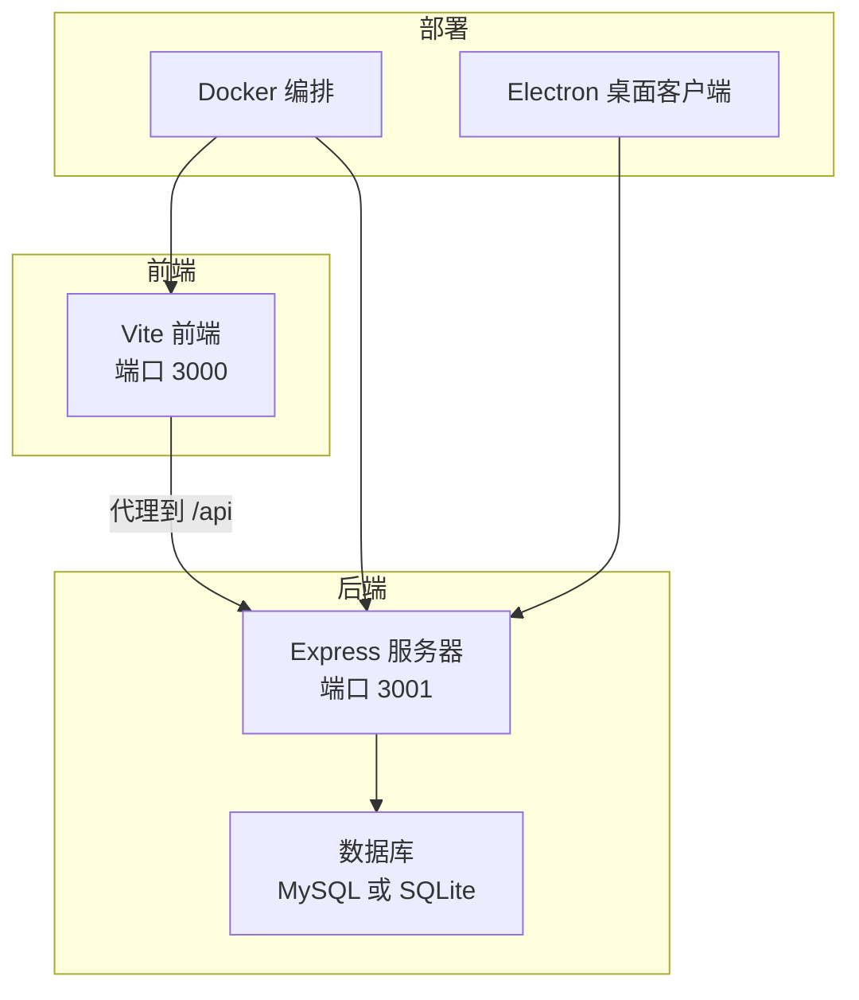
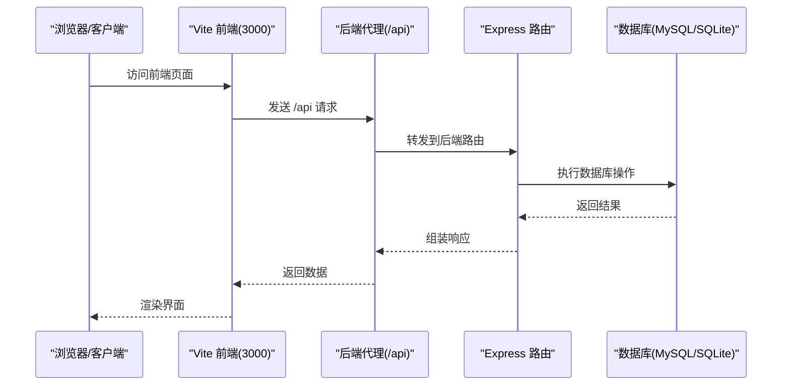
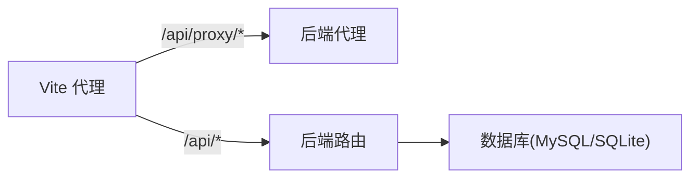

# 快速开始

<cite>
**本文引用的文件**
- [README.md](file://README.md)
- [package.json](file://package.json)
- [Dockerfile](file://Dockerfile)
- [docker-compose.yaml](file://docker-compose.yaml)
- [docker-compose.mysql.yaml](file://docker-compose.mysql.yaml)
- [server/src/config/database.ts](file://server/src/config/database.ts)
- [server/src/config/sqliteDatabase.ts](file://server/src/config/sqliteDatabase.ts)
- [server/src/index.ts](file://server/src/index.ts)
- [server/src/scripts/seed.ts](file://server/src/scripts/seed.ts)
- [scripts/build-local.sh](file://scripts/build-local.sh)
- [vite.config.ts](file://vite.config.ts)
- [electron/main.ts](file://electron/main.ts)
- [server/src/routes/auth.ts](file://server/src/routes/auth.ts)
</cite>

## 目录
1. [简介](#简介)
2. [项目结构](#项目结构)
3. [核心组件](#核心组件)
4. [架构总览](#架构总览)
5. [详细组件分析](#详细组件分析)
6. [依赖关系分析](#依赖关系分析)
7. [性能注意事项](#性能注意事项)
8. [故障排查指南](#故障排查指南)
9. [结论](#结论)
10. [附录](#附录)

## 简介
本指南面向首次接触 AI Shotlive 的用户，帮助你在最短时间内完成环境准备、项目克隆、依赖安装、环境变量配置与启动运行。项目支持多种部署方式：本地开发、Docker 部署（外置 MySQL 与同栈 MySQL）、生产构建与本地轻量部署（SQLite）。你还将获得默认管理员账号信息与初始登录流程，以及常见环境问题的排查方法。

## 项目结构
- 前端采用 React + Vite，后端采用 Express + TypeScript，数据库支持 MySQL 与 SQLite（本地/桌面客户端）。
- 项目提供 Dockerfile 与 docker-compose 编排文件，便于快速部署。
- Electron 主进程负责内嵌 Express 与 BrowserWindow，实现桌面客户端双击即用。

图表来源
- [vite.config.ts:26-105](file://vite.config.ts#L26-L105)
- [server/src/index.ts:66-78](file://server/src/index.ts#L66-L78)
- [Dockerfile:42-49](file://Dockerfile#L42-L49)
- [electron/main.ts:68-72](file://electron/main.ts#L68-L72)

章节来源
- [README.md:308-370](file://README.md#L308-L370)

## 核心组件
- 环境与依赖
  - Node.js >= 20（Electron 打包需 Node >= 18；本地 SQLite 模式开发可用 Node >= 18）
  - npm >= 9
  - MySQL >= 5.7（推荐 8.0+）或使用内置 SQLite（本地/桌面客户端）
- 启动与脚本
  - 本地开发：前端 + 后端同时启动
  - Docker 部署：两种模式（外置 MySQL 与同栈 MySQL）
  - 生产构建：前端 + 后端构建并以生产模式启动
  - 本地轻量：SQLite 模式，无需 MySQL
  - 桌面客户端：Electron 打包，内嵌 SQLite，无需安装 MySQL

章节来源
- [README.md:149-157](file://README.md#L149-L157)
- [package.json:7-25](file://package.json#L7-L25)
- [scripts/build-local.sh:23-34](file://scripts/build-local.sh#L23-L34)

## 架构总览
后端根据环境变量选择数据库类型：MySQL 或 SQLite。健康检查接口会返回当前数据库类型，便于确认连接状态。生产模式下，后端提供静态资源并回退到 SPA 入口。

图表来源
- [vite.config.ts:26-105](file://vite.config.ts#L26-L105)
- [server/src/index.ts:66-78](file://server/src/index.ts#L66-L78)
- [server/src/config/database.ts:32-37](file://server/src/config/database.ts#L32-L37)

## 详细组件分析

### 环境配置与初始化
- 克隆与安装
  - 克隆仓库后执行依赖安装
  - 复制示例环境变量文件并按需编辑
- 数据库初始化
  - 首次启动后端会自动初始化数据库表结构
  - 可选：创建默认管理员账号并导入备份数据
- 默认管理员账号
  - 用户名：admin
  - 密码：admin123
  - 登录后可修改用户名与密码

章节来源
- [README.md:161-198](file://README.md#L161-L198)
- [server/src/scripts/seed.ts:23-54](file://server/src/scripts/seed.ts#L23-L54)

### 启动方式与部署模式

#### 本地开发（前端 + 后端）
- 启动命令：同时启动前端与后端
- 前端访问：http://localhost:3000
- 后端 API：http://localhost:3001

章节来源
- [README.md:201-206](file://README.md#L201-L206)
- [package.json:8-10](file://package.json#L8-L10)

#### Docker 部署（使用宿主机 MySQL）
- 使用 docker-compose 启动应用，数据库连接参数从 .env 读取
- 容器通过 host.docker.internal 访问宿主机（Mac/Windows 原生支持；Linux 需 extra_hosts 映射）
- 访问地址：http://localhost:3001

章节来源
- [README.md:208-213](file://README.md#L208-L213)
- [docker-compose.yaml:14-24](file://docker-compose.yaml#L14-L24)

#### Docker 部署（应用 + MySQL 同栈）
- 使用 docker-compose.mysql.yaml 启动，应用与 MySQL 容器同栈
- 数据持久化在容器卷中
- 访问地址：http://localhost:3001

章节来源
- [README.md:215-220](file://README.md#L215-L220)
- [docker-compose.mysql.yaml:14-22](file://docker-compose.mysql.yaml#L14-L22)

#### 生产构建
- 构建前端与后端产物
- 以生产模式启动后端
- 生产环境需配置 JWT_SECRET

章节来源
- [README.md:222-228](file://README.md#L222-L228)
- [Dockerfile:24-49](file://Dockerfile#L24-L49)
- [server/src/index.ts:125-137](file://server/src/index.ts#L125-L137)

#### 本地轻量部署（SQLite，无需 MySQL）
- 使用 SQLite 作为数据库后端
- 自动创建 data/local.db
- 访问地址：http://localhost:3001

章节来源
- [README.md:229-236](file://README.md#L229-L236)
- [scripts/build-local.sh:54-74](file://scripts/build-local.sh#L54-L74)

#### 桌面客户端打包（Electron）
- Electron 主进程启动内嵌 Express 服务器与 BrowserWindow
- 数据目录位于用户数据目录下（与系统其他文件隔离）
- 支持 macOS 与 Windows 平台打包

章节来源
- [README.md:242-305](file://README.md#L242-L305)
- [electron/main.ts:30-50](file://electron/main.ts#L30-L50)

### 数据库配置与切换
- MySQL 模式
  - 通过环境变量配置 DB_HOST、DB_PORT、DB_USER、DB_PASSWORD、DB_NAME
  - 启动时自动调整 max_allowed_packet 并初始化表结构
- SQLite 模式
  - 通过 DB_TYPE=sqlite 切换
  - 默认 SQLite 文件路径为 data/local.db（可通过 SQLITE_DB_PATH 覆盖）

章节来源
- [server/src/config/database.ts:16-37](file://server/src/config/database.ts#L16-L37)
- [server/src/config/database.ts:244-250](file://server/src/config/database.ts#L244-L250)
- [server/src/config/sqliteDatabase.ts:105-119](file://server/src/config/sqliteDatabase.ts#L105-L119)

### 默认管理员账号与登录流程
- 默认账号
  - 用户名：admin
  - 密码：admin123
- 登录流程
  - 前端登录页提交用户名与密码
  - 后端校验用户名与密码，返回 JWT Token
  - 登录成功后可进入系统并修改个人信息

章节来源
- [README.md:403-404](file://README.md#L403-L404)
- [server/src/routes/auth.ts:78-120](file://server/src/routes/auth.ts#L78-L120)

## 依赖关系分析
- 前端代理
  - Vite 配置了第三方 API 代理与后端 /api 代理，解决浏览器 CORS 限制
- 后端路由
  - 路由集中挂载在 /api/*，包括认证、项目、资产、模型、任务、视觉风格、数据传输等
- 数据库适配
  - 通过环境变量 DB_TYPE 切换 MySQL 与 SQLite，上层代码无需感知差异

图表来源
- [vite.config.ts:26-105](file://vite.config.ts#L26-L105)
- [server/src/index.ts:66-78](file://server/src/index.ts#L66-L78)
- [server/src/config/database.ts:32-37](file://server/src/config/database.ts#L32-L37)

章节来源
- [vite.config.ts:26-105](file://vite.config.ts#L26-L105)
- [server/src/index.ts:66-78](file://server/src/index.ts#L66-L78)

## 性能注意事项
- 生产环境建议配置 JWT_SECRET，避免明文或默认密钥导致的安全风险
- Docker 健康检查与后端 /api/health 接口可用于监控数据库连接状态
- SQLite 模式适合单机与轻量使用，MySQL 模式适合多用户并发场景

章节来源
- [server/src/index.ts:125-137](file://server/src/index.ts#L125-L137)
- [Dockerfile:45-46](file://Dockerfile#L45-L46)
- [server/src/index.ts:79-98](file://server/src/index.ts#L79-L98)

## 故障排查指南
- 数据库连接失败
  - 检查 .env 中数据库连接参数（MySQL 模式）
  - 确认数据库服务可达且用户权限正常
  - 健康检查接口 /api/health 可返回数据库类型与连接状态
- max_allowed_packet 警告（MySQL）
  - 若当前用户无 SUPER 权限，无法自动调整，需手动执行 SET GLOBAL max_allowed_packet
- JWT_SECRET 未配置或使用默认值（生产环境）
  - 生产模式下必须配置随机强密钥，否则启动会失败
- Docker 端口冲突或网络问题
  - 确认端口 3001 未被占用
  - Linux 环境下 host.docker.internal 需通过 extra_hosts 映射
- SQLite 文件权限
  - 确保运行用户对 data/local.db 所在目录具有读写权限

章节来源
- [server/src/config/database.ts:42-75](file://server/src/config/database.ts#L42-L75)
- [server/src/index.ts:79-98](file://server/src/index.ts#L79-L98)
- [server/src/index.ts:125-137](file://server/src/index.ts#L125-L137)
- [docker-compose.yaml:18-20](file://docker-compose.yaml#L18-L20)
- [scripts/build-local.sh:52-53](file://scripts/build-local.sh#L52-L53)

## 结论
按照本快速开始指南，你可以完成从环境准备到多模式部署的全流程。建议优先尝试本地轻量部署（SQLite）以快速体验功能，随后根据团队规模与需求选择 Docker 外置 MySQL 或同栈 MySQL 方案。生产环境务必配置强 JWT_SECRET 并做好备份与监控。

## 附录

### 环境变量清单（关键项）
- DB_TYPE：数据库类型（mysql 或 sqlite）
- DB_HOST/DB_PORT/DB_USER/DB_PASSWORD/DB_NAME：MySQL 连接参数
- SQLITE_DB_PATH：SQLite 文件路径（默认 data/local.db）
- JWT_SECRET：JWT 密钥（生产环境必填）
- SERVER_PORT：后端服务端口（默认 3001）
- NODE_ENV：运行环境（development/production）
- UPLOADS_DIR/DATA_DIR：上传与数据目录（Electron 模式下由主进程设置）

章节来源
- [server/src/config/database.ts:11](file://server/src/config/database.ts#L11)
- [server/src/config/sqliteDatabase.ts:109](file://server/src/config/sqliteDatabase.ts#L109)
- [server/src/index.ts:48-56](file://server/src/index.ts#L48-L56)
- [electron/main.ts:33-38](file://electron/main.ts#L33-L38)