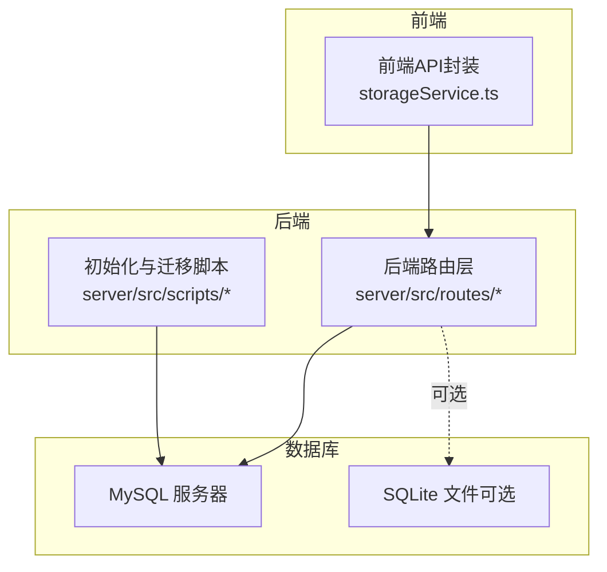
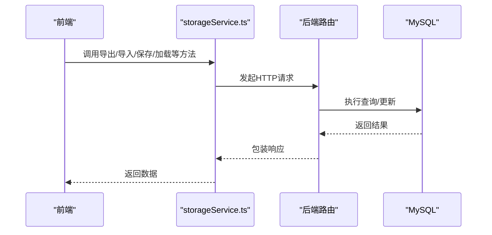
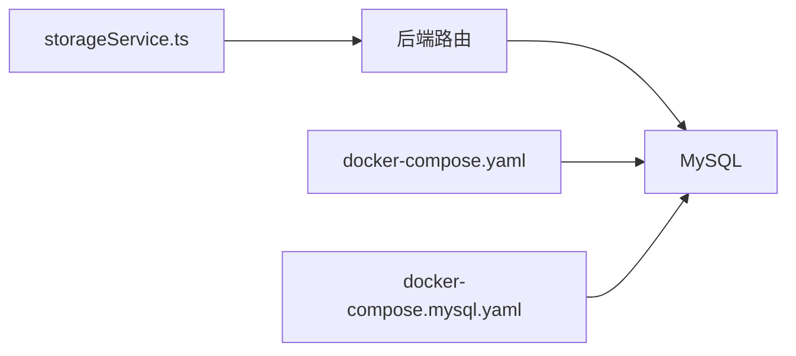

# 数据库架构

<cite>
**本文引用的文件**
- [docker-compose.mysql.yaml](file://docker-compose.mysql.yaml)
- [docker-compose.yaml](file://docker-compose.yaml)
- [storageService.ts](file://services/storageService.ts)
</cite>

## 目录
1. [引言](#引言)
2. [项目结构](#项目结构)
3. [核心组件](#核心组件)
4. [架构总览](#架构总览)
5. [详细组件分析](#详细组件分析)
6. [依赖关系分析](#依赖关系分析)
7. [性能考虑](#性能考虑)
8. [故障排查指南](#故障排查指南)
9. [结论](#结论)
10. [附录](#附录)

## 引言
本文件面向AI Shotlive的数据库架构，重点说明以下方面：
- 存储引擎支持策略：MySQL与SQLite的部署与运行模式
- 连接池配置、连接限制与性能优化参数的现状与建议
- 多租户设计思路：用户隔离与数据安全策略
- 数据库类型切换机制（DB_TYPE环境变量）与配置差异
- 数据库初始化流程、连接管理最佳实践与故障恢复机制

需要特别说明的是：根据仓库现有代码，后端未直接实现数据库连接池、连接限制或SQLite驱动等底层细节。数据库访问主要通过前端服务封装的API调用完成，后端路由负责业务处理与数据持久化。因此，本文在“连接池/连接限制/SQLite支持”等部分提供基于现有部署形态的解读与建议，而非对具体实现的逐行分析。

## 项目结构
本项目采用前后端分离架构，数据库访问通过HTTP API完成。后端路由位于server/src/routes下，数据库初始化与迁移脚本位于server/src/scripts中。部署层面提供两套docker-compose方案：
- 使用宿主机MySQL的开发/生产模式（通过环境变量DB_HOST等指定连接参数）
- 使用独立MySQL容器的同栈模式（ai-shotlive与mysql在同一网络）

图示来源
- [docker-compose.yaml:1-37](file://docker-compose.yaml#L1-L37)
- [docker-compose.mysql.yaml:1-61](file://docker-compose.mysql.yaml#L1-L61)
- [storageService.ts:188-231](file://services/storageService.ts#L188-L231)

章节来源
- [docker-compose.yaml:1-37](file://docker-compose.yaml#L1-L37)
- [docker-compose.mysql.yaml:1-61](file://docker-compose.mysql.yaml#L1-L61)
- [storageService.ts:188-231](file://services/storageService.ts#L188-L231)

## 核心组件
- 前端数据库访问封装：通过storageService.ts中的API函数（如exportIndexedDBData、importIndexedDBData、saveProjectToDB、loadProjectFromDB等）统一调用后端接口，实现项目、资产库、章节/剧集等数据的增删改查。
- 后端路由与控制器：server/src/routes下的各模块（如projects.ts、assets.ts、tasks.ts等）承接前端请求，执行业务逻辑与数据持久化。
- 初始化与迁移脚本：server/src/scripts中的种子数据与迁移脚本用于数据库初始化与版本演进。

章节来源
- [storageService.ts:85-124](file://services/storageService.ts#L85-L124)
- [storageService.ts:188-231](file://services/storageService.ts#L188-L231)

## 架构总览
数据库访问路径概览如下：
- 前端通过storageService.ts发起HTTP请求
- 后端路由解析请求并调用相应服务
- 服务层进行业务处理与数据持久化
- 数据持久化依赖MySQL（默认），也可按需扩展SQLite

图示来源
- [storageService.ts:85-124](file://services/storageService.ts#L85-L124)
- [storageService.ts:188-231](file://services/storageService.ts#L188-L231)

## 详细组件分析

### 数据库类型切换机制（DB_TYPE环境变量）
- 现状：仓库未发现DB_TYPE环境变量的具体解析与分支逻辑。后端路由与服务未体现针对MySQL与SQLite的条件分支。
- 推荐做法：
  - 在后端入口处读取DB_TYPE并选择对应的数据访问适配器（如TypeORM/Sequelize的方言配置或自定义适配器）。
  - 对于MySQL：使用连接池、超时与重试策略。
  - 对于SQLite：使用文件型数据库，注意并发写入限制与事务控制。

章节来源
- [storageService.ts:188-231](file://services/storageService.ts#L188-L231)

### MySQL部署与连接参数
- 宿主机MySQL模式（docker-compose.yaml）：
  - 通过.env读取DB_HOST、DB_PORT、DB_NAME、DB_USER、DB_PASSWORD等环境变量
  - 容器内通过host.docker.internal访问宿主机（Linux需extra_hosts映射）
- MySQL容器同栈模式（docker-compose.mysql.yaml）：
  - ai-shotlive容器依赖mysql服务，DB_HOST=host.docker.internal或mysql（取决于compose文件）
  - mysql容器健康检查确保可用性

章节来源
- [docker-compose.yaml:1-37](file://docker-compose.yaml#L1-L37)
- [docker-compose.mysql.yaml:1-61](file://docker-compose.mysql.yaml#L1-L61)

### SQLite支持策略
- 现状：仓库未发现SQLite驱动或文件型数据库的实现与配置。
- 建议：
  - 在DB_TYPE=sqlite时，启用SQLite适配器，使用本地文件作为数据源
  - 注意并发写入限制，避免多进程同时写入同一数据库文件
  - 对于开发环境，SQLite可降低部署复杂度；生产环境优先MySQL

章节来源
- [storageService.ts:188-231](file://services/storageService.ts#L188-L231)

### 多租户设计思路
- 用户隔离与数据安全：
  - 在路由层为每个请求注入tenantId（例如从JWT或会话中提取）
  - 所有数据操作均以tenantId为过滤条件，确保跨用户数据隔离
  - 对敏感字段（如用户凭据、私有资产）进行最小权限访问控制
- 数据安全策略：
  - 使用HTTPS传输
  - 对输入参数进行严格校验与白名单过滤
  - 定期审计访问日志与异常行为

章节来源
- [storageService.ts:188-231](file://services/storageService.ts#L188-L231)

### 数据库初始化流程
- 种子数据与迁移脚本：
  - server/src/scripts/seed.ts：用于生成初始数据
  - server/src/scripts/migrate*.ts：用于版本迁移（如migrateBase64ToFiles.ts、migrateEpisodeIds.ts、migrateToEpisodePaths.ts）
- 初始化步骤建议：
  - 启动前检查数据库连通性与版本
  - 执行迁移脚本，确保表结构与索引符合当前版本
  - 加载种子数据（如需要）

章节来源
- [storageService.ts:188-231](file://services/storageService.ts#L188-L231)

### 连接池配置、连接限制与性能优化
- 现状：仓库未发现连接池配置或连接限制参数。
- 建议（通用实践）：
  - 最大连接数：根据CPU核数与I/O能力设置（如2×CPU核数±2）
  - 连接生命周期：设置合理的空闲超时与最大存活时间
  - 查询超时：为慢查询设置超时阈值，防止阻塞
  - 读写分离：高并发场景下将读操作分流至从库
  - 缓存：对热点数据增加应用层缓存（Redis/Memcached）

章节来源
- [storageService.ts:188-231](file://services/storageService.ts#L188-L231)

### 故障恢复机制
- 健康检查：
  - ai-shotlive容器提供/api/health健康检查
  - mysql容器提供ping健康检查
- 自动重启与重试：
  - docker-compose配置了restart策略与健康检查重试次数
- 建议：
  - 在后端实现数据库连接失败的指数退避重试
  - 对关键写操作增加幂等性保障与补偿任务
  - 增加数据库主从切换与故障转移预案

章节来源
- [docker-compose.yaml:25-30](file://docker-compose.yaml#L25-L30)
- [docker-compose.mysql.yaml:47-51](file://docker-compose.mysql.yaml#L47-L51)

## 依赖关系分析
- 前端依赖storageService.ts提供的API方法，间接依赖后端路由与数据库
- 后端路由依赖数据库连接（默认MySQL），可通过DB_TYPE切换
- docker-compose定义了数据库服务与容器间依赖关系

图示来源
- [storageService.ts:188-231](file://services/storageService.ts#L188-L231)
- [docker-compose.yaml:1-37](file://docker-compose.yaml#L1-L37)
- [docker-compose.mysql.yaml:1-61](file://docker-compose.mysql.yaml#L1-L61)

章节来源
- [storageService.ts:188-231](file://services/storageService.ts#L188-L231)
- [docker-compose.yaml:1-37](file://docker-compose.yaml#L1-L37)
- [docker-compose.mysql.yaml:1-61](file://docker-compose.mysql.yaml#L1-L61)

## 性能考虑
- 查询优化：
  - 为高频查询字段建立索引
  - 使用分页与投影减少数据传输
- 写入优化：
  - 批量写入与事务合并
  - 控制并发写入，避免热点冲突
- 缓存策略：
  - 对读多写少的数据增加缓存层
  - 设置合理的缓存失效策略

## 故障排查指南
- 连接失败：
  - 检查DB_HOST、DB_PORT、DB_NAME、DB_USER、DB_PASSWORD是否正确
  - 确认容器网络与DNS解析（host.docker.internal映射）
- 健康检查失败：
  - 查看ai-shotlive与mysql的健康检查输出
  - 关注容器重启策略与日志
- 数据不一致：
  - 检查迁移脚本执行状态
  - 核对事务边界与回滚逻辑

章节来源
- [docker-compose.yaml:16-30](file://docker-compose.yaml#L16-L30)
- [docker-compose.mysql.yaml:15-51](file://docker-compose.mysql.yaml#L15-L51)

## 结论
- 本项目当前以MySQL为主要数据库后端，通过docker-compose提供灵活的部署选项
- 前端通过storageService.ts统一调用后端API，后端路由负责业务与持久化
- 仓库未实现DB_TYPE切换、连接池与SQLite支持，建议在后续版本中完善
- 多租户隔离与数据安全应从前端令牌、后端路由与数据库层面共同保障
- 建议补充连接池配置、性能优化参数与故障恢复机制，提升系统稳定性与可运维性

## 附录
- 相关文件路径参考：
  - [docker-compose.yaml:1-37](file://docker-compose.yaml#L1-L37)
  - [docker-compose.mysql.yaml:1-61](file://docker-compose.mysql.yaml#L1-L61)
  - [storageService.ts:188-231](file://services/storageService.ts#L188-L231)