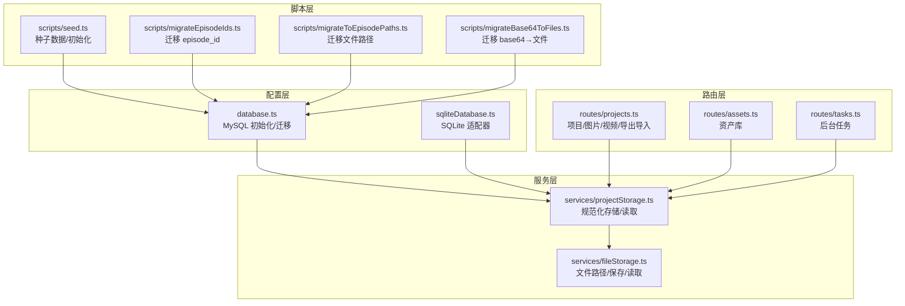
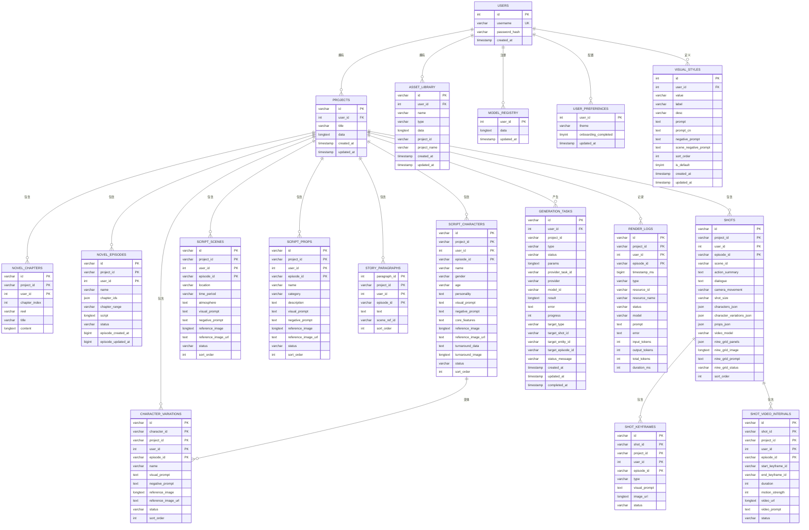
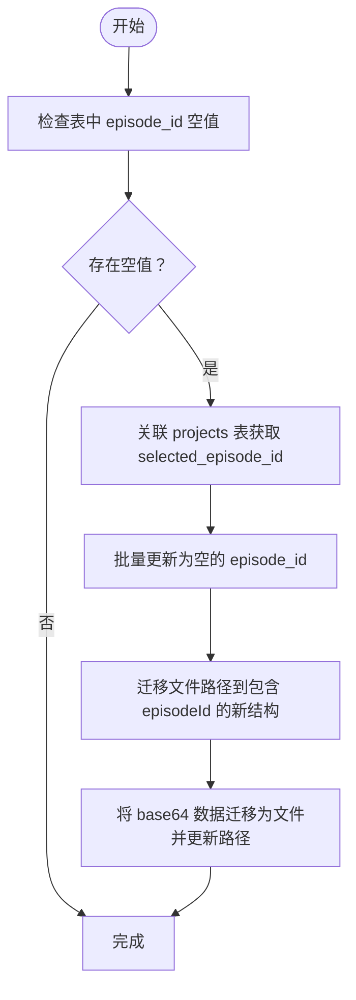
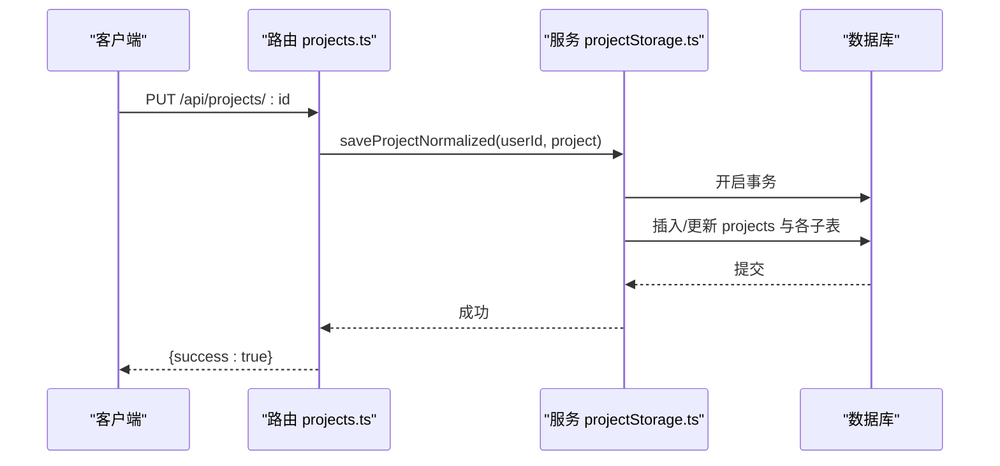
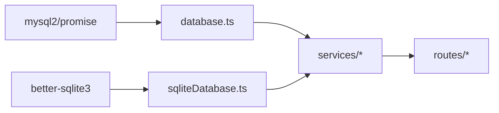

# 数据库设计

<cite>
**本文引用的文件**
- [database.ts](file://server/src/config/database.ts)
- [sqliteDatabase.ts](file://server/src/config/sqliteDatabase.ts)
- [migrateEpisodeIds.ts](file://server/src/scripts/migrateEpisodeIds.ts)
- [migrateToEpisodePaths.ts](file://server/src/scripts/migrateToEpisodePaths.ts)
- [migrateBase64ToFiles.ts](file://server/src/scripts/migrateBase64ToFiles.ts)
- [seed.ts](file://server/src/scripts/seed.ts)
- [projects.ts](file://server/src/routes/projects.ts)
- [assets.ts](file://server/src/routes/assets.ts)
- [tasks.ts](file://server/src/routes/tasks.ts)
- [projectStorage.ts](file://server/src/services/projectStorage.ts)
- [fileStorage.ts](file://server/src/services/fileStorage.ts)
- [package.json](file://package.json)
</cite>

## 目录
1. [简介](#简介)
2. [项目结构](#项目结构)
3. [核心组件](#核心组件)
4. [架构总览](#架构总览)
5. [详细组件分析](#详细组件分析)
6. [依赖分析](#依赖分析)
7. [性能考量](#性能考量)
8. [故障排查指南](#故障排查指南)
9. [结论](#结论)
10. [附录](#附录)

## 简介
本文件面向 AI Shotlive 的数据库设计，系统性阐述数据库架构、表结构、字段类型与约束关系，重点解释用户隔离与数据权限控制策略（user_id 与 episode_id 的协同使用）、业务实体关系映射（项目、剧集、角色、场景、镜头等），并提供数据迁移策略、初始化脚本与备份恢复机制，最后给出数据库模式图与 ER 关系图。

## 项目结构
数据库相关代码主要分布在以下模块：
- 配置层：MySQL/SQLite 连接与初始化、迁移工具
- 路由层：项目、资产、任务等 API
- 服务层：项目规范化存储、文件存储与读写
- 脚本层：种子数据、迁移脚本

图表来源
- [database.ts:244-712](file://server/src/config/database.ts#L244-L712)
- [sqliteDatabase.ts:282-671](file://server/src/config/sqliteDatabase.ts#L282-L671)
- [projects.ts:1-425](file://server/src/routes/projects.ts#L1-L425)
- [assets.ts:1-153](file://server/src/routes/assets.ts#L1-L153)
- [tasks.ts:1-223](file://server/src/routes/tasks.ts#L1-L223)
- [projectStorage.ts:149-200](file://server/src/services/projectStorage.ts#L149-L200)
- [fileStorage.ts:144-200](file://server/src/services/fileStorage.ts#L144-L200)
- [seed.ts:26-178](file://server/src/scripts/seed.ts#L26-L178)
- [migrateEpisodeIds.ts:27-74](file://server/src/scripts/migrateEpisodeIds.ts#L27-L74)
- [migrateToEpisodePaths.ts:45-222](file://server/src/scripts/migrateToEpisodePaths.ts#L45-L222)
- [migrateBase64ToFiles.ts:44-142](file://server/src/scripts/migrateBase64ToFiles.ts#L44-L142)

章节来源
- [database.ts:11-37](file://server/src/config/database.ts#L11-L37)
- [sqliteDatabase.ts:105-119](file://server/src/config/sqliteDatabase.ts#L105-L119)
- [package.json:7-25](file://package.json#L7-L25)

## 核心组件
- 数据库类型选择：通过环境变量 DB_TYPE 切换 MySQL 或 SQLite，默认 MySQL
- 连接池与适配：MySQL 使用 mysql2/promise，SQLite 使用 better-sqlite3 包装为异步接口
- 初始化流程：创建规范化表结构、添加列与索引、迁移 episode_id、修复 JSON 脏数据、回填资产库字段
- 权限控制：所有表均携带 user_id；部分表进一步携带 project_id、episode_id，形成三层隔离
- 文件存储：数据库仅存文件路径，路径强制包含 episodeId，确保按剧本隔离

章节来源
- [database.ts:11-37](file://server/src/config/database.ts#L11-L37)
- [sqliteDatabase.ts:105-119](file://server/src/config/sqliteDatabase.ts#L105-L119)
- [database.ts:244-712](file://server/src/config/database.ts#L244-L712)
- [sqliteDatabase.ts:282-671](file://server/src/config/sqliteDatabase.ts#L282-L671)

## 架构总览
数据库采用“三层隔离 + 规范化存储”的设计：
- 用户隔离：user_id
- 项目隔离：project_id
- 剧本隔离：episode_id
- 数据隔离：通过复合主键与 WHERE 条件强制隔离
- 文件隔离：data/{projectId}/{episodeId}/{entityType}/... 路径

图表来源
- [database.ts:256-613](file://server/src/config/database.ts#L256-L613)
- [sqliteDatabase.ts:285-667](file://server/src/config/sqliteDatabase.ts#L285-L667)

## 详细组件分析

### 用户与项目表
- users：用户认证与权限入口
- projects：项目元数据与结构化字段，复合主键 (id, user_id)，外键关联 users

章节来源
- [database.ts:256-280](file://server/src/config/database.ts#L256-L280)
- [sqliteDatabase.ts:285-327](file://server/src/config/sqliteDatabase.ts#L285-L327)

### 小说章节与剧集
- novel_chapters：按章节索引，复合主键 (id, project_id, user_id)
- novel_episodes：剧集聚合，包含章节范围与脚本内容，复合主键 (id, project_id, user_id)

章节来源
- [database.ts:306-338](file://server/src/config/database.ts#L306-L338)
- [sqliteDatabase.ts:329-363](file://server/src/config/sqliteDatabase.ts#L329-L363)

### 角色、场景、道具与故事段落
- script_characters / character_variations：角色与变体，变体外键关联角色
- script_scenes / script_props：场景与道具
- story_paragraphs：故事段落，主键为 paragraph_id，复合主键 (paragraph_id, project_id, user_id, episode_id)

章节来源
- [database.ts:340-437](file://server/src/config/database.ts#L340-L437)
- [sqliteDatabase.ts:364-476](file://server/src/config/sqliteDatabase.ts#L364-L476)

### 镜头、关键帧与视频片段
- shots：镜头，包含九宫格面板与状态
- shot_keyframes：关键帧，外键关联 shots
- shot_video_intervals：视频片段，关联起止关键帧

章节来源
- [database.ts:439-502](file://server/src/config/database.ts#L439-L502)
- [sqliteDatabase.ts:477-547](file://server/src/config/sqliteDatabase.ts#L477-L547)

### 后台生成任务与渲染日志
- generation_tasks：任务生命周期与结果存储，包含 target_episode_id
- render_logs：渲染日志，按毫秒时间戳索引

章节来源
- [database.ts:504-555](file://server/src/config/database.ts#L504-L555)
- [sqliteDatabase.ts:548-604](file://server/src/config/sqliteDatabase.ts#L548-L604)

### 资产库、模型注册、用户偏好与视觉风格
- asset_library：资产库，新增 project_id/project_name 支持项目筛选
- model_registry / user_preferences：用户维度配置
- visual_styles：视觉风格，唯一约束 (user_id, value)

章节来源
- [database.ts:557-613](file://server/src/config/database.ts#L557-L613)
- [sqliteDatabase.ts:605-667](file://server/src/config/sqliteDatabase.ts#L605-L667)

### 数据隔离与权限控制
- user_id：所有表均携带，确保用户间数据隔离
- project_id：项目级隔离，配合 user_id 形成双重约束
- episode_id：在涉及图片/视频/渲染日志等表中强制加入主键与 WHERE 条件，实现“剧本级”隔离
- 复合主键策略：在主键中加入 episode_id，避免不同剧本中相同实体 ID 冲突

章节来源
- [database.ts:166-239](file://server/src/config/database.ts#L166-L239)
- [sqliteDatabase.ts:14-38](file://server/src/config/sqliteDatabase.ts#L14-L38)

### 文件存储与路径规范
- 文件路径必须为 data/{projectId}/{episodeId}/{entityType}/...，强制包含 episodeId
- 支持 base64 data URI、URL 与文件路径三种形态，统一解析为文件路径
- 路由层在读取图片/视频时强制要求提供 episode 参数

章节来源
- [fileStorage.ts:5-16](file://server/src/services/fileStorage.ts#L5-L16)
- [fileStorage.ts:79-117](file://server/src/services/fileStorage.ts#L79-L117)
- [projects.ts:159-264](file://server/src/routes/projects.ts#L159-L264)
- [projects.ts:273-328](file://server/src/routes/projects.ts#L273-L328)

### 数据迁移策略
- 迁移 episode_id：将空/NULL 的记录补全为 selected_episode_id 或默认值
- 迁移文件路径：将旧路径 data/{projectId}/{entityType}/... 迁移到 data/{projectId}/{episodeId}/{entityType}/...
- 迁移 base64：将数据库中的 base64 数据提取为文件，更新为文件路径
- 种子数据：创建默认用户并导入规范化数据

图表来源
- [migrateEpisodeIds.ts:27-74](file://server/src/scripts/migrateEpisodeIds.ts#L27-L74)
- [migrateToEpisodePaths.ts:45-222](file://server/src/scripts/migrateToEpisodePaths.ts#L45-L222)
- [migrateBase64ToFiles.ts:44-142](file://server/src/scripts/migrateBase64ToFiles.ts#L44-L142)

章节来源
- [migrateEpisodeIds.ts:27-74](file://server/src/scripts/migrateEpisodeIds.ts#L27-L74)
- [migrateToEpisodePaths.ts:45-222](file://server/src/scripts/migrateToEpisodePaths.ts#L45-L222)
- [migrateBase64ToFiles.ts:44-142](file://server/src/scripts/migrateBase64ToFiles.ts#L44-L142)
- [seed.ts:26-178](file://server/src/scripts/seed.ts#L26-L178)

### 规范化存储与读取流程
- 写入：saveProjectNormalized 将 ProjectState 拆解到各子表，使用事务保证一致性
- 读取：loadProjectNormalized 从多表并行查询组装完整对象
- 图片清洗：sanitizeImageField 统一处理 URL/base64/JSON 脏数据

图表来源
- [projects.ts:64-124](file://server/src/routes/projects.ts#L64-L124)
- [projectStorage.ts:149-200](file://server/src/services/projectStorage.ts#L149-L200)

章节来源
- [projects.ts:64-124](file://server/src/routes/projects.ts#L64-L124)
- [projectStorage.ts:149-200](file://server/src/services/projectStorage.ts#L149-L200)

### API 与数据访问模式
- 项目管理：列表、详情、保存、删除、导出/导入
- 资产库：分页查询、按类型与项目筛选、保存/删除
- 任务管理：创建、查询、取消、单独获取结果
- 图片/视频：按实体类型与实体 ID 获取，强制要求 episode 参数

章节来源
- [projects.ts:19-425](file://server/src/routes/projects.ts#L19-L425)
- [assets.ts:26-153](file://server/src/routes/assets.ts#L26-L153)
- [tasks.ts:27-223](file://server/src/routes/tasks.ts#L27-L223)

## 依赖分析
- 数据库驱动：mysql2（MySQL）、better-sqlite3（SQLite）
- 连接池：统一通过 getPool()/createSqlitePool() 获取连接
- 跨库兼容：sqliteDatabase.ts 将 MySQL 语法翻译为 SQLite 语法，实现接口一致性
- 外键约束：所有子表均外键关联 projects(user_id, id)，projects 外键关联 users(id)

图表来源
- [database.ts:1-10](file://server/src/config/database.ts#L1-L10)
- [sqliteDatabase.ts:8-11](file://server/src/config/sqliteDatabase.ts#L8-L11)
- [sqliteDatabase.ts:276-278](file://server/src/config/sqliteDatabase.ts#L276-L278)

章节来源
- [database.ts:1-10](file://server/src/config/database.ts#L1-L10)
- [sqliteDatabase.ts:8-11](file://server/src/config/sqliteDatabase.ts#L8-L11)
- [sqliteDatabase.ts:276-278](file://server/src/config/sqliteDatabase.ts#L276-L278)

## 性能考量
- 连接池配置：MySQL 连接池限制、队列与字符集设置
- 索引优化：为 user_id、project_id、episode_id、updated_at、timestamp_ms 等常用查询字段建立索引
- 主键设计：在主键中加入 episode_id，避免超长主键导致的性能问题
- 事务与锁：保存项目时使用事务与重试，减少锁等待与死锁风险
- 文件存储：将大体积图片/视频从数据库剥离到文件系统，数据库仅存路径

章节来源
- [database.ts:16-30](file://server/src/config/database.ts#L16-L30)
- [database.ts:244-712](file://server/src/config/database.ts#L244-L712)
- [projects.ts:80-124](file://server/src/routes/projects.ts#L80-L124)

## 故障排查指南
- max_allowed_packet：初始化时检测并尝试调整，若无权限需手动执行 SET GLOBAL
- JSON 脏数据：历史数据中存在 {"base64":"...","url":"..."}，初始化阶段进行清洗
- 锁冲突：保存项目时捕获锁等待/死锁错误并指数退避重试
- episode_id 缺失：运行 migrateEpisodeIds 脚本补全
- 文件路径迁移：运行 migrateToEpisodePaths 脚本迁移旧路径
- base64→文件：运行 migrateBase64ToFiles 脚本迁移大体积数据

章节来源
- [database.ts:42-75](file://server/src/config/database.ts#L42-L75)
- [database.ts:667-705](file://server/src/config/database.ts#L667-L705)
- [projects.ts:103-123](file://server/src/routes/projects.ts#L103-L123)
- [migrateEpisodeIds.ts:27-74](file://server/src/scripts/migrateEpisodeIds.ts#L27-L74)
- [migrateToEpisodePaths.ts:45-222](file://server/src/scripts/migrateToEpisodePaths.ts#L45-L222)
- [migrateBase64ToFiles.ts:44-142](file://server/src/scripts/migrateBase64ToFiles.ts#L44-L142)

## 结论
本数据库设计通过 user_id、project_id、episode_id 三层隔离，结合规范化存储与文件系统分离，实现了高隔离性、高性能与可维护性的数据架构。迁移脚本覆盖了从旧版本到新版本的完整路径，种子脚本提供了便捷的初始化与导入能力。配合完善的索引与事务策略，系统在并发与一致性方面具备良好表现。

## 附录
- 初始化与种子
  - 初始化数据库：调用 initDatabase，创建规范化表结构并执行迁移
  - 种子脚本：创建默认用户并导入浏览器导出的规范化数据
- 迁移命令
  - npm run migrate:episode-ids
  - npm run migrate:episode-paths
- 文件存储规范
  - 路径必须包含 episodeId：data/{projectId}/{episodeId}/{entityType}/...

章节来源
- [database.ts:244-712](file://server/src/config/database.ts#L244-L712)
- [seed.ts:26-178](file://server/src/scripts/seed.ts#L26-L178)
- [package.json:23-24](file://package.json#L23-L24)
- [fileStorage.ts:5-16](file://server/src/services/fileStorage.ts#L5-L16)