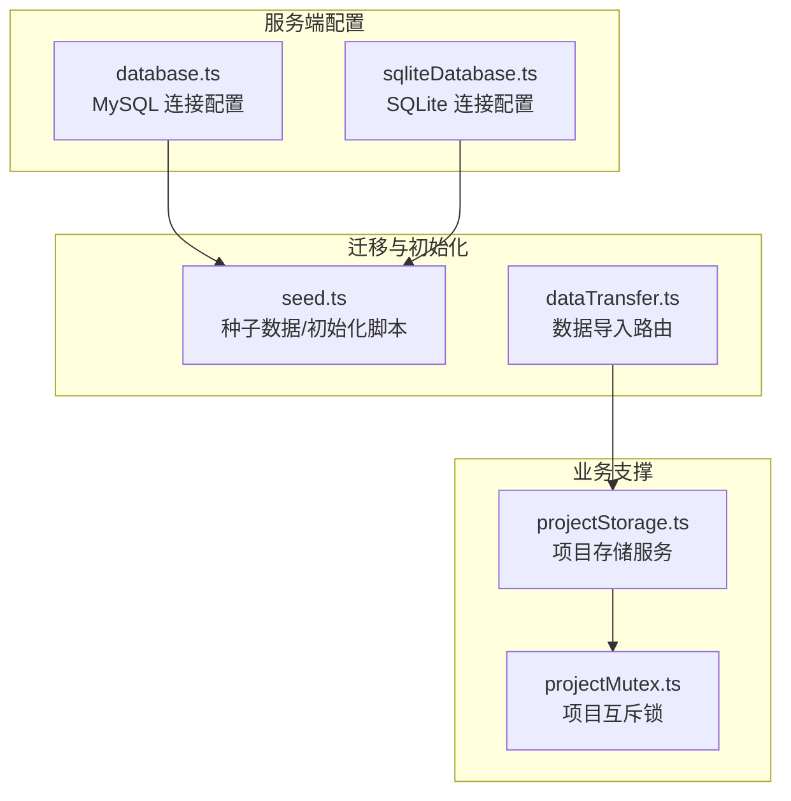
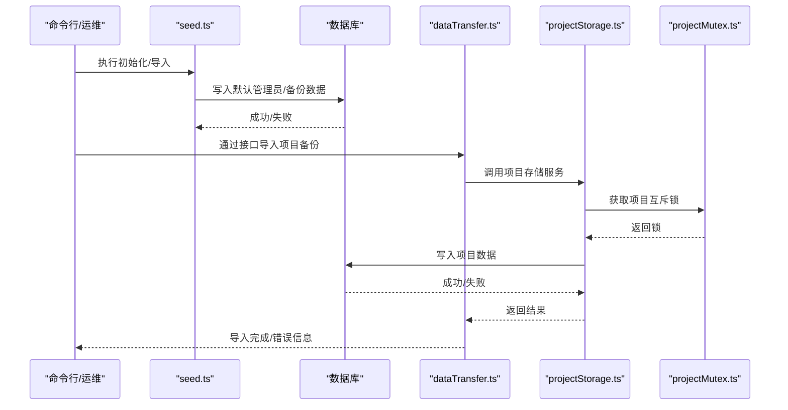
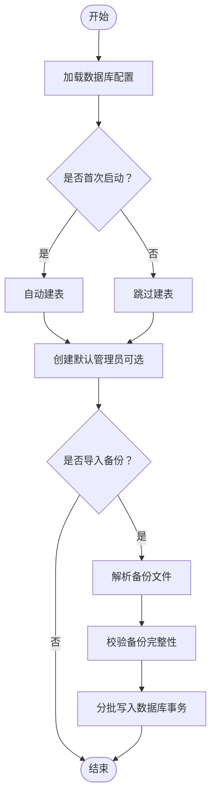
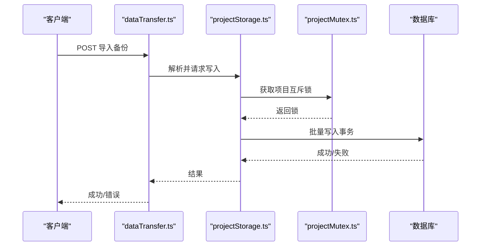
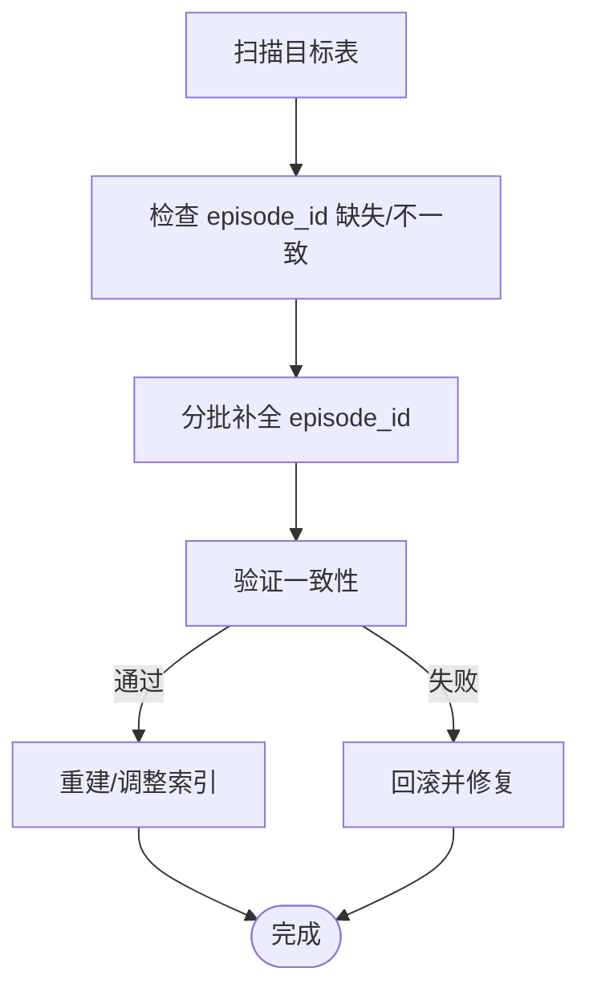
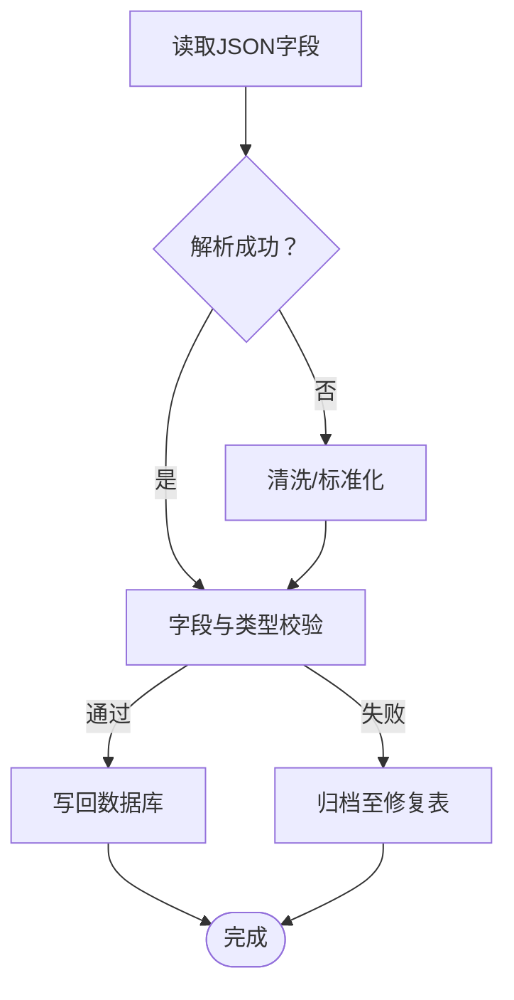
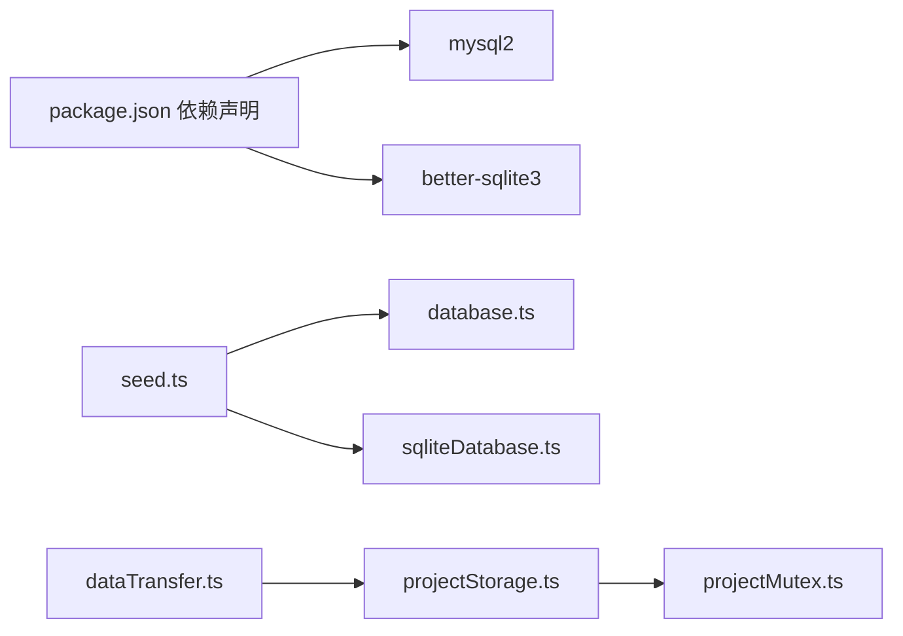

# 数据迁移策略

<cite>
**本文引用的文件**
- [README.md](file://README.md)
- [README_EN.md](file://README_EN.md)
- [package.json](file://package.json)
- [server/src/config/database.ts](file://server/src/config/database.ts)
- [server/src/config/sqliteDatabase.ts](file://server/src/config/sqliteDatabase.ts)
- [server/src/scripts/seed.ts](file://server/src/scripts/seed.ts)
- [server/src/routes/dataTransfer.ts](file://server/src/routes/dataTransfer.ts)
- [server/src/services/projectStorage.ts](file://server/src/services/projectStorage.ts)
- [server/src/utils/projectMutex.ts](file://server/src/utils/projectMutex.ts)
</cite>

## 目录
1. [引言](#引言)
2. [项目结构](#项目结构)
3. [核心组件](#核心组件)
4. [架构总览](#架构总览)
5. [详细组件分析](#详细组件分析)
6. [依赖分析](#依赖分析)
7. [性能考虑](#性能考虑)
8. [故障排查指南](#故障排查指南)
9. [结论](#结论)
10. [附录](#附录)

## 引言
本文件面向AI Shotlive的数据迁移与维护团队，系统化梳理数据库版本迁移、历史数据迁移、数据修复、初始化与种子数据加载、迁移回滚与备份策略以及迁移性能优化实践。文档基于现有仓库中的数据库初始化、种子数据脚本与相关配置进行归纳总结，并提供可操作的迁移策略建议与可视化流程图。

## 项目结构
围绕数据迁移与初始化的关键位置如下：
- 数据库连接与初始化：server/src/config/database.ts（MySQL）、server/src/config/sqliteDatabase.ts（SQLite）
- 种子数据与初始化脚本：server/src/scripts/seed.ts
- 数据导入接口：server/src/routes/dataTransfer.ts
- 项目存储与并发控制：server/src/services/projectStorage.ts、server/src/utils/projectMutex.ts

图表来源
- [server/src/config/database.ts](file://server/src/config/database.ts)
- [server/src/config/sqliteDatabase.ts](file://server/src/config/sqliteDatabase.ts)
- [server/src/scripts/seed.ts](file://server/src/scripts/seed.ts)
- [server/src/routes/dataTransfer.ts](file://server/src/routes/dataTransfer.ts)
- [server/src/services/projectStorage.ts](file://server/src/services/projectStorage.ts)
- [server/src/utils/projectMutex.ts](file://server/src/utils/projectMutex.ts)

章节来源
- [README.md:187-197](file://README.md#L187-L197)
- [README_EN.md:202-212](file://README_EN.md#L202-L212)

## 核心组件
- 数据库连接配置
  - MySQL配置：server/src/config/database.ts
  - SQLite配置：server/src/config/sqliteDatabase.ts
- 初始化与种子数据
  - 脚本：server/src/scripts/seed.ts
  - 用途：首次启动自动建表；可选创建默认管理员与导入备份数据
- 数据导入接口
  - 路由：server/src/routes/dataTransfer.ts
  - 作用：接收浏览器导出的项目备份并写入数据库
- 项目存储与并发控制
  - 服务：server/src/services/projectStorage.ts
  - 工具：server/src/utils/projectMutex.ts（项目级互斥锁）

章节来源
- [README.md:187-197](file://README.md#L187-L197)
- [README_EN.md:202-212](file://README_EN.md#L202-L212)
- [server/src/scripts/seed.ts](file://server/src/scripts/seed.ts)
- [server/src/routes/dataTransfer.ts](file://server/src/routes/dataTransfer.ts)
- [server/src/services/projectStorage.ts](file://server/src/services/projectStorage.ts)
- [server/src/utils/projectMutex.ts](file://server/src/utils/projectMutex.ts)

## 架构总览
下图展示从“种子数据脚本”到“数据导入接口”的整体迁移与初始化流程，以及与项目存储服务的交互关系。

图表来源
- [server/src/scripts/seed.ts](file://server/src/scripts/seed.ts)
- [server/src/routes/dataTransfer.ts](file://server/src/routes/dataTransfer.ts)
- [server/src/services/projectStorage.ts](file://server/src/services/projectStorage.ts)
- [server/src/utils/projectMutex.ts](file://server/src/utils/projectMutex.ts)

## 详细组件分析

### 组件A：数据库初始化与种子数据加载
- 设计要点
  - 自动建表：首次启动时根据配置自动创建所需表结构
  - 可选默认管理员：通过脚本创建默认管理员账户
  - 备份导入：支持从浏览器导出的项目备份文件导入数据库
- 关键流程
  - 初始化：读取数据库配置，执行建表与默认数据插入
  - 导入：解析备份文件，按表结构写入对应记录
- 安全性与幂等性
  - 建议在导入前校验备份文件完整性与版本兼容性
  - 对重复导入进行去重处理（如按唯一键判断）
- 性能优化
  - 使用事务包裹批量写入，减少往返开销
  - 分批提交，避免单次事务过大导致锁竞争

图表来源
- [server/src/scripts/seed.ts](file://server/src/scripts/seed.ts)
- [server/src/config/database.ts](file://server/src/config/database.ts)

章节来源
- [README.md:187-197](file://README.md#L187-L197)
- [README_EN.md:202-212](file://README_EN.md#L202-L212)
- [server/src/scripts/seed.ts](file://server/src/scripts/seed.ts)

### 组件B：数据导入接口与项目存储
- 接口职责
  - 提供REST接口接收浏览器导出的项目备份
  - 解析备份并调用项目存储服务写入数据库
- 并发控制
  - 使用项目级互斥锁避免同一项目并发写入冲突
- 错误处理
  - 对无效备份、数据库异常、并发冲突进行明确返回码与错误信息

图表来源
- [server/src/routes/dataTransfer.ts](file://server/src/routes/dataTransfer.ts)
- [server/src/services/projectStorage.ts](file://server/src/services/projectStorage.ts)
- [server/src/utils/projectMutex.ts](file://server/src/utils/projectMutex.ts)

章节来源
- [server/src/routes/dataTransfer.ts](file://server/src/routes/dataTransfer.ts)
- [server/src/services/projectStorage.ts](file://server/src/services/projectStorage.ts)
- [server/src/utils/projectMutex.ts](file://server/src/utils/projectMutex.ts)

### 组件C：历史数据迁移与主键重构（策略建议）
- episode_id 字段批量迁移
  - 目标：将历史数据中缺失或不一致的 episode_id 字段补齐
  - 方法：扫描相关表，按用户与剧集维度补全 episode_id，确保后续按 episode_id 的查询与隔离逻辑生效
  - 注意：对大表采用分页/游标式更新，避免长时间锁表
- 主键重构
  - 目标：将部分表的联合主键或索引调整为更合理的组合，提升查询与写入性能
  - 方法：先新增列/索引，再批量迁移数据，最后切换索引与约束
  - 注意：迁移期间保持对外只读或低写入窗口，避免数据不一致

图表来源
- [server/src/services/projectStorage.ts](file://server/src/services/projectStorage.ts)

章节来源
- [server/src/services/projectStorage.ts](file://server/src/services/projectStorage.ts)

### 组件D：数据修复机制（策略建议）
- JSON脏数据清理与格式标准化
  - 目标：清理历史导入中产生的JSON格式异常、字段缺失或类型不匹配
  - 方法：对JSON字段进行解析与校验，对异常条目进行清洗或迁移至修复表
  - 注意：保留原始数据副本，便于审计与回溯

图表来源
- [server/src/services/projectStorage.ts](file://server/src/services/projectStorage.ts)

章节来源
- [server/src/services/projectStorage.ts](file://server/src/services/projectStorage.ts)

## 依赖分析
- 外部依赖
  - MySQL驱动：mysql2（用于MySQL连接与事务）
  - SQLite驱动：better-sqlite3（用于桌面/本地模式）
- 内部依赖
  - seed.ts 依赖数据库配置模块
  - dataTransfer.ts 依赖 projectStorage.ts 与互斥工具
  - projectStorage.ts 依赖互斥工具以保证并发安全

图表来源
- [package.json](file://package.json)
- [server/src/config/database.ts](file://server/src/config/database.ts)
- [server/src/config/sqliteDatabase.ts](file://server/src/config/sqliteDatabase.ts)
- [server/src/scripts/seed.ts](file://server/src/scripts/seed.ts)
- [server/src/routes/dataTransfer.ts](file://server/src/routes/dataTransfer.ts)
- [server/src/services/projectStorage.ts](file://server/src/services/projectStorage.ts)
- [server/src/utils/projectMutex.ts](file://server/src/utils/projectMutex.ts)

章节来源
- [package.json](file://package.json)
- [server/src/config/database.ts](file://server/src/config/database.ts)
- [server/src/config/sqliteDatabase.ts](file://server/src/config/sqliteDatabase.ts)
- [server/src/scripts/seed.ts](file://server/src/scripts/seed.ts)
- [server/src/routes/dataTransfer.ts](file://server/src/routes/dataTransfer.ts)
- [server/src/services/projectStorage.ts](file://server/src/services/projectStorage.ts)
- [server/src/utils/projectMutex.ts](file://server/src/utils/projectMutex.ts)

## 性能考虑
- 事务与批处理
  - 批量写入使用事务包裹，减少磁盘写入次数与锁持有时间
  - 分批大小建议：根据表规模与内存限制动态调整
- 索引与并发
  - 在迁移前评估索引影响，必要时临时禁用非必要索引
  - 利用项目级互斥锁避免并发写入冲突
- I/O与网络
  - 备份导入建议离峰执行，避免与高峰期业务争抢资源
  - 对超大备份文件，优先本地缓存后再导入

## 故障排查指南
- 常见问题
  - 数据库连接失败：检查环境变量与配置文件
  - 权限不足：确认数据库用户具备DDL/DML权限
  - 并发冲突：检查项目互斥锁是否正确释放
  - 备份格式错误：核对导出/导入版本兼容性
- 排查步骤
  - 查看服务日志定位异常点
  - 对失败批次进行重试或单独修复
  - 必要时回滚到上一个稳定版本

章节来源
- [server/src/routes/dataTransfer.ts](file://server/src/routes/dataTransfer.ts)
- [server/src/utils/projectMutex.ts](file://server/src/utils/projectMutex.ts)

## 结论
本策略文档基于现有仓库中的数据库配置与种子数据脚本，给出了可落地的迁移与维护实践。对于未在仓库中直接体现的“addColumnIfNotExists、modifyColumn”等安全迁移函数，建议在后续版本中引入数据库迁移框架（如Knex、Prisma Migrate或自研迁移工具），并在迁移脚本中统一封装这些安全函数，以提升迁移的可控性与可追溯性。

## 附录
- 数据库初始化与种子数据入口
  - 参考：README.md 与 README_EN.md 中的初始化与种子数据说明
- 项目结构与关键文件
  - 参考：项目根目录与 server/src 下的配置、脚本与服务文件

章节来源
- [README.md:187-197](file://README.md#L187-L197)
- [README_EN.md:202-212](file://README_EN.md#L202-L212)