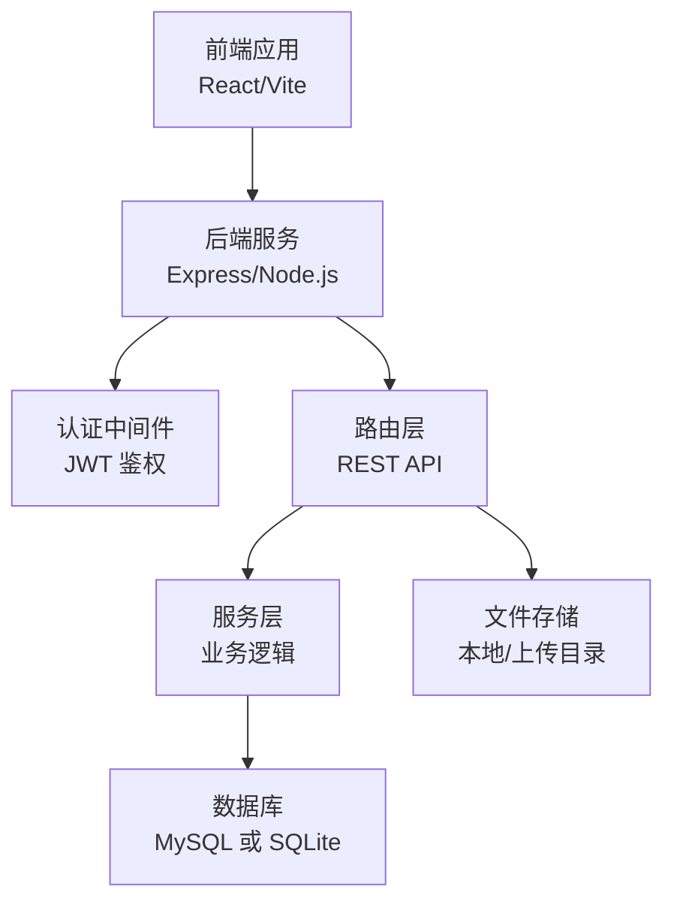
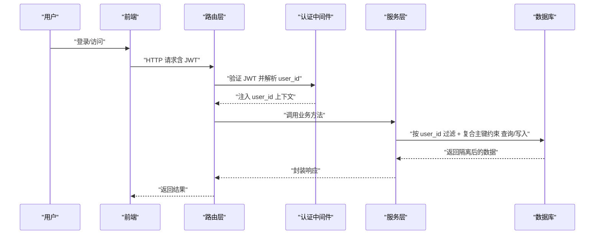
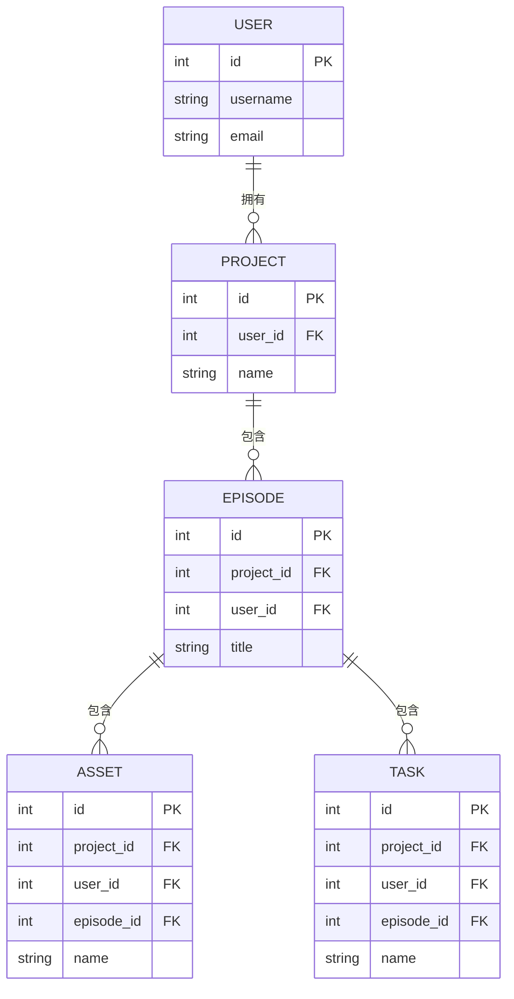
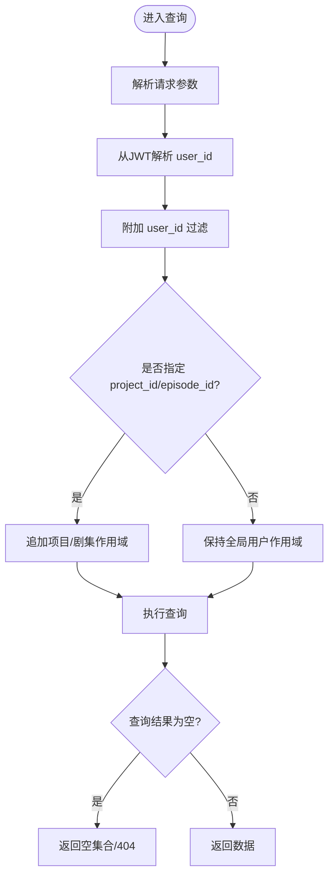
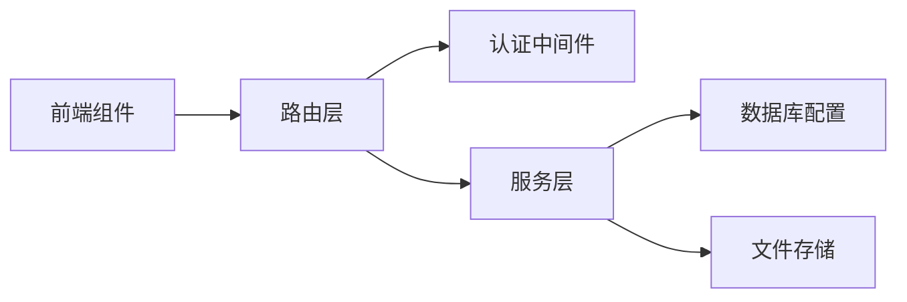

# 用户隔离机制

<cite>
**本文引用的文件**
- [README_EN.md](file://README_EN.md)
- [seed.ts](file://server/src/scripts/seed.ts)
- [migrateEpisodeIds.ts](file://server/src/scripts/migrateEpisodeIds.ts)
- [migrateToEpisodePaths.ts](file://server/src/scripts/migrateToEpisodePaths.ts)
- [migrateBase64ToFiles.ts](file://server/src/scripts/migrateBase64ToFiles.ts)
- [dataTransfer.ts](file://server/src/routes/dataTransfer.ts)
- [projects.ts](file://server/src/routes/projects.ts)
- [tasks.ts](file://server/src/routes/tasks.ts)
- [assets.ts](file://server/src/routes/assets.ts)
- [models.ts](file://server/src/routes/models.ts)
- [visualStyles.ts](file://server/src/routes/visualStyles.ts)
- [uploads.ts](file://server/src/routes/uploads.ts)
- [auth.ts](file://server/src/routes/auth.ts)
- [ai.ts](file://server/src/routes/ai.ts)
- [projectPatch.ts](file://server/src/routes/projectPatch.ts)
- [preferences.ts](file://server/src/routes/preferences.ts)
- [sqliteDatabase.ts](file://server/src/config/sqliteDatabase.ts)
- [database.ts](file://server/src/config/database.ts)
- [auth.ts](file://server/src/middleware/auth.ts)
- [AuthContext.tsx](file://src/contexts/AuthContext.tsx)
- [Login.tsx](file://src/components/Login.tsx)
- [Dashboard.tsx](file://src/components/Dashboard.tsx)
- [StageScript.tsx](file://src/components/StageScript.tsx)
- [StageAssets.tsx](file://src/components/StageAssets.tsx)
- [StageDirector.tsx](file://src/components/StageDirector.tsx)
- [StageExport.tsx](file://src/components/StageExport.tsx)
- [StagePrompts.tsx](file://src/components/StagePrompts.tsx)
- [StageScript.tsx](file://src/components/StageScript/utils.ts)
- [StageAssets.tsx](file://src/components/StageAssets/utils.ts)
- [StageDirector.tsx](file://src/components/StageDirector/utils.ts)
- [StageExport.tsx](file://src/components/StageExport/utils.ts)
- [StagePrompts.tsx](file://src/components/StagePrompts/utils.ts)
</cite>

## 目录
1. [引言](#引言)
2. [项目结构](#项目结构)
3. [核心组件](#核心组件)
4. [架构总览](#架构总览)
5. [详细组件分析](#详细组件分析)
6. [依赖关系分析](#依赖关系分析)
7. [性能考虑](#性能考虑)
8. [故障排查指南](#故障排查指南)
9. [结论](#结论)
10. [附录](#附录)

## 引言
本文件面向AI Shotlive的多租户与用户隔离机制，围绕“user_id”在全量业务表中的强制使用策略、复合主键设计（id, project_id, user_id, episode_id）如何确保数据隔离、查询与跨表关联时的隔离策略与性能优化、以及用户数据迁移、备份恢复与安全审计进行系统化说明。文档同时提供可视化图示与可操作的最佳实践建议，帮助开发者与运维人员正确实现与维护用户数据边界。

## 项目结构
AI Shotlive采用前后端分离架构：前端通过React/Vite构建，后端基于TypeScript/Node.js，提供REST API；数据库支持MySQL与SQLite两种模式。多租户隔离的关键点在于：
- 所有业务表均携带user_id字段，作为用户维度的强制隔离条件
- 复合主键与查询过滤共同构成数据边界保护
- 路由层统一鉴权中间件，服务层严格遵循user_id过滤
- 提供脚本化的数据迁移与导入工具，保障历史数据与备份恢复

章节来源
- [README_EN.md: 188-259:188-259](file://README_EN.md#L188-L259)

## 核心组件
- 认证与会话管理：通过JWT令牌承载用户身份，路由层中间件拦截校验，确保后续请求均带有合法user_id上下文
- 路由与控制器：各功能模块（项目、任务、资产、模型、视觉风格、上传、AI等）均在路由层进行鉴权与参数校验
- 数据访问层：根据部署模式选择MySQL或SQLite，统一在服务层执行user_id过滤与复合主键约束
- 数据迁移与导入：提供种子脚本与迁移脚本，支持从旧版本到新版本的数据结构演进与备份导入

章节来源
- [README_EN.md: 188-259:188-259](file://README_EN.md#L188-L259)
- [seed.ts](file://server/src/scripts/seed.ts)
- [migrateEpisodeIds.ts](file://server/src/scripts/migrateEpisodeIds.ts)
- [migrateToEpisodePaths.ts](file://server/src/scripts/migrateToEpisodePaths.ts)
- [migrateBase64ToFiles.ts](file://server/src/scripts/migrateBase64ToFiles.ts)

## 架构总览
下图展示用户隔离在系统中的关键位置：前端发起请求，经由认证中间件注入user_id，路由层接收请求并调用服务层，服务层在数据库层执行user_id过滤与复合主键约束，最终返回受保护的数据结果。

图表来源
- [auth.ts](file://server/src/middleware/auth.ts)
- [projects.ts](file://server/src/routes/projects.ts)
- [tasks.ts](file://server/src/routes/tasks.ts)
- [assets.ts](file://server/src/routes/assets.ts)
- [models.ts](file://server/src/routes/models.ts)
- [visualStyles.ts](file://server/src/routes/visualStyles.ts)
- [uploads.ts](file://server/src/routes/uploads.ts)
- [ai.ts](file://server/src/routes/ai.ts)
- [projectPatch.ts](file://server/src/routes/projectPatch.ts)
- [preferences.ts](file://server/src/routes/preferences.ts)

## 详细组件分析

### 多租户与user_id强制使用策略
- 设计原则
  - 所有业务表必须包含user_id字段，作为用户维度的强制隔离标识
  - 增删改查操作默认附加user_id过滤条件，防止越权访问
  - 写入流程中，user_id与项目/剧集等上下文信息共同决定数据归属
- 实施要点
  - 路由层在处理请求前，通过认证中间件解析并注入user_id
  - 服务层在执行SQL或ORM操作时，统一追加user_id条件
  - 复合主键设计（id, project_id, user_id, episode_id）确保同一用户在同一项目/剧集内的唯一性与隔离性

章节来源
- [README_EN.md: 188-259:188-259](file://README_EN.md#L188-L259)
- [auth.ts](file://server/src/middleware/auth.ts)
- [projects.ts](file://server/src/routes/projects.ts)
- [tasks.ts](file://server/src/routes/tasks.ts)
- [assets.ts](file://server/src/routes/assets.ts)
- [models.ts](file://server/src/routes/models.ts)
- [visualStyles.ts](file://server/src/routes/visualStyles.ts)
- [uploads.ts](file://server/src/routes/uploads.ts)
- [ai.ts](file://server/src/routes/ai.ts)
- [projectPatch.ts](file://server/src/routes/projectPatch.ts)
- [preferences.ts](file://server/src/routes/preferences.ts)

### 复合主键设计与数据隔离
- 主键组合
  - 推荐复合主键：(id, project_id, user_id, episode_id)
  - 设计考量
    - id：全局唯一标识
    - project_id：项目级隔离
    - user_id：用户级隔离
    - episode_id：剧集级隔离（可选，用于分集/场景粒度）
- 隔离效果
  - 同一用户在不同项目间无法互相读取数据
  - 同一项目内不同用户无法互相读取数据
  - 同一项目与剧集内，不同用户也无法互相读取数据
- 写入约束
  - 插入/更新时必须显式携带user_id与项目/剧集上下文
  - 若违反复合主键规则，数据库层应拒绝重复或冲突写入

图表来源
- [assets.ts](file://server/src/routes/assets.ts)
- [tasks.ts](file://server/src/routes/tasks.ts)
- [projects.ts](file://server/src/routes/projects.ts)
- [StageAssets.tsx](file://src/components/StageAssets.tsx)
- [StageDirector.tsx](file://src/components/StageDirector.tsx)
- [StageExport.tsx](file://src/components/StageExport.tsx)
- [StagePrompts.tsx](file://src/components/StagePrompts.tsx)
- [StageScript.tsx](file://src/components/StageScript.tsx)

### 数据访问控制：查询过滤与边界保护
- 查询过滤
  - 所有列表/详情查询默认附加user_id过滤
  - 支持按project_id与episode_id进一步限定范围
- 边界保护
  - 写入/删除操作必须满足“当前用户+目标资源”的双重校验
  - 对于跨表关联查询，需确保关联表的user_id一致，避免越权
- 错误处理
  - 当user_id不匹配或越权访问时，返回403/404等语义明确的错误码

图表来源
- [auth.ts](file://server/src/middleware/auth.ts)
- [projects.ts](file://server/src/routes/projects.ts)
- [tasks.ts](file://server/src/routes/tasks.ts)
- [assets.ts](file://server/src/routes/assets.ts)

### 跨表关联查询的隔离策略与性能优化
- 隔离策略
  - 关联查询时，确保主表与所有关联表的user_id一致
  - 使用JOIN时，对每个关联表追加user_id过滤条件
- 性能优化
  - 在(user_id, project_id)、(user_id, episode_id)等高频过滤列上建立索引
  - 将常用聚合查询结果缓存，减少重复计算
  - 分页查询时，优先使用基于索引的排序字段，避免全表扫描

章节来源
- [assets.ts](file://server/src/routes/assets.ts)
- [tasks.ts](file://server/src/routes/tasks.ts)
- [projects.ts](file://server/src/routes/projects.ts)

### 用户数据迁移、备份恢复与安全审计
- 数据迁移
  - 提供迁移脚本，支持从旧版本结构迁移到新版本（如剧集ID、路径、媒体存储等）
  - 迁移过程中严格保留user_id与项目/剧集映射关系
- 备份恢复
  - 支持JSON格式的项目备份与导入，导入时自动校验user_id与结构一致性
  - 桌面版客户端内置SQLite，便于离线备份与快速恢复
- 安全审计
  - 记录关键操作（创建/修改/删除）的时间戳、user_id、目标资源ID
  - 对异常访问（403/404）与批量操作进行告警与日志留存

章节来源
- [README_EN.md: 188-259:188-259](file://README_EN.md#L188-L259)
- [seed.ts](file://server/src/scripts/seed.ts)
- [migrateEpisodeIds.ts](file://server/src/scripts/migrateEpisodeIds.ts)
- [migrateToEpisodePaths.ts](file://server/src/scripts/migrateToEpisodePaths.ts)
- [migrateBase64ToFiles.ts](file://server/src/scripts/migrateBase64ToFiles.ts)

## 依赖关系分析
- 组件耦合
  - 路由层依赖认证中间件，服务层依赖数据库配置与连接池
  - 前端通过HTTP与后端交互，认证状态由JWT维持
- 外部依赖
  - 数据库：MySQL或SQLite（取决于部署模式）
  - 加密：JWT用于认证令牌签发与校验
  - 文件存储：本地文件系统用于媒体与上传资源

图表来源
- [auth.ts](file://server/src/middleware/auth.ts)
- [projects.ts](file://server/src/routes/projects.ts)
- [sqliteDatabase.ts](file://server/src/config/sqliteDatabase.ts)
- [database.ts](file://server/src/config/database.ts)

章节来源
- [README_EN.md: 188-259:188-259](file://README_EN.md#L188-L259)
- [sqliteDatabase.ts](file://server/src/config/sqliteDatabase.ts)
- [database.ts](file://server/src/config/database.ts)

## 性能考虑
- 索引策略
  - 在(user_id, project_id)、(user_id, episode_id)等高选择性列上建立复合索引
  - 对时间戳、状态等过滤字段建立单列索引
- 查询优化
  - 列表查询尽量使用分页与投影，避免SELECT *
  - 关联查询使用INNER JOIN并限制返回字段
- 缓存与异步
  - 对热点数据（如项目概览、资产清单）引入缓存层
  - 大型导出/渲染任务采用异步队列，避免阻塞主线程

## 故障排查指南
- 常见问题
  - 403/401：JWT无效或过期，检查令牌签名与有效期
  - 404：user_id不匹配或资源不存在，确认请求参数与权限
  - 写入冲突：违反复合主键或并发写入，检查id与上下文一致性
- 排查步骤
  - 查看后端日志与审计记录，定位user_id与资源ID
  - 使用数据库客户端执行相同过滤条件的查询，复现问题
  - 检查迁移脚本是否完整执行，确认历史数据映射正确

章节来源
- [auth.ts](file://server/src/middleware/auth.ts)
- [projects.ts](file://server/src/routes/projects.ts)
- [tasks.ts](file://server/src/routes/tasks.ts)
- [assets.ts](file://server/src/routes/assets.ts)

## 结论
AI Shotlive通过“user_id强制使用 + 复合主键 + 查询过滤 + 中间件鉴权”的组合拳，实现了强隔离的多租户架构。配合完善的迁移、备份与审计机制，既能保障数据边界安全，又能满足性能与可维护性的需求。建议在新增表与接口时，严格遵循上述原则，确保隔离策略的一致性与可扩展性。

## 附录
- 快速开始与部署参考
  - 数据库初始化与种子用户导入
  - Docker与本地轻量部署选项
- 桌面客户端数据位置与打包流程

章节来源
- [README_EN.md: 188-259:188-259](file://README_EN.md#L188-L259)
- [README_EN.md: 300-320:300-320](file://README_EN.md#L300-L320)