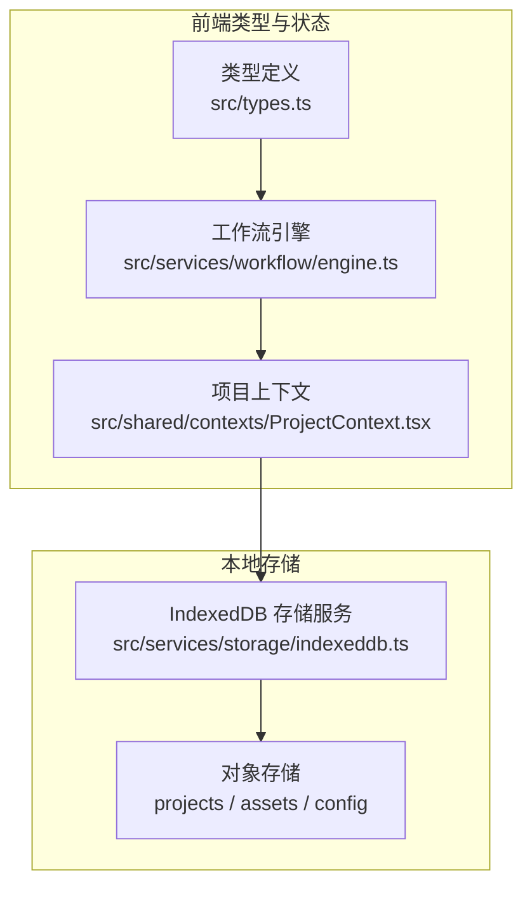
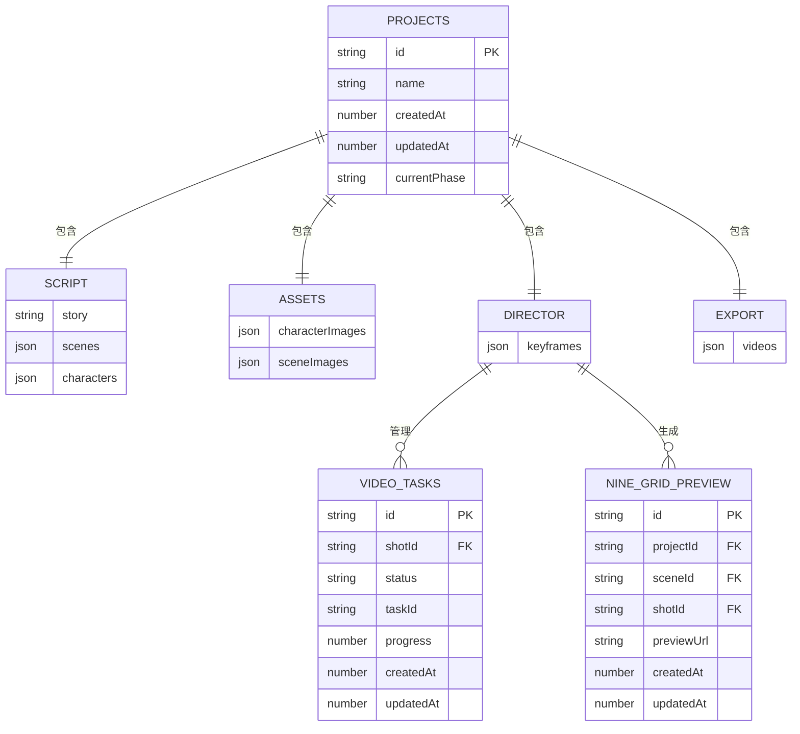
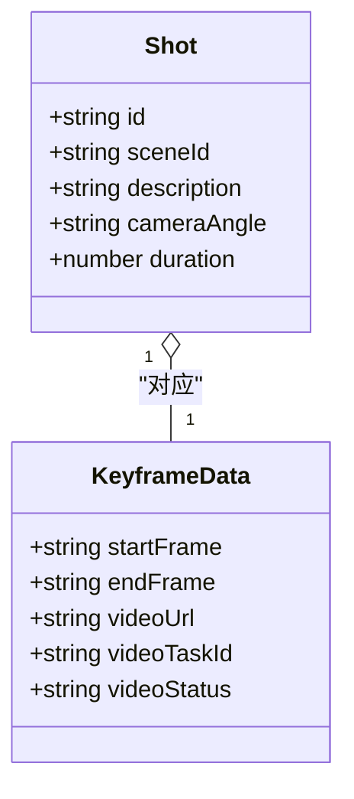
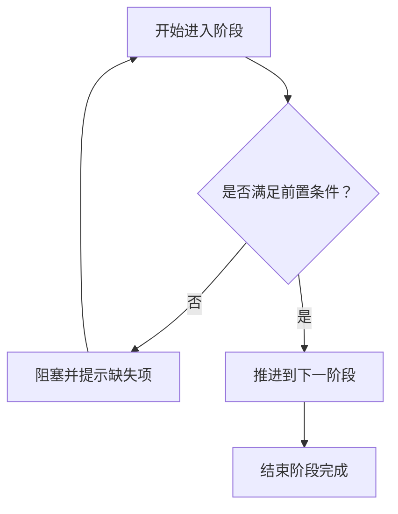
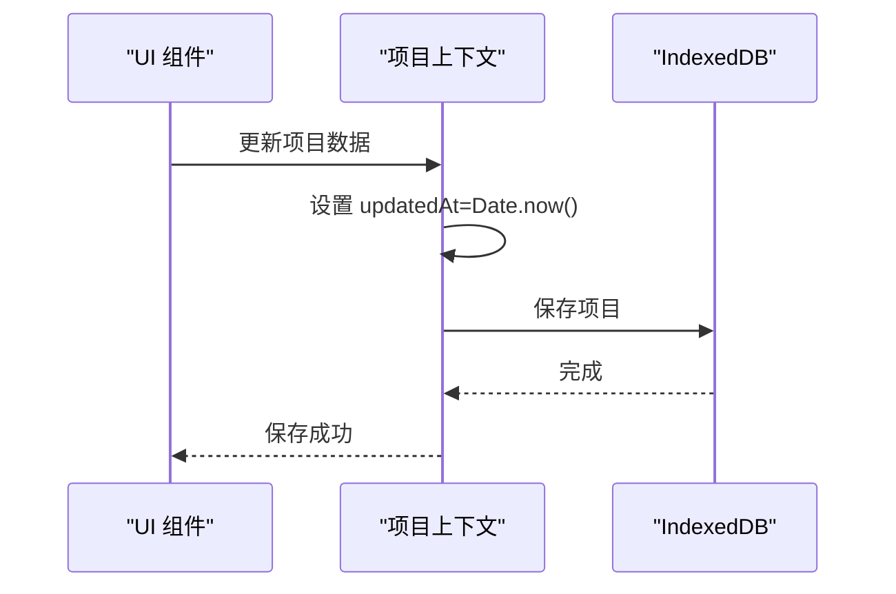
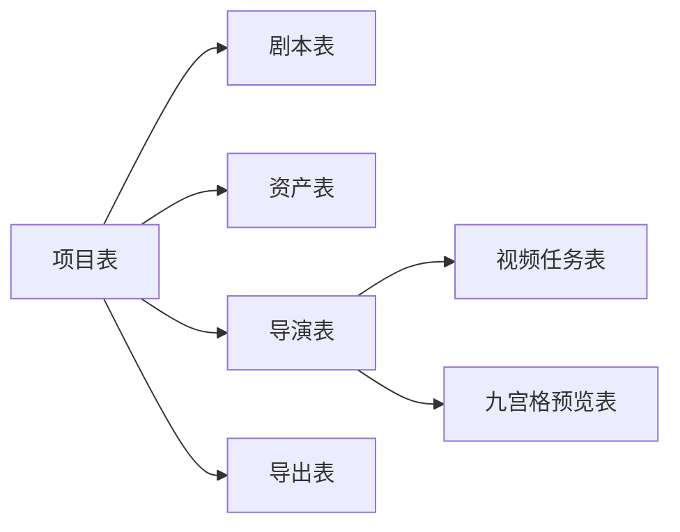
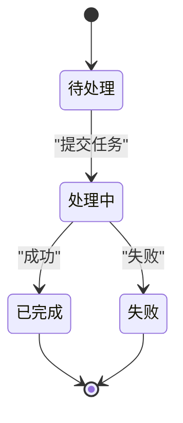
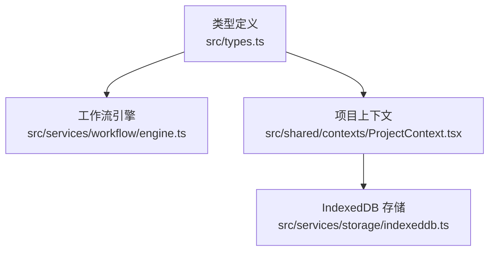

# 工作流相关表

<cite>
**本文引用的文件**
- [src/types.ts](file://src/types.ts)
- [src/services/workflow/types.ts](file://src/services/workflow/types.ts)
- [src/services/workflow/engine.ts](file://src/services/workflow/engine.ts)
- [src/shared/contexts/ProjectContext.tsx](file://src/shared/contexts/ProjectContext.tsx)
- [src/services/storage/indexeddb.ts](file://src/services/storage/indexeddb.ts)
- [src/services/storage/types.ts](file://src/services/storage/types.ts)
- [src/services/storage/index.ts](file://src/services/storage/index.ts)
- [src/phases/director/components/ShotCard.tsx](file://src/phases/director/components/ShotCard.tsx)
- [src/phases/export/ExportPhase.tsx](file://src/phases/export/ExportPhase.tsx)
</cite>

## 目录
1. [简介](#简介)
2. [项目结构](#项目结构)
3. [核心组件](#核心组件)
4. [架构总览](#架构总览)
5. [详细组件分析](#详细组件分析)
6. [依赖分析](#依赖分析)
7. [性能考虑](#性能考虑)
8. [故障排查指南](#故障排查指南)
9. [结论](#结论)
10. [附录](#附录)

## 简介
本文件面向“AI Shotlive”项目，系统性梳理工作流相关的核心数据结构与状态管理设计，重点覆盖以下主题：
- 镜头表、关键帧表、视频片段表等核心工作流表的结构与职责边界
- 工作流状态管理字段的设计思路（如 status 字段取值与状态转换规则）
- 时间戳字段设计（created_at、updated_at 及业务特定时间戳）
- JSON/结构化字段的使用场景（如 characters_json、props_json 的替代方案）
- 表间关联关系与数据一致性保障机制
- 九宫格预览相关的 nine_grid_* 字段设计与视频生成任务生命周期管理

说明：当前仓库前端类型与存储实现采用 IndexedDB 作为本地持久化，未发现后端数据库迁移脚本或实体定义文件。本文依据现有类型定义与前端实现进行表结构映射与设计说明。

## 项目结构
围绕工作流的数据模型，项目采用“单一可信数据源 + 自动持久化”的前端架构：
- 类型定义集中于前端，描述项目、剧本、资产、导演、导出等阶段数据结构
- 工作流引擎负责阶段推进与状态校验
- 项目上下文负责更新与持久化
- IndexedDB 提供本地存储，键空间包含 projects、assets、config



图表来源
- [src/types.ts:1-96](file://src/types.ts#L1-L96)
- [src/services/workflow/engine.ts:1-120](file://src/services/workflow/engine.ts#L1-L120)
- [src/shared/contexts/ProjectContext.tsx:1-186](file://src/shared/contexts/ProjectContext.tsx#L1-L186)
- [src/services/storage/indexeddb.ts:44-167](file://src/services/storage/indexeddb.ts#L44-L167)

章节来源
- [src/types.ts:1-96](file://src/types.ts#L1-L96)
- [src/services/workflow/engine.ts:1-120](file://src/services/workflow/engine.ts#L1-L120)
- [src/shared/contexts/ProjectContext.tsx:1-186](file://src/shared/contexts/ProjectContext.tsx#L1-L186)
- [src/services/storage/indexeddb.ts:44-167](file://src/services/storage/indexeddb.ts#L44-L167)

## 核心组件
本节从“表”的视角抽象工作流相关的核心实体，并结合现有类型定义映射到表结构字段。

- 项目表（projects）
  - 主键：id
  - 关键字段：name、createdAt、updatedAt、currentPhase
  - 业务含义：承载整个工作流的顶层状态与元数据
  - 关联：通过 id 与各阶段数据建立一对一关系

- 剧本表（script）
  - 结构：story、scenes、characters
  - 关联：scenes 与视频片段表（export.videos）存在逻辑关联；characters 与资产表（assets）存在逻辑关联
  - 说明：当前类型中未直接体现独立的 script 表，而是作为项目的一个子结构存在

- 资产表（assets）
  - 结构：characterImages、sceneImages
  - 关联：characterImages 与 characters 表存在逻辑关联；sceneImages 与 scenes 表存在逻辑关联
  - 说明：当前类型中未直接体现独立的 assets 表，而是作为项目的一个子结构存在

- 导演表（director）
  - 结构：keyframes（shotId -> KeyframeData）
  - 关键字段：startFrame、endFrame、videoUrl、videoTaskId、videoStatus
  - 关联：与镜头（shots）存在多对一关系（一个镜头对应一个关键帧记录）

- 导出表（export）
  - 结构：videos（VideoSegment 列表）
  - 关键字段：shotId、url、duration
  - 关联：与导演表（keyframes）存在逻辑关联（视频片段来源于已生成的关键帧）

- 九宫格预览表（nine_grid_preview）
  - 设计意图：用于存储九宫格预览的元数据，便于快速渲染与回放
  - 建议字段：
    - id（主键）
    - projectId（外键）
    - sceneId（外键）
    - shotId（外键）
    - previewUrl（九宫格预览图地址）
    - createdAt、updatedAt（时间戳）
  - 说明：当前类型中未出现 nine_grid_* 字段，建议在导演阶段扩展该表以支持九宫格预览

- 视频生成任务表（video_tasks）
  - 设计意图：统一管理视频生成任务的生命周期
  - 建议字段：
    - id（主键）
    - shotId（外键）
    - status（枚举：pending、processing、completed、failed）
    - taskId（第三方任务标识）
    - progress（百分比）
    - createdAt、updatedAt
  - 说明：当前类型中未出现独立的任务表，但 KeyframeData 中已包含 videoStatus、videoTaskId 等字段，可作为任务表的雏形

章节来源
- [src/types.ts:10-96](file://src/types.ts#L10-L96)
- [src/services/workflow/engine.ts:15-81](file://src/services/workflow/engine.ts#L15-L81)
- [src/phases/director/components/ShotCard.tsx:37-39](file://src/phases/director/components/ShotCard.tsx#L37-L39)

## 架构总览
下图展示工作流核心实体与状态流转的关系：



图表来源
- [src/types.ts:10-96](file://src/types.ts#L10-L96)
- [src/services/storage/indexeddb.ts:44-61](file://src/services/storage/indexeddb.ts#L44-L61)

## 详细组件分析

### 镜头表（shots）与关键帧表（keyframes）
- 镜头表（映射至类型中的 Shot）
  - 字段：id、sceneId、description、cameraAngle、duration
  - 作用：描述单个镜头的基本属性，用于导演工作台与视频生成
- 关键帧表（映射至类型中的 KeyframeData）
  - 字段：startFrame、endFrame、videoUrl、videoTaskId、videoStatus
  - 作用：记录每个镜头的首帧、尾帧、视频地址、任务标识与状态



图表来源
- [src/types.ts:44-69](file://src/types.ts#L44-L69)

章节来源
- [src/types.ts:44-69](file://src/types.ts#L44-L69)

### 视频片段表（videos）与导出阶段
- 视频片段表（映射至类型中的 VideoSegment）
  - 字段：shotId、url、duration
  - 作用：记录最终导出的视频片段，供导出阶段展示与下载
- 导出阶段（export）
  - 字段：videos（列表）
  - 作用：聚合所有已生成的视频片段

```mermaid
classDiagram
class VideoSegment {
+string shotId
+string url
+number duration
}
class ExportData {
+VideoSegment[] videos
}
ExportData "1" ||--o{ VideoSegment : "包含"
```

图表来源
- [src/types.ts:76-80](file://src/types.ts#L76-L80)

章节来源
- [src/types.ts:76-80](file://src/types.ts#L76-L80)

### 工作流状态管理字段设计
- 阶段枚举（Phase）
  - 取值：script、assets、director、export
  - 作用：控制工作流的推进顺序与回退能力
- 阶段状态（PhaseStatus）
  - 字段：isComplete、completionPercentage、missingRequirements
  - 作用：量化阶段完成度与缺失项，驱动 UI 与推进逻辑
- 关键帧状态（videoStatus）
  - 取值：pending、processing、completed、failed
  - 作用：反映视频生成任务的实时状态，驱动 UI 锁定与预览



图表来源
- [src/services/workflow/engine.ts:83-117](file://src/services/workflow/engine.ts#L83-L117)
- [src/types.ts:63-69](file://src/types.ts#L63-L69)

章节来源
- [src/services/workflow/types.ts:7-18](file://src/services/workflow/types.ts#L7-L18)
- [src/services/workflow/engine.ts:83-117](file://src/services/workflow/engine.ts#L83-L117)
- [src/types.ts:63-69](file://src/types.ts#L63-L69)

### 时间戳字段设计
- 项目级时间戳
  - createdAt：项目创建时间
  - updatedAt：项目最近更新时间（每次 updateProject 会刷新）
- 业务特定时间戳
  - 当前类型未提供业务特定时间戳字段，可在后续扩展中引入（如 lastGeneratedAt、lastExportedAt 等）



图表来源
- [src/shared/contexts/ProjectContext.tsx:150-161](file://src/shared/contexts/ProjectContext.tsx#L150-L161)
- [src/services/storage/indexeddb.ts:103-109](file://src/services/storage/indexeddb.ts#L103-L109)

章节来源
- [src/shared/contexts/ProjectContext.tsx:150-161](file://src/shared/contexts/ProjectContext.tsx#L150-L161)
- [src/services/storage/indexeddb.ts:103-109](file://src/services/storage/indexeddb.ts#L103-L109)

### JSON 字段的使用场景
- 结构化数据存储
  - characters、scenes、keyframes、videos 等字段采用 JSON 形式存储，便于灵活表达复杂结构
- 适用场景
  - 角色与场景的动态扩展
  - 关键帧与视频片段的多态存储
- 注意事项
  - 查询与索引受限，建议在数据库层引入规范化表结构以提升查询效率

章节来源
- [src/types.ts:22-80](file://src/types.ts#L22-L80)

### 表间关联关系与一致性保障
- 关联关系
  - 项目表与剧本、资产、导演、导出表为“包含”关系
  - 导演表与视频任务表、九宫格预览表存在外键关联
- 一致性保障
  - 单一可信数据源：ProjectContext 作为唯一状态源
  - 自动持久化：debounce 2 秒保存一次，避免频繁写入
  - 版本变更处理：IndexedDB 升级时主动关闭数据库，避免锁库



图表来源
- [src/types.ts:10-96](file://src/types.ts#L10-L96)
- [src/services/storage/indexeddb.ts:44-61](file://src/services/storage/indexeddb.ts#L44-L61)

章节来源
- [src/types.ts:10-96](file://src/types.ts#L10-L96)
- [src/services/storage/indexeddb.ts:44-61](file://src/services/storage/indexeddb.ts#L44-L61)

### 九宫格预览字段设计与视频生成任务生命周期
- 九宫格预览（建议字段）
  - previewUrl：九宫格预览图地址
  - createdAt/updatedAt：时间戳
  - 作用：加速预览与回放，减少重复计算
- 视频生成任务生命周期
  - 状态：pending → processing → completed 或 failed
  - 进度：可通过 progress 字段展示
  - 任务标识：taskId 用于对接第三方服务



图表来源
- [src/types.ts:63-69](file://src/types.ts#L63-L69)

章节来源
- [src/types.ts:63-69](file://src/types.ts#L63-L69)

## 依赖分析
- 类型定义依赖：所有工作流实体均依赖 src/types.ts 中的接口定义
- 引擎依赖：工作流引擎依赖类型定义与 ProjectContext 的状态
- 存储依赖：IndexedDB 依赖类型定义与 ProjectContext 的持久化策略



图表来源
- [src/types.ts:1-96](file://src/types.ts#L1-L96)
- [src/services/workflow/engine.ts:1-120](file://src/services/workflow/engine.ts#L1-L120)
- [src/shared/contexts/ProjectContext.tsx:1-186](file://src/shared/contexts/ProjectContext.tsx#L1-L186)
- [src/services/storage/indexeddb.ts:44-167](file://src/services/storage/indexeddb.ts#L44-L167)

章节来源
- [src/types.ts:1-96](file://src/types.ts#L1-L96)
- [src/services/workflow/engine.ts:1-120](file://src/services/workflow/engine.ts#L1-L120)
- [src/shared/contexts/ProjectContext.tsx:1-186](file://src/shared/contexts/ProjectContext.tsx#L1-L186)
- [src/services/storage/indexeddb.ts:44-167](file://src/services/storage/indexeddb.ts#L44-L167)

## 性能考虑
- 本地持久化：IndexedDB 适合小中型项目，建议限制单次读取的项目大小，优先使用摘要列表
- 状态更新：自动去抖（2 秒）降低写入频率，避免 UI 卡顿
- 数据结构：JSON 字段便于扩展，但查询性能有限，建议在数据库层引入规范化表结构

## 故障排查指南
- 无法推进阶段
  - 检查工作流引擎返回的缺失项与完成度
  - 确认前置阶段数据完整性
- 视频生成卡住
  - 检查 videoStatus 是否为 pending/processing
  - 核对 taskId 是否正确传递至第三方服务
- 预览异常
  - 检查九宫格预览表是否存在对应记录
  - 确认 previewUrl 是否有效

章节来源
- [src/services/workflow/engine.ts:83-117](file://src/services/workflow/engine.ts#L83-L117)
- [src/types.ts:63-69](file://src/types.ts#L63-L69)

## 结论
本文基于现有类型定义与前端实现，对 AI Shotlive 的工作流相关表进行了系统化梳理。建议在后续迭代中：
- 引入数据库层的规范化表结构，替换部分 JSON 字段
- 新增九宫格预览表与视频任务表，完善预览与任务生命周期管理
- 在项目表中增加业务特定时间戳字段，增强审计与追踪能力

## 附录
- 术语
  - Phase：工作流阶段（script、assets、director、export）
  - KeyframeData：关键帧数据（含视频状态与任务信息）
  - VideoSegment：视频片段（导出阶段产物）