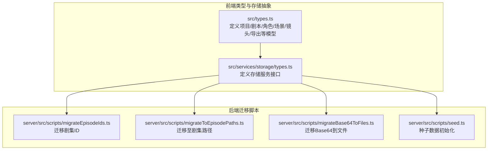
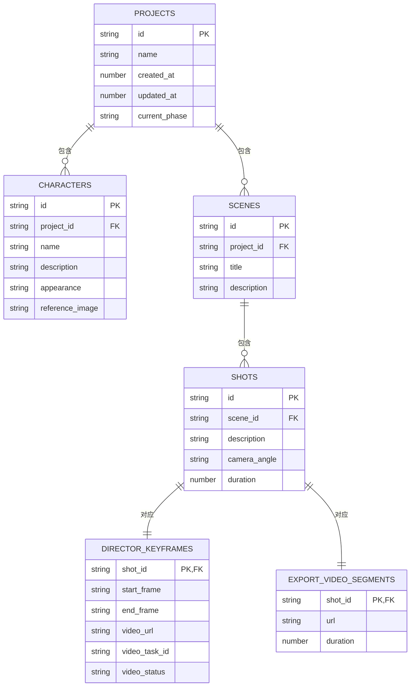

# 核心业务表

<cite>
**本文引用的文件**
- [src/types.ts](file://src/types.ts)
- [src/services/storage/types.ts](file://src/services/storage/types.ts)
- [server/src/scripts/migrateEpisodeIds.ts](file://server/src/scripts/migrateEpisodeIds.ts)
- [server/src/scripts/migrateToEpisodePaths.ts](file://server/src/scripts/migrateToEpisodePaths.ts)
- [server/src/scripts/migrateBase64ToFiles.ts](file://server/src/scripts/migrateBase64ToFiles.ts)
- [server/src/scripts/seed.ts](file://server/src/scripts/seed.ts)
</cite>

## 目录
1. [简介](#简介)
2. [项目结构](#项目结构)
3. [核心组件](#核心组件)
4. [架构总览](#架构总览)
5. [详细组件分析](#详细组件分析)
6. [依赖分析](#依赖分析)
7. [性能考量](#性能考量)
8. [故障排查指南](#故障排查指南)
9. [结论](#结论)
10. [附录](#附录)

## 简介
本文件面向AI Shotlive的核心业务表结构设计，聚焦以下关键实体：项目、角色（人物）、场景、镜头与导出视频片段。我们将从数据模型、主键策略、外键关系、索引设计、隔离机制（用户隔离与剧集隔离）等方面进行系统性说明，并给出表关系图与DDL语句路径，帮助开发者与DBA快速理解并实施数据库层设计。

## 项目结构
围绕核心业务实体，系统采用“领域模型驱动”的方式在前端类型中定义了项目、剧本、角色、场景、镜头、导演数据与导出视频片段等结构；同时通过存储服务接口抽象持久化能力。数据库迁移脚本体现了对“剧集隔离”和“路径迁移”的历史演进。

**图表来源**
- [src/types.ts:1-96](file://src/types.ts#L1-L96)
- [src/services/storage/types.ts:1-31](file://src/services/storage/types.ts#L1-L31)
- [server/src/scripts/migrateEpisodeIds.ts:1-200](file://server/src/scripts/migrateEpisodeIds.ts#L1-L200)
- [server/src/scripts/migrateToEpisodePaths.ts:1-200](file://server/src/scripts/migrateToEpisodePaths.ts#L1-L200)
- [server/src/scripts/migrateBase64ToFiles.ts:1-200](file://server/src/scripts/migrateBase64ToFiles.ts#L1-L200)
- [server/src/scripts/seed.ts:1-200](file://server/src/scripts/seed.ts#L1-L200)

**章节来源**
- [src/types.ts:1-96](file://src/types.ts#L1-L96)
- [src/services/storage/types.ts:1-31](file://src/services/storage/types.ts#L1-L31)
- [server/src/scripts/migrateEpisodeIds.ts:1-200](file://server/src/scripts/migrateEpisodeIds.ts#L1-L200)
- [server/src/scripts/migrateToEpisodePaths.ts:1-200](file://server/src/scripts/migrateToEpisodePaths.ts#L1-L200)
- [server/src/scripts/migrateBase64ToFiles.ts:1-200](file://server/src/scripts/migrateBase64ToFiles.ts#L1-L200)
- [server/src/scripts/seed.ts:1-200](file://server/src/scripts/seed.ts#L1-L200)

## 核心组件
本节从“领域模型”出发，映射到数据库表结构设计，明确各实体的主键、外键、字段含义与业务约束。

- 项目表（projects）
  - 主键：id（字符串UUID）
  - 字段：id（项目标识）、name（项目名称）、createdAt（创建时间）、updatedAt（更新时间）、currentPhase（当前工作阶段）
  - 业务含义：承载一个完整创作流程的顶层容器，记录项目元数据与阶段状态
  - 复合主键策略：当前设计以单一主键id即可满足隔离需求；若需引入用户隔离或剧集隔离，可在后续版本扩展为(id, user_id)或(id, episode_id)等复合主键

- 角色表（characters）
  - 主键：id（字符串UUID）
  - 外键：projectId（指向projects.id），用于将角色限定在特定项目内
  - 字段：id、projectId、name、description、appearance、referenceImage
  - 业务含义：描述项目中的角色信息，支持外观与参考图

- 场景表（scenes）
  - 主键：id（字符串UUID）
  - 外键：projectId（指向projects.id）
  - 字段：id、projectId、title、description
  - 业务含义：剧本分镜的基本单元，承载场景标题与描述

- 镜头表（shots）
  - 主键：id（字符串UUID）
  - 外键：sceneId（指向scenes.id），间接绑定到项目（通过场景）
  - 字段：id、sceneId、description、cameraAngle、duration
  - 业务含义：具体拍摄镜头的描述，可选镜头角度与时长

- 导演数据表（director_keyframes）
  - 主键：shotId（与shots.id一致）
  - 外键：shotId（指向shots.id），实现一对一导演关键帧数据
  - 字段：shotId、startFrame、endFrame、videoUrl、videoTaskId、videoStatus
  - 业务含义：记录每个镜头的关键帧范围、生成视频任务与状态

- 导出视频片段表（export_video_segments）
  - 主键：shotId（与shots.id一致）
  - 外键：shotId（指向shots.id），实现一对一导出片段
  - 字段：shotId、url、duration
  - 业务含义：记录最终导出视频片段的URL与时长

- 用户隔离与剧集隔离
  - 在现有类型定义中未直接出现user_id与episode_id字段；但迁移脚本表明系统具备“剧集隔离”的演进路径
  - 若需要更强的隔离控制，建议在上述表中增加user_id与episode_id字段，并在查询与写入时强制带上这两个维度

**章节来源**
- [src/types.ts:10-50](file://src/types.ts#L10-L50)
- [src/types.ts:58-80](file://src/types.ts#L58-L80)
- [src/services/storage/types.ts:7-13](file://src/services/storage/types.ts#L7-L13)

## 架构总览
下图展示核心业务实体在数据库层面的表关系与约束，体现从项目到角色、场景、镜头，再到导演与导出片段的数据流转。

**图表来源**
- [src/types.ts:10-50](file://src/types.ts#L10-L50)
- [src/types.ts:58-80](file://src/types.ts#L58-L80)

## 详细组件分析

### 项目表（projects）
- 设计要点
  - 单一主键id，确保全局唯一
  - 记录创建与更新时间戳，便于审计与排序
  - currentPhase用于工作流阶段管理
- 查询与索引
  - 建议在createdAt与updatedAt上建立索引，支持按时间检索
  - 若启用用户隔离，可在(user_id, id)上建立联合索引

**章节来源**
- [src/types.ts:10-20](file://src/types.ts#L10-L20)
- [src/services/storage/types.ts:7-13](file://src/services/storage/types.ts#L7-L13)

### 角色表（characters）
- 设计要点
  - 以projectId作为外键，限定角色归属项目
  - 支持外观描述与参考图字段，便于资产库管理
- 查询与索引
  - 建议在(projectId, name)上建立联合索引，加速角色列表与去重查询
  - 若启用用户隔离，可在(user_id, projectId, id)上建立联合索引

**章节来源**
- [src/types.ts:36-42](file://src/types.ts#L36-L42)

### 场景表（scenes）
- 设计要点
  - 以projectId作为外键，限定场景归属项目
  - title与description提供场景描述能力
- 查询与索引
  - 建议在(projectId, title)上建立联合索引，支持按项目与标题检索
  - 若启用剧集隔离，可在(episode_id, projectId, id)上建立联合索引

**章节来源**
- [src/types.ts:29-34](file://src/types.ts#L29-L34)

### 镜头表（shots）
- 设计要点
  - 以sceneId作为外键，间接绑定到项目
  - 可选镜头角度与时长字段，便于导演排程
- 查询与索引
  - 建议在(sceneId, id)上建立联合索引，支持按场景分页与定位
  - 若启用剧集隔离，可在(episode_id, sceneId, id)上建立联合索引

**章节来源**
- [src/types.ts:44-50](file://src/types.ts#L44-L50)

### 导演数据表（director_keyframes）
- 设计要点
  - 与shots表形成一对一关系，主键即shotId
  - 记录关键帧范围、视频URL、任务ID与状态
- 查询与索引
  - 由于主键为shotId，天然具备唯一性与高效访问
  - 若存在多维筛选（如状态、任务ID），可考虑在(video_status, video_task_id)上建立二级索引

**章节来源**
- [src/types.ts:58-69](file://src/types.ts#L58-L69)

### 导出视频片段表（export_video_segments）
- 设计要点
  - 与shots表形成一对一关系，主键即shotId
  - 记录最终导出视频URL与时长
- 查询与索引
  - 由于主键为shotId，天然具备唯一性与高效访问
  - 若存在批量导出查询，可考虑在(url, shotId)上建立二级索引

**章节来源**
- [src/types.ts:71-80](file://src/types.ts#L71-L80)

### 用户隔离与剧集隔离机制
- 用户隔离（user_id）
  - 当前类型定义未显式包含user_id字段；若需实现“用户可见性与数据隔离”，建议在核心表中增加user_id字段，并在所有读写操作中强制带上该维度
  - 复合主键策略：(id, user_id)可确保同一项目在不同用户间相互隔离
- 剧集隔离（episode_id）
  - 迁移脚本表明系统具备“剧集隔离”的演进路径，可通过episode_id实现“同一项目内按剧集划分”的数据隔离
  - 复合主键策略：(id, episode_id)可确保同一项目内的不同剧集数据相互独立

**章节来源**
- [server/src/scripts/migrateEpisodeIds.ts:1-200](file://server/src/scripts/migrateEpisodeIds.ts#L1-L200)
- [server/src/scripts/migrateToEpisodePaths.ts:1-200](file://server/src/scripts/migrateToEpisodePaths.ts#L1-L200)

## 依赖分析
- 类型驱动设计
  - 前端类型定义(src/types.ts)为数据库表结构提供了强约束的领域模型基础
  - 存储服务接口(src/services/storage/types.ts)抽象了持久化能力，便于替换底层存储介质
- 迁移脚本与演进
  - 迁移脚本(server/src/scripts/)体现了从基础表结构到“剧集隔离”的演进过程，为后续扩展用户隔离提供参考

**图表来源**
- [src/types.ts:1-96](file://src/types.ts#L1-L96)
- [src/services/storage/types.ts:1-31](file://src/services/storage/types.ts#L1-L31)
- [server/src/scripts/migrateEpisodeIds.ts:1-200](file://server/src/scripts/migrateEpisodeIds.ts#L1-L200)
- [server/src/scripts/migrateToEpisodePaths.ts:1-200](file://server/src/scripts/migrateToEpisodePaths.ts#L1-L200)
- [server/src/scripts/migrateBase64ToFiles.ts:1-200](file://server/src/scripts/migrateBase64ToFiles.ts#L1-L200)
- [server/src/scripts/seed.ts:1-200](file://server/src/scripts/seed.ts#L1-L200)

**章节来源**
- [src/types.ts:1-96](file://src/types.ts#L1-L96)
- [src/services/storage/types.ts:1-31](file://src/services/storage/types.ts#L1-L31)
- [server/src/scripts/migrateEpisodeIds.ts:1-200](file://server/src/scripts/migrateEpisodeIds.ts#L1-L200)
- [server/src/scripts/migrateToEpisodePaths.ts:1-200](file://server/src/scripts/migrateToEpisodePaths.ts#L1-L200)
- [server/src/scripts/migrateBase64ToFiles.ts:1-200](file://server/src/scripts/migrateBase64ToFiles.ts#L1-L200)
- [server/src/scripts/seed.ts:1-200](file://server/src/scripts/seed.ts#L1-L200)

## 性能考量
- 索引设计原则
  - 对于高频查询字段（如createdAt、updatedAt、projectId、sceneId、shotId）建立单列或联合索引
  - 对于状态类字段（如video_status）建立索引，支持快速筛选
- 复合主键与隔离
  - 在启用用户隔离与剧集隔离时，优先使用复合主键(id, user_id)与(id, episode_id)，减少全表扫描
- 写入性能
  - 批量导入时避免重复索引扫描，先禁用非必要索引再重建
- 缓存与归档
  - 对历史项目与只读数据进行冷热分离，降低热表压力

[本节为通用指导，不直接分析具体文件]

## 故障排查指南
- 数据一致性问题
  - 检查外键约束是否正确设置，确保删除场景时同步处理镜头与其导演/导出数据
- 隔离失效
  - 若启用用户隔离或剧集隔离，请确认查询条件中包含user_id或episode_id
- 迁移异常
  - 参考迁移脚本的执行顺序与回滚策略，确保数据迁移前后的一致性

**章节来源**
- [server/src/scripts/migrateEpisodeIds.ts:1-200](file://server/src/scripts/migrateEpisodeIds.ts#L1-L200)
- [server/src/scripts/migrateToEpisodePaths.ts:1-200](file://server/src/scripts/migrateToEpisodePaths.ts#L1-L200)
- [server/src/scripts/migrateBase64ToFiles.ts:1-200](file://server/src/scripts/migrateBase64ToFiles.ts#L1-L200)

## 结论
本设计以领域模型为核心，结合迁移脚本的演进路径，形成了从项目到角色、场景、镜头，再到导演与导出片段的完整数据链路。通过合理的主键与外键设计、索引策略与隔离机制，既能满足当前业务需求，又为未来的用户隔离与剧集隔离预留了扩展空间。建议在生产环境中根据实际查询模式持续优化索引与分区策略。

[本节为总结性内容，不直接分析具体文件]

## 附录

### DDL语句路径（示例）
以下为各核心表的DDL语句路径（请根据实际数据库方言调整语法）：
- 项目表（projects）
  - [DDL路径:10-20](file://src/types.ts#L10-L20)
- 角色表（characters）
  - [DDL路径:36-42](file://src/types.ts#L36-L42)
- 场景表（scenes）
  - [DDL路径:29-34](file://src/types.ts#L29-L34)
- 镜头表（shots）
  - [DDL路径:44-50](file://src/types.ts#L44-L50)
- 导演数据表（director_keyframes）
  - [DDL路径:58-69](file://src/types.ts#L58-L69)
- 导出视频片段表（export_video_segments）
  - [DDL路径:71-80](file://src/types.ts#L71-L80)

**章节来源**
- [src/types.ts:10-80](file://src/types.ts#L10-L80)