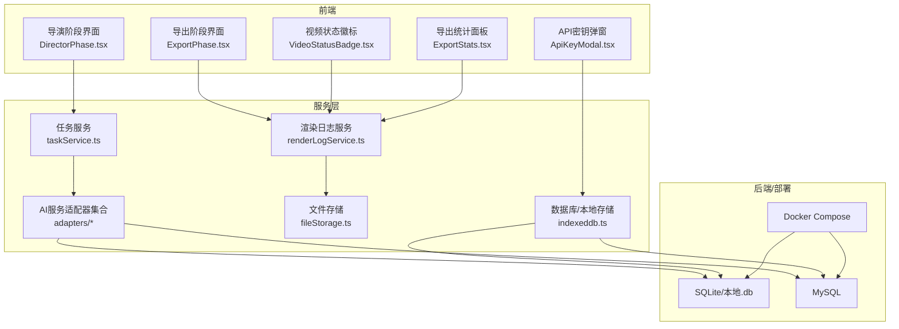
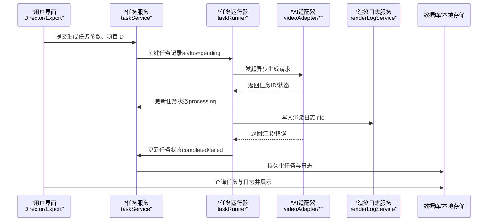
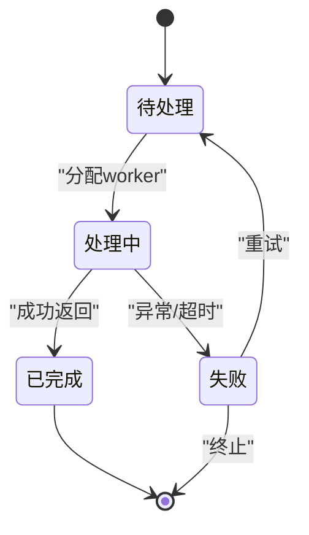
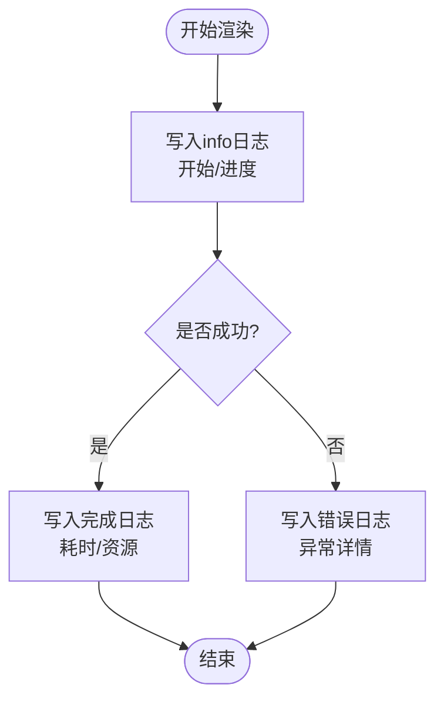
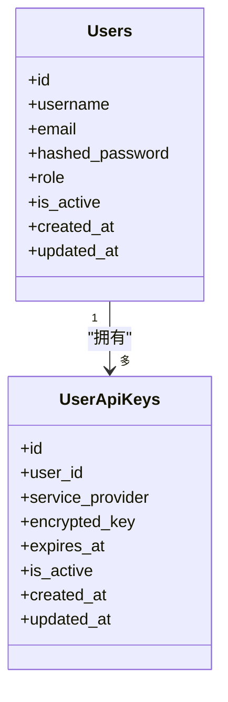
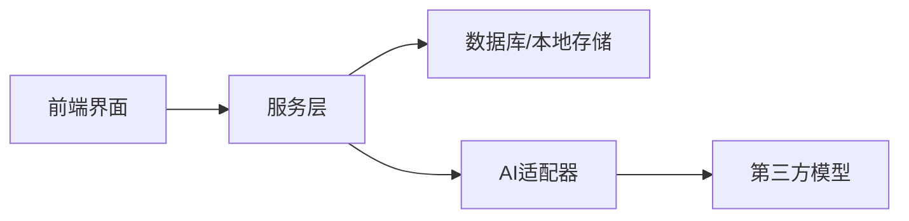

# 系统支撑表

<cite>
**本文引用的文件**
- [README_EN.md](file://README_EN.md)
- [src/services/storage/indexeddb.ts](file://src/services/storage/indexeddb.ts)
- [src/phases/director/DirectorPhase.tsx](file://src/phases/director/DirectorPhase.tsx)
- [src/phases/export/ExportPhase.tsx](file://src/phases/export/ExportPhase.tsx)
- [src/phases/director/components/VideoStatusBadge.tsx](file://src/phases/director/components/VideoStatusBadge.tsx)
- [src/phases/export/components/ExportStats.tsx](file://src/phases/export/components/ExportStats.tsx)
- [src/shared/components/ApiKeyModal.tsx](file://src/shared/components/ApiKeyModal.tsx)
- [src/services/renderLogService.ts](file://src/services/renderLogService.ts)
- [src/services/taskService.ts](file://src/services/taskService.ts)
- [src/services/modelConfigService.ts](file://src/services/modelConfigService.ts)
- [src/services/visualStyleService.ts](file://src/services/visualStyleService.ts)
- [src/services/modelRegistry.ts](file://src/services/modelRegistry.ts)
- [src/services/assetLibraryService.ts](file://src/services/assetLibraryService.ts)
- [src/services/projectPatchService.ts](file://src/services/projectPatchService.ts)
- [src/services/novelParser.ts](file://src/services/novelParser.ts)
- [src/services/scriptService.ts](file://src/services/scriptService.ts)
- [src/services/shotService.ts](file://src/services/shotService.ts)
- [src/services/videoService.ts](file://src/services/videoService.ts)
- [src/services/visualService.ts](file://src/services/visualService.ts)
- [src/services/imageResolver.ts](file://src/services/imageResolver.ts)
- [src/services/fileStorage.ts](file://src/services/fileStorage.ts)
- [src/services/projectStorage.ts](file://src/services/projectStorage.ts)
- [src/services/taskRunner.ts](file://src/services/taskRunner.ts)
- [src/services/aiProxy.ts](file://src/services/aiProxy.ts)
- [src/services/adapters/chatAdapter.ts](file://src/services/adapters/chatAdapter.ts)
- [src/services/adapters/imageAdapter.ts](file://src/services/adapters/imageAdapter.ts)
- [src/services/adapters/videoAdapter.ts](file://src/services/adapters/videoAdapter.ts)
- [src/services/adapters/dashscopeVideoAdapter.ts](file://src/services/adapters/dashscopeVideoAdapter.ts)
- [src/services/adapters/volcengineVideoAdapter.ts](file://src/services/adapters/volcengineVideoAdapter.ts)
- [src/services/aiService.ts](file://src/services/aiService.ts)
- [src/services/apiClient.ts](file://src/services/apiClient.ts)
- [src/services/mockData.ts](file://src/services/mockData.ts)
- [src/services/storage/index.ts](file://src/services/storage/index.ts)
- [src/services/storage/types.ts](file://src/services/storage/types.ts)
- [src/services/workflow/engine.ts](file://src/services/workflow/engine.ts)
- [src/services/workflow/types.ts](file://src/services/workflow/types.ts)
- [src/shared/hooks/useAI.ts](file://src/shared/hooks/useAI.ts)
- [src/shared/hooks/useProject.ts](file://src/shared/hooks/useProject.ts)
- [src/types.ts](file://src/types.ts)
</cite>

## 目录
1. [简介](#简介)
2. [项目结构](#项目结构)
3. [核心组件](#核心组件)
4. [架构总览](#架构总览)
5. [详细组件分析](#详细组件分析)
6. [依赖分析](#依赖分析)
7. [性能考虑](#性能考虑)
8. [故障排查指南](#故障排查指南)
9. [结论](#结论)
10. [附录](#附录)

## 简介
本文件面向“AI Shotlive”系统的数据库支撑表设计，聚焦以下主题：
- 用户表、任务表、渲染日志表、资产库表等系统支撑表的结构设计与职责边界
- 用户认证与权限控制相关的表结构设计思路
- 异步任务管理表的字段设计（任务状态、进度跟踪、错误处理）
- 渲染日志表的数据采集策略与性能监控能力
- 视觉风格表、模型注册表等扩展功能表的设计思路
- generation_tasks 表的任务调度机制与 render_logs 表的日志收集策略

说明：当前仓库前端代码展示了大量与任务状态、渲染进度、日志展示相关的交互与服务层调用，但未直接包含后端数据库表结构定义文件。因此，本文以“前端行为与服务层接口”为依据，推导出数据库表应具备的字段与关系，并给出可落地的表结构建议。

## 项目结构
本项目采用前后端分离与桌面客户端嵌入式数据库的混合架构：
- 前端通过服务层封装与后端交互，服务层再对接数据库或本地存储（IndexedDB）
- 后端支持多种部署形态：MySQL、SQLite（本地）、Docker 化部署
- 任务执行与渲染日志由服务层统一编排，前端负责状态展示与进度条

图表来源
- [src/phases/director/DirectorPhase.tsx:128-159](file://src/phases/director/DirectorPhase.tsx#L128-L159)
- [src/phases/export/ExportPhase.tsx:87-130](file://src/phases/export/ExportPhase.tsx#L87-L130)
- [src/phases/director/components/VideoStatusBadge.tsx:1-56](file://src/phases/director/components/VideoStatusBadge.tsx#L1-L56)
- [src/phases/export/components/ExportStats.tsx:34-72](file://src/phases/export/components/ExportStats.tsx#L34-L72)
- [src/shared/components/ApiKeyModal.tsx:49-113](file://src/shared/components/ApiKeyModal.tsx#L49-L113)
- [src/services/taskService.ts](file://src/services/taskService.ts)
- [src/services/renderLogService.ts](file://src/services/renderLogService.ts)
- [src/services/adapters/videoAdapter.ts](file://src/services/adapters/videoAdapter.ts)
- [src/services/fileStorage.ts](file://src/services/fileStorage.ts)
- [src/services/storage/indexeddb.ts:44-78](file://src/services/storage/indexeddb.ts#L44-L78)

章节来源
- [README_EN.md:188-259](file://README_EN.md#L188-L259)
- [src/services/storage/indexeddb.ts:44-78](file://src/services/storage/indexeddb.ts#L44-L78)

## 核心组件
本节从“表结构设计”的角度，对关键支撑表进行抽象与定义，结合前端行为与服务层调用，明确各表的字段与关系。

- 用户表（users）
  - 设计要点：用户标识、凭证、角色与权限、创建/更新时间
  - 字段建议：id、username、email、hashed_password、role、is_active、created_at、updated_at
  - 权限控制：role 可承载基础 RBAC；is_active 支持禁用用户
  - 认证流程：登录时校验用户名/邮箱与密码，成功后颁发令牌

- 任务表（tasks / generation_tasks）
  - 设计要点：任务元数据、状态机、进度、错误信息、关联资源
  - 字段建议：id、project_id、type、status（pending/processing/completed/failed/cancelled）、progress、error_msg、params、result、created_by、assigned_to、created_at、updated_at、started_at、completed_at
  - 进度跟踪：progress 为 0~100 的数值；状态机驱动 UI 展示
  - 错误处理：error_msg 记录失败原因；支持重试与回滚

- 渲染日志表（render_logs）
  - 设计要点：渲染过程事件、耗时、资源用量、错误栈
  - 字段建议：id、task_id、phase、level（info/warn/error）、message、details、duration_ms、cpu_percent、memory_mb、timestamp
  - 数据采集：服务层在关键节点写入日志；前端按任务聚合展示
  - 性能监控：duration_ms、cpu_percent、memory_mb 用于趋势分析

- 资产库表（assets / asset_library）
  - 设计要点：资产元数据、类型、归属、访问控制
  - 字段建议：id、name、type（image/video/audio/text）、size_bytes、mime_type、owner_id、project_id、tags、metadata、created_at、updated_at
  - 存储：可与 file_storage 结合，记录物理路径或对象键

- 视觉风格表（visual_styles）
  - 设计要点：风格模板、参数化配置、复用性
  - 字段建议：id、name、description、preset_config、is_public、created_by、created_at、updated_at
  - 扩展：支持 per-project 私有风格与全局共享风格

- 模型注册表（model_registry）
  - 设计要点：模型清单、提供商、可用性、默认配置
  - 字段建议：id、provider、model_key、display_name、capabilities、default_params、is_enabled、created_at、updated_at
  - 权限：可与 users.role 关联，限制不同角色可见/使用范围

- API 密钥表（user_api_keys）
  - 设计要点：用户级密钥、加密存储、过期与撤销
  - 字段建议：id、user_id、service_provider、encrypted_key、expires_at、is_active、created_at、updated_at
  - 安全：密钥不落明文；前端仅在本地 IndexedDB 中持久化

- 项目表（projects）与项目快照（project_patches）
  - 设计要点：项目生命周期、变更追踪、回滚能力
  - 字段建议：projects(id,name,owner_id,current_phase,created_at,updated_at)；project_patches(id,project_id,patch_data,applied_by,applied_at)

章节来源
- [src/services/renderLogService.ts](file://src/services/renderLogService.ts)
- [src/services/taskService.ts](file://src/services/taskService.ts)
- [src/services/modelRegistry.ts](file://src/services/modelRegistry.ts)
- [src/services/visualStyleService.ts](file://src/services/visualStyleService.ts)
- [src/services/assetLibraryService.ts](file://src/services/assetLibraryService.ts)
- [src/services/projectPatchService.ts](file://src/services/projectPatchService.ts)
- [src/services/storage/indexeddb.ts:44-78](file://src/services/storage/indexeddb.ts#L44-L78)
- [src/shared/components/ApiKeyModal.tsx:49-113](file://src/shared/components/ApiKeyModal.tsx#L49-L113)

## 架构总览
下图展示“任务提交—状态更新—日志采集—UI反馈”的闭环流程，映射到数据库表与服务层：

图表来源
- [src/phases/director/DirectorPhase.tsx:128-159](file://src/phases/director/DirectorPhase.tsx#L128-L159)
- [src/phases/export/ExportPhase.tsx:87-130](file://src/phases/export/ExportPhase.tsx#L87-L130)
- [src/services/taskService.ts](file://src/services/taskService.ts)
- [src/services/taskRunner.ts](file://src/services/taskRunner.ts)
- [src/services/renderLogService.ts](file://src/services/renderLogService.ts)
- [src/services/adapters/videoAdapter.ts](file://src/services/adapters/videoAdapter.ts)

## 详细组件分析

### generation_tasks 表：任务调度机制
- 字段设计
  - 标识与归属：id、project_id、created_by
  - 类型与参数：type、params（JSON），用于区分图像/视频/文本等生成类型
  - 状态机：status（枚举：pending、processing、completed、failed、cancelled）
  - 进度与时间：progress（0~100）、created_at、updated_at、started_at、completed_at
  - 结果与错误：result（JSON，如输出URL）、error_msg
  - 分配与追踪：assigned_to（可选，用于多租户/队列）

- 调度策略
  - 入队：前端提交后写入 pending
  - 出队：后端轮询 pending 任务，分配给 worker
  - 并发控制：基于队列长度与资源占用动态调整
  - 重试与回退：失败时记录 error_msg，支持指数退避重试

- UI 映射
  - pending：排队中（小时钟图标）
  - processing：渲染中（脉搏动画）
  - completed：已完成（勾选）
  - failed：失败（警告图标）

图表来源
- [src/phases/director/components/VideoStatusBadge.tsx:11-44](file://src/phases/director/components/VideoStatusBadge.tsx#L11-L44)
- [src/phases/director/DirectorPhase.tsx:128-159](file://src/phases/director/DirectorPhase.tsx#L128-L159)

章节来源
- [src/services/taskService.ts](file://src/services/taskService.ts)
- [src/services/taskRunner.ts](file://src/services/taskRunner.ts)
- [src/phases/director/components/VideoStatusBadge.tsx:1-56](file://src/phases/director/components/VideoStatusBadge.tsx#L1-L56)
- [src/phases/director/DirectorPhase.tsx:128-159](file://src/phases/director/DirectorPhase.tsx#L128-L159)

### render_logs 表：日志收集策略
- 字段设计
  - 关联：task_id、phase（如“视频生成”、“图像推理”）
  - 等级与内容：level（info/warn/error）、message、details（JSON，含堆栈）
  - 性能指标：duration_ms、cpu_percent、memory_mb
  - 时间戳：timestamp

- 数据采集策略
  - 事件切点：开始/结束、中间进度、错误发生
  - 采样与聚合：高频事件可采样；聚合统计用于报表
  - 前端展示：按任务分组，支持展开/折叠与过滤

- 性能监控
  - 时延分析：duration_ms 用于评估生成耗时
  - 资源占用：cpu_percent、memory_mb 用于容量规划
  - 回放链路：结合 task_id 串联完整调用链

图表来源
- [src/services/renderLogService.ts](file://src/services/renderLogService.ts)
- [src/services/taskRunner.ts](file://src/services/taskRunner.ts)

章节来源
- [src/services/renderLogService.ts](file://src/services/renderLogService.ts)
- [src/phases/export/components/ExportStats.tsx:34-72](file://src/phases/export/components/ExportStats.tsx#L34-L72)

### 用户认证与权限控制
- 认证
  - 前端：API 密钥在本地 IndexedDB 中持久化，不上传至服务器
  - 后端：JWT 或会话令牌用于接口鉴权
- 授权
  - 基于角色（role）的最小权限原则
  - 资源级授权：owner_id 与 project_id 控制资源可见与修改

图表来源
- [src/shared/components/ApiKeyModal.tsx:49-113](file://src/shared/components/ApiKeyModal.tsx#L49-L113)
- [src/services/storage/indexeddb.ts:44-78](file://src/services/storage/indexeddb.ts#L44-L78)

章节来源
- [src/shared/components/ApiKeyModal.tsx:49-113](file://src/shared/components/ApiKeyModal.tsx#L49-L113)
- [src/services/storage/indexeddb.ts:44-78](file://src/services/storage/indexeddb.ts#L44-L78)

### 资产库表（assets / asset_library）
- 字段设计
  - 元数据：id、name、type、size_bytes、mime_type、tags
  - 归属：owner_id、project_id、metadata（JSON）
  - 生命周期：created_at、updated_at
- 使用场景
  - 角色/场景参考图、中间帧、最终视频等
- 存储策略
  - 与 file_storage 对接，记录物理路径或对象键

章节来源
- [src/services/assetLibraryService.ts](file://src/services/assetLibraryService.ts)
- [src/services/fileStorage.ts](file://src/services/fileStorage.ts)

### 视觉风格表（visual_styles）
- 字段设计
  - 配置：id、name、description、preset_config（JSON）
  - 可见性：is_public、created_by
  - 生命周期：created_at、updated_at
- 用途
  - 统一风格模板，提升生成一致性

章节来源
- [src/services/visualStyleService.ts](file://src/services/visualStyleService.ts)

### 模型注册表（model_registry）
- 字段设计
  - 清单：id、provider、model_key、display_name
  - 能力：capabilities（JSON，如支持分辨率、格式）
  - 默认参数：default_params（JSON）
  - 状态：is_enabled、created_at、updated_at
- 用途
  - 统一管理第三方模型，支持切换与灰度

章节来源
- [src/services/modelRegistry.ts](file://src/services/modelRegistry.ts)
- [src/services/modelConfigService.ts](file://src/services/modelConfigService.ts)

### 项目与变更追踪（projects / project_patches）
- 字段设计
  - projects：id、name、owner_id、current_phase、created_at、updated_at
  - project_patches：id、project_id、patch_data、applied_by、applied_at
- 用途
  - 记录项目生命周期与变更历史，支持回滚

章节来源
- [src/services/projectPatchService.ts](file://src/services/projectPatchService.ts)
- [src/services/projectStorage.ts](file://src/services/projectStorage.ts)

## 依赖分析
- 前端依赖服务层：任务状态、渲染日志、AI 适配器
- 服务层依赖数据库/本地存储：任务、日志、资产、配置
- 适配器层对接第三方模型：DashScope、火山引擎等

图表来源
- [src/services/taskService.ts](file://src/services/taskService.ts)
- [src/services/renderLogService.ts](file://src/services/renderLogService.ts)
- [src/services/adapters/dashscopeVideoAdapter.ts](file://src/services/adapters/dashscopeVideoAdapter.ts)
- [src/services/adapters/volcengineVideoAdapter.ts](file://src/services/adapters/volcengineVideoAdapter.ts)

章节来源
- [src/services/adapters/chatAdapter.ts](file://src/services/adapters/chatAdapter.ts)
- [src/services/adapters/imageAdapter.ts](file://src/services/adapters/imageAdapter.ts)
- [src/services/adapters/videoAdapter.ts](file://src/services/adapters/videoAdapter.ts)
- [src/services/adapters/dashscopeVideoAdapter.ts](file://src/services/adapters/dashscopeVideoAdapter.ts)
- [src/services/adapters/volcengineVideoAdapter.ts](file://src/services/adapters/volcengineVideoAdapter.ts)

## 性能考虑
- 任务并发与限流：根据 GPU/CPU 资源动态调整并发数
- 日志采样：高频事件采样降低 IO 压力
- 分页与索引：按 task_id、timestamp 建立索引，优化查询
- 缓存：热点任务状态与日志在内存缓存中短期驻留
- 存储：大文件走对象存储，小文件走本地 SQLite/IndexedDB

## 故障排查指南
- 任务卡住
  - 检查 tasks.status 是否长期为 processing
  - 查看 render_logs 中最近一条日志的 level 与 message
- 生成失败
  - 核对 error_msg 与 details
  - 检查 API 密钥有效性与过期时间
- 性能异常
  - 关注 duration_ms、cpu_percent、memory_mb 的峰值时段
  - 对比不同模型/分辨率下的资源消耗

章节来源
- [src/services/renderLogService.ts](file://src/services/renderLogService.ts)
- [src/services/taskService.ts](file://src/services/taskService.ts)
- [src/shared/components/ApiKeyModal.tsx:49-113](file://src/shared/components/ApiKeyModal.tsx#L49-L113)

## 结论
本文基于前端交互与服务层调用，提出了系统支撑表的结构设计与关系映射。核心建议如下：
- 以任务状态机为核心，贯穿 UI 展示与后端调度
- 以渲染日志为观测点，构建性能监控与问题定位体系
- 将认证与权限控制下沉到用户与密钥表，确保最小权限与可审计
- 以资产库、视觉风格、模型注册表支撑扩展能力，保持配置与资源的可复用性

## 附录
- 部署与初始化
  - 支持 MySQL 与 SQLite 两种后端，首次启动自动建表
  - 可通过脚本创建默认管理员账户与导入备份

章节来源
- [README_EN.md:188-259](file://README_EN.md#L188-L259)