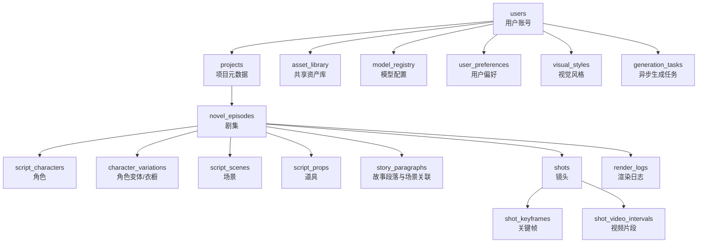
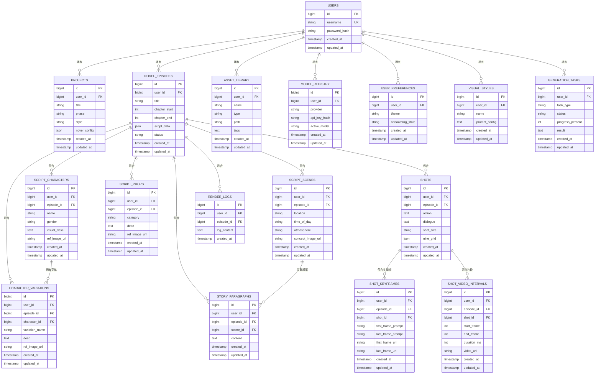
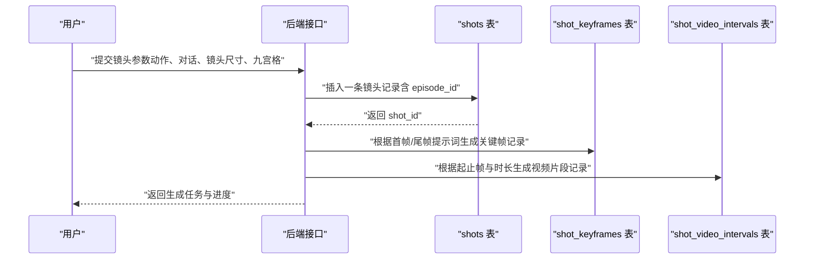
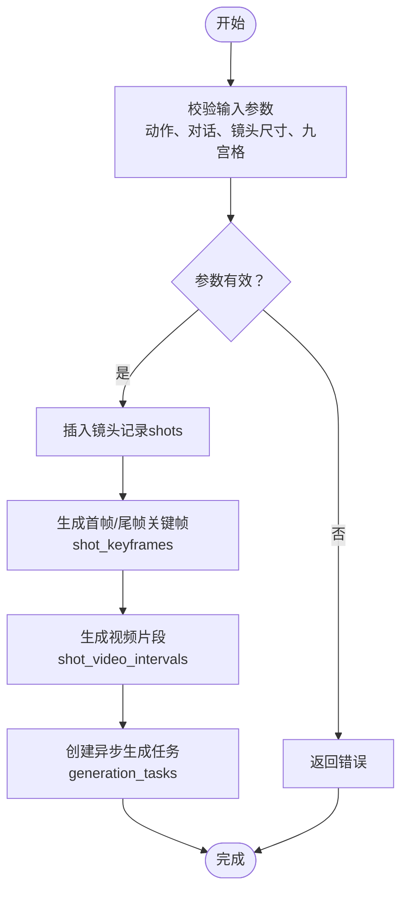

# 表结构设计

<cite>
**本文引用的文件**
- [README.md](file://README.md)
- [package.json](file://package.json)
</cite>

## 目录
1. [简介](#简介)
2. [项目结构](#项目结构)
3. [核心组件](#核心组件)
4. [架构总览](#架构总览)
5. [详细组件分析](#详细组件分析)
6. [依赖分析](#依赖分析)
7. [性能考虑](#性能考虑)
8. [故障排查指南](#故障排查指南)
9. [结论](#结论)
10. [附录](#附录)

## 简介
本文件为 AI Shotlive 的数据库表结构设计文档，聚焦业务表的结构定义、主键与外键设计、索引策略、字段注释、默认值与完整性约束，以及用户隔离字段（user_id、episode_id）的设计理念与实现方式。文档还阐述了“项目-角色-场景-镜头”的层级关系，并提供完整的 DDL 说明与表关系图。

## 项目结构
- 项目采用前后端分离架构，后端使用 Express + MySQL（或本地 SQLite），数据库自动初始化与建表逻辑由服务端脚本负责。
- 数据隔离策略：
  - 用户级隔离：users、projects、novel_chapters、novel_episodes、generation_tasks、asset_library、model_registry、user_preferences、visual_styles 等表通过 user_id 进行隔离。
  - 剧集级隔离：script_characters、character_variations、script_scenes、script_props、story_paragraphs、shots、shot_keyframes、shot_video_intervals、render_logs 等表通过 user_id + episode_id 进行隔离。
- 剧集内数据通过 episode_id 实现独立管理，支持同一项目下多集剧本的并行与隔离。

图表来源
- [README.md:373-397](file://README.md#L373-L397)

章节来源
- [README.md:13,134,373-397](file://README.md#L13-L13,L134-L134,L373-L397)

## 核心组件
本节对所有业务表进行结构定义与约束说明，涵盖字段含义、数据类型、默认值、注释与完整性约束。由于仓库未提供具体 DDL 文件，以下为基于 README 的结构化定义与设计建议，便于后续落地实现。

- users（用户账号）
  - 字段要点：用户标识、用户名、密码哈希、创建/更新时间等。
  - 主键：user_id（自增或 UUID，建议 UUID 以提升安全性与可移植性）。
  - 约束：用户名唯一；密码需安全存储（不可明文）。
  - 隔离：无（全局用户表）。

- projects（项目元数据）
  - 字段要点：项目标题、所属用户、阶段、风格、小说配置等。
  - 主键：project_id。
  - 外键：user_id → users.user_id。
  - 约束：必填字段需校验；风格/阶段枚举化。
  - 隔离：按 user_id 隔离。

- novel_chapters（小说章节）
  - 字段要点：章节内容、排序、所属用户等。
  - 主键：chapter_id。
  - 外键：user_id → users.user_id。
  - 约束：章节内容长度限制；排序唯一性。
  - 隔离：按 user_id 隔离。

- novel_episodes（剧集）
  - 字段要点：剧集标题、章节范围、生成的剧本、状态、所属用户等。
  - 主键：episode_id。
  - 外键：user_id → users.user_id。
  - 约束：状态枚举；章节范围校验。
  - 隔离：按 user_id 隔离。

- script_characters（角色）
  - 字段要点：角色名称、性别、视觉描述、参考图等。
  - 主键：character_id。
  - 外键：user_id → users.user_id；episode_id → novel_episodes.episode_id。
  - 约束：名称唯一性（在同一剧集内按 user_id 维度）；视觉描述长度限制。
  - 隔离：按 user_id + episode_id 隔离。

- character_variations（角色变体/衣橱）
  - 字段要点：角色变体名称、造型描述、参考图等。
  - 主键：variation_id。
  - 外键：user_id → users.user_id；episode_id → novel_episodes.episode_id；character_id → script_characters.character_id。
  - 约束：变体名称唯一性；描述长度限制。
  - 隔离：按 user_id + episode_id 隔离。

- script_scenes（场景）
  - 字段要点：地点、时段、氛围、概念图等。
  - 主键：scene_id。
  - 外键：user_id → users.user_id；episode_id → novel_episodes.episode_id。
  - 约束：地点/时段/氛围描述长度限制。
  - 隔离：按 user_id + episode_id 隔离。

- script_props（道具）
  - 字段要点：分类、描述、参考图等。
  - 主键：prop_id。
  - 外键：user_id → users.user_id；episode_id → novel_episodes.episode_id。
  - 约束：分类与描述长度限制。
  - 隔离：按 user_id + episode_id 隔离。

- story_paragraphs（故事段落与场景关联）
  - 字段要点：段落内容、关联场景等。
  - 主键：paragraph_id。
  - 外键：user_id → users.user_id；episode_id → novel_episodes.episode_id；scene_id → script_scenes.scene_id。
  - 约束：段落内容长度限制。
  - 隔离：按 user_id + episode_id 隔离。

- shots（镜头）
  - 字段要点：动作、对话、镜头尺寸、九宫格等。
  - 主键：shot_id。
  - 外键：user_id → users.user_id；episode_id → novel_episodes.episode_id。
  - 约束：动作/对话/尺寸描述长度限制；九宫格字段为 JSON 结构。
  - 隔离：按 user_id + episode_id 隔离。

- shot_keyframes（关键帧）
  - 字段要点：首帧/尾帧、提示词、图像等。
  - 主键：keyframe_id。
  - 外键：user_id → users.user_id；episode_id → novel_episodes.episode_id；shot_id → shots.shot_id。
  - 约束：提示词与图像路径长度限制；首帧/尾帧一致性校验。
  - 隔离：按 user_id + episode_id 隔离。

- shot_video_intervals（视频片段）
  - 字段要点：起止帧、时长、视频 URL 等。
  - 主键：interval_id。
  - 外键：user_id → users.user_id；episode_id → novel_episodes.episode_id；shot_id → shots.shot_id。
  - 约束：起止帧与时长数值校验；URL 长度限制。
  - 隔离：按 user_id + episode_id 隔离。

- generation_tasks（异步生成任务）
  - 字段要点：任务类型、状态、进度、结果等。
  - 主键：task_id。
  - 外键：user_id → users.user_id。
  - 约束：任务类型/状态枚举；进度百分比校验。
  - 隔离：按 user_id 隔离。

- render_logs（渲染日志）
  - 字段要点：渲染时间线、日志详情等。
  - 主键：log_id。
  - 外键：user_id → users.user_id；episode_id → novel_episodes.episode_id。
  - 约束：日志详情长度限制。
  - 隔离：按 user_id + episode_id 隔离。

- asset_library（共享资产库）
  - 字段要点：资产名称、类型、路径、标签等。
  - 主键：asset_id。
  - 外键：user_id → users.user_id。
  - 约束：资产名称唯一性；路径与标签长度限制。
  - 隔离：按 user_id 隔离。

- model_registry（模型配置）
  - 字段要点：提供商、API Key、激活模型等。
  - 主键：registry_id。
  - 外键：user_id → users.user_id。
  - 约束：提供商枚举；API Key 加密存储；激活模型唯一性。
  - 隔离：按 user_id 隔离。

- user_preferences（用户偏好）
  - 字段要点：主题、引导状态等。
  - 主键：preference_id。
  - 外键：user_id → users.user_id。
  - 约束：主题/引导状态枚举。
  - 隔离：按 user_id 隔离。

- visual_styles（视觉风格）
  - 字段要点：风格名称、提示词配置等。
  - 主键：style_id。
  - 外键：user_id → users.user_id。
  - 约束：风格名称唯一性；提示词长度限制。
  - 隔离：按 user_id 隔离。

章节来源
- [README.md:373-397](file://README.md#L373-L397)

## 架构总览
下图展示了用户、项目、剧集与资产/镜头相关表之间的关系，体现用户隔离与剧集隔离的设计思路。

图表来源
- [README.md:373-397](file://README.md#L373-L397)

## 详细组件分析

### 用户隔离字段设计：user_id
- 设计理念
  - 保障多租户环境下用户数据的强隔离，避免跨用户数据泄露。
  - 通过 user_id 对用户级表（如 users、projects、asset_library、model_registry、user_preferences、visual_styles、generation_tasks）进行强制隔离。
- 实现方式
  - 所有用户级表均包含 user_id 字段，查询/写入操作必须携带当前用户上下文。
  - 在路由层与服务层进行 user_id 校验与注入，确保数据访问边界。

章节来源
- [README.md:373-397](file://README.md#L373-L397)

### 剧集隔离字段设计：episode_id
- 设计理念
  - 剧集是剧本与资产的最小管理单元，同一项目可包含多个剧集，彼此独立。
  - 通过 episode_id 对剧集级表（如 script_characters、character_variations、script_scenes、script_props、story_paragraphs、shots、shot_keyframes、shot_video_intervals、render_logs）进行隔离。
- 实现方式
  - 所有剧集级表均包含 user_id + episode_id 组合，查询/写入操作需同时满足用户与剧集上下文。
  - 在业务流程中，剧集创建后分配唯一 episode_id，并贯穿角色、场景、镜头、关键帧、片段与日志的全链路。

章节来源
- [README.md:373-397](file://README.md#L373-L397)

### 表关系与层级结构
- 项目-角色-场景-镜头的层级关系
  - 项目（projects）包含多个剧集（novel_episodes）。
  - 剧集（novel_episodes）包含角色（script_characters）、场景（script_scenes）、道具（script_props）、故事段落（story_paragraphs）。
  - 镜头（shots）位于剧集层级之下，关联关键帧（shot_keyframes）与视频片段（shot_video_intervals）。
  - 渲染日志（render_logs）记录剧集内的渲染过程与结果。
- 关联关系
  - 用户（users）与项目（projects）一对多。
  - 项目（projects）与剧集（novel_episodes）一对多。
  - 剧集（novel_episodes）与角色/场景/道具/段落/镜头/日志等多对多通过外键约束实现。
  - 镜头（shots）与关键帧（shot_keyframes）、视频片段（shot_video_intervals）一对一/一对多。

章节来源
- [README.md:373-397](file://README.md#L373-L397)

### 关键流程示意：镜头生成与关键帧

图表来源
- [README.md:373-397](file://README.md#L373-L397)

### 复杂逻辑流程：关键帧与片段生成

图表来源
- [README.md:373-397](file://README.md#L373-L397)

## 依赖分析
- 外部依赖
  - MySQL 客户端：mysql2（用于连接与操作 MySQL）。
  - SQLite 客户端：better-sqlite3（用于本地/桌面模式）。
- 依赖来源
  - 包管理文件中声明了 mysql2 与 better-sqlite3，表明系统支持两种数据库后端。

章节来源
- [package.json](file://package.json)

## 性能考虑
- 索引策略建议
  - 用户级表：在 user_id 上建立普通索引，加速按用户过滤。
  - 剧集级表：在 user_id + episode_id 上建立复合索引，优先命中隔离条件。
  - 关联表：在外键字段（如 episode_id、shot_id、character_id 等）上建立索引，提升 JOIN 与子查询性能。
  - 文本搜索：对名称、描述等字段建立全文索引（如适用），优化模糊匹配。
- 查询优化
  - 使用分页查询处理大量章节/镜头/片段数据。
  - 避免 N+1 查询：批量加载关联数据（角色、场景、道具、关键帧、片段）。
- 存储与归档
  - 媒体文件（图片/视频）与数据库分离存储，数据库仅保留路径与元数据。
  - 导出/导入时同步处理数据库与 media 文件夹，确保一致性。

## 故障排查指南
- 常见问题
  - 数据隔离异常：确认请求上下文中 user_id 是否正确传递；检查是否遗漏 episode_id。
  - 外键约束失败：检查关联表的外键值是否存在且合法。
  - 重复数据：角色/资产等唯一性字段冲突，检查唯一索引与业务去重逻辑。
  - 生成任务卡住：检查 generation_tasks 状态与进度字段，核对任务队列与模型提供商配置。
- 排查步骤
  - 核对表结构与索引是否完整。
  - 使用 EXPLAIN 分析慢查询，补充缺失索引。
  - 检查日志表（render_logs）定位渲染异常节点。
  - 验证导出/导入流程，确保数据一致性。

## 结论
本设计文档基于 README 的数据库设计说明，给出了用户隔离与剧集隔离的完整表结构定义、字段注释、外键关系与索引策略建议。通过 user_id 与 episode_id 的双重隔离，系统实现了多用户与多剧集的强隔离与灵活管理。建议在实现阶段严格遵循字段约束与索引策略，确保数据完整性与查询性能。

## 附录
- DDL 说明（示例模板）
  - users：包含 id、username（唯一）、password_hash、created_at、updated_at。
  - projects：包含 id、user_id（FK）、title、phase、style、novel_config、created_at、updated_at。
  - novel_episodes：包含 id、user_id（FK）、title、chapter_start、chapter_end、script_data、status、created_at、updated_at。
  - script_characters：包含 id、user_id（FK）、episode_id（FK）、name、gender、visual_desc、ref_image_url、created_at、updated_at。
  - character_variations：包含 id、user_id（FK）、episode_id（FK）、character_id（FK）、variation_name、desc、ref_image_url、created_at、updated_at。
  - script_scenes：包含 id、user_id（FK）、episode_id（FK）、location、time_of_day、atmosphere、concept_image_url、created_at、updated_at。
  - script_props：包含 id、user_id（FK）、episode_id（FK）、category、desc、ref_image_url、created_at、updated_at。
  - story_paragraphs：包含 id、user_id（FK）、episode_id（FK）、scene_id（FK）、content、created_at、updated_at。
  - shots：包含 id、user_id（FK）、episode_id（FK）、action、dialogue、shot_size、nine_grid、created_at、updated_at。
  - shot_keyframes：包含 id、user_id（FK）、episode_id（FK）、shot_id（FK）、first_frame_prompt、last_frame_prompt、first_frame_url、last_frame_url、created_at、updated_at。
  - shot_video_intervals：包含 id、user_id（FK）、episode_id（FK）、shot_id（FK）、start_frame、end_frame、duration_ms、video_url、created_at、updated_at。
  - render_logs：包含 id、user_id（FK）、episode_id（FK）、log_content、created_at。
  - asset_library：包含 id、user_id（FK）、name、type、path、tags、created_at、updated_at。
  - model_registry：包含 id、user_id（FK）、provider、api_key_hash、active_model、created_at、updated_at。
  - user_preferences：包含 id、user_id（FK）、theme、onboarding_state、created_at、updated_at。
  - visual_styles：包含 id、user_id（FK）、name、prompt_config、created_at、updated_at。
  - generation_tasks：包含 id、user_id（FK）、task_type、status、progress_percent、result、created_at、updated_at。
- 索引建议
  - 用户级表：user_id（普通索引）。
  - 剧集级表：user_id + episode_id（复合索引）。
  - 关联表：外键字段（如 episode_id、shot_id、character_id 等）建立索引。
- 默认值与约束
  - 时间戳字段：默认 CURRENT_TIMESTAMP。
  - 枚举字段：状态、类型等使用枚举或受限集合。
  - 长文本字段：使用 TEXT 或 JSON，注意长度限制与索引策略。
  - 唯一性：用户名、资产名称、激活模型等字段需唯一性约束。

章节来源
- [README.md:373-397](file://README.md#L373-L397)