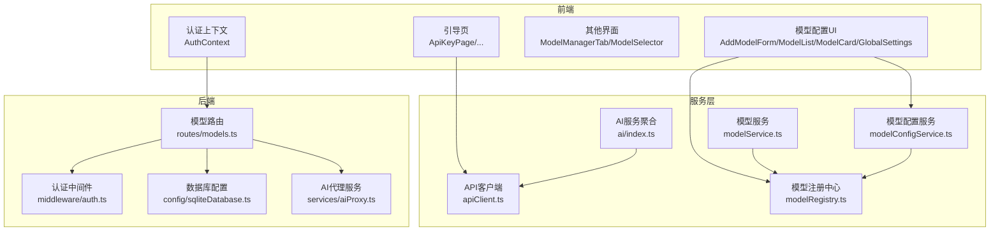
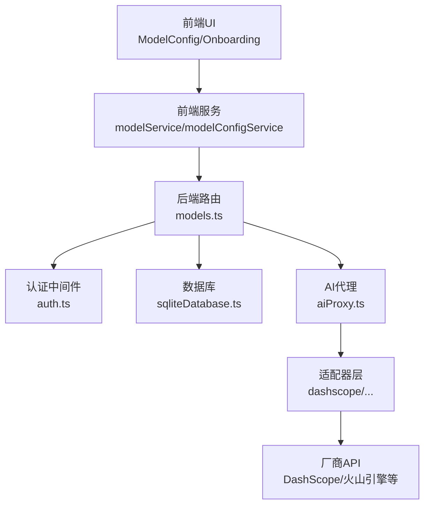
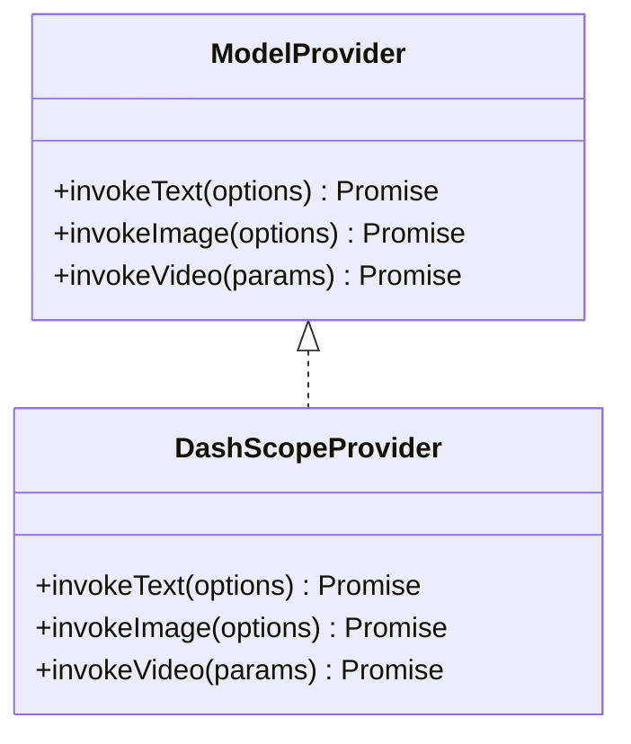
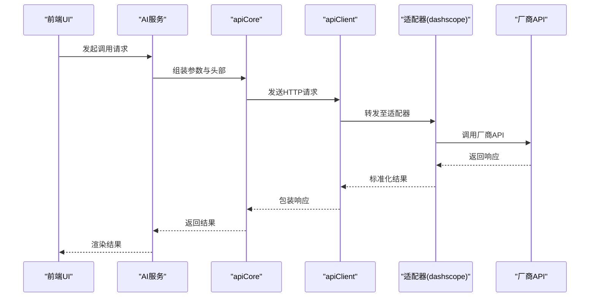
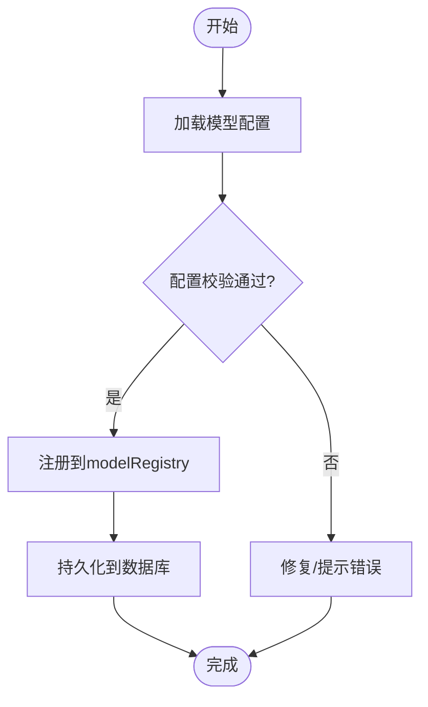
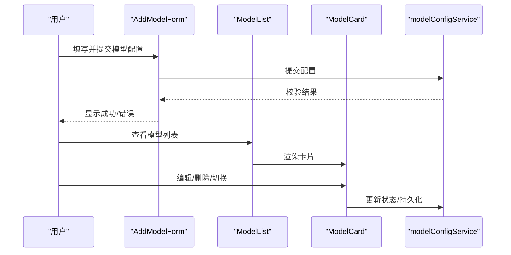
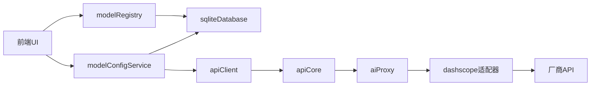

# AI模型配置系统

<cite>
**本文档引用的文件**
- [App.tsx](file://App.tsx)
- [src/services/ai/index.ts](file://src/services/ai/index.ts)
- [src/services/ai/types.ts](file://src/services/ai/types.ts)
- [src/services/ai/dashscope.ts](file://src/services/ai/dashscope.ts)
- [src/services/ai/videoService.ts](file://src/services/ai/videoService.ts)
- [src/services/ai/imageService.ts](file://src/services/ai/imageService.ts)
- [src/services/ai/scriptService.ts](file://src/services/ai/scriptService.ts)
- [src/services/ai/novelScriptService.ts](file://src/services/ai/novelScriptService.ts)
- [src/services/ai/shotService.ts](file://src/services/ai/shotService.ts)
- [src/services/ai/visualService.ts](file://src/services/ai/visualService.ts)
- [src/services/ai/apiCore.ts](file://src/services/ai/apiCore.ts)
- [src/services/ai/promptConstants.ts](file://src/services/ai/promptConstants.ts)
- [src/services/aiService.ts](file://src/services/aiService.ts)
- [src/services/apiClient.ts](file://src/services/apiClient.ts)
- [src/services/modelService.ts](file://src/services/modelService.ts)
- [src/services/modelRegistry.ts](file://src/services/modelRegistry.ts)
- [src/services/modelConfigService.ts](file://src/services/modelConfigService.ts)
- [components/ModelConfig/AddModelForm.tsx](file://components/ModelConfig/AddModelForm.tsx)
- [components/ModelConfig/GlobalSettings.tsx](file://components/ModelConfig/GlobalSettings.tsx)
- [components/ModelConfig/ModelCard.tsx](file://components/ModelConfig/ModelCard.tsx)
- [components/ModelConfig/ModelList.tsx](file://components/ModelConfig/ModelList.tsx)
- [components/ModelManagerTab.tsx](file://components/ModelManagerTab.tsx)
- [components/ModelSelector.tsx](file://components/ModelSelector.tsx)
- [components/Onboarding/ApiKeyPage.tsx](file://components/Onboarding/ApiKeyPage.tsx)
- [components/Onboarding/constants.ts](file://components/Onboarding/constants.ts)
- [contexts/AuthContext.tsx](file://contexts/AuthContext.tsx)
- [server/src/routes/models.ts](file://server/src/routes/models.ts)
- [server/src/config/database.ts](file://server/src/config/database.ts)
- [server/src/config/sqliteDatabase.ts](file://server/src/config/sqliteDatabase.ts)
- [server/src/middleware/auth.ts](file://server/src/middleware/auth.ts)
- [server/src/services/aiProxy.ts](file://server/src/services/aiProxy.ts)
- [server/src/services/projectStorage.ts](file://server/src/services/projectStorage.ts)
- [server/src/utils/projectMutex.ts](file://server/src/utils/projectMutex.ts)
- [types/model.ts](file://types/model.ts)
</cite>

## 目录
1. [简介](#简介)
2. [项目结构](#项目结构)
3. [核心组件](#核心组件)
4. [架构总览](#架构总览)
5. [详细组件分析](#详细组件分析)
6. [依赖关系分析](#依赖关系分析)
7. [性能考虑](#性能考虑)
8. [故障排除指南](#故障排除指南)
9. [结论](#结论)
10. [附录](#附录)

## 简介
本系统是一个面向多厂商AI模型的配置与管理平台，支持模型抽象层设计、适配器模式应用、动态模型注册机制，以及API Key管理、模型配置切换、模型验证、配置持久化、安全存储与权限控制等能力。系统通过前端组件与后端服务的协作，提供从模型接入到运行时调度的完整链路，并预留扩展点以支持未来多厂商Provider的切换与负载均衡、故障转移等高级特性。

## 项目结构
系统采用前后端分离架构，前端基于React组件化模块（如模型配置UI、引导页、认证上下文），后端提供REST路由、数据库配置与中间件，服务层封装AI能力与业务逻辑，适配器层负责对接不同厂商的API。

**图表来源**
- [App.tsx](file://App.tsx)
- [src/services/ai/index.ts](file://src/services/ai/index.ts)
- [src/services/apiClient.ts](file://src/services/apiClient.ts)
- [src/services/modelService.ts](file://src/services/modelService.ts)
- [src/services/modelRegistry.ts](file://src/services/modelRegistry.ts)
- [src/services/modelConfigService.ts](file://src/services/modelConfigService.ts)
- [server/src/routes/models.ts](file://server/src/routes/models.ts)
- [server/src/middleware/auth.ts](file://server/src/middleware/auth.ts)
- [server/src/config/sqliteDatabase.ts](file://server/src/config/sqliteDatabase.ts)
- [server/src/services/aiProxy.ts](file://server/src/services/aiProxy.ts)

**章节来源**
- [App.tsx](file://App.tsx)
- [src/services/ai/index.ts](file://src/services/ai/index.ts)
- [server/src/routes/models.ts](file://server/src/routes/models.ts)

## 核心组件
- 模型抽象层与Provider管理：通过统一的ModelProvider接口与getAIProvider/重置机制，实现对单一Provider的懒加载与可替换性，为未来多Provider切换预留空间。
- 适配器模式：在AI服务中以适配器形式封装不同厂商的API调用细节，对外暴露一致的文本、图像、视频等服务接口。
- 动态模型注册：通过modelRegistry集中注册与发现模型，结合modelConfigService进行配置持久化与校验。
- 前端模型配置UI：提供模型添加表单、列表展示、卡片视图与全局设置入口，支撑模型生命周期管理。
- 后端路由与中间件：models路由负责模型配置的增删改查，认证中间件保障访问安全，数据库配置提供数据持久化基础。
- 引导与API Key管理：Onboarding页面引导用户完成API Key配置，确保后续模型调用的安全与合规。

**章节来源**
- [src/services/ai/index.ts](file://src/services/ai/index.ts)
- [src/services/ai/types.ts](file://src/services/ai/types.ts)
- [src/services/modelRegistry.ts](file://src/services/modelRegistry.ts)
- [src/services/modelConfigService.ts](file://src/services/modelConfigService.ts)
- [components/ModelConfig/AddModelForm.tsx](file://components/ModelConfig/AddModelForm.tsx)
- [components/ModelConfig/ModelList.tsx](file://components/ModelConfig/ModelList.tsx)
- [components/ModelConfig/ModelCard.tsx](file://components/ModelConfig/ModelCard.tsx)
- [components/ModelConfig/GlobalSettings.tsx](file://components/ModelConfig/GlobalSettings.tsx)
- [components/Onboarding/ApiKeyPage.tsx](file://components/Onboarding/ApiKeyPage.tsx)
- [server/src/routes/models.ts](file://server/src/routes/models.ts)
- [server/src/middleware/auth.ts](file://server/src/middleware/auth.ts)
- [server/src/config/sqliteDatabase.ts](file://server/src/config/sqliteDatabase.ts)

## 架构总览
系统采用分层架构：表现层（React组件）、服务层（AI聚合、模型管理、API客户端）、后端（路由、中间件、数据库）与适配器层（厂商API适配）。整体数据流从UI发起配置请求，经由服务层与后端路由，最终落库或调用外部厂商API。

**图表来源**
- [components/ModelConfig/AddModelForm.tsx](file://components/ModelConfig/AddModelForm.tsx)
- [src/services/modelService.ts](file://src/services/modelService.ts)
- [src/services/modelConfigService.ts](file://src/services/modelConfigService.ts)
- [server/src/routes/models.ts](file://server/src/routes/models.ts)
- [server/src/middleware/auth.ts](file://server/src/middleware/auth.ts)
- [server/src/config/sqliteDatabase.ts](file://server/src/config/sqliteDatabase.ts)
- [server/src/services/aiProxy.ts](file://server/src/services/aiProxy.ts)
- [src/services/ai/dashscope.ts](file://src/services/ai/dashscope.ts)

## 详细组件分析

### 模型抽象层与Provider管理
- 设计要点
  - 统一ModelProvider接口，屏蔽具体厂商差异。
  - 懒加载与单例Provider，支持resetProvider以触发重建。
  - 通过createDashScopeProvider创建默认Provider，为后续多Provider切换奠定基础。
- 关键文件
  - [src/services/ai/index.ts](file://src/services/ai/index.ts)
  - [src/services/ai/types.ts](file://src/services/ai/types.ts)
  - [src/services/ai/dashscope.ts](file://src/services/ai/dashscope.ts)

**图表来源**
- [src/services/ai/types.ts](file://src/services/ai/types.ts)
- [src/services/ai/dashscope.ts](file://src/services/ai/dashscope.ts)

**章节来源**
- [src/services/ai/index.ts](file://src/services/ai/index.ts)
- [src/services/ai/types.ts](file://src/services/ai/types.ts)
- [src/services/ai/dashscope.ts](file://src/services/ai/dashscope.ts)

### 适配器模式与多厂商集成
- 设计要点
  - 适配器封装厂商API调用细节，统一输入输出格式。
  - 支持文本、图像、视频等服务能力，便于上层按需选择。
  - 通过apiCore与apiClient进行HTTP请求与错误处理。
- 关键文件
  - [src/services/ai/apiCore.ts](file://src/services/ai/apiCore.ts)
  - [src/services/apiClient.ts](file://src/services/apiClient.ts)
  - [src/services/ai/dashscope.ts](file://src/services/ai/dashscope.ts)

**图表来源**
- [src/services/ai/apiCore.ts](file://src/services/ai/apiCore.ts)
- [src/services/apiClient.ts](file://src/services/apiClient.ts)
- [src/services/ai/dashscope.ts](file://src/services/ai/dashscope.ts)

**章节来源**
- [src/services/ai/apiCore.ts](file://src/services/ai/apiCore.ts)
- [src/services/apiClient.ts](file://src/services/apiClient.ts)
- [src/services/ai/dashscope.ts](file://src/services/ai/dashscope.ts)

### 动态模型注册机制
- 设计要点
  - modelRegistry集中注册模型元信息与能力描述。
  - modelConfigService负责配置的读取、校验与持久化。
  - modelService协调注册与运行时选择。
- 关键文件
  - [src/services/modelRegistry.ts](file://src/services/modelRegistry.ts)
  - [src/services/modelConfigService.ts](file://src/services/modelConfigService.ts)
  - [src/services/modelService.ts](file://src/services/modelService.ts)

**图表来源**
- [src/services/modelConfigService.ts](file://src/services/modelConfigService.ts)
- [src/services/modelRegistry.ts](file://src/services/modelRegistry.ts)
- [server/src/config/sqliteDatabase.ts](file://server/src/config/sqliteDatabase.ts)

**章节来源**
- [src/services/modelRegistry.ts](file://src/services/modelRegistry.ts)
- [src/services/modelConfigService.ts](file://src/services/modelConfigService.ts)
- [src/services/modelService.ts](file://src/services/modelService.ts)

### 前端模型配置UI与交互
- 组件职责
  - AddModelForm：新增模型配置表单，收集必要字段并提交。
  - ModelList/ModelCard：展示已配置模型列表与卡片视图，支持编辑/删除/启用/禁用。
  - GlobalSettings：全局模型相关设置入口。
  - ModelManagerTab/ModelSelector：管理与选择当前使用的模型。
- 关键文件
  - [components/ModelConfig/AddModelForm.tsx](file://components/ModelConfig/AddModelForm.tsx)
  - [components/ModelConfig/ModelList.tsx](file://components/ModelConfig/ModelList.tsx)
  - [components/ModelConfig/ModelCard.tsx](file://components/ModelConfig/ModelCard.tsx)
  - [components/ModelConfig/GlobalSettings.tsx](file://components/ModelConfig/GlobalSettings.tsx)
  - [components/ModelManagerTab.tsx](file://components/ModelManagerTab.tsx)
  - [components/ModelSelector.tsx](file://components/ModelSelector.tsx)

**图表来源**
- [components/ModelConfig/AddModelForm.tsx](file://components/ModelConfig/AddModelForm.tsx)
- [components/ModelConfig/ModelList.tsx](file://components/ModelConfig/ModelList.tsx)
- [components/ModelConfig/ModelCard.tsx](file://components/ModelConfig/ModelCard.tsx)
- [src/services/modelConfigService.ts](file://src/services/modelConfigService.ts)

**章节来源**
- [components/ModelConfig/AddModelForm.tsx](file://components/ModelConfig/AddModelForm.tsx)
- [components/ModelConfig/ModelList.tsx](file://components/ModelConfig/ModelList.tsx)
- [components/ModelConfig/ModelCard.tsx](file://components/ModelConfig/ModelCard.tsx)
- [components/ModelConfig/GlobalSettings.tsx](file://components/ModelConfig/GlobalSettings.tsx)
- [components/ModelManagerTab.tsx](file://components/ModelManagerTab.tsx)
- [components/ModelSelector.tsx](file://components/ModelSelector.tsx)
- [src/services/modelConfigService.ts](file://src/services/modelConfigService.ts)

### 引导与API Key管理
- 设计要点
  - Onboarding引导用户完成API Key配置，确保后续调用可用。
  - constants定义引导流程常量与步骤。
  - AuthContext提供认证上下文，保障受保护资源访问。
- 关键文件
  - [components/Onboarding/ApiKeyPage.tsx](file://components/Onboarding/ApiKeyPage.tsx)
  - [components/Onboarding/constants.ts](file://components/Onboarding/constants.ts)
  - [contexts/AuthContext.tsx](file://contexts/AuthContext.tsx)

**章节来源**
- [components/Onboarding/ApiKeyPage.tsx](file://components/Onboarding/ApiKeyPage.tsx)
- [components/Onboarding/constants.ts](file://components/Onboarding/constants.ts)
- [contexts/AuthContext.tsx](file://contexts/AuthContext.tsx)

### 后端路由、中间件与数据库
- 设计要点
  - models路由处理模型配置的CRUD操作。
  - 认证中间件确保只有授权用户可访问。
  - sqliteDatabase提供本地数据库配置，支持配置持久化。
  - aiProxy作为后端代理，转发请求至适配器层。
- 关键文件
  - [server/src/routes/models.ts](file://server/src/routes/models.ts)
  - [server/src/middleware/auth.ts](file://server/src/middleware/auth.ts)
  - [server/src/config/sqliteDatabase.ts](file://server/src/config/sqliteDatabase.ts)
  - [server/src/services/aiProxy.ts](file://server/src/services/aiProxy.ts)

**章节来源**
- [server/src/routes/models.ts](file://server/src/routes/models.ts)
- [server/src/middleware/auth.ts](file://server/src/middleware/auth.ts)
- [server/src/config/sqliteDatabase.ts](file://server/src/config/sqliteDatabase.ts)
- [server/src/services/aiProxy.ts](file://server/src/services/aiProxy.ts)

### AI服务能力与提示词管理
- 设计要点
  - videoService、imageService、scriptService、novelScriptService、shotService、visualService分别封装对应领域的AI能力。
  - promptConstants集中管理提示词模板，便于复用与维护。
  - aiService作为统一入口，协调各子服务。
- 关键文件
  - [src/services/ai/videoService.ts](file://src/services/ai/videoService.ts)
  - [src/services/ai/imageService.ts](file://src/services/ai/imageService.ts)
  - [src/services/ai/scriptService.ts](file://src/services/ai/scriptService.ts)
  - [src/services/ai/novelScriptService.ts](file://src/services/ai/novelScriptService.ts)
  - [src/services/ai/shotService.ts](file://src/services/ai/shotService.ts)
  - [src/services/ai/visualService.ts](file://src/services/ai/visualService.ts)
  - [src/services/ai/promptConstants.ts](file://src/services/ai/promptConstants.ts)
  - [src/services/aiService.ts](file://src/services/aiService.ts)

**章节来源**
- [src/services/ai/videoService.ts](file://src/services/ai/videoService.ts)
- [src/services/ai/imageService.ts](file://src/services/ai/imageService.ts)
- [src/services/ai/scriptService.ts](file://src/services/ai/scriptService.ts)
- [src/services/ai/novelScriptService.ts](file://src/services/ai/novelScriptService.ts)
- [src/services/ai/shotService.ts](file://src/services/ai/shotService.ts)
- [src/services/ai/visualService.ts](file://src/services/ai/visualService.ts)
- [src/services/ai/promptConstants.ts](file://src/services/ai/promptConstants.ts)
- [src/services/aiService.ts](file://src/services/aiService.ts)

## 依赖关系分析
- 组件耦合
  - 前端UI组件依赖modelConfigService与modelRegistry进行数据读写与注册。
  - 服务层依赖apiClient与apiCore进行网络通信与错误处理。
  - 后端路由依赖认证中间件与数据库配置，同时通过aiProxy调用适配器。
- 外部依赖
  - 厂商API（如DashScope）通过适配器接入。
  - 数据库存储模型配置与项目数据。

**图表来源**
- [src/services/modelConfigService.ts](file://src/services/modelConfigService.ts)
- [src/services/modelRegistry.ts](file://src/services/modelRegistry.ts)
- [server/src/config/sqliteDatabase.ts](file://server/src/config/sqliteDatabase.ts)
- [src/services/apiClient.ts](file://src/services/apiClient.ts)
- [src/services/ai/apiCore.ts](file://src/services/ai/apiCore.ts)
- [server/src/services/aiProxy.ts](file://server/src/services/aiProxy.ts)
- [src/services/ai/dashscope.ts](file://src/services/ai/dashscope.ts)

**章节来源**
- [src/services/modelConfigService.ts](file://src/services/modelConfigService.ts)
- [src/services/modelRegistry.ts](file://src/services/modelRegistry.ts)
- [server/src/config/sqliteDatabase.ts](file://server/src/config/sqliteDatabase.ts)
- [src/services/apiClient.ts](file://src/services/apiClient.ts)
- [src/services/ai/apiCore.ts](file://src/services/ai/apiCore.ts)
- [server/src/services/aiProxy.ts](file://server/src/services/aiProxy.ts)
- [src/services/ai/dashscope.ts](file://src/services/ai/dashscope.ts)

## 性能考虑
- 请求合并与缓存
  - 对重复的模型配置查询可引入本地缓存，减少后端压力。
  - 对高频调用的提示词与模板可进行内存缓存。
- 并发控制
  - 使用projectMutex避免并发写入导致的数据不一致。
- 超时与重试
  - 在apiCore中设置合理的超时与指数退避重试策略，提升稳定性。
- 负载均衡与故障转移
  - 当前Provider为单实例；建议在Provider内部或代理层增加多节点轮询与健康检查，实现故障转移与自动恢复。

**章节来源**
- [server/src/utils/projectMutex.ts](file://server/src/utils/projectMutex.ts)
- [src/services/ai/apiCore.ts](file://src/services/ai/apiCore.ts)
- [server/src/services/aiProxy.ts](file://server/src/services/aiProxy.ts)

## 故障排除指南
- 配置校验失败
  - 检查模型配置字段是否完整，参考modelConfigService的校验逻辑。
  - 确认数据库连接正常，查看sqliteDatabase初始化日志。
- 认证失败
  - 确认请求头携带有效令牌，检查auth中间件拦截规则。
- 适配器调用异常
  - 查看apiClient与apiCore的错误处理分支，定位具体厂商API返回码。
  - 检查网络连通性与厂商API可用性。
- 并发冲突
  - 若出现数据写入冲突，检查projectMutex使用是否正确。

**章节来源**
- [src/services/modelConfigService.ts](file://src/services/modelConfigService.ts)
- [server/src/config/sqliteDatabase.ts](file://server/src/config/sqliteDatabase.ts)
- [server/src/middleware/auth.ts](file://server/src/middleware/auth.ts)
- [src/services/apiClient.ts](file://src/services/apiClient.ts)
- [src/services/ai/apiCore.ts](file://src/services/ai/apiCore.ts)
- [server/src/utils/projectMutex.ts](file://server/src/utils/projectMutex.ts)

## 结论
本系统通过清晰的分层架构与适配器模式，实现了多厂商模型的统一接入与管理。前端提供完善的模型配置UI，后端提供安全的路由与持久化能力，服务层封装了丰富的AI能力与统一的调用入口。未来可在Provider内部实现多节点负载均衡与故障转移，进一步提升系统的可用性与扩展性。

## 附录
- 新模型接入流程
  - 在适配器层新增厂商适配器，遵循统一接口规范。
  - 在modelRegistry中注册新模型元信息。
  - 在前端ModelConfig中完善表单与展示逻辑。
  - 在后端models路由中完善鉴权与持久化逻辑。
- 配置模板管理
  - 将常用提示词与模板集中管理于promptConstants，便于复用与版本控制。
- 批量操作
  - 可在后端models路由中扩展批量导入/导出接口，前端提供批量选择与确认。
- 监控告警
  - 在apiCore中记录请求耗时与错误码，结合日志系统实现告警。
- 安全与权限
  - 严格使用auth中间件，确保敏感配置与调用仅限授权用户访问。
- 性能评估
  - 建立基准测试集，对比不同Provider与模型的响应时间与质量指标。