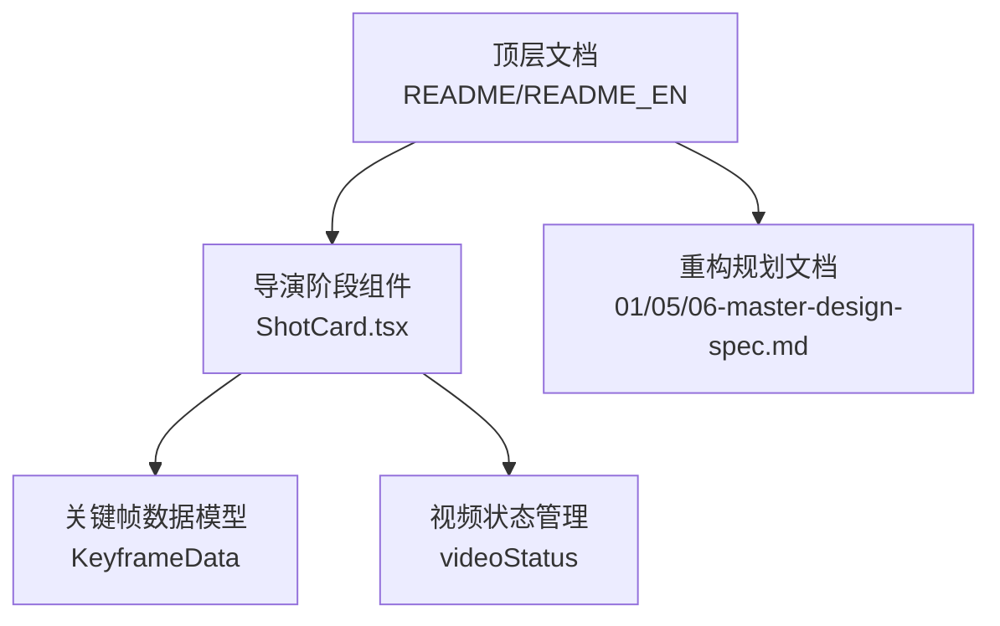
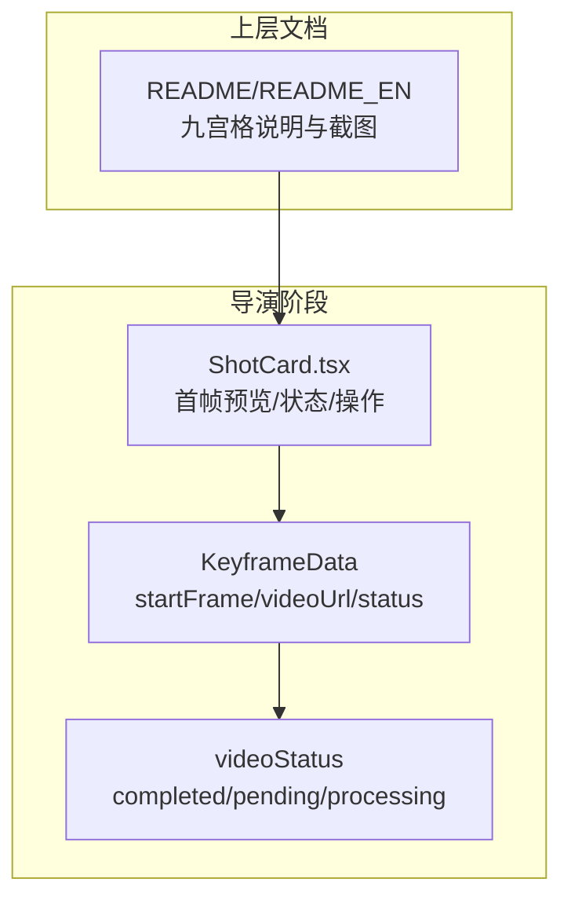
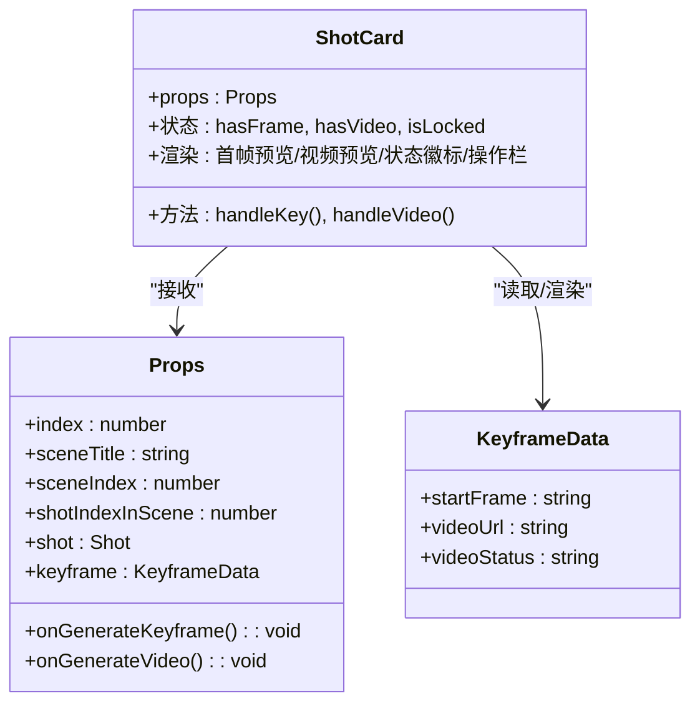
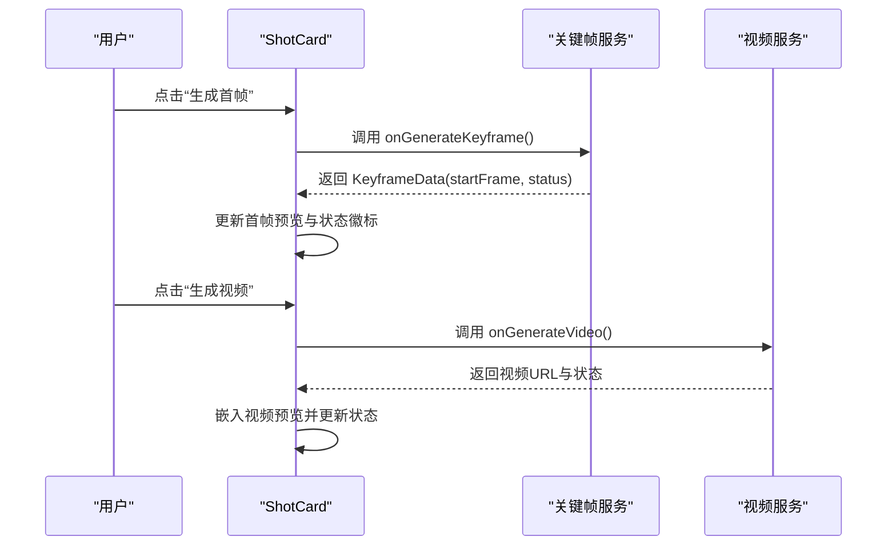
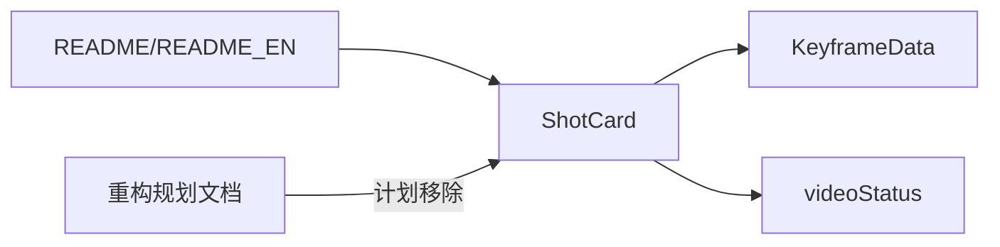

# 九宫格预览系统

<cite>
**本文引用的文件**
- [README.md](file://README.md)
- [README_EN.md](file://README_EN.md)
- [ShotCard.tsx](file://src/phases/director/components/ShotCard.tsx)
- [01-system-overview.md](file://docs/refactor/01-system-overview.md)
- [05-adaptive-evolution.md](file://docs/refactor/05-adaptive-evolution.md)
- [06-master-design-spec.md](file://docs/refactor/06-master-design-spec.md)
</cite>

## 目录
1. [引言](#引言)
2. [项目结构](#项目结构)
3. [核心组件](#核心组件)
4. [架构总览](#架构总览)
5. [详细组件分析](#详细组件分析)
6. [依赖分析](#依赖分析)
7. [性能考虑](#性能考虑)
8. [故障排查指南](#故障排查指南)
9. [结论](#结论)
10. [附录](#附录)

## 引言
本技术文档围绕“九宫格预览系统”展开，目标是为用户提供从概念到实现的完整理解，涵盖九宫格模式的触发条件、面板生成机制、图像裁剪与拼接思路、与关键帧生成的协作关系、状态生命周期、配置与优化策略，以及在视频生成中的应用场景与最佳实践。  
根据仓库现有资料，当前系统以“镜头首帧预览”为核心入口，九宫格作为一种“多视角预览”的展示形态被提及，但实际代码中并未发现独立的九宫格组件文件。本文将基于现有证据进行严谨分析，并对缺失部分给出清晰的说明与建议。

章节来源
- [README.md:36-40](file://README.md#L36-L40)
- [README_EN.md:27-31](file://README_EN.md#L27-L31)

## 项目结构
- 顶层文档与说明：README 中包含九宫格示意图与功能定位，体现其在“分镜与成片”流程中的作用。
- 源码位置：九宫格相关代码在重构文档中被标记为“0 matches”，且计划移除，表明当前仓库中不存在独立的九宫格组件文件。
- 关键实现线索：导演阶段的“镜头卡片（ShotCard）”负责首帧预览与关键帧状态管理，是九宫格预览能力的直接承载者。

图表来源
- [README.md:36-40](file://README.md#L36-L40)
- [README_EN.md:27-31](file://README_EN.md#L27-L31)
- [ShotCard.tsx:11-20](file://src/phases/director/components/ShotCard.tsx#L11-L20)
- [01-system-overview.md:165](file://docs/refactor/01-system-overview.md#L165)
- [05-adaptive-evolution.md:207](file://docs/refactor/05-adaptive-evolution.md#L207)
- [06-master-design-spec.md:89](file://docs/refactor/06-master-design-spec.md#L89)

章节来源
- [README.md:36-40](file://README.md#L36-L40)
- [README_EN.md:27-31](file://README_EN.md#L27-L31)
- [01-system-overview.md:165](file://docs/refactor/01-system-overview.md#L165)
- [05-adaptive-evolution.md:207](file://docs/refactor/05-adaptive-evolution.md#L207)
- [06-master-design-spec.md:89](file://docs/refactor/06-master-design-spec.md#L89)

## 核心组件
- 镜头卡片（ShotCard）：负责渲染单个镜头的首帧预览、关键帧状态显示、生成首帧与生成视频的操作入口。该组件直接体现了“九宫格预览”的落地形式——以首帧图像作为九宫格的整图或单格来源。
- 关键帧数据模型（KeyframeData）：包含首帧图像地址、视频地址、状态等字段，是九宫格预览的数据基础。
- 视频状态管理（videoStatus）：用于控制 UI 的可用性与视觉反馈，如渲染中、已完成、排队中等。

章节来源
- [ShotCard.tsx:11-20](file://src/phases/director/components/ShotCard.tsx#L11-L20)
- [ShotCard.tsx:37-42](file://src/phases/director/components/ShotCard.tsx#L37-L42)
- [ShotCard.tsx:117-150](file://src/phases/director/components/ShotCard.tsx#L117-L150)

## 架构总览
下图展示了九宫格预览在当前系统中的位置与交互关系：顶层文档定义了九宫格的概念与用途；导演阶段的镜头卡片承载首帧预览与关键帧状态；状态驱动 UI 行为与用户交互。

图表来源
- [README.md:36-40](file://README.md#L36-L40)
- [README_EN.md:27-31](file://README_EN.md#L27-L31)
- [ShotCard.tsx:11-20](file://src/phases/director/components/ShotCard.tsx#L11-L20)
- [ShotCard.tsx:37-42](file://src/phases/director/components/ShotCard.tsx#L37-L42)

## 详细组件分析

### 组件一：镜头卡片（ShotCard）
- 职责与行为
  - 渲染镜头编号、场景信息与状态徽标。
  - 展示首帧图像或占位样式；支持嵌入式视频预览。
  - 提供“生成首帧/重绘首帧”“生成视频/重新拍摄”两类操作按钮，并依据状态禁用或高亮。
  - 在处理中状态显示扫描条动画，提升感知反馈。
- 数据与状态
  - 使用 KeyframeData 的 startFrame 与 videoUrl 决定首帧与视频预览的呈现。
  - videoStatus 控制按钮可用性与背景高亮，确保并发安全与一致性。
- 用户交互
  - 通过 onGenerateKeyframe 与 onGenerateVideo 回调与上层协作，完成关键帧与视频生成任务。

图表来源
- [ShotCard.tsx:11-20](file://src/phases/director/components/ShotCard.tsx#L11-L20)
- [ShotCard.tsx:37-42](file://src/phases/director/components/ShotCard.tsx#L37-L42)
- [ShotCard.tsx:117-150](file://src/phases/director/components/ShotCard.tsx#L117-L150)
- [ShotCard.tsx:203-265](file://src/phases/director/components/ShotCard.tsx#L203-L265)

章节来源
- [ShotCard.tsx:11-20](file://src/phases/director/components/ShotCard.tsx#L11-L20)
- [ShotCard.tsx:37-42](file://src/phases/director/components/ShotCard.tsx#L37-L42)
- [ShotCard.tsx:117-150](file://src/phases/director/components/ShotCard.tsx#L117-L150)
- [ShotCard.tsx:203-265](file://src/phases/director/components/ShotCard.tsx#L203-L265)

### 流程分析：九宫格预览触发与关键帧协作
- 触发条件
  - 当某镜头尚未生成首帧时，用户点击“生成首帧/重绘首帧”按钮，触发关键帧生成流程。
  - 关键帧生成完成后，首帧图像进入 KeyframeData.startFrame，随后可在镜头卡片中预览。
- 面板生成机制
  - 九宫格的“整图”来源于首帧图像；“单格”来源于对整图的裁剪与拼接（具体算法在当前仓库未实现，需另行扩展）。
- 与关键帧生成的协作
  - ShotCard 通过回调 onGenerateKeyframe 与 onGenerateVideo 将用户操作转化为关键帧与视频生成任务。
  - videoStatus 作为统一的状态信号，驱动 UI 的可用性与视觉反馈。

图表来源
- [ShotCard.tsx:43-69](file://src/phases/director/components/ShotCard.tsx#L43-L69)
- [ShotCard.tsx:117-150](file://src/phases/director/components/ShotCard.tsx#L117-L150)
- [ShotCard.tsx:181-190](file://src/phases/director/components/ShotCard.tsx#L181-L190)

章节来源
- [ShotCard.tsx:43-69](file://src/phases/director/components/ShotCard.tsx#L43-L69)
- [ShotCard.tsx:117-150](file://src/phases/director/components/ShotCard.tsx#L117-L150)
- [ShotCard.tsx:181-190](file://src/phases/director/components/ShotCard.tsx#L181-L190)

### 算法与实现要点（当前仓库未实现，仅作设计建议）
- 图像裁剪与拼接
  - 输入：首帧整图
  - 输出：九宫格图像（3x3）
  - 建议：按等比分割，保留边缘留白，统一缩放至目标分辨率，最后拼接为九宫格。
- 面板生成机制
  - 九宫格整图：直接使用首帧整图。
  - 九宫格单格：对整图进行 3x3 分割，生成 9 张子图。
- 存储与管理
  - 建议将九宫格图像与原始首帧、关键帧元数据一起持久化，便于回溯与复用。
- 状态生命周期
  - 未生成 → 生成中 → 已生成（含整图与单格）→ 可选导出/复用。

（本小节为设计建议，不对应具体源码）

## 依赖分析
- 文档依赖：顶层 README/README_EN 定义九宫格概念与截图，是系统理解的起点。
- 代码依赖：ShotCard 依赖 KeyframeData 与 videoStatus，形成“数据—状态—UI”的闭环。
- 重构依赖：重构文档明确指出九宫格相关代码为 0 匹配，且计划移除，表明当前实现并不包含独立的九宫格组件。

图表来源
- [README.md:36-40](file://README.md#L36-L40)
- [README_EN.md:27-31](file://README_EN.md#L27-L31)
- [ShotCard.tsx:11-20](file://src/phases/director/components/ShotCard.tsx#L11-L20)
- [05-adaptive-evolution.md:207](file://docs/refactor/05-adaptive-evolution.md#L207)
- [06-master-design-spec.md:89](file://docs/refactor/06-master-design-spec.md#L89)

章节来源
- [README.md:36-40](file://README.md#L36-L40)
- [README_EN.md:27-31](file://README_EN.md#L27-L31)
- [05-adaptive-evolution.md:207](file://docs/refactor/05-adaptive-evolution.md#L207)
- [06-master-design-spec.md:89](file://docs/refactor/06-master-design-spec.md#L89)

## 性能考虑
- 首帧与视频预览的资源加载
  - 使用合适的图片格式与压缩参数，避免超大文件导致加载缓慢。
  - 对于视频预览，采用流式播放与懒加载策略，减少初始渲染压力。
- 并发与状态控制
  - 通过 videoStatus 与忙碌态（busyKey/busyVid）防止重复提交与竞态。
- 动画与反馈
  - 渲染中扫描条动画应轻量，避免额外性能开销。
- 九宫格扩展的性能
  - 若引入九宫格裁剪/拼接，建议在后台线程或 Web Worker 中执行，避免阻塞主线程。

（本节为通用性能建议，不直接分析具体文件）

## 故障排查指南
- 无法生成首帧
  - 检查 onGenerateKeyframe 回调是否正确实现与调用。
  - 关注错误弹窗与日志输出，确认网络与服务端状态。
- 视频状态异常
  - videoStatus 不一致可能导致按钮不可用或样式异常，需同步状态机。
- 预览空白
  - 确认 KeyframeData.startFrame 是否存在；若为空，检查生成流程与存储路径。

章节来源
- [ShotCard.tsx:43-69](file://src/phases/director/components/ShotCard.tsx#L43-L69)
- [ShotCard.tsx:267-285](file://src/phases/director/components/ShotCard.tsx#L267-L285)

## 结论
- 九宫格预览在当前仓库中以“首帧预览”的形式存在，而非独立的九宫格组件。
- ShotCard 是九宫格预览能力的直接承载者，通过 KeyframeData 与 videoStatus 实现状态驱动的 UI 行为。
- 顶层文档明确了九宫格的概念与用途，重构文档则表明其代码已被识别为冗余并计划移除。
- 如需恢复或增强九宫格功能，应在现有首帧基础上扩展裁剪/拼接与存储逻辑，并完善状态机与 UI 反馈。

## 附录

### 九宫格模式的应用场景与最佳实践
- 应用场景
  - 分镜对比：在同一镜头下快速比较不同视角与构图。
  - 首帧选择：从九宫格中挑选最合适的首帧作为视频起始画面。
  - 快速迭代：在生成视频前进行多方案预览与筛选。
- 最佳实践
  - 明确九宫格的生成策略（等比分割、统一缩放、留白比例）。
  - 提供“整图/单格”切换与导出能力，便于后续复用。
  - 保持状态一致性，避免并发冲突与视觉误导。

（本节为通用实践建议，不直接分析具体文件）