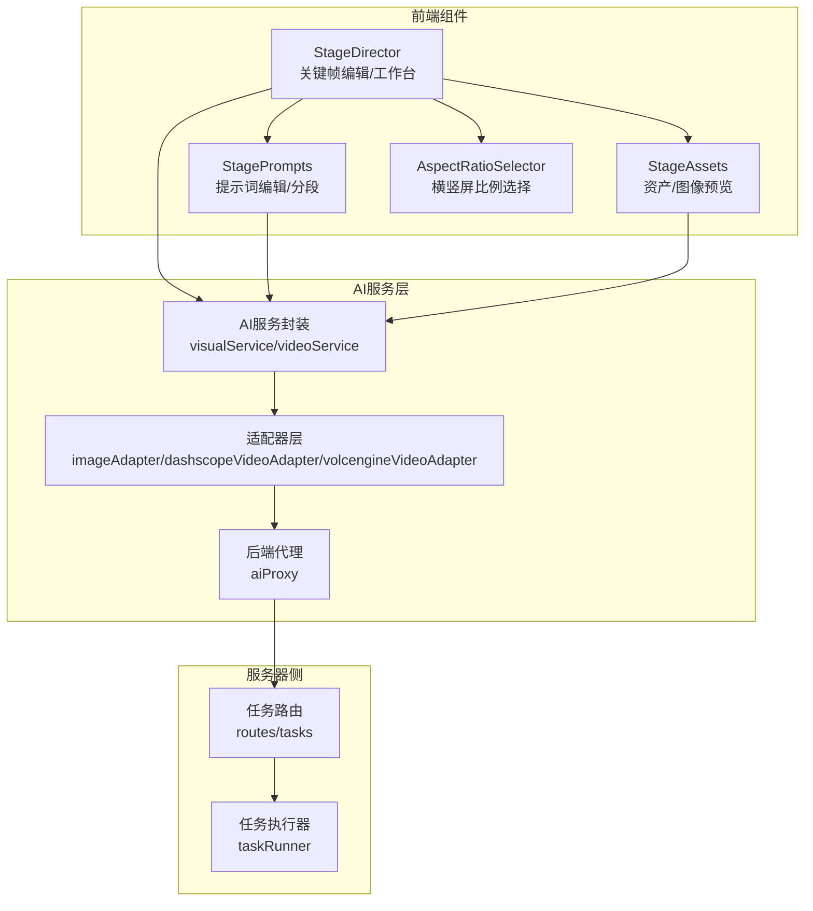
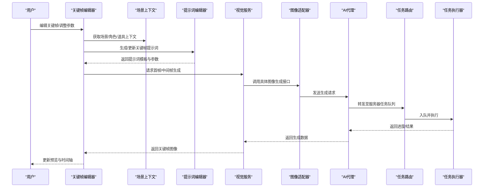
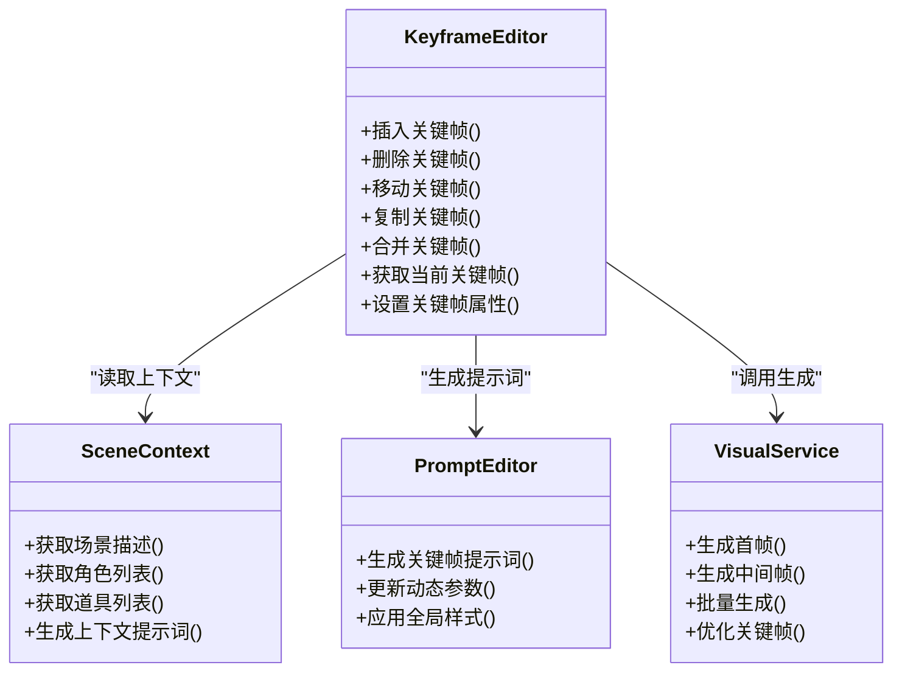
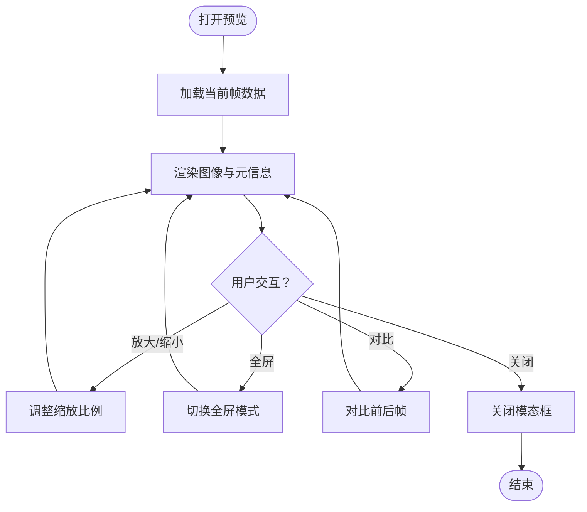
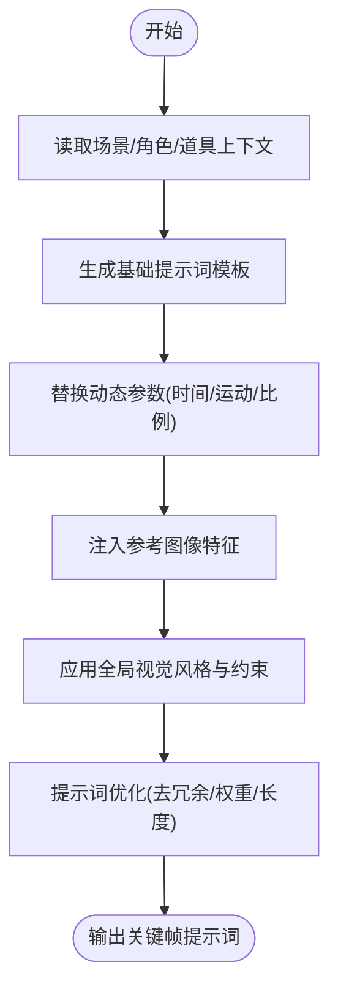
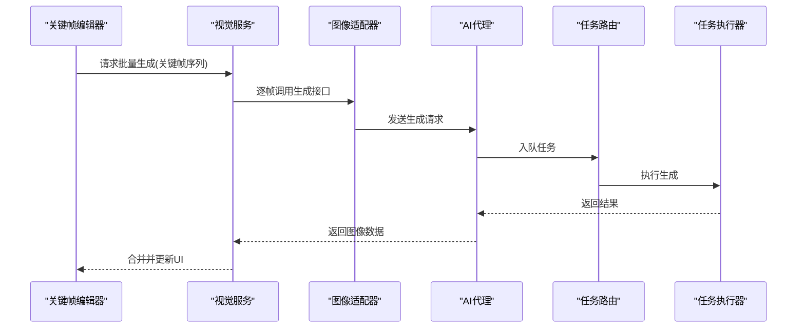
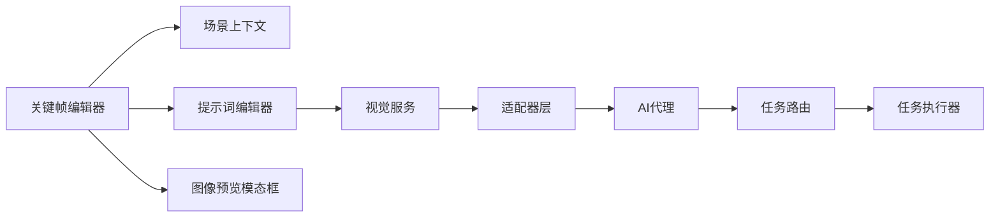

# 关键帧生成器

<cite>
**本文档引用的文件**
- [KeyframeEditor.tsx](file://components/StageDirector/KeyframeEditor.tsx)
- [ImagePreviewModal.tsx](file://components/StageDirector/ImagePreviewModal.tsx)
- [PromptEditor.tsx](file://components/StagePrompts/PromptEditor.tsx)
- [KeyframeSection.tsx](file://components/StagePrompts/KeyframeSection.tsx)
- [ShotWorkbench.tsx](file://components/StageDirector/ShotWorkbench.tsx)
- [SceneContext.tsx](file://components/StageDirector/SceneContext.tsx)
- [constants.ts](file://components/StageDirector/constants.ts)
- [utils.ts](file://components/StageDirector/utils.ts)
- [apiCore.ts](file://services/ai/apiCore.ts)
- [index.ts](file://services/ai/index.ts)
- [visualService.ts](file://services/ai/visualService.ts)
- [videoService.ts](file://services/ai/videoService.ts)
- [imageAdapter.ts](file://services/adapters/imageAdapter.ts)
- [dashscopeVideoAdapter.ts](file://services/adapters/dashscopeVideoAdapter.ts)
- [volcengineVideoAdapter.ts](file://services/adapters/volcengineVideoAdapter.ts)
- [aiProxy.ts](file://server/src/services/aiProxy.ts)
- [tasks.ts](file://server/src/routes/tasks.ts)
- [taskRunner.ts](file://server/src/services/taskRunner.ts)
- [AspectRatioSelector.tsx](file://components/AspectRatioSelector.tsx)
- [constants.ts](file://components/StageAssets/constants.ts)
- [utils.ts](file://components/StageAssets/utils.ts)
</cite>

## 目录
1. [简介](#简介)
2. [项目结构](#项目结构)
3. [核心组件](#核心组件)
4. [架构总览](#架构总览)
5. [详细组件分析](#详细组件分析)
6. [依赖关系分析](#依赖关系分析)
7. [性能考虑](#性能考虑)
8. [故障排除指南](#故障排除指南)
9. [结论](#结论)
10. [附录](#附录)

## 简介
本技术文档围绕关键帧生成器展开，系统性阐述关键帧编辑器的实现原理、图像预览模态框工作机制、关键帧提示词构建算法，以及首帧与尾帧生成逻辑、AI增强功能、批量生成机制、关键帧优化策略。文档还解释关键帧与场景、角色、道具的关系，参考图像的注入机制，横竖屏比例的配置管理，并提供最佳实践、提示词优化技巧、质量控制方法，以及与AI服务的集成方式、错误处理机制和性能优化策略。

## 项目结构
关键帧生成器相关的核心代码分布在以下模块：
- StageDirector：关键帧编辑、场景上下文、工作台与工具集
- StagePrompts：提示词编辑与分段管理（含关键帧提示词）
- StageAssets：资产卡片与图像上传、预览、注入机制
- 适配层与AI服务：图像/视频生成适配器与后端代理
- 服务器侧任务编排：任务路由、执行器与代理服务

**图表来源**
- [KeyframeEditor.tsx](file://components/StageDirector/KeyframeEditor.tsx)
- [ShotWorkbench.tsx](file://components/StageDirector/ShotWorkbench.tsx)
- [PromptEditor.tsx](file://components/StagePrompts/PromptEditor.tsx)
- [ImagePreviewModal.tsx](file://components/StageDirector/ImagePreviewModal.tsx)
- [visualService.ts](file://services/ai/visualService.ts)
- [imageAdapter.ts](file://services/adapters/imageAdapter.ts)
- [aiProxy.ts](file://server/src/services/aiProxy.ts)
- [tasks.ts](file://server/src/routes/tasks.ts)
- [taskRunner.ts](file://server/src/services/taskRunner.ts)

**章节来源**
- [KeyframeEditor.tsx](file://components/StageDirector/KeyframeEditor.tsx)
- [ShotWorkbench.tsx](file://components/StageDirector/ShotWorkbench.tsx)
- [PromptEditor.tsx](file://components/StagePrompts/PromptEditor.tsx)
- [ImagePreviewModal.tsx](file://components/StageDirector/ImagePreviewModal.tsx)
- [visualService.ts](file://services/ai/visualService.ts)
- [imageAdapter.ts](file://services/adapters/imageAdapter.ts)
- [aiProxy.ts](file://server/src/services/aiProxy.ts)
- [tasks.ts](file://server/src/routes/tasks.ts)
- [taskRunner.ts](file://server/src/services/taskRunner.ts)

## 核心组件
- 关键帧编辑器：负责关键帧的增删改查、时序排列、与场景上下文联动
- 图像预览模态框：展示当前关键帧或候选帧的缩略图与细节信息
- 提示词编辑器与关键帧分段：构建与维护关键帧提示词模板与动态参数
- 场景上下文：整合场景、角色、道具等元素，驱动提示词生成与参考图像注入
- AI服务封装与适配器：统一图像/视频生成接口，屏蔽底层厂商差异
- 服务器任务编排：接收前端请求，调度生成任务并返回进度与结果

**章节来源**
- [KeyframeEditor.tsx](file://components/StageDirector/KeyframeEditor.tsx)
- [ImagePreviewModal.tsx](file://components/StageDirector/ImagePreviewModal.tsx)
- [PromptEditor.tsx](file://components/StagePrompts/PromptEditor.tsx)
- [KeyframeSection.tsx](file://components/StagePrompts/KeyframeSection.tsx)
- [SceneContext.tsx](file://components/StageDirector/SceneContext.tsx)
- [visualService.ts](file://services/ai/visualService.ts)
- [videoService.ts](file://services/ai/videoService.ts)

## 架构总览
关键帧生成从用户在关键帧编辑器中操作开始，结合场景上下文与提示词模板，触发AI服务生成首帧与中间关键帧，随后进行批量生成与优化，最终输出到渲染管线。

**图表来源**
- [KeyframeEditor.tsx](file://components/StageDirector/KeyframeEditor.tsx)
- [SceneContext.tsx](file://components/StageDirector/SceneContext.tsx)
- [PromptEditor.tsx](file://components/StagePrompts/PromptEditor.tsx)
- [visualService.ts](file://services/ai/visualService.ts)
- [imageAdapter.ts](file://services/adapters/imageAdapter.ts)
- [aiProxy.ts](file://server/src/services/aiProxy.ts)
- [tasks.ts](file://server/src/routes/tasks.ts)
- [taskRunner.ts](file://server/src/services/taskRunner.ts)

## 详细组件分析

### 关键帧编辑器实现原理
- 数据模型：关键帧序列以时间轴顺序存储，每个关键帧包含提示词、参考图像、运动参数、分辨率与比例等元数据
- 编辑能力：支持插入、删除、移动、复制、合并相邻关键帧；与场景上下文联动自动填充提示词
- 预览机制：通过图像预览模态框实时查看生成效果，支持缩放与对比
- 批量生成：基于选定范围的关键帧，触发批量生成流程，按顺序推进

**图表来源**
- [KeyframeEditor.tsx](file://components/StageDirector/KeyframeEditor.tsx)
- [SceneContext.tsx](file://components/StageDirector/SceneContext.tsx)
- [PromptEditor.tsx](file://components/StagePrompts/PromptEditor.tsx)
- [visualService.ts](file://services/ai/visualService.ts)

**章节来源**
- [KeyframeEditor.tsx](file://components/StageDirector/KeyframeEditor.tsx)
- [SceneContext.tsx](file://components/StageDirector/SceneContext.tsx)
- [PromptEditor.tsx](file://components/StagePrompts/PromptEditor.tsx)
- [visualService.ts](file://services/ai/visualService.ts)

### 图像预览模态框工作机制
- 触发条件：点击关键帧或候选帧时弹出
- 展示内容：当前帧图像、提示词摘要、生成参数、时间戳与状态
- 操作入口：支持放大/缩小、全屏、下载、对比上一帧/下一帧
- 关闭策略：ESC键或点击遮罩关闭，不打断主流程

**图表来源**
- [ImagePreviewModal.tsx](file://components/StageDirector/ImagePreviewModal.tsx)

**章节来源**
- [ImagePreviewModal.tsx](file://components/StageDirector/ImagePreviewModal.tsx)

### 关键帧提示词构建算法
- 上下文融合：从场景上下文提取场景描述、角色特征、道具细节，作为基础模板
- 动态参数：根据关键帧位置、镜头运动、时间跨度动态替换模板变量
- 风格约束：应用全局视觉风格与比例配置，确保一致性
- 参考图像注入：将参考图像的视觉特征编码为提示词片段，提升对齐度
- 优化策略：去除冗余描述、平衡正负提示词权重、限制长度避免截断

**图表来源**
- [SceneContext.tsx](file://components/StageDirector/SceneContext.tsx)
- [PromptEditor.tsx](file://components/StagePrompts/PromptEditor.tsx)
- [KeyframeSection.tsx](file://components/StagePrompts/KeyframeSection.tsx)
- [constants.ts](file://components/StageAssets/constants.ts)
- [utils.ts](file://components/StageAssets/utils.ts)

**章节来源**
- [PromptEditor.tsx](file://components/StagePrompts/PromptEditor.tsx)
- [KeyframeSection.tsx](file://components/StagePrompts/KeyframeSection.tsx)
- [SceneContext.tsx](file://components/StageDirector/SceneContext.tsx)
- [constants.ts](file://components/StageAssets/constants.ts)
- [utils.ts](file://components/StageAssets/utils.ts)

### 首帧与尾帧生成逻辑
- 首帧生成：基于场景上下文与初始提示词，优先保证构图与风格稳定
- 尾帧生成：在关键帧序列末尾插入尾帧，确保动作收束与画面稳定
- 连接策略：首帧与尾帧与相邻关键帧共享提示词相似度，减少突变
- 参数对齐：保持分辨率、比例与运动参数的一致性，避免渲染抖动

**章节来源**
- [KeyframeEditor.tsx](file://components/StageDirector/KeyframeEditor.tsx)
- [visualService.ts](file://services/ai/visualService.ts)

### AI增强功能与批量生成机制
- 增强策略：在关键帧之间插入中间帧，利用提示词插值与运动引导提升流畅度
- 批量生成：按时间轴顺序批量提交生成任务，支持并发与限速控制
- 结果合并：将生成的中间帧与关键帧拼接，形成连续序列
- 失败重试：对失败的任务进行指数退避重试，记录日志便于回溯

**图表来源**
- [visualService.ts](file://services/ai/visualService.ts)
- [imageAdapter.ts](file://services/adapters/imageAdapter.ts)
- [aiProxy.ts](file://server/src/services/aiProxy.ts)
- [tasks.ts](file://server/src/routes/tasks.ts)
- [taskRunner.ts](file://server/src/services/taskRunner.ts)

**章节来源**
- [visualService.ts](file://services/ai/visualService.ts)
- [imageAdapter.ts](file://services/adapters/imageAdapter.ts)
- [aiProxy.ts](file://server/src/services/aiProxy.ts)
- [tasks.ts](file://server/src/routes/tasks.ts)
- [taskRunner.ts](file://server/src/services/taskRunner.ts)

### 关键帧优化策略
- 质量评估：基于提示词与图像特征计算相似度，剔除重复或低质量帧
- 时间密度控制：根据镜头节奏调整关键帧密度，避免过密导致资源浪费
- 运动平滑：通过插值与运动引导降低关键帧间跳跃感
- 成本控制：限制单次批量规模与并发度，避免资源峰值

**章节来源**
- [KeyframeEditor.tsx](file://components/StageDirector/KeyframeEditor.tsx)
- [utils.ts](file://components/StageDirector/utils.ts)

### 关键帧与场景、角色、道具的关系
- 场景：决定背景、光照、氛围与风格基底
- 角色：提供外观、动作、表情与交互线索
- 道具：补充细节与叙事信息，增强画面完整性
- 关系映射：通过场景上下文组件将三者抽象为可注入的提示词片段

**章节来源**
- [SceneContext.tsx](file://components/StageDirector/SceneContext.tsx)
- [constants.ts](file://components/StageAssets/constants.ts)

### 参考图像的注入机制
- 注入时机：在提示词构建阶段将参考图像的视觉特征编码为提示词片段
- 特征提取：通过图像适配器提取风格与构图特征，避免直接复制图像
- 权衡策略：控制参考图像权重，防止过度依赖导致创意受限

**章节来源**
- [constants.ts](file://components/StageAssets/constants.ts)
- [utils.ts](file://components/StageAssets/utils.ts)
- [imageAdapter.ts](file://services/adapters/imageAdapter.ts)

### 横竖屏比例的配置管理
- 配置入口：通过横竖屏比例选择器设置全局比例
- 应用范围：影响关键帧生成的分辨率与提示词中的比例约束
- 统一策略：在场景上下文中同步比例参数，确保生成一致性

**章节来源**
- [AspectRatioSelector.tsx](file://components/AspectRatioSelector.tsx)
- [constants.ts](file://components/StageDirector/constants.ts)

## 依赖关系分析
- 前端组件间耦合：关键帧编辑器依赖场景上下文与提示词编辑器；图像预览模态框独立但与编辑器联动
- 服务层解耦：视觉服务统一封装生成接口，适配器层隔离厂商差异
- 服务器编排：任务路由与执行器解耦前端请求与实际生成任务

**图表来源**
- [KeyframeEditor.tsx](file://components/StageDirector/KeyframeEditor.tsx)
- [SceneContext.tsx](file://components/StageDirector/SceneContext.tsx)
- [PromptEditor.tsx](file://components/StagePrompts/PromptEditor.tsx)
- [ImagePreviewModal.tsx](file://components/StageDirector/ImagePreviewModal.tsx)
- [visualService.ts](file://services/ai/visualService.ts)
- [imageAdapter.ts](file://services/adapters/imageAdapter.ts)
- [aiProxy.ts](file://server/src/services/aiProxy.ts)
- [tasks.ts](file://server/src/routes/tasks.ts)
- [taskRunner.ts](file://server/src/services/taskRunner.ts)

**章节来源**
- [KeyframeEditor.tsx](file://components/StageDirector/KeyframeEditor.tsx)
- [visualService.ts](file://services/ai/visualService.ts)
- [imageAdapter.ts](file://services/adapters/imageAdapter.ts)
- [aiProxy.ts](file://server/src/services/aiProxy.ts)
- [tasks.ts](file://server/src/routes/tasks.ts)
- [taskRunner.ts](file://server/src/services/taskRunner.ts)

## 性能考虑
- 并发与限流：批量生成时控制并发度，避免AI服务过载
- 缓存策略：对常用提示词与参考图像特征进行缓存，减少重复计算
- 分片生成：将长序列拆分为小批次，提高容错与响应速度
- 渲染优化：预览时使用缩略图与懒加载，避免阻塞主线程

## 故障排除指南
- 生成失败：检查提示词是否过长或包含违禁词；确认参考图像格式与大小
- 任务卡住：查看任务路由与执行器日志，确认是否存在网络或权限问题
- 结果异常：核对横竖屏比例与分辨率配置，确保与场景上下文一致
- 错误处理：在前端捕获异常并提示用户；在后端记录详细日志以便追踪

**章节来源**
- [tasks.ts](file://server/src/routes/tasks.ts)
- [taskRunner.ts](file://server/src/services/taskRunner.ts)
- [aiProxy.ts](file://server/src/services/aiProxy.ts)

## 结论
关键帧生成器通过“编辑器-上下文-提示词-生成服务”的闭环设计，实现了从创意到产出的高效转化。其核心优势在于：
- 强大的上下文感知与提示词构建能力
- 稳健的批量生成与优化策略
- 与多厂商AI服务的灵活适配
- 完善的错误处理与性能保障

建议在实际使用中持续优化提示词模板与风格约束，结合场景特点迭代生成策略，以获得更高质量的关键帧序列。

## 附录
- 最佳实践
  - 在场景上下文中明确角色与道具的职责，避免提示词冗余
  - 使用参考图像增强风格一致性，但需控制权重
  - 合理设置关键帧密度，兼顾质量与成本
- 提示词优化技巧
  - 使用结构化模板，将动态参数与静态描述分离
  - 在关键帧间保持提示词相似度，减少突变
  - 加入比例与运动约束，提升生成稳定性
- 质量控制方法
  - 建立预览与对比流程，及时发现异常
  - 对重复与低质量关键帧进行剔除
  - 记录生成参数与结果，便于回溯与复现