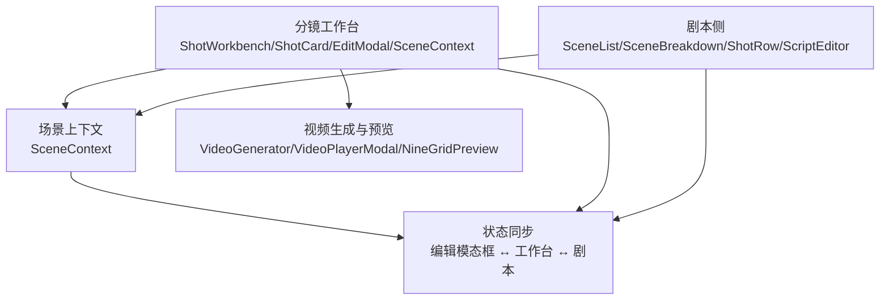
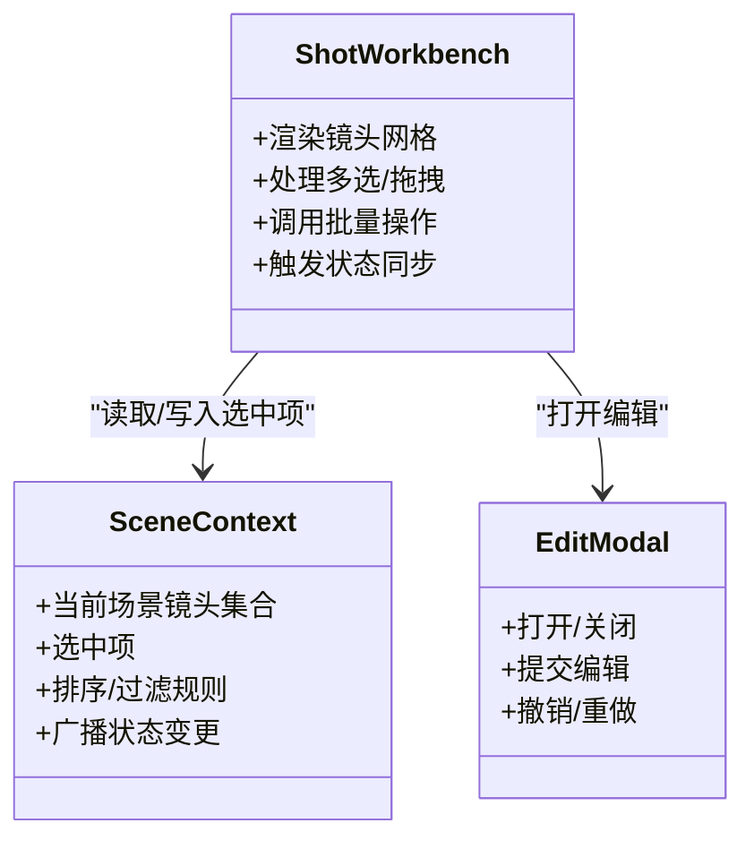
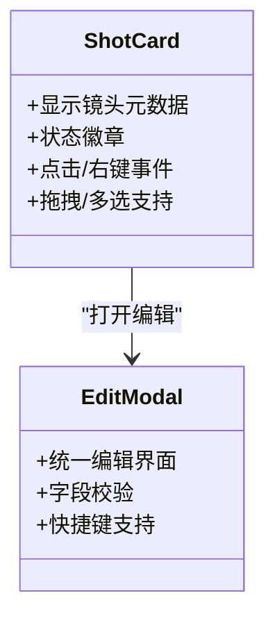
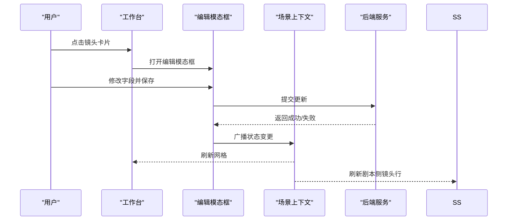
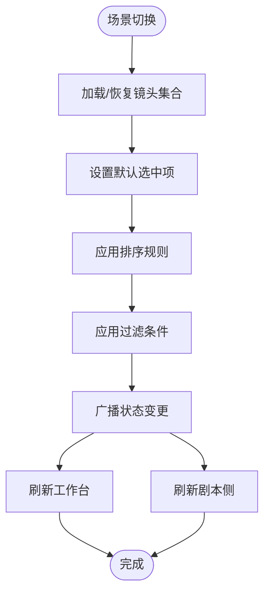
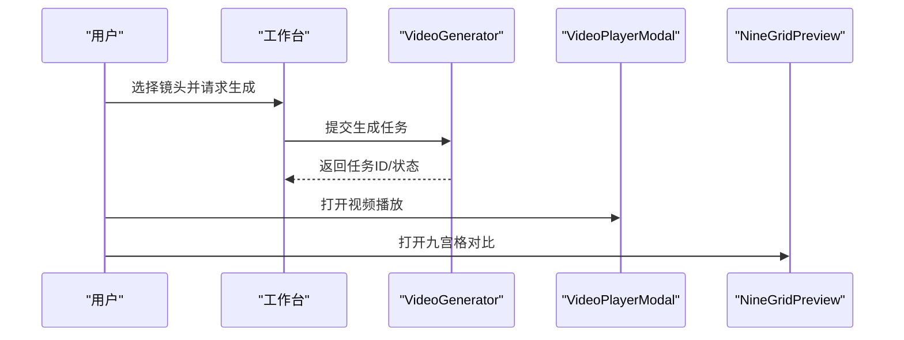
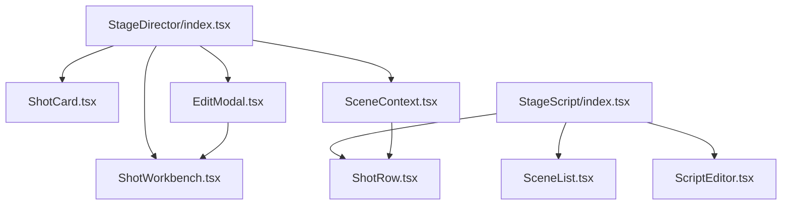

# 分镜编辑器

<cite>
**本文引用的文件**
- [App.tsx](file://src/App.tsx)
- [StageDirector/index.tsx](file://components/StageDirector/index.tsx)
- [StageScript/index.tsx](file://components/StageScript/index.tsx)
- [StageDirector/README.md](file://components/StageDirector/README.md)
- [StageScript/README.md](file://components/StageScript/README.md)
- [StageDirector/constants.ts](file://components/StageDirector/constants.ts)
- [StageScript/constants.ts](file://components/StageScript/constants.ts)
- [StageDirector/utils.ts](file://components/StageDirector/utils.ts)
- [StageScript/utils.ts](file://components/StageScript/utils.ts)
- [StageDirector/ShotWorkbench.tsx](file://components/StageDirector/ShotWorkbench.tsx)
- [StageDirector/ShotCard.tsx](file://components/StageDirector/ShotCard.tsx)
- [StageDirector/EditModal.tsx](file://components/StageDirector/EditModal.tsx)
- [StageDirector/SceneContext.tsx](file://components/StageDirector/SceneContext.tsx)
- [StageScript/ShotRow.tsx](file://components/StageScript/ShotRow.tsx)
- [StageScript/SceneList.tsx](file://components/StageScript/SceneList.tsx)
- [StageScript/SceneBreakdown.tsx](file://components/StageScript/SceneBreakdown.tsx)
- [StageScript/ScriptEditor.tsx](file://components/StageScript/ScriptEditor.tsx)
- [StageScript/InlineEditor.tsx](file://components/StageScript/InlineEditor.tsx)
- [StageScript/CharacterList.tsx](file://components/StageScript/CharacterList.tsx)
- [StageScript/NovelManager.tsx](file://components/StageScript/NovelManager.tsx)
- [StageScript/EpisodeManager.tsx](file://components/StageScript/EpisodeManager.tsx)
- [StageScript/OptionSelector.tsx](file://components/StageScript/OptionSelector.tsx)
- [StageScript/ConfigPanel.tsx](file://components/StageScript/ConfigPanel.tsx)
- [StageScript/StatusBadge.tsx](file://components/StageScript/StatusBadge.tsx)
- [StageScript/CollapsibleSection.tsx](file://components/StageScript/CollapsibleSection.tsx)
- [StageScript/KeyframeSection.tsx](file://components/StageScript/KeyframeSection.tsx)
- [StageScript/PropSection.tsx](file://components/StageScript/PropSection.tsx)
- [StageScript/SceneSection.tsx](file://components/StageScript/SceneSection.tsx)
- [StageScript/CharacterSection.tsx](file://components/StageScript/CharacterSection.tsx)
- [StageScript/PromptEditor.tsx](file://components/StageScript/PromptEditor.tsx)
- [StageScript/StatusPanel.tsx](file://components/StageScript/StatusPanel.tsx)
- [StageScript/TimelineVisualizer.tsx](file://components/StageScript/TimelineVisualizer.tsx)
- [StageScript/VideoPlayerModal.tsx](file://components/StageScript/VideoPlayerModal.tsx)
- [StageScript/RenderLogsModal.tsx](file://components/StageScript/RenderLogsModal.tsx)
- [StageScript/SecondaryOptions.tsx](file://components/StageScript/SecondaryOptions.tsx)
- [StageScript/ActionButtons.tsx](file://components/StageScript/ActionButtons.tsx)
- [StageScript/VideoGenerator.tsx](file://components/StageDirector/VideoGenerator.tsx)
- [StageScript/KeyframeEditor.tsx](file://components/StageDirector/KeyframeEditor.tsx)
- [StageScript/NineGridPreview.tsx](file://components/StageDirector/NineGridPreview.tsx)
- [StageScript/ImagePreviewModal.tsx](file://components/StageDirector/ImagePreviewModal.tsx)
- [StageScript/cameraMovementGuides.ts](file://components/StageDirector/cameraMovementGuides.ts)
- [StageScript/VideoPlayerModal.tsx](file://components/StageScript/VideoPlayerModal.tsx)
- [StageScript/RenderLogsModal.tsx](file://components/StageScript/RenderLogsModal.tsx)
- [StageScript/SecondaryOptions.tsx](file://components/StageScript/SecondaryOptions.tsx)
- [StageScript/ActionButtons.tsx](file://components/StageScript/ActionButtons.tsx)
- [StageScript/StatusPanel.tsx](file://components/StageScript/StatusPanel.tsx)
- [StageScript/TimelineVisualizer.tsx](file://components/StageScript/TimelineVisualizer.tsx)
- [StageScript/VideoPlayerModal.tsx](file://components/StageScript/VideoPlayerModal.tsx)
- [StageScript/RenderLogsModal.tsx](file://components/StageScript/RenderLogsModal.tsx)
- [StageScript/SecondaryOptions.tsx](file://components/StageScript/SecondaryOptions.tsx)
- [StageScript/ActionButtons.tsx](file://components/StageScript/ActionButtons.tsx)
- [StageScript/StatusPanel.tsx](file://components/StageScript/StatusPanel.tsx)
- [StageScript/TimelineVisualizer.tsx](file://components/StageScript/TimelineVisualizer.tsx)
- [StageScript/VideoPlayerModal.tsx](file://components/StageScript/VideoPlayerModal.tsx)
- [StageScript/RenderLogsModal.tsx](file://components/StageScript/RenderLogsModal.tsx)
- [StageScript/SecondaryOptions.tsx](file://components/StageScript/SecondaryOptions.tsx)
- [StageScript/ActionButtons.tsx](file://components/StageScript/ActionButtons.tsx)
- [StageScript/StatusPanel.tsx](file://components/StageScript/StatusPanel.tsx)
- [StageScript/TimelineVisualizer.tsx](file://components/StageScript/TimelineVisualizer.tsx)
- [StageScript/VideoPlayerModal.tsx](file://components/StageScript/VideoPlayerModal.tsx)
- [StageScript/RenderLogsModal.tsx](file://components/StageScript/RenderLogsModal.tsx)
- [StageScript/SecondaryOptions.tsx](file://components/StageScript/SecondaryOptions.tsx)
- [StageScript/ActionButtons.tsx](file://components/StageScript/ActionButtons.tsx)
- [StageScript/StatusPanel.tsx](file://components/StageScript/StatusPanel.tsx)
- [StageScript/TimelineVisualizer.tsx](file://components/StageScript/TimelineVisualizer.tsx)
- [StageScript/VideoPlayerModal.tsx](file://components/StageScript/VideoPlayerModal.tsx)
- [StageScript/RenderLogsModal.tsx](file://components/StageScript/RenderLogsModal.tsx)
- [StageScript/SecondaryOptions.tsx](file://components/StageScript/SecondaryOptions.tsx)
- [StageScript/ActionButtons.tsx](file://components/StageScript/ActionButtons.tsx)
- [StageScript/StatusPanel.tsx](file://components/StageScript/StatusPanel.tsx)
- [StageScript/TimelineVisualizer.tsx](file://components/StageScript/TimelineVisualizer.tsx)
- [StageScript/VideoPlayerModal.tsx](file://components/StageScript/VideoPlayerModal.tsx)
- [StageScript/RenderLogsModal.tsx](file://components/StageScript/RenderLogsModal.tsx)
- [StageScript/SecondaryOptions.tsx](file://components/StageScript/SecondaryOptions.tsx)
- [StageScript/ActionButtons.tsx](file://components/StageScript/ActionButtons.tsx)
- [StageScript/StatusPanel.tsx](file://components/StageScript/StatusPanel.tsx)
- [StageScript/TimelineVisualizer.tsx](file://components/StageScript/TimelineVisualizer.tsx)
- [StageScript/VideoPlayerModal.tsx](file://components/StageScript/VideoPlayerModal.tsx)
- [StageScript/RenderLogsModal.tsx](file://components/StageScript/RenderLogsModal.tsx)
- [StageScript/SecondaryOptions.tsx](file://components/StageScript/SecondaryOptions.tsx)
- [StageScript/ActionButtons.tsx](file://components/StageScript/ActionButtons.tsx)
- [StageScript/StatusPanel.tsx](file://components/StageScript/StatusPanel.tsx)
- [StageScript/TimelineVisualizer.tsx](......)
</cite>

## 目录
1. [简介](#简介)
2. [项目结构](#项目结构)
3. [核心组件](#核心组件)
4. [架构总览](#架构总览)
5. [详细组件分析](#详细组件分析)
6. [依赖分析](#依赖分析)
7. [性能考虑](#性能考虑)
8. [故障排除指南](#故障排除指南)
9. [结论](#结论)
10. [附录](#附录)

## 简介
本技术文档围绕“分镜编辑器”展开，目标是为分镜工作台、镜头卡片组件、编辑模态框的状态管理机制提供系统化说明，并覆盖分镜的创建、编辑、删除流程，镜头上下文管理、批量操作与复制机制，以及分镜与剧本的关联关系、镜头索引系统与状态同步机制。同时，文档提供用户交互模式、快捷键支持、错误处理策略、与项目状态管理的集成方式及性能优化建议。

## 项目结构
分镜编辑器位于前端组件层的“StageDirector”与“StageScript”模块中，分别负责分镜工作台与剧本侧的镜头管理与展示。整体采用按功能域划分的组织方式：  
- StageDirector：分镜工作台、镜头卡片、编辑模态、场景上下文、预览与渲染工具等  
- StageScript：剧本侧的场景列表、镜头行、脚本编辑器、角色/道具/场景/关键帧等分组编辑器  

```mermaid
graph TB
subgraph "分镜编辑器StageDirector"
SD_Index["index.tsx"]
SD_Workbench["ShotWorkbench.tsx"]
SD_Card["ShotCard.tsx"]
SD_EditModal["EditModal.tsx"]
SD_SceneContext["SceneContext.tsx"]
SD_VideoGen["VideoGenerator.tsx"]
SD_Keyframe["KeyframeEditor.tsx"]
SD_NineGrid["NineGridPreview.tsx"]
SD_ImagePreview["ImagePreviewModal.tsx"]
SD_CameraGuide["cameraMovementGuides.ts"]
end
subgraph "剧本侧StageScript"
SS_Index["index.tsx"]
SS_ShotRow["ShotRow.tsx"]
SS_SceneList["SceneList.tsx"]
SS_SceneBreakdown["SceneBreakdown.tsx"]
SS_ScriptEditor["ScriptEditor.tsx"]
SS_InlineEditor["InlineEditor.tsx"]
SS_CharacterList["CharacterList.tsx"]
SS_NovelManager["NovelManager.tsx"]
SS_EpisodeManager["EpisodeManager.tsx"]
SS_OptionSelector["OptionSelector.tsx"]
SS_ConfigPanel["ConfigPanel.tsx"]
SS_StatusBadge["StatusBadge.tsx"]
SS_Collapsible["CollapsibleSection.tsx"]
SS_KeyframeSec["KeyframeSection.tsx"]
SS_PropSec["PropSection.tsx"]
SS_SceneSec["SceneSection.tsx"]
SS_CharSec["CharacterSection.tsx"]
SS_PromptEditor["PromptEditor.tsx"]
SS_StatusPanel["StatusPanel.tsx"]
SS_Timeline["TimelineVisualizer.tsx"]
SS_VideoPlayer["VideoPlayerModal.tsx"]
SS_RenderLogs["RenderLogsModal.tsx"]
SS_SecondaryOpts["SecondaryOptions.tsx"]
SS_ActionBtns["ActionButtons.tsx"]
end
App["App.tsx"]
App --> SD_Index
App --> SS_Index
SD_Index --> SD_Workbench
SD_Index --> SD_Card
SD_Index --> SD_EditModal
SD_Index --> SD_SceneContext
SD_Index --> SD_VideoGen
SD_Index --> SD_Keyframe
SD_Index --> SD_NineGrid
SD_Index --> SD_ImagePreview
SD_Index --> SD_CameraGuide
SS_Index --> SS_ShotRow
SS_Index --> SS_SceneList
SS_Index --> SS_SceneBreakdown
SS_Index --> SS_ScriptEditor
SS_Index --> SS_InlineEditor
SS_Index --> SS_CharacterList
SS_Index --> SS_NovelManager
SS_Index --> SS_EpisodeManager
SS_Index --> SS_OptionSelector
SS_Index --> SS_ConfigPanel
SS_Index --> SS_StatusBadge
SS_Index --> SS_Collapsible
SS_Index --> SS_KeyframeSec
SS_Index --> SS_PropSec
SS_Index --> SS_SceneSec
SS_Index --> SS_CharSec
SS_Index --> SS_PromptEditor
SS_Index --> SS_StatusPanel
SS_Index --> SS_Timeline
SS_Index --> SS_VideoPlayer
SS_Index --> SS_RenderLogs
SS_Index --> SS_SecondaryOpts
SS_Index --> SS_ActionBtns
```

图表来源
- [App.tsx](file://src/App.tsx)
- [StageDirector/index.tsx](file://components/StageDirector/index.tsx)
- [StageScript/index.tsx](file://components/StageScript/index.tsx)
- [StageDirector/ShotWorkbench.tsx](file://components/StageDirector/ShotWorkbench.tsx)
- [StageDirector/ShotCard.tsx](file://components/StageDirector/ShotCard.tsx)
- [StageDirector/EditModal.tsx](file://components/StageDirector/EditModal.tsx)
- [StageDirector/SceneContext.tsx](file://components/StageDirector/SceneContext.tsx)
- [StageDirector/VideoGenerator.tsx](file://components/StageDirector/VideoGenerator.tsx)
- [StageDirector/KeyframeEditor.tsx](file://components/StageDirector/KeyframeEditor.tsx)
- [StageDirector/NineGridPreview.tsx](file://components/StageDirector/NineGridPreview.tsx)
- [StageDirector/ImagePreviewModal.tsx](file://components/StageDirector/ImagePreviewModal.tsx)
- [StageDirector/cameraMovementGuides.ts](file://components/StageDirector/cameraMovementGuides.ts)
- [StageScript/ShotRow.tsx](file://components/StageScript/ShotRow.tsx)
- [StageScript/SceneList.tsx](file://components/StageScript/SceneList.tsx)
- [StageScript/SceneBreakdown.tsx](file://components/StageScript/SceneBreakdown.tsx)
- [StageScript/ScriptEditor.tsx](file://components/StageScript/ScriptEditor.tsx)
- [StageScript/InlineEditor.tsx](file://components/StageScript/InlineEditor.tsx)
- [StageScript/CharacterList.tsx](file://components/StageScript/CharacterList.tsx)
- [StageScript/NovelManager.tsx](file://components/StageScript/NovelManager.tsx)
- [StageScript/EpisodeManager.tsx](file://components/StageScript/EpisodeManager.tsx)
- [StageScript/OptionSelector.tsx](file://components/StageScript/OptionSelector.tsx)
- [StageScript/ConfigPanel.tsx](file://components/StageScript/ConfigPanel.tsx)
- [StageScript/StatusBadge.tsx](file://components/StageScript/StatusBadge.tsx)
- [StageScript/CollapsibleSection.tsx](file://components/StageScript/CollapsibleSection.tsx)
- [StageScript/KeyframeSection.tsx](file://components/StageScript/KeyframeSection.tsx)
- [StageScript/PropSection.tsx](file://components/StageScript/PropSection.tsx)
- [StageScript/SceneSection.tsx](file://components/StageScript/SceneSection.tsx)
- [StageScript/CharacterSection.tsx](file://components/StageScript/CharacterSection.tsx)
- [StageScript/PromptEditor.tsx](file://components/StageScript/PromptEditor.tsx)
- [StageScript/StatusPanel.tsx](file://components/StageScript/StatusPanel.tsx)
- [StageScript/TimelineVisualizer.tsx](file://components/StageScript/TimelineVisualizer.tsx)
- [StageScript/VideoPlayerModal.tsx](file://components/StageScript/VideoPlayerModal.tsx)
- [StageScript/RenderLogsModal.tsx](file://components/StageScript/RenderLogsModal.tsx)
- [StageScript/SecondaryOptions.tsx](file://components/StageScript/SecondaryOptions.tsx)
- [StageScript/ActionButtons.tsx](file://components/StageScript/ActionButtons.tsx)

章节来源
- [App.tsx](file://src/App.tsx)
- [StageDirector/index.tsx](file://components/StageDirector/index.tsx)
- [StageScript/index.tsx](file://components/StageScript/index.tsx)

## 核心组件
- 分镜工作台（ShotWorkbench）：承载镜头卡片网格布局、上下文菜单、批量操作入口、镜头索引导航与状态同步
- 镜头卡片（ShotCard）：单个镜头的可视化呈现，包含镜头元数据、状态徽章、操作按钮与拖拽/选择能力
- 编辑模态框（EditModal）：统一的镜头编辑界面，支持字段校验、快捷键、撤销/重做与状态回滚
- 场景上下文（SceneContext）：维护当前场景的镜头集合、选中项、排序规则与过滤条件
- 剧本侧镜头行（ShotRow）：在剧本视图中展示与跳转到对应镜头，支持双链路联动
- 剧本侧场景列表（SceneList/SceneBreakdown）：按场景组织镜头，支持场景级筛选与展开
- 剧本编辑器（ScriptEditor/InlineEditor）：文本级编辑与内联修改，触发镜头索引更新
- 视频生成与预览（VideoGenerator/VideoPlayerModal/NineGridPreview）：生成与预览镜头视频，支持九宫格对比
- 关键帧编辑（KeyframeEditor）：关键帧参数编辑与预设应用
- 图像预览（ImagePreviewModal）：静态图像预览与标注
- 摄像机运动指南（cameraMovementGuides）：提供拍摄指导与运动轨迹参考

章节来源
- [StageDirector/ShotWorkbench.tsx](file://components/StageDirector/ShotWorkbench.tsx)
- [StageDirector/ShotCard.tsx](file://components/StageDirector/ShotCard.tsx)
- [StageDirector/EditModal.tsx](file://components/StageDirector/EditModal.tsx)
- [StageDirector/SceneContext.tsx](file://components/StageDirector/SceneContext.tsx)
- [StageScript/ShotRow.tsx](file://components/StageScript/ShotRow.tsx)
- [StageScript/SceneList.tsx](file://components/StageScript/SceneList.tsx)
- [StageScript/SceneBreakdown.tsx](file://components/StageScript/SceneBreakdown.tsx)
- [StageScript/ScriptEditor.tsx](file://components/StageScript/ScriptEditor.tsx)
- [StageScript/InlineEditor.tsx](file://components/StageScript/InlineEditor.tsx)
- [StageDirector/VideoGenerator.tsx](file://components/StageDirector/VideoGenerator.tsx)
- [StageDirector/VideoPlayerModal.tsx](file://components/StageDirector/VideoPlayerModal.tsx)
- [StageDirector/NineGridPreview.tsx](file://components/StageDirector/NineGridPreview.tsx)
- [StageDirector/KeyframeEditor.tsx](file://components/StageDirector/KeyframeEditor.tsx)
- [StageDirector/ImagePreviewModal.tsx](file://components/StageDirector/ImagePreviewModal.tsx)
- [StageDirector/cameraMovementGuides.ts](file://components/StageDirector/cameraMovementGuides.ts)

## 架构总览
分镜编辑器采用“工作台 + 剧本联动”的双视图架构：  
- 工作台侧（StageDirector）：以镜头为中心的可视化编辑与批量操作  
- 剧本侧（StageScript）：以场景/台词为中心的文本编辑与镜头索引映射  
- 上下文共享：通过SceneContext在工作台与剧本之间传递选中镜头、排序与过滤状态  
- 状态同步：编辑模态框与工作台/剧本的双向更新，确保镜头元数据一致性

图表来源
- [StageDirector/ShotWorkbench.tsx](file://components/StageDirector/ShotWorkbench.tsx)
- [StageDirector/ShotCard.tsx](file://components/StageDirector/ShotCard.tsx)
- [StageDirector/EditModal.tsx](file://components/StageDirector/EditModal.tsx)
- [StageDirector/SceneContext.tsx](file://components/StageDirector/SceneContext.tsx)
- [StageScript/SceneList.tsx](file://components/StageScript/SceneList.tsx)
- [StageScript/SceneBreakdown.tsx](file://components/StageScript/SceneBreakdown.tsx)
- [StageScript/ShotRow.tsx](file://components/StageScript/ShotRow.tsx)
- [StageScript/ScriptEditor.tsx](file://components/StageScript/ScriptEditor.tsx)
- [StageDirector/VideoGenerator.tsx](file://components/StageDirector/VideoGenerator.tsx)
- [StageDirector/VideoPlayerModal.tsx](file://components/StageDirector/VideoPlayerModal.tsx)
- [StageDirector/NineGridPreview.tsx](file://components/StageDirector/NineGridPreview.tsx)

## 详细组件分析

### 分镜工作台（ShotWorkbench）
- 职责：网格布局镜头卡片、上下文菜单、批量操作入口、镜头索引导航、状态同步
- 关键点：
  - 支持多选、拖拽排序、右键菜单（复制、删除、批量导出）
  - 与SceneContext联动，保持选中项与过滤条件一致
  - 与编辑模态框双向同步，确保编辑后即时刷新

图表来源
- [StageDirector/ShotWorkbench.tsx](file://components/StageDirector/ShotWorkbench.tsx)
- [StageDirector/SceneContext.tsx](file://components/StageDirector/SceneContext.tsx)
- [StageDirector/EditModal.tsx](file://components/StageDirector/EditModal.tsx)

章节来源
- [StageDirector/ShotWorkbench.tsx](file://components/StageDirector/ShotWorkbench.tsx)
- [StageDirector/SceneContext.tsx](file://components/StageDirector/SceneContext.tsx)

### 镜头卡片（ShotCard）
- 职责：单镜头可视化、状态徽章、操作按钮、拖拽/选择
- 关键点：
  - 点击进入编辑模态框；右键菜单提供复制/删除/预览
  - 状态徽章反映生成进度/质量/锁定状态
  - 支持拖拽排序与多选

图表来源
- [StageDirector/ShotCard.tsx](file://components/StageDirector/ShotCard.tsx)
- [StageDirector/EditModal.tsx](file://components/StageDirector/EditModal.tsx)

章节来源
- [StageDirector/ShotCard.tsx](file://components/StageDirector/ShotCard.tsx)
- [StageDirector/EditModal.tsx](file://components/StageDirector/EditModal.tsx)

### 编辑模态框（EditModal）
- 职责：统一的镜头编辑界面，支持字段校验、快捷键、撤销/重做与状态回滚
- 关键点：
  - 表单字段与后端模型对齐，保存时进行必填/范围校验
  - 快捷键：Esc关闭、Ctrl+Enter保存、Ctrl+Z撤销
  - 提交后触发工作台与剧本的同步刷新

图表来源
- [StageDirector/EditModal.tsx](file://components/StageDirector/EditModal.tsx)
- [StageDirector/SceneContext.tsx](file://components/StageDirector/SceneContext.tsx)
- [StageScript/ShotRow.tsx](file://components/StageScript/ShotRow.tsx)

章节来源
- [StageDirector/EditModal.tsx](file://components/StageDirector/EditModal.tsx)
- [StageDirector/SceneContext.tsx](file://components/StageDirector/SceneContext.tsx)
- [StageScript/ShotRow.tsx](file://components/StageScript/ShotRow.tsx)

### 场景上下文（SceneContext）
- 职责：集中管理当前场景的镜头集合、选中项、排序与过滤规则
- 关键点：
  - 作为工作台与剧本之间的状态枢纽
  - 统一广播状态变更，避免重复请求与状态漂移
  - 支持场景切换时的缓存与恢复

图表来源
- [StageDirector/SceneContext.tsx](file://components/StageDirector/SceneContext.tsx)
- [StageDirector/ShotWorkbench.tsx](file://components/StageDirector/ShotWorkbench.tsx)
- [StageScript/SceneList.tsx](file://components/StageScript/SceneList.tsx)

章节来源
- [StageDirector/SceneContext.tsx](file://components/StageDirector/SceneContext.tsx)
- [StageDirector/ShotWorkbench.tsx](file://components/StageDirector/ShotWorkbench.tsx)
- [StageScript/SceneList.tsx](file://components/StageScript/SceneList.tsx)

### 剧本侧组件（SceneList/SceneBreakdown/ShotRow/ScriptEditor）
- SceneList/SceneBreakdown：按场景组织镜头，支持展开/折叠与场景级筛选
- ShotRow：在剧本中定位并高亮对应镜头，支持点击跳转
- ScriptEditor/InlineEditor：文本编辑与内联修改，触发镜头索引更新
- StatusPanel/TimelineVisualizer：展示渲染状态与时间线可视化

图表来源
- [StageScript/SceneList.tsx](file://components/StageScript/SceneList.tsx)
- [StageScript/SceneBreakdown.tsx](file://components/StageScript/SceneBreakdown.tsx)
- [StageScript/ShotRow.tsx](file://components/StageScript/ShotRow.tsx)
- [StageScript/ScriptEditor.tsx](file://components/StageScript/ScriptEditor.tsx)
- [StageScript/InlineEditor.tsx](file://components/StageScript/InlineEditor.tsx)
- [StageScript/StatusPanel.tsx](file://components/StageScript/StatusPanel.tsx)
- [StageScript/TimelineVisualizer.tsx](file://components/StageScript/TimelineVisualizer.tsx)

章节来源
- [StageScript/SceneList.tsx](file://components/StageScript/SceneList.tsx)
- [StageScript/SceneBreakdown.tsx](file://components/StageScript/SceneBreakdown.tsx)
- [StageScript/ShotRow.tsx](file://components/StageScript/ShotRow.tsx)
- [StageScript/ScriptEditor.tsx](file://components/StageScript/ScriptEditor.tsx)
- [StageScript/InlineEditor.tsx](file://components/StageScript/InlineEditor.tsx)
- [StageScript/StatusPanel.tsx](file://components/StageScript/StatusPanel.tsx)
- [StageScript/TimelineVisualizer.tsx](file://components/StageScript/TimelineVisualizer.tsx)

### 视频生成与预览（VideoGenerator/VideoPlayerModal/NineGridPreview）
- VideoGenerator：触发镜头视频生成任务，支持队列与并发控制
- VideoPlayerModal：播放生成的视频，支持全屏与字幕
- NineGridPreview：九宫格对比不同版本或参数下的镜头效果

图表来源
- [StageDirector/VideoGenerator.tsx](file://components/StageDirector/VideoGenerator.tsx)
- [StageDirector/VideoPlayerModal.tsx](file://components/StageDirector/VideoPlayerModal.tsx)
- [StageDirector/NineGridPreview.tsx](file://components/StageDirector/NineGridPreview.tsx)

章节来源
- [StageDirector/VideoGenerator.tsx](file://components/StageDirector/VideoGenerator.tsx)
- [StageDirector/VideoPlayerModal.tsx](file://components/StageDirector/VideoPlayerModal.tsx)
- [StageDirector/NineGridPreview.tsx](file://components/StageDirector/NineGridPreview.tsx)

### 关键帧编辑与摄像机运动指南（KeyframeEditor/cameraMovementGuides）
- KeyframeEditor：编辑关键帧参数，支持预设与快速应用
- cameraMovementGuides：提供拍摄指导与运动轨迹参考，辅助镜头设计

章节来源
- [StageDirector/KeyframeEditor.tsx](file://components/StageDirector/KeyframeEditor.tsx)
- [StageDirector/cameraMovementGuides.ts](file://components/StageDirector/cameraMovementGuides.ts)

## 依赖分析
- 组件耦合：
  - 工作台与剧本通过SceneContext解耦，降低直接依赖
  - 编辑模态框与工作台/剧本通过状态广播实现松耦合
- 外部依赖：
  - 后端服务用于保存/查询镜头元数据、触发视频生成
  - 文件存储服务用于视频/图像资源管理
- 可能的循环依赖：
  - 通过上下文与状态广播避免直接互相导入

图表来源
- [StageDirector/index.tsx](file://components/StageDirector/index.tsx)
- [StageScript/index.tsx](file://components/StageScript/index.tsx)
- [StageDirector/ShotWorkbench.tsx](file://components/StageDirector/ShotWorkbench.tsx)
- [StageDirector/ShotCard.tsx](file://components/StageDirector/ShotCard.tsx)
- [StageDirector/EditModal.tsx](file://components/StageDirector/EditModal.tsx)
- [StageDirector/SceneContext.tsx](file://components/StageDirector/SceneContext.tsx)
- [StageScript/ShotRow.tsx](file://components/StageScript/ShotRow.tsx)
- [StageScript/SceneList.tsx](file://components/StageScript/SceneList.tsx)
- [StageScript/ScriptEditor.tsx](file://components/StageScript/ScriptEditor.tsx)

章节来源
- [StageDirector/index.tsx](file://components/StageDirector/index.tsx)
- [StageScript/index.tsx](file://components/StageScript/index.tsx)
- [StageDirector/SceneContext.tsx](file://components/StageDirector/SceneContext.tsx)

## 性能考虑
- 渲染优化：
  - 使用虚拟滚动与懒加载减少大列表渲染压力
  - 对缩略图与预览图采用占位符与延迟加载策略
- 状态同步：
  - 通过节流/防抖合并频繁的状态变更，避免重复渲染
  - 将昂贵计算放入Web Worker或后台线程
- 生成任务：
  - 控制并发数量，避免资源争用
  - 采用增量更新与局部刷新，减少全量重绘
- 存储与缓存：
  - 对已生成视频与图像建立本地缓存，命中则直接播放
  - 对镜头元数据进行版本化管理，避免无效请求

## 故障排除指南
- 编辑保存失败：
  - 检查字段校验与网络状态，查看错误提示并重试
  - 若出现冲突，使用撤销/重做恢复到最近一致状态
- 预览无法播放：
  - 确认视频生成已完成且文件可访问
  - 切换浏览器或清除缓存后重试
- 状态不一致：
  - 强制刷新页面或重新加载场景上下文
  - 检查是否有其他用户同时编辑同一场景
- 性能问题：
  - 减少一次性渲染的镜头数量，启用虚拟滚动
  - 降低预览分辨率或关闭不必要的预览面板

## 结论
分镜编辑器通过“工作台 + 剧本联动”的架构实现了高效的镜头可视化编辑与文本驱动的剧本管理。借助SceneContext实现松耦合的状态共享，结合编辑模态框的统一校验与快捷键支持，提升了编辑效率与一致性。配合视频生成与预览工具，形成从创意到产出的完整闭环。未来可在虚拟滚动、并发控制与缓存策略上进一步优化，以支撑更大规模的项目。

## 附录
- 用户交互模式与快捷键：
  - Esc：关闭模态框
  - Ctrl+Enter：保存并关闭
  - Ctrl+Z：撤销
  - 右键菜单：复制/删除/预览
- 错误处理策略：
  - 编辑失败：保留草稿并提示重试
  - 生成失败：显示错误日志并允许重试
  - 网络异常：自动重连与离线缓存
- 与项目状态管理的集成：
  - 通过SceneContext集中管理场景级状态
  - 与全局状态（如用户偏好、主题）解耦，避免污染