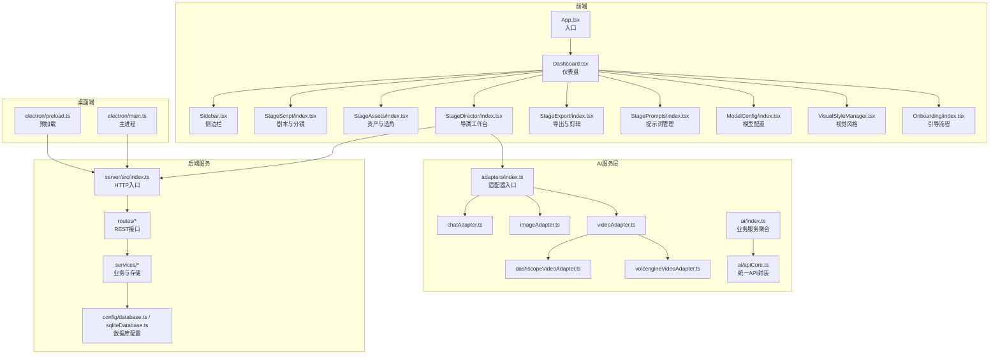
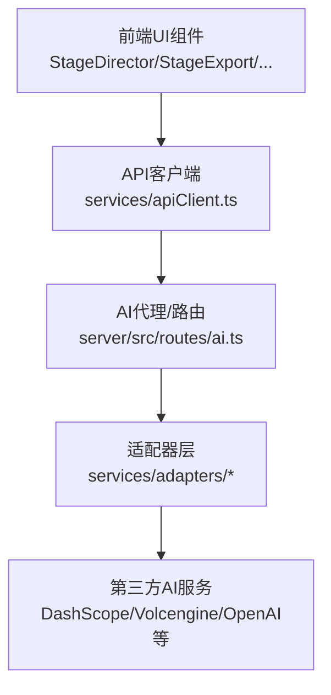
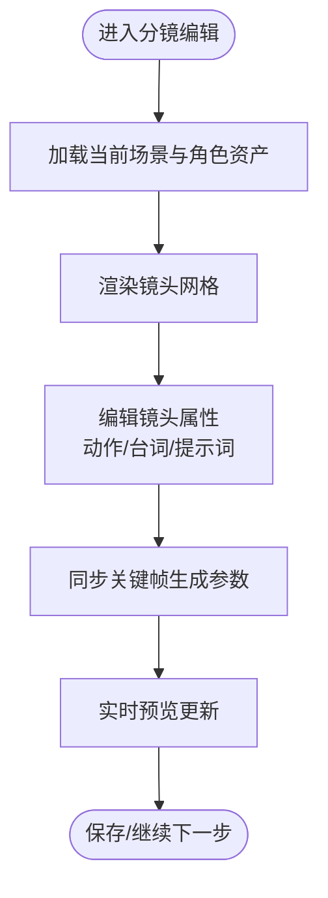
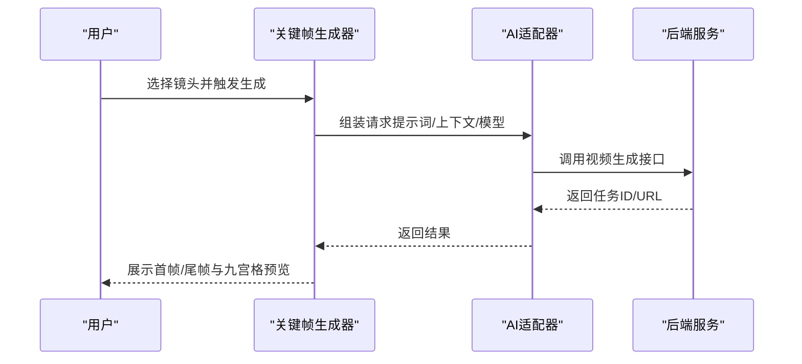
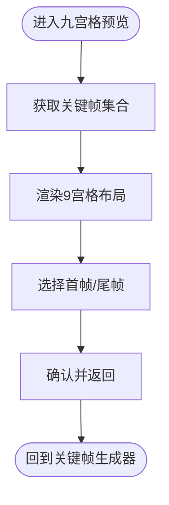
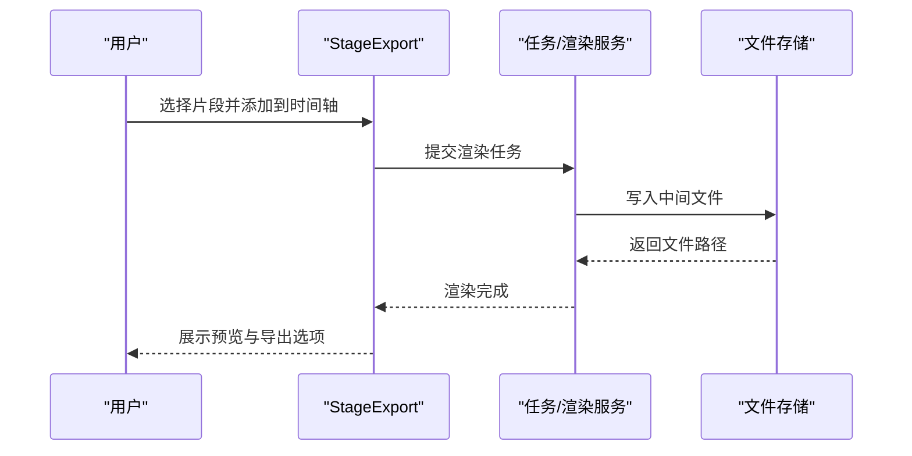
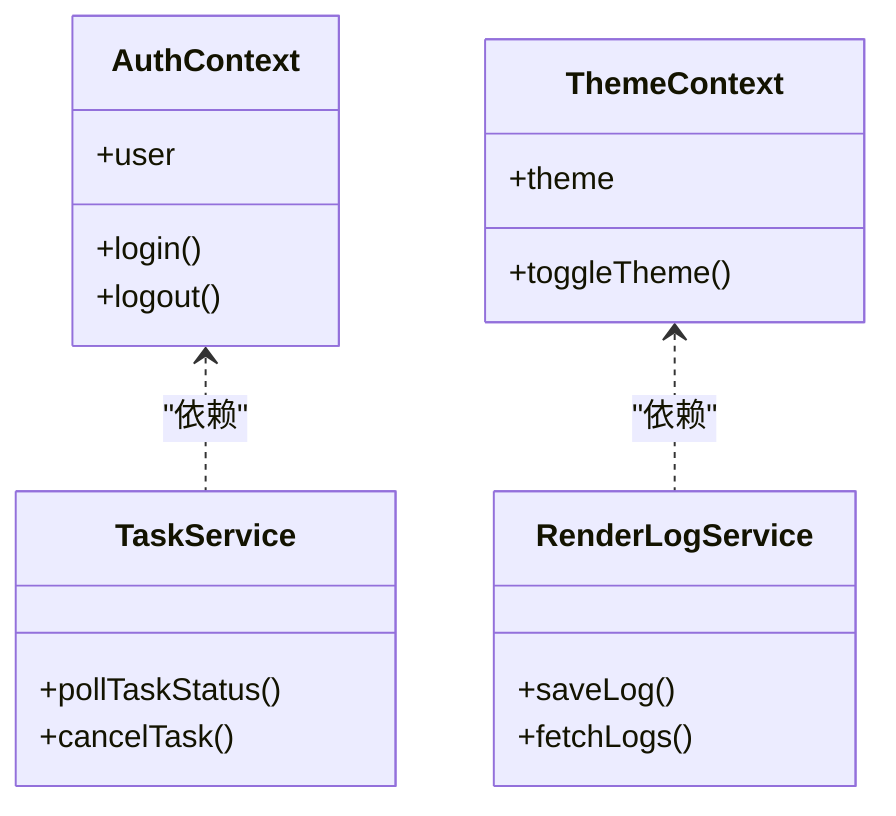
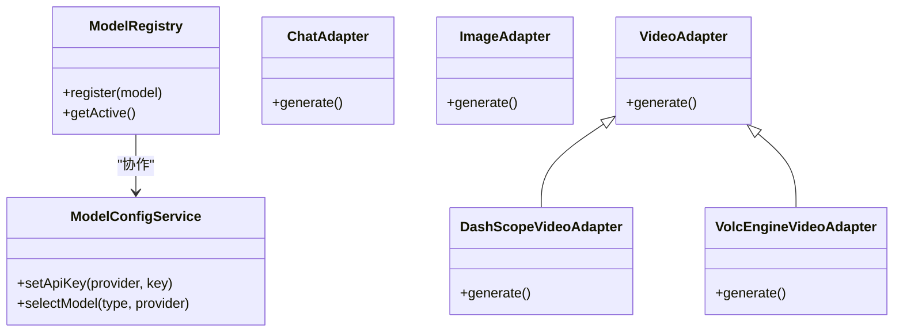
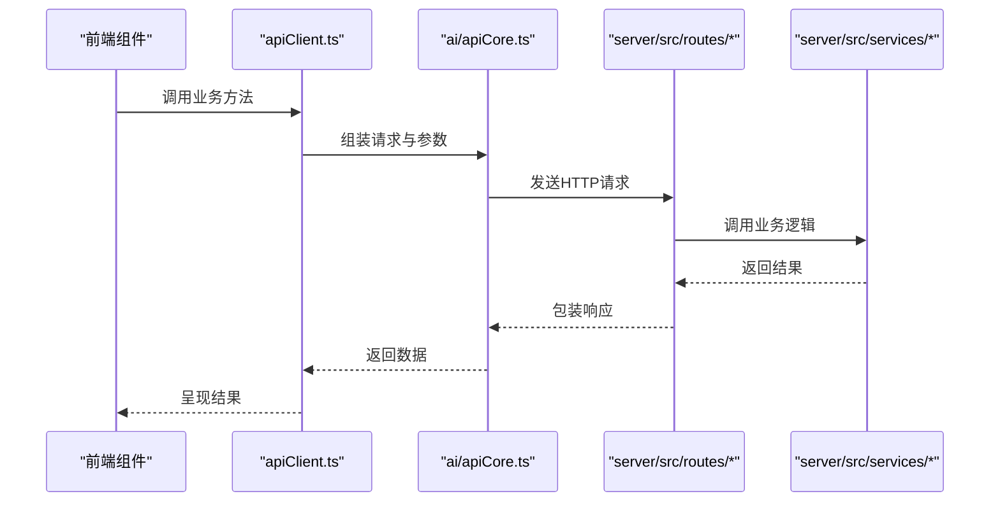
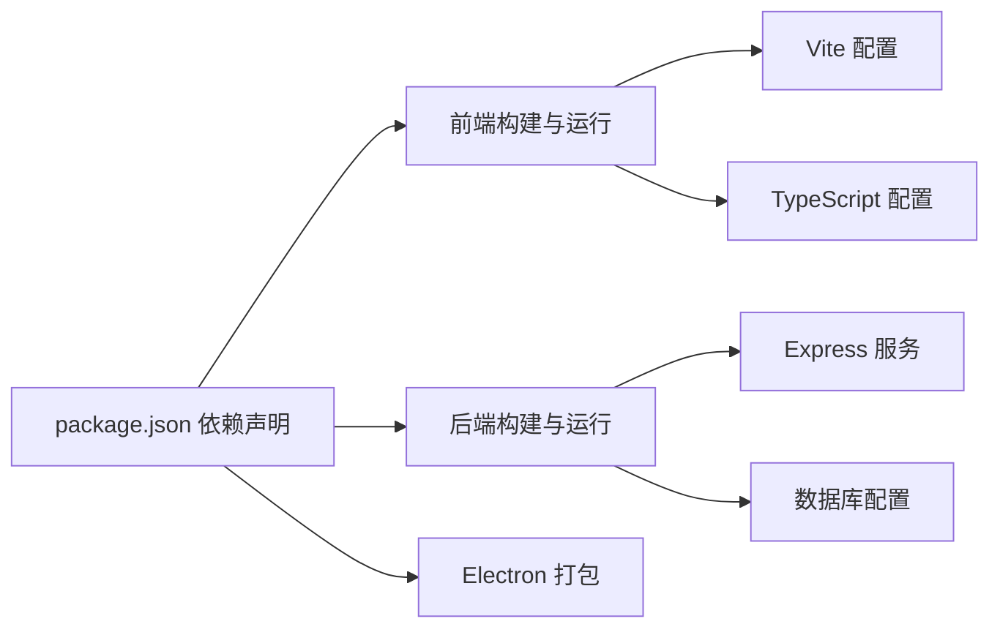

# 导演工作台

<cite>
**本文引用的文件**
- [README.md](file://README.md)
- [App.tsx](file://App.tsx)
- [index.tsx](file://index.tsx)
- [types.ts](file://types.ts)
- [types/model.ts](file://types/model.ts)
- [contexts/AuthContext.tsx](file://contexts/AuthContext.tsx)
- [contexts/ThemeContext.tsx](file://contexts/ThemeContext.tsx)
- [components/Dashboard.tsx](file://components/Dashboard.tsx)
- [components/Sidebar.tsx](file://components/Sidebar.tsx)
- [components/StageScript/index.tsx](file://components/StageScript/index.tsx)
- [components/StageAssets/index.tsx](file://components/StageAssets/index.tsx)
- [components/StageDirector/index.tsx](file://components/StageDirector/index.tsx)
- [components/StageExport/index.tsx](file://components/StageExport/index.tsx)
- [components/StagePrompts/index.tsx](file://components/StagePrompts/index.tsx)
- [components/ModelConfig/index.tsx](file://components/ModelConfig/index.tsx)
- [components/VisualStyleManager.tsx](file://components/VisualStyleManager.tsx)
- [components/Onboarding/index.tsx](file://components/Onboarding/index.tsx)
- [services/adapters/index.ts](file://services/adapters/index.ts)
- [services/adapters/chatAdapter.ts](file://services/adapters/chatAdapter.ts)
- [services/adapters/imageAdapter.ts](file://services/adapters/imageAdapter.ts)
- [services/adapters/videoAdapter.ts](file://services/adapters/videoAdapter.ts)
- [services/adapters/dashscopeVideoAdapter.ts](file://services/adapters/dashscopeVideoAdapter.ts)
- [services/adapters/volcengineVideoAdapter.ts](file://services/adapters/volcengineVideoAdapter.ts)
- [services/ai/index.ts](file://services/ai/index.ts)
- [services/ai/apiCore.ts](file://services/ai/apiCore.ts)
- [services/ai/novelScriptService.ts](file://services/ai/novelScriptService.ts)
- [services/ai/scriptService.ts](file://services/ai/scriptService.ts)
- [services/ai/shotService.ts](file://services/ai/shotService.ts)
- [services/ai/videoService.ts](file://services/ai/videoService.ts)
- [services/ai/visualService.ts](file://services/ai/visualService.ts)
- [services/ai/promptConstants.ts](file://services/ai/promptConstants.ts)
- [services/apiClient.ts](file://services/apiClient.ts)
- [services/storageService.ts](file://services/storageService.ts)
- [services/modelRegistry.ts](file://services/modelRegistry.ts)
- [services/modelConfigService.ts](file://services/modelConfigService.ts)
- [services/taskService.ts](file://services/taskService.ts)
- [services/exportService.ts](file://services/exportService.ts)
- [services/renderLogService.ts](file://services/renderLogService.ts)
- [services/projectPatchService.ts](file://services/projectPatchService.ts)
- [services/novelParser.ts](file://services/novelParser.ts)
- [services/assetLibraryService.ts](file://services/assetLibraryService.ts)
- [services/visualStyleService.ts](file://services/visualStyleService.ts)
- [server/src/index.ts](file://server/src/index.ts)
- [server/src/proxy.ts](file://server/src/proxy.ts)
- [server/src/middleware/auth.ts](file://server/src/middleware/auth.ts)
- [server/src/routes/ai.ts](file://server/src/routes/ai.ts)
- [server/src/routes/assets.ts](file://server/src/routes/assets.ts)
- [server/src/routes/auth.ts](file://server/src/routes/auth.ts)
- [server/src/routes/dataTransfer.ts](file://server/src/routes/dataTransfer.ts)
- [server/src/routes/models.ts](file://server/src/routes/models.ts)
- [server/src/routes/preferences.ts](file://server/src/routes/preferences.ts)
- [server/src/routes/projects.ts](file://server/src/routes/projects.ts)
- [server/src/routes/tasks.ts](file://server/src/routes/tasks.ts)
- [server/src/routes/uploads.ts](file://server/src/routes/uploads.ts)
- [server/src/routes/visualStyles.ts](file://server/src/routes/visualStyles.ts)
- [server/src/services/aiProxy.ts](file://server/src/services/aiProxy.ts)
- [server/src/services/fileStorage.ts](file://server/src/services/fileStorage.ts)
- [server/src/services/imageResolver.ts](file://server/src/services/imageResolver.ts)
- [server/src/services/projectStorage.ts](file://server/src/services/projectStorage.ts)
- [server/src/services/scriptParser.ts](file://server/src/services/scriptParser.ts)
- [server/src/services/taskRunner.ts](file://server/src/services/taskRunner.ts)
- [server/src/config/database.ts](file://server/src/config/database.ts)
- [server/src/config/sqliteDatabase.ts](file://server/src/config/sqliteDatabase.ts)
- [lib/utils.ts](file://lib/utils.ts)
- [electron/main.ts](file://electron/main.ts)
- [electron/preload.ts](file://electron/preload.ts)
- [electron/tsconfig.json](file://electron/tsconfig.json)
- [package.json](file://package.json)
- [vite.config.ts](file://vite.config.ts)
- [tsconfig.json](file://tsconfig.json)
</cite>

## 目录
1. [简介](#简介)
2. [项目结构](#项目结构)
3. [核心组件](#核心组件)
4. [架构总览](#架构总览)
5. [详细组件分析](#详细组件分析)
6. [依赖关系分析](#依赖关系分析)
7. [性能考量](#性能考量)
8. [故障排查指南](#故障排查指南)
9. [结论](#结论)
10. [附录](#附录)

## 简介
导演工作台是面向创作者的“小说 → 剧本 → 分镜 → 资产 → 关键帧 → 成片”的关键帧驱动型短剧/漫剧生产平台。其核心理念是以“先画后动”为核心：先生成首帧与尾帧，再由中间插值生成视频；通过角色定妆与场景概念图约束画面一致性；支持多模型提供商（文本/图像/视频/音频），统一通过适配器层进行调用。

导演工作台的关键功能包括：
- 分镜编辑器：以网格化方式管理镜头，支持编辑角色、提示词、动作、台词等。
- 关键帧生成：生成首帧与可选尾帧，支持九宫格预览与选框。
- 九宫格预览：同一镜头9个视角预览，便于挑选最佳构图。
- 视频合成与渲染：支持I2V与首尾帧插值，按所选视频模型生成片段。
- 导演工具集：相机运动指导、镜头语言规范、关键帧驱动的视频生成算法、实时预览系统。
- 与AI视频生成服务集成：统一适配器层对接多家厂商，支持性能与成本优化。

## 项目结构
项目采用前后端分离架构，前端基于React 19 + Vite 6，后端基于Express.js，数据库支持MySQL或SQLite（本地/桌面模式）。AI能力通过适配器层抽象，统一调用多家厂商API；桌面端基于Electron，内置SQLite，便于离线使用。

图表来源
- [App.tsx](file://App.tsx)
- [components/Dashboard.tsx](file://components/Dashboard.tsx)
- [components/StageDirector/index.tsx](file://components/StageDirector/index.tsx)
- [services/adapters/index.ts](file://services/adapters/index.ts)
- [services/ai/apiCore.ts](file://services/ai/apiCore.ts)
- [server/src/index.ts](file://server/src/index.ts)
- [electron/main.ts](file://electron/main.ts)

章节来源
- [README.md](file://README.md)
- [package.json](file://package.json)
- [vite.config.ts](file://vite.config.ts)
- [tsconfig.json](file://tsconfig.json)

## 核心组件
- 分镜编辑器：负责镜头的增删改查、提示词编辑、动作与台词维护，支持与资产库联动。
- 关键帧生成器：负责首帧/尾帧的生成与编辑，支持九宫格预览与选框。
- 九宫格预览：在同一镜头下展示多个视角，辅助挑选最佳构图。
- 视频生成器：根据关键帧与提示词，调用视频模型生成片段，支持I2V与首尾帧插值。
- 导演工具集：包含相机运动指导、镜头语言规范、实时预览系统与状态管理。
- 模型配置与适配器：统一接入多家AI厂商，支持多模型切换与成本优化。
- 任务与渲染：异步任务队列、渲染日志追踪、导出与剪辑。

章节来源
- [README.md](file://README.md)
- [components/StageDirector/index.tsx](file://components/StageDirector/index.tsx)

## 架构总览
导演工作台采用“前端组件 + AI适配器 + 后端服务 + 数据库”的分层架构。前端通过统一的AI API封装与后端路由交互，后端通过适配器层调用第三方AI服务，实现多模型、多厂商的统一接入。

图表来源
- [services/apiClient.ts](file://services/apiClient.ts)
- [server/src/routes/ai.ts](file://server/src/routes/ai.ts)
- [services/adapters/index.ts](file://services/adapters/index.ts)
- [services/adapters/dashscopeVideoAdapter.ts](file://services/adapters/dashscopeVideoAdapter.ts)
- [services/adapters/volcengineVideoAdapter.ts](file://services/adapters/volcengineVideoAdapter.ts)

## 详细组件分析

### 分镜编辑器
- 功能职责
  - 网格化管理镜头，支持编辑角色、提示词、动作、台词。
  - 与资产库联动，自动带入当前场景图与角色服装图，减少“不连戏”。
  - 与关键帧生成器协同，确保首帧/尾帧与分镜描述一致。
- 数据模型
  - 镜头实体包含动作、对话、镜头尺寸、九宫格等字段。
  - 关键帧实体包含首帧/尾帧、提示词、图像等。
- 状态管理
  - 使用全局上下文与本地组件状态结合，保证编辑态与渲染态的一致性。
- 用户交互
  - 可视化编辑面板、拖拽排序、批量操作、快捷键支持。

图表来源
- [components/StageScript/index.tsx](file://components/StageScript/index.tsx)
- [services/ai/scriptService.ts](file://services/ai/scriptService.ts)

章节来源
- [README.md](file://README.md)
- [components/StageScript/index.tsx](file://components/StageScript/index.tsx)

### 关键帧生成器
- 功能职责
  - 生成首帧与可选尾帧，支持I2V与首尾帧插值。
  - 与九宫格预览联动，支持整图或单格作为首帧。
  - 自动带入上下文（场景图、角色服装图）以保证画面一致性。
- 算法要点
  - 关键帧驱动的视频生成遵循“先画后动”，通过首尾帧插值生成中间帧。
  - 提示词与上下文约束确保角色与场景一致性。
- 性能优化
  - 异步任务队列，避免阻塞UI。
  - 渲染日志追踪，便于回溯与重试。

图表来源
- [components/StageDirector/index.tsx](file://components/StageDirector/index.tsx)
- [services/adapters/videoAdapter.ts](file://services/adapters/videoAdapter.ts)
- [server/src/routes/ai.ts](file://server/src/routes/ai.ts)

章节来源
- [README.md](file://README.md)
- [components/StageDirector/index.tsx](file://components/StageDirector/index.tsx)

### 九宫格预览
- 功能职责
  - 同一镜头9个视角预览，支持整图或单格作为首帧。
  - 辅助导演快速挑选最佳构图，提升创作效率。
- 实现要点
  - 基于关键帧生成的多视角输出，统一管理与展示。
  - 与关键帧生成器状态联动，保证选框与生成结果一致。

图表来源
- [components/StageDirector/index.tsx](file://components/StageDirector/index.tsx)

章节来源
- [README.md](file://README.md)
- [components/StageDirector/index.tsx](file://components/StageDirector/index.tsx)

### 视频合成与渲染
- 功能职责
  - 时间轴预览：渲染进度追踪，导出高清关键帧与MP4片段。
  - 多轨道：支持视频、音频、字幕、图片轨道，可自由增删。
  - 资源库：按剧本/镜头、角色、场景、视频、上传、AI字幕、AI音频分类展示。
  - 下载剪辑：将当前轨道中的视频与图片片段打包为ZIP下载。
- 工作流
  - 生成片段 → 导入时间轴 → 调整轨道与特效 → 导出成品。

图表来源
- [components/StageExport/index.tsx](file://components/StageExport/index.tsx)
- [services/exportService.ts](file://services/exportService.ts)
- [server/src/services/taskRunner.ts](file://server/src/services/taskRunner.ts)

章节来源
- [README.md](file://README.md)
- [components/StageExport/index.tsx](file://components/StageExport/index.tsx)

### 导演工具集与状态管理
- 工具集
  - 相机运动指导：提供运动轨迹模板与参数建议，辅助稳定与动感。
  - 镜头语言规范：统一镜头尺寸、运动与节奏标准，提升作品一致性。
  - 实时预览系统：在编辑过程中即时反馈生成效果，减少迭代成本。
- 状态管理
  - 全局上下文（认证、主题）与组件局部状态相结合，保证跨页面状态一致。
  - 任务状态与渲染日志持久化，支持断点续传与重试。

图表来源
- [contexts/AuthContext.tsx](file://contexts/AuthContext.tsx)
- [contexts/ThemeContext.tsx](file://contexts/ThemeContext.tsx)
- [services/taskService.ts](file://services/taskService.ts)
- [services/renderLogService.ts](file://services/renderLogService.ts)

章节来源
- [contexts/AuthContext.tsx](file://contexts/AuthContext.tsx)
- [contexts/ThemeContext.tsx](file://contexts/ThemeContext.tsx)
- [services/taskService.ts](file://services/taskService.ts)
- [services/renderLogService.ts](file://services/renderLogService.ts)

### 模型配置与适配器层
- 设计理念
  - 多模型支持：文本/图像/视频/音频可分别配置API Key与当前使用模型。
  - 统一适配：通过适配器层屏蔽厂商差异，支持无缝切换。
- 适配器实现
  - chatAdapter：文本/对话。
  - imageAdapter：图像生成。
  - videoAdapter：视频生成，具体厂商通过dashscopeVideoAdapter与volcengineVideoAdapter实现。
- 类型与注册
  - types/model.ts定义模型与提供商类型，modelRegistry与modelConfigService负责注册与切换。

图表来源
- [types/model.ts](file://types/model.ts)
- [services/modelRegistry.ts](file://services/modelRegistry.ts)
- [services/modelConfigService.ts](file://services/modelConfigService.ts)
- [services/adapters/chatAdapter.ts](file://services/adapters/chatAdapter.ts)
- [services/adapters/imageAdapter.ts](file://services/adapters/imageAdapter.ts)
- [services/adapters/videoAdapter.ts](file://services/adapters/videoAdapter.ts)
- [services/adapters/dashscopeVideoAdapter.ts](file://services/adapters/dashscopeVideoAdapter.ts)
- [services/adapters/volcengineVideoAdapter.ts](file://services/adapters/volcengineVideoAdapter.ts)

章节来源
- [README.md](file://README.md)
- [types/model.ts](file://types/model.ts)
- [services/modelRegistry.ts](file://services/modelRegistry.ts)
- [services/modelConfigService.ts](file://services/modelConfigService.ts)
- [services/adapters/index.ts](file://services/adapters/index.ts)

### AI服务与API封装
- 统一API封装：ai/apiCore.ts提供统一的请求封装与错误处理。
- 业务服务聚合：ai/index.ts聚合小说脚本、剧本、分镜、视频、视觉风格等服务。
- 提示词常量：promptConstants.ts集中管理各类提示词模板，保证一致性与可复用性。

图表来源
- [services/apiClient.ts](file://services/apiClient.ts)
- [services/ai/apiCore.ts](file://services/ai/apiCore.ts)
- [server/src/routes/ai.ts](file://server/src/routes/ai.ts)
- [server/src/services/aiProxy.ts](file://server/src/services/aiProxy.ts)

章节来源
- [services/ai/index.ts](file://services/ai/index.ts)
- [services/ai/apiCore.ts](file://services/ai/apiCore.ts)
- [services/ai/promptConstants.ts](file://services/ai/promptConstants.ts)

## 依赖关系分析
- 前端依赖
  - React 19、Vite 6、Tailwind CSS 4、Radix UI、Framer Motion。
  - 组件间通过上下文与服务层解耦，提高可维护性。
- 后端依赖
  - Express.js、JWT认证、MySQL/SQLite、文件存储。
  - 通过路由与服务层分离关注点，便于扩展与测试。
- 桌面端依赖
  - Electron 33、better-sqlite3、electron-builder，支持macOS与Windows打包。

图表来源
- [package.json](file://package.json)
- [vite.config.ts](file://vite.config.ts)
- [tsconfig.json](file://tsconfig.json)
- [server/src/config/database.ts](file://server/src/config/database.ts)
- [server/src/config/sqliteDatabase.ts](file://server/src/config/sqliteDatabase.ts)

章节来源
- [package.json](file://package.json)
- [vite.config.ts](file://vite.config.ts)
- [tsconfig.json](file://tsconfig.json)

## 性能考量
- 异步任务与并发控制
  - 使用任务队列与并发限制，避免AI服务过载与超时。
  - 渲染日志与断点续传，提升失败恢复能力。
- 缓存与预取
  - 对常用资产与提示词进行缓存，减少重复请求。
  - 预取下一镜头的关键帧，缩短编辑等待时间。
- 渲染优化
  - 优先使用I2V与首尾帧插值，减少全量生成成本。
  - 多轨道导出时按需渲染，避免不必要的计算。
- 网络与适配器
  - 适配器层统一错误处理与重试策略，提升稳定性。
  - 支持多厂商切换，按成本与质量动态选择。

## 故障排查指南
- 常见问题
  - API Key未配置或失效：检查模型配置页面，确保各厂商API Key正确。
  - 生成任务长时间无响应：查看任务状态与渲染日志，必要时重试或取消。
  - 画面不连戏：确认场景图与角色服装图已正确上传并启用上下文。
- 排查步骤
  - 检查网络与代理设置，确保能访问第三方AI服务。
  - 查看后端日志与任务队列，定位异常节点。
  - 回滚至上一个稳定版本，逐步定位变更影响。
- 服务与存储
  - 数据库连接失败：检查数据库配置与权限。
  - 文件存储异常：确认data/与uploads/目录权限与磁盘空间。

章节来源
- [services/modelConfigService.ts](file://services/modelConfigService.ts)
- [services/taskService.ts](file://services/taskService.ts)
- [services/renderLogService.ts](file://services/renderLogService.ts)
- [server/src/config/database.ts](file://server/src/config/database.ts)
- [server/src/config/sqliteDatabase.ts](file://server/src/config/sqliteDatabase.ts)

## 结论
导演工作台通过“关键帧驱动”的创作流程，结合多模型适配与统一的AI服务层，实现了从分镜到成片的一站式生产。其模块化设计与状态管理机制，使得复杂的工作流在易用性与可扩展性之间取得平衡。配合相机运动指导与镜头语言规范，能够帮助创作者高效产出高质量的短剧/漫剧内容。

## 附录
- 快速开始
  - 登录后配置模型，上传小说或直接输入故事/剧本，生成分镜与资产，进入导演工作台生成关键帧并导出视频。
- 数据导出与导入
  - 支持ZIP归档导出/导入，适用于跨服务器迁移与备份恢复。
- 桌面客户端
  - 基于Electron打包，内嵌SQLite，无需安装MySQL，双击即用。

章节来源
- [README.md](file://README.md)
- [components/Onboarding/index.tsx](file://components/Onboarding/index.tsx)