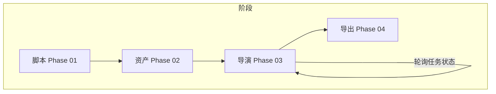
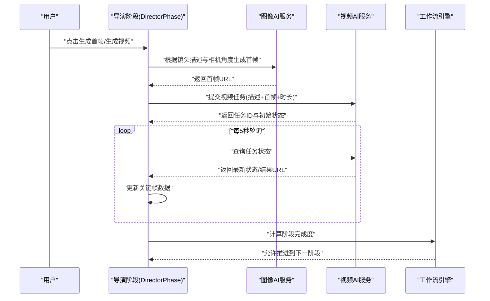
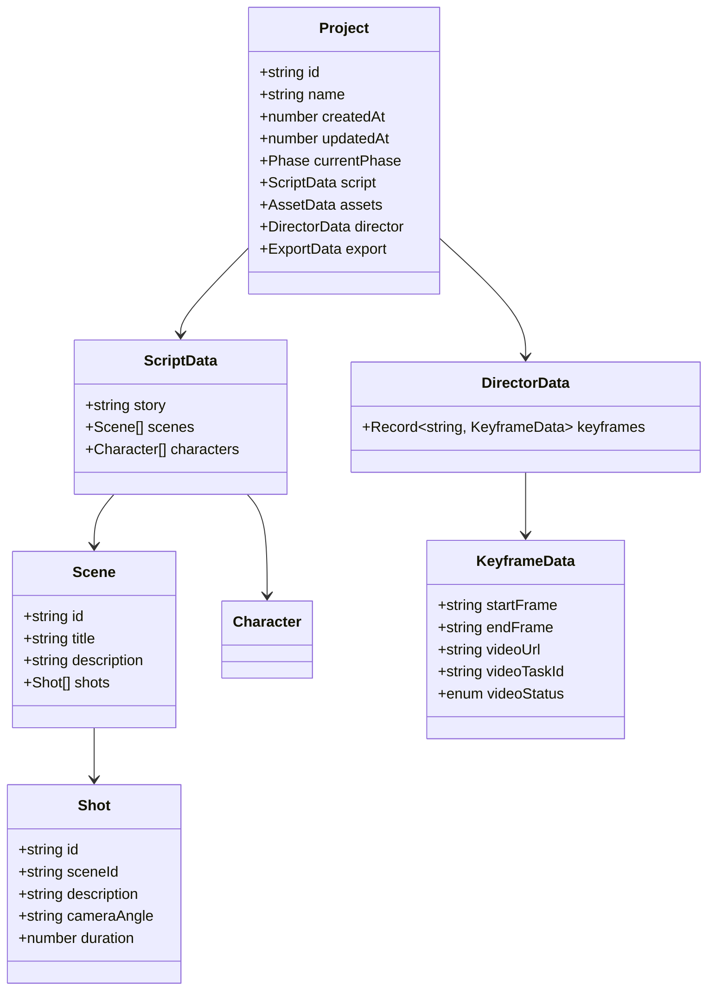
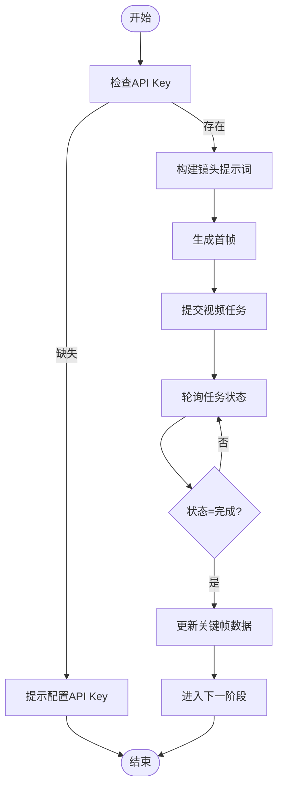
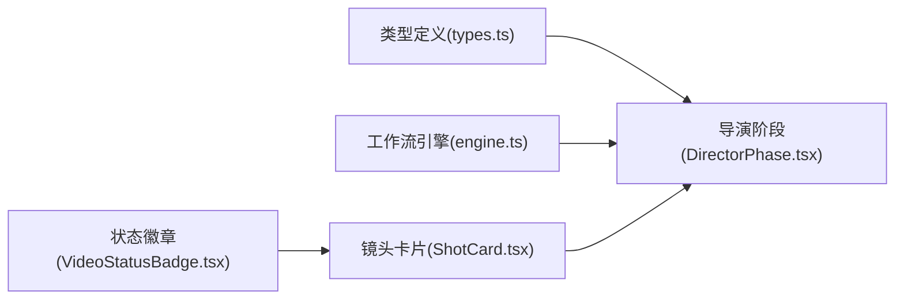

# 相机运动指导

<cite>
**本文引用的文件**
- [src/phases/director/DirectorPhase.tsx](file://src/phases/director/DirectorPhase.tsx)
- [src/phases/director/components/ShotCard.tsx](file://src/phases/director/components/ShotCard.tsx)
- [src/phases/director/components/VideoStatusBadge.tsx](file://src/phases/director/components/VideoStatusBadge.tsx)
- [src/services/workflow/engine.ts](file://src/services/workflow/engine.ts)
- [src/services/workflow/types.ts](file://src/services/workflow/types.ts)
- [src/types.ts](file://src/types.ts)
</cite>

## 目录
1. [引言](#引言)
2. [项目结构](#项目结构)
3. [核心组件](#核心组件)
4. [架构总览](#架构总览)
5. [详细组件分析](#详细组件分析)
6. [依赖分析](#依赖分析)
7. [性能考虑](#性能考虑)
8. [故障排查指南](#故障排查指南)
9. [结论](#结论)
10. [附录](#附录)

## 引言
本技术文档围绕“相机运动指导系统”的镜头调度与可视化能力展开，聚焦导演工作台如何将剧本镜头转化为可执行的首帧与视频任务，并通过状态反馈闭环驱动后续阶段推进。文档将从数据结构、镜头语言规范、运动类型分类、适用场景与强度量化、镜头调度原则、与情节匹配关系、视觉目标、轨迹设计思路、创意指导、技术实现要点以及质量评估标准等方面进行系统化阐述。

## 项目结构
该系统采用分阶段工作流：脚本（Phase 01）→资产（Phase 02）→导演（Phase 03）→导出（Phase 04）。导演阶段负责将镜头描述与相机角度等信息转化为首帧图像与视频任务，并通过轮询机制回查任务状态，最终形成可导出的视频片段。

**图表来源**
- [src/services/workflow/engine.ts:83-117](file://src/services/workflow/engine.ts#L83-L117)
- [src/phases/director/DirectorPhase.tsx:62-495](file://src/phases/director/DirectorPhase.tsx#L62-L495)

**章节来源**
- [src/services/workflow/engine.ts:83-117](file://src/services/workflow/engine.ts#L83-L117)
- [src/phases/director/DirectorPhase.tsx:62-495](file://src/phases/director/DirectorPhase.tsx#L62-L495)

## 核心组件
- 导演阶段主界面：负责构建镜头提示词、批量生成首帧、提交视频任务、轮询任务状态并更新UI。
- 镜头卡片：展示单个镜头的编号、场景信息、首帧预览、状态徽章与操作按钮。
- 状态徽章：以四态（排队、渲染中、已完成、失败）直观呈现视频任务状态。
- 工作流引擎：定义阶段推进规则与各阶段完成度计算逻辑。

**章节来源**
- [src/phases/director/DirectorPhase.tsx:39-125](file://src/phases/director/DirectorPhase.tsx#L39-L125)
- [src/phases/director/DirectorPhase.tsx:127-159](file://src/phases/director/DirectorPhase.tsx#L127-L159)
- [src/phases/director/DirectorPhase.tsx:191-247](file://src/phases/director/DirectorPhase.tsx#L191-L247)
- [src/phases/director/components/ShotCard.tsx:22-31](file://src/phases/director/components/ShotCard.tsx#L22-L31)
- [src/phases/director/components/VideoStatusBadge.tsx:52-80](file://src/phases/director/components/VideoStatusBadge.tsx#L52-L80)
- [src/services/workflow/engine.ts:83-117](file://src/services/workflow/engine.ts#L83-L117)

## 架构总览
导演阶段的核心流程包括：构建镜头提示词 → 图像模型生成首帧 → 视频模型提交任务 → 定时轮询任务状态 → 更新关键帧数据 → 驱动工作流进入下一阶段。

**图表来源**
- [src/phases/director/DirectorPhase.tsx:39-60](file://src/phases/director/DirectorPhase.tsx#L39-L60)
- [src/phases/director/DirectorPhase.tsx:111-125](file://src/phases/director/DirectorPhase.tsx#L111-L125)
- [src/phases/director/DirectorPhase.tsx:127-159](file://src/phases/director/DirectorPhase.tsx#L127-L159)
- [src/phases/director/DirectorPhase.tsx:191-247](file://src/phases/director/DirectorPhase.tsx#L191-L247)
- [src/services/workflow/engine.ts:56-72](file://src/services/workflow/engine.ts#L56-L72)

## 详细组件分析

### 数据结构与镜头语言规范
- 项目模型包含脚本、资产、导演与导出四个阶段的数据结构；导演阶段的关键数据为关键帧记录，包含首帧、结束帧、视频URL、任务ID与状态。
- 镜头语言规范体现在提示词构建函数中：将镜头描述、相机角度、场景描述、角色外观等信息组合为统一提示词，确保生成内容与剧本一致。

**图表来源**
- [src/types.ts:10-96](file://src/types.ts#L10-L96)

**章节来源**
- [src/types.ts:44-69](file://src/types.ts#L44-L69)
- [src/phases/director/DirectorPhase.tsx:39-60](file://src/phases/director/DirectorPhase.tsx#L39-L60)

### 运动类型分类系统与适用场景
- 相机角度字段用于表达镜头语言中的“运动类型”，如中景、近景、特写等，作为镜头提示词的一部分参与图像生成。
- 适用场景建议：
  - 特写：强调情感与细节，适合关键情绪爆发或物品聚焦；
  - 中景：平衡人物与环境，适合对话与互动；
  - 全景：交代空间与氛围，适合场景转换或大动作。
- 强度量化建议：
  - 低强度：静态构图、轻微摇摆或推拉；
  - 中强度：中等幅度的移动、变焦；
  - 高强度：快速移动、大幅度变焦或不稳定手持感。
- 注意：当前系统通过“相机角度”字段表达镜头语言，未内置专门的“运动强度”字段，可在扩展时增加枚举值或数值字段以细化控制。

**章节来源**
- [src/phases/director/DirectorPhase.tsx:39-60](file://src/phases/director/DirectorPhase.tsx#L39-L60)
- [src/phases/director/components/ShotCard.tsx:152-163](file://src/phases/director/components/ShotCard.tsx#L152-L163)

### 镜头调度指导原则
- 生成顺序：先首帧后视频，避免无首帧直接提交视频。
- 并发策略：批量生成首帧时逐个处理并累积错误，保持进度反馈。
- 轮询策略：对处于“排队/处理中”的任务并行轮询，及时更新状态与结果URL。
- 错误处理：捕获生成与轮询异常，保留错误信息并允许用户重试。

**图表来源**
- [src/phases/director/DirectorPhase.tsx:111-125](file://src/phases/director/DirectorPhase.tsx#L111-L125)
- [src/phases/director/DirectorPhase.tsx:127-159](file://src/phases/director/DirectorPhase.tsx#L127-L159)
- [src/phases/director/DirectorPhase.tsx:191-247](file://src/phases/director/DirectorPhase.tsx#L191-L247)

**章节来源**
- [src/phases/director/DirectorPhase.tsx:162-189](file://src/phases/director/DirectorPhase.tsx#L162-L189)
- [src/phases/director/DirectorPhase.tsx:191-247](file://src/phases/director/DirectorPhase.tsx#L191-L247)

### 相机运动与故事情节的匹配关系
- 提示词构建将“镜头描述”“相机角度”“场景描述”“角色外观”整合，使生成画面与剧本情境一致。
- 建议在镜头描述中明确动作、情绪与节奏，配合相机角度强化叙事张力。

**章节来源**
- [src/phases/director/DirectorPhase.tsx:39-60](file://src/phases/director/DirectorPhase.tsx#L39-L60)

### 视觉效果的预期目标
- 首帧用于定调画面风格与构图，视频任务在此基础上延续风格并加入动态。
- 状态徽章提供“排队/渲染中/已完成/失败”的即时反馈，帮助用户把握整体进度。

**章节来源**
- [src/phases/director/components/VideoStatusBadge.tsx:11-44](file://src/phases/director/components/VideoStatusBadge.tsx#L11-L44)

### 运动轨迹的设计思路
- 当前系统通过“相机角度”表达镜头语言，未包含具体运动轨迹参数。
- 设计建议：
  - 在镜头描述中体现运动方向与节奏（如“缓慢推进至角色面部”）；
  - 结合时长字段控制运动节奏与持续时间；
  - 对复杂运动可拆分为多个镜头，分别指定角度与时长，便于控制与回放。

**章节来源**
- [src/phases/director/DirectorPhase.tsx:39-60](file://src/phases/director/DirectorPhase.tsx#L39-L60)
- [src/types.ts:48-49](file://src/types.ts#L48-L49)

### 创意指导与最佳实践
- 镜头语言规范
  - 使用简洁明确的镜头描述，突出动作、表情或关键道具；
  - 相机角度与场景/角色描述相呼应，避免风格冲突。
- 适用场景
  - 情绪戏：多用特写与中景，强调面部与肢体语言；
  - 动作戏：多用运动镜头与广角，强调空间与速度感；
  - 叙事转场：使用全景或慢移，建立时空关系。
- 强度控制
  - 低强度：静态或轻微移动，适合内省与铺垫；
  - 中强度：适度变焦与平移，适合对话与互动；
  - 高强度：快速剪辑与动感镜头，适合高潮与冲突。
- 最佳实践
  - 先生成首帧再提交视频，确保风格稳定；
  - 批量生成时关注错误汇总，优先修复失败项；
  - 轮询期间避免重复提交相同任务。

**章节来源**
- [src/phases/director/DirectorPhase.tsx:39-60](file://src/phases/director/DirectorPhase.tsx#L39-L60)
- [src/phases/director/DirectorPhase.tsx:162-189](file://src/phases/director/DirectorPhase.tsx#L162-L189)

### 技术实现要点
- 提示词构建：将镜头描述、相机角度、场景描述与角色外观拼接为统一提示词。
- 首帧生成：调用图像AI服务，固定分辨率输出首帧URL并写入关键帧。
- 视频提交：携带镜头描述、首帧URL与时长提交视频任务，记录任务ID与初始状态。
- 轮询更新：定时查询任务状态，成功后回填结果URL并更新UI。
- 错误处理：捕获API异常与网络问题，保留错误信息并允许重试。

**章节来源**
- [src/phases/director/DirectorPhase.tsx:39-60](file://src/phases/director/DirectorPhase.tsx#L39-L60)
- [src/phases/director/DirectorPhase.tsx:111-125](file://src/phases/director/DirectorPhase.tsx#L111-L125)
- [src/phases/director/DirectorPhase.tsx:127-159](file://src/phases/director/DirectorPhase.tsx#L127-L159)
- [src/phases/director/DirectorPhase.tsx:191-247](file://src/phases/director/DirectorPhase.tsx#L191-L247)

### 质量评估标准
- 首帧质量：与镜头描述一致、构图稳定、风格统一。
- 视频质量：运动流畅、时长符合预期、风格与首帧一致。
- 状态反馈：排队/渲染中/完成/失败状态准确，进度可见。
- 工作流推进：导演阶段至少完成一个镜头视频后方可进入导出阶段。

**章节来源**
- [src/phases/director/components/VideoStatusBadge.tsx:11-44](file://src/phases/director/components/VideoStatusBadge.tsx#L11-L44)
- [src/services/workflow/engine.ts:56-72](file://src/services/workflow/engine.ts#L56-L72)

## 依赖分析
导演阶段依赖于类型定义、工作流引擎与状态徽章组件，形成“数据结构—业务逻辑—UI反馈”的清晰分层。

**图表来源**
- [src/types.ts:10-96](file://src/types.ts#L10-L96)
- [src/services/workflow/engine.ts:83-117](file://src/services/workflow/engine.ts#L83-L117)
- [src/phases/director/components/VideoStatusBadge.tsx:52-80](file://src/phases/director/components/VideoStatusBadge.tsx#L52-L80)
- [src/phases/director/components/ShotCard.tsx:22-31](file://src/phases/director/components/ShotCard.tsx#L22-L31)
- [src/phases/director/DirectorPhase.tsx:62-495](file://src/phases/director/DirectorPhase.tsx#L62-L495)

**章节来源**
- [src/types.ts:10-96](file://src/types.ts#L10-L96)
- [src/services/workflow/engine.ts:83-117](file://src/services/workflow/engine.ts#L83-L117)
- [src/phases/director/components/VideoStatusBadge.tsx:52-80](file://src/phases/director/components/VideoStatusBadge.tsx#L52-L80)
- [src/phases/director/components/ShotCard.tsx:22-31](file://src/phases/director/components/ShotCard.tsx#L22-L31)
- [src/phases/director/DirectorPhase.tsx:62-495](file://src/phases/director/DirectorPhase.tsx#L62-L495)

## 性能考虑
- 批量生成首帧时逐个处理并累积错误，避免阻塞UI线程。
- 轮询采用固定间隔（毫秒级），对大量任务并发查询，需注意网络与服务端限流。
- 首帧与视频均采用异步处理，前端乐观更新状态以提升交互体验。

**章节来源**
- [src/phases/director/DirectorPhase.tsx:162-189](file://src/phases/director/DirectorPhase.tsx#L162-L189)
- [src/phases/director/DirectorPhase.tsx:191-247](file://src/phases/director/DirectorPhase.tsx#L191-L247)

## 故障排查指南
- API Key未配置：在“模型配置”中填写后重试。
- 首帧未生成即提交视频：先生成首帧再提交视频。
- 任务长时间处于排队/处理中：检查网络与服务端状态，稍后重试。
- 部分镜头生成失败：查看全局错误提示，定位失败原因并重试。

**章节来源**
- [src/phases/director/DirectorPhase.tsx:114-116](file://src/phases/director/DirectorPhase.tsx#L114-L116)
- [src/phases/director/DirectorPhase.tsx:134-137](file://src/phases/director/DirectorPhase.tsx#L134-L137)
- [src/phases/director/DirectorPhase.tsx:176-181](file://src/phases/director/DirectorPhase.tsx#L176-L181)
- [src/phases/director/DirectorPhase.tsx:355-367](file://src/phases/director/DirectorPhase.tsx#L355-L367)

## 结论
本系统通过“镜头描述+相机角度”的提示词体系与“首帧+视频”的两阶段生成流程，实现了从剧本到可导出视频的自动化调度。结合状态反馈与工作流推进规则，能够有效支撑创意表达与工程化落地。未来可在“运动强度”“轨迹参数”“镜头组合”等方面进一步扩展，以满足更复杂的镜头语言需求。

## 附录
- 常见镜头运动模式与场景建议
  - 推进/拉远：强调角色情绪变化或空间延伸；
  - 横移/升降：表现人物关系或环境氛围；
  - 固定构图：强调静态细节或象征性画面。
- 最佳实践清单
  - 明确镜头描述与相机角度；
  - 控制时长与节奏；
  - 先首帧后视频；
  - 分批生成并关注错误；
  - 达成导演阶段完成度后再推进。