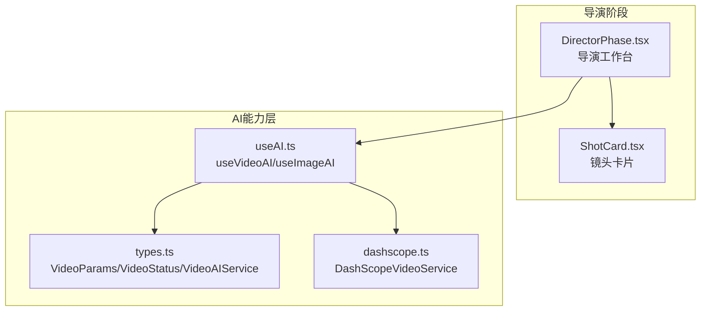
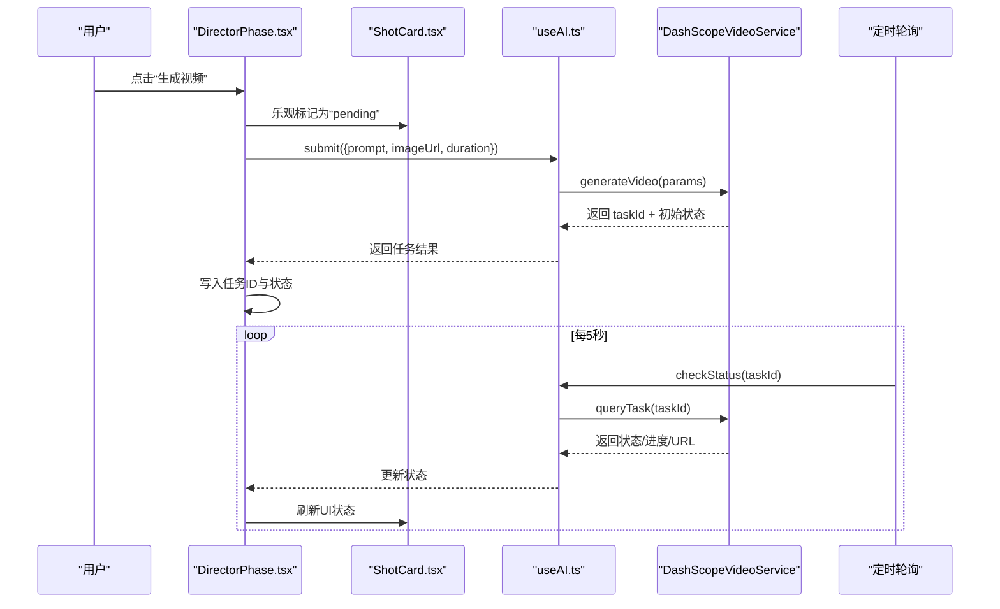
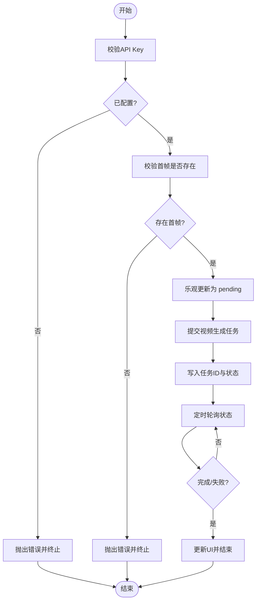
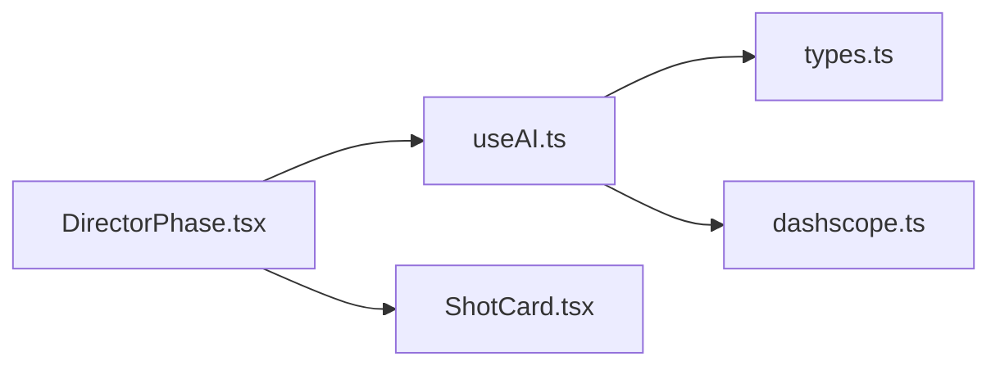

# 视频生成引擎

<cite>
**本文引用的文件**
- [DirectorPhase.tsx](file://src/phases/director/DirectorPhase.tsx)
- [ShotCard.tsx](file://src/phases/director/components/ShotCard.tsx)
- [useAI.ts](file://src/shared/hooks/useAI.ts)
- [dashscope.ts](file://src/services/ai/dashscope.ts)
- [types.ts](file://src/services/ai/types.ts)
- [README_EN.md](file://README_EN.md)
</cite>

## 目录
1. [简介](#简介)
2. [项目结构](#项目结构)
3. [核心组件](#核心组件)
4. [架构总览](#架构总览)
5. [详细组件分析](#详细组件分析)
6. [依赖关系分析](#依赖关系分析)
7. [性能考量](#性能考量)
8. [故障排查指南](#故障排查指南)
9. [结论](#结论)
10. [附录](#附录)

## 简介
本技术文档围绕“视频生成引擎”的前端实现进行系统化梳理，重点覆盖以下方面：
- 视频生成器组件的架构设计与职责边界
- 关键帧到视频的转换流程与异步任务管理机制
- 与多AI服务提供商的集成方式、状态轮询与反馈
- 运动强度控制、时长参数配置与质量控制策略
- 批量生成最佳实践、性能优化与错误恢复

该系统采用“导演工作台”作为交互中枢，结合“乐观更新”与“定时轮询”机制，将异步视频生成任务的状态实时反馈至UI，并支持批量生成与错误累积处理。

## 项目结构
视频生成引擎位于前端“导演阶段”（Director Phase），主要由以下模块构成：
- 导演工作台：负责镜头组织、关键帧与视频生成的入口控制
- 视频生成UI：单镜头与批量生成按钮、状态展示与重试机制
- AI能力封装：统一的文本/图像/视频服务接口与提供商工厂
- DashScope适配器：具体视频生成服务的实现与状态查询

图表来源
- [DirectorPhase.tsx:127-204](file://src/phases/director/DirectorPhase.tsx#L127-L204)
- [ShotCard.tsx:232-265](file://src/phases/director/components/ShotCard.tsx#L232-L265)
- [useAI.ts:68-96](file://src/shared/hooks/useAI.ts#L68-L96)
- [types.ts:40-63](file://src/services/ai/types.ts#L40-L63)
- [dashscope.ts:275-326](file://src/services/ai/dashscope.ts#L275-L326)

章节来源
- [DirectorPhase.tsx:127-204](file://src/phases/director/DirectorPhase.tsx#L127-L204)
- [ShotCard.tsx:232-265](file://src/phases/director/components/ShotCard.tsx#L232-L265)
- [useAI.ts:68-96](file://src/shared/hooks/useAI.ts#L68-L96)
- [types.ts:40-63](file://src/services/ai/types.ts#L40-L63)
- [dashscope.ts:275-326](file://src/services/ai/dashscope.ts#L275-L326)

## 核心组件
- 导演工作台（DirectorPhase）
  - 提交视频生成任务、写入任务ID与初始状态
  - 定时轮询任务状态，更新UI反馈
  - 支持批量生成与错误累积处理
- 镜头卡片（ShotCard）
  - 单镜头生成按钮、状态文案与图标
  - 生成中/排队中/已完成/失败等状态可视化
- AI能力封装（useAI）
  - 统一的视频提交与状态检查接口
  - 内置加载态与错误态管理
- 类型与接口（types）
  - 视频参数、状态枚举与服务接口定义
- DashScope适配器（dashscope）
  - 提交异步任务、查询状态、映射完成态与URL

章节来源
- [DirectorPhase.tsx:127-204](file://src/phases/director/DirectorPhase.tsx#L127-L204)
- [DirectorPhase.tsx:191-204](file://src/phases/director/DirectorPhase.tsx#L191-L204)
- [ShotCard.tsx:232-265](file://src/phases/director/components/ShotCard.tsx#L232-L265)
- [useAI.ts:68-96](file://src/shared/hooks/useAI.ts#L68-L96)
- [types.ts:40-63](file://src/services/ai/types.ts#L40-L63)
- [dashscope.ts:275-326](file://src/services/ai/dashscope.ts#L275-L326)

## 架构总览
系统采用“控制论反馈闭环”设计：用户在导演工作台提交视频生成请求，系统立即进入“乐观更新”状态；随后通过定时轮询将外部服务状态拉回本地，最终落库并驱动下一阶段使用。

图表来源
- [DirectorPhase.tsx:127-204](file://src/phases/director/DirectorPhase.tsx#L127-L204)
- [DirectorPhase.tsx:191-204](file://src/phases/director/DirectorPhase.tsx#L191-L204)
- [ShotCard.tsx:232-265](file://src/phases/director/components/ShotCard.tsx#L232-L265)
- [useAI.ts:68-96](file://src/shared/hooks/useAI.ts#L68-L96)
- [dashscope.ts:275-326](file://src/services/ai/dashscope.ts#L275-L326)

## 详细组件分析

### 组件A：导演工作台（DirectorPhase）
- 职责
  - 校验API Key与首帧存在性
  - 乐观更新：提交前将状态标记为“排队中”
  - 写入任务ID与初始状态
  - 定时轮询：每5秒检查一次任务状态
- 关键流程
  - 单镜头生成：收集镜头描述、首帧图与时长，提交视频生成
  - 批量生成：遍历待生成镜头，累积错误但不中断
- 错误处理
  - 失败时回滚状态为“失败”，保留错误信息
  - 批量模式下记录首个异常消息，继续后续任务

图表来源
- [DirectorPhase.tsx:127-204](file://src/phases/director/DirectorPhase.tsx#L127-L204)
- [DirectorPhase.tsx:191-204](file://src/phases/director/DirectorPhase.tsx#L191-L204)

章节来源
- [DirectorPhase.tsx:127-204](file://src/phases/director/DirectorPhase.tsx#L127-L204)
- [DirectorPhase.tsx:191-204](file://src/phases/director/DirectorPhase.tsx#L191-L204)

### 组件B：镜头卡片（ShotCard）
- 职责
  - 展示当前镜头的生成状态与操作按钮
  - 生成中/排队中显示加载态与文案
  - 已生成时提供“重新拍摄”入口
- 交互
  - 按钮禁用条件：无首帧/正在生成/镜头被锁定
  - 成功后高亮提示并允许重新生成

章节来源
- [ShotCard.tsx:232-265](file://src/phases/director/components/ShotCard.tsx#L232-L265)

### 组件C：AI能力封装（useAI）
- 职责
  - 封装视频提交与状态检查
  - 统一错误处理与加载态管理
- 接口
  - submit(params): Promise<VideoResult>
  - checkStatus(taskId): Promise<VideoStatus>

章节来源
- [useAI.ts:68-96](file://src/shared/hooks/useAI.ts#L68-L96)

### 组件D：类型与接口（types）
- 职责
  - 定义视频参数、状态与服务接口
- 关键类型
  - VideoParams：prompt、imageUrl、duration、aspectRatio
  - VideoStatus：state（pending/processing/completed/failed）、progress、resultUrl、error
  - VideoAIService：generateVideo、checkStatus

章节来源
- [types.ts:40-63](file://src/services/ai/types.ts#L40-L63)

### 组件E：DashScope适配器（dashscope）
- 职责
  - 提交异步视频合成任务，返回taskId与初始状态
  - 查询任务状态，映射完成态并提取视频URL
- 状态映射
  - completed：返回URL与100进度
  - failed：返回错误信息
  - processing/pending：返回对应进度或0

章节来源
- [dashscope.ts:275-326](file://src/services/ai/dashscope.ts#L275-L326)

## 依赖关系分析
- 组件耦合
  - DirectorPhase 依赖 useAI 与类型定义
  - useAI 依赖具体提供商实现（如 DashScope）
  - ShotCard 仅依赖状态与回调，低耦合
- 外部依赖
  - DashScope 视频生成服务（异步任务、状态查询）

图表来源
- [DirectorPhase.tsx:127-204](file://src/phases/director/DirectorPhase.tsx#L127-L204)
- [ShotCard.tsx:232-265](file://src/phases/director/components/ShotCard.tsx#L232-L265)
- [useAI.ts:68-96](file://src/shared/hooks/useAI.ts#L68-L96)
- [types.ts:40-63](file://src/services/ai/types.ts#L40-L63)
- [dashscope.ts:275-326](file://src/services/ai/dashscope.ts#L275-L326)

章节来源
- [DirectorPhase.tsx:127-204](file://src/phases/director/DirectorPhase.tsx#L127-L204)
- [ShotCard.tsx:232-265](file://src/phases/director/components/ShotCard.tsx#L232-L265)
- [useAI.ts:68-96](file://src/shared/hooks/useAI.ts#L68-L96)
- [types.ts:40-63](file://src/services/ai/types.ts#L40-L63)
- [dashscope.ts:275-326](file://src/services/ai/dashscope.ts#L275-L326)

## 性能考量
- 轮询频率
  - 默认5秒轮询一次，平衡实时性与成本
- 乐观更新
  - 提升用户感知速度，减少等待焦虑
- 批量生成
  - 逐个任务执行，避免并发超载；错误累积但不中断
- 参数优化
  - 合理设置时长与分辨率，避免过长任务导致长时间排队
  - 使用稳定的首帧图像，提高生成成功率

## 故障排查指南
- 常见问题
  - 未配置API Key：提交前会抛出明确错误
  - 缺少首帧：必须先生成首帧才能提交视频
  - 任务完成但无URL：DashScope适配器会返回失败状态并携带错误信息
- 处理建议
  - 在“模型配置”中正确填写API Key
  - 确保每个镜头都已生成首帧
  - 查看轮询返回的错误信息，必要时重新提交

章节来源
- [DirectorPhase.tsx:127-204](file://src/phases/director/DirectorPhase.tsx#L127-L204)
- [dashscope.ts:289-314](file://src/services/ai/dashscope.ts#L289-L314)

## 结论
该视频生成引擎通过清晰的分层设计与控制论反馈闭环，实现了从关键帧到视频的高效转换。其异步任务管理、状态轮询与乐观更新机制确保了良好的用户体验；同时，统一的接口抽象便于接入多家AI提供商。建议在生产环境中结合业务负载调整轮询频率与并发策略，并完善失败重试与资源限流机制。

## 附录

### 关键帧到视频的转换流程
- 输入：镜头描述（prompt）、首帧图像（imageUrl）、时长（duration）
- 输出：任务ID与初始状态；完成后返回视频URL
- 流程：提交 -> 乐观更新 -> 轮询 -> 完成/失败

章节来源
- [types.ts:40-63](file://src/services/ai/types.ts#L40-L63)
- [dashscope.ts:275-326](file://src/services/ai/dashscope.ts#L275-L326)

### 运动强度控制与时长参数配置
- 运动强度：通过镜头描述与首帧图像共同决定
- 时长参数：直接影响生成任务的复杂度与时长
- 建议：根据场景节奏合理设置时长，避免过长导致排队时间过长

章节来源
- [types.ts:40-46](file://src/services/ai/types.ts#L40-L46)
- [DirectorPhase.tsx:144-148](file://src/phases/director/DirectorPhase.tsx#L144-L148)

### 不同视频模型的支持
- 当前实现基于 DashScope 提供的视频生成服务
- 通过统一接口抽象，可扩展至其他提供商（如 AntSK 平台）

章节来源
- [dashscope.ts:318-326](file://src/services/ai/dashscope.ts#L318-L326)
- [README_EN.md:106](file://README_EN.md#L106)

### 参数调优与批量生成最佳实践
- 参数调优
  - 适当降低时长与分辨率以缩短排队与生成时间
  - 使用高质量首帧提升生成稳定性
- 批量生成
  - 分批提交，避免瞬时并发过高
  - 记录并汇总错误，及时修复问题镜头

章节来源
- [DirectorPhase.tsx:161-189](file://src/phases/director/DirectorPhase.tsx#L161-L189)