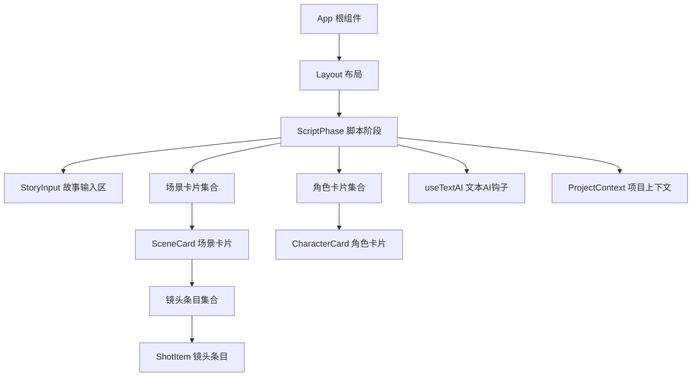
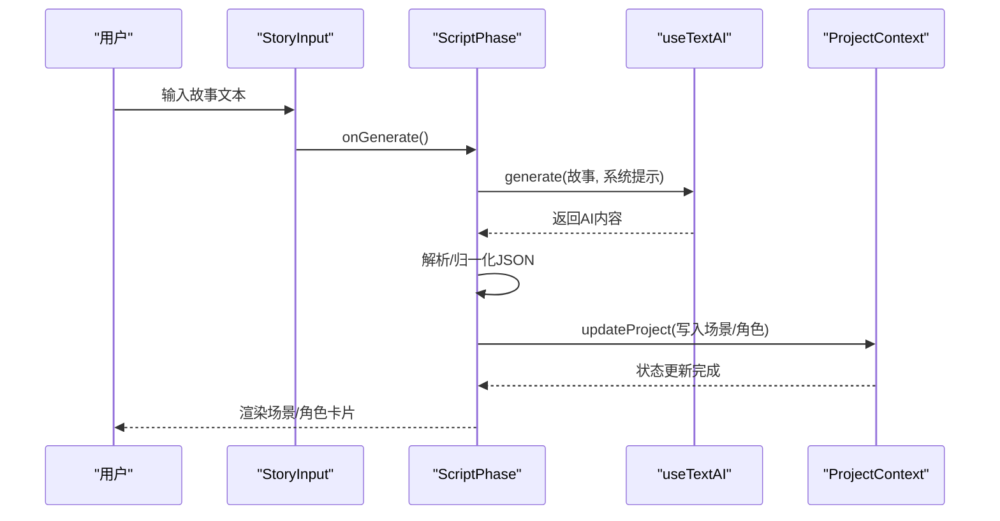
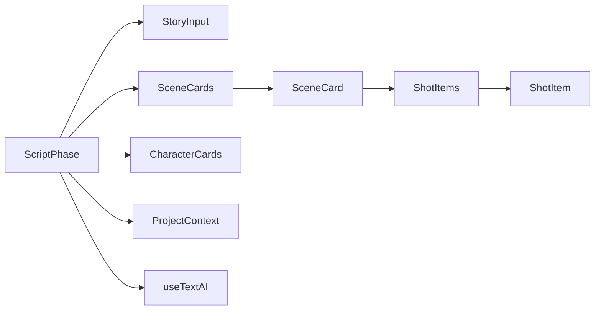

# 剧本编辑器

<cite>
**本文引用的文件**
- [src/App.tsx](file://src/App.tsx)
- [src/phases/script/ScriptPhase.tsx](file://src/phases/script/ScriptPhase.tsx)
- [src/phases/script/components/StoryInput.tsx](file://src/phases/script/components/StoryInput.tsx)
- [src/phases/script/components/SceneCard.tsx](file://src/phases/script/components/SceneCard.tsx)
- [src/phases/script/components/ShotItem.tsx](file://src/phases/script/components/ShotItem.tsx)
- [src/phases/script/components/CharacterCard.tsx](file://src/phases/script/components/CharacterCard.tsx)
- [src/shared/hooks/useAI.ts](file://src/shared/hooks/useAI.ts)
- [src/shared/contexts/ProjectContext.tsx](file://src/shared/contexts/ProjectContext.tsx)
- [src/shared/components/Layout.tsx](file://src/shared/components/Layout.tsx)
</cite>

## 目录
1. [简介](#简介)
2. [项目结构](#项目结构)
3. [核心组件](#核心组件)
4. [架构总览](#架构总览)
5. [详细组件分析](#详细组件分析)
6. [依赖关系分析](#依赖关系分析)
7. [性能考量](#性能考量)
8. [故障排查指南](#故障排查指南)
9. [结论](#结论)
10. [附录](#附录)

## 简介
本文件面向“剧本编辑器”功能，围绕剧本文本的输入、编辑、格式化与可视化呈现进行系统化说明。重点涵盖：
- 实时编辑与内容变更的响应流程
- 场景与镜头的多层级编辑体验
- 角色信息的结构化录入与参考图位
- 与AI服务的协作式智能拆解与生成
- 编辑器交互设计、快捷键建议、撤销重做机制现状与替代方案
- 内容验证规则、错误提示与用户体验保障
- 编辑器配置项、主题定制与性能优化策略

## 项目结构
剧本编辑器位于“脚本阶段”（Script Phase），采用分层组件化组织：
- 应用入口负责路由与阶段切换
- 脚本阶段作为主容器，承载输入区、统计概览、场景列表、角色列表
- 子组件分别负责故事输入、场景卡片、镜头条目、角色卡片
- 全局状态通过项目上下文管理，具备防抖持久化能力
- AI能力通过Hook封装，统一处理加载态与错误态

图表来源
- [src/App.tsx:15-43](file://src/App.tsx#L15-L43)
- [src/shared/components/Layout.tsx:9-22](file://src/shared/components/Layout.tsx#L9-L22)
- [src/phases/script/ScriptPhase.tsx:143-495](file://src/phases/script/ScriptPhase.tsx#L143-L495)
- [src/phases/script/components/StoryInput.tsx:17-114](file://src/phases/script/components/StoryInput.tsx#L17-L114)
- [src/phases/script/components/SceneCard.tsx:22-215](file://src/phases/script/components/SceneCard.tsx#L22-L215)
- [src/phases/script/components/ShotItem.tsx:21-169](file://src/phases/script/components/ShotItem.tsx#L21-L169)
- [src/phases/script/components/CharacterCard.tsx:15-200](file://src/phases/script/components/CharacterCard.tsx#L15-L200)
- [src/shared/hooks/useAI.ts:14-39](file://src/shared/hooks/useAI.ts#L14-L39)
- [src/shared/contexts/ProjectContext.tsx:47-186](file://src/shared/contexts/ProjectContext.tsx#L47-L186)

章节来源
- [src/App.tsx:15-43](file://src/App.tsx#L15-L43)
- [src/shared/components/Layout.tsx:9-22](file://src/shared/components/Layout.tsx#L9-L22)
- [src/phases/script/ScriptPhase.tsx:143-495](file://src/phases/script/ScriptPhase.tsx#L143-L495)

## 核心组件
- 故事输入区（StoryInput）：提供多行文本输入、字词统计、触发AI拆解按钮、错误提示与加载态控制。
- 场景卡片（SceneCard）：支持场景标题/描述的双字段编辑、镜头列表展开/折叠、新增镜头、统计时长。
- 镜头条目（ShotItem）：支持镜头描述、拍摄角度、时长的编辑，提供保存/取消操作。
- 角色卡片（CharacterCard）：支持角色姓名、性格背景、外貌描述的编辑，预留参考图位占位。
- 脚本阶段（ScriptPhase）：整合输入、AI拆解、场景/角色CRUD、完成度校验与阶段推进。
- AI钩子（useTextAI）：统一封装文本类AI调用，提供loading/error状态与错误传播。
- 项目上下文（ProjectContext）：单一可信数据源，提供更新、持久化、阶段切换与列表刷新。

章节来源
- [src/phases/script/components/StoryInput.tsx:17-114](file://src/phases/script/components/StoryInput.tsx#L17-L114)
- [src/phases/script/components/SceneCard.tsx:22-215](file://src/phases/script/components/SceneCard.tsx#L22-L215)
- [src/phases/script/components/ShotItem.tsx:21-169](file://src/phases/script/components/ShotItem.tsx#L21-L169)
- [src/phases/script/components/CharacterCard.tsx:15-200](file://src/phases/script/components/CharacterCard.tsx#L15-L200)
- [src/phases/script/ScriptPhase.tsx:143-495](file://src/phases/script/ScriptPhase.tsx#L143-L495)
- [src/shared/hooks/useAI.ts:14-39](file://src/shared/hooks/useAI.ts#L14-L39)
- [src/shared/contexts/ProjectContext.tsx:47-186](file://src/shared/contexts/ProjectContext.tsx#L47-L186)

## 架构总览
编辑器遵循“输入-拆解-可视化-编辑-持久化”的闭环：
- 用户在故事输入区输入文本，点击“AI智能拆解”，由AI钩子发起请求
- AI返回结构化JSON，经解析与归一化后写入项目状态
- UI基于项目状态渲染场景卡片与镜头条目，支持就地编辑
- 项目状态通过上下文进行更新与防抖持久化

图表来源
- [src/phases/script/components/StoryInput.tsx:85-111](file://src/phases/script/components/StoryInput.tsx#L85-L111)
- [src/phases/script/ScriptPhase.tsx:174-202](file://src/phases/script/ScriptPhase.tsx#L174-L202)
- [src/shared/hooks/useAI.ts:18-36](file://src/shared/hooks/useAI.ts#L18-L36)
- [src/shared/contexts/ProjectContext.tsx:150-161](file://src/shared/contexts/ProjectContext.tsx#L150-L161)

## 详细组件分析

### 故事输入区（StoryInput）
- 功能要点
  - 多行文本输入，支持中文/英文
  - 字词统计显示
  - 生成按钮启用条件：非加载且文本长度≥8
  - 错误横幅展示AI错误信息
  - 加载态下禁用输入与按钮
- 交互设计
  - 首次生成显示“AI智能拆解”，再次生成显示“重新拆解”
  - 生成覆盖现有场景与角色的提示
- 快捷键建议
  - Ctrl/Cmd+Enter 触发生成（建议在上层容器绑定）
  - Esc 取消编辑（建议在编辑模式下绑定）

章节来源
- [src/phases/script/components/StoryInput.tsx:17-114](file://src/phases/script/components/StoryInput.tsx#L17-L114)

### 场景卡片（SceneCard）
- 功能要点
  - 场景标题与描述双字段编辑
  - 展开/折叠镜头列表
  - 新增镜头按钮
  - 统计镜头数量与总时长
- 编辑流程
  - 点击进入编辑模式，输入框自动聚焦
  - 保存时进行trim与默认值回退
  - 删除前确认提示
- 交互设计
  - 鼠标悬停显示删除按钮
  - 编辑图标随悬停显隐

章节来源
- [src/phases/script/components/SceneCard.tsx:22-215](file://src/phases/script/components/SceneCard.tsx#L22-L215)

### 镜头条目（ShotItem）
- 功能要点
  - 镜头描述编辑（多行）
  - 拍摄角度选择器（预设枚举）
  - 时长输入（数值，范围约束）
  - 保存/取消操作
- 编辑流程
  - 点击进入编辑模式，自动聚焦
  - 提交时进行合法性校验（时长>0、可转换为数字）
  - 支持清空时回退至原值

章节来源
- [src/phases/script/components/ShotItem.tsx:21-169](file://src/phases/script/components/ShotItem.tsx#L21-L169)

### 角色卡片（CharacterCard）
- 功能要点
  - 姓名、性格背景、外貌描述三字段编辑
  - 参考图位占位（预留定妆图）
  - 删除前确认提示
- 交互设计
  - 名称右侧显示编辑图标，悬停显隐
  - 外貌段落带“APPEARANCE”标签与分隔线

章节来源
- [src/phases/script/components/CharacterCard.tsx:15-200](file://src/phases/script/components/CharacterCard.tsx#L15-L200)

### 脚本阶段（ScriptPhase）
- 功能要点
  - 整合故事输入、AI拆解、场景/角色CRUD
  - 统计场景数、角色数、镜头总数与估算时长
  - 完成度校验：至少1场景+至少1角色
  - 推进到资产生成阶段
- AI拆解流程
  - 发送系统提示与温度参数
  - 解析AI返回的JSON（去除代码围栏、截取首尾大括号）
  - 归一化为内部Scene/Character结构，补全缺失字段
- 错误处理
  - useTextAI已设置error；解析失败时额外弹窗提示

章节来源
- [src/phases/script/ScriptPhase.tsx:143-495](file://src/phases/script/ScriptPhase.tsx#L143-L495)

### AI钩子（useTextAI）
- 功能要点
  - 统一API Key校验
  - 统一loading/error状态
  - 文本生成接口封装
- 使用建议
  - 在调用前确保API Key已配置
  - 将错误信息传递给上层UI以展示

章节来源
- [src/shared/hooks/useAI.ts:14-39](file://src/shared/hooks/useAI.ts#L14-L39)

### 项目上下文（ProjectContext）
- 功能要点
  - 单一可信数据源（Project）
  - 防抖持久化（2秒去抖），页面卸载/隐藏时强制保存
  - 提供更新、创建、加载、删除、关闭项目与阶段切换
- 性能特性
  - 更新后延迟保存，减少频繁IO
  - 使用ref保持最新项目快照，避免闭包陷阱

章节来源
- [src/shared/contexts/ProjectContext.tsx:47-186](file://src/shared/contexts/ProjectContext.tsx#L47-L186)

## 依赖关系分析
- 组件耦合
  - ScriptPhase是主容器，向下聚合StoryInput、SceneCard、CharacterCard
  - SceneCard内组合ShotItem，形成多层级编辑链
  - 所有编辑均通过ProjectContext.updateProject进行状态更新
- 外部依赖
  - useTextAI依赖AI服务提供者，负责文本生成
  - 项目持久化依赖storage服务（通过ProjectContext封装）

图表来源
- [src/phases/script/ScriptPhase.tsx:143-495](file://src/phases/script/ScriptPhase.tsx#L143-L495)
- [src/phases/script/components/SceneCard.tsx:22-215](file://src/phases/script/components/SceneCard.tsx#L22-L215)
- [src/phases/script/components/ShotItem.tsx:21-169](file://src/phases/script/components/ShotItem.tsx#L21-L169)
- [src/phases/script/components/CharacterCard.tsx:15-200](file://src/phases/script/components/CharacterCard.tsx#L15-L200)
- [src/shared/hooks/useAI.ts:14-39](file://src/shared/hooks/useAI.ts#L14-L39)
- [src/shared/contexts/ProjectContext.tsx:47-186](file://src/shared/contexts/ProjectContext.tsx#L47-L186)

## 性能考量
- 防抖持久化
  - 项目更新后2秒去抖保存，降低IO压力
  - 页面卸载/隐藏时强制保存，避免数据丢失
- 计算优化
  - 场景/镜头统计在组件内通过useMemo计算，避免重复开销
- 渲染优化
  - 使用局部状态（useState）隔离编辑草稿，仅在提交时合并到全局
  - 列表渲染按需展开，减少初始渲染量
- 建议
  - 对超长文本输入可考虑分块渲染或虚拟滚动（待扩展）
  - 对AI响应解析可增加缓存策略（基于输入指纹）

章节来源
- [src/shared/contexts/ProjectContext.tsx:45-106](file://src/shared/contexts/ProjectContext.tsx#L45-L106)
- [src/phases/script/ScriptPhase.tsx:151-162](file://src/phases/script/ScriptPhase.tsx#L151-L162)

## 故障排查指南
- AI拆解失败
  - 现象：输入区出现错误横幅，控制台打印错误
  - 排查：确认API Key已配置；检查网络连通性；查看AI服务可用性
  - 处理：根据错误提示重试或更换模型
- JSON解析异常
  - 现象：解析失败抛出异常，ScriptPhase捕获并弹窗提示
  - 排查：检查AI返回格式是否符合预期；确认系统提示未被污染
- 编辑冲突
  - 现象：多人协作或并发编辑导致状态不一致
  - 建议：当前版本未内置分布式锁，建议在上层引入乐观更新与冲突提示
- 数据丢失
  - 现象：刷新/关闭页面后数据未保存
  - 排查：确认防抖保存是否触发；检查IndexedDB权限与容量
- 时长异常
  - 现象：镜头时长为负或NaN
  - 处理：提交时进行数值校验与边界处理（已在组件内实现）

章节来源
- [src/shared/hooks/useAI.ts:10-12](file://src/shared/hooks/useAI.ts#L10-L12)
- [src/phases/script/ScriptPhase.tsx:79-100](file://src/phases/script/ScriptPhase.tsx#L79-L100)
- [src/phases/script/ScriptPhase.tsx:191-202](file://src/phases/script/ScriptPhase.tsx#L191-L202)
- [src/shared/contexts/ProjectContext.tsx:93-106](file://src/shared/contexts/ProjectContext.tsx#L93-L106)
- [src/phases/script/components/ShotItem.tsx:34-41](file://src/phases/script/components/ShotItem.tsx#L34-L41)

## 结论
剧本编辑器以“输入-拆解-可视化-编辑-持久化”为主线，构建了从故事到场景/角色/镜头的结构化工作流。其优势在于：
- 易用的多层级编辑体验（场景/镜头/角色）
- 统一的AI集成与错误处理
- 防抖持久化保障数据安全
- 清晰的完成度校验与阶段推进

建议后续增强方向：
- 引入撤销/重做机制（基于操作日志）
- 增加快捷键体系与键盘导航
- 语法高亮与内容格式化（Markdown/富文本）
- 与AI服务的实时协作（增量生成/草稿同步）

## 附录

### 编辑器配置选项与主题定制
- 主题样式
  - 通过公共样式文件提供明/暗主题变量，编辑器组件使用CSS变量适配
- 编辑器外观
  - 使用统一的表面容器与边框样式，支持悬停与过渡动画
- 建议
  - 可扩展主题切换开关，动态注入CSS变量

章节来源
- [src/shared/components/Layout.tsx:9-22](file://src/shared/components/Layout.tsx#L9-L22)

### 与AI服务的实时协作
- 当前实现
  - ScriptPhase通过useTextAI发起一次性的文本生成请求
  - AI返回JSON后进行解析与归一化，再写入项目状态
- 建议
  - 引入增量式草稿同步与实时预览
  - 提供“继续生成”“重写某段”等细粒度控制

章节来源
- [src/phases/script/ScriptPhase.tsx:174-202](file://src/phases/script/ScriptPhase.tsx#L174-L202)
- [src/shared/hooks/useAI.ts:18-36](file://src/shared/hooks/useAI.ts#L18-L36)