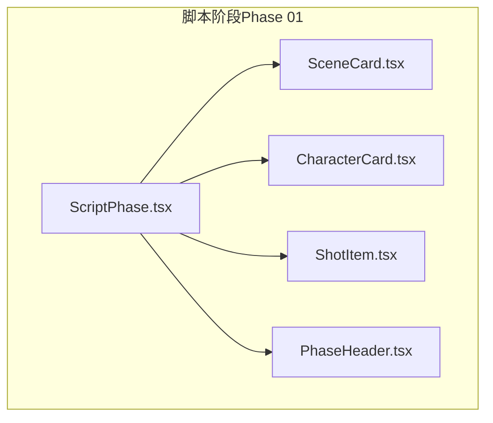
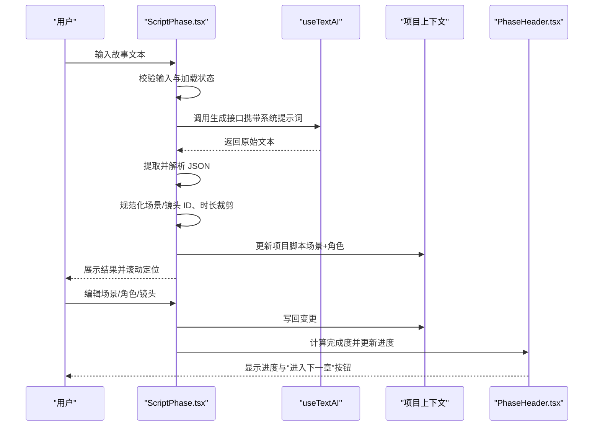
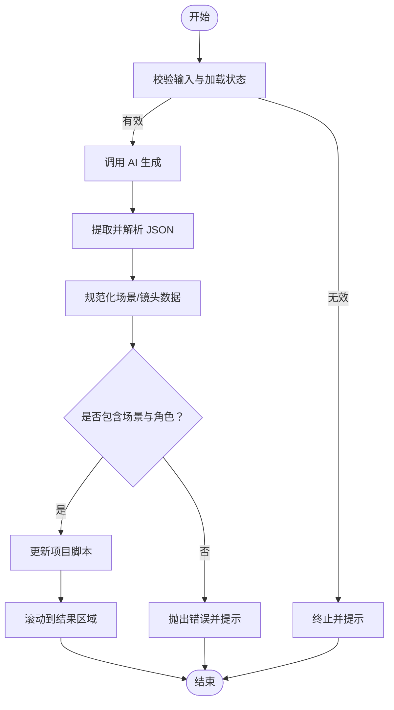
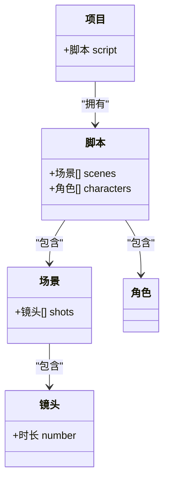
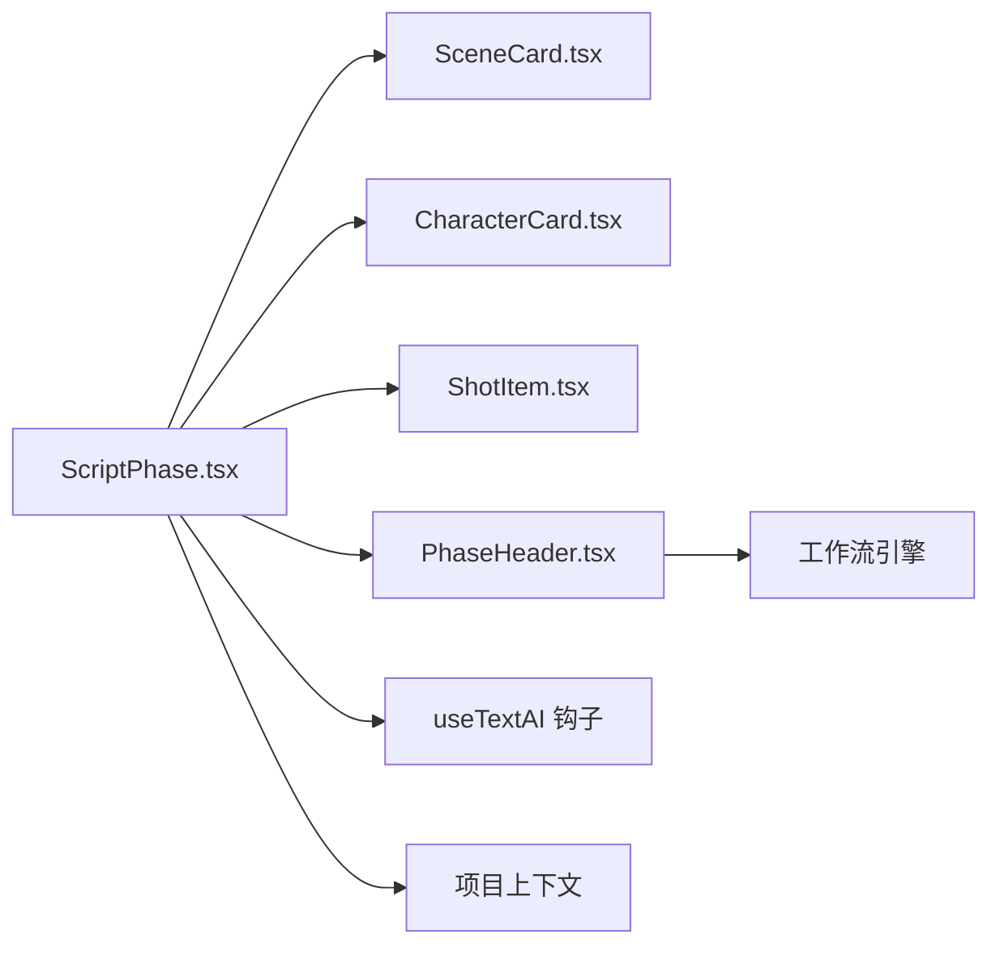

# 剧集生成与管理

<cite>
**本文引用的文件**
- [ScriptPhase.tsx](file://src/phases/script/ScriptPhase.tsx)
- [SceneCard.tsx](file://src/phases/script/components/SceneCard.tsx)
- [CharacterCard.tsx](file://src/phases/script/components/CharacterCard.tsx)
- [ShotItem.tsx](file://src/phases/script/components/ShotItem.tsx)
- [PhaseHeader.tsx](file://src/shared/components/PhaseHeader.tsx)
- [README_EN.md](file://README_EN.md)
- [README.md](file://README.md)
</cite>

## 目录
1. [简介](#简介)
2. [项目结构](#项目结构)
3. [核心组件](#核心组件)
4. [架构总览](#架构总览)
5. [详细组件分析](#详细组件分析)
6. [依赖分析](#依赖分析)
7. [性能考虑](#性能考虑)
8. [故障排查指南](#故障排查指南)
9. [结论](#结论)
10. [附录](#附录)

## 简介
本文件面向“剧集生成与管理”功能，围绕剧本阶段（Phase 01）的自动生成机制、剧集结构设计、章节到剧集的映射关系进行深入说明。重点涵盖：
- 剧本生成算法与内容分割策略
- 剧集时长控制与质量评估标准
- 剧集配置参数与生成进度跟踪
- 批量处理能力与版本管理
- 剧集编辑工具与手动调整机制
- 质量检查流程与与项目管理系统的集成方式

该系统采用“输入故事 → AI 拆解 → 展示结果 → 用户编辑修正”的闭环模式，确保生成内容可编辑、可校验、可迭代。

## 项目结构
本功能位于前端脚本阶段模块，核心由一个主组件与若干子组件构成，配合全局工作流状态与项目上下文完成进度跟踪与章节推进。

图表来源
- [ScriptPhase.tsx:143-495](file://src/phases/script/ScriptPhase.tsx#L143-L495)
- [SceneCard.tsx:22-216](file://src/phases/script/components/SceneCard.tsx#L22-L216)
- [CharacterCard.tsx:15-201](file://src/phases/script/components/CharacterCard.tsx#L15-L201)
- [ShotItem.tsx:21-170](file://src/phases/script/components/ShotItem.tsx#L21-L170)
- [PhaseHeader.tsx:17-86](file://src/shared/components/PhaseHeader.tsx#L17-L86)

章节来源
- [ScriptPhase.tsx:1-495](file://src/phases/script/ScriptPhase.tsx#L1-L495)
- [PhaseHeader.tsx:1-86](file://src/shared/components/PhaseHeader.tsx#L1-L86)

## 核心组件
- ScriptPhase：剧本阶段主控制器，负责故事输入、AI 生成、结果解析与规范化、统计计算、CRUD 操作、进入下一阶段的条件判断。
- SceneCard：场景卡片，支持场景标题/描述编辑、镜头列表展开/折叠、添加镜头、统计场景总时长。
- CharacterCard：角色卡片，支持角色信息编辑、参考图占位、编号标识。
- ShotItem：镜头条目，支持镜头描述、拍摄角度、时长编辑。
- PhaseHeader：章节头部，显示进度百分比、标签语、完成状态与进入下一阶段按钮。

章节来源
- [ScriptPhase.tsx:143-495](file://src/phases/script/ScriptPhase.tsx#L143-L495)
- [SceneCard.tsx:22-216](file://src/phases/script/components/SceneCard.tsx#L22-L216)
- [CharacterCard.tsx:15-201](file://src/phases/script/components/CharacterCard.tsx#L15-L201)
- [ShotItem.tsx:21-170](file://src/phases/script/components/ShotItem.tsx#L21-L170)
- [PhaseHeader.tsx:17-86](file://src/shared/components/PhaseHeader.tsx#L17-L86)

## 架构总览
下图展示了从用户输入到生成结果、再到编辑与进度推进的整体流程。

图表来源
- [ScriptPhase.tsx:174-202](file://src/phases/script/ScriptPhase.tsx#L174-L202)
- [PhaseHeader.tsx:22-25](file://src/shared/components/PhaseHeader.tsx#L22-L25)

## 详细组件分析

### 剧本生成与解析流程
- 系统提示词：定义“专业影视分镜师”角色，约束输出为结构化 JSON，包含场景与角色字段，明确每个场景的镜头数量与角色提取要求。
- AI 输出解析：去除 Markdown 代码围栏，截取首个大括号对之间的 JSON 片段并解析，异常时抛出错误。
- 数据规范化：为场景与镜头生成稳定 ID，清洗描述字段；镜头时长做最小值与最大值限制与四舍五入，保证合理性。
- 错误处理：当解析失败或未返回场景/角色时，捕获异常并在 UI 上提示。

图表来源
- [ScriptPhase.tsx:79-138](file://src/phases/script/ScriptPhase.tsx#L79-L138)
- [ScriptPhase.tsx:174-202](file://src/phases/script/ScriptPhase.tsx#L174-L202)

章节来源
- [ScriptPhase.tsx:21-138](file://src/phases/script/ScriptPhase.tsx#L21-L138)

### 剧集结构设计与映射关系
- 结构层次：项目内包含脚本（script），脚本包含多个场景（scenes），场景包含多个镜头（shots），角色（characters）独立于场景但与镜头生成相关联。
- 章节到剧集映射：系统支持以“剧集”为单位隔离数据，每部剧集维护独立的角色、场景、镜头与资产，便于批量管理与版本控制。
- 统计与概览：页面顶部统计场景数、角色数、镜头总数，并估算总时长（基于镜头时长之和）。

图表来源
- [ScriptPhase.tsx:151-162](file://src/phases/script/ScriptPhase.tsx#L151-L162)
- [README.md:370-394](file://README.md#L370-L394)

章节来源
- [ScriptPhase.tsx:151-162](file://src/phases/script/ScriptPhase.tsx#L151-L162)
- [README.md:370-394](file://README.md#L370-L394)

### 内容分割策略与时长控制
- 分割策略：AI 输出的场景默认包含 2-5 个镜头，确保节奏紧凑且便于后续关键帧生成。
- 时长控制：镜头时长默认值与裁剪逻辑在规范化阶段完成，避免极端值影响整体时长估算。
- 总时长估算：页面实时计算并展示，帮助用户把握剧集节奏与目标时长（如预告片、短片）。

章节来源
- [ScriptPhase.tsx:102-138](file://src/phases/script/ScriptPhase.tsx#L102-L138)
- [ScriptPhase.tsx:151-162](file://src/phases/script/ScriptPhase.tsx#L151-L162)

### 质量评估标准
- 结构完整性：至少包含 1 个场景与 1 个角色，作为进入下一阶段的完成条件。
- 描述质量：镜头描述需具体，便于后续生成图像与视频；角色外观描述需包含发型、服装、体型等细节。
- 一致性：通过角色卡与场景卡的编辑，确保角色外观与场景氛围描述一致。

章节来源
- [ScriptPhase.tsx:164-166](file://src/phases/script/ScriptPhase.tsx#L164-L166)
- [ScriptPhase.tsx:50-54](file://src/phases/script/ScriptPhase.tsx#L50-L54)

### 剧集配置参数与生成进度跟踪
- 配置参数：系统提示词、温度系数等在调用 AI 时传入，用于控制生成风格与稳定性。
- 进度跟踪：工作流引擎根据当前阶段的数据完备性计算完成度百分比，顶部进度条与“进入下一章”按钮联动。

章节来源
- [ScriptPhase.tsx:177-180](file://src/phases/script/ScriptPhase.tsx#L177-L180)
- [PhaseHeader.tsx:22-25](file://src/shared/components/PhaseHeader.tsx#L22-L25)

### 批量处理能力与版本管理
- 批量处理：通过选择章节范围生成多个剧集，每个剧集独立隔离数据，便于并行处理与对比。
- 版本管理：数据库层面以“剧集”为单位隔离角色、场景、镜头与资产，支持历史版本与回溯。

章节来源
- [README_EN.md:47-54](file://README_EN.md#L47-L54)
- [README.md:370-394](file://README.md#L370-L394)

### 剧集编辑工具与手动调整机制
- 场景编辑：支持场景标题与描述编辑、镜头列表展开/折叠、添加镜头、删除场景。
- 角色编辑：支持角色名称、性格背景、外观描述编辑，预留参考图占位。
- 镜头编辑：支持镜头描述、拍摄角度、时长编辑，提供常用角度选项与数值输入。
- 实时统计：场景卡片显示镜头数量与总时长估算，辅助节奏把控。

章节来源
- [SceneCard.tsx:36-106](file://src/phases/script/components/SceneCard.tsx#L36-L106)
- [CharacterCard.tsx:23-37](file://src/phases/script/components/CharacterCard.tsx#L23-L37)
- [ShotItem.tsx:27-41](file://src/phases/script/components/ShotItem.tsx#L27-L41)

### 质量检查流程
- 自动检查：AI 生成后进行 JSON 提取与解析，若未返回场景或角色则报错。
- 手动检查：通过编辑界面补充缺失描述，确保镜头与角色信息完整。
- 进度检查：完成度达到阈值后方可进入下一阶段，避免跳步导致后续资源不足。

章节来源
- [ScriptPhase.tsx:134-135](file://src/phases/script/ScriptPhase.tsx#L134-L135)
- [ScriptPhase.tsx:164-166](file://src/phases/script/ScriptPhase.tsx#L164-L166)

### 与项目管理系统的集成方式
- 工作流集成：章节头部组件通过工作流引擎获取阶段状态，决定是否允许进入下一阶段。
- 数据隔离：数据库表以“剧集”为维度隔离角色、场景、镜头与资产，确保项目间互不干扰。
- 项目上下文：所有编辑操作通过项目上下文写回，保持状态一致与持久化。

章节来源
- [PhaseHeader.tsx:22-25](file://src/shared/components/PhaseHeader.tsx#L22-L25)
- [README.md:370-394](file://README.md#L370-L394)

## 依赖分析
- 组件耦合：ScriptPhase 作为中枢，依赖子组件（SceneCard、CharacterCard、ShotItem）进行 UI 交互；同时依赖工作流引擎与项目上下文进行进度与状态管理。
- 外部依赖：AI 生成服务通过 useTextAI 钩子调用，错误处理与 UI 提示在 ScriptPhase 内集中处理。
- 数据依赖：统计信息（总镜头数、总时长）依赖脚本数据结构，实时计算并渲染。

图表来源
- [ScriptPhase.tsx:143-495](file://src/phases/script/ScriptPhase.tsx#L143-L495)
- [PhaseHeader.tsx:17-86](file://src/shared/components/PhaseHeader.tsx#L17-L86)

章节来源
- [ScriptPhase.tsx:143-495](file://src/phases/script/ScriptPhase.tsx#L143-L495)
- [PhaseHeader.tsx:17-86](file://src/shared/components/PhaseHeader.tsx#L17-L86)

## 性能考虑
- 计算开销：统计总镜头数与总时长在渲染层进行，建议在数据量较大时采用分页或虚拟化列表优化。
- 解析效率：JSON 提取与解析仅在生成完成后触发，避免频繁 IO；异常路径提前返回，减少无效计算。
- UI 响应：编辑操作采用局部状态更新，避免全量重渲染；滚动定位延迟触发，提升交互流畅度。

## 故障排查指南
- AI 未返回场景/角色：检查系统提示词是否被正确执行，确认 API Key 与网络连接正常。
- JSON 解析失败：确认 AI 输出包裹在代码围栏内，或在输出中包含合法 JSON 片段。
- 无法进入下一阶段：确保至少包含 1 个场景与 1 个角色，且角色具备参考图或外观描述。
- 时长估算异常：检查镜头时长输入是否为正数，避免出现负值或非数字字符。

章节来源
- [ScriptPhase.tsx:134-135](file://src/phases/script/ScriptPhase.tsx#L134-L135)
- [ScriptPhase.tsx:191-201](file://src/phases/script/ScriptPhase.tsx#L191-L201)
- [ScriptPhase.tsx:164-166](file://src/phases/script/ScriptPhase.tsx#L164-L166)

## 结论
本功能以“剧本阶段”为核心，构建了从故事输入到结构化脚本的自动化流程，并通过可视化编辑工具与进度跟踪机制，确保生成内容的质量与可控性。结合剧集级数据隔离与工作流引擎，系统支持批量处理、版本管理与跨阶段协作，满足从短片到预告片的多样化创作需求。

## 附录
- 关键实现位置参考
  - 剧本生成与解析：[ScriptPhase.tsx:79-138](file://src/phases/script/ScriptPhase.tsx#L79-L138)
  - 场景卡片与统计：[SceneCard.tsx:50-150](file://src/phases/script/components/SceneCard.tsx#L50-L150)
  - 角色卡片与外观描述：[CharacterCard.tsx:30-135](file://src/phases/script/components/CharacterCard.tsx#L30-L135)
  - 镜头条目与编辑：[ShotItem.tsx:34-120](file://src/phases/script/components/ShotItem.tsx#L34-L120)
  - 章节进度与推进：[PhaseHeader.tsx:22-73](file://src/shared/components/PhaseHeader.tsx#L22-L73)
  - 数据库隔离与剧集维度：[README.md:370-394](file://README.md#L370-L394)
  - 剧集与章节映射说明：[README_EN.md:47-54](file://README_EN.md#L47-L54)