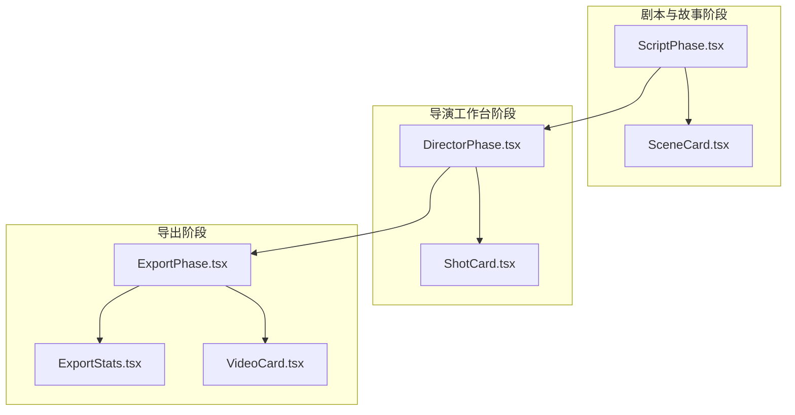
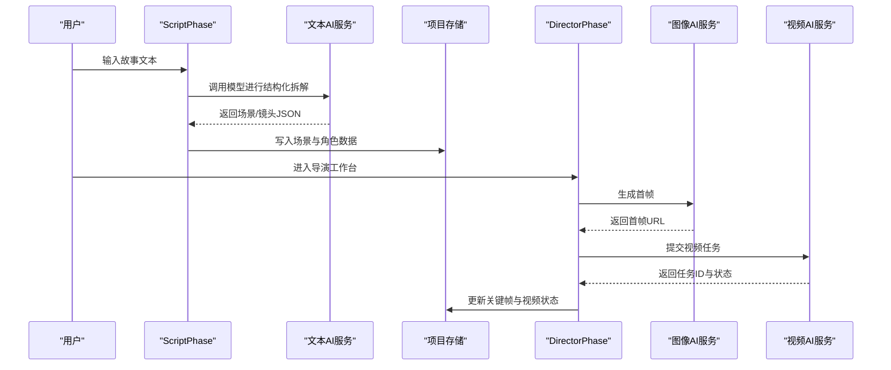
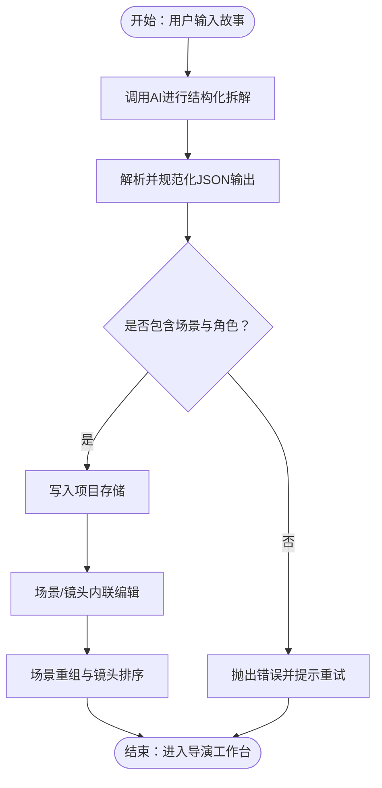
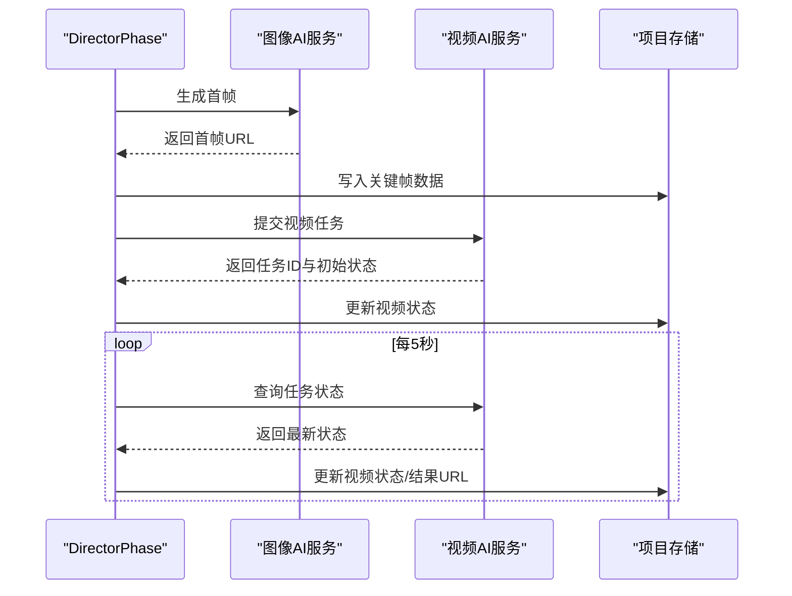
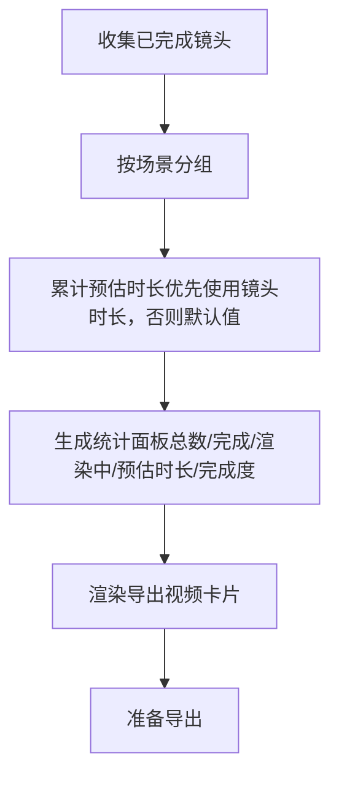
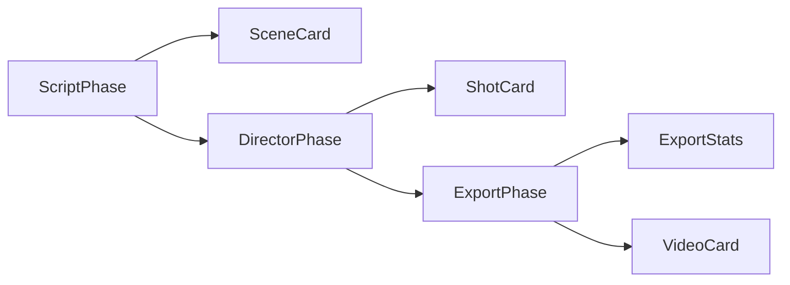

# 场景分解与分析

<cite>
**本文引用的文件**
- [ScriptPhase.tsx](file://src/phases/script/ScriptPhase.tsx)
- [SceneCard.tsx](file://src/phases/script/components/SceneCard.tsx)
- [DirectorPhase.tsx](file://src/phases/director/DirectorPhase.tsx)
- [ShotCard.tsx](file://src/phases/director/components/ShotCard.tsx)
- [ExportPhase.tsx](file://src/phases/export/ExportPhase.tsx)
- [ExportStats.tsx](file://src/phases/export/components/ExportStats.tsx)
- [VideoCard.tsx](file://src/phases/export/components/VideoCard.tsx)
</cite>

## 目录
1. [简介](#简介)
2. [项目结构](#项目结构)
3. [核心组件](#核心组件)
4. [架构总览](#架构总览)
5. [详细组件分析](#详细组件分析)
6. [依赖关系分析](#依赖关系分析)
7. [性能考量](#性能考量)
8. [故障排查指南](#故障排查指南)
9. [结论](#结论)
10. [附录](#附录)

## 简介
本文件围绕“场景分解与分析”功能，系统阐述从剧本到镜头的自动化拆解、场景边界检测、场景内容分析、时间轴映射、场景属性提取与关联分析等核心能力，并结合导演工作台的可视化、统计与质量评估，提供场景编辑工具、手动调整机制、场景重组能力及与导出阶段的集成方式。文档同时给出流程图与时序图，帮助非技术读者理解端到端工作流。

## 项目结构
场景分解与分析贯穿三个阶段：
- 剧本与故事阶段（ScriptPhase）：接收用户输入的故事文本，调用大模型进行结构化拆解，输出场景与镜头清单，并支持人工编辑与增删改查。
- 导演工作台阶段（DirectorPhase）：基于剧本生成的场景/镜头，进行首帧与视频生成调度，提供批量处理、状态轮询与可视化卡片。
- 导出阶段（ExportPhase）：汇总已完成的镜头，进行统计与时间轴映射，形成最终的成片概览与导出准备。

图表来源
- [ScriptPhase.tsx:143-494](file://src/phases/script/ScriptPhase.tsx#L143-L494)
- [SceneCard.tsx:22-215](file://src/phases/script/components/SceneCard.tsx#L22-L215)
- [DirectorPhase.tsx:62-494](file://src/phases/director/DirectorPhase.tsx#L62-L494)
- [ShotCard.tsx:22-307](file://src/phases/director/components/ShotCard.tsx#L22-L307)
- [ExportPhase.tsx:87-130](file://src/phases/export/ExportPhase.tsx#L87-L130)
- [ExportStats.tsx:34-72](file://src/phases/export/components/ExportStats.tsx#L34-L72)
- [VideoCard.tsx:221-235](file://src/phases/export/components/VideoCard.tsx#L221-L235)

章节来源
- [ScriptPhase.tsx:143-494](file://src/phases/script/ScriptPhase.tsx#L143-L494)
- [DirectorPhase.tsx:62-494](file://src/phases/director/DirectorPhase.tsx#L62-L494)
- [ExportPhase.tsx:87-130](file://src/phases/export/ExportPhase.tsx#L87-L130)

## 核心组件
- 剧本拆解与场景卡片
  - ScriptPhase：负责调用大模型进行结构化拆解，解析并规范化输出，提供场景与角色的增删改查。
  - SceneCard：场景卡片组件，支持场景标题/描述的内联编辑、镜头列表展开/折叠、镜头增删改查。
- 导演工作台与镜头卡片
  - DirectorPhase：构建镜头条目、生成首帧与视频、批量处理、状态轮询、按场景分组渲染。
  - ShotCard：镜头卡片，展示首帧预览、状态徽标、操作按钮（生成首帧/重绘、生成视频/重拍），并提供错误弹窗。
- 导出统计与时间轴映射
  - ExportPhase：收集已完成镜头，计算预估总时长，按场景分组渲染。
  - ExportStats：导出统计面板，显示镜头总数、已成片、渲染中/待渲染、预估总时长与完成度。
  - VideoCard：导出阶段的视频卡片，展示场景标题、镜头描述与镜头参数。

章节来源
- [ScriptPhase.tsx:143-494](file://src/phases/script/ScriptPhase.tsx#L143-L494)
- [SceneCard.tsx:22-215](file://src/phases/script/components/SceneCard.tsx#L22-L215)
- [DirectorPhase.tsx:62-494](file://src/phases/director/DirectorPhase.tsx#L62-L494)
- [ShotCard.tsx:22-307](file://src/phases/director/components/ShotCard.tsx#L22-L307)
- [ExportPhase.tsx:87-130](file://src/phases/export/ExportPhase.tsx#L87-L130)
- [ExportStats.tsx:34-72](file://src/phases/export/components/ExportStats.tsx#L34-L72)
- [VideoCard.tsx:221-235](file://src/phases/export/components/VideoCard.tsx#L221-L235)

## 架构总览
场景分解与分析遵循“脚本→资产→关键帧→视频”的流水线式架构。AI 模型在剧本阶段产出结构化场景/镜头数据，导演工作台负责首帧与视频生成的调度与可视化，导出阶段进行统计与时间轴映射。

图表来源
- [ScriptPhase.tsx:174-202](file://src/phases/script/ScriptPhase.tsx#L174-L202)
- [DirectorPhase.tsx:111-159](file://src/phases/director/DirectorPhase.tsx#L111-L159)

## 详细组件分析

### 组件A：剧本拆解与场景卡片
- 自动识别与分解
  - 使用系统提示词约束输出格式与内容密度，确保每个场景包含2-5个镜头，提取主要角色并提供具体的镜头描述与角色外观描述。
  - 解析器会去除代码围栏，截取首个有效JSON块并进行严格校验，异常时抛出明确错误。
- 场景边界检测与内容分析
  - 场景卡片展示场景元信息（镜头数量、总时长估算、场景ID），支持对场景标题与描述进行内联编辑，便于快速修正与补充。
- 场景属性提取与关联分析
  - 场景与镜头均具备唯一ID，镜头包含描述、镜头角度、时长等属性；角色包含名称、描述与外观描述，便于后续生成与一致性控制。
- 场景可视化与统计
  - 场景卡片顶部展示场景编号与强调条纹，底部显示镜头数量、时长估算与场景ID；场景列表支持展开/折叠查看镜头细节。
- 场景编辑工具与手动调整
  - 支持添加/删除场景、添加/删除镜头、更新场景与镜头属性；提供空状态提示与完成条件提示（至少1个场景+1个角色）。
- 场景重组
  - 通过场景与镜头的增删改查接口，实现场景顺序调整与镜头重组；导演工作台按全局索引与场景索引进行渲染分组。

图表来源
- [ScriptPhase.tsx:174-202](file://src/phases/script/ScriptPhase.tsx#L174-L202)
- [ScriptPhase.tsx:102-138](file://src/phases/script/ScriptPhase.tsx#L102-L138)
- [SceneCard.tsx:36-48](file://src/phases/script/components/SceneCard.tsx#L36-L48)

章节来源
- [ScriptPhase.tsx:174-202](file://src/phases/script/ScriptPhase.tsx#L174-L202)
- [ScriptPhase.tsx:102-138](file://src/phases/script/ScriptPhase.tsx#L102-L138)
- [SceneCard.tsx:36-48](file://src/phases/script/components/SceneCard.tsx#L36-L48)

### 组件B：导演工作台与镜头卡片
- 首帧与视频生成
  - 构建增强提示词，融合镜头描述、镜头角度、场景描述与角色外观，保证生成一致性；图像模型生成首帧，视频模型提交任务并记录任务ID。
- 状态轮询与可视化
  - 定时轮询视频任务状态，支持并发轮询多个任务；根据状态更新关键帧数据，实时刷新UI；提供批量生成首帧功能与进度条。
- 镜头卡片交互
  - 首帧预览区域支持占位样式与录制扫描动画；根据状态显示不同操作按钮（生成首帧/重绘、生成视频/重拍）；错误弹窗提供失败原因。
- 时间轴映射
  - 导演工作台将镜头按场景分组渲染，每个镜头具有全局索引与场景内索引，便于后续导出阶段的时间轴映射与统计。

图表来源
- [DirectorPhase.tsx:111-159](file://src/phases/director/DirectorPhase.tsx#L111-L159)
- [DirectorPhase.tsx:191-247](file://src/phases/director/DirectorPhase.tsx#L191-L247)
- [ShotCard.tsx:43-69](file://src/phases/director/components/ShotCard.tsx#L43-L69)

章节来源
- [DirectorPhase.tsx:111-159](file://src/phases/director/DirectorPhase.tsx#L111-L159)
- [DirectorPhase.tsx:191-247](file://src/phases/director/DirectorPhase.tsx#L191-L247)
- [ShotCard.tsx:43-69](file://src/phases/director/components/ShotCard.tsx#L43-L69)

### 组件C：导出统计与时间轴映射
- 统计与质量评估
  - 导出阶段统计镜头总数、已完成视频数、渲染中/待渲染数与预估总时长；完成度百分比用于质量评估与进度反馈。
- 时间轴映射
  - 收集已完成镜头，按场景分组渲染；若镜头未指定时长，则采用默认时长进行估算；最终形成可导出的视频序列。
- 场景可视化
  - 导出阶段的视频卡片展示场景标题、镜头描述与镜头参数，便于核对与二次编辑。

图表来源
- [ExportPhase.tsx:87-130](file://src/phases/export/ExportPhase.tsx#L87-L130)
- [ExportStats.tsx:34-72](file://src/phases/export/components/ExportStats.tsx#L34-L72)
- [VideoCard.tsx:221-235](file://src/phases/export/components/VideoCard.tsx#L221-L235)

章节来源
- [ExportPhase.tsx:87-130](file://src/phases/export/ExportPhase.tsx#L87-L130)
- [ExportStats.tsx:34-72](file://src/phases/export/components/ExportStats.tsx#L34-L72)
- [VideoCard.tsx:221-235](file://src/phases/export/components/VideoCard.tsx#L221-L235)

## 依赖关系分析
- 组件耦合与内聚
  - ScriptPhase 与 SceneCard：高内聚的数据驱动渲染，低耦合的事件回调；场景卡片仅依赖传入的更新/删除回调。
  - DirectorPhase 与 ShotCard：通过统一的镜头条目结构与关键帧数据进行解耦；状态轮询与批量处理逻辑集中在导演工作台。
  - 导出阶段：依赖导演工作台的关键帧数据与场景结构，进行统计与渲染。
- 外部依赖与集成点
  - 文本AI服务：用于剧本结构化拆解。
  - 图像AI服务：用于首帧生成。
  - 视频AI服务：用于视频任务提交与状态查询。
- 潜在循环依赖
  - 当前模块间为单向依赖（剧本→导演→导出），未发现循环依赖风险。

图表来源
- [ScriptPhase.tsx:143-494](file://src/phases/script/ScriptPhase.tsx#L143-L494)
- [DirectorPhase.tsx:62-494](file://src/phases/director/DirectorPhase.tsx#L62-L494)
- [ExportPhase.tsx:87-130](file://src/phases/export/ExportPhase.tsx#L87-L130)

章节来源
- [ScriptPhase.tsx:143-494](file://src/phases/script/ScriptPhase.tsx#L143-L494)
- [DirectorPhase.tsx:62-494](file://src/phases/director/DirectorPhase.tsx#L62-L494)
- [ExportPhase.tsx:87-130](file://src/phases/export/ExportPhase.tsx#L87-L130)

## 性能考量
- 并发轮询
  - 视频状态轮询采用并发策略，容忍个别失败但仍继续推进整体进度，减少等待时间。
- 批量处理
  - 导演工作台提供批量生成首帧功能，逐个执行并累积错误，避免单点阻塞。
- 数据缓存与稳定更新
  - 使用稳定的更新器写入关键帧数据，避免重复渲染与状态抖动。
- 估算成本
  - 导出阶段对未指定时长的镜头采用默认时长估算，降低计算复杂度。

## 故障排查指南
- AI 拆解失败
  - 现象：解析失败或未返回合法JSON。
  - 排查：确认API Key配置、网络连通性与模型可用性；查看错误提示并重试。
- 首帧/视频生成失败
  - 现象：生成按钮禁用或出现错误弹窗。
  - 排查：确认已生成首帧后再提交视频；检查API Key与配额；查看状态轮询日志。
- 状态不更新
  - 现象：视频状态长时间停留在“排队中/渲染中”。
  - 排查：检查网络与服务端状态查询接口；等待轮询间隔后重试。
- 导出统计异常
  - 现象：预估时长与实际不符。
  - 排查：检查场景/镜头时长字段是否正确填写；确认已完成镜头筛选逻辑。

章节来源
- [ScriptPhase.tsx:191-202](file://src/phases/script/ScriptPhase.tsx#L191-L202)
- [DirectorPhase.tsx:111-159](file://src/phases/director/DirectorPhase.tsx#L111-L159)
- [ShotCard.tsx:268-285](file://src/phases/director/components/ShotCard.tsx#L268-L285)

## 结论
场景分解与分析功能以剧本阶段的结构化拆解为基础，结合导演工作台的首帧与视频生成调度，最终在导出阶段完成统计与时间轴映射。该流程实现了从创意到成片的自动化与可视化，辅以丰富的编辑与调整工具，满足创作者对效率与质量的双重需求。

## 附录
- 场景可视化与统计
  - 剧本阶段：场景卡片展示镜头数量与时长估算；角色卡片展示角色信息。
  - 导演阶段：镜头卡片展示首帧预览与状态徽标；控制室统计当前阶段的镜头状态。
  - 导出阶段：统计面板与视频卡片直观呈现完成度与预估时长。
- 场景质量评估与优化建议
  - 建议依据完成度与渲染中/待渲染比例动态调整批量生成策略；对时长估算偏差较大的场景进行二次校准。
- 与导演工作台的集成方式
  - 导演工作台直接消费剧本阶段生成的场景/镜头数据，通过关键帧与视频状态实现闭环反馈；支持批量生成与状态轮询，确保工作流顺畅。