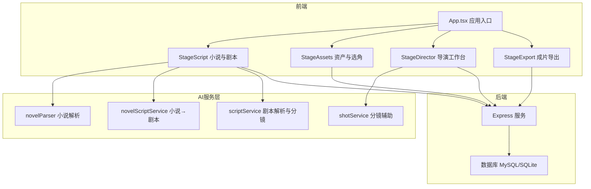
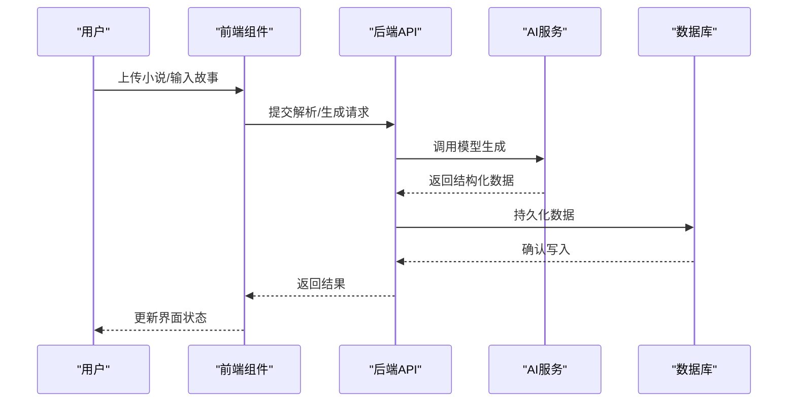
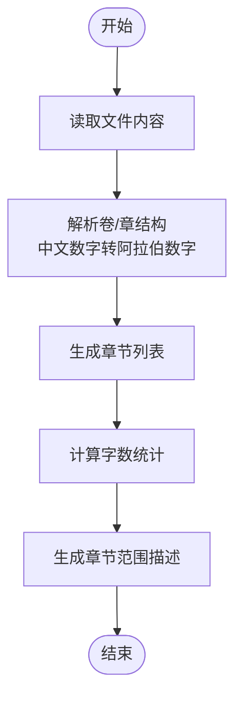
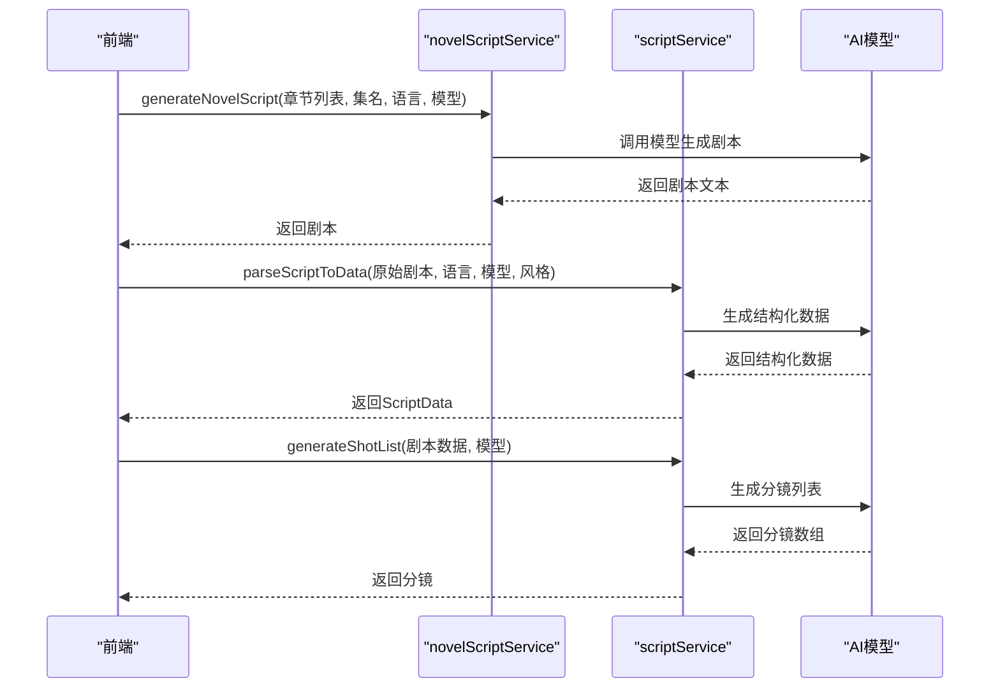
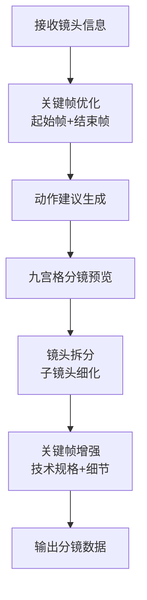
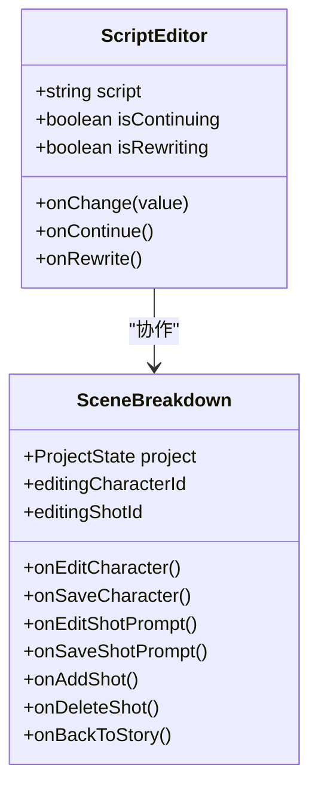
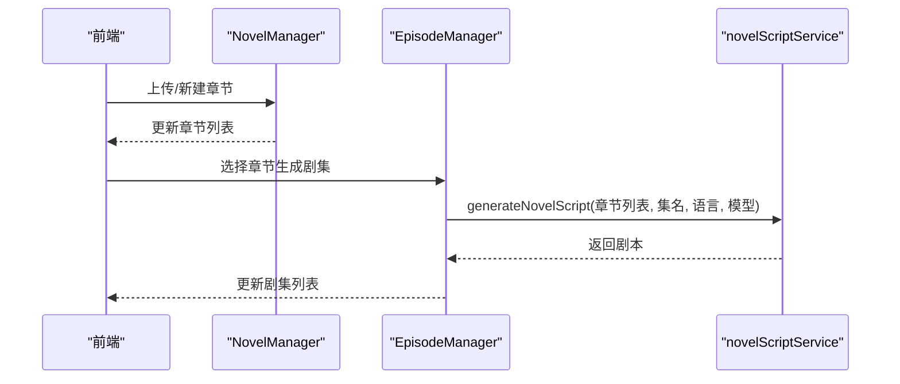
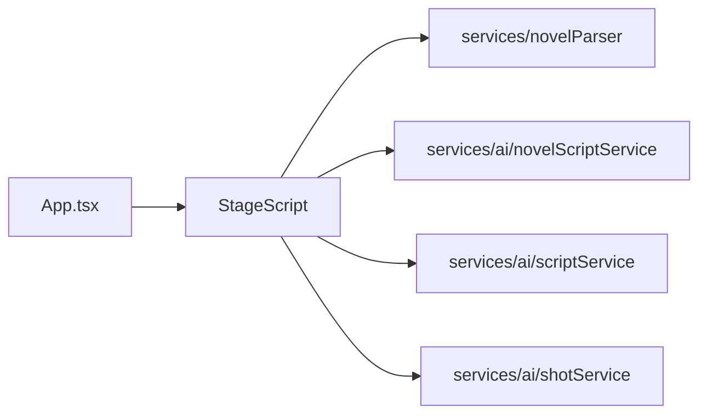

# 小说与剧本管理系统

<cite>
**本文档引用的文件**
- [README.md](file://README.md)
- [App.tsx](file://App.tsx)
- [components/StageScript/index.tsx](file://components/StageScript/index.tsx)
- [components/StageScript/NovelManager.tsx](file://components/StageScript/NovelManager.tsx)
- [components/StageScript/EpisodeManager.tsx](file://components/StageScript/EpisodeManager.tsx)
- [components/StageScript/ScriptEditor.tsx](file://components/StageScript/ScriptEditor.tsx)
- [components/StageScript/SceneBreakdown.tsx](file://components/StageScript/SceneBreakdown.tsx)
- [services/novelParser.ts](file://services/novelParser.ts)
- [services/ai/novelScriptService.ts](file://services/ai/novelScriptService.ts)
- [services/ai/scriptService.ts](file://services/ai/scriptService.ts)
- [services/ai/shotService.ts](file://services/ai/shotService.ts)
</cite>

## 目录
1. [简介](#简介)
2. [项目结构](#项目结构)
3. [核心组件](#核心组件)
4. [架构总览](#架构总览)
5. [详细组件分析](#详细组件分析)
6. [依赖关系分析](#依赖关系分析)
7. [性能考虑](#性能考虑)
8. [故障排除指南](#故障排除指南)
9. [结论](#结论)

## 简介
本系统是一个「小说 → 剧本 → 分镜 → 资产 → 关键帧 → 成片」的工业级工作流平台，支持多模型提供商，从灵感直达成片。核心能力包括：
- 小说解析与章节管理：自动识别卷/章结构，支持中文数字，提供章节字数统计与范围描述
- 剧本生成与编辑：AI将小说章节改编为剧本，支持续写与改写，提供可视化翻译与角色/场景/道具的视觉提示词
- 分镜生成与场景分解：基于目标时长与视觉风格生成分镜，支持关键帧优化、动作建议、九宫格预览与镜头拆分
- 资产与选角：角色定妆与场景概念图，道具资产管理
- 导演工作台：首帧/尾帧生成与编辑，九宫格分镜，上下文感知生成
- 成片导出：时间轴预览、多轨道视频剪辑、AI字幕/音频、ZIP导出

## 项目结构
前端采用 React + Vite，后端采用 Express + MySQL/SQLite，AI 服务通过适配器层统一调用多厂商模型。

**图表来源**
- [App.tsx:21-380](file://App.tsx#L21-L380)
- [components/StageScript/index.tsx:27-906](file://components/StageScript/index.tsx#L27-L906)
- [services/novelParser.ts:1-227](file://services/novelParser.ts#L1-L227)
- [services/ai/novelScriptService.ts:1-341](file://services/ai/novelScriptService.ts#L1-L341)
- [services/ai/scriptService.ts:1-673](file://services/ai/scriptService.ts#L1-L673)
- [services/ai/shotService.ts:1-844](file://services/ai/shotService.ts#L1-L844)

**章节来源**
- [README.md:1-441](file://README.md#L1-L441)

## 核心组件
- 小说解析器：支持 .txt/.docx，自动识别卷/章，中文数字解析，章节字数统计与范围描述
- 小说→剧本服务：将章节内容改编为剧本，支持流式输出与错误日志
- 剧本解析与分镜：结构化剧本数据提取，生成角色/场景/道具视觉提示词，按目标时长生成分镜
- 分镜辅助：关键帧优化、动作建议、九宫格分镜、镜头拆分、关键帧增强
- 小说管理界面：上传/新建章节、AI生成章节、分页浏览、章节字数统计
- 剧集管理界面：选择章节生成剧集，流式生成剧本，编辑/重新生成/删除
- 剧本编辑器：支持续写与改写，Markdown 支持，自动统计字符与行数
- 场景分解：拍摄清单视图，角色/场景/分镜管理，新增/编辑/删除分镜

**章节来源**
- [services/novelParser.ts:1-227](file://services/novelParser.ts#L1-L227)
- [services/ai/novelScriptService.ts:1-341](file://services/ai/novelScriptService.ts#L1-L341)
- [services/ai/scriptService.ts:1-673](file://services/ai/scriptService.ts#L1-L673)
- [services/ai/shotService.ts:1-844](file://services/ai/shotService.ts#L1-L844)
- [components/StageScript/NovelManager.tsx:1-891](file://components/StageScript/NovelManager.tsx#L1-L891)
- [components/StageScript/EpisodeManager.tsx:1-761](file://components/StageScript/EpisodeManager.tsx#L1-L761)
- [components/StageScript/ScriptEditor.tsx:1-113](file://components/StageScript/ScriptEditor.tsx#L1-L113)
- [components/StageScript/SceneBreakdown.tsx:1-203](file://components/StageScript/SceneBreakdown.tsx#L1-L203)

## 架构总览
系统采用前后端分离架构，前端负责用户交互与状态管理，后端提供数据持久化与异步任务调度，AI 服务通过统一适配器层对接多厂商模型。

**图表来源**
- [App.tsx:131-161](file://App.tsx#L131-L161)
- [components/StageScript/index.tsx:196-296](file://components/StageScript/index.tsx#L196-L296)
- [services/ai/scriptService.ts:30-251](file://services/ai/scriptService.ts#L30-L251)

## 详细组件分析

### 小说解析与章节管理
- 解析流程：正则识别卷/章，中文数字转阿拉伯数字，章节内容切分与排序
- 章节管理：上传 .txt 文件，自动解析；新建章节；AI 生成章节内容；分页加载与缓存
- 字数统计：章节字数与选中章节总字数计算，章节范围描述生成

**图表来源**
- [services/novelParser.ts:55-168](file://services/novelParser.ts#L55-L168)
- [components/StageScript/NovelManager.tsx:137-176](file://components/StageScript/NovelManager.tsx#L137-L176)

**章节来源**
- [services/novelParser.ts:1-227](file://services/novelParser.ts#L1-L227)
- [components/StageScript/NovelManager.tsx:1-891](file://components/StageScript/NovelManager.tsx#L1-L891)

### 剧本生成与编辑
- 小说→剧本：合并章节文本，限制输入长度，调用模型生成剧本，支持流式输出
- 剧本解析：提取标题/类型/梗概/角色/场景/道具/段落，生成全局美术指导与视觉提示词
- 分镜生成：根据目标时长与场景数量估算分镜数量，生成每个场景的分镜列表
- 续写/改写：支持流式与非流式两种模式，提供错误日志与令牌统计

**图表来源**
- [services/ai/novelScriptService.ts:24-143](file://services/ai/novelScriptService.ts#L24-L143)
- [services/ai/scriptService.ts:30-251](file://services/ai/scriptService.ts#L30-L251)
- [services/ai/scriptService.ts:261-466](file://services/ai/scriptService.ts#L261-L466)

**章节来源**
- [services/ai/novelScriptService.ts:1-341](file://services/ai/novelScriptService.ts#L1-L341)
- [services/ai/scriptService.ts:1-673](file://services/ai/scriptService.ts#L1-L673)

### 分镜辅助与场景分解
- 关键帧优化：同时优化起始帧与结束帧，确保两帧连贯协调
- 动作建议：根据首帧/尾帧与镜头运动生成8-10秒单镜头动作描述
- 九宫格分镜：将动作拆分为9个不同摄影视角，便于预览与选择
- 镜头拆分：将粗略镜头拆分为多个细致子镜头，控制时长与景别
- 关键帧增强：在基础提示词基础上添加技术规格与视觉细节

**图表来源**
- [services/ai/shotService.ts:25-170](file://services/ai/shotService.ts#L25-L170)
- [services/ai/shotService.ts:311-394](file://services/ai/shotService.ts#L311-L394)
- [services/ai/shotService.ts:696-778](file://services/ai/shotService.ts#L696-L778)
- [services/ai/shotService.ts:403-577](file://services/ai/shotService.ts#L403-L577)
- [services/ai/shotService.ts:586-687](file://services/ai/shotService.ts#L586-L687)

**章节来源**
- [services/ai/shotService.ts:1-844](file://services/ai/shotService.ts#L1-L844)

### 剧本编辑器与场景分解
- 剧本编辑器：支持续写与改写，Markdown 支持，字符/行数统计，自动保存状态
- 场景分解：拍摄清单视图，角色/场景/分镜管理，新增/编辑/删除分镜，返回编辑

**图表来源**
- [components/StageScript/ScriptEditor.tsx:1-113](file://components/StageScript/ScriptEditor.tsx#L1-L113)
- [components/StageScript/SceneBreakdown.tsx:1-203](file://components/StageScript/SceneBreakdown.tsx#L1-L203)

**章节来源**
- [components/StageScript/ScriptEditor.tsx:1-113](file://components/StageScript/ScriptEditor.tsx#L1-L113)
- [components/StageScript/SceneBreakdown.tsx:1-203](file://components/StageScript/SceneBreakdown.tsx#L1-L203)

### 小说管理与剧集生成
- 小说管理：上传/新建章节、AI 生成章节、分页加载、章节字数统计
- 剧集管理：选择章节生成剧集，流式生成剧本，编辑/重新生成/删除，使用剧本进行创作

**图表来源**
- [components/StageScript/NovelManager.tsx:137-176](file://components/StageScript/NovelManager.tsx#L137-L176)
- [components/StageScript/EpisodeManager.tsx:171-246](file://components/StageScript/EpisodeManager.tsx#L171-L246)
- [services/ai/novelScriptService.ts:24-143](file://services/ai/novelScriptService.ts#L24-L143)

**章节来源**
- [components/StageScript/NovelManager.tsx:1-891](file://components/StageScript/NovelManager.tsx#L1-L891)
- [components/StageScript/EpisodeManager.tsx:1-761](file://components/StageScript/EpisodeManager.tsx#L1-L761)

## 依赖关系分析
- 组件耦合：StageScript 作为核心容器，依赖 novelParser、novelScriptService、scriptService、shotService
- 状态管理：App.tsx 维护全局项目状态与生成状态，通过回调控制页面切换与生成锁
- 数据流：前端通过服务层调用后端 API，后端持久化到数据库，AI 服务通过适配器层统一调用

**图表来源**
- [App.tsx:21-380](file://App.tsx#L21-L380)
- [components/StageScript/index.tsx:27-906](file://components/StageScript/index.tsx#L27-L906)

**章节来源**
- [App.tsx:1-380](file://App.tsx#L1-L380)
- [components/StageScript/index.tsx:1-906](file://components/StageScript/index.tsx#L1-L906)

## 性能考虑
- 分页加载：章节与剧集列表采用分页，避免一次性加载大量数据
- 内容缓存：章节内容与剧集内容缓存，减少重复请求
- 流式输出：剧本生成与续写/改写支持流式输出，提升用户体验
- 异步任务：解析与生成任务异步执行，支持页面刷新后恢复任务
- 模型选择：支持多模型提供商，可根据需求选择合适模型与 API Key

## 故障排除指南
- API Key 错误：全局监听 API Key 相关错误，自动弹出模型配置窗口
- 生成任务中断：页面切换时提示生成任务进行中，避免数据丢失
- 任务恢复：页面刷新后自动恢复未完成的解析任务，显示进度与状态
- 错误日志：所有 AI 调用记录日志与令牌统计，便于问题排查

**章节来源**
- [App.tsx:75-106](file://App.tsx#L75-L106)
- [components/StageScript/index.tsx:149-194](file://components/StageScript/index.tsx#L149-L194)

## 结论
本系统通过模块化设计与多模型适配，实现了从小说到成片的一站式工作流。小说解析、剧本生成、分镜辅助、场景分解等核心功能相互配合，既保证了创作效率，又确保了视觉一致性。通过合理的状态管理与错误处理机制，提升了用户体验与系统的稳定性。