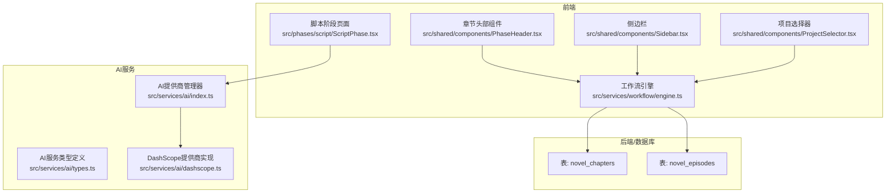
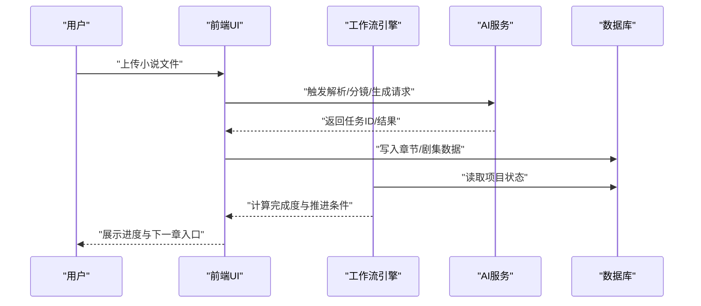
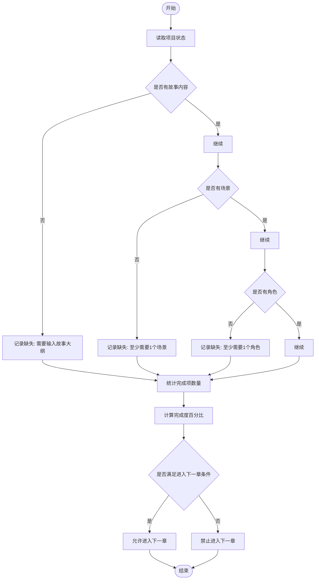
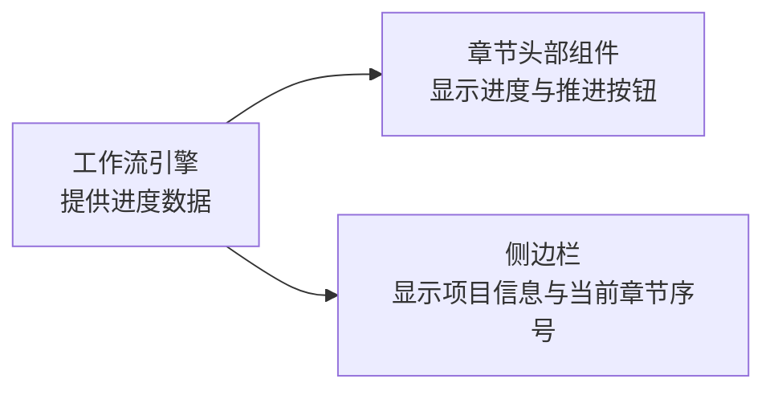
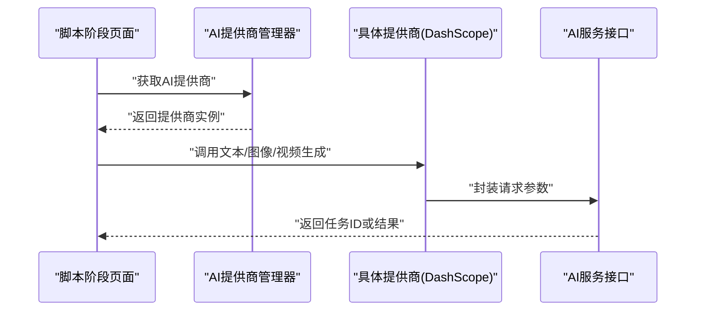
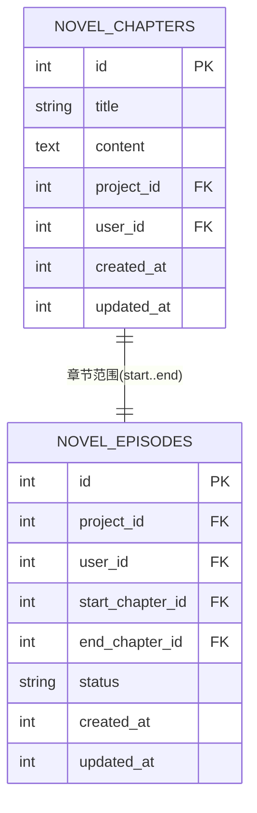
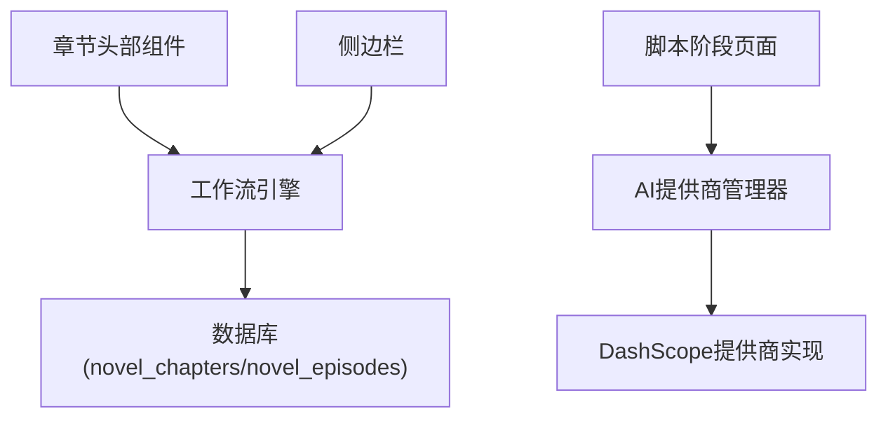

# 小说解析与章节管理

<cite>
**本文档引用的文件**
- [README.md](file://README.md)
- [README_EN.md](file://README_EN.md)
- [src/services/workflow/engine.ts](file://src/services/workflow/engine.ts)
- [src/services/workflow/types.ts](file://src/services/workflow/types.ts)
- [src/services/ai/types.ts](file://src/services/ai/types.ts)
- [src/services/ai/index.ts](file://src/services/ai/index.ts)
- [src/services/ai/dashscope.ts](file://src/services/ai/dashscope.ts)
- [src/shared/components/PhaseHeader.tsx](file://src/shared/components/PhaseHeader.tsx)
- [src/shared/components/Sidebar.tsx](file://src/shared/components/Sidebar.tsx)
- [src/phases/script/ScriptPhase.tsx](file://src/phases/script/ScriptPhase.tsx)
- [src/shared/components/ProjectSelector.tsx](file://src/shared/components/ProjectSelector.tsx)
</cite>

## 目录
1. [引言](#引言)
2. [项目结构](#项目结构)
3. [核心组件](#核心组件)
4. [架构总览](#架构总览)
5. [详细组件分析](#详细组件分析)
6. [依赖关系分析](#依赖关系分析)
7. [性能考虑](#性能考虑)
8. [故障排除指南](#故障排除指南)
9. [结论](#结论)
10. [附录](#附录)

## 引言
本文件围绕“小说解析与章节管理”主题，系统梳理项目中与小说上传、章节识别与管理、元数据提取、解析状态与进度跟踪、AI服务集成等相关的能力与实现路径。根据现有代码与文档，项目已具备以下能力：
- 小说上传与解析：支持上传 .txt 小说文件，自动按章节切分与解析。
- 章节管理：以“剧集（Episode）”为单位进行章节范围划分与状态管理。
- 元数据与结构化内容：项目元数据（标题、阶段、风格等）与章节级数据（novel_chapters、novel_episodes）分离存储。
- 解析状态与进度：通过工作流引擎计算各阶段完成度，并在界面中展示进度条与“进入下一章”控制。
- AI服务集成：统一的AI服务接口与提供商工厂，支持文本、图像、视频生成服务。

注意：当前仓库未包含专门的小说解析器（novelParser）、小说脚本服务（novelScriptService）或小说管理组件（NovelManager）的具体实现文件。本文档基于现有可验证文件与数据库设计文档，给出可落地的实现建议与最佳实践，帮助在现有架构基础上扩展小说解析与章节管理功能。

## 项目结构
项目采用前端（React/Vite）+ 后端（Node.js/TypeScript）+ 数据库（SQLite/MySQL）的分层架构。与小说解析与章节管理直接相关的模块包括：
- 前端工作流与UI：工作流引擎、章节头部组件、侧边栏、脚本阶段页面、项目选择器等。
- AI服务层：统一的AI服务接口与提供商工厂，支持文本、图像、视频服务。
- 数据库表：novel_chapters、novel_episodes 等与小说章节和剧集相关的表结构。

图表来源
- [src/shared/components/PhaseHeader.tsx:1-86](file://src/shared/components/PhaseHeader.tsx#L1-L86)
- [src/shared/components/Sidebar.tsx:47-79](file://src/shared/components/Sidebar.tsx#L47-L79)
- [src/services/workflow/engine.ts:1-33](file://src/services/workflow/engine.ts#L1-L33)
- [src/services/ai/types.ts:1-72](file://src/services/ai/types.ts#L1-L72)
- [src/services/ai/index.ts:1-33](file://src/services/ai/index.ts#L1-L33)
- [src/services/ai/dashscope.ts:141-326](file://src/services/ai/dashscope.ts#L141-L326)

章节来源
- [README.md:370-394](file://README.md#L370-L394)
- [README_EN.md:37-54](file://README_EN.md#L37-L54)

## 核心组件
- 工作流引擎：负责计算当前阶段的完成度、缺失要求与进入下一阶段的条件，支撑章节进度可视化与推进。
- 章节头部组件：展示章节编号、标题、副标题、标语与进度百分比，并提供“进入下一章”按钮。
- 侧边栏：显示项目标题、ID与当前所处章节序号。
- 脚本阶段页面：提供故事输入区域与AI智能分镜按钮，占位展示AI生成流程。
- AI服务接口与提供商：统一抽象文本/图像/视频生成服务，支持多提供商切换与异步任务轮询。

章节来源
- [src/services/workflow/engine.ts:1-33](file://src/services/workflow/engine.ts#L1-L33)
- [src/shared/components/PhaseHeader.tsx:1-86](file://src/shared/components/PhaseHeader.tsx#L1-L86)
- [src/shared/components/Sidebar.tsx:47-79](file://src/shared/components/Sidebar.tsx#L47-L79)
- [src/phases/script/ScriptPhase.tsx:1-36](file://src/phases/script/ScriptPhase.tsx#L1-L36)
- [src/services/ai/types.ts:1-72](file://src/services/ai/types.ts#L1-L72)
- [src/services/ai/index.ts:1-33](file://src/services/ai/index.ts#L1-L33)

## 架构总览
小说解析与章节管理的整体流程如下：
- 用户上传小说文件，后端接收并触发解析任务。
- 解析器对文本进行清洗与标准化，识别章节边界，生成章节元数据与正文。
- 解析结果写入 novel_chapters 表；用户选择章节范围创建剧集（novel_episodes），并进入后续阶段。
- 工作流引擎根据项目状态计算完成度，界面展示进度与推进按钮。
- 在需要时，通过AI服务接口调用文本/图像/视频生成能力，辅助剧本分解与视觉翻译。

图表来源
- [src/services/workflow/engine.ts:15-33](file://src/services/workflow/engine.ts#L15-L33)
- [src/services/ai/types.ts:18-63](file://src/services/ai/types.ts#L18-L63)
- [src/services/ai/index.ts:24-33](file://src/services/ai/index.ts#L24-L33)
- [README.md:370-394](file://README.md#L370-L394)

## 详细组件分析

### 工作流引擎与章节进度
工作流引擎根据项目状态计算当前阶段的完成度与缺失要求，决定是否允许进入下一章。该机制为小说解析后的章节管理提供了统一的状态视图。

图表来源
- [src/services/workflow/engine.ts:15-33](file://src/services/workflow/engine.ts#L15-L33)

章节来源
- [src/services/workflow/engine.ts:1-33](file://src/services/workflow/engine.ts#L1-L33)

### 章节头部组件与侧边栏
章节头部组件展示了章节编号、标题、副标题、标语与进度百分比，并提供“进入下一章”按钮。侧边栏显示项目标题、ID与当前所处章节序号，二者共同构成章节进度的可视化入口。

图表来源
- [src/shared/components/PhaseHeader.tsx:17-86](file://src/shared/components/PhaseHeader.tsx#L17-L86)
- [src/shared/components/Sidebar.tsx:50-79](file://src/shared/components/Sidebar.tsx#L50-L79)
- [src/services/workflow/engine.ts:9-33](file://src/services/workflow/engine.ts#L9-L33)

章节来源
- [src/shared/components/PhaseHeader.tsx:1-86](file://src/shared/components/PhaseHeader.tsx#L1-L86)
- [src/shared/components/Sidebar.tsx:47-79](file://src/shared/components/Sidebar.tsx#L47-L79)

### 脚本阶段页面与AI集成
脚本阶段页面提供故事输入区域与AI智能分镜按钮，占位展示AI生成流程。AI服务通过统一接口与提供商工厂进行抽象，支持文本、图像、视频生成，并提供异步任务轮询能力。

图表来源
- [src/phases/script/ScriptPhase.tsx:25-30](file://src/phases/script/ScriptPhase.tsx#L25-L30)
- [src/services/ai/index.ts:24-33](file://src/services/ai/index.ts#L24-L33)
- [src/services/ai/types.ts:18-63](file://src/services/ai/types.ts#L18-L63)
- [src/services/ai/dashscope.ts:155-182](file://src/services/ai/dashscope.ts#L155-L182)

章节来源
- [src/phases/script/ScriptPhase.tsx:1-36](file://src/phases/script/ScriptPhase.tsx#L1-L36)
- [src/services/ai/types.ts:1-72](file://src/services/ai/types.ts#L1-L72)
- [src/services/ai/index.ts:1-33](file://src/services/ai/index.ts#L1-L33)
- [src/services/ai/dashscope.ts:141-326](file://src/services/ai/dashscope.ts#L141-L326)

### 数据模型与章节存储
根据数据库设计文档，小说章节与剧集的数据模型如下：
- novel_chapters：存储解析后的章节元数据与正文，按用户隔离。
- novel_episodes：存储剧集（章节范围、生成的剧本、状态），按用户隔离。

图表来源
- [README.md:370-394](file://README.md#L370-L394)

章节来源
- [README.md:370-394](file://README.md#L370-L394)

## 依赖关系分析
- 组件耦合：章节头部组件与侧边栏依赖工作流引擎提供的状态数据；脚本阶段页面依赖AI提供商管理器与具体提供商实现。
- 外部依赖：AI服务通过统一接口抽象，便于替换不同提供商；DashScope实现提供异步任务提交与轮询能力。
- 数据依赖：工作流引擎与数据库交互，读取项目状态并更新进度；章节与剧集数据分别存储于 novel_chapters 与 novel_episodes。

图表来源
- [src/shared/components/PhaseHeader.tsx:17-86](file://src/shared/components/PhaseHeader.tsx#L17-L86)
- [src/shared/components/Sidebar.tsx:50-79](file://src/shared/components/Sidebar.tsx#L50-L79)
- [src/services/workflow/engine.ts:9-33](file://src/services/workflow/engine.ts#L9-L33)
- [src/services/ai/index.ts:24-33](file://src/services/ai/index.ts#L24-L33)
- [src/services/ai/dashscope.ts:155-182](file://src/services/ai/dashscope.ts#L155-L182)
- [README.md:370-394](file://README.md#L370-L394)

章节来源
- [src/shared/components/PhaseHeader.tsx:1-86](file://src/shared/components/PhaseHeader.tsx#L1-L86)
- [src/shared/components/Sidebar.tsx:47-79](file://src/shared/components/Sidebar.tsx#L47-L79)
- [src/services/workflow/engine.ts:1-33](file://src/services/workflow/engine.ts#L1-L33)
- [src/services/ai/index.ts:1-33](file://src/services/ai/index.ts#L1-L33)
- [src/services/ai/dashscope.ts:141-326](file://src/services/ai/dashscope.ts#L141-L326)
- [README.md:370-394](file://README.md#L370-L394)

## 性能考虑
- 解析性能：对大体量小说文件进行分块读取与增量解析，避免一次性加载导致内存压力。
- 并发与队列：解析任务应纳入后台任务队列，结合重试与限速策略，保障稳定性。
- 缓存与去重：对重复章节标题与正文进行去重与缓存，减少数据库写入与AI调用次数。
- 前端渲染：章节列表与进度条应采用虚拟滚动与懒加载，提升大数据量下的交互流畅度。
- AI调用：合理设置温度与最大Token，避免超长上下文带来的延迟与成本上升。

## 故障排除指南
- 解析失败：检查上传文件格式与编码；确认解析器对章节标题与正文的识别规则是否覆盖目标文本特征。
- 进度不更新：核对工作流引擎对项目状态的读取逻辑，确保 novel_episodes 与 novel_chapters 的状态字段正确更新。
- AI调用异常：检查AI提供商密钥与网络连通性；利用异步任务轮询接口查询任务状态，定位失败原因。
- 数据库一致性：核对 novel_chapters 与 novel_episodes 的外键约束与用户隔离字段，防止跨用户数据污染。

章节来源
- [src/services/ai/dashscope.ts:155-182](file://src/services/ai/dashscope.ts#L155-L182)
- [src/services/ai/dashscope.ts:289-314](file://src/services/ai/dashscope.ts#L289-L314)
- [README.md:370-394](file://README.md#L370-L394)

## 结论
本项目已具备小说上传、章节管理与工作流进度控制的基础能力，并通过统一的AI服务接口与提供商工厂实现了与AI能力的集成。针对小说解析与章节管理，建议在现有架构上补充：
- 小说解析器：实现文本清洗、章节断句与元数据提取。
- 批量导入：支持多章节合并与范围选择创建剧集。
- 解析状态管理：细化解析任务状态与错误码，提供重试与回滚机制。
- 解析质量评估：建立章节标题与正文匹配度、断句准确率等指标。
- 与AI服务深度集成：在章节解析后自动进行场景分解与视觉翻译。

这些改进将使小说解析与章节管理功能更加完善、稳定与可扩展。

## 附录
- 术语
  - 剧集（Episode）：由若干连续章节组成的可独立管理单元。
  - 工作流（Workflow）：控制项目从脚本到导出的阶段性推进与状态校验。
  - 提供商（Provider）：对AI服务的统一抽象与实现封装。