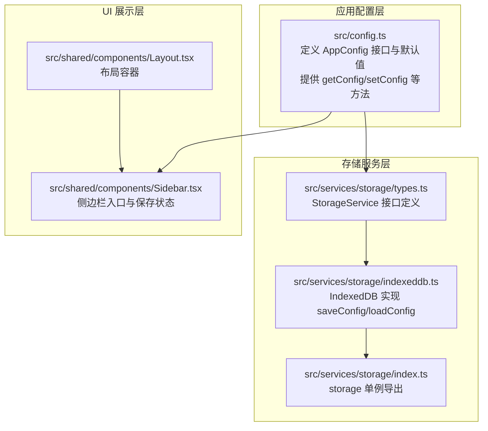
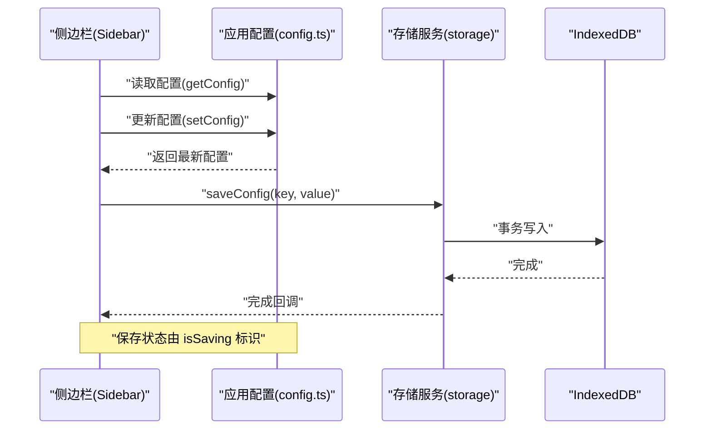
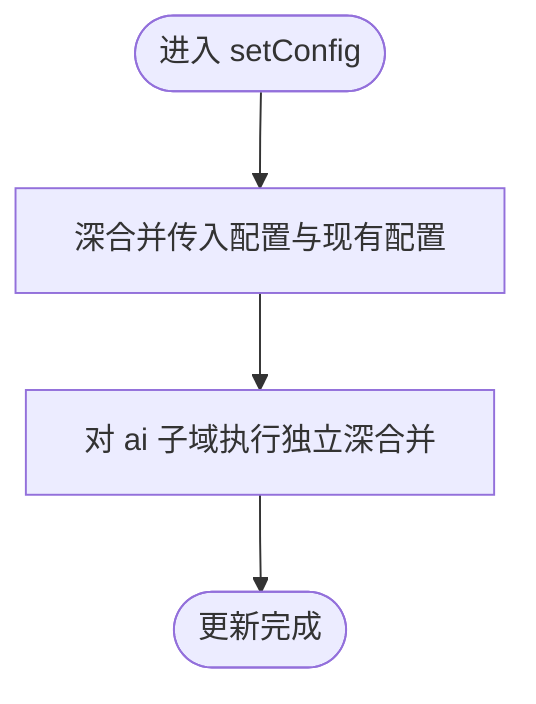
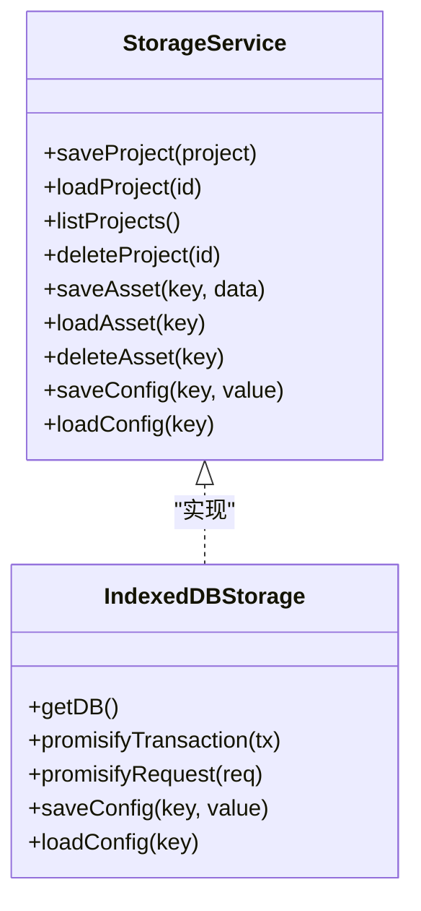
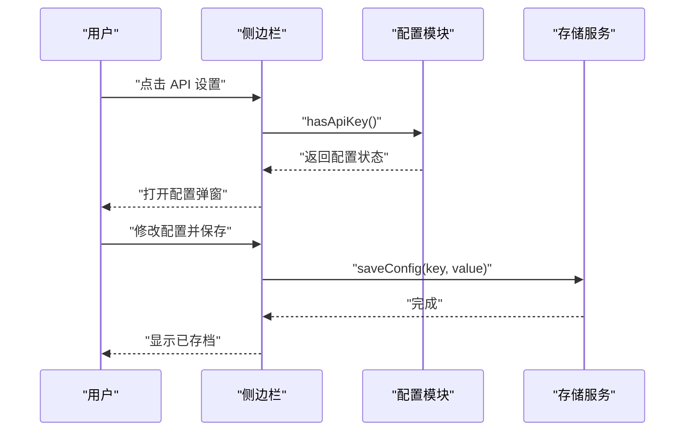
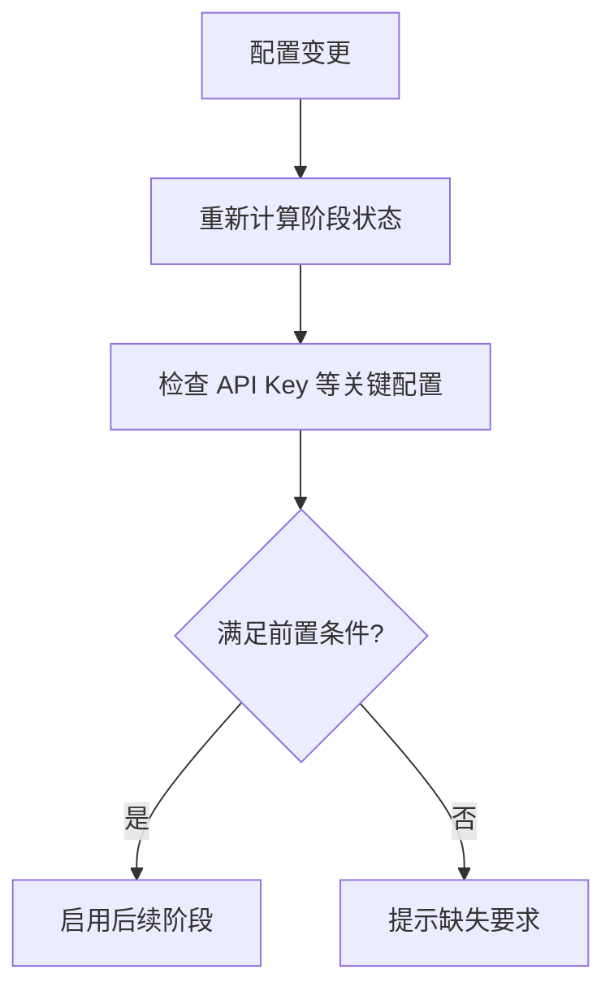
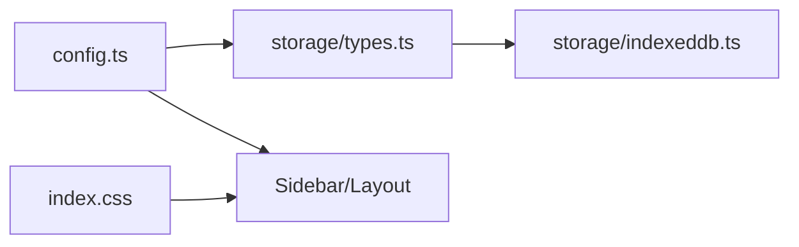

# 配置面板与参数设置

<cite>
**本文引用的文件**
- [src/config.ts](file://src/config.ts)
- [src/shared/components/Sidebar.tsx](file://src/shared/components/Sidebar.tsx)
- [src/services/storage/types.ts](file://src/services/storage/types.ts)
- [src/services/storage/indexeddb.ts](file://src/services/storage/indexeddb.ts)
- [src/services/storage/index.ts](file://src/services/storage/index.ts)
- [src/index.css](file://src/index.css)
- [src/shared/components/Layout.tsx](file://src/shared/components/Layout.tsx)
- [src/services/workflow/engine.ts](file://src/services/workflow/engine.ts)
</cite>

## 目录
1. [简介](#简介)
2. [项目结构](#项目结构)
3. [核心组件](#核心组件)
4. [架构总览](#架构总览)
5. [详细组件分析](#详细组件分析)
6. [依赖关系分析](#依赖关系分析)
7. [性能考量](#性能考量)
8. [故障排查指南](#故障排查指南)
9. [结论](#结论)
10. [附录](#附录)

## 简介
本文件围绕“配置面板与参数设置”功能进行系统化文档化，覆盖以下主题：
- 配置面板设计与实现：如何通过统一配置源驱动界面与行为
- 参数验证机制：默认值管理、参数约束检查与错误处理
- 配置持久化：浏览器端 IndexedDB 的配置存储与读取
- 配置导入导出与模板：基于键空间的扩展能力
- 配置重置、备份与恢复：安全回滚与迁移策略
- 配置同步策略：与项目状态联动，确保工作流一致性

## 项目结构
本项目的配置体系由三层组成：
- 应用配置层：集中定义与管理全局配置对象
- 存储服务层：抽象出统一的存储接口，并以 IndexedDB 实现配置持久化
- UI 展示层：侧边栏入口与保存状态提示，配合配置变更触发

**图表来源**
- [src/config.ts:1-47](file://src/config.ts#L1-L47)
- [src/services/storage/types.ts:15-30](file://src/services/storage/types.ts#L15-L30)
- [src/services/storage/indexeddb.ts:169-189](file://src/services/storage/indexeddb.ts#L169-L189)
- [src/services/storage/index.ts:1-2](file://src/services/storage/index.ts#L1-L2)
- [src/shared/components/Layout.tsx:1-22](file://src/shared/components/Layout.tsx#L1-L22)
- [src/shared/components/Sidebar.tsx:178-214](file://src/shared/components/Sidebar.tsx#L178-L214)

**章节来源**
- [src/config.ts:1-47](file://src/config.ts#L1-L47)
- [src/services/storage/types.ts:15-30](file://src/services/storage/types.ts#L15-L30)
- [src/services/storage/indexeddb.ts:169-189](file://src/services/storage/indexeddb.ts#L169-L189)
- [src/shared/components/Layout.tsx:1-22](file://src/shared/components/Layout.tsx#L1-L22)
- [src/shared/components/Sidebar.tsx:178-214](file://src/shared/components/Sidebar.tsx#L178-L214)

## 核心组件
- 应用配置模块：提供 AppConfig 类型、默认值常量、运行时配置读写函数
- 存储服务接口：定义 saveConfig/loadConfig 等方法，隔离具体存储实现
- IndexedDB 实现：以键值对形式持久化配置，支持任意 JSON 可序列化值
- UI 入口：侧边栏提供“API 设置”入口与保存状态指示，联动配置变更

关键职责与交互：
- 配置读取：应用启动或组件渲染时调用 getConfig 获取当前配置
- 配置更新：setConfig 深合并传入部分配置，避免覆盖未变更字段
- 配置持久化：通过 storage.saveConfig/saveConfig 将配置写入 IndexedDB
- UI 同步：侧边栏根据 hasApiKey 状态显示 API 配置状态；保存状态通过 isSaving 标识

**章节来源**
- [src/config.ts:28-46](file://src/config.ts#L28-L46)
- [src/services/storage/types.ts:27-30](file://src/services/storage/types.ts#L27-L30)
- [src/services/storage/indexeddb.ts:171-184](file://src/services/storage/indexeddb.ts#L171-L184)
- [src/shared/components/Sidebar.tsx:181-211](file://src/shared/components/Sidebar.tsx#L181-L211)

## 架构总览
下图展示从 UI 到存储的完整链路，以及配置与项目状态的联动。

**图表来源**
- [src/shared/components/Sidebar.tsx:178-214](file://src/shared/components/Sidebar.tsx#L178-L214)
- [src/config.ts:28-46](file://src/config.ts#L28-L46)
- [src/services/storage/types.ts:27-30](file://src/services/storage/types.ts#L27-L30)
- [src/services/storage/indexeddb.ts:171-184](file://src/services/storage/indexeddb.ts#L171-L184)

## 详细组件分析

### 组件一：应用配置模块（config.ts）
- 设计要点
  - 使用接口 AppConfig 抽象配置结构，避免硬编码
  - 默认值集中管理，便于统一初始化与重置
  - 提供浅/深合并策略，保证子域（如 ai）独立更新
- 关键流程
  - 初始化：从 DEFAULT_CONFIG 深拷贝一份当前配置
  - 读取：getConfig 返回当前运行时配置
  - 更新：setConfig 对传入部分配置进行深合并
  - 辅助：setApiKey、hasApiKey 支持快速访问与校验

**图表来源**
- [src/config.ts:32-38](file://src/config.ts#L32-L38)

**章节来源**
- [src/config.ts:6-26](file://src/config.ts#L6-L26)
- [src/config.ts:28-46](file://src/config.ts#L28-L46)

### 组件二：存储服务接口与实现（storage）
- 接口契约
  - 定义 saveConfig/loadConfig 方法，约定键空间与值类型
- IndexedDB 实现
  - 使用只读/读写事务访问 CONFIG 存储区
  - put/get 键值对，返回 Promise 包装结果
- 扩展性
  - 通过键前缀可扩展为多类配置（如用户偏好、项目模板）

**图表来源**
- [src/services/storage/types.ts:15-30](file://src/services/storage/types.ts#L15-L30)
- [src/services/storage/indexeddb.ts:169-189](file://src/services/storage/indexeddb.ts#L169-L189)

**章节来源**
- [src/services/storage/types.ts:15-30](file://src/services/storage/types.ts#L15-L30)
- [src/services/storage/indexeddb.ts:169-189](file://src/services/storage/indexeddb.ts#L169-L189)

### 组件三：UI 入口与状态联动（Sidebar/Layout）
- 侧边栏入口
  - “API 设置”按钮用于打开配置弹窗，联动 hasApiKey 状态显示
  - 保存状态通过 LoadingSpinner 与“已存档”徽标提示
- 布局容器
  - Layout 统一承载 Sidebar 与主内容区域，确保样式与主题一致

**图表来源**
- [src/shared/components/Sidebar.tsx:181-211](file://src/shared/components/Sidebar.tsx#L181-L211)
- [src/config.ts:44-46](file://src/config.ts#L44-L46)
- [src/services/storage/types.ts:27-30](file://src/services/storage/types.ts#L27-L30)

**章节来源**
- [src/shared/components/Sidebar.tsx:178-214](file://src/shared/components/Sidebar.tsx#L178-L214)
- [src/shared/components/Layout.tsx:1-22](file://src/shared/components/Layout.tsx#L1-L22)

### 组件四：配置与项目状态联动（workflow/engine）
- 工作流引擎通过项目状态判断各阶段完成度
- 配置变更可能影响后续阶段可用性（如 API Key 缺失导致无法生成）
- 建议在配置变更后重新计算阶段状态，确保 UI 与逻辑一致

**图表来源**
- [src/services/workflow/engine.ts:35-72](file://src/services/workflow/engine.ts#L35-L72)

**章节来源**
- [src/services/workflow/engine.ts:35-72](file://src/services/workflow/engine.ts#L35-L72)

## 依赖关系分析
- 配置模块依赖存储服务接口，但不直接依赖具体实现
- UI 仅依赖配置模块与存储服务接口，降低耦合
- 主题与样式通过 CSS 变量统一，不影响配置逻辑

**图表来源**
- [src/config.ts:28-46](file://src/config.ts#L28-L46)
- [src/services/storage/types.ts:15-30](file://src/services/storage/types.ts#L15-L30)
- [src/services/storage/indexeddb.ts:169-189](file://src/services/storage/indexeddb.ts#L169-L189)
- [src/shared/components/Sidebar.tsx:178-214](file://src/shared/components/Sidebar.tsx#L178-L214)
- [src/shared/components/Layout.tsx:1-22](file://src/shared/components/Layout.tsx#L1-L22)
- [src/index.css:11-37](file://src/index.css#L11-L37)

**章节来源**
- [src/config.ts:28-46](file://src/config.ts#L28-L46)
- [src/services/storage/types.ts:15-30](file://src/services/storage/types.ts#L15-L30)
- [src/services/storage/indexeddb.ts:169-189](file://src/services/storage/indexeddb.ts#L169-L189)
- [src/shared/components/Sidebar.tsx:178-214](file://src/shared/components/Sidebar.tsx#L178-L214)
- [src/shared/components/Layout.tsx:1-22](file://src/shared/components/Layout.tsx#L1-L22)
- [src/index.css:11-37](file://src/index.css#L11-L37)

## 性能考量
- 配置读取：get/set 为内存级操作，开销极低
- 存储写入：IndexedDB 事务异步，建议批量写入减少抖动
- UI 渲染：配置变更应节流/防抖，避免频繁重渲染
- 样式：CSS 变量切换无重排，不影响配置性能

## 故障排查指南
- 配置未生效
  - 检查是否调用了 setConfig 并传入了期望的键值
  - 确认未被后续 setConfig 覆盖
- 配置未持久化
  - 确认已调用 storage.saveConfig 并等待 Promise 完成
  - 检查浏览器是否禁用 IndexedDB 或存储空间不足
- API 设置状态异常
  - hasApiKey 返回值与预期不符，检查 apiKey 是否为空字符串
  - 侧边栏状态未更新，确认 isSaving 流程是否正确结束
- 与项目状态不同步
  - 在配置变更后，重新计算阶段状态，确保前置条件满足

**章节来源**
- [src/config.ts:32-46](file://src/config.ts#L32-L46)
- [src/services/storage/indexeddb.ts:171-184](file://src/services/storage/indexeddb.ts#L171-L184)
- [src/shared/components/Sidebar.tsx:181-211](file://src/shared/components/Sidebar.tsx#L181-L211)
- [src/services/workflow/engine.ts:35-72](file://src/services/workflow/engine.ts#L35-L72)

## 结论
本配置体系采用“配置驱动”的控制论思想，通过统一的配置源、抽象的存储接口与清晰的 UI 入口，实现了高内聚、低耦合的配置管理。结合默认值管理、参数深合并、IndexedDB 持久化与工作流状态联动，能够稳定支撑项目生命周期中的各类参数设置需求。建议后续扩展：
- 增加配置导入导出与模板功能（基于键空间扩展）
- 提供配置重置与备份恢复的 UI 操作
- 引入配置版本与变更日志，便于审计与回滚

## 附录

### 配置项分类与默认值
- 分类：AI 相关配置（API Key、基础地址、文本/图像/视频模型）
- 默认值：集中于 DEFAULT_CONFIG，便于初始化与重置
- 更新策略：setConfig 深合并，避免覆盖未变更字段

**章节来源**
- [src/config.ts:16-26](file://src/config.ts#L16-L26)
- [src/config.ts:32-38](file://src/config.ts#L32-L38)

### 参数验证与约束检查
- 建议在 setConfig 前增加参数校验（如模型名称白名单、URL 合法性）
- 对必填项（如 API Key）在保存前进行非空检查
- 对数值型参数（如目标时长）增加范围约束

[本节为通用实践建议，无需特定文件引用]

### 配置持久化与同步策略
- 持久化：通过 storage.saveConfig/loadConfig 实现键值对持久化
- 同步：UI 与配置模块之间通过事件/回调保持一致
- 备份恢复：可将当前配置导出为 JSON，必要时导入恢复

**章节来源**
- [src/services/storage/types.ts:27-30](file://src/services/storage/types.ts#L27-L30)
- [src/services/storage/indexeddb.ts:171-184](file://src/services/storage/indexeddb.ts#L171-L184)