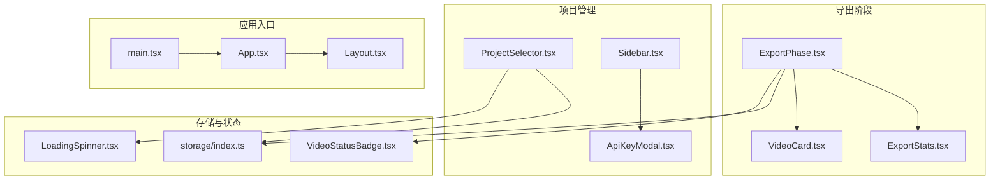
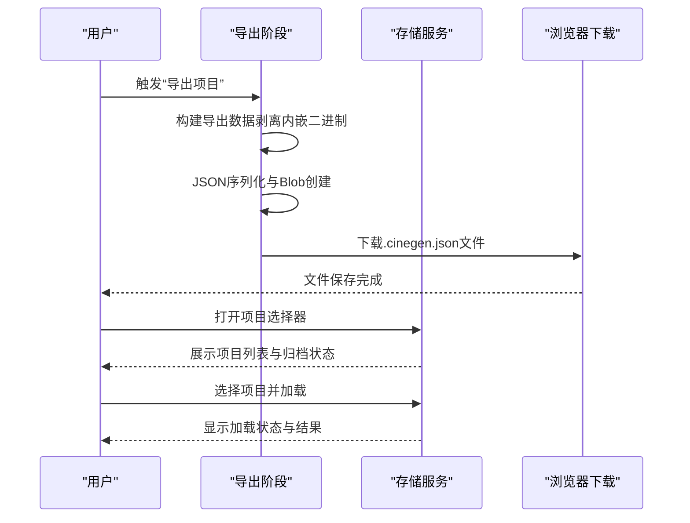
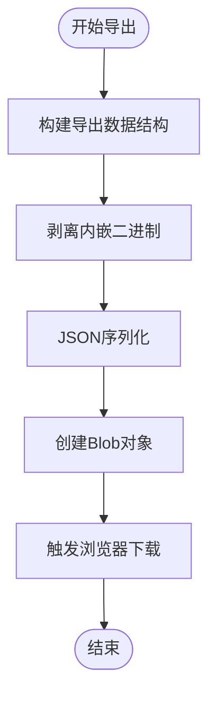
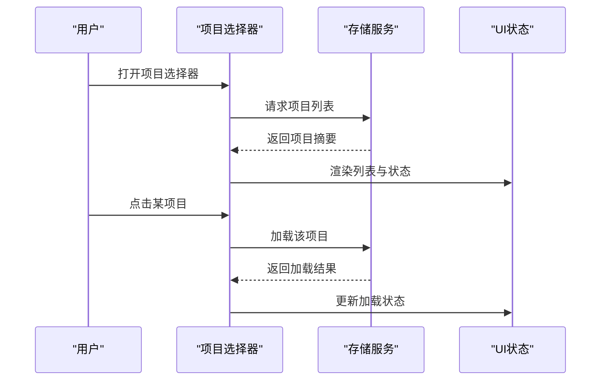
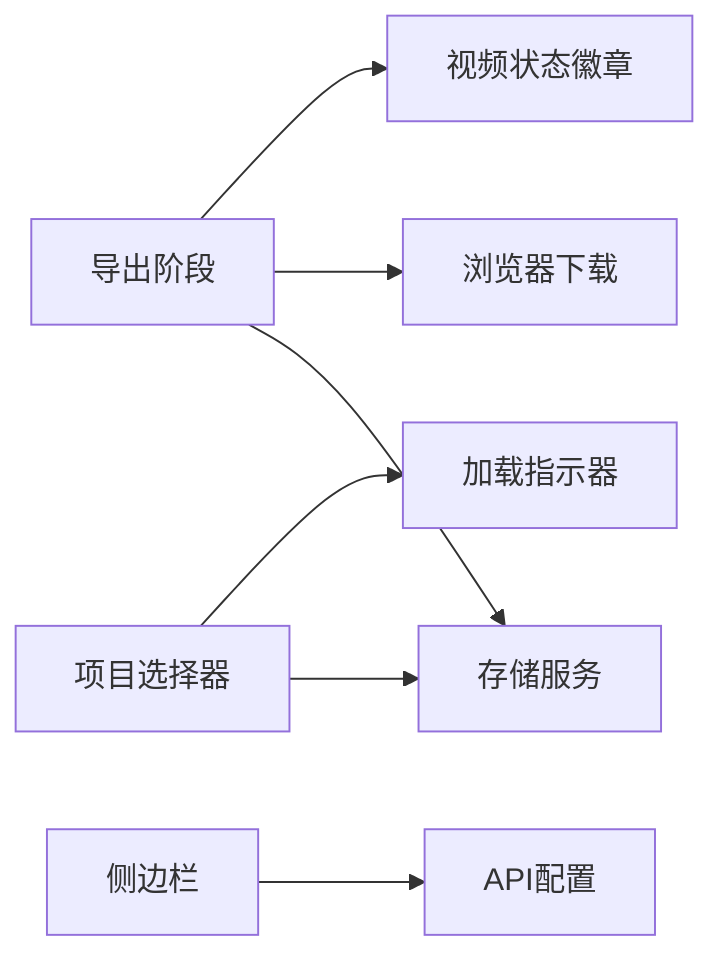

# 二级选项功能

<cite>
**本文档引用的文件**
- [src/phases/export/ExportPhase.tsx](file://src/phases/export/ExportPhase.tsx)
- [src/phases/export/components/ExportStats.tsx](file://src/phases/export/components/ExportStats.tsx)
- [src/phases/export/components/VideoCard.tsx](file://src/phases/export/components/VideoCard.tsx)
- [src/shared/components/ProjectSelector.tsx](file://src/shared/components/ProjectSelector.tsx)
- [src/shared/components/Sidebar.tsx](file://src/shared/components/Sidebar.tsx)
- [src/services/storage/index.ts](file://src/services/storage/index.ts)
- [src/shared/components/ApiKeyModal.tsx](file://src/shared/components/ApiKeyModal.tsx)
- [src/shared/components/LoadingSpinner.tsx](file://src/shared/components/LoadingSpinner.tsx)
- [src/phases/director/components/VideoStatusBadge.tsx](file://src/phases/director/components/VideoStatusBadge.tsx)
- [src/phases/assets/components/ImagePreview.tsx](file://src/phases/assets/components/ImagePreview.tsx)
- [src/shared/components/Layout.tsx](file://src/shared/components/Layout.tsx)
- [src/App.tsx](file://src/App.tsx)
- [src/main.tsx](file://src/main.tsx)
</cite>

## 目录
1. [简介](#简介)
2. [项目结构](#项目结构)
3. [核心组件](#核心组件)
4. [架构总览](#架构总览)
5. [详细组件分析](#详细组件分析)
6. [依赖关系分析](#依赖关系分析)
7. [性能考虑](#性能考虑)
8. [故障排除指南](#故障排除指南)
9. [结论](#结论)

## 简介
本文件聚焦于“二级选项”功能的技术实现，围绕以下关键能力展开：项目数据导出（含二进制剥离与JSON序列化）、渲染状态展示与日志查看入口、项目归档与加载、以及与之配套的存储服务、API配置与状态指示器。文档将从系统架构、组件关系、数据流、处理逻辑、集成点、错误处理与性能特征等方面进行深入解析，并提供可视化图示与排障建议。

## 项目结构
二级选项功能主要分布在“导出阶段”与“侧边栏/项目选择器”等模块中，配合前端存储服务与全局布局组件共同构成完整的归档与导出工作流。

**图表来源**
- [src/phases/export/ExportPhase.tsx](file://src/phases/export/ExportPhase.tsx)
- [src/phases/export/components/ExportStats.tsx](file://src/phases/export/components/ExportStats.tsx)
- [src/phases/export/components/VideoCard.tsx](file://src/phases/export/components/VideoCard.tsx)
- [src/shared/components/ProjectSelector.tsx](file://src/shared/components/ProjectSelector.tsx)
- [src/shared/components/Sidebar.tsx](file://src/shared/components/Sidebar.tsx)
- [src/services/storage/index.ts](file://src/services/storage/index.ts)
- [src/shared/components/ApiKeyModal.tsx](file://src/shared/components/ApiKeyModal.tsx)
- [src/phases/director/components/VideoStatusBadge.tsx](file://src/phases/director/components/VideoStatusBadge.tsx)
- [src/shared/components/LoadingSpinner.tsx](file://src/shared/components/LoadingSpinner.tsx)
- [src/shared/components/Layout.tsx](file://src/shared/components/Layout.tsx)
- [src/App.tsx](file://src/App.tsx)
- [src/main.tsx](file://src/main.tsx)

**章节来源**
- [src/phases/export/ExportPhase.tsx](file://src/phases/export/ExportPhase.tsx)
- [src/shared/components/ProjectSelector.tsx](file://src/shared/components/ProjectSelector.tsx)
- [src/services/storage/index.ts](file://src/services/storage/index.ts)

## 核心组件
- 导出阶段（ExportPhase）：负责构建导出数据结构、剥离内嵌二进制、序列化并触发浏览器下载。
- 项目选择器（ProjectSelector）：提供项目列表展示、加载与归档状态指示。
- 存储服务（storage/index）：封装IndexedDB访问接口，提供项目摘要与持久化能力。
- 侧边栏与API配置（Sidebar/ApiKeyModal）：显示存档状态与API配置状态，提供设置入口。
- 视频状态徽章（VideoStatusBadge）：在导出卡片中展示渲染状态。
- 加载指示器（LoadingSpinner）：在项目读取或归档过程中提供视觉反馈。
- 应用布局（Layout/App/main）：组织页面结构与路由入口。

**章节来源**
- [src/phases/export/ExportPhase.tsx](file://src/phases/export/ExportPhase.tsx)
- [src/shared/components/ProjectSelector.tsx](file://src/shared/components/ProjectSelector.tsx)
- [src/services/storage/index.ts](file://src/services/storage/index.ts)
- [src/shared/components/Sidebar.tsx](file://src/shared/components/Sidebar.tsx)
- [src/shared/components/ApiKeyModal.tsx](file://src/shared/components/ApiKeyModal.tsx)
- [src/phases/director/components/VideoStatusBadge.tsx](file://src/phases/director/components/VideoStatusBadge.tsx)
- [src/shared/components/LoadingSpinner.tsx](file://src/shared/components/LoadingSpinner.tsx)
- [src/shared/components/Layout.tsx](file://src/shared/components/Layout.tsx)
- [src/App.tsx](file://src/App.tsx)
- [src/main.tsx](file://src/main.tsx)

## 架构总览
二级选项功能采用“前端单页应用 + IndexedDB 存储”的轻量架构。导出流程通过构建JSON快照并剥离内嵌二进制，避免大体积数据进入文本导出；项目归档与加载由存储服务统一管理；UI层通过状态徽章与指示器反馈操作结果。

**图表来源**
- [src/phases/export/ExportPhase.tsx](file://src/phases/export/ExportPhase.tsx)
- [src/services/storage/index.ts](file://src/services/storage/index.ts)

## 详细组件分析

### 导出阶段（ExportPhase）
- 功能职责
  - 构建导出数据结构，包含项目元信息与脚本、资产、导演等引用。
  - 剥离内嵌二进制（如dataURL），仅保留可恢复的引用，降低导出体积。
  - 将数据序列化为JSON并创建Blob，触发浏览器下载。
- 关键流程
  - 数据构建：对项目对象进行浅层复制，替换敏感字段为占位符。
  - 内嵌数据剥离：遍历对象，识别并替换以特定前缀开头的字符串。
  - 下载触发：生成时间戳命名的文件名，创建临时URL并触发下载。
- 错误处理
  - 包裹导出过程，捕获异常并设置错误状态，避免界面冻结。
- 性能特征
  - 大对象序列化可能阻塞UI线程，建议在后台线程或分片处理（当前实现未采用）。
  - 剥离内嵌二进制显著减少导出文件大小，提升传输与存储效率。

**图表来源**
- [src/phases/export/ExportPhase.tsx](file://src/phases/export/ExportPhase.tsx)

**章节来源**
- [src/phases/export/ExportPhase.tsx](file://src/phases/export/ExportPhase.tsx)

### 项目选择器（ProjectSelector）
- 功能职责
  - 展示本地项目列表，支持加载与归档状态查看。
  - 在加载过程中显示加载指示器，提升用户体验。
- 关键流程
  - 列表渲染：根据项目数量决定空态或列表项展示。
  - 加载逻辑：点击项目项后调用加载函数，更新当前项目状态。
  - 归档状态：结合侧边栏状态指示器，显示存档完成或进行中。
- 错误处理
  - 列表为空时提供友好提示，避免用户困惑。
- 性能特征
  - 列表项较少时开销可忽略；若项目数量增长，建议引入虚拟滚动或分页。

**图表来源**
- [src/shared/components/ProjectSelector.tsx](file://src/shared/components/ProjectSelector.tsx)
- [src/services/storage/index.ts](file://src/services/storage/index.ts)

**章节来源**
- [src/shared/components/ProjectSelector.tsx](file://src/shared/components/ProjectSelector.tsx)
- [src/services/storage/index.ts](file://src/services/storage/index.ts)

### 存储服务（storage/index）
- 功能职责
  - 统一封装IndexedDB访问，提供项目摘要与持久化能力。
  - 作为导出与加载的数据源，确保数据一致性。
- 关键流程
  - 类型导出：导出StorageService接口与默认实现实例。
  - 项目摘要：返回项目基本信息用于列表展示。
  - 持久化：写入/读取项目数据，支持版本迁移与兼容性。
- 错误处理
  - 访问失败时抛出明确错误，便于上层UI处理。
- 性能特征
  - IndexedDB适合中小规模项目数据；大体量数据需考虑分片与索引优化。

**章节来源**
- [src/services/storage/index.ts](file://src/services/storage/index.ts)

### 侧边栏与API配置（Sidebar/ApiKeyModal）
- 功能职责
  - Sidebar显示API配置状态与存档状态，提供设置入口。
  - ApiKeyModal用于配置与校验API密钥，影响后续任务执行。
- 关键流程
  - 状态指示：根据API密钥存在与否切换样式与文案。
  - 设置弹窗：打开/关闭时同步状态，确保配置生效。
- 错误处理
  - 配置无效时提示用户修正，避免静默失败。
- 性能特征
  - 状态切换为纯前端逻辑，开销极低。

**章节来源**
- [src/shared/components/Sidebar.tsx](file://src/shared/components/Sidebar.tsx)
- [src/shared/components/ApiKeyModal.tsx](file://src/shared/components/ApiKeyModal.tsx)

### 视频状态徽章（VideoStatusBadge）
- 功能职责
  - 在导出卡片中展示渲染状态，帮助用户快速判断任务进度。
- 关键流程
  - 接收状态参数，映射到UI徽章样式与文案。
- 错误处理
  - 未知状态时回退到默认样式，保证界面稳定。
- 性能特征
  - 纯展示组件，渲染成本极低。

**章节来源**
- [src/phases/director/components/VideoStatusBadge.tsx](file://src/phases/director/components/VideoStatusBadge.tsx)

### 加载指示器（LoadingSpinner）
- 功能职责
  - 在长时间操作期间提供视觉反馈，改善用户体验。
- 关键流程
  - 接收是否加载状态，动态渲染指示器。
- 错误处理
  - 与业务状态解耦，避免阻断主流程。
- 性能特征
  - 轻量动画，对性能影响可忽略。

**章节来源**
- [src/shared/components/LoadingSpinner.tsx](file://src/shared/components/LoadingSpinner.tsx)

### 应用布局与入口（Layout/App/main）
- 功能职责
  - Layout组织页面结构与主题样式。
  - App与main负责应用初始化与路由挂载。
- 关键流程
  - 入口初始化：加载主题、上下文与路由。
  - 布局渲染：承载各阶段组件与侧边栏。
- 错误处理
  - 初始化失败时提供兜底界面与错误提示。
- 性能特征
  - 结构清晰，利于按需加载与懒编译。

**章节来源**
- [src/shared/components/Layout.tsx](file://src/shared/components/Layout.tsx)
- [src/App.tsx](file://src/App.tsx)
- [src/main.tsx](file://src/main.tsx)

## 依赖关系分析
- 组件耦合
  - 导出阶段依赖存储服务以获取项目数据；项目选择器依赖存储服务进行列表与加载。
  - 侧边栏与API配置为横切关注点，影响任务执行环境而非数据流。
- 外部依赖
  - 浏览器下载API用于导出文件生成。
  - IndexedDB用于本地数据持久化。
- 潜在循环依赖
  - 当前模块间为单向依赖，未发现循环。
- 接口契约
  - 存储服务暴露统一接口，便于替换实现（如迁移到文件系统或云存储）。

**图表来源**
- [src/phases/export/ExportPhase.tsx](file://src/phases/export/ExportPhase.tsx)
- [src/shared/components/ProjectSelector.tsx](file://src/shared/components/ProjectSelector.tsx)
- [src/services/storage/index.ts](file://src/services/storage/index.ts)
- [src/shared/components/Sidebar.tsx](file://src/shared/components/Sidebar.tsx)
- [src/shared/components/ApiKeyModal.tsx](file://src/shared/components/ApiKeyModal.tsx)
- [src/phases/director/components/VideoStatusBadge.tsx](file://src/phases/director/components/VideoStatusBadge.tsx)
- [src/shared/components/LoadingSpinner.tsx](file://src/shared/components/LoadingSpinner.tsx)

**章节来源**
- [src/phases/export/ExportPhase.tsx](file://src/phases/export/ExportPhase.tsx)
- [src/shared/components/ProjectSelector.tsx](file://src/shared/components/ProjectSelector.tsx)
- [src/services/storage/index.ts](file://src/services/storage/index.ts)
- [src/shared/components/Sidebar.tsx](file://src/shared/components/Sidebar.tsx)
- [src/shared/components/ApiKeyModal.tsx](file://src/shared/components/ApiKeyModal.tsx)
- [src/phases/director/components/VideoStatusBadge.tsx](file://src/phases/director/components/VideoStatusBadge.tsx)
- [src/shared/components/LoadingSpinner.tsx](file://src/shared/components/LoadingSpinner.tsx)

## 性能考虑
- 导出序列化
  - 对大型项目进行全量JSON序列化可能造成主线程阻塞。建议采用Web Worker或分块处理，或将剥离步骤前置到服务端。
- 数据剥离策略
  - 剥离内嵌二进制显著降低导出体积，但会改变原始数据结构。应确保导入流程具备恢复能力。
- 存储优化
  - IndexedDB适合中小项目；若项目增多，建议引入分页、索引与清理策略。
- 并发安全
  - 导出与加载应互斥，避免竞态条件。可在导出阶段禁用其他写操作或引入锁机制。
- 压缩与校验
  - 可选地对导出文件进行压缩与哈希校验，提升传输可靠性与完整性保障（当前实现未包含）。

## 故障排除指南
- 导出失败
  - 现象：导出按钮无响应或出现错误提示。
  - 排查：确认项目数据完整、内存充足；检查浏览器下载权限；查看控制台错误。
  - 处理：重试导出；减小项目规模；更换浏览器或升级版本。
- 项目加载缓慢
  - 现象：项目选择器长时间处于加载状态。
  - 排查：检查IndexedDB可用性与数据大小；确认网络代理或扩展未干扰。
  - 处理：清理旧项目；迁移至更快存储；优化数据结构。
- API配置无效
  - 现象：侧边栏显示未配置，任务无法执行。
  - 排查：核对密钥格式与有效期；检查网络连通性。
  - 处理：重新输入密钥；刷新页面；联系管理员。
- 存档状态异常
  - 现象：侧边栏显示“已存档”，但项目未更新。
  - 排查：确认存档流程完成；检查存储服务状态。
  - 处理：手动触发存档；重启应用；查看日志。

**章节来源**
- [src/phases/export/ExportPhase.tsx](file://src/phases/export/ExportPhase.tsx)
- [src/shared/components/ProjectSelector.tsx](file://src/shared/components/ProjectSelector.tsx)
- [src/shared/components/Sidebar.tsx](file://src/shared/components/Sidebar.tsx)
- [src/shared/components/ApiKeyModal.tsx](file://src/shared/components/ApiKeyModal.tsx)

## 结论
二级选项功能以“导出剥离+本地归档”为核心，通过清晰的组件边界与稳定的存储服务实现可靠的数据流转。当前实现简洁高效，适合中小型项目场景。针对大规模项目与复杂需求，建议引入压缩/校验、并发锁、分页/索引与Worker异步处理等优化手段，进一步提升稳定性与性能。