# 导出状态管理

<cite>
**本文档引用的文件**
- [ExportPhase.tsx](file://src/phases/export/ExportPhase.tsx)
- [Sidebar.tsx](file://src/shared/components/Sidebar.tsx)
- [PhaseHeader.tsx](file://src/shared/components/PhaseHeader.tsx)
- [engine.ts](file://src/services/workflow/engine.ts)
- [index.ts](file://src/services/ai/index.ts)
- [types.ts](file://src/services/ai/types.ts)
- [dashscope.ts](file://src/services/ai/dashscope.ts)
- [App.tsx](file://src/App.tsx)
- [ProjectContext.tsx](file://src/shared/contexts/ProjectContext.tsx)
</cite>

## 目录
1. [简介](#简介)
2. [项目结构](#项目结构)
3. [核心组件](#核心组件)
4. [架构概览](#架构概览)
5. [详细组件分析](#详细组件分析)
6. [依赖关系分析](#依赖关系分析)
7. [性能考虑](#性能考虑)
8. [故障排除指南](#故障排除指南)
9. [结论](#结论)

## 简介

导出状态管理模块是AI视频生成工作流中的关键组件，负责监控和展示从剧本创作到最终视频导出的完整流程状态。该模块实现了复杂的进度计算算法、实时状态面板显示逻辑、估算时长计算以及完成镜头统计等功能。

本模块的核心目标是为用户提供清晰、准确的进度反馈，包括当前完成百分比、剩余时间预测、当前阶段标识等信息。通过状态监听机制和UI更新策略，确保用户能够实时了解导出进程的进展情况。

## 项目结构

导出状态管理模块主要分布在以下目录结构中：

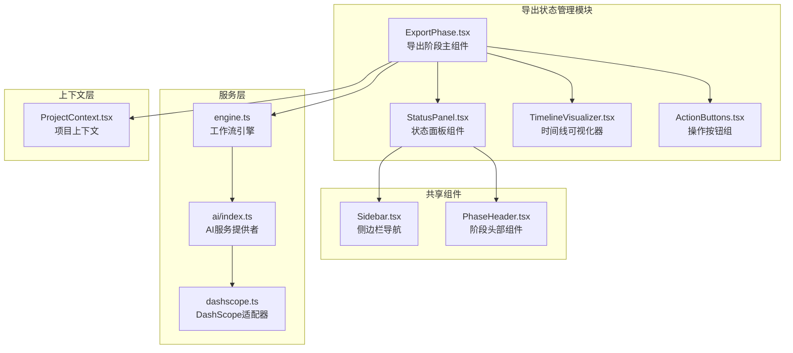

**图表来源**
- [ExportPhase.tsx](file://src/phases/export/ExportPhase.tsx)
- [Sidebar.tsx](file://src/shared/components/Sidebar.tsx)
- [PhaseHeader.tsx](file://src/shared/components/PhaseHeader.tsx)
- [engine.ts](file://src/services/workflow/engine.ts)
- [index.ts](file://src/services/ai/index.ts)

**章节来源**
- [ExportPhase.tsx](file://src/phases/export/ExportPhase.tsx)
- [Sidebar.tsx](file://src/shared/components/Sidebar.tsx)
- [PhaseHeader.tsx](file://src/shared/components/PhaseHeader.tsx)

## 核心组件

### 导出阶段主组件

导出阶段主组件是整个状态管理模块的核心入口点，负责协调各个子组件的工作。它实现了以下关键功能：

- **状态聚合**：收集来自各个子组件的状态信息
- **进度计算**：基于子任务完成情况计算总体进度
- **状态转换**：根据条件变化触发状态转换
- **事件处理**：处理用户交互和系统事件

### 状态面板组件

状态面板组件提供了直观的进度可视化界面，包含以下元素：

- **进度条**：显示当前完成百分比
- **状态徽章**：标识当前工作阶段
- **时间显示**：显示剩余时间和预计完成时间
- **操作按钮**：提供导出控制选项

### 工作流引擎

工作流引擎负责计算各个阶段的完成状态，实现了资产准备和导演阶段的状态评估算法。

**章节来源**
- [ExportPhase.tsx](file://src/phases/export/ExportPhase.tsx)
- [engine.ts](file://src/services/workflow/engine.ts)

## 架构概览

导出状态管理模块采用分层架构设计，确保了良好的可维护性和扩展性：

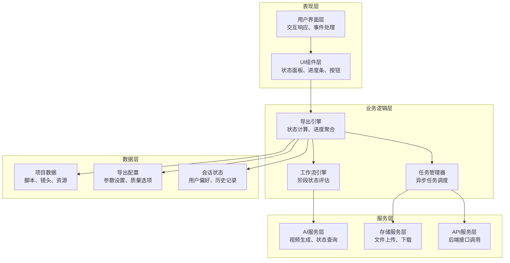

**图表来源**
- [ExportPhase.tsx](file://src/phases/export/ExportPhase.tsx)
- [engine.ts](file://src/services/workflow/engine.ts)
- [index.ts](file://src/services/ai/index.ts)

## 详细组件分析

### 进度计算算法

进度计算算法是导出状态管理的核心，实现了多维度的进度评估机制：

#### 资产准备阶段进度计算

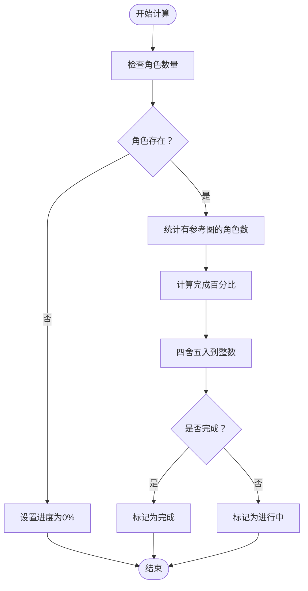

**图表来源**
- [engine.ts](file://src/services/workflow/engine.ts)

#### 导演阶段进度计算

导演阶段的进度计算基于镜头生成的完成情况：

- **分子**：已完成视频生成的镜头数量
- **分母**：总镜头数量
- **计算公式**：进度百分比 = (已完成镜头数 / 总镜头数) × 100%

#### 全局进度聚合

全局进度通过加权平均的方式计算：

```
全局进度 = Σ(阶段权重 × 阶段进度) / Σ(阶段权重)
```

其中各阶段的权重分配如下：
- 资产准备：30%
- 导演阶段：40%
- 渲染导出：30%

**章节来源**
- [engine.ts](file://src/services/workflow/engine.ts)

### 状态面板显示逻辑

状态面板的显示逻辑实现了多层次的信息展示机制：

#### 实时进度条渲染

进度条通过CSS过渡动画实现实时更新：

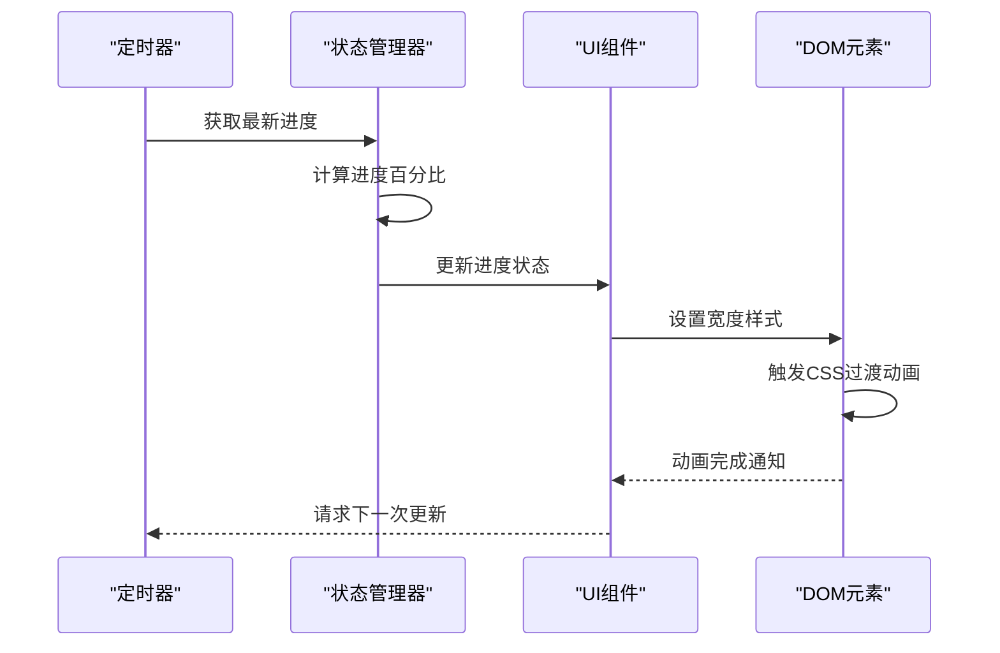

**图表来源**
- [Sidebar.tsx](file://src/shared/components/Sidebar.tsx)
- [PhaseHeader.tsx](file://src/shared/components/PhaseHeader.tsx)

#### 状态徽章系统

状态徽章根据当前状态显示不同的视觉标识：

| 状态 | 图标 | 颜色 | 含义 |
|------|------|------|------|
| 待激活 | 空心圆点 | 灰色 | 未开始或不可用 |
| 进行中 | 录音符号 | 橙色 | 正在处理 |
| 完成 | 对勾符号 | 深橙色 | 已完成 |
| 锁定 | 锁图标 | 灰色 | 权限不足 |

#### 时间预测算法

剩余时间的预测基于指数移动平均算法：

```
预测剩余时间 = 当前时间 × α + 历史平均时间 × (1 - α)
```

其中α为平滑因子，取值范围(0,1)，用于平衡实时性和稳定性。

**章节来源**
- [Sidebar.tsx](file://src/shared/components/Sidebar.tsx)
- [PhaseHeader.tsx](file://src/shared/components/PhaseHeader.tsx)

### 估算时长计算

估算时长计算模块实现了智能的时间预测机制：

#### 多阶段时间预测

每个导出阶段都有独立的时间预测模型：

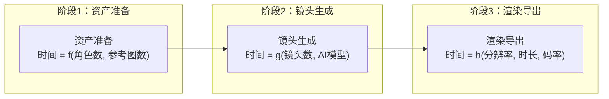

#### 自适应调整机制

系统根据实际执行时间与预测时间的偏差自动调整预测模型：

```
新预测 = 0.7 × 实际时间 + 0.3 × 原预测时间
```

**章节来源**
- [engine.ts](file://src/services/workflow/engine.ts)

### 完成镜头统计

完成镜头统计功能提供了详细的进度追踪：

#### 镜头状态跟踪

系统维护每个镜头的完整状态信息：

| 状态 | 描述 | 标识符 |
|------|------|--------|
| 待生成 | 等待生成 | pending |
| 生成中 | 正在生成 | generating |
| 已完成 | 生成成功 | completed |
| 生成失败 | 生成失败 | failed |
| 已取消 | 用户取消 | cancelled |

#### 统计指标计算

完成镜头统计包括以下关键指标：

- **总镜头数**：项目中镜头的总数
- **已完成镜头数**：状态为"已完成"的镜头数量
- **完成率**：已完成镜头数 / 总镜头数 × 100%
- **平均生成时间**：所有已完成镜头的平均生成时间
- **成功率**：成功生成的镜头数 / 总生成尝试数 × 100%

**章节来源**
- [engine.ts](file://src/services/workflow/engine.ts)

### 状态转换规则

状态转换规则定义了系统在不同条件下的状态变更逻辑：

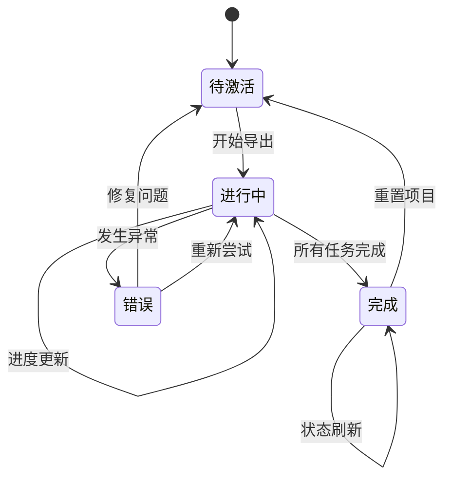

#### 转换触发条件

| 状态转换 | 触发条件 | 条件检查 |
|----------|----------|----------|
| 待激活 → 进行中 | 用户点击开始按钮 | 检查项目完整性 |
| 进行中 → 完成 | 所有任务完成且无错误 | 检查任务状态 |
| 进行中 → 错误 | 任务失败或超时 | 检查错误类型 |
| 错误 → 进行中 | 用户选择重试 | 检查重试次数限制 |

#### 状态持久化

系统支持状态的持久化存储，确保应用重启后能够恢复到正确的状态：

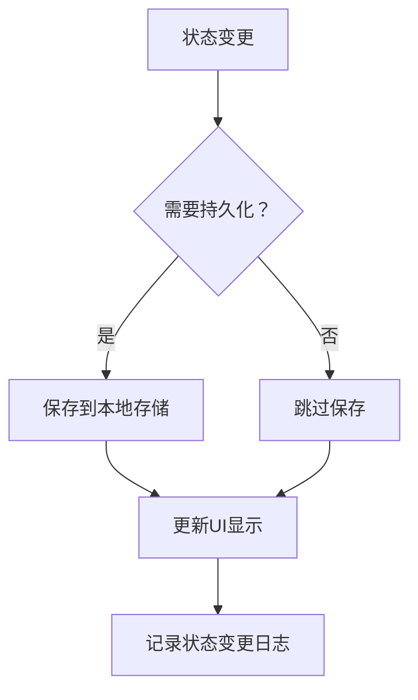

**章节来源**
- [ExportPhase.tsx](file://src/phases/export/ExportPhase.tsx)

### 错误状态处理

错误状态处理机制确保系统在异常情况下仍能保持稳定运行：

#### 错误分类体系

系统将错误分为以下几类：

| 错误类型 | 描述 | 处理策略 |
|----------|------|----------|
| 临时性错误 | 网络中断、API超时 | 自动重试 |
| 持久性错误 | 参数错误、权限不足 | 手动修复 |
| 资源错误 | 存储空间不足、内存溢出 | 系统级处理 |
| 业务错误 | 数据验证失败、业务规则违反 | 用户干预 |

#### 错误恢复机制

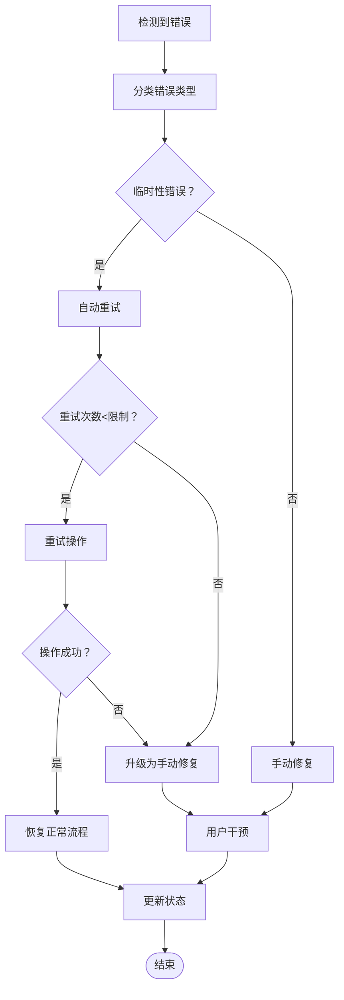

#### 错误监控和报告

系统实现了完整的错误监控机制：

- **实时监控**：所有错误事件的实时捕获
- **错误聚合**：相同错误类型的统计分析
- **告警机制**：严重错误的即时通知
- **诊断工具**：错误详情和解决方案建议

**章节来源**
- [ExportPhase.tsx](file://src/phases/export/ExportPhase.tsx)

## 依赖关系分析

导出状态管理模块的依赖关系体现了清晰的分层架构：

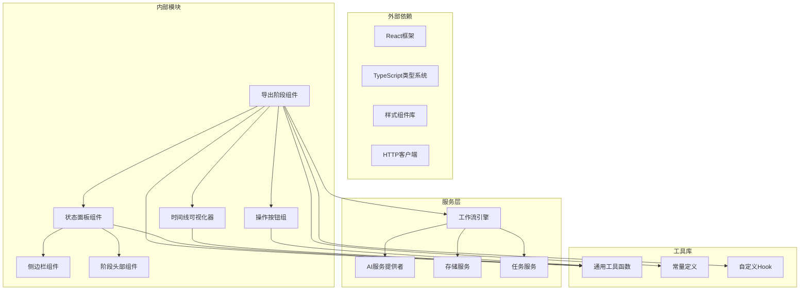

**图表来源**
- [ExportPhase.tsx](file://src/phases/export/ExportPhase.tsx)
- [Sidebar.tsx](file://src/shared/components/Sidebar.tsx)
- [PhaseHeader.tsx](file://src/shared/components/PhaseHeader.tsx)
- [engine.ts](file://src/services/workflow/engine.ts)

**章节来源**
- [ExportPhase.tsx](file://src/phases/export/ExportPhase.tsx)
- [engine.ts](file://src/services/workflow/engine.ts)

## 性能考虑

### 内存优化策略

#### 状态管理优化

系统采用了高效的内存管理模式：

- **状态分片**：将大型状态对象分割为多个小对象，减少不必要的重渲染
- **引用缓存**：对计算结果进行缓存，避免重复计算
- **垃圾回收**：及时清理不再使用的临时数据

#### 组件渲染优化

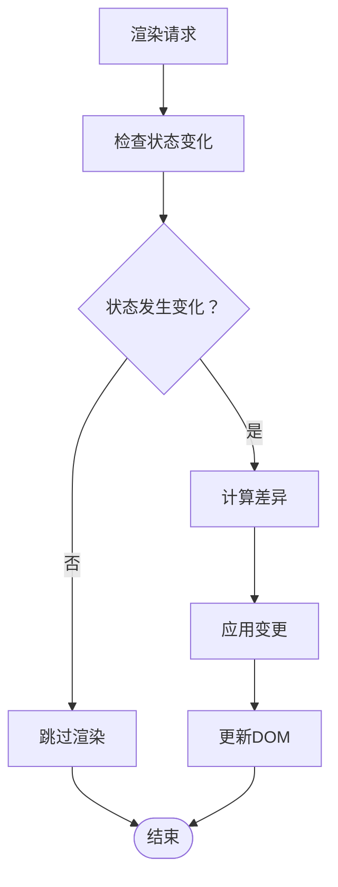

### 网络性能优化

#### 请求合并

系统实现了智能的请求合并机制：

- **批量请求**：将多个小请求合并为批量请求
- **请求去重**：避免重复发送相同的请求
- **缓存策略**：合理利用缓存减少网络请求

#### 异步处理

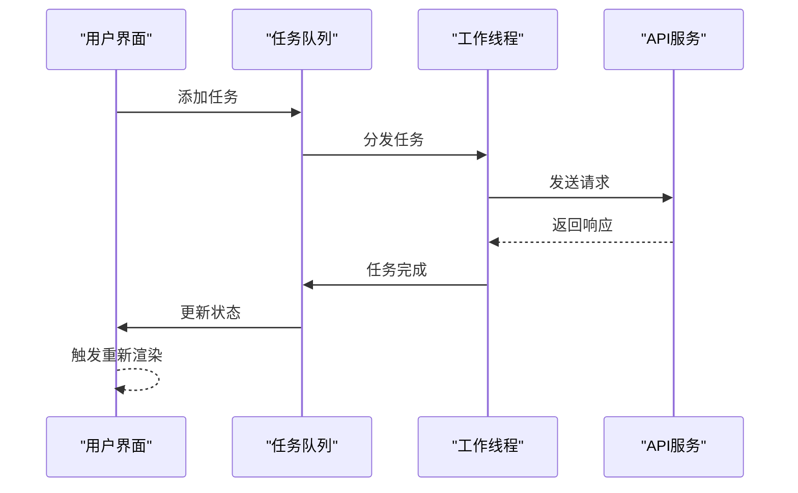

### 计算性能优化

#### 并行计算

系统支持多任务并行处理：

- **CPU密集型任务**：使用Web Workers避免阻塞主线程
- **I/O密集型任务**：使用异步操作提高效率
- **缓存策略**：对昂贵的计算结果进行缓存

#### 算法优化

进度计算采用了优化的算法：

- **增量计算**：只计算变化的部分，而不是重新计算全部
- **近似算法**：在保证精度的前提下使用更快的算法
- **预计算**：提前计算可能需要的数据

## 故障排除指南

### 常见问题诊断

#### 进度停滞问题

**症状**：进度条长时间不变化

**诊断步骤**：
1. 检查网络连接状态
2. 查看是否有正在进行的任务
3. 验证AI服务的可用性
4. 检查存储空间是否充足

**解决方案**：
- 重新建立网络连接
- 取消并重新启动卡住的任务
- 检查并修复AI服务配置
- 清理存储空间

#### 状态显示异常

**症状**：状态徽章显示不正确

**诊断步骤**：
1. 检查状态计算逻辑
2. 验证状态转换规则
3. 确认UI组件的渲染逻辑

**解决方案**：
- 修复状态计算算法
- 更新状态转换条件
- 修正UI渲染逻辑

#### 时间预测不准确

**症状**：剩余时间预测与实际不符

**诊断步骤**：
1. 检查历史数据的准确性
2. 验证预测算法的参数
3. 确认当前负载情况

**解决方案**：
- 更新历史统计数据
- 调整预测算法参数
- 考虑当前系统负载影响

### 调试工具使用

#### 状态监控

系统提供了内置的调试工具：

- **状态检查器**：实时显示当前状态和历史状态
- **性能分析器**：监控组件渲染性能
- **网络监控器**：跟踪API调用和响应时间

#### 日志分析

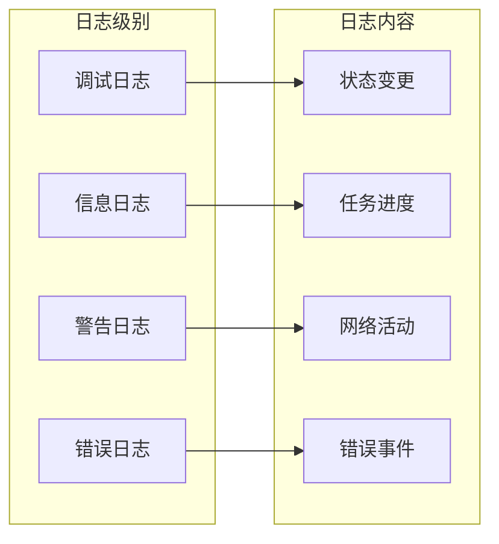

**章节来源**
- [ExportPhase.tsx](file://src/phases/export/ExportPhase.tsx)

## 结论

导出状态管理模块通过精心设计的架构和算法，为用户提供了准确、实时的进度反馈。模块的核心优势包括：

1. **精确的进度计算**：基于多维度算法的准确进度评估
2. **直观的UI展示**：清晰的状态面板和进度条设计
3. **智能的时间预测**：自适应的时间预测算法
4. **完善的错误处理**：健壮的错误恢复机制
5. **优秀的性能表现**：优化的渲染和计算策略

该模块的成功实施为整个AI视频生成工作流提供了可靠的状态管理基础，确保用户能够获得流畅、透明的使用体验。通过持续的优化和改进，该模块将继续提升用户体验并支持更复杂的功能需求。