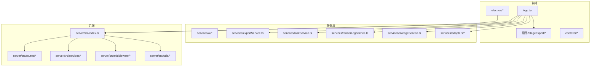
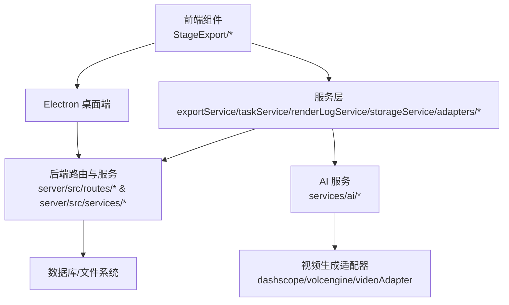
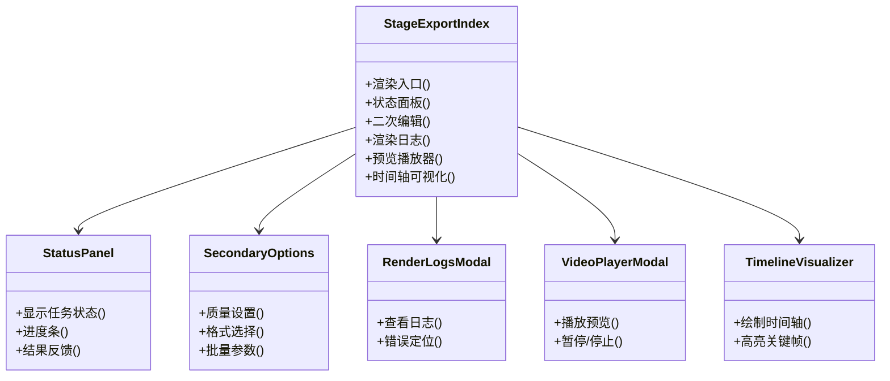
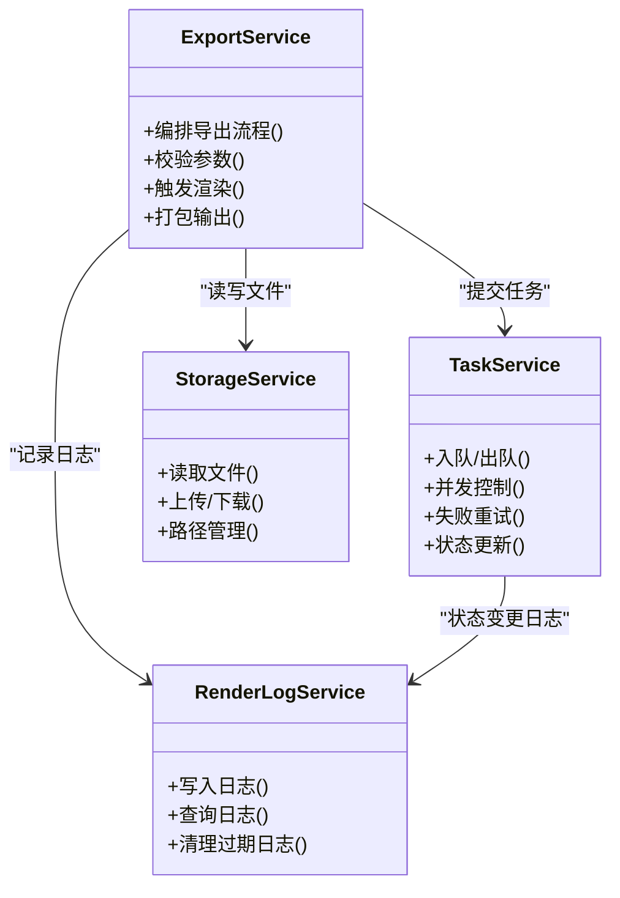
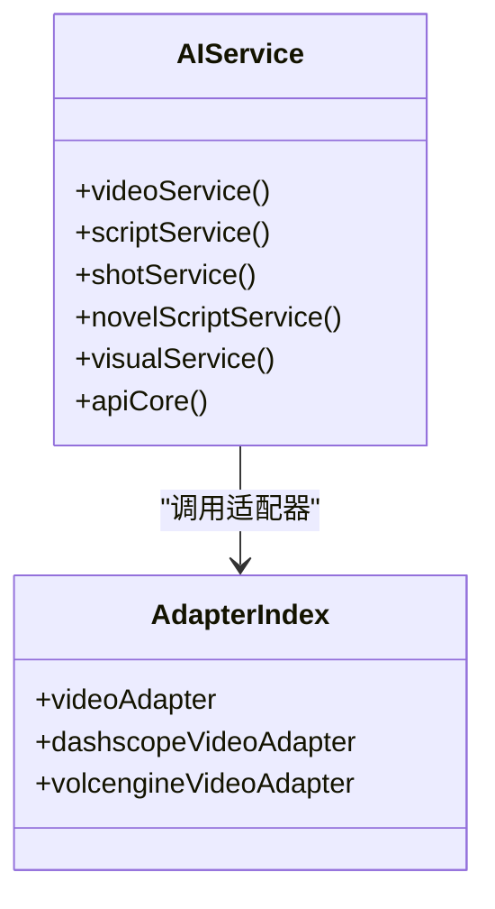
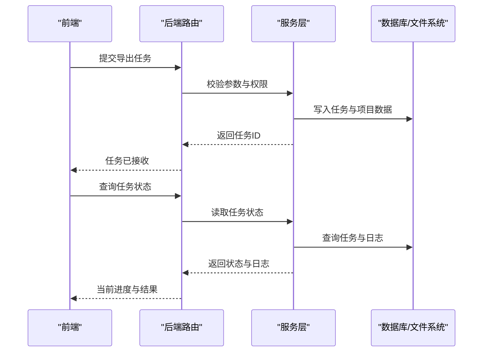
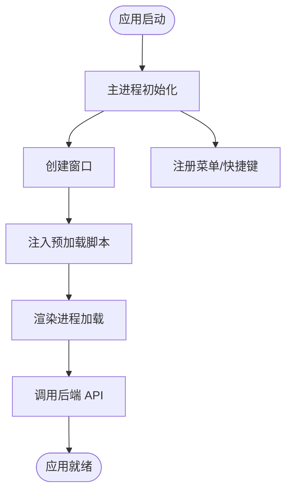
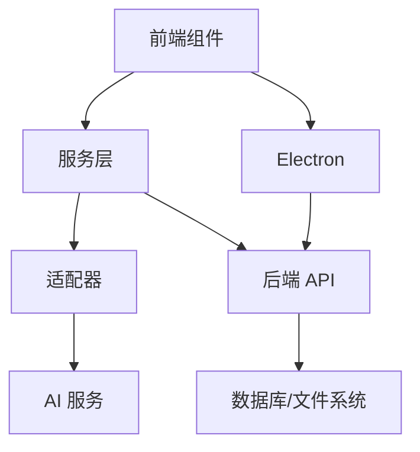

# 成片导出系统

<cite>
**本文档引用的文件**
- [App.tsx](file://App.tsx)
- [README.md](file://README.md)
- [README_EN.md](file://README_EN.md)
- [package.json](file://package.json)
- [tsconfig.json](file://tsconfig.json)
- [vite.config.ts](file://vite.config.ts)
- [electron/main.ts](file://electron/main.ts)
- [electron/preload.ts](file://electron/preload.ts)
- [server/src/index.ts](file://server/src/index.ts)
- [server/src/proxy.ts](file://server/src/proxy.ts)
- [server/src/middleware/auth.ts](file://server/src/middleware/auth.ts)
- [server/src/routes/projects.ts](file://server/src/routes/projects.ts)
- [server/src/routes/tasks.ts](file://server/src/routes/tasks.ts)
- [server/src/routes/dataTransfer.ts](file://server/src/routes/dataTransfer.ts)
- [server/src/services/projectStorage.ts](file://server/src/services/projectStorage.ts)
- [server/src/services/scriptParser.ts](file://server/src/services/scriptParser.ts)
- [server/src/utils/projectMutex.ts](file://server/src/utils/projectMutex.ts)
- [components/StageExport/index.tsx](file://components/StageExport/index.tsx)
- [components/StageExport/ActionButtons.tsx](file://components/StageExport/ActionButtons.tsx)
- [components/StageExport/StatusPanel.tsx](file://components/StageExport/StatusPanel.tsx)
- [components/StageExport/SecondaryOptions.tsx](file://components/StageExport/SecondaryOptions.tsx)
- [components/StageExport/RenderLogsModal.tsx](file://components/StageExport/RenderLogsModal.tsx)
- [components/StageExport/VideoPlayerModal.tsx](file://components/StageExport/VideoPlayerModal.tsx)
- [components/StageExport/TimelineVisualizer.tsx](file://components/StageExport/TimelineVisualizer.tsx)
- [components/StageExport/constants.ts](file://components/StageExport/constants.ts)
- [components/StageExport/utils.ts](file://components/StageExport/utils.ts)
- [services/exportService.ts](file://services/exportService.ts)
- [services/taskService.ts](file://services/taskService.ts)
- [services/renderLogService.ts](file://services/renderLogService.ts)
- [services/storageService.ts](file://services/storageService.ts)
- [services/adapters/index.ts](file://services/adapters/index.ts)
- [services/adapters/videoAdapter.ts](file://services/adapters/videoAdapter.ts)
- [services/adapters/dashscopeVideoAdapter.ts](file://services/adapters/dashscopeVideoAdapter.ts)
- [services/adapters/volcengineVideoAdapter.ts](file://services/adapters/volcengineVideoAdapter.ts)
- [services/ai/index.ts](file://services/ai/index.ts)
- [services/ai/videoService.ts](file://services/ai/videoService.ts)
- [services/ai/scriptService.ts](file://services/ai/scriptService.ts)
- [services/ai/shotService.ts](file://services/ai/shotService.ts)
- [services/ai/novelScriptService.ts](file://services/ai/novelScriptService.ts)
- [services/ai/visualService.ts](file://services/ai/visualService.ts)
- [services/ai/apiCore.ts](file://services/ai/apiCore.ts)
- [contexts/AuthContext.tsx](file://contexts/AuthContext.tsx)
- [contexts/ThemeContext.tsx](file://contexts/ThemeContext.tsx)
</cite>

## 目录
1. [简介](#简介)
2. [项目结构](#项目结构)
3. [核心组件](#核心组件)
4. [架构总览](#架构总览)
5. [详细组件分析](#详细组件分析)
6. [依赖关系分析](#依赖关系分析)
7. [性能考虑](#性能考虑)
8. [故障排查指南](#故障排查指南)
9. [结论](#结论)
10. [附录](#附录)

## 简介
本系统是一个面向视频内容创作与导出的全栈应用，涵盖视频剪辑、字幕生成、音频处理、导出管理等核心功能。系统采用前端 React/Vite + Electron 桌面封装，后端 Node.js + 路由与服务层，配合任务调度与渲染日志管理，支撑从脚本解析到最终视频导出的完整工作流。同时提供时间轴可视化、预览播放器、二次编辑选项、质量控制等用户界面能力，并通过适配器模式对接多家视频生成服务，支持多格式导出与云端存储。

## 项目结构
项目采用前后端分离与模块化组织方式：
- 前端：React 组件、上下文、样式与构建配置
- 服务层：AI 服务、导出服务、任务服务、渲染日志服务、存储服务、适配器
- 后端：路由、中间件、数据库配置与工具
- 桌面端：Electron 主进程与预加载脚本
- 构建与部署：Vite 配置、Docker 与 docker-compose

**图表来源**
- [App.tsx](file://App.tsx)
- [components/StageExport/index.tsx](file://components/StageExport/index.tsx)
- [services/exportService.ts](file://services/exportService.ts)
- [services/taskService.ts](file://services/taskService.ts)
- [services/renderLogService.ts](file://services/renderLogService.ts)
- [services/storageService.ts](file://services/storageService.ts)
- [services/adapters/index.ts](file://services/adapters/index.ts)
- [server/src/index.ts](file://server/src/index.ts)
- [server/src/routes/projects.ts](file://server/src/routes/projects.ts)
- [server/src/routes/tasks.ts](file://server/src/routes/tasks.ts)
- [server/src/services/projectStorage.ts](file://server/src/services/projectStorage.ts)
- [server/src/utils/projectMutex.ts](file://server/src/utils/projectMutex.ts)
- [electron/main.ts](file://electron/main.ts)

**章节来源**
- [App.tsx](file://App.tsx)
- [README.md](file://README.md)
- [README_EN.md](file://README_EN.md)
- [package.json](file://package.json)
- [tsconfig.json](file://tsconfig.json)
- [vite.config.ts](file://vite.config.ts)
- [electron/main.ts](file://electron/main.ts)
- [electron/preload.ts](file://electron/preload.ts)
- [server/src/index.ts](file://server/src/index.ts)
- [server/src/proxy.ts](file://server/src/proxy.ts)

## 核心组件
- 导出工作台（StageExport）：提供导出入口、状态面板、二次编辑选项、渲染日志、预览播放器与时间轴可视化。
- 服务层：导出服务负责导出流程编排；任务服务负责任务队列与执行；渲染日志服务负责记录与查询渲染过程；存储服务负责本地/云端文件存取；适配器对接多家视频生成服务。
- 后端服务：路由与中间件提供认证与数据接口；项目存储与脚本解析服务支撑项目数据管理；项目互斥锁保障并发安全。
- 桌面端：Electron 主进程与预加载脚本提供桌面应用能力与安全桥接。

**章节来源**
- [components/StageExport/index.tsx](file://components/StageExport/index.tsx)
- [components/StageExport/StatusPanel.tsx](file://components/StageExport/StatusPanel.tsx)
- [components/StageExport/SecondaryOptions.tsx](file://components/StageExport/SecondaryOptions.tsx)
- [components/StageExport/RenderLogsModal.tsx](file://components/StageExport/RenderLogsModal.tsx)
- [components/StageExport/VideoPlayerModal.tsx](file://components/StageExport/VideoPlayerModal.tsx)
- [components/StageExport/TimelineVisualizer.tsx](file://components/StageExport/TimelineVisualizer.tsx)
- [services/exportService.ts](file://services/exportService.ts)
- [services/taskService.ts](file://services/taskService.ts)
- [services/renderLogService.ts](file://services/renderLogService.ts)
- [services/storageService.ts](file://services/storageService.ts)
- [services/adapters/index.ts](file://services/adapters/index.ts)
- [server/src/routes/projects.ts](file://server/src/routes/projects.ts)
- [server/src/routes/tasks.ts](file://server/src/routes/tasks.ts)
- [server/src/services/projectStorage.ts](file://server/src/services/projectStorage.ts)
- [server/src/utils/projectMutex.ts](file://server/src/utils/projectMutex.ts)
- [electron/main.ts](file://electron/main.ts)

## 架构总览
系统采用“前端组件 + 服务层 + 后端 API + 适配器”的分层架构。前端通过服务层调用后端接口与执行导出任务；后端路由与服务层提供项目管理、任务调度与数据持久化；适配器层抽象多家视频生成服务，便于扩展与切换；桌面端提供本地运行环境与安全沙箱。

**图表来源**
- [components/StageExport/index.tsx](file://components/StageExport/index.tsx)
- [services/exportService.ts](file://services/exportService.ts)
- [services/taskService.ts](file://services/taskService.ts)
- [services/renderLogService.ts](file://services/renderLogService.ts)
- [services/storageService.ts](file://services/storageService.ts)
- [services/adapters/index.ts](file://services/adapters/index.ts)
- [services/ai/index.ts](file://services/ai/index.ts)
- [server/src/routes/projects.ts](file://server/src/routes/projects.ts)
- [server/src/routes/tasks.ts](file://server/src/routes/tasks.ts)
- [server/src/services/projectStorage.ts](file://server/src/services/projectStorage.ts)
- [electron/main.ts](file://electron/main.ts)

## 详细组件分析

### 导出工作台（StageExport）
- 入口组件负责聚合导出相关 UI 与交互逻辑。
- 状态面板展示当前导出任务状态、进度与结果。
- 二次编辑选项允许调整导出参数（如分辨率、码率、格式等）。
- 渲染日志弹窗用于查看详细日志与错误信息。
- 预览播放器提供导出前的快速预览。
- 时间轴可视化帮助用户直观了解片段与关键帧分布。

**图表来源**
- [components/StageExport/index.tsx](file://components/StageExport/index.tsx)
- [components/StageExport/StatusPanel.tsx](file://components/StageExport/StatusPanel.tsx)
- [components/StageExport/SecondaryOptions.tsx](file://components/StageExport/SecondaryOptions.tsx)
- [components/StageExport/RenderLogsModal.tsx](file://components/StageExport/RenderLogsModal.tsx)
- [components/StageExport/VideoPlayerModal.tsx](file://components/StageExport/VideoPlayerModal.tsx)
- [components/StageExport/TimelineVisualizer.tsx](file://components/StageExport/TimelineVisualizer.tsx)

**章节来源**
- [components/StageExport/index.tsx](file://components/StageExport/index.tsx)
- [components/StageExport/StatusPanel.tsx](file://components/StageExport/StatusPanel.tsx)
- [components/StageExport/SecondaryOptions.tsx](file://components/StageExport/SecondaryOptions.tsx)
- [components/StageExport/RenderLogsModal.tsx](file://components/StageExport/RenderLogsModal.tsx)
- [components/StageExport/VideoPlayerModal.tsx](file://components/StageExport/VideoPlayerModal.tsx)
- [components/StageExport/TimelineVisualizer.tsx](file://components/StageExport/TimelineVisualizer.tsx)
- [components/StageExport/constants.ts](file://components/StageExport/constants.ts)
- [components/StageExport/utils.ts](file://components/StageExport/utils.ts)

### 服务层（导出、任务、日志、存储）
- 导出服务：协调导出流程，整合脚本解析、素材准备、渲染与打包。
- 任务服务：维护导出任务队列，处理优先级、并发与重试。
- 渲染日志服务：记录渲染阶段日志，支持查询与过滤。
- 存储服务：统一文件读写与上传下载，支持本地与云端存储抽象。

**图表来源**
- [services/exportService.ts](file://services/exportService.ts)
- [services/taskService.ts](file://services/taskService.ts)
- [services/renderLogService.ts](file://services/renderLogService.ts)
- [services/storageService.ts](file://services/storageService.ts)

**章节来源**
- [services/exportService.ts](file://services/exportService.ts)
- [services/taskService.ts](file://services/taskService.ts)
- [services/renderLogService.ts](file://services/renderLogService.ts)
- [services/storageService.ts](file://services/storageService.ts)

### AI 服务与适配器
- AI 服务：提供视频生成、脚本解析、镜头规划、视觉风格等能力。
- 适配器：以统一接口对接多家视频生成平台（如 DashScope、火山引擎），便于替换与扩展。

**图表来源**
- [services/ai/index.ts](file://services/ai/index.ts)
- [services/ai/videoService.ts](file://services/ai/videoService.ts)
- [services/ai/scriptService.ts](file://services/ai/scriptService.ts)
- [services/ai/shotService.ts](file://services/ai/shotService.ts)
- [services/ai/novelScriptService.ts](file://services/ai/novelScriptService.ts)
- [services/ai/visualService.ts](file://services/ai/visualService.ts)
- [services/ai/apiCore.ts](file://services/ai/apiCore.ts)
- [services/adapters/index.ts](file://services/adapters/index.ts)
- [services/adapters/videoAdapter.ts](file://services/adapters/videoAdapter.ts)
- [services/adapters/dashscopeVideoAdapter.ts](file://services/adapters/dashscopeVideoAdapter.ts)
- [services/adapters/volcengineVideoAdapter.ts](file://services/adapters/volcengineVideoAdapter.ts)

**章节来源**
- [services/ai/index.ts](file://services/ai/index.ts)
- [services/ai/videoService.ts](file://services/ai/videoService.ts)
- [services/ai/scriptService.ts](file://services/ai/scriptService.ts)
- [services/ai/shotService.ts](file://services/ai/shotService.ts)
- [services/ai/novelScriptService.ts](file://services/ai/novelScriptService.ts)
- [services/ai/visualService.ts](file://services/ai/visualService.ts)
- [services/ai/apiCore.ts](file://services/ai/apiCore.ts)
- [services/adapters/index.ts](file://services/adapters/index.ts)
- [services/adapters/videoAdapter.ts](file://services/adapters/videoAdapter.ts)
- [services/adapters/dashscopeVideoAdapter.ts](file://services/adapters/dashscopeVideoAdapter.ts)
- [services/adapters/volcengineVideoAdapter.ts](file://services/adapters/volcengineVideoAdapter.ts)

### 后端 API 与数据管理
- 路由：提供项目、任务、数据传输等接口。
- 中间件：认证与权限控制。
- 服务：项目存储、脚本解析、任务执行等。
- 工具：项目互斥锁保障并发安全。

**图表来源**
- [server/src/routes/tasks.ts](file://server/src/routes/tasks.ts)
- [server/src/routes/projects.ts](file://server/src/routes/projects.ts)
- [server/src/services/projectStorage.ts](file://server/src/services/projectStorage.ts)
- [server/src/utils/projectMutex.ts](file://server/src/utils/projectMutex.ts)

**章节来源**
- [server/src/routes/tasks.ts](file://server/src/routes/tasks.ts)
- [server/src/routes/projects.ts](file://server/src/routes/projects.ts)
- [server/src/services/projectStorage.ts](file://server/src/services/projectStorage.ts)
- [server/src/utils/projectMutex.ts](file://server/src/utils/projectMutex.ts)
- [server/src/middleware/auth.ts](file://server/src/middleware/auth.ts)

### 桌面端集成（Electron）
- 主进程：应用生命周期、窗口管理、菜单与系统集成。
- 预加载脚本：提供安全的渲染进程 API 桥接，限制访问范围。

**图表来源**
- [electron/main.ts](file://electron/main.ts)
- [electron/preload.ts](file://electron/preload.ts)

**章节来源**
- [electron/main.ts](file://electron/main.ts)
- [electron/preload.ts](file://electron/preload.ts)

## 依赖关系分析
- 前端依赖：React 生态、UI 库、构建工具与 Electron 打包。
- 服务层依赖：适配器与 AI 服务，以及后端 API 的契约。
- 后端依赖：数据库与文件系统、路由与中间件、工具类。
- 适配器依赖：第三方视频生成平台 SDK 或 API。

**图表来源**
- [App.tsx](file://App.tsx)
- [services/adapters/index.ts](file://services/adapters/index.ts)
- [services/ai/index.ts](file://services/ai/index.ts)
- [server/src/index.ts](file://server/src/index.ts)

**章节来源**
- [package.json](file://package.json)
- [vite.config.ts](file://vite.config.ts)
- [tsconfig.json](file://tsconfig.json)

## 性能考虑
- 并发与队列：任务服务应限制并发度，避免资源争用；对耗时操作进行异步化与分片处理。
- 缓存与复用：渲染日志与中间产物可缓存，减少重复计算；预览播放器采用渐进式加载。
- 存储优化：大文件采用分块上传与断点续传；本地临时文件定期清理。
- 适配器抽象：通过统一接口屏蔽平台差异，便于按需扩展与切换。
- 前端渲染：时间轴可视化与预览播放器应避免主线程阻塞，使用 Web Workers 或请求动画帧。

[本节为通用性能建议，不直接分析具体文件，故无章节来源]

## 故障排查指南
- 认证与权限：检查后端中间件与路由权限配置，确认 Token 有效性与作用域。
- 任务状态异常：通过渲染日志服务查看详细日志，定位失败节点与错误码。
- 文件读写问题：核对存储服务路径与权限，确认临时目录与持久化目录配置。
- 并发冲突：检查项目互斥锁是否正确加锁与释放，避免竞态条件。
- 适配器调用失败：验证第三方平台密钥与网络连通性，查看适配器返回码与超时设置。

**章节来源**
- [server/src/middleware/auth.ts](file://server/src/middleware/auth.ts)
- [server/src/utils/projectMutex.ts](file://server/src/utils/projectMutex.ts)
- [services/renderLogService.ts](file://services/renderLogService.ts)
- [services/storageService.ts](file://services/storageService.ts)
- [services/adapters/index.ts](file://services/adapters/index.ts)

## 结论
本系统通过清晰的分层架构与模块化设计，实现了从脚本解析到视频导出的完整链路。前端导出工作台提供直观的交互体验，服务层与后端 API 支撑稳定的任务编排与数据管理，适配器模式确保了对外部服务的灵活接入。结合并发控制、日志体系与存储优化，系统在可用性与可扩展性方面具备良好基础。

## 附录
- 操作指南（示例）
  - 导出配置：在二次编辑选项中设置分辨率、码率与输出格式，保存为模板以便批量使用。
  - 质量控制：通过时间轴可视化核对关键帧与片段边界，预览播放器快速验证效果。
  - 批量处理：在任务服务中批量提交导出任务，利用队列管理器自动调度。
  - 云端存储：在存储服务中配置对象存储参数，导出完成后自动上传并生成外链。

[本节为概念性操作说明，不直接分析具体文件，故无章节来源]