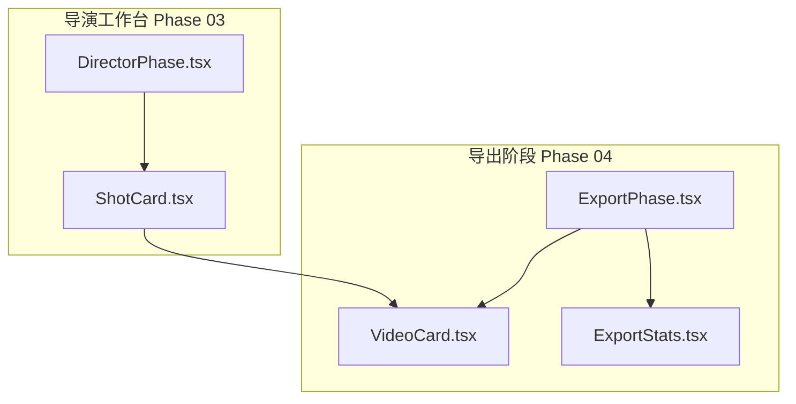
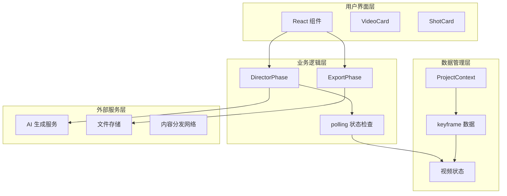
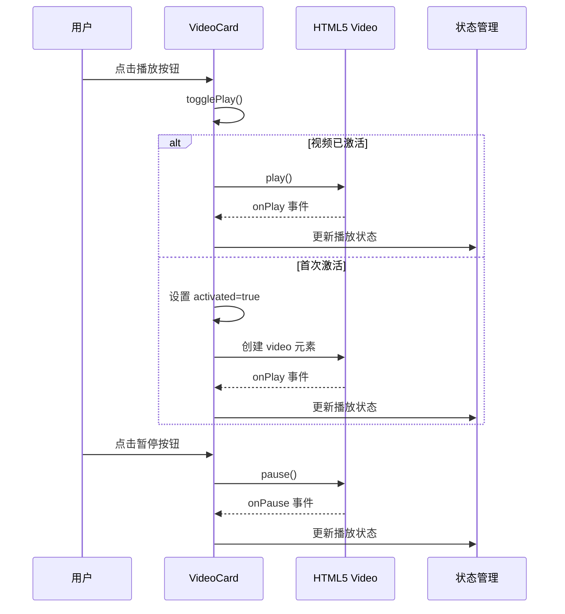
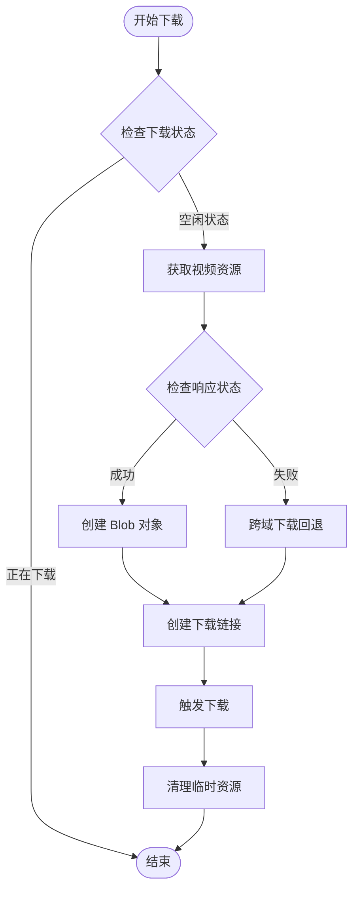
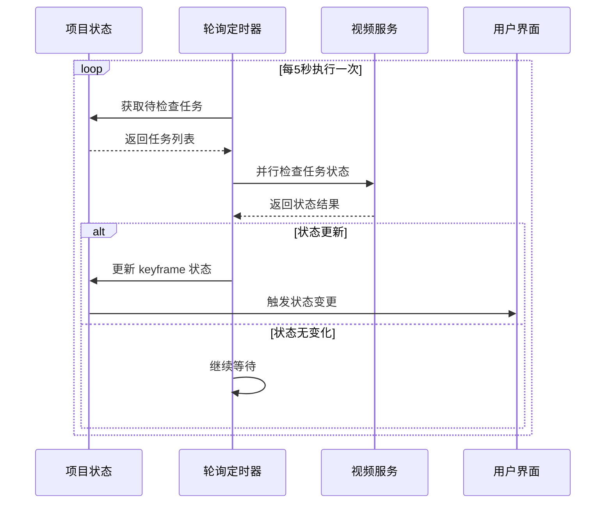
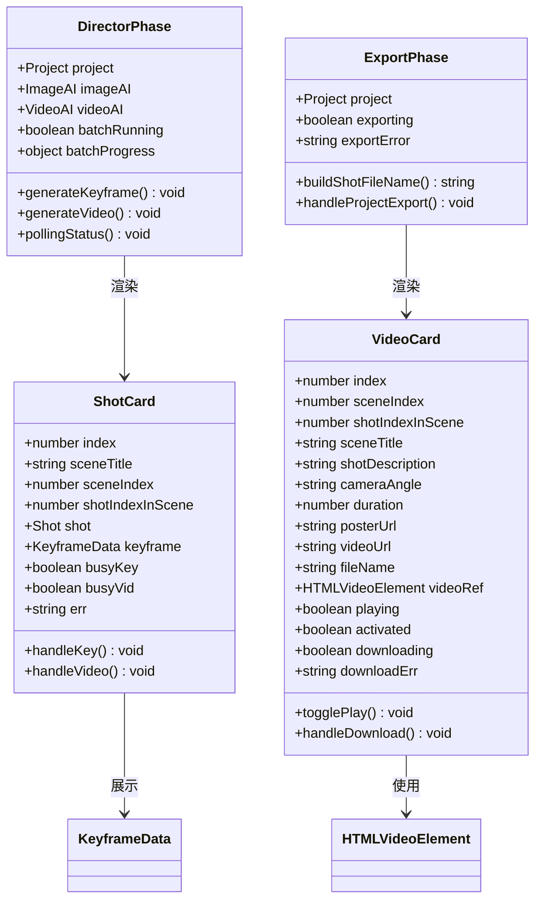
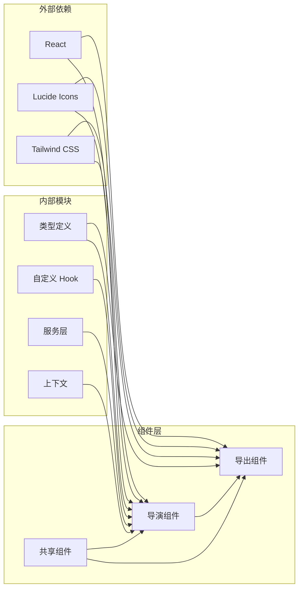

# 时间轴预览系统

<cite>
**本文档引用的文件**
- [VideoCard.tsx](file://src/phases/export/components/VideoCard.tsx)
- [ShotCard.tsx](file://src/phases/director/components/ShotCard.tsx)
- [ExportPhase.tsx](file://src/phases/export/ExportPhase.tsx)
- [DirectorPhase.tsx](file://src/phases/director/DirectorPhase.tsx)
- [ExportStats.tsx](file://src/phases/export/components/ExportStats.tsx)
</cite>

## 目录
1. [简介](#简介)
2. [项目结构](#项目结构)
3. [核心组件](#核心组件)
4. [架构概览](#架构概览)
5. [详细组件分析](#详细组件分析)
6. [依赖关系分析](#依赖关系分析)
7. [性能考虑](#性能考虑)
8. [故障排除指南](#故障排除指南)
9. [结论](#结论)

## 简介

时间轴预览系统是 AI 影视制作工作流中的关键组件，负责将生成的视频片段以时间轴的形式进行可视化展示和交互控制。该系统实现了完整的视频预览、播放控制、下载管理和状态同步功能，为用户提供直观的时间轴浏览体验。

系统采用 React 组件化架构，通过状态管理实现视频片段的实时更新和用户交互响应。核心功能包括视频片段的内嵌播放、批量下载、状态指示、播放进度显示等特性。

## 项目结构

时间轴预览系统主要分布在两个相位中：

**图表来源**
- [DirectorPhase.tsx:1-624](file://src/phases/director/DirectorPhase.tsx#L1-L624)
- [ExportPhase.tsx:1-409](file://src/phases/export/ExportPhase.tsx#L1-L409)

**章节来源**
- [DirectorPhase.tsx:1-624](file://src/phases/director/DirectorPhase.tsx#L1-L624)
- [ExportPhase.tsx:1-409](file://src/phases/export/ExportPhase.tsx#L1-L409)

## 核心组件

### 视频片段卡片组件

VideoCard.tsx 是导出阶段的核心组件，负责单个视频片段的展示和控制：

- **播放控制**：内嵌 HTML5 视频播放器，支持播放/暂停操作
- **预览功能**：支持海报图预览和首帧预览
- **下载管理**：提供片段级下载功能，支持跨域回退机制
- **状态指示**：实时显示播放状态和下载进度

### 镜头卡片组件

ShotCard.tsx 是导演工作台的核心组件，负责镜头的预览和操作：

- **状态管理**：跟踪镜头的生成状态（未开拍、渲染中、已完成）
- **预览功能**：显示首帧图片和生成的视频
- **操作控制**：提供首帧生成和视频拍摄按钮
- **视觉反馈**：通过颜色和动画指示不同状态

**章节来源**
- [VideoCard.tsx:1-285](file://src/phases/export/components/VideoCard.tsx#L1-L285)
- [ShotCard.tsx:1-308](file://src/phases/director/components/ShotCard.tsx#L1-L308)

## 架构概览

系统采用分层架构设计，实现了清晰的功能分离：

**图表来源**
- [DirectorPhase.tsx:191-247](file://src/phases/director/DirectorPhase.tsx#L191-L247)
- [ExportPhase.tsx:87-121](file://src/phases/export/ExportPhase.tsx#L87-L121)

系统的核心交互流程包括：

1. **状态同步**：通过轮询机制定期检查视频生成状态
2. **用户交互**：响应用户的播放、暂停、下载等操作
3. **数据更新**：实时更新项目状态和 UI 显示
4. **资源管理**：合理管理内存和网络资源

## 详细组件分析

### 视频播放器实现

VideoCard 组件实现了完整的视频播放功能：

**图表来源**
- [VideoCard.tsx:41-56](file://src/phases/export/components/VideoCard.tsx#L41-L56)
- [VideoCard.tsx:114-115](file://src/phases/export/components/VideoCard.tsx#L114-L115)

### 下载管理系统

VideoCard 实现了智能的下载管理机制：

**图表来源**
- [VideoCard.tsx:58-92](file://src/phases/export/components/VideoCard.tsx#L58-L92)

### 状态同步机制

DirectorPhase 实现了视频状态的实时同步：

**图表来源**
- [DirectorPhase.tsx:191-247](file://src/phases/director/DirectorPhase.tsx#L191-L247)

**章节来源**
- [VideoCard.tsx:1-285](file://src/phases/export/components/VideoCard.tsx#L1-L285)
- [DirectorPhase.tsx:191-247](file://src/phases/director/DirectorPhase.tsx#L191-L247)

### 组件类关系图

**图表来源**
- [VideoCard.tsx:10-34](file://src/phases/export/components/VideoCard.tsx#L10-L34)
- [ShotCard.tsx:11-31](file://src/phases/director/components/ShotCard.tsx#L11-L31)
- [DirectorPhase.tsx:62-108](file://src/phases/director/DirectorPhase.tsx#L62-L108)
- [ExportPhase.tsx:82-85](file://src/phases/export/ExportPhase.tsx#L82-L85)

## 依赖关系分析

系统各组件之间的依赖关系如下：

**图表来源**
- [DirectorPhase.tsx:13-27](file://src/phases/director/DirectorPhase.tsx#L13-L27)
- [ExportPhase.tsx:8-21](file://src/phases/export/ExportPhase.tsx#L8-L21)

**章节来源**
- [DirectorPhase.tsx:13-27](file://src/phases/director/DirectorPhase.tsx#L13-L27)
- [ExportPhase.tsx:8-21](file://src/phases/export/ExportPhase.tsx#L8-L21)

## 性能考虑

### 内存管理优化

系统实现了多项内存管理策略：

- **对象 URL 清理**：下载完成后及时释放 Blob URL
- **条件渲染**：仅在需要时创建视频元素
- **状态缓存**：避免不必要的重新计算和渲染

### 网络优化

- **并行请求**：状态轮询采用并行处理提高效率
- **跨域回退**：下载失败时自动切换到直接下载模式
- **预加载策略**：使用 metadata 预加载减少首帧延迟

### 用户体验优化

- **乐观更新**：立即更新 UI 状态提升响应感
- **错误隔离**：单个镜头失败不影响整体操作
- **进度反馈**：批量操作提供详细的进度指示

## 故障排除指南

### 常见问题及解决方案

**播放问题**
- 检查视频格式兼容性
- 验证网络连接状态
- 确认浏览器权限设置

**下载问题**
- 检查跨域访问权限
- 验证服务器响应状态
- 确认磁盘空间充足

**状态同步问题**
- 检查轮询间隔设置
- 验证 API 密钥配置
- 确认任务 ID 有效性

**章节来源**
- [VideoCard.tsx:58-92](file://src/phases/export/components/VideoCard.tsx#L58-L92)
- [DirectorPhase.tsx:191-247](file://src/phases/director/DirectorPhase.tsx#L191-L247)

## 结论

时间轴预览系统通过精心设计的组件架构和状态管理机制，实现了高效的视频片段预览和交互控制功能。系统具备以下优势：

1. **模块化设计**：清晰的组件分离便于维护和扩展
2. **实时同步**：通过轮询机制确保状态的及时更新
3. **用户体验**：流畅的交互和完善的错误处理
4. **性能优化**：合理的资源管理和内存控制

该系统为 AI 影视制作提供了强大的时间轴预览能力，支持从镜头生成到最终导出的完整工作流程。