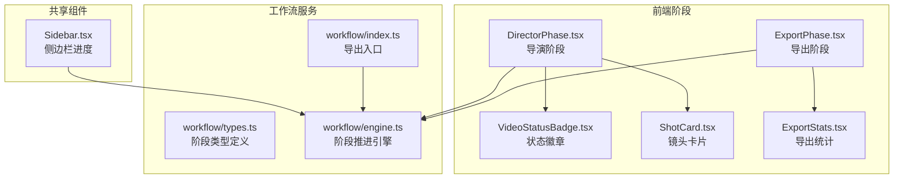
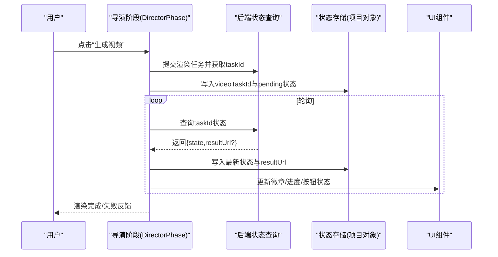
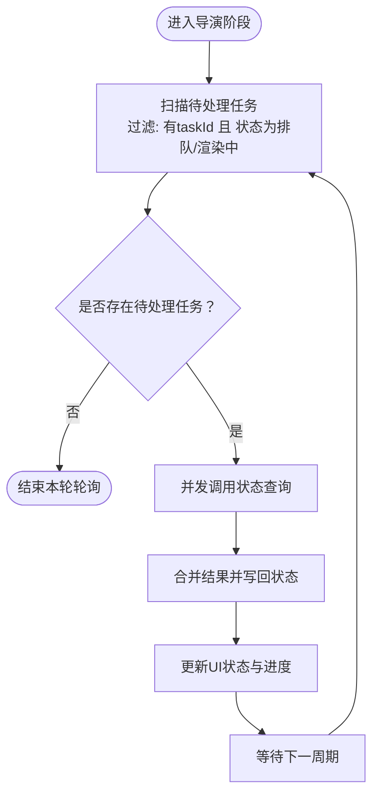
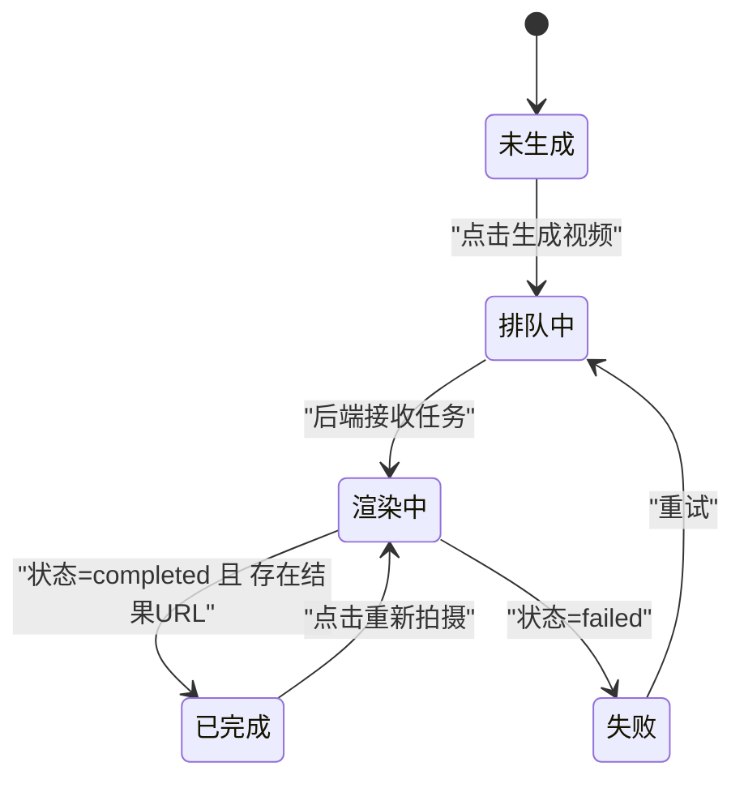
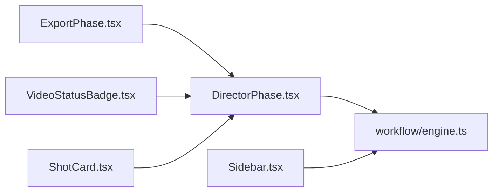

# 渲染控制系统

<cite>
**本文引用的文件**
- [DirectorPhase.tsx](file://src/phases/director/DirectorPhase.tsx)
- [VideoStatusBadge.tsx](file://src/phases/director/components/VideoStatusBadge.tsx)
- [ShotCard.tsx](file://src/phases/director/components/ShotCard.tsx)
- [ExportPhase.tsx](file://src/phases/export/ExportPhase.tsx)
- [ExportStats.tsx](file://src/phases/export/components/ExportStats.tsx)
- [Sidebar.tsx](file://src/shared/components/Sidebar.tsx)
- [workflow/types.ts](file://src/services/workflow/types.ts)
- [workflow/engine.ts](file://src/services/workflow/engine.ts)
- [index.ts](file://src/services/workflow/index.ts)
</cite>

## 目录
1. [简介](#简介)
2. [项目结构](#项目结构)
3. [核心组件](#核心组件)
4. [架构总览](#架构总览)
5. [详细组件分析](#详细组件分析)
6. [依赖关系分析](#依赖关系分析)
7. [性能考虑](#性能考虑)
8. [故障排查指南](#故障排查指南)
9. [结论](#结论)
10. [附录](#附录)

## 简介
本文件为“渲染控制系统”的技术文档，聚焦于主视频生成、源资源准备、渲染队列管理、并发控制、渲染按钮状态管理、下载进度跟踪、错误重试与超时处理、渲染日志与错误分类、状态同步与用户反馈、渲染优先级、资源清理与内存管理、性能监控等主题。系统采用前后端分离架构，前端通过阶段化工作流驱动渲染流程，后端提供任务状态查询与数据持久化能力。

## 项目结构
渲染控制涉及前端阶段组件与工作流服务，以及共享的侧边栏进度展示。核心模块包括：
- 导演阶段（Director）：负责单镜头视频生成触发、状态轮询与UI反馈
- 导出阶段（Export）：负责渲染统计、场景分组与结果汇总
- 工作流服务：定义阶段推进规则与阶段状态计算
- 共享组件：侧边栏进度条与阶段徽章

图表来源
- [DirectorPhase.tsx:202-238](file://src/phases/director/DirectorPhase.tsx#L202-L238)
- [ExportPhase.tsx:87-130](file://src/phases/export/ExportPhase.tsx#L87-L130)
- [VideoStatusBadge.tsx:1-80](file://src/phases/director/components/VideoStatusBadge.tsx#L1-L80)
- [ShotCard.tsx:232-265](file://src/phases/director/components/ShotCard.tsx#L232-L265)
- [ExportStats.tsx:34-145](file://src/phases/export/components/ExportStats.tsx#L34-L145)
- [workflow/types.ts:1-20](file://src/services/workflow/types.ts#L1-L20)
- [workflow/engine.ts:1-33](file://src/services/workflow/engine.ts#L1-L33)
- [index.ts:1-2](file://src/services/workflow/index.ts#L1-L2)
- [Sidebar.tsx:144-176](file://src/shared/components/Sidebar.tsx#L144-L176)

章节来源
- [DirectorPhase.tsx:202-238](file://src/phases/director/DirectorPhase.tsx#L202-L238)
- [ExportPhase.tsx:87-130](file://src/phases/export/ExportPhase.tsx#L87-L130)
- [workflow/types.ts:1-20](file://src/services/workflow/types.ts#L1-L20)
- [workflow/engine.ts:1-33](file://src/services/workflow/engine.ts#L1-L33)
- [Sidebar.tsx:144-176](file://src/shared/components/Sidebar.tsx#L144-L176)

## 核心组件
- 导演阶段（DirectorPhase）：负责扫描待渲染任务、并发轮询状态、写回状态与结果URL，并在UI中展示批次进度。
- 导出阶段（ExportPhase）：负责统计已完成/进行中镜头数量、估算总时长、按场景分组渲染结果。
- 状态徽章（VideoStatusBadge）：以四态（排队、渲染中、已完成、失败）可视化渲染状态与进度。
- 镜头卡片（ShotCard）：提供“生成视频”“重新拍摄”等交互按钮，根据状态禁用或启用。
- 导出统计（ExportStats）：展示镜头总数、已成片、渲染中、预估总时长等指标。
- 工作流引擎（Workflow Engine）：定义阶段顺序、阶段完成度与推进条件。
- 侧边栏（Sidebar）：展示阶段进度条与可达性状态。

章节来源
- [DirectorPhase.tsx:202-238](file://src/phases/director/DirectorPhase.tsx#L202-L238)
- [ExportPhase.tsx:87-130](file://src/phases/export/ExportPhase.tsx#L87-L130)
- [VideoStatusBadge.tsx:1-80](file://src/phases/director/components/VideoStatusBadge.tsx#L1-L80)
- [ShotCard.tsx:232-265](file://src/phases/director/components/ShotCard.tsx#L232-L265)
- [ExportStats.tsx:34-145](file://src/phases/export/components/ExportStats.tsx#L34-L145)
- [workflow/engine.ts:1-33](file://src/services/workflow/engine.ts#L1-L33)
- [Sidebar.tsx:144-176](file://src/shared/components/Sidebar.tsx#L144-L176)

## 架构总览
渲染控制由“阶段驱动 + 并发轮询 + 状态回写 + 可视化反馈”构成。前端在导演阶段并发拉取多个任务状态，后端提供状态查询接口；导出阶段聚合统计并按场景分组展示；工作流服务确保阶段推进的确定性；侧边栏统一呈现整体进度。

图表来源
- [DirectorPhase.tsx:202-238](file://src/phases/director/DirectorPhase.tsx#L202-L238)
- [ShotCard.tsx:232-265](file://src/phases/director/components/ShotCard.tsx#L232-L265)
- [VideoStatusBadge.tsx:1-80](file://src/phases/director/components/VideoStatusBadge.tsx#L1-L80)

## 详细组件分析

### 导演阶段：渲染队列与并发控制
- 扫描策略：遍历项目中的关键帧，筛选具备videoTaskId且状态为排队/渲染中的条目。
- 并发轮询：对所有待处理任务并行发起状态查询，容忍个别失败，避免阻塞整体进度。
- 状态回写：根据返回状态更新videoStatus；当状态为完成且存在结果URL时，回写videoUrl。
- 进度展示：在界面顶部显示批次进度条，宽度代表已完成/总计的比例。

图表来源
- [DirectorPhase.tsx:202-238](file://src/phases/director/DirectorPhase.tsx#L202-L238)
- [DirectorPhase.tsx:389-403](file://src/phases/director/DirectorPhase.tsx#L389-L403)

章节来源
- [DirectorPhase.tsx:202-238](file://src/phases/director/DirectorPhase.tsx#L202-L238)
- [DirectorPhase.tsx:389-403](file://src/phases/director/DirectorPhase.tsx#L389-L403)

### 渲染按钮状态管理与交互
- 按钮文案与样式随状态变化：排队中显示“排队中”，渲染中显示“渲染中”，已完成显示“重新拍摄”，未生成显示“ROLL · 生成视频”。
- 禁用逻辑：当无可用帧、正在忙或被锁定时禁用按钮。
- 成功后行为：完成后按钮切换为“重新拍摄”，便于再次生成。

图表来源
- [ShotCard.tsx:232-265](file://src/phases/director/components/ShotCard.tsx#L232-L265)
- [VideoStatusBadge.tsx:1-80](file://src/phases/director/components/VideoStatusBadge.tsx#L1-L80)

章节来源
- [ShotCard.tsx:232-265](file://src/phases/director/components/ShotCard.tsx#L232-L265)
- [VideoStatusBadge.tsx:1-80](file://src/phases/director/components/VideoStatusBadge.tsx#L1-L80)

### 下载进度跟踪与结果回写
- 进度展示：渲染中状态下，状态徽章显示百分比进度。
- 结果回写：当状态为完成且返回结果URL时，写入videoUrl，供播放器或导出阶段使用。
- 轮询间隔：通过定时器周期性轮询，避免一次性请求过多导致拥塞。

章节来源
- [VideoStatusBadge.tsx:52-78](file://src/phases/director/components/VideoStatusBadge.tsx#L52-L78)
- [DirectorPhase.tsx:220-237](file://src/phases/director/DirectorPhase.tsx#L220-L237)

### 错误重试机制与超时处理
- 错误容忍：轮询过程中单个任务失败不会影响其他任务，避免连锁反应。
- 状态保持：网络异常时保持原状态，等待下一次轮询恢复。
- 建议实践：可引入指数退避与最大重试次数，结合超时控制优化体验（建议在现有轮询基础上扩展）。

章节来源
- [DirectorPhase.tsx:232-236](file://src/phases/director/DirectorPhase.tsx#L232-L236)

### 渲染日志收集、错误分类与状态同步
- 日志收集：前端可在轮询失败时记录警告日志，便于定位问题。
- 错误分类：可按网络错误、业务错误、超时等维度分类，辅助用户反馈与运维诊断。
- 状态同步：通过写回项目对象的keyframe字段，确保UI与数据一致。

章节来源
- [DirectorPhase.tsx:232-236](file://src/phases/director/DirectorPhase.tsx#L232-L236)

### 导出阶段：统计与场景分组
- 统计指标：计算已完成、进行中镜头数，按已完成镜头时长估算总时长。
- 场景分组：按场景分组渲染结果，便于用户浏览与导出。

章节来源
- [ExportPhase.tsx:87-130](file://src/phases/export/ExportPhase.tsx#L87-L130)
- [ExportStats.tsx:34-145](file://src/phases/export/components/ExportStats.tsx#L34-L145)

### 工作流引擎：阶段推进与完成度
- 阶段顺序：脚本 → 资源 → 导演 → 导出。
- 完成度计算：基于阶段内必需条件的填充比例，决定进度百分比与“可推进”状态。
- 可达性：通过“缺失条件”提示用户补齐内容。

章节来源
- [workflow/engine.ts:9-33](file://src/services/workflow/engine.ts#L9-L33)
- [workflow/types.ts:7-18](file://src/services/workflow/types.ts#L7-L18)
- [index.ts:1-2](file://src/services/workflow/index.ts#L1-L2)
- [Sidebar.tsx:144-176](file://src/shared/components/Sidebar.tsx#L144-L176)

## 依赖关系分析
- 导演阶段依赖工作流引擎提供的阶段信息，用于判断是否可进入渲染阶段。
- 导出阶段依赖导演阶段的渲染结果（状态与URL），进行统计与分组。
- 状态徽章与镜头卡片依赖项目对象中的keyframe字段，实时反映渲染状态。
- 侧边栏依赖工作流引擎的阶段状态，统一展示进度条与可达性。

图表来源
- [DirectorPhase.tsx:202-238](file://src/phases/director/DirectorPhase.tsx#L202-L238)
- [ExportPhase.tsx:87-130](file://src/phases/export/ExportPhase.tsx#L87-L130)
- [VideoStatusBadge.tsx:1-80](file://src/phases/director/components/VideoStatusBadge.tsx#L1-L80)
- [ShotCard.tsx:232-265](file://src/phases/director/components/ShotCard.tsx#L232-L265)
- [workflow/engine.ts:1-33](file://src/services/workflow/engine.ts#L1-L33)
- [Sidebar.tsx:144-176](file://src/shared/components/Sidebar.tsx#L144-L176)

章节来源
- [DirectorPhase.tsx:202-238](file://src/phases/director/DirectorPhase.tsx#L202-L238)
- [ExportPhase.tsx:87-130](file://src/phases/export/ExportPhase.tsx#L87-L130)
- [workflow/engine.ts:1-33](file://src/services/workflow/engine.ts#L1-L33)

## 性能考虑
- 并发轮询：对多个任务并行查询，提升吞吐；建议限制并发上限，避免后端压力过大。
- 轮询频率：合理设置轮询间隔，避免频繁请求；可根据任务规模动态调整。
- UI更新：批量写回状态，减少不必要的重渲染。
- 内存管理：及时清理已完成任务的轮询句柄与中间状态，避免内存泄漏。
- 资源清理：导出完成后释放临时资源，如预览URL与缓存数据。

## 故障排查指南
- 症状：渲染按钮一直显示“排队中”
  - 检查任务是否成功提交到后端，确认taskId存在
  - 查看轮询日志，确认网络请求是否成功
- 症状：渲染中状态长时间不变化
  - 检查后端状态查询接口是否稳定
  - 调整轮询间隔，避免过于频繁
- 症状：状态从“渲染中”回到“排队中”
  - 检查后端返回状态是否异常
  - 核对任务超时与重试策略
- 症状：导出统计不准确
  - 检查已完成镜头的时长字段是否正确
  - 确认场景分组逻辑与数据一致性

章节来源
- [DirectorPhase.tsx:232-236](file://src/phases/director/DirectorPhase.tsx#L232-L236)
- [ExportPhase.tsx:117-121](file://src/phases/export/ExportPhase.tsx#L117-L121)

## 结论
该渲染控制系统通过阶段化工作流与前端并发轮询实现了高效、可视化的渲染管理。当前实现覆盖了渲染触发、状态轮询、UI反馈与导出统计等关键环节。为进一步提升稳定性与可观测性，建议补充超时控制、指数退避、错误分类与日志上报、并发上限与资源清理策略，并在导出阶段增加更细粒度的性能监控与告警机制。

## 附录
- 渲染优先级：可在提交任务时附加优先级字段，后端按优先级调度（建议扩展）。
- 资源清理：导出完成后清理临时文件与缓存，降低磁盘占用。
- 内存管理：定期清理轮询句柄与历史状态，避免长期运行内存增长。
- 性能监控：埋点记录轮询耗时、成功率、失败原因分布，形成KPI报表。