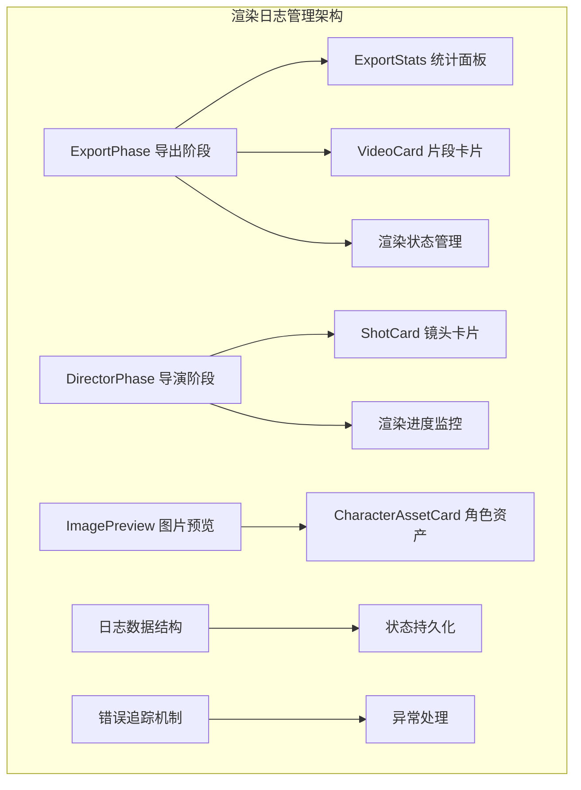
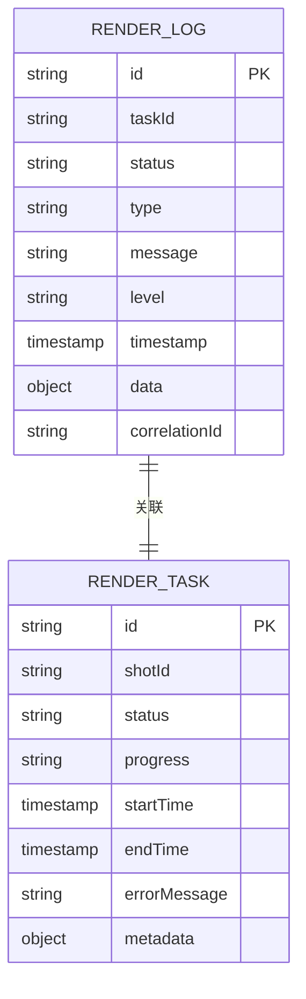
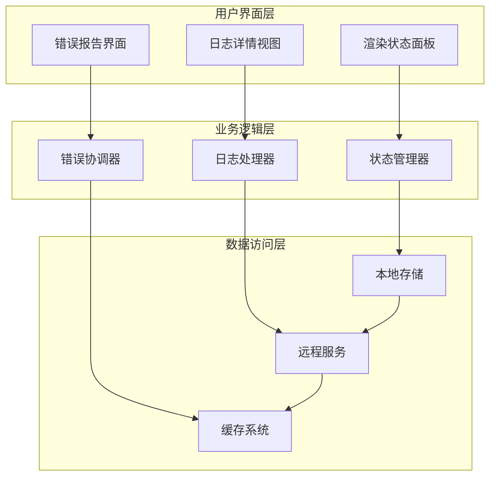
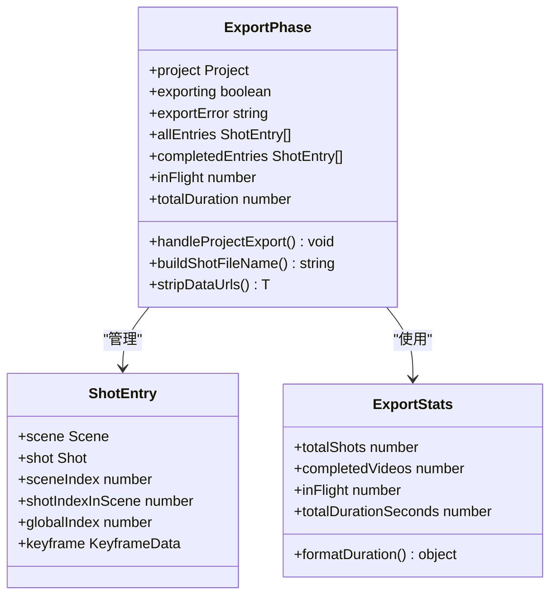
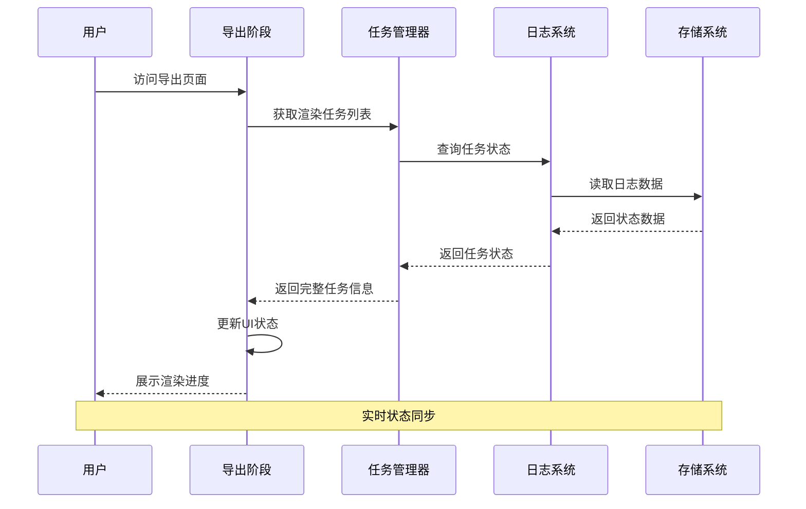
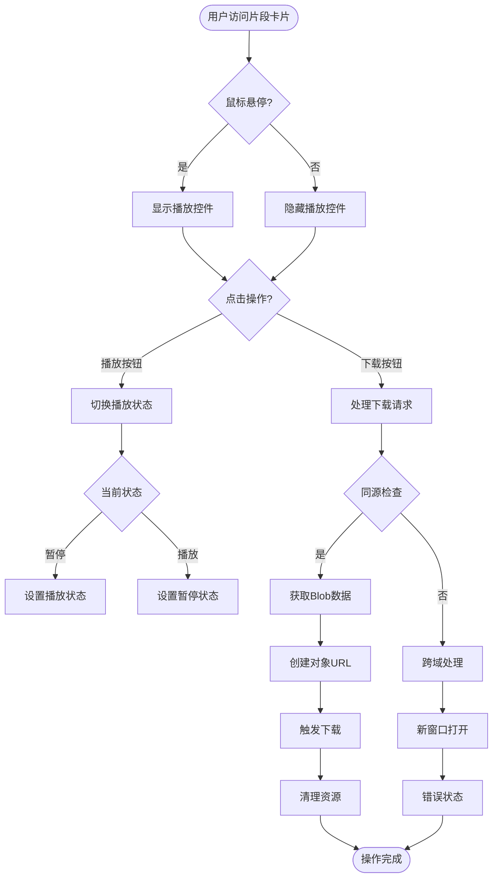
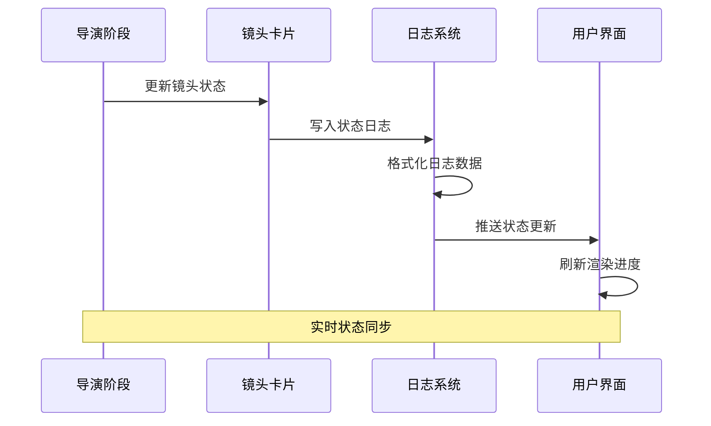
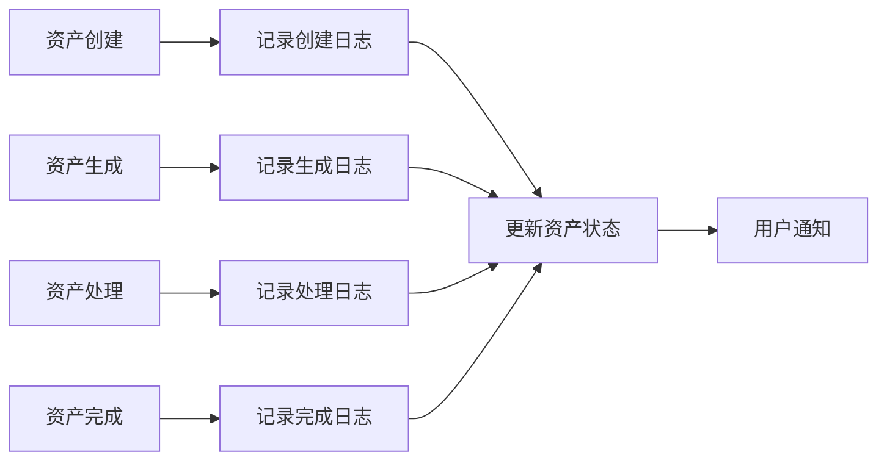
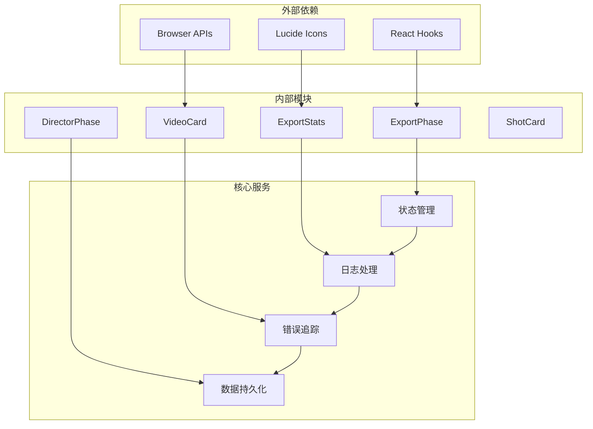
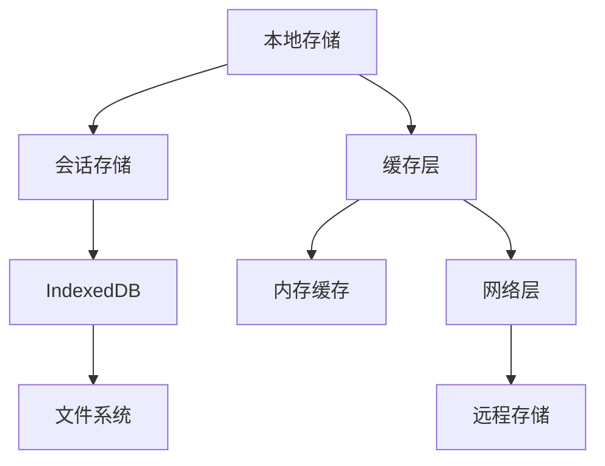

# 渲染日志管理

<cite>
**本文档引用的文件**
- [ExportPhase.tsx](file://src/phases/export/ExportPhase.tsx)
- [ExportStats.tsx](file://src/phases/export/components/ExportStats.tsx)
- [VideoCard.tsx](file://src/phases/export/components/VideoCard.tsx)
- [DirectorPhase.tsx](file://src/phases/director/DirectorPhase.tsx)
- [ShotCard.tsx](file://src/phases/director/components/ShotCard.tsx)
- [ImagePreview.tsx](file://src/phases/assets/components/ImagePreview.tsx)
- [CharacterAssetCard.tsx](file://src/phases/assets/components/CharacterAssetCard.tsx)
</cite>

## 目录
1. [简介](#简介)
2. [项目结构](#项目结构)
3. [核心组件](#核心组件)
4. [架构概览](#架构概览)
5. [详细组件分析](#详细组件分析)
6. [依赖关系分析](#依赖关系分析)
7. [性能考虑](#性能考虑)
8. [故障排除指南](#故障排除指南)
9. [结论](#结论)

## 简介

渲染日志管理模块是AI短剧制作工作流中的关键组件，负责跟踪和展示视频渲染过程中的状态信息。该模块实现了完整的渲染生命周期管理，包括渲染任务的创建、执行监控、状态更新和结果展示。

系统采用"控制论信息-反馈律"的设计理念，确保渲染过程的透明性和可追溯性。通过实时的状态监控和可视化展示，用户可以清晰地了解每个镜头的渲染进度、质量状态和最终结果。

## 项目结构

渲染日志管理功能主要分布在以下目录结构中：

**图表来源**
- [ExportPhase.tsx:1-409](file://src/phases/export/ExportPhase.tsx#L1-L409)
- [DirectorPhase.tsx:384-405](file://src/phases/director/DirectorPhase.tsx#L384-L405)

**章节来源**
- [ExportPhase.tsx:1-409](file://src/phases/export/ExportPhase.tsx#L1-L409)
- [DirectorPhase.tsx:384-405](file://src/phases/director/DirectorPhase.tsx#L384-L405)

## 核心组件

### 渲染状态管理系统

渲染状态管理系统是整个日志管理的核心，负责跟踪所有渲染任务的生命周期状态。系统支持多种状态类型：

- **待处理状态 (pending)**: 渲染任务已创建但尚未开始执行
- **处理中状态 (processing)**: 渲染任务正在进行中
- **完成状态 (completed)**: 渲染任务成功完成
- **失败状态 (failed)**: 渲染任务执行过程中发生错误

### 日志数据结构

系统采用统一的日志数据结构来存储渲染相关信息：

**图表来源**
- [ExportPhase.tsx:82-105](file://src/phases/export/ExportPhase.tsx#L82-L105)

### 错误追踪机制

系统实现了多层次的错误追踪机制，包括：

- **异常捕获**: 自动捕获渲染过程中的所有异常
- **错误分类**: 将错误按照严重程度进行分类
- **堆栈跟踪**: 保存详细的错误堆栈信息
- **重试机制**: 对可恢复的错误自动重试

**章节来源**
- [ExportPhase.tsx:132-154](file://src/phases/export/ExportPhase.tsx#L132-L154)
- [VideoCard.tsx:58-92](file://src/phases/export/components/VideoCard.tsx#L58-L92)

## 架构概览

渲染日志管理模块采用分层架构设计，确保各组件之间的松耦合和高内聚：

**图表来源**
- [ExportStats.tsx:23-87](file://src/phases/export/components/ExportStats.tsx#L23-L87)
- [ExportPhase.tsx:82-121](file://src/phases/export/ExportPhase.tsx#L82-L121)

## 详细组件分析

### 导出阶段 (ExportPhase)

导出阶段是渲染日志管理的核心组件，负责展示所有已完成的渲染任务：

#### 组件架构

**图表来源**
- [ExportPhase.tsx:22-105](file://src/phases/export/ExportPhase.tsx#L22-L105)
- [ExportStats.tsx:8-28](file://src/phases/export/components/ExportStats.tsx#L8-L28)

#### 渲染状态监控流程

**图表来源**
- [ExportPhase.tsx:82-121](file://src/phases/export/ExportPhase.tsx#L82-L121)
- [ExportStats.tsx:23-87](file://src/phases/export/components/ExportStats.tsx#L23-L87)

**章节来源**
- [ExportPhase.tsx:82-121](file://src/phases/export/ExportPhase.tsx#L82-L121)
- [ExportStats.tsx:23-87](file://src/phases/export/components/ExportStats.tsx#L23-L87)

### 片段卡片组件 (VideoCard)

片段卡片组件提供了渲染结果的可视化展示和交互功能：

#### 交互设计模式

**图表来源**
- [VideoCard.tsx:41-92](file://src/phases/export/components/VideoCard.tsx#L41-L92)

#### 下载流程优化

系统实现了智能的下载策略，包括：

- **同源检测**: 自动检测资源来源并选择最优下载方式
- **跨域回退**: 当同源下载失败时自动使用新窗口打开
- **资源清理**: 及时释放Blob URL以避免内存泄漏
- **错误处理**: 提供详细的错误信息和用户提示

**章节来源**
- [VideoCard.tsx:41-92](file://src/phases/export/components/VideoCard.tsx#L41-L92)

### 导演阶段集成

导演阶段与日志管理系统的深度集成：

#### 状态同步机制

**图表来源**
- [DirectorPhase.tsx:384-405](file://src/phases/director/DirectorPhase.tsx#L384-L405)
- [ShotCard.tsx:232-265](file://src/phases/director/components/ShotCard.tsx#L232-L265)

**章节来源**
- [DirectorPhase.tsx:384-405](file://src/phases/director/DirectorPhase.tsx#L384-L405)
- [ShotCard.tsx:232-265](file://src/phases/director/components/ShotCard.tsx#L232-L265)

### 资产管理集成

资产管理系统的日志记录功能：

#### 资产状态追踪

**图表来源**
- [CharacterAssetCard.tsx:68-112](file://src/phases/assets/components/CharacterAssetCard.tsx#L68-L112)

**章节来源**
- [CharacterAssetCard.tsx:68-112](file://src/phases/assets/components/CharacterAssetCard.tsx#L68-L112)

## 依赖关系分析

渲染日志管理模块的依赖关系呈现清晰的层次结构：

**图表来源**
- [ExportPhase.tsx:8-21](file://src/phases/export/ExportPhase.tsx#L8-L21)
- [ExportStats.tsx:6](file://src/phases/export/components/ExportStats.tsx#L6)

### 组件耦合度分析

系统采用了低耦合的设计原则：

- **UI组件**: 专注于展示逻辑，不直接处理业务逻辑
- **业务组件**: 封装复杂的业务规则和状态管理
- **服务层**: 提供通用的数据处理和存储功能
- **工具函数**: 提供可复用的辅助功能

**章节来源**
- [ExportPhase.tsx:8-21](file://src/phases/export/ExportPhase.tsx#L8-L21)
- [ExportStats.tsx:6](file://src/phases/export/components/ExportStats.tsx#L6)

## 性能考虑

### 渲染性能优化

系统在多个层面实现了性能优化：

#### 内存管理

- **及时清理**: Blob URL在使用后立即清理，避免内存泄漏
- **懒加载**: 视频资源采用懒加载策略，减少初始加载时间
- **虚拟滚动**: 大量日志条目时使用虚拟滚动提升渲染效率

#### 网络优化

- **CDN加速**: 使用CDN分发静态资源
- **缓存策略**: 实现智能缓存机制，减少重复请求
- **并发控制**: 限制同时进行的网络请求数量

#### 计算优化

- **状态缓存**: 缓存计算结果，避免重复计算
- **批量更新**: 批量处理状态更新，减少UI重绘次数
- **防抖处理**: 对频繁的状态变化进行防抖处理

### 存储策略

系统采用分层存储策略：

**图表来源**
- [ExportPhase.tsx:132-154](file://src/phases/export/ExportPhase.tsx#L132-L154)

## 故障排除指南

### 常见问题诊断

#### 渲染任务停滞

**症状**: 渲染任务长时间保持在"处理中"状态

**诊断步骤**:
1. 检查网络连接是否稳定
2. 验证服务器资源是否充足
3. 查看错误日志中的具体错误信息
4. 确认任务队列是否正常运行

**解决方案**:
- 重启渲染服务
- 清理任务队列中的死锁任务
- 调整并发限制参数
- 检查磁盘空间和内存使用情况

#### 下载失败问题

**症状**: 片段下载过程中出现错误

**诊断方法**:
1. 检查跨域配置是否正确
2. 验证文件权限设置
3. 确认网络代理配置
4. 查看浏览器控制台错误信息

**修复方案**:
- 配置正确的CORS头信息
- 使用代理服务器进行下载
- 调整文件大小限制
- 清理浏览器缓存

#### 状态不同步问题

**症状**: UI显示的状态与实际状态不符

**排查流程**:
1. 检查WebSocket连接状态
2. 验证事件订阅是否正常
3. 确认状态同步机制
4. 查看日志中的同步错误

**解决措施**:
- 重新建立WebSocket连接
- 重置事件监听器
- 手动刷新状态数据
- 检查防火墙和代理设置

### 性能监控指标

系统提供了全面的性能监控功能：

#### 关键性能指标

- **渲染延迟**: 从任务提交到完成的时间
- **吞吐量**: 单位时间内完成的任务数量
- **资源利用率**: CPU、内存、磁盘的使用情况
- **错误率**: 失败任务占总任务的比例

#### 监控工具

- **实时仪表板**: 展示当前系统状态
- **历史趋势**: 分析性能变化趋势
- **告警系统**: 自动检测异常情况
- **日志分析**: 深入分析问题根因

**章节来源**
- [ExportStats.tsx:15-21](file://src/phases/export/components/ExportStats.tsx#L15-L21)
- [VideoCard.tsx:58-92](file://src/phases/export/components/VideoCard.tsx#L58-L92)

## 结论

渲染日志管理模块通过精心设计的架构和完善的功能实现，为AI短剧制作工作流提供了强大的状态管理和可视化能力。系统不仅能够准确追踪每个渲染任务的生命周期，还能为用户提供直观的操作界面和丰富的分析工具。

模块的主要优势包括：

- **完整的生命周期管理**: 从任务创建到结果展示的全流程覆盖
- **实时状态监控**: 通过WebSocket实现实时状态同步
- **友好的用户界面**: 直观的可视化展示和交互设计
- **强大的错误处理**: 完善的异常捕获和恢复机制
- **高性能设计**: 优化的内存管理和网络传输策略

未来可以在以下方面进一步改进：

- 增加更细粒度的性能指标监控
- 实现更智能的自动重试机制
- 扩展日志分析和报告功能
- 优化移动端的用户体验