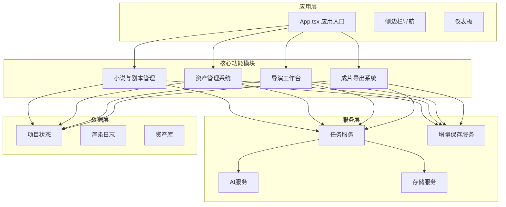
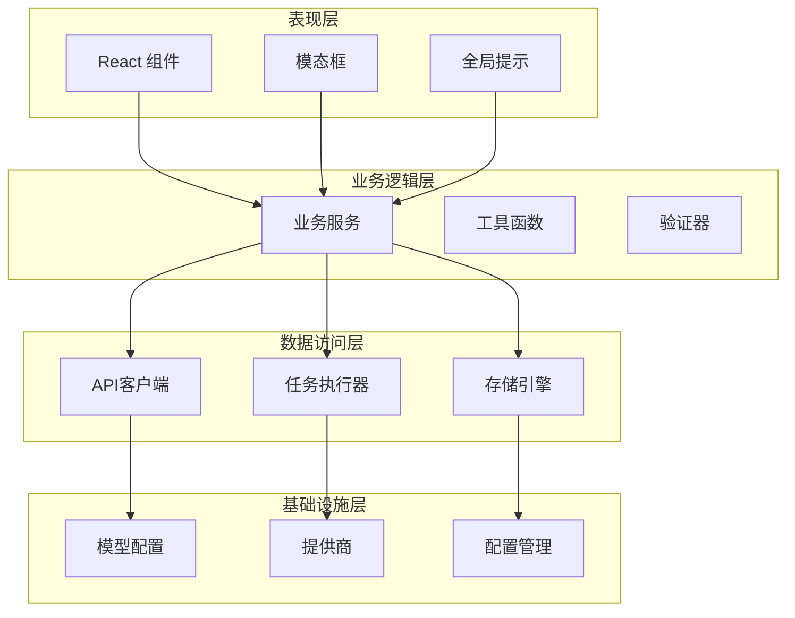
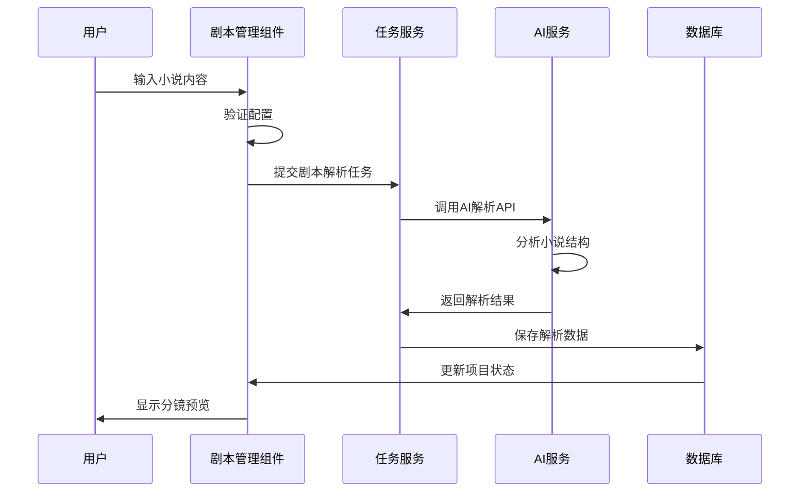
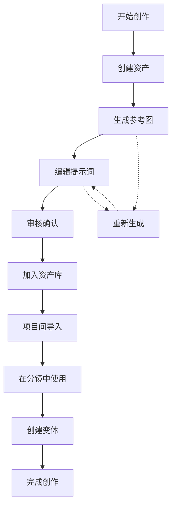
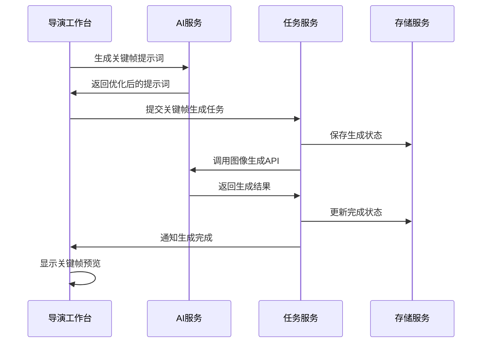
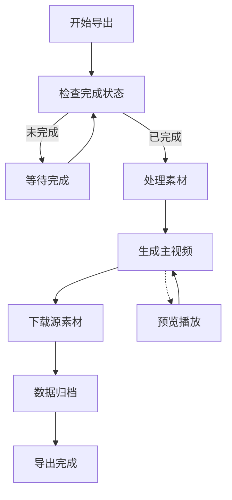
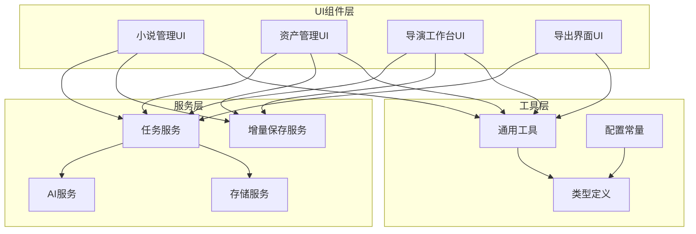
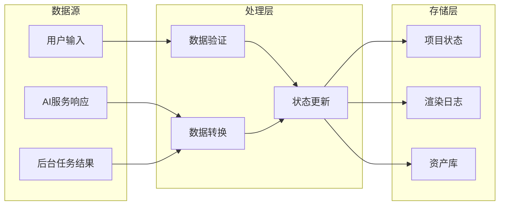
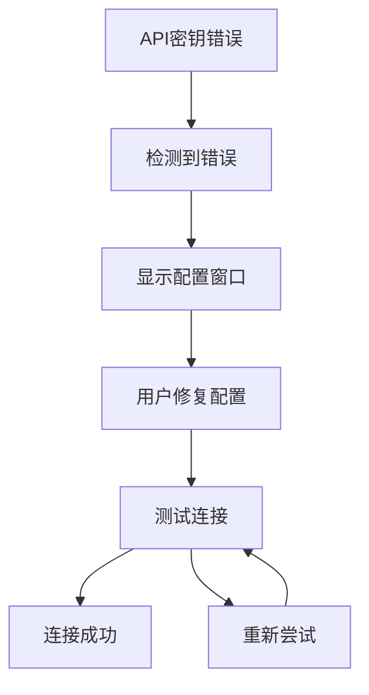

# 核心功能模块

<cite>
**本文档引用的文件**
- [App.tsx](file://App.tsx)
- [StageScript/index.tsx](file://components/StageScript/index.tsx)
- [StageScript/utils.ts](file://components/StageScript/utils.ts)
- [StageScript/constants.ts](file://components/StageScript/constants.ts)
- [StageAssets/index.tsx](file://components/StageAssets/index.tsx)
- [StageAssets/utils.ts](file://components/StageAssets/utils.ts)
- [StageAssets/constants.ts](file://components/StageAssets/constants.ts)
- [StageDirector/index.tsx](file://components/StageDirector/index.tsx)
- [StageDirector/utils.ts](file://components/StageDirector/utils.ts)
- [StageExport/index.tsx](file://components/StageExport/index.tsx)
- [StageExport/utils.ts](file://components/StageExport/utils.ts)
- [projectPatchService.ts](file://services/projectPatchService.ts)
- [taskService.ts](file://services/taskService.ts)
- [aiService.ts](file://services/aiService.ts)
- [types.ts](file://types.ts)
</cite>

## 目录
1. [简介](#简介)
2. [项目结构](#项目结构)
3. [核心组件](#核心组件)
4. [架构概览](#架构概览)
5. [详细组件分析](#详细组件分析)
6. [依赖分析](#依赖分析)
7. [性能考虑](#性能考虑)
8. [故障排除指南](#故障排除指南)
9. [结论](#结论)

## 简介

AI Shotlive 是一个基于 React 和 TypeScript 开发的智能影视制作平台，专注于小说到成片的一站式自动化生产流程。该平台通过四大核心功能模块实现了从创意构思到成品输出的完整工作流程：

- **小说与剧本管理模块**：负责小说内容的导入、解析和剧本生成
- **资产管理系统**：管理角色、场景、道具等视觉资产
- **导演工作台**：提供分镜设计、关键帧生成和视频合成
- **成片导出系统**：整合所有素材并生成最终成品

每个模块都采用了现代化的开发模式，包括增量状态管理、后台任务处理和实时进度反馈，为用户提供流畅的创作体验。

## 项目结构

AI Shotlive 采用模块化的组件架构，每个功能模块都是独立的 React 组件，通过统一的应用入口进行协调管理。

**图表来源**
- [App.tsx:233-260](file://App.tsx#L233-L260)
- [StageScript/index.tsx:27-31](file://components/StageScript/index.tsx#L27-L31)
- [StageAssets/index.tsx:71-88](file://components/StageAssets/index.tsx#L71-L88)
- [StageDirector/index.tsx:42-51](file://components/StageDirector/index.tsx#L42-L51)
- [StageExport/index.tsx:27-32](file://components/StageExport/index.tsx#L27-L32)

**章节来源**
- [App.tsx:233-260](file://App.tsx#L233-L260)
- [types.ts:246-271](file://types.ts#L246-L271)

## 核心组件

### 应用入口与导航控制

App.tsx 作为整个应用的根组件，负责：
- 用户认证状态管理
- 项目生命周期管理
- 页面导航控制
- 全局错误处理

应用采用阶段化的工作流程，通过 `project.stage` 状态控制用户在不同功能模块间的切换。

**章节来源**
- [App.tsx:131-161](file://App.tsx#L131-L161)
- [App.tsx:163-210](file://App.tsx#L163-L210)

### 项目状态管理

项目状态通过统一的 `ProjectState` 接口管理，包含：
- 小说管理相关的元数据
- 剧本解析结果
- 分镜数据
- 渲染日志
- 当前工作阶段

这种设计确保了数据的一致性和可追踪性。

**章节来源**
- [types.ts:246-271](file://types.ts#L246-L271)
- [types.ts:183-196](file://types.ts#L183-L196)

## 架构概览

AI Shotlive 采用分层架构设计，每层都有明确的职责分工：

**图表来源**
- [App.tsx:108-125](file://App.tsx#L108-L125)
- [projectPatchService.ts:24-25](file://services/projectPatchService.ts#L24-L25)
- [taskService.ts:107-111](file://services/taskService.ts#L107-L111)

## 详细组件分析

### 小说与剧本管理模块

小说与剧本管理模块是整个工作流程的起点，负责将原始小说内容转化为可执行的分镜脚本。

#### 核心功能特性

**图表来源**
- [StageScript/index.tsx:196-296](file://components/StageScript/index.tsx#L196-L296)
- [taskService.ts:107-111](file://services/taskService.ts#L107-L111)

#### 数据处理流程

该模块采用增量保存策略，通过 `projectPatchService` 实现细粒度的状态更新：

1. **配置验证**：检查输入的参数完整性
2. **AI解析**：调用AI服务进行剧本结构分析
3. **数据转换**：将解析结果转换为内部数据结构
4. **状态更新**：通过增量保存机制更新项目状态

**章节来源**
- [StageScript/index.tsx:196-296](file://components/StageScript/index.tsx#L196-L296)
- [StageScript/utils.ts:43-62](file://components/StageScript/utils.ts#L43-L62)
- [projectPatchService.ts:24-25](file://services/projectPatchService.ts#L24-L25)

### 资产管理系统

资产管理系统负责管理创作过程中的所有视觉元素，包括角色、场景和道具。

#### 资产生命周期管理

**图表来源**
- [StageAssets/index.tsx:264-361](file://components/StageAssets/index.tsx#L264-L361)
- [StageAssets/index.tsx:501-542](file://components/StageAssets/index.tsx#L501-L542)

#### 核心功能实现

系统支持多种资产生成方式：
- **AI生成**：基于提示词自动生成参考图
- **手动上传**：支持用户自定义图片
- **批量处理**：支持一次生成多个资产
- **资产库管理**：支持跨项目资产共享

**章节来源**
- [StageAssets/index.tsx:264-401](file://components/StageAssets/index.tsx#L264-L401)
- [StageAssets/utils.ts:7-28](file://components/StageAssets/utils.ts#L7-L28)

### 导演工作台

导演工作台是整个创作流程的核心，负责将抽象的剧本转化为具体的视觉内容。

#### 分镜生成工作流

**图表来源**
- [StageDirector/index.tsx:233-330](file://components/StageDirector/index.tsx#L233-L330)
- [StageDirector/utils.ts:102-191](file://components/StageDirector/utils.ts#L102-L191)

#### 高级功能特性

系统提供多种智能化辅助功能：
- **AI提示词优化**：自动优化关键帧描述
- **动作建议生成**：基于上下文生成合理的动作描述
- **九宫格分镜**：高级的镜头预览和设计工具
- **批量操作**：支持大规模资产的批量处理

**章节来源**
- [StageDirector/index.tsx:627-798](file://components/StageDirector/index.tsx#L627-L798)
- [StageDirector/utils.ts:472-550](file://components/StageDirector/utils.ts#L472-L550)

### 成片导出系统

成片导出系统负责整合所有创作成果，生成最终的成品文件。

#### 导出流程管理

**图表来源**
- [StageExport/index.tsx:116-172](file://components/StageExport/index.tsx#L116-L172)
- [StageExport/utils.ts:31-35](file://components/StageExport/utils.ts#L31-L35)

#### 多格式支持

系统支持多种导出格式和选项：
- **主视频导出**：高质量成品视频
- **源素材下载**：原始素材文件打包
- **数据归档**：完整的项目备份
- **实时预览**：导出过程中的进度监控

**章节来源**
- [StageExport/index.tsx:116-230](file://components/StageExport/index.tsx#L116-L230)
- [StageExport/utils.ts:58-67](file://components/StageExport/utils.ts#L58-L67)

## 依赖分析

### 组件间依赖关系

**图表来源**
- [StageScript/index.tsx:1-16](file://components/StageScript/index.tsx#L1-L16)
- [StageAssets/index.tsx:1-28](file://components/StageAssets/index.tsx#L1-L28)
- [StageDirector/index.tsx:1-33](file://components/StageDirector/index.tsx#L1-L33)
- [StageExport/index.tsx:1-21](file://components/StageExport/index.tsx#L1-L21)

### 数据流分析

系统采用单向数据流设计，确保数据的一致性和可预测性：

**图表来源**
- [projectPatchService.ts:24-25](file://services/projectPatchService.ts#L24-L25)
- [taskService.ts:165-200](file://services/taskService.ts#L165-L200)

**章节来源**
- [projectPatchService.ts:16-18](file://services/projectPatchService.ts#L16-L18)
- [taskService.ts:107-111](file://services/taskService.ts#L107-L111)

## 性能考虑

### 异步任务处理

系统采用后台任务模式处理耗时操作，避免阻塞用户界面：

- **任务队列管理**：支持多个任务并发执行
- **进度跟踪**：实时显示任务执行进度
- **状态恢复**：页面刷新后自动恢复任务状态
- **超时处理**：防止任务无限期挂起

### 内存优化策略

- **增量更新**：只更新发生变化的部分状态
- **懒加载**：大文件采用懒加载策略
- **缓存机制**：合理利用浏览器缓存
- **垃圾回收**：及时清理不再使用的资源

### 网络优化

- **请求合并**：将多个小请求合并为批量请求
- **断线重连**：自动处理网络异常情况
- **超时控制**：合理设置请求超时时间
- **错误重试**：对临时性错误进行自动重试

## 故障排除指南

### 常见问题诊断

#### API密钥配置问题

当检测到API密钥错误时，系统会自动弹出配置窗口：

**图表来源**
- [App.tsx:75-106](file://App.tsx#L75-L106)

#### 任务执行失败

系统提供多层次的任务失败处理机制：

1. **前端错误捕获**：捕获并显示详细的错误信息
2. **自动重试**：对可恢复的错误进行自动重试
3. **用户干预**：允许用户手动重新执行失败的任务
4. **日志记录**：完整记录错误信息便于调试

**章节来源**
- [App.tsx:75-106](file://App.tsx#L75-L106)
- [StageDirector/index.tsx:152-157](file://components/StageDirector/index.tsx#L152-L157)

### 性能监控

系统内置了完善的性能监控机制：

- **渲染日志**：记录所有API调用的详细信息
- **进度跟踪**：实时显示任务执行进度
- **错误报告**：自动收集和报告系统错误
- **性能指标**：监控关键性能指标的变化趋势

**章节来源**
- [StageExport/utils.ts:9-12](file://components/StageExport/utils.ts#L9-L12)
- [App.tsx:108-125](file://App.tsx#L108-L125)

## 结论

AI Shotlive 的四大核心功能模块通过精心设计的架构实现了高效、可靠的智能影视制作流程。每个模块都具备以下特点：

**模块化设计**：独立的功能模块便于维护和扩展
**智能化处理**：充分利用AI技术提升创作效率
**用户体验优化**：流畅的交互和实时反馈
**数据安全保障**：完善的错误处理和状态恢复机制

该系统为创作者提供了一个强大而易用的工具平台，能够显著提升影视制作的效率和质量。通过模块间的紧密协作和统一的数据管理，实现了从创意到成品的完整自动化流程。

未来的发展方向包括：
- 更多AI功能的集成
- 支持更多文件格式
- 增强团队协作能力
- 优化移动端体验
- 扩展云服务功能

这些改进将进一步提升系统的实用性和竞争力，为用户提供更加优质的创作体验。