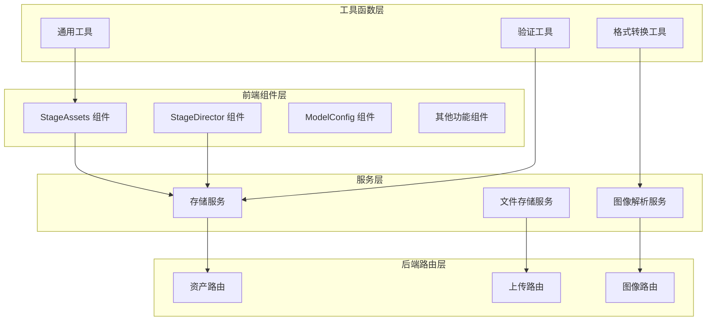
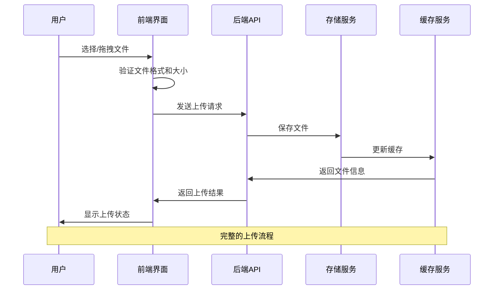
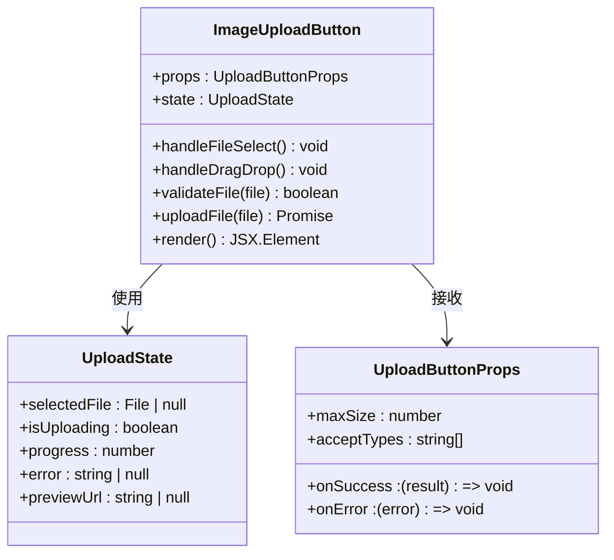
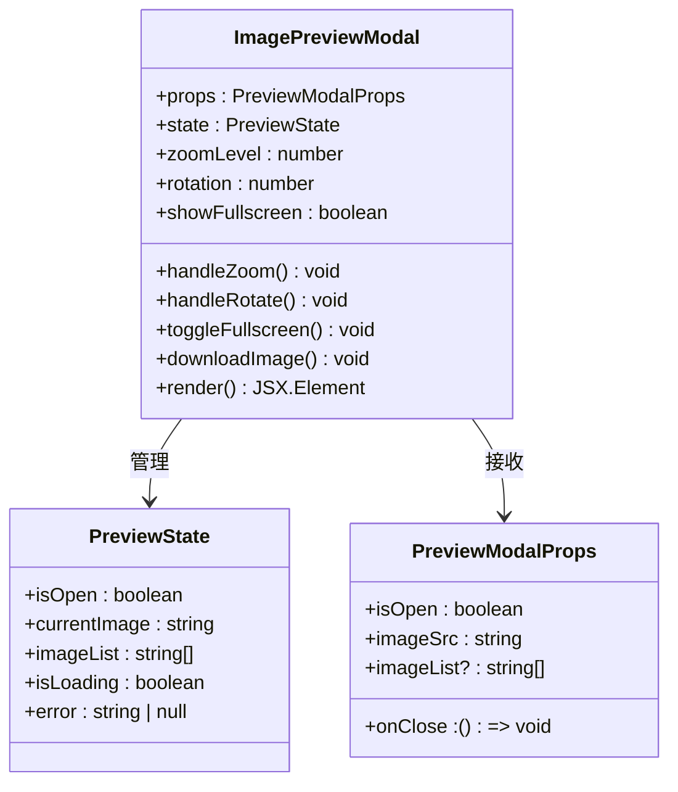
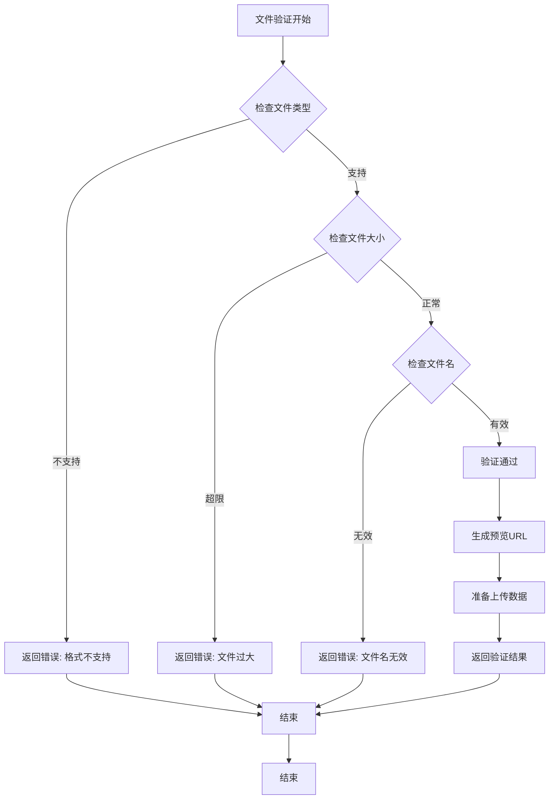
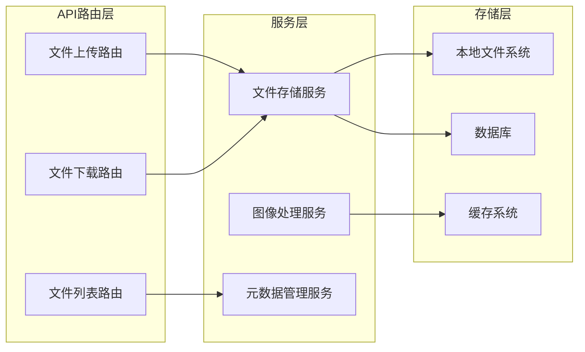
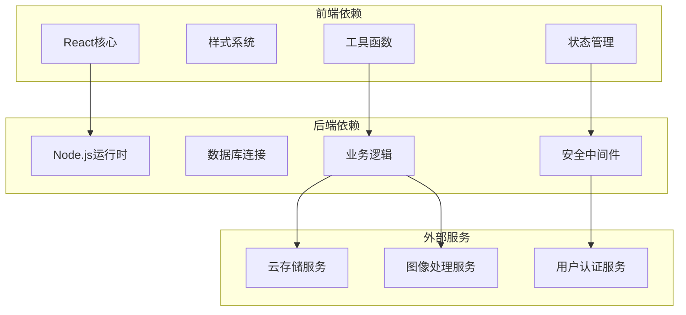

# 上传与预览系统

<cite>
**本文档引用的文件**
- [ImageUploadButton.tsx](file://components/StageAssets/ImageUploadButton.tsx)
- [ImagePreviewModal.tsx](file://components/StageAssets/ImagePreviewModal.tsx)
- [ImagePreviewModal.tsx](file://components/StageDirector/ImagePreviewModal.tsx)
- [utils.ts](file://components/StageAssets/utils.ts)
- [assets.ts](file://server/src/routes/assets.ts)
- [fileStorage.ts](file://server/src/services/fileStorage.ts)
- [imageResolver.ts](file://server/src/services/imageResolver.ts)
- [storageService.ts](file://services/storageService.ts)
- [README.md](file://components/StageAssets/README.md)
- [README.md](file://components/StageDirector/README.md)
</cite>

## 目录
1. [简介](#简介)
2. [项目结构](#项目结构)
3. [核心组件](#核心组件)
4. [架构概览](#架构概览)
5. [详细组件分析](#详细组件分析)
6. [依赖关系分析](#依赖关系分析)
7. [性能考虑](#性能考虑)
8. [故障排除指南](#故障排除指南)
9. [结论](#结论)
10. [附录](#附录)

## 简介

上传与预览系统是一个完整的文件上传解决方案，专注于图像文件的上传、预览和管理功能。该系统提供了直观的用户界面，支持多种上传方式（拖拽上传、文件选择），具备完善的文件验证机制（格式检查、大小限制），以及丰富的预览功能（缩放、旋转、全屏、下载）。

系统采用前后端分离架构，前端使用React构建用户界面，后端提供RESTful API服务，支持安全的文件存储和检索。整个系统设计注重用户体验和性能优化，为用户提供流畅的文件上传和预览体验。

## 项目结构

项目采用模块化组织结构，主要分为以下几个核心部分：

**图表来源**
- [ImageUploadButton.tsx](file://components/StageAssets/ImageUploadButton.tsx)
- [ImagePreviewModal.tsx](file://components/StageAssets/ImagePreviewModal.tsx)
- [assets.ts](file://server/src/routes/assets.ts)

**章节来源**
- [README.md](file://components/StageAssets/README.md)
- [README.md](file://components/StageDirector/README.md)

## 核心组件

### 文件上传组件

文件上传组件是系统的核心功能模块，提供多种上传方式和完善的验证机制：

- **拖拽上传**：支持拖拽文件到指定区域进行上传
- **文件选择**：通过点击按钮选择本地文件
- **格式验证**：自动检查文件类型是否符合要求
- **大小限制**：实施文件大小上限控制
- **进度显示**：实时显示上传进度和状态

### 图像预览模态框

图像预览模态框提供丰富的预览和编辑功能：

- **缩放控制**：支持鼠标滚轮和滑块调节缩放比例
- **旋转调整**：提供90度倍数的旋转功能
- **全屏预览**：支持全屏模式浏览大图
- **下载功能**：一键下载原始或处理后的图像
- **多点触控**：移动端支持手势操作

**章节来源**
- [ImageUploadButton.tsx](file://components/StageAssets/ImageUploadButton.tsx)
- [ImagePreviewModal.tsx](file://components/StageAssets/ImagePreviewModal.tsx)
- [ImagePreviewModal.tsx](file://components/StageDirector/ImagePreviewModal.tsx)

## 架构概览

系统采用分层架构设计，确保各层职责清晰、耦合度低：

**图表来源**
- [assets.ts](file://server/src/routes/assets.ts)
- [fileStorage.ts](file://server/src/services/fileStorage.ts)
- [storageService.ts](file://services/storageService.ts)

系统架构特点：
- **前后端分离**：前端负责用户交互，后端专注业务逻辑
- **服务化设计**：各功能模块独立封装，便于维护和扩展
- **异步处理**：采用Promise和async/await处理异步操作
- **错误处理**：完善的异常捕获和错误反馈机制

## 详细组件分析

### 文件上传按钮组件

文件上传按钮组件是用户交互的核心入口，提供直观的上传操作界面：

**图表来源**
- [ImageUploadButton.tsx](file://components/StageAssets/ImageUploadButton.tsx)

组件核心功能：
- **文件选择**：支持单文件和多文件选择
- **拖拽支持**：实现HTML5拖拽API
- **实时预览**：上传前生成文件预览
- **进度跟踪**：显示上传进度百分比
- **错误处理**：友好的错误提示和重试机制

**章节来源**
- [ImageUploadButton.tsx](file://components/StageAssets/ImageUploadButton.tsx)

### 图像预览模态框

图像预览模态框提供完整的图像浏览和编辑功能：

**图表来源**
- [ImagePreviewModal.tsx](file://components/StageAssets/ImagePreviewModal.tsx)
- [ImagePreviewModal.tsx](file://components/StageDirector/ImagePreviewModal.tsx)

预览功能特性：
- **缩放控制**：支持连续缩放和固定级别切换
- **旋转功能**：90度增量旋转，支持任意方向
- **全屏模式**：沉浸式浏览体验
- **导航系统**：多图片时的前后切换
- **下载选项**：支持原图和处理后版本下载

**章节来源**
- [ImagePreviewModal.tsx](file://components/StageAssets/ImagePreviewModal.tsx)
- [ImagePreviewModal.tsx](file://components/StageDirector/ImagePreviewModal.tsx)

### 工具函数库

工具函数库提供系统所需的各种辅助功能：

**图表来源**
- [utils.ts](file://components/StageAssets/utils.ts)

工具函数功能：
- **文件格式验证**：检查MIME类型和文件扩展名
- **大小限制检查**：验证文件大小是否在允许范围内
- **预览URL生成**：创建临时预览链接
- **格式转换工具**：支持不同格式间的转换
- **安全检查**：防止恶意文件上传

**章节来源**
- [utils.ts](file://components/StageAssets/utils.ts)

### 后端服务层

后端服务层提供完整的文件管理和API接口：

**图表来源**
- [assets.ts](file://server/src/routes/assets.ts)
- [fileStorage.ts](file://server/src/services/fileStorage.ts)
- [imageResolver.ts](file://server/src/services/imageResolver.ts)

服务功能：
- **文件存储**：安全可靠的文件持久化
- **元数据管理**：记录文件属性和访问历史
- **图像处理**：支持格式转换和尺寸调整
- **权限控制**：基于用户身份的访问控制
- **缓存优化**：提升频繁访问的响应速度

**章节来源**
- [assets.ts](file://server/src/routes/assets.ts)
- [fileStorage.ts](file://server/src/services/fileStorage.ts)
- [imageResolver.ts](file://server/src/services/imageResolver.ts)

## 依赖关系分析

系统各组件间存在清晰的依赖关系，确保模块化设计的有效性：

**图表来源**
- [storageService.ts](file://services/storageService.ts)
- [fileStorage.ts](file://server/src/services/fileStorage.ts)

依赖特点：
- **前端轻量级**：React + 必需的第三方库
- **后端模块化**：按功能划分的服务模块
- **可扩展性**：支持插件化的服务扩展
- **安全性**：内置的安全检查和防护机制

**章节来源**
- [storageService.ts](file://services/storageService.ts)

## 性能考虑

系统在设计时充分考虑了性能优化，采用多种策略提升用户体验：

### 前端性能优化

- **懒加载**：图片资源按需加载，减少初始渲染时间
- **虚拟滚动**：大量文件时使用虚拟化技术提升列表性能
- **防抖处理**：输入验证和搜索功能使用防抖避免频繁计算
- **缓存策略**：本地缓存常用数据，减少网络请求

### 后端性能优化

- **并发处理**：支持多文件并发上传和处理
- **流式传输**：大文件使用流式上传避免内存占用过高
- **压缩算法**：智能压缩策略平衡文件大小和质量
- **CDN集成**：静态资源通过CDN加速分发

### 存储性能优化

- **分片存储**：大文件自动分片存储提升读写效率
- **索引优化**：建立高效的文件索引系统
- **批量操作**：支持批量文件操作提升处理速度
- **清理策略**：定期清理临时文件和过期数据

## 故障排除指南

### 常见问题及解决方案

**上传失败问题**
- 检查网络连接和服务器状态
- 验证文件格式和大小限制
- 查看浏览器控制台错误信息
- 确认用户权限和配额限制

**预览功能异常**
- 清除浏览器缓存重新加载
- 检查文件是否损坏或格式不受支持
- 验证浏览器兼容性和JavaScript启用状态
- 确认文件路径和访问权限

**性能问题**
- 关闭不必要的浏览器标签页
- 清理系统内存和磁盘空间
- 检查防火墙和杀毒软件设置
- 联系技术支持获取进一步帮助

### 调试工具和方法

- **浏览器开发者工具**：监控网络请求和JavaScript错误
- **日志分析**：查看应用日志和错误报告
- **性能分析器**：识别性能瓶颈和内存泄漏
- **单元测试**：确保核心功能的稳定性

**章节来源**
- [README.md](file://components/StageAssets/README.md)
- [README.md](file://components/StageDirector/README.md)

## 结论

上传与预览系统是一个功能完整、架构清晰的文件管理解决方案。系统通过精心设计的组件结构和完善的错误处理机制，为用户提供了稳定可靠的文件上传和预览体验。

系统的主要优势包括：
- **用户友好**：直观的界面设计和流畅的操作体验
- **功能丰富**：支持多种上传方式和预览功能
- **性能优异**：优化的架构设计确保高效运行
- **安全可靠**：多层次的安全检查和防护机制
- **易于扩展**：模块化设计便于功能扩展和维护

未来可以考虑的功能增强包括：
- 支持更多文件格式和压缩算法
- 增强移动端的触摸操作体验
- 集成AI驱动的图像处理功能
- 提供更精细的权限和访问控制

## 附录

### 配置选项

系统支持灵活的配置选项，可根据不同需求进行定制：

**上传配置**
- 最大文件大小限制
- 允许的文件格式列表
- 上传超时时间和重试次数
- 并发上传数量限制

**预览配置**
- 默认缩放级别和范围
- 旋转角度增量设置
- 全屏模式行为配置
- 下载格式和质量选项

**安全配置**
- 文件类型白名单
- 大小限制和配额管理
- 访问权限和身份验证
- 审计日志和监控设置

### 最佳实践

**开发最佳实践**
- 遵循组件化开发原则
- 实施严格的错误处理机制
- 使用TypeScript确保类型安全
- 编写完整的单元测试用例

**部署最佳实践**
- 使用HTTPS确保传输安全
- 配置适当的CORS策略
- 设置合理的缓存策略
- 监控系统性能和资源使用

**运维最佳实践**
- 定期备份重要数据
- 监控系统健康状况
- 及时更新安全补丁
- 制定应急响应预案