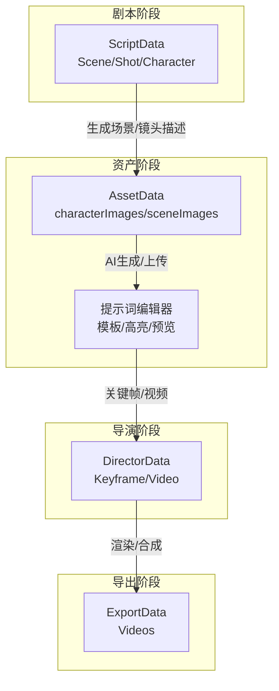
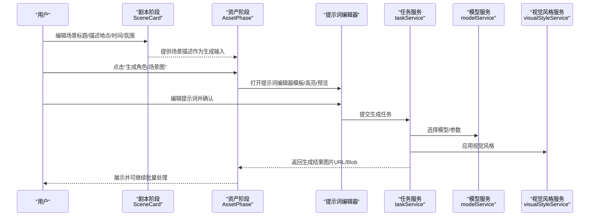
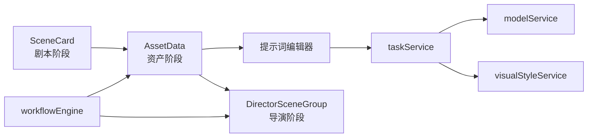

# 场景资产管理

<cite>
**本文引用的文件**
- [src/phases/assets/AssetPhase.tsx](file://src/phases/assets/AssetPhase.tsx)
- [src/phases/script/components/SceneCard.tsx](file://src/phases/script/components/SceneCard.tsx)
- [src/types.ts](file://src/types.ts)
- [src/services/workflow/engine.ts](file://src/services/workflow/engine.ts)
- [src/phases/director/DirectorPhase.tsx](file://src/phases/director/DirectorPhase.tsx)
- [src/services/assetLibraryService.ts](file://src/services/assetLibraryService.ts)
- [src/services/storageService.ts](file://src/services/storageService.ts)
- [src/services/taskService.ts](file://src/services/taskService.ts)
- [src/services/modelService.ts](file://src/services/modelService.ts)
- [src/services/visualStyleService.ts](file://src/services/visualStyleService.ts)
- [src/shared/components/GlobalAlert.tsx](file://src/shared/components/GlobalAlert.tsx)
</cite>

## 目录
1. [简介](#简介)
2. [项目结构](#项目结构)
3. [核心组件](#核心组件)
4. [架构总览](#架构总览)
5. [详细组件分析](#详细组件分析)
6. [依赖关系分析](#依赖关系分析)
7. [性能考虑](#性能考虑)
8. [故障排除指南](#故障排除指南)
9. [结论](#结论)
10. [附录](#附录)

## 简介
本文件面向“场景资产管理”功能，系统性梳理从剧本阶段到资产生成、再到导演与导出阶段的完整工作流。重点覆盖以下方面：
- 场景资产的管理流程：场景创建、基本信息配置（地点、时间、氛围）、状态管理与进度推进
- 场景提示词编辑器的使用方法：模板、自动补全、语法高亮、预览等能力
- 场景资产的生成机制：AI 图像生成、手动上传、批量处理
- 分类管理、搜索过滤、质量控制等实用功能

该文档旨在帮助非技术读者快速上手，同时为开发者提供代码级参考。

## 项目结构
场景资产管理位于“资产生成阶段（Phase 02）”，与剧本阶段（Phase 01）和导演阶段（Phase 03）紧密衔接。核心结构如下：
- 剧本阶段：定义场景与镜头的基本信息（标题、描述、时长等）
- 资产阶段：为角色与场景生成参考图或场景图，支持 AI 生成与手动上传
- 导演阶段：基于资产进行关键帧与视频生成
- 导出阶段：汇总并导出最终视频

图表来源
- [src/types.ts:52-61](file://src/types.ts#L52-L61)
- [src/phases/assets/AssetPhase.tsx:1-33](file://src/phases/assets/AssetPhase.tsx#L1-L33)
- [src/phases/director/DirectorPhase.tsx:561-607](file://src/phases/director/DirectorPhase.tsx#L561-L607)

章节来源
- [src/types.ts:9-61](file://src/types.ts#L9-L61)
- [src/phases/assets/AssetPhase.tsx:1-33](file://src/phases/assets/AssetPhase.tsx#L1-L33)

## 核心组件
- 资产阶段主界面：负责展示角色与场景资产列表，提供“生成”入口与状态指示
- 场景卡片：在剧本阶段中用于编辑场景标题与描述（地点、时间、氛围等），支持展开/收起与镜头管理
- 类型定义：统一描述项目数据结构，确保跨阶段一致性
- 工作流引擎：根据资产完成度推进阶段流转

章节来源
- [src/phases/assets/AssetPhase.tsx:13-33](file://src/phases/assets/AssetPhase.tsx#L13-L33)
- [src/phases/script/components/SceneCard.tsx:22-48](file://src/phases/script/components/SceneCard.tsx#L22-L48)
- [src/types.ts:29-50](file://src/types.ts#L29-L50)
- [src/services/workflow/engine.ts:35-54](file://src/services/workflow/engine.ts#L35-L54)

## 架构总览
场景资产管理贯穿多阶段协作，关键交互如下：
- 剧本阶段提供场景描述（地点、时间、氛围等），作为资产生成的输入
- 资产阶段通过提示词编辑器生成角色/场景参考图，支持 AI 生成与手动上传
- 导演阶段基于资产生成关键帧与视频
- 导出阶段汇总视频并提供质量控制与预览

图表来源
- [src/phases/script/components/SceneCard.tsx:36-48](file://src/phases/script/components/SceneCard.tsx#L36-L48)
- [src/phases/assets/AssetPhase.tsx:13-33](file://src/phases/assets/AssetPhase.tsx#L13-L33)
- [src/services/taskService.ts](file://src/services/taskService.ts)
- [src/services/modelService.ts](file://src/services/modelService.ts)
- [src/services/visualStyleService.ts](file://src/services/visualStyleService.ts)

## 详细组件分析

### 组件一：资产阶段（AssetPhase）
职责与行为
- 展示角色与场景两大资产清单
- 提供“生成”入口，触发提示词编辑器
- 显示资产状态（是否已生成、进度百分比）
- 支持批量处理与状态推进

关键交互
- 角色区域：为每位角色生成参考图，作为镜头一致性锚点
- 场景区域：为每个场景生成场景图，体现地点、时间、氛围

章节来源
- [src/phases/assets/AssetPhase.tsx:13-33](file://src/phases/assets/AssetPhase.tsx#L13-L33)
- [src/phases/assets/AssetPhase.tsx:25-33](file://src/phases/assets/AssetPhase.tsx#L25-L33)
- [src/phases/assets/AssetPhase.tsx:194-223](file://src/phases/assets/AssetPhase.tsx#L194-L223)

### 组件二：场景卡片（SceneCard）
职责与行为
- 场景标题与描述的可编辑展示
- 展开/收起以查看/管理镜头
- 计算场景总时长（基于镜头时长）
- 提供删除场景与添加镜头操作

编辑流程
- 点击进入编辑模式，支持修改标题与描述
- 保存后更新场景对象并退出编辑

章节来源
- [src/phases/script/components/SceneCard.tsx:22-48](file://src/phases/script/components/SceneCard.tsx#L22-L48)
- [src/phases/script/components/SceneCard.tsx:50-50](file://src/phases/script/components/SceneCard.tsx#L50-L50)
- [src/phases/script/components/SceneCard.tsx:179-212](file://src/phases/script/components/SceneCard.tsx#L179-L212)

### 组件三：提示词编辑器（Prompt Editor）
职责与行为
- 模板：内置场景提示词模板，便于快速生成
- 自动补全：基于上下文与历史提示提供智能建议
- 语法高亮：对提示词中的关键字段进行高亮显示
- 预览：实时预览生成效果，便于调整

使用流程
- 在资产阶段打开编辑器
- 选择模板或自定义提示词
- 启用自动补全与高亮
- 预览并确认提交生成任务

章节来源
- [src/phases/assets/AssetPhase.tsx:13-33](file://src/phases/assets/AssetPhase.tsx#L13-L33)

### 组件四：工作流引擎（Workflow Engine）
职责与行为
- 根据资产完成度计算阶段状态
- 推进到下一阶段或阻止前进
- 提供完成百分比与缺失要求提示

资产阶段状态规则
- 至少存在一个角色且拥有参考图（定妆图）才视为完成
- 完成度按角色中有参考图的比例计算

章节来源
- [src/services/workflow/engine.ts:35-54](file://src/services/workflow/engine.ts#L35-L54)
- [src/services/workflow/engine.ts:83-117](file://src/services/workflow/engine.ts#L83-L117)

### 组件五：数据模型（Types）
职责与行为
- 统一描述项目结构：剧本、资产、导演、导出各阶段的数据模型
- 场景与角色的描述字段用于资产生成的输入

章节来源
- [src/types.ts:29-50](file://src/types.ts#L29-L50)
- [src/types.ts:52-61](file://src/types.ts#L52-L61)

### 组件六：导演阶段场景组（Director SceneGroup）
职责与行为
- 展示场景标题与描述摘要
- 统计场景内镜头数量，辅助资产核对

章节来源
- [src/phases/director/DirectorPhase.tsx:561-607](file://src/phases/director/DirectorPhase.tsx#L561-L607)

## 依赖关系分析
组件间耦合与协作
- 剧本阶段（SceneCard）向资产阶段提供场景描述
- 资产阶段（AssetPhase）依赖提示词编辑器与任务服务
- 导演阶段（DirectorSceneGroup）依赖资产阶段输出
- 工作流引擎贯穿各阶段，提供状态推进与校验

图表来源
- [src/phases/script/components/SceneCard.tsx:22-48](file://src/phases/script/components/SceneCard.tsx#L22-L48)
- [src/phases/assets/AssetPhase.tsx:13-33](file://src/phases/assets/AssetPhase.tsx#L13-L33)
- [src/services/taskService.ts](file://src/services/taskService.ts)
- [src/services/modelService.ts](file://src/services/modelService.ts)
- [src/services/visualStyleService.ts](file://src/services/visualStyleService.ts)
- [src/phases/director/DirectorPhase.tsx:561-607](file://src/phases/director/DirectorPhase.tsx#L561-L607)
- [src/services/workflow/engine.ts:83-117](file://src/services/workflow/engine.ts#L83-L117)

章节来源
- [src/services/workflow/engine.ts:83-117](file://src/services/workflow/engine.ts#L83-L117)

## 性能考虑
- 批量处理：在资产阶段支持批量生成与上传，减少重复操作
- 状态缓存：工作流引擎根据角色与场景数量计算完成度，避免重复扫描
- 渲染优化：场景卡片仅在展开时渲染镜头列表，降低初始渲染压力
- 任务队列：通过任务服务统一调度生成任务，避免并发冲突

## 故障排除指南
常见问题与解决步骤
- 无法推进到下一阶段
  - 检查资产阶段是否满足完成条件（至少一个角色有参考图）
  - 查看工作流引擎返回的缺失要求提示
- 生成失败或结果不理想
  - 使用提示词编辑器的模板与高亮功能优化提示词
  - 切换视觉风格或调整模型参数
- 图片加载异常
  - 确认存储服务可用并正确返回图片URL
  - 检查网络与缓存策略

章节来源
- [src/services/workflow/engine.ts:35-54](file://src/services/workflow/engine.ts#L35-L54)
- [src/shared/components/GlobalAlert.tsx](file://src/shared/components/GlobalAlert.tsx)

## 结论
场景资产管理通过“剧本描述—资产生成—导演关键帧—导出”的闭环流程，实现了从创意到成品的高效转化。提示词编辑器提供了强大的可编辑体验，结合工作流引擎的状态推进与质量控制，确保项目稳定迭代。建议在实际使用中优先完善场景描述（地点、时间、氛围），并充分利用模板与预览功能提升生成效率。

## 附录
- 数据模型概览（简化）
  - 剧本数据：包含故事、场景、角色
  - 资产数据：角色参考图、场景图映射
  - 导演数据：关键帧与视频链接
  - 导出数据：最终视频集合

章节来源
- [src/types.ts:9-61](file://src/types.ts#L9-L61)