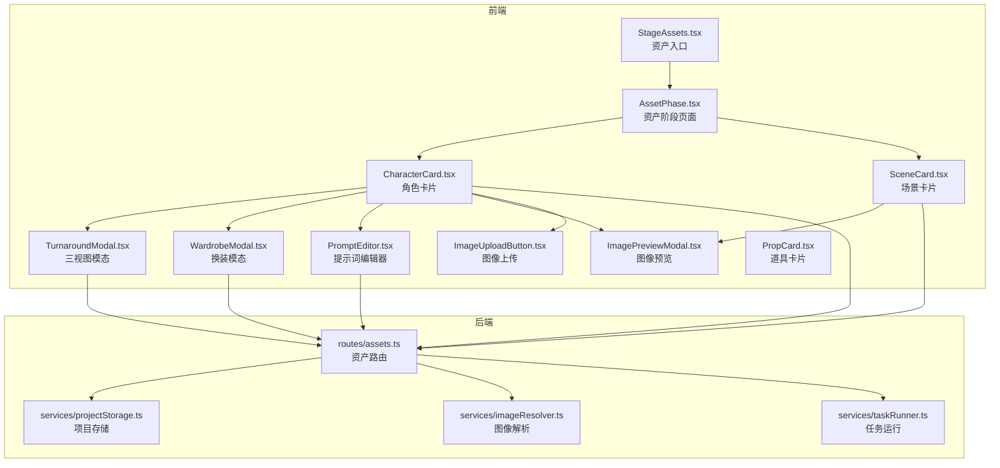
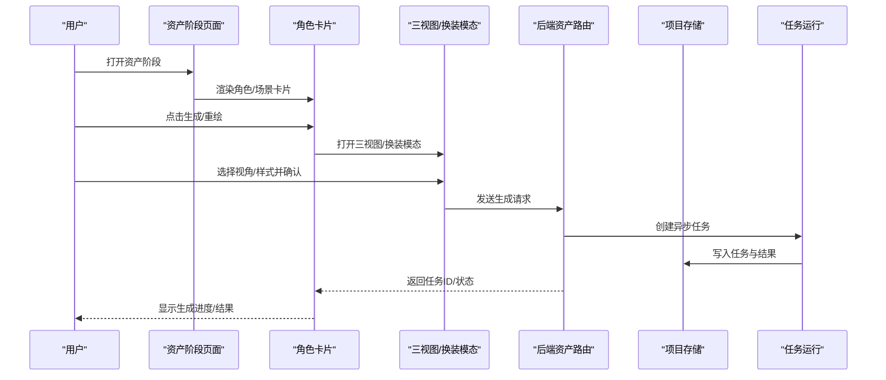
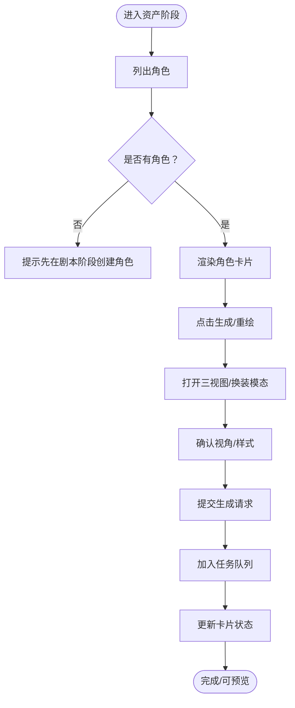
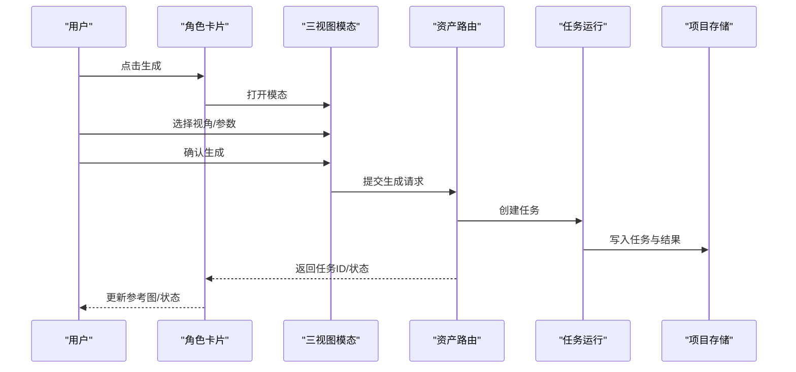
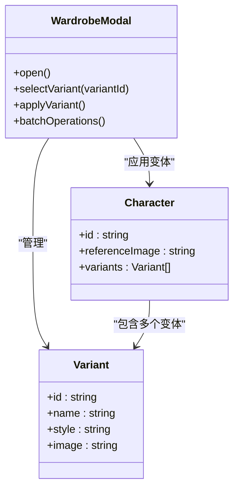
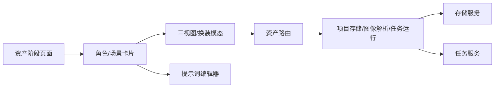

# 角色资产管理

<cite>
**本文引用的文件**
- [README.md](file://README.md)
- [AssetPhase.tsx](file://src/phases/assets/AssetPhase.tsx)
- [CharacterCard.tsx](file://src/phases/assets/CharacterCard.tsx)
- [TurnaroundModal.tsx](file://components/StageAssets/TurnaroundModal.tsx)
- [WardrobeModal.tsx](file://components/StageAssets/WardrobeModal.tsx)
- [PromptEditor.tsx](file://components/StageAssets/PromptEditor.tsx)
- [ImagePreviewModal.tsx](file://components/StageAssets/ImagePreviewModal.tsx)
- [ImageUploadButton.tsx](file://components/StageAssets/ImageUploadButton.tsx)
- [PropCard.tsx](file://components/StageAssets/PropCard.tsx)
- [SceneCard.tsx](file://components/StageAssets/SceneCard.tsx)
- [StageAssets.tsx](file://components/StageAssets.tsx)
- [StageAssets/index.tsx](file://components/StageAssets/index.tsx)
- [StageAssets/utils.ts](file://components/StageAssets/utils.ts)
- [StageAssets/constants.ts](file://components/StageAssets/constants.ts)
- [server/src/routes/assets.ts](file://server/src/routes/assets.ts)
- [server/src/services/projectStorage.ts](file://server/src/services/projectStorage.ts)
- [server/src/services/imageResolver.ts](file://server/src/services/imageResolver.ts)
- [server/src/services/taskRunner.ts](file://server/src/services/taskRunner.ts)
- [server/src/lib/utils.ts](file://server/src/lib/utils.ts)
- [services/assetLibraryService.ts](file://services/assetLibraryService.ts)
- [services/storageService.ts](file://services/storageService.ts)
- [services/taskService.ts](file://services/taskService.ts)
- [types/model.ts](file://types/model.ts)
</cite>

## 目录
1. [简介](#简介)
2. [项目结构](#项目结构)
3. [核心组件](#核心组件)
4. [架构总览](#架构总览)
5. [详细组件分析](#详细组件分析)
6. [依赖关系分析](#依赖关系分析)
7. [性能考虑](#性能考虑)
8. [故障排除指南](#故障排除指南)
9. [结论](#结论)
10. [附录](#附录)

## 简介
本文件围绕角色资产管理功能进行系统化技术文档梳理，重点覆盖以下方面：
- 角色资产的完整生命周期管理：角色创建、基本信息编辑（姓名、性别、年龄、性格）、视觉提示词管理、状态跟踪等
- 角色三视图生成系统：三视图模态框使用、视角切换、图像生成流程
- 换装系统设计与实现：变体管理、样式切换、批量操作等高级功能
- 角色资产导入导出、版本控制、质量检查等实用功能的操作指南与最佳实践

根据现有代码库与文档，角色资产管理主要分布在前端的“资产阶段”（Phase 02）以及后端的资产路由与服务层，配合任务调度与存储服务实现异步生成与持久化。

## 项目结构
角色资产管理相关的核心位置如下：
- 前端资产阶段页面：src/phases/assets/AssetPhase.tsx 及其子组件（角色卡片、场景卡片、三视图模态、换装模态、提示词编辑器等）
- 组件库：components/StageAssets/ 下的各类资产相关组件
- 后端路由与服务：server/src/routes/assets.ts、server/src/services/ 下的项目存储、图像解析、任务运行等
- 前端服务层：services/assetLibraryService.ts、services/storageService.ts、services/taskService.ts 等

图表来源
- [AssetPhase.tsx:1-192](file://src/phases/assets/AssetPhase.tsx#L1-L192)
- [CharacterCard.tsx](file://src/phases/assets/CharacterCard.tsx)
- [TurnaroundModal.tsx](file://components/StageAssets/TurnaroundModal.tsx)
- [WardrobeModal.tsx](file://components/StageAssets/WardrobeModal.tsx)
- [PromptEditor.tsx](file://components/StageAssets/PromptEditor.tsx)
- [ImagePreviewModal.tsx](file://components/StageAssets/ImagePreviewModal.tsx)
- [ImageUploadButton.tsx](file://components/StageAssets/ImageUploadButton.tsx)
- [PropCard.tsx](file://components/StageAssets/PropCard.tsx)
- [SceneCard.tsx](file://components/StageAssets/SceneCard.tsx)
- [StageAssets.tsx](file://components/StageAssets.tsx)
- [server/src/routes/assets.ts](file://server/src/routes/assets.ts)
- [server/src/services/projectStorage.ts](file://server/src/services/projectStorage.ts)
- [server/src/services/imageResolver.ts](file://server/src/services/imageResolver.ts)
- [server/src/services/taskRunner.ts](file://server/src/services/taskRunner.ts)

章节来源
- [README.md:308-370](file://README.md#L308-L370)
- [AssetPhase.tsx:1-192](file://src/phases/assets/AssetPhase.tsx#L1-L192)

## 核心组件
- 资产阶段页面（AssetPhase）：负责展示角色与场景资产区域，提供生成与管理入口
- 角色卡片（CharacterCard）：展示角色参考图、基础信息、生成/重绘按钮、状态指示
- 场景卡片（SceneCard）：展示场景概念图与生成入口
- 三视图模态（TurnaroundModal）：提供角色多角度生成与预览
- 换装模态（WardrobeModal）：管理角色变体（造型/服装）与样式切换
- 提示词编辑器（PromptEditor）：编辑角色视觉提示词
- 图像预览与上传组件：图像查看与上传能力
- 资产入口（StageAssets）：聚合导出资产相关组件

章节来源
- [AssetPhase.tsx:1-192](file://src/phases/assets/AssetPhase.tsx#L1-L192)
- [CharacterCard.tsx](file://src/phases/assets/CharacterCard.tsx)
- [StageAssets.tsx](file://components/StageAssets.tsx)
- [StageAssets/index.tsx](file://components/StageAssets/index.tsx)
- [StageAssets/utils.ts](file://components/StageAssets/utils.ts)
- [StageAssets/constants.ts](file://components/StageAssets/constants.ts)

## 架构总览
角色资产管理采用“前端页面 + 组件库 + 后端路由与服务”的分层架构：
- 前端负责用户交互与状态展示（资产阶段页面、卡片、模态框、编辑器）
- 后端负责资产数据持久化、图像解析与任务调度
- 任务系统异步处理生成请求，前端轮询或接收通知更新状态

图表来源
- [AssetPhase.tsx:1-192](file://src/phases/assets/AssetPhase.tsx#L1-L192)
- [CharacterCard.tsx](file://src/phases/assets/CharacterCard.tsx)
- [TurnaroundModal.tsx](file://components/StageAssets/TurnaroundModal.tsx)
- [WardrobeModal.tsx](file://components/StageAssets/WardrobeModal.tsx)
- [server/src/routes/assets.ts](file://server/src/routes/assets.ts)
- [server/src/services/taskRunner.ts](file://server/src/services/taskRunner.ts)
- [server/src/services/projectStorage.ts](file://server/src/services/projectStorage.ts)

## 详细组件分析

### 角色资产生命周期管理
- 角色创建与基本信息编辑
  - 在剧本阶段创建角色后，资产阶段提供角色卡片展示与操作入口
  - 角色卡片包含基础信息展示与生成/重绘按钮，支持状态指示
- 视觉提示词管理
  - 提示词编辑器用于维护角色外观描述，作为生成参考
- 状态跟踪
  - 生成任务通过任务系统异步执行，前端轮询或监听更新状态

图表来源
- [AssetPhase.tsx:1-192](file://src/phases/assets/AssetPhase.tsx#L1-L192)
- [CharacterCard.tsx](file://src/phases/assets/CharacterCard.tsx)
- [PromptEditor.tsx](file://components/StageAssets/PromptEditor.tsx)
- [server/src/services/taskRunner.ts](file://server/src/services/taskRunner.ts)

章节来源
- [AssetPhase.tsx:1-192](file://src/phases/assets/AssetPhase.tsx#L1-L192)
- [CharacterCard.tsx](file://src/phases/assets/CharacterCard.tsx)

### 角色三视图生成系统
- 模态框使用
  - 三视图模态提供多角度生成选项，支持视角切换与批量生成
- 图像生成流程
  - 用户在模态中选择视角与参数，提交后由后端路由接收请求
  - 任务运行器创建异步任务，项目存储写入任务与结果
  - 前端轮询或接收通知，更新卡片与预览

图表来源
- [TurnaroundModal.tsx](file://components/StageAssets/TurnaroundModal.tsx)
- [server/src/routes/assets.ts](file://server/src/routes/assets.ts)
- [server/src/services/taskRunner.ts](file://server/src/services/taskRunner.ts)
- [server/src/services/projectStorage.ts](file://server/src/services/projectStorage.ts)

章节来源
- [TurnaroundModal.tsx](file://components/StageAssets/TurnaroundModal.tsx)

### 换装系统设计与实现
- 变体管理
  - 换装模态支持角色变体（多套造型）的创建、编辑与切换
- 样式切换
  - 在模态中选择不同变体，提交后更新角色参考图
- 批量操作
  - 支持批量生成与批量更新，提升效率

图表来源
- [WardrobeModal.tsx](file://components/StageAssets/WardrobeModal.tsx)
- [CharacterCard.tsx](file://src/phases/assets/CharacterCard.tsx)

章节来源
- [WardrobeModal.tsx](file://components/StageAssets/WardrobeModal.tsx)

### 视觉提示词管理
- 提示词编辑器提供角色外观描述的编辑能力
- 编辑内容作为生成参考，影响三视图与换装生成结果
- 支持与三视图模态联动，实时预览效果

章节来源
- [PromptEditor.tsx](file://components/StageAssets/PromptEditor.tsx)

### 图像预览与上传
- 图像预览模态用于查看与放大角色/场景参考图
- 图像上传按钮支持本地文件上传，作为参考图来源

章节来源
- [ImagePreviewModal.tsx](file://components/StageAssets/ImagePreviewModal.tsx)
- [ImageUploadButton.tsx](file://components/StageAssets/ImageUploadButton.tsx)

### 场景与道具资产
- 场景卡片展示场景概念图与生成入口
- 道具卡片管理道具资产，支持上传与关联

章节来源
- [SceneCard.tsx](file://components/StageAssets/SceneCard.tsx)
- [PropCard.tsx](file://components/StageAssets/PropCard.tsx)

## 依赖关系分析
- 前端组件依赖
  - 资产阶段页面依赖角色卡片、场景卡片等子组件
  - 角色卡片依赖三视图模态、换装模态、提示词编辑器、图像预览与上传组件
- 后端服务依赖
  - 资产路由依赖项目存储、图像解析、任务运行服务
  - 任务运行器负责异步生成与状态更新
- 前端服务依赖
  - 资产库服务、存储服务、任务服务提供数据与状态管理

图表来源
- [AssetPhase.tsx:1-192](file://src/phases/assets/AssetPhase.tsx#L1-L192)
- [CharacterCard.tsx](file://src/phases/assets/CharacterCard.tsx)
- [TurnaroundModal.tsx](file://components/StageAssets/TurnaroundModal.tsx)
- [WardrobeModal.tsx](file://components/StageAssets/WardrobeModal.tsx)
- [PromptEditor.tsx](file://components/StageAssets/PromptEditor.tsx)
- [server/src/routes/assets.ts](file://server/src/routes/assets.ts)
- [server/src/services/projectStorage.ts](file://server/src/services/projectStorage.ts)
- [server/src/services/imageResolver.ts](file://server/src/services/imageResolver.ts)
- [server/src/services/taskRunner.ts](file://server/src/services/taskRunner.ts)
- [services/storageService.ts](file://services/storageService.ts)
- [services/taskService.ts](file://services/taskService.ts)

章节来源
- [server/src/routes/assets.ts](file://server/src/routes/assets.ts)
- [server/src/services/projectStorage.ts](file://server/src/services/projectStorage.ts)
- [server/src/services/imageResolver.ts](file://server/src/services/imageResolver.ts)
- [server/src/services/taskRunner.ts](file://server/src/services/taskRunner.ts)
- [services/storageService.ts](file://services/storageService.ts)
- [services/taskService.ts](file://services/taskService.ts)

## 性能考虑
- 异步任务与轮询
  - 生成任务通过任务运行器异步执行，避免阻塞前端交互
  - 建议合理设置轮询间隔，减少不必要的请求
- 图像缓存与预览
  - 图像解析服务应支持缓存策略，减少重复请求
  - 预览模态提供缩放与懒加载，优化大图体验
- 批量操作
  - 换装与三视图支持批量生成，建议限制并发数量以平衡性能与响应速度

## 故障排除指南
- 生成失败
  - 检查任务运行器状态与日志，确认生成参数与提示词是否有效
  - 核对后端路由返回的任务ID与状态
- 图像无法显示
  - 使用图像解析服务检查路径与权限
  - 确认存储服务中文件是否存在且可访问
- 模态框异常
  - 检查模态组件的打开/关闭逻辑与事件绑定
  - 确认与路由的交互是否正确传递参数

章节来源
- [server/src/services/taskRunner.ts](file://server/src/services/taskRunner.ts)
- [server/src/services/imageResolver.ts](file://server/src/services/imageResolver.ts)
- [server/src/services/projectStorage.ts](file://server/src/services/projectStorage.ts)

## 结论
角色资产管理功能通过“资产阶段页面 + 组件库 + 后端路由与服务”的架构实现了完整的生命周期管理，涵盖角色创建、基本信息编辑、视觉提示词管理、状态跟踪、三视图生成与换装系统。异步任务与存储服务确保了生成流程的稳定与可扩展性。建议在实际使用中结合批量操作与缓存策略，进一步提升用户体验与系统性能。

## 附录
- 数据导出与导入
  - 系统支持将用户数据与媒体文件打包为 ZIP 进行导出与导入，适用于跨服务器迁移与备份恢复
- 版本控制与质量检查
  - 建议在生成完成后进行质量检查，必要时使用重绘功能进行修正
  - 对于频繁使用的提示词与变体，建议建立版本管理与归档策略

章节来源
- [README.md:103-107](file://README.md#L103-L107)