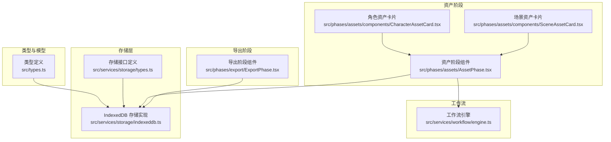
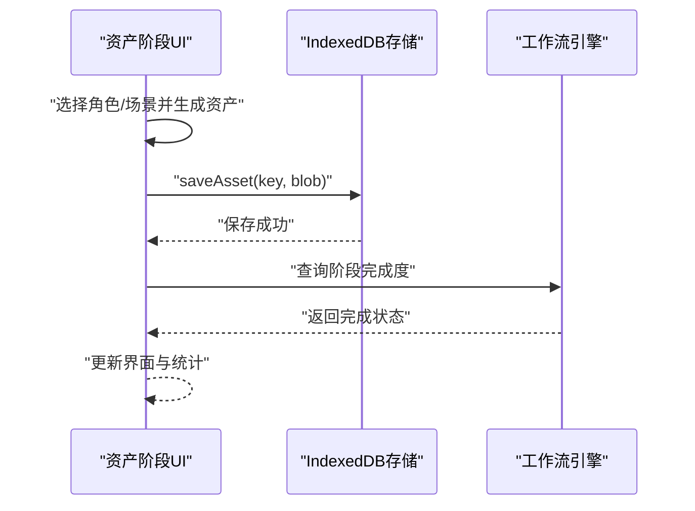
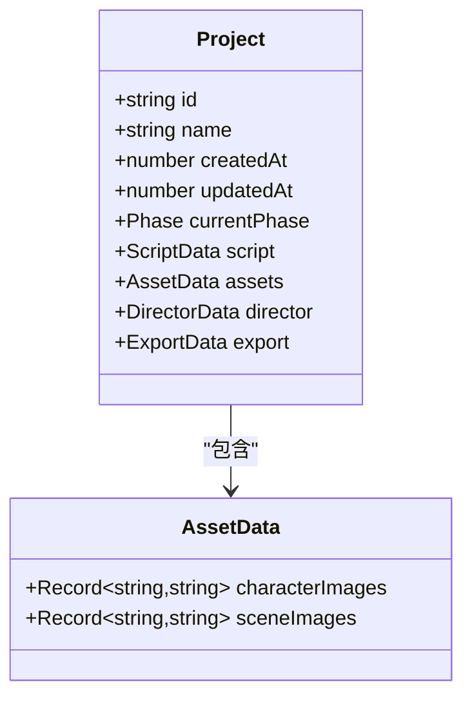
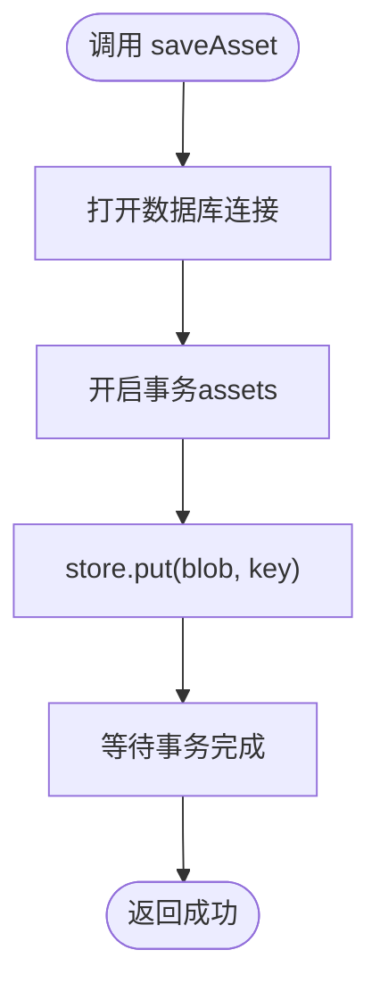
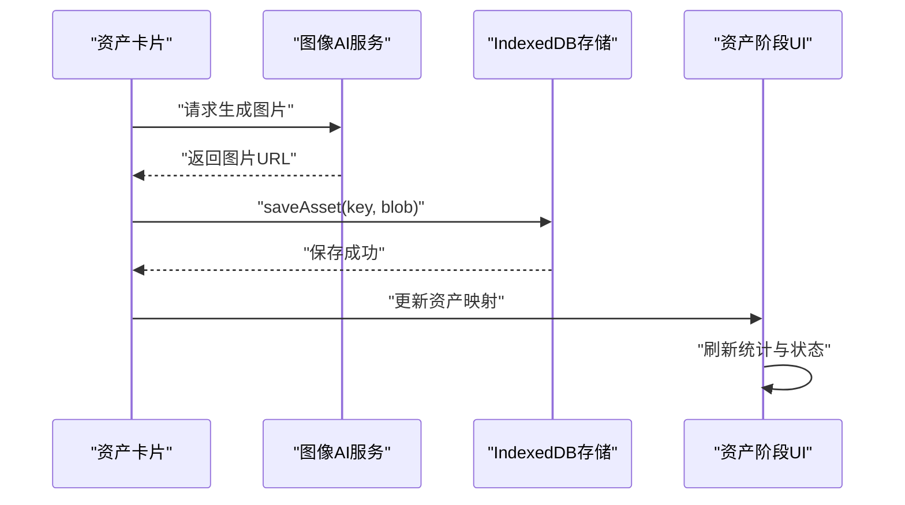
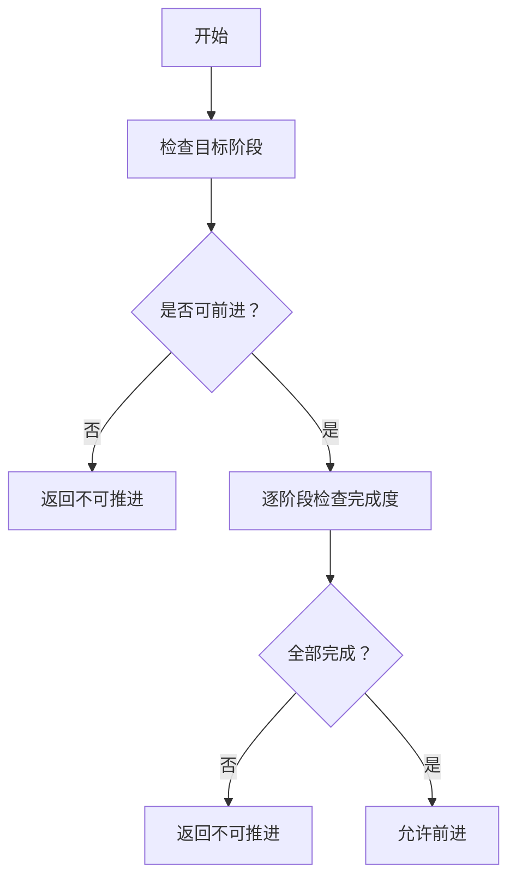
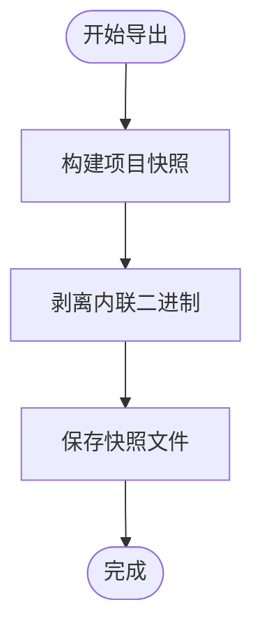
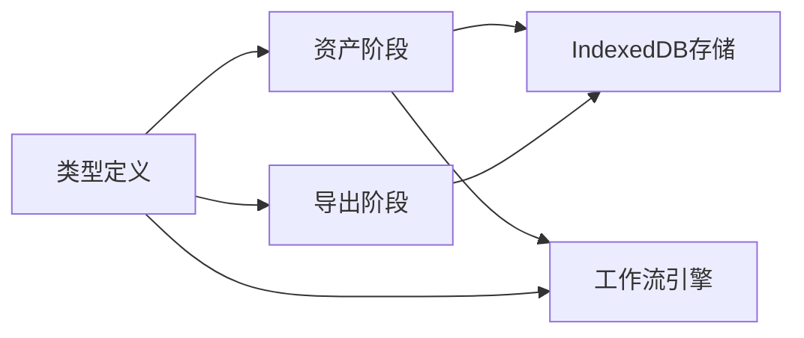

# 资产库管理

<cite>
**本文档引用的文件**
- [src/services/storage/indexeddb.ts](file://src/services/storage/indexeddb.ts)
- [src/services/storage/types.ts](file://src/services/storage/types.ts)
- [src/types.ts](file://src/types.ts)
- [src/phases/assets/AssetPhase.tsx](file://src/phases/assets/AssetPhase.tsx)
- [src/phases/assets/components/CharacterAssetCard.tsx](file://src/phases/assets/components/CharacterAssetCard.tsx)
- [src/phases/assets/components/SceneAssetCard.tsx](file://src/phases/assets/components/SceneAssetCard.tsx)
- [src/services/workflow/engine.ts](file://src/services/workflow/engine.ts)
- [src/phases/export/ExportPhase.tsx](file://src/phases/export/ExportPhase.tsx)
- [README_EN.md](file://README_EN.md)
</cite>

## 目录
1. [简介](#简介)
2. [项目结构](#项目结构)
3. [核心组件](#核心组件)
4. [架构总览](#架构总览)
5. [详细组件分析](#详细组件分析)
6. [依赖关系分析](#依赖关系分析)
7. [性能考虑](#性能考虑)
8. [故障排查指南](#故障排查指南)
9. [结论](#结论)
10. [附录](#附录)

## 简介
本文件面向“资产库管理系统”的使用者与维护者，系统性阐述资产库的架构设计、管理机制与使用流程。重点覆盖以下方面：
- 资产库的创建、配置与权限控制
- 资产库的搜索与过滤能力（按类型、项目关联、关键词、分页）
- 资产库的导入与导出机制（单个/批量、格式转换、数据迁移）
- 资产库的共享与协作（跨项目共享、权限管理、版本控制）
- 维护管理、性能优化与备份恢复策略

说明：当前代码库以本地 IndexedDB 为核心存储，资产数据以二进制形式存取；项目工作流与资产生成位于前端阶段，未发现后端独立的资产库服务模块。本文在不改变现有实现的前提下，给出面向资产库管理的最佳实践与扩展建议。

## 项目结构
资产库相关能力主要分布在以下区域：
- 类型与模型：全局项目与资产数据结构定义
- 存储层：IndexedDB 实现的本地持久化（项目、资产、配置）
- 资产生成与展示：资产阶段的 UI 组件与交互逻辑
- 工作流引擎：阶段推进与完成度校验
- 导出阶段：项目快照与资源导出

图表来源
- [src/types.ts:1-96](file://src/types.ts#L1-L96)
- [src/services/storage/indexeddb.ts:1-190](file://src/services/storage/indexeddb.ts#L1-L190)
- [src/services/storage/types.ts:1-30](file://src/services/storage/types.ts#L1-L30)
- [src/phases/assets/AssetPhase.tsx:1-362](file://src/phases/assets/AssetPhase.tsx#L1-L362)
- [src/phases/assets/components/CharacterAssetCard.tsx:1-31](file://src/phases/assets/components/CharacterAssetCard.tsx#L1-L31)
- [src/phases/assets/components/SceneAssetCard.tsx:1-37](file://src/phases/assets/components/SceneAssetCard.tsx#L1-L37)
- [src/services/workflow/engine.ts:35-119](file://src/services/workflow/engine.ts#L35-L119)
- [src/phases/export/ExportPhase.tsx:49-85](file://src/phases/export/ExportPhase.tsx#L49-L85)

章节来源
- [src/types.ts:1-96](file://src/types.ts#L1-L96)
- [src/services/storage/indexeddb.ts:1-190](file://src/services/storage/indexeddb.ts#L1-L190)
- [src/services/storage/types.ts:1-30](file://src/services/storage/types.ts#L1-L30)
- [src/phases/assets/AssetPhase.tsx:1-362](file://src/phases/assets/AssetPhase.tsx#L1-L362)
- [src/phases/assets/components/CharacterAssetCard.tsx:1-31](file://src/phases/assets/components/CharacterAssetCard.tsx#L1-L31)
- [src/phases/assets/components/SceneAssetCard.tsx:1-37](file://src/phases/assets/components/SceneAssetCard.tsx#L1-L37)
- [src/services/workflow/engine.ts:35-119](file://src/services/workflow/engine.ts#L35-L119)
- [src/phases/export/ExportPhase.tsx:49-85](file://src/phases/export/ExportPhase.tsx#L49-L85)

## 核心组件
- 类型与模型：定义项目、剧本、资产、导演与导出的数据结构，明确资产数据以键值映射的 URL/base64 存储方式。
- 存储服务：通过 IndexedDB 提供项目、资产、配置的增删改查能力，支持二进制资产的保存与加载。
- 资产阶段：提供角色与场景两类资产的生成、预览、批量处理与进度控制。
- 工作流引擎：根据资产生成状态计算阶段完成度，保障工作流顺序推进。
- 导出阶段：对项目进行文本化快照导出，剥离内联二进制，便于跨环境迁移。

章节来源
- [src/types.ts:52-80](file://src/types.ts#L52-L80)
- [src/services/storage/indexeddb.ts:143-167](file://src/services/storage/indexeddb.ts#L143-L167)
- [src/phases/assets/AssetPhase.tsx:1-362](file://src/phases/assets/AssetPhase.tsx#L1-L362)
- [src/services/workflow/engine.ts:35-119](file://src/services/workflow/engine.ts#L35-L119)
- [src/phases/export/ExportPhase.tsx:49-85](file://src/phases/export/ExportPhase.tsx#L49-L85)

## 架构总览
资产库管理采用“前端本地存储 + 阶段化工作流”的架构模式：
- 数据持久化：IndexedDB 分三类对象存储（projects/assets/config），分别承载项目、二进制资产与应用配置。
- 资产生命周期：在资产阶段生成并落盘到 assets 存储；后续在导出阶段以文本快照形式输出，避免内联大体积二进制。
- 权限与协作：当前实现未包含跨用户/项目的权限控制与版本管理，建议在扩展时引入后端服务与鉴权体系。

图表来源
- [src/phases/assets/AssetPhase.tsx:1-362](file://src/phases/assets/AssetPhase.tsx#L1-L362)
- [src/services/storage/indexeddb.ts:143-167](file://src/services/storage/indexeddb.ts#L143-L167)
- [src/services/workflow/engine.ts:35-119](file://src/services/workflow/engine.ts#L35-L119)

## 详细组件分析

### 类型与模型（AssetData/Project）
- 资产数据结构：角色资产与场景资产分别以字符 ID 与场景 ID 为键，映射到可直接使用的图片 URL 或 base64 字符串。
- 项目结构：Project 包含 script/assets/director/export 四个阶段数据，资产阶段位于中间环节。
- 扩展建议：若需跨项目共享或版本控制，可在 AssetData 中引入版本号、归属项目标识与访问控制字段。

图表来源
- [src/types.ts:10-20](file://src/types.ts#L10-L20)
- [src/types.ts:52-56](file://src/types.ts#L52-L56)

章节来源
- [src/types.ts:10-20](file://src/types.ts#L10-L20)
- [src/types.ts:52-56](file://src/types.ts#L52-L56)

### 存储服务（IndexedDB）
- 对象存储：
  - projects：以项目 id 为主键，存储完整项目 JSON。
  - assets：以自定义 key 存放二进制 Blob。
  - config：键值对存储应用配置。
- 关键能力：
  - 项目 CRUD：保存、加载、列表（仅摘要字段）、删除。
  - 资产 CRUD：保存 Blob、按 key 加载、删除。
  - 配置 CRUD：保存任意值、按 key 读取。

图表来源
- [src/services/storage/indexeddb.ts:143-167](file://src/services/storage/indexeddb.ts#L143-L167)

章节来源
- [src/services/storage/indexeddb.ts:17-21](file://src/services/storage/indexeddb.ts#L17-L21)
- [src/services/storage/indexeddb.ts:103-141](file://src/services/storage/indexeddb.ts#L103-L141)
- [src/services/storage/indexeddb.ts:145-167](file://src/services/storage/indexeddb.ts#L145-L167)
- [src/services/storage/types.ts:15-30](file://src/services/storage/types.ts#L15-L30)

### 资产阶段（生成与展示）
- 功能概览：
  - 角色资产：基于角色描述生成参考图，支持预览、重新生成与批量处理。
  - 场景资产：为关键场景生成概念图，统一美术风格与光照方向。
  - 统计面板：显示角色定妆、场景概念与整体完成度。
- 交互流程：
  - 用户点击生成按钮触发 AI 生成。
  - 生成完成后将结果以 URL 形式写入 AssetData，并持久化到 assets 存储。
  - 工作流引擎根据资产完成度判定是否可进入下一阶段。

图表来源
- [src/phases/assets/AssetPhase.tsx:1-362](file://src/phases/assets/AssetPhase.tsx#L1-L362)
- [src/phases/assets/components/CharacterAssetCard.tsx:1-31](file://src/phases/assets/components/CharacterAssetCard.tsx#L1-L31)
- [src/phases/assets/components/SceneAssetCard.tsx:1-37](file://src/phases/assets/components/SceneAssetCard.tsx#L1-L37)
- [src/services/storage/indexeddb.ts:143-167](file://src/services/storage/indexeddb.ts#L143-L167)

章节来源
- [src/phases/assets/AssetPhase.tsx:1-362](file://src/phases/assets/AssetPhase.tsx#L1-L362)
- [src/phases/assets/components/CharacterAssetCard.tsx:1-31](file://src/phases/assets/components/CharacterAssetCard.tsx#L1-L31)
- [src/phases/assets/components/SceneAssetCard.tsx:1-37](file://src/phases/assets/components/SceneAssetCard.tsx#L1-L37)

### 工作流引擎（阶段推进与完成度）
- 资产阶段完成度规则：
  - 至少存在一个角色且具备参考图。
- 导演阶段完成度规则：
  - 至少存在一个镜头并已生成视频。
- 导出阶段完成度规则：
  - 存在可导出的视频片段。
- 推进策略：
  - 前进需满足前置阶段全部完成；可自由回退。

图表来源
- [src/services/workflow/engine.ts:83-119](file://src/services/workflow/engine.ts#L83-L119)
- [src/services/workflow/engine.ts:35-81](file://src/services/workflow/engine.ts#L35-L81)

章节来源
- [src/services/workflow/engine.ts:35-119](file://src/services/workflow/engine.ts#L35-L119)

### 导出阶段（快照与迁移）
- 快照策略：
  - 仅保留可恢复的资源引用（URL/base64），剥离内联二进制，降低导出体积。
- 导出用途：
  - 项目迁移、跨环境恢复、归档备份。

图表来源
- [src/phases/export/ExportPhase.tsx:49-85](file://src/phases/export/ExportPhase.tsx#L49-L85)

章节来源
- [src/phases/export/ExportPhase.tsx:49-85](file://src/phases/export/ExportPhase.tsx#L49-L85)

## 依赖关系分析
- 组件耦合：
  - 资产阶段依赖存储服务进行资产持久化。
  - 工作流引擎依赖项目数据结构中的资产状态进行完成度判断。
  - 导出阶段依赖存储服务提供的项目快照能力。
- 外部依赖：
  - IndexedDB 作为浏览器内置存储，无需额外服务端依赖。
  - 图像生成依赖前端 AI 服务钩子，具体实现不在本仓库范围内。

图表来源
- [src/phases/assets/AssetPhase.tsx:1-362](file://src/phases/assets/AssetPhase.tsx#L1-L362)
- [src/services/storage/indexeddb.ts:1-190](file://src/services/storage/indexeddb.ts#L1-L190)
- [src/services/workflow/engine.ts:35-119](file://src/services/workflow/engine.ts#L35-L119)
- [src/phases/export/ExportPhase.tsx:49-85](file://src/phases/export/ExportPhase.tsx#L49-L85)
- [src/types.ts:1-96](file://src/types.ts#L1-L96)

章节来源
- [src/phases/assets/AssetPhase.tsx:1-362](file://src/phases/assets/AssetPhase.tsx#L1-L362)
- [src/services/storage/indexeddb.ts:1-190](file://src/services/storage/indexeddb.ts#L1-L190)
- [src/services/workflow/engine.ts:35-119](file://src/services/workflow/engine.ts#L35-L119)
- [src/phases/export/ExportPhase.tsx:49-85](file://src/phases/export/ExportPhase.tsx#L49-L85)
- [src/types.ts:1-96](file://src/types.ts#L1-L96)

## 性能考虑
- 二进制存储优化：
  - 将大体积资产以 Blob 形式存入 assets 存储，避免在项目 JSON 中内联 base64，减少序列化与传输开销。
- 列表与快照：
  - 项目列表仅返回摘要字段，降低网络与内存压力。
  - 导出阶段剥离内联二进制，提升迁移效率。
- 并发与事务：
  - 写操作使用事务封装，确保一致性；读写分离可降低锁竞争。
- 建议：
  - 在扩展跨项目共享时，优先采用“引用+鉴权”而非复制二进制，减少存储膨胀。
  - 引入缓存与懒加载策略，优化长列表渲染性能。

## 故障排查指南
- 无法打开 IndexedDB
  - 可能原因：数据库版本变更导致阻塞、浏览器隐私模式限制。
  - 处理：关闭其他标签页中的同库连接、切换到常规模式重试。
- 资产保存失败
  - 可能原因：事务异常、磁盘空间不足。
  - 处理：检查事务回调错误、清理过期缓存或临时文件。
- 导出体积过大
  - 可能原因：内联二进制未剥离。
  - 处理：确认导出流程已执行剥离逻辑，必要时手动清理。
- 工作流无法前进
  - 可能原因：前置阶段未满足完成度要求。
  - 处理：检查资产生成数量与状态，补齐缺失项。

章节来源
- [src/services/storage/indexeddb.ts:31-78](file://src/services/storage/indexeddb.ts#L31-L78)
- [src/services/storage/indexeddb.ts:93-99](file://src/services/storage/indexeddb.ts#L93-L99)
- [src/phases/export/ExportPhase.tsx:71-80](file://src/phases/export/ExportPhase.tsx#L71-L80)
- [src/services/workflow/engine.ts:83-119](file://src/services/workflow/engine.ts#L83-L119)

## 结论
本资产库管理方案以 IndexedDB 为基础，结合阶段化工作流与导出快照机制，实现了从资产生成到项目迁移的闭环。当前实现聚焦于本地存储与前端交互，未包含跨用户/项目的权限与版本控制。建议在扩展时引入后端服务与鉴权体系，完善资产共享、权限管理与版本治理能力，同时保持现有存储与导出策略的兼容性。

## 附录
- 使用建议
  - 资产命名规范：建议以“项目ID_类型_实体ID_时间戳”命名，便于检索与迁移。
  - 定期导出：建议在关键节点导出项目快照，作为备份与审计依据。
  - 清理策略：定期清理过期资产与临时文件，释放存储空间。
- 参考文档
  - 项目阶段说明与资产生成流程参见英文说明文档。

章节来源
- [README_EN.md:56-80](file://README_EN.md#L56-L80)