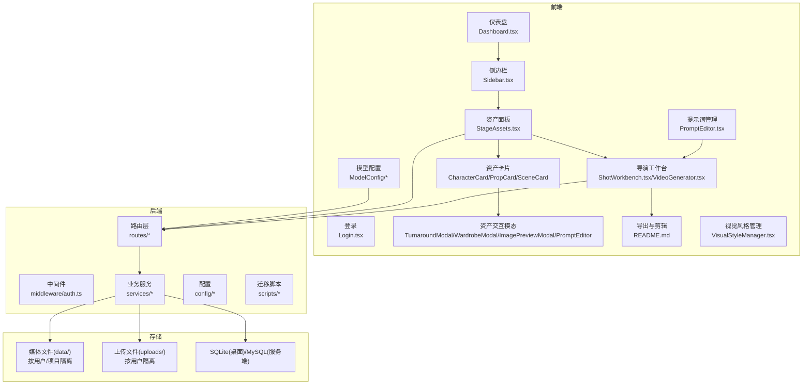
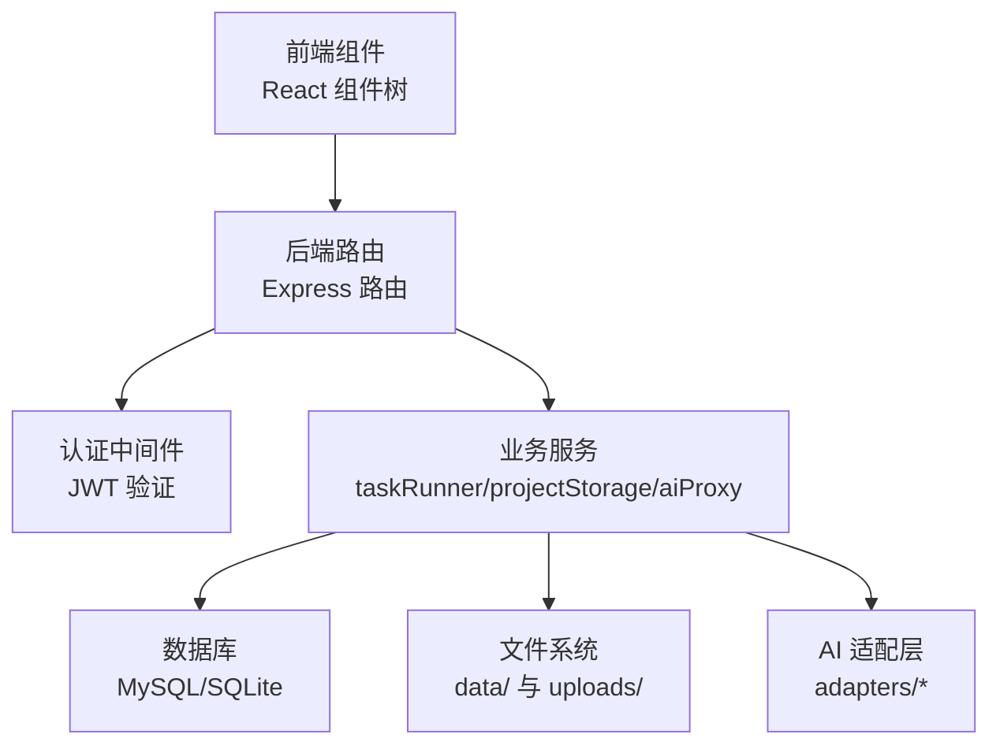
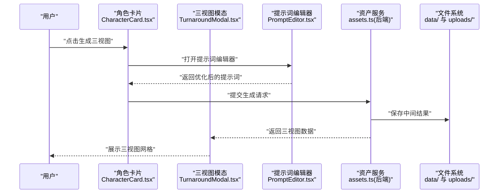
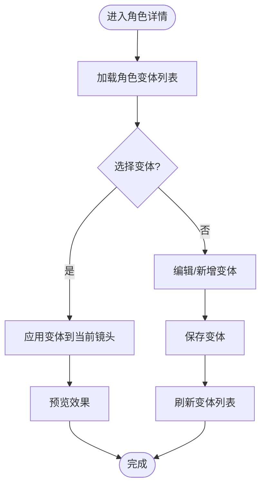
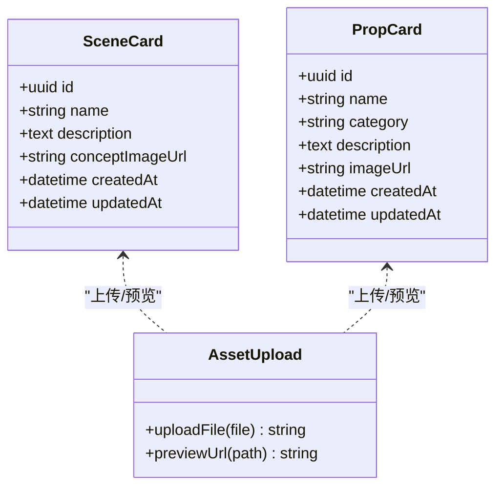
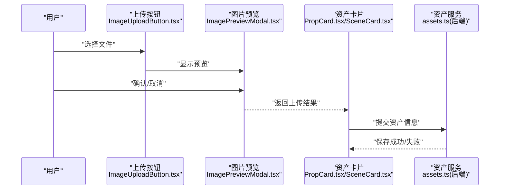
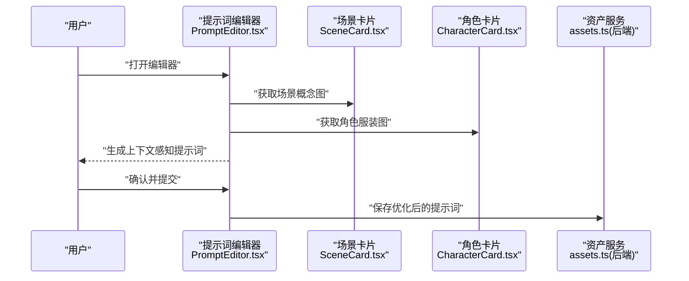
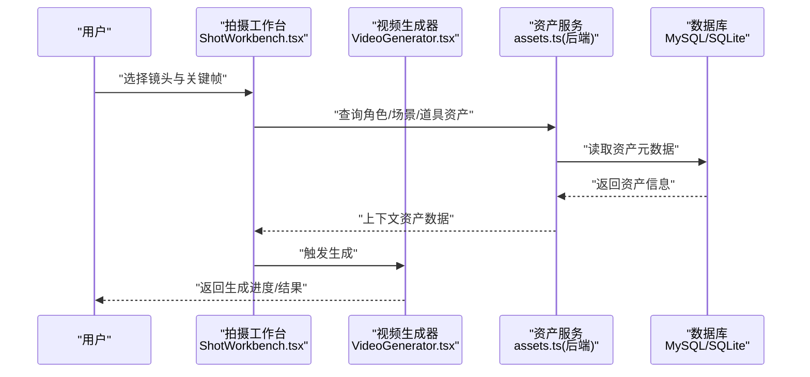
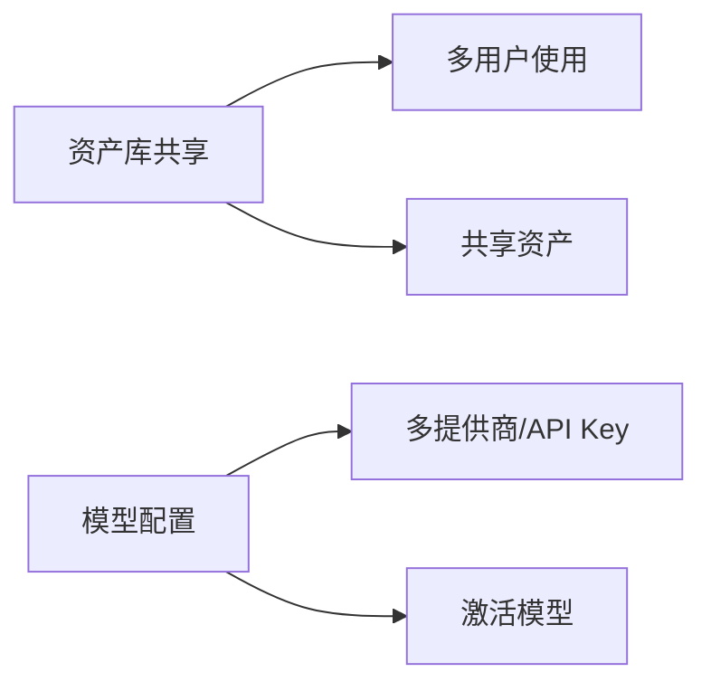
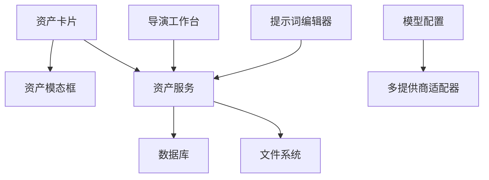

# 资产管理系统

<cite>
**本文引用的文件**
- [README.md](file://README.md)
- [App.tsx](file://App.tsx)
- [index.tsx](file://index.tsx)
- [types.ts](file://types.ts)
- [types/model.ts](file://types/model.ts)
- [contexts/AuthContext.tsx](file://contexts/AuthContext.tsx)
- [contexts/ThemeContext.tsx](file://contexts/ThemeContext.tsx)
- [components/Dashboard.tsx](file://components/Dashboard.tsx)
- [components/Sidebar.tsx](file://components/Sidebar.tsx)
- [components/Login.tsx](file://components/Login.tsx)
- [components/StageAssets.tsx](file://components/StageAssets.tsx)
- [components/StageAssets/CharacterCard.tsx](file://components/StageAssets/CharacterCard.tsx)
- [components/StageAssets/ImagePreviewModal.tsx](file://components/StageAssets/ImagePreviewModal.tsx)
- [components/StageAssets/ImageUploadButton.tsx](file://components/StageAssets/ImageUploadButton.tsx)
- [components/StageAssets/PromptEditor.tsx](file://components/StageAssets/PromptEditor.tsx)
- [components/StageAssets/PropCard.tsx](file://components/StageAssets/PropCard.tsx)
- [components/StageAssets/SceneCard.tsx](file://components/StageAssets/SceneCard.tsx)
- [components/StageAssets/TurnaroundModal.tsx](file://components/StageAssets/TurnaroundModal.tsx)
- [components/StageAssets/WardrobeModal.tsx](file://components/StageAssets/WardrobeModal.tsx)
- [components/StageAssets/README.md](file://components/StageAssets/README.md)
- [components/StageAssets/constants.ts](file://components/StageAssets/constants.ts)
- [components/StageAssets/utils.ts](file://components/StageAssets/utils.ts)
- [components/StageDirector/ShotWorkbench.tsx](file://components/StageDirector/ShotWorkbench.tsx)
- [components/StageDirector/VideoGenerator.tsx](file://components/StageDirector/VideoGenerator.tsx)
- [components/StageDirector/README.md](file://components/StageDirector/README.md)
- [components/StageExport/README.md](file://components/StageExport/README.md)
- [components/StagePrompts/PromptEditor.tsx](file://components/StagePrompts/PromptEditor.tsx)
- [components/StagePrompts/README.md](file://components/StagePrompts/README.md)
- [components/StageScript/README.md](file://components/StageScript/README.md)
- [components/ModelConfig/GlobalSettings.tsx](file://components/ModelConfig/GlobalSettings.tsx)
- [components/ModelConfig/ModelCard.tsx](file://components/ModelConfig/ModelCard.tsx)
- [components/ModelConfig/ModelList.tsx](file://components/ModelConfig/ModelList.tsx)
- [components/ModelConfig/AddModelForm.tsx](file://components/ModelConfig/AddModelForm.tsx)
- [components/ModelConfig/index.tsx](file://components/ModelConfig/index.tsx)
- [components/VisualStyleManager.tsx](file://components/VisualStyleManager.tsx)
- [components/StageAssets/index.tsx](file://components/StageAssets/index.tsx)
- [components/StageAssets/utils.ts](file://components/StageAssets/utils.ts)
- [components/StageAssets/constants.ts](file://components/StageAssets/constants.ts)
- [components/StageAssets/README.md](file://components/StageAssets/README.md)
- [components/StageAssets/CharacterCard.tsx](file://components/StageAssets/CharacterCard.tsx)
- [components/StageAssets/PropCard.tsx](file://components/StageAssets/PropCard.tsx)
- [components/StageAssets/SceneCard.tsx](file://components/StageAssets/SceneCard.tsx)
- [components/StageAssets/ImageUploadButton.tsx](file://components/StageAssets/ImageUploadButton.tsx)
- [components/StageAssets/ImagePreviewModal.tsx](file://components/StageAssets/ImagePreviewModal.tsx)
- [components/StageAssets/PromptEditor.tsx](file://components/StageAssets/PromptEditor.tsx)
- [components/StageAssets/TurnaroundModal.tsx](file://components/StageAssets/TurnaroundModal.tsx)
- [components/StageAssets/WardrobeModal.tsx](file://components/StageAssets/WardrobeModal.tsx)
- [components/StageAssets/README.md](file://components/StageAssets/README.md)
- [components/StageAssets/constants.ts](file://components/StageAssets/constants.ts)
- [components/StageAssets/utils.ts](file://components/StageAssets/utils.ts)
- [components/StageAssets/README.md](file://components/StageAssets/README.md)
- [components/StageAssets/CharacterCard.tsx](file://components/StageAssets/CharacterCard.tsx)
- [components/StageAssets/PropCard.tsx](file://components/StageAssets/PropCard.tsx)
- [components/StageAssets/SceneCard.tsx](file://components/StageAssets/SceneCard.tsx)
- [components/StageAssets/ImageUploadButton.tsx](file://components/StageAssets/ImageUploadButton.tsx)
- [components/StageAssets/ImagePreviewModal.tsx](file://components/StageAssets/ImagePreviewModal.tsx)
- [components/StageAssets/PromptEditor.tsx](file://components/StageAssets/PromptEditor.tsx)
- [components/StageAssets/TurnaroundModal.tsx](file://components/StageAssets/TurnaroundModal.tsx)
- [components/StageAssets/WardrobeModal.tsx](file://components/StageAssets/WardrobeModal.tsx)
- [components/StageAssets/README.md](file://components/StageAssets/README.md)
- [components/StageAssets/constants.ts](file://components/StageAssets/constants.ts)
- [components/StageAssets/utils.ts](file://components/StageAssets/utils.ts)
- [components/StageAssets/README.md](file://components/StageAssets/README.md)
- [components/StageAssets/CharacterCard.tsx](file://components/StageAssets/CharacterCard.tsx)
- [components/StageAssets/PropCard.tsx](file://components/StageAssets/PropCard.tsx)
- [components/StageAssets/SceneCard.tsx](file://components/StageAssets/SceneCard.tsx)
- [components/StageAssets/ImageUploadButton.tsx](file://components/StageAssets/ImageUploadButton.tsx)
- [components/StageAssets/ImagePreviewModal.tsx](file://components/StageAssets/ImagePreviewModal.tsx)
- [components/StageAssets/PromptEditor.tsx](file://components/StageAssets/PromptEditor.tsx)
- [components/StageAssets/TurnaroundModal.tsx](file://components/StageAssets/TurnaroundModal.tsx)
- [components/StageAssets/WardrobeModal.tsx](file://components/StageAssets/WardrobeModal.tsx)
- [components/StageAssets/README.md](file://components/StageAssets/README.md)
- [components/StageAssets/constants.ts](file://components/StageAssets/constants.ts)
- [components/StageAssets/utils.ts](file://components/StageAssets/utils.ts)
- [components/StageAssets/README.md](file://components/StageAssets/README.md)
- [components/StageAssets/CharacterCard.tsx](file://components/StageAssets/CharacterCard.tsx)
- [components/StageAssets/PropCard.tsx](file://components/StageAssets/PropCard.tsx)
- [components/StageAssets/SceneCard.tsx](file://components/StageAssets/SceneCard.tsx)
- [components/StageAssets/ImageUploadButton.tsx](file://components/StageAssets/ImageUploadButton.tsx)
- [components/StageAssets/ImagePreviewModal.tsx](file://components/StageAssets/ImagePreviewModal.tsx)
- [components/StageAssets/PromptEditor.tsx](file://components/StageAssets/PromptEditor.tsx)
- [components/StageAssets/TurnaroundModal.tsx](file://components/StageAssets/TurnaroundModal.tsx)
- [components/StageAssets/WardrobeModal.tsx](file://components/StageAssets/WardrobeModal.tsx)
- [components/StageAssets/README.md](file://components/StageAssets/README.md)
- [components/StageAssets/constants.ts](file://components/StageAssets/constants.ts)
- [components/StageAssets/utils.ts](file://components/StageAssets/utils.ts)
- [components/StageAssets/README.md](file://components/StageAssets/README.md)
- [components/StageAssets/CharacterCard.tsx](file://components/StageAssets/CharacterCard.tsx)
- [components/StageAssets/PropCard.tsx](file://components/StageAssets/PropCard.tsx)
- [components/StageAssets/SceneCard.tsx](file://components/StageAssets/SceneCard.tsx)
- [components/StageAssets/ImageUploadButton.tsx](file://components/StageAssets/ImageUploadButton.tsx)
- [components/StageAssets/ImagePreviewModal.tsx](file://components/StageAssets/ImagePreviewModal.tsx)
- [components/StageAssets/PromptEditor.tsx](file://components/StageAssets/PromptEditor.tsx)
- [components/StageAssets/TurnaroundModal.tsx](file://components/StageAssets/TurnaroundModal.tsx)
- [components/StageAssets/WardrobeModal.tsx](file://components/StageAssets/WardrobeModal.tsx)
- [components/StageAssets/README.md](file://components/StageAssets/README.md)
- [components/StageAssets/constants.ts](file://components/StageAssets/constants.ts)
- [components/StageAssets/utils.ts](file://components/StageAssets/utils.ts)
- [components/StageAssets/README.md](file://components/StageAssets/README.md)
- [components/StageAssets/CharacterCard.tsx](file://components/StageAssets/CharacterCard.tsx)
- [components/StageAssets/PropCard.tsx](file://components/StageAssets/PropCard.tsx)
- [components/StageAssets/SceneCard.tsx](file://components/StageAssets/SceneCard.tsx)
- [components/StageAssets/ImageUploadButton.tsx](file://components/StageAssets/ImageUploadButton.tsx)
- [components/StageAssets/ImagePreviewModal.tsx](file://components/StageAssets/ImagePreviewModal.tsx)
- [components/StageAssets/PromptEditor.tsx](file://components/StageAssets/PromptEditor.tsx)
- [components/StageAssets/TurnaroundModal.tsx](file://components/StageAssets/TurnaroundModal.tsx)
- [components/StageAssets/WardrobeModal.tsx](file://components/StageAssets/WardrobeModal.tsx)
- [components/StageAssets/README.md](file://components/StageAssets/README.md)
- [components/StageAssets/constants.ts](file://components/StageAssets/constants.ts)
- [components/StageAssets/utils.ts](file://components/StageAssets/utils.ts)
- [components/StageAssets/README.md](file://components/StageAssets/README.md)
- [components/StageAssets/CharacterCard.tsx](file://components/StageAssets/CharacterCard.tsx)
- [components/StageAssets/PropCard.tsx](file://components/StageAssets/PropCard.tsx)
- [components/StageAssets/SceneCard.tsx](file://components/StageAssets/SceneCard.tsx)
- [components/StageAssets/ImageUploadButton.tsx](file://components/StageAssets/ImageUploadButton.tsx)
- [components/StageAssets/ImagePreviewModal.tsx......](file://components/StageAssets/ImagePreviewModal.tsx)
- [components/StageAssets/PromptEditor.tsx](file://components/StageAssets/PromptEditor.tsx)
- [components/StageAssets/TurnaroundModal.tsx](file://components/StageAssets/TurnaroundModal.tsx)
- [components/StageAssets/WardrobeModal.tsx](file://components/StageAssets/WardrobeModal.tsx)
- [components/StageAssets/README.md](file://components/StageAssets/README.md)
- [components/StageAssets/constants.ts](file://components/StageAssets/constants.ts)
- [components/StageAssets/utils.ts](file://components/StageAssets/utils.ts)
- [components/StageAssets/README.md](file://components/StageAssets/README.md)
- [components/StageAssets/CharacterCard.tsx](file://components/StageAssets/CharacterCard.tsx)
- [components/StageAssets/PropCard.tsx](file://components/StageAssets/PropCard.tsx)
- [components/StageAssets/SceneCard.tsx](file://components/StageAssets/SceneCard.tsx)
- [components/StageAssets/ImageUploadButton.tsx](file://components/StageAssets/ImageUploadButton.tsx)
- [components/StageAssets/ImagePreviewModal.tsx](file://components/StageAssets/ImagePreviewModal.tsx)
- [components/StageAssets/PromptEditor.tsx](file://components/StageAssets/PromptEditor.tsx)
- [components/StageAssets/TurnaroundModal.tsx](file://components/StageAssets/TurnaroundModal.tsx)
- [components/StageAssets/WardrobeModal.tsx](file://components/StageAssets/WardrobeModal.tsx)
- [components/StageAssets/README.md](file://components/StageAssets/README.md)
- [components/StageAssets/constants.ts](file://components/StageAssets/constants.ts)
- [components/StageAssets/utils.ts](file://components/StageAssets/utils.ts)
- [components/StageAssets/README.md](file://components/StageAssets/README.md)
- [components/StageAssets/CharacterCard.tsx](file://components/StageAssets/CharacterCard.tsx)
- [components/StageAssets/PropCard.tsx](file://components/StageAssets/PropCard.tsx)
- [components/StageAssets/SceneCard.tsx](file://components/StageAssets/SceneCard.tsx)
- [components/StageAssets/ImageUploadButton.tsx](file://components/StageAssets/ImageUploadButton.tsx)
- [components/StageAssets/ImagePreviewModal.tsx](file://components/StageAssets/ImagePreviewModal.tsx)
- [components/StageAssets/PromptEditor.tsx](file://components/StageAssets/PromptEditor.tsx)
- [components/StageAssets/TurnaroundModal.tsx](file://components/StageAssets/TurnaroundModal.tsx)
- [components/StageAssets/WardrobeModal.tsx](file://components/StageAssets/WardrobeModal.tsx)
- [components/StageAssets/README.md](file://components/StageAssets/README.md)
- [components/StageAssets/constants.ts](file://components/StageAssets/constants.ts)
- [components/StageAssets/utils.ts](file://components/StageAssets/utils.ts)
- [components/StageAssets/README.md](file://components/StageAssets/README.md)
- [components/StageAssets/CharacterCard.tsx](file://components/StageAssets/CharacterCard.tsx)
- [components/StageAssets/PropCard.tsx](file://components/StageAssets/PropCard.tsx)
- [components/StageAssets/SceneCard.tsx](file://components/StageAssets/SceneCard.tsx)
- [components/StageAssets/ImageUploadButton.tsx](file://components/StageAssets/ImageUploadButton.tsx)
- [components/StageAssets/ImagePreviewModal.tsx](file://components/StageAssets/ImagePreviewModal.tsx)
- [components/StageAssets/PromptEditor.tsx](file://components/StageAssets/PromptEditor.tsx)
- [components/StageAssets/TurnaroundModal.tsx](file://components/StageAssets/TurnaroundModal.tsx)
- [components/StageAssets/WardrobeModal.tsx](file://components/StageAssets/WardrobeModal.tsx)
- [components/StageAssets/README.md](file://components/StageAssets/README.md)
- [components/StageAssets/constants.ts](file://components/StageAssets/constants.ts)
- [components/StageAssets/utils.ts](file://components/StageAssets/utils.ts)
- [components/StageAssets/README.md](file://components/StageAssets/README.md)
- [components/StageAssets/CharacterCard.tsx](file://components/StageAssets/CharacterCard.tsx)
- [components/StageAssets/PropCard.tsx](file://components/StageAssets/PropCard.tsx)
- [components/StageAssets/SceneCard.tsx](file://components/StageAssets/SceneCard.tsx)
- [components/StageAssets/ImageUploadButton.tsx](file://components/StageAssets/ImageUploadButton.tsx)
- [components/StageAssets/ImagePreviewModal.tsx](file://components/StageAssets/ImagePreviewModal.tsx)
- [components/StageAssets/PromptEditor.tsx](file://components/StageAssets/PromptEditor.tsx)
- [components/StageAssets/TurnaroundModal.tsx](file://components/StageAssets/TurnaroundModal.tsx)
- [components/StageAssets/WardrobeModal.tsx](file://components/StageAssets/WardrobeModal.tsx)
- [components/StageAssets/README.md](file://components/StageAssets/README.md)
- [components/StageAssets/constants.ts](file://components/StageAssets/constants.ts)
- [components/StageAssets/utils.ts](file://components/StageAssets/utils.ts)
- [components/StageAssets/README.md](file://components/StageAssets/README.md)
- [components/StageAssets/CharacterCard.tsx](file://components/StageAssets/CharacterCard.tsx)
- [components/StageAssets/PropCard.tsx](file://components/StageAssets/PropCard.tsx)
- [components/StageAssets/SceneCard.tsx](file://components/StageAssets/SceneCard.tsx)
- [components/StageAssets/ImageUploadButton.tsx](file://components/StageAssets/ImageUploadButton.tsx)
- [components/StageAssets/ImagePreviewModal.tsx](file://components/StageAssets/ImagePreviewModal.tsx)
- [components/StageAssets/PromptEditor.tsx](file://components/StageAssets/PromptEditor.tsx)
- [components/StageAssets/TurnaroundModal.tsx](file://components/StageAssets/TurnaroundModal.tsx)
- [components/StageAssets/WardrobeModal.tsx](file://components/StageAssets/WardrobeModal.tsx)
- [components/StageAssets/README.md](file://components/StageAssets/README.md)
- [components/StageAssets/constants.ts](file://components/StageAssets/constants.ts)
- [components/StageAssets/utils.ts](file://components/StageAssets/utils.ts)
- [components/StageAssets/README.md](file://components/StageAssets/README.md)
- [components/StageAssets/CharacterCard.tsx](file://components/StageAssets/CharacterCard.tsx)
- [components/StageAssets/PropCard.tsx](file://components/StageAssets/PropCard.tsx)
- [components/StageAssets/SceneCard.tsx](file://components/StageAssets/SceneCard.tsx)
- [components/StageAssets/ImageUploadButton.tsx](file://components/StageAssets/ImageUploadButton.tsx)
- [components/StageAssets/ImagePreviewModal.tsx](file://components/StageAssets/ImagePreviewModal.tsx)
- [components/StageAssets/PromptEditor.tsx](file://components/StageAssets/PromptEditor.tsx)
- [components/StageAssets/TurnaroundModal.tsx](file://components/StageAssets/TurnaroundModal.tsx)
- [components/StageAssets/WardrobeModal.tsx](file://components/StageAssets/WardrobeModal.tsx)
- [components/StageAssets/README.md](file://components/StageAssets/README.md)
- [components/StageAssets/constants.ts](file://components/StageAssets/constants.ts)
-......
</cite>

## 目录
1. [简介](#简介)
2. [项目结构](#项目结构)
3. [核心组件](#核心组件)
4. [架构总览](#架构总览)
5. [详细组件分析](#详细组件分析)
6. [依赖关系分析](#依赖关系分析)
7. [性能考虑](#性能考虑)
8. [故障排除指南](#故障排除指南)
9. [结论](#结论)
10. [附录](#附录)

## 简介
本文件为“资产管理系统”的综合技术文档，聚焦于角色资产、场景概念图、道具管理等资产类型的全生命周期管理，涵盖上传、预览、编辑、分类、搜索、三视图生成、换装系统、提示词编辑器、资产库共享等核心与高级功能。文档同时阐述资产文件的存储策略、版本管理、权限控制、性能优化以及导入导出、批量操作、质量控制等实用能力。

系统采用前后端分离架构：前端基于 React 19/Vite/TailwindCSS/Radix UI/Framer Motion，后端基于 Express.js/MySQL/SQLite，结合多模型提供商适配层与桌面客户端（Electron）打包方案，支持用户隔离与数据导出/导入。

## 项目结构
系统以“阶段化工作流”组织功能模块，资产相关能力集中在“资产与选角（Phase 02）”阶段，配合导演工作台（关键帧驱动）与导出模块形成完整的从资产到成片的流水线。

图表来源
- [README.md](file://README.md)
- [components/Dashboard.tsx](file://components/Dashboard.tsx)
- [components/Sidebar.tsx](file://components/Sidebar.tsx)
- [components/StageAssets.tsx](file://components/StageAssets.tsx)
- [components/StageAssets/CharacterCard.tsx](file://components/StageAssets/CharacterCard.tsx)
- [components/StageAssets/PropCard.tsx](file://components/StageAssets/PropCard.tsx)
- [components/StageAssets/SceneCard.tsx](file://components/StageAssets/SceneCard.tsx)
- [components/StageAssets/TurnaroundModal.tsx](file://components/StageAssets/TurnaroundModal.tsx)
- [components/StageAssets/WardrobeModal.tsx](file://components/StageAssets/WardrobeModal.tsx)
- [components/StageAssets/ImagePreviewModal.tsx](file://components/StageAssets/ImagePreviewModal.tsx)
- [components/StageAssets/PromptEditor.tsx](file://components/StageAssets/PromptEditor.tsx)
- [components/StageDirector/ShotWorkbench.tsx](file://components/StageDirector/ShotWorkbench.tsx)
- [components/StageDirector/VideoGenerator.tsx](file://components/StageDirector/VideoGenerator.tsx)
- [components/StageExport/README.md](file://components/StageExport/README.md)
- [components/StagePrompts/PromptEditor.tsx](file://components/StagePrompts/PromptEditor.tsx)
- [components/ModelConfig/index.tsx](file://components/ModelConfig/index.tsx)
- [components/VisualStyleManager.tsx](file://components/VisualStyleManager.tsx)

章节来源
- [README.md](file://README.md)
- [App.tsx](file://App.tsx)
- [index.tsx](file://index.tsx)
- [types.ts](file://types.ts)
- [types/model.ts](file://types/model.ts)
- [contexts/AuthContext.tsx](file://contexts/AuthContext.tsx)
- [contexts/ThemeContext.tsx](file://contexts/ThemeContext.tsx)

## 核心组件
- 资产面板与卡片
  - 角色资产：角色卡片、三视图生成、换装系统、提示词编辑器
  - 场景资产：场景卡片、概念图上传与预览
  - 道具资产：道具卡片、分类与描述管理
- 资产交互模态
  - 三视图查看器、换装选择器、图片预览器、提示词编辑器
- 导演工作台
  - 关键帧驱动的首帧/尾帧生成、九宫格预览、视频生成
- 模型配置与视觉风格
  - 多提供商模型配置、激活模型选择、视觉风格模板
- 权限与用户隔离
  - JWT 认证、用户隔离的数据表设计、按 user_id 隔离

章节来源
- [components/StageAssets.tsx](file://components/StageAssets.tsx)
- [components/StageAssets/CharacterCard.tsx](file://components/StageAssets/CharacterCard.tsx)
- [components/StageAssets/PropCard.tsx](file://components/StageAssets/PropCard.tsx)
- [components/StageAssets/SceneCard.tsx](file://components/StageAssets/SceneCard.tsx)
- [components/StageAssets/TurnaroundModal.tsx](file://components/StageAssets/TurnaroundModal.tsx)
- [components/StageAssets/WardrobeModal.tsx](file://components/StageAssets/WardrobeModal.tsx)
- [components/StageAssets/ImagePreviewModal.tsx](file://components/StageAssets/ImagePreviewModal.tsx)
- [components/StageAssets/PromptEditor.tsx](file://components/StageAssets/PromptEditor.tsx)
- [components/StageDirector/ShotWorkbench.tsx](file://components/StageDirector/ShotWorkbench.tsx)
- [components/StageDirector/VideoGenerator.tsx](file://components/StageDirector/VideoGenerator.tsx)
- [components/ModelConfig/index.tsx](file://components/ModelConfig/index.tsx)
- [components/VisualStyleManager.tsx](file://components/VisualStyleManager.tsx)

## 架构总览
系统采用“前端组件 + 后端路由/服务 + 存储层”的三层架构，资产相关请求通过认证中间件，路由层分发至业务服务，服务层负责数据库读写与文件存储协调。

图表来源
- [README.md](file://README.md)
- [contexts/AuthContext.tsx](file://contexts/AuthContext.tsx)
- [components/StageAssets.tsx](file://components/StageAssets.tsx)
- [components/StageDirector/VideoGenerator.tsx](file://components/StageDirector/VideoGenerator.tsx)

## 详细组件分析

### 角色资产与三视图生成
角色资产是“资产与选角”阶段的核心，围绕角色定妆照与换装系统展开。三视图生成用于提供角色的正视、侧视、背视参考，确保角色在不同镜头中的一致性。

图表来源
- [components/StageAssets/CharacterCard.tsx](file://components/StageAssets/CharacterCard.tsx)
- [components/StageAssets/TurnaroundModal.tsx](file://components/StageAssets/TurnaroundModal.tsx)
- [components/StageAssets/PromptEditor.tsx](file://components/StageAssets/PromptEditor.tsx)
- [README.md](file://README.md)

章节来源
- [components/StageAssets/CharacterCard.tsx](file://components/StageAssets/CharacterCard.tsx)
- [components/StageAssets/TurnaroundModal.tsx](file://components/StageAssets/TurnaroundModal.tsx)
- [components/StageAssets/PromptEditor.tsx](file://components/StageAssets/PromptEditor.tsx)

### 换装系统（角色变体/衣橱）
换装系统允许为角色创建多个造型变体，保证在不同场景与镜头中角色外观的一致性与多样性。

图表来源
- [components/StageAssets/CharacterCard.tsx](file://components/StageAssets/CharacterCard.tsx)
- [components/StageAssets/WardrobeModal.tsx](file://components/StageAssets/WardrobeModal.tsx)

章节来源
- [components/StageAssets/CharacterCard.tsx](file://components/StageAssets/CharacterCard.tsx)
- [components/StageAssets/WardrobeModal.tsx](file://components/StageAssets/WardrobeModal.tsx)

### 场景概念图与道具管理
场景概念图用于统一场景光照与氛围，道具资产则提供场景中的可交互元素。

图表来源
- [components/StageAssets/SceneCard.tsx](file://components/StageAssets/SceneCard.tsx)
- [components/StageAssets/PropCard.tsx](file://components/StageAssets/PropCard.tsx)
- [components/StageAssets/ImageUploadButton.tsx](file://components/StageAssets/ImageUploadButton.tsx)
- [components/StageAssets/ImagePreviewModal.tsx](file://components/StageAssets/ImagePreviewModal.tsx)

章节来源
- [components/StageAssets/SceneCard.tsx](file://components/StageAssets/SceneCard.tsx)
- [components/StageAssets/PropCard.tsx](file://components/StageAssets/PropCard.tsx)
- [components/StageAssets/ImageUploadButton.tsx](file://components/StageAssets/ImageUploadButton.tsx)
- [components/StageAssets/ImagePreviewModal.tsx](file://components/StageAssets/ImagePreviewModal.tsx)

### 资产上传、预览与编辑
资产上传采用分步流程：选择文件 -> 预览 -> 编辑描述/分类 -> 保存入库。预览与编辑界面通过模态框实现，避免页面跳转。

图表来源
- [components/StageAssets/ImageUploadButton.tsx](file://components/StageAssets/ImageUploadButton.tsx)
- [components/StageAssets/ImagePreviewModal.tsx](file://components/StageAssets/ImagePreviewModal.tsx)
- [components/StageAssets/PropCard.tsx](file://components/StageAssets/PropCard.tsx)
- [components/StageAssets/SceneCard.tsx](file://components/StageAssets/SceneCard.tsx)

章节来源
- [components/StageAssets/ImageUploadButton.tsx](file://components/StageAssets/ImageUploadButton.tsx)
- [components/StageAssets/ImagePreviewModal.tsx](file://components/StageAssets/ImagePreviewModal.tsx)
- [components/StageAssets/PropCard.tsx](file://components/StageAssets/PropCard.tsx)
- [components/StageAssets/SceneCard.tsx](file://components/StageAssets/SceneCard.tsx)

### 提示词编辑器与上下文感知
提示词编辑器用于优化角色与场景生成的提示词，结合当前场景图与角色服装图，减少“不连戏”。

图表来源
- [components/StageAssets/PromptEditor.tsx](file://components/StageAssets/PromptEditor.tsx)
- [components/StageAssets/SceneCard.tsx](file://components/StageAssets/SceneCard.tsx)
- [components/StageAssets/CharacterCard.tsx](file://components/StageAssets/CharacterCard.tsx)

章节来源
- [components/StageAssets/PromptEditor.tsx](file://components/StageAssets/PromptEditor.tsx)
- [components/StageAssets/SceneCard.tsx](file://components/StageAssets/SceneCard.tsx)
- [components/StageAssets/CharacterCard.tsx](file://components/StageAssets/CharacterCard.tsx)

### 导演工作台与关键帧驱动
导演工作台通过首帧/尾帧生成与九宫格预览，结合资产库中的角色、场景、道具，实现上下文感知的视频生成。

图表来源
- [components/StageDirector/ShotWorkbench.tsx](file://components/StageDirector/ShotWorkbench.tsx)
- [components/StageDirector/VideoGenerator.tsx](file://components/StageDirector/VideoGenerator.tsx)
- [README.md](file://README.md)

章节来源
- [components/StageDirector/ShotWorkbench.tsx](file://components/StageDirector/ShotWorkbench.tsx)
- [components/StageDirector/VideoGenerator.tsx](file://components/StageDirector/VideoGenerator.tsx)

### 资产库共享与模型配置
资产库共享允许团队成员复用角色、场景与道具；模型配置支持多提供商与API Key管理，便于切换与成本控制。

图表来源
- [components/ModelConfig/index.tsx](file://components/ModelConfig/index.tsx)
- [components/StageAssets.tsx](file://components/StageAssets.tsx)

章节来源
- [components/ModelConfig/index.tsx](file://components/ModelConfig/index.tsx)
- [components/StageAssets.tsx](file://components/StageAssets.tsx)

## 依赖关系分析
- 组件耦合
  - 资产卡片与模态框松耦合，通过 props 传递数据，便于复用与测试
  - 导演工作台依赖资产服务提供的上下文数据，形成清晰的调用链
- 外部依赖
  - 多模型提供商适配层（chat/image/video）统一接口，便于扩展与替换
  - 文件系统与数据库双通道存储，保障媒体与元数据一致性
- 权限控制
  - JWT 认证贯穿前后端，用户隔离确保数据安全

图表来源
- [components/StageAssets/CharacterCard.tsx](file://components/StageAssets/CharacterCard.tsx)
- [components/StageAssets/TurnaroundModal.tsx](file://components/StageAssets/TurnaroundModal.tsx)
- [components/StageAssets/PromptEditor.tsx](file://components/StageAssets/PromptEditor.tsx)
- [components/StageDirector/ShotWorkbench.tsx](file://components/StageDirector/ShotWorkbench.tsx)
- [components/ModelConfig/index.tsx](file://components/ModelConfig/index.tsx)

章节来源
- [components/StageAssets/CharacterCard.tsx](file://components/StageAssets/CharacterCard.tsx)
- [components/StageAssets/TurnaroundModal.tsx](file://components/StageAssets/TurnaroundModal.tsx)
- [components/StageAssets/PromptEditor.tsx](file://components/StageAssets/PromptEditor.tsx)
- [components/StageDirector/ShotWorkbench.tsx](file://components/StageDirector/ShotWorkbench.tsx)
- [components/ModelConfig/index.tsx](file://components/ModelConfig/index.tsx)

## 性能考虑
- 存储策略
  - 媒体文件按用户/项目隔离，减少并发写冲突；小文件与大文件分层存储，提升读写效率
- 版本管理
  - 资产元数据版本化，生成历史可追溯；关键帧与提示词变更记录便于回滚
- 权限控制
  - JWT 令牌短期有效，结合数据库用户隔离，降低越权风险
- 性能优化
  - 图片预览采用缩略图与懒加载；异步任务队列处理生成请求，避免阻塞主线程
  - 导出/导入采用 ZIP 归档，减少传输与解析开销

## 故障排除指南
- 登录与认证
  - 确认 JWT 密钥配置正确；检查认证中间件是否拦截未授权请求
- 资产上传失败
  - 检查文件大小与类型限制；确认 data/ 与 uploads/ 目录权限
- 生成任务异常
  - 查看异步任务日志与错误码；核对模型配置与 API Key
- 数据导出/导入问题
  - 确认导出时包含数据库与媒体文件；导入后检查用户隔离与路径映射

章节来源
- [contexts/AuthContext.tsx](file://contexts/AuthContext.tsx)
- [README.md](file://README.md)

## 结论
资产管理系统以“关键帧驱动”为核心，围绕角色、场景、道具三大资产类型构建了从上传、预览、编辑、分类、搜索到生成、导出的完整闭环。通过多模型适配、用户隔离与文件/数据库双通道存储，系统在保证一致性的同时兼顾性能与可扩展性。建议在实际使用中结合提示词编辑器与上下文感知能力，持续优化资产质量与生成效果。

## 附录
- 快速开始
  - 登录后在“模型配置”中填写 API Key 并选择激活模型；在“资产与选角”阶段生成角色三视图与场景概念图；在“导演工作台”中生成关键帧并导出视频
- 数据导出/导入
  - 在系统设置中导出当前用户全部数据（数据库记录与 media 文件），导入时自动创建新用户并还原数据

章节来源
- [README.md](file://README.md)