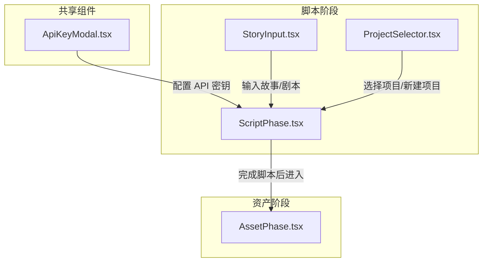
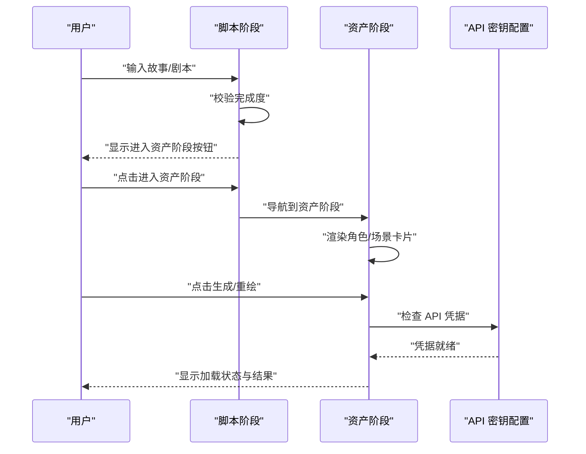
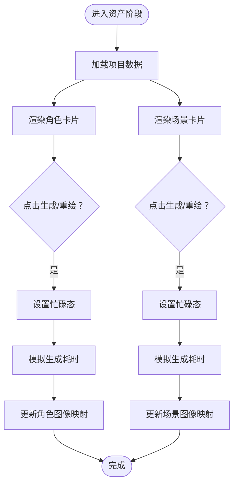
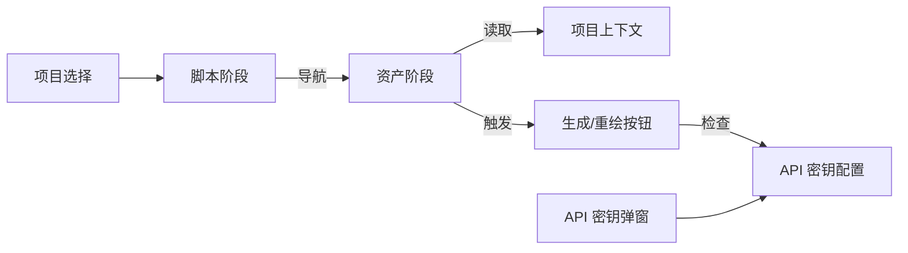

# 道具资产管理

<cite>
**本文引用的文件**
- [AssetPhase.tsx](file://src/phases/assets/AssetPhase.tsx)
- [ScriptPhase.tsx](file://src/phases/script/ScriptPhase.tsx)
- [ApiKeyModal.tsx](file://src/shared/components/ApiKeyModal.tsx)
- [ProjectSelector.tsx](file://src/shared/components/ProjectSelector.tsx)
- [StoryInput.tsx](file://src/phases/script/components/StoryInput.tsx)
</cite>

## 目录
1. [简介](#简介)
2. [项目结构](#项目结构)
3. [核心组件](#核心组件)
4. [架构总览](#架构总览)
5. [详细组件分析](#详细组件分析)
6. [依赖关系分析](#依赖关系分析)
7. [性能考虑](#性能考虑)
8. [故障排除指南](#故障排除指南)
9. [结论](#结论)
10. [附录](#附录)

## 简介
本文件面向“道具资产管理”功能，系统性梳理当前项目中与资产生成、角色与场景参考图相关的前端实现与工作流。根据现有代码，资产生成阶段（Phase 02）目前处于骨架版本，核心目标是为角色与场景生成参考图，并通过统一入口进入该阶段。实际图像生成逻辑在后续任务中完善。

本文件将从以下维度展开：
- 资产生成阶段的整体架构与控制流
- 角色与场景卡片组件的职责与交互
- API 密钥配置与项目选择对资产生成的影响
- 工作流衔接：从脚本阶段到资产阶段的跳转机制
- 可能的扩展点：提示词编辑、批量操作、导入导出与版本管理等

## 项目结构
与道具资产管理直接相关的核心文件位于前端阶段模块中，主要涉及资产生成阶段与脚本阶段之间的衔接，以及密钥配置与项目选择界面。

图表来源
- [ScriptPhase.tsx:397-430](file://src/phases/script/ScriptPhase.tsx#L397-L430)
- [AssetPhase.tsx:1-242](file://src/phases/assets/AssetPhase.tsx#L1-L242)
- [ApiKeyModal.tsx:49-79](file://src/shared/components/ApiKeyModal.tsx#L49-L79)
- [ProjectSelector.tsx:114-140](file://src/shared/components/ProjectSelector.tsx#L114-L140)
- [StoryInput.tsx:42-63](file://src/phases/script/components/StoryInput.tsx#L42-L63)

章节来源
- [AssetPhase.tsx:1-242](file://src/phases/assets/AssetPhase.tsx#L1-L242)
- [ScriptPhase.tsx:397-430](file://src/phases/script/ScriptPhase.tsx#L397-L430)
- [ApiKeyModal.tsx:49-79](file://src/shared/components/ApiKeyModal.tsx#L49-L79)
- [ProjectSelector.tsx:114-140](file://src/shared/components/ProjectSelector.tsx#L114-L140)
- [StoryInput.tsx:42-63](file://src/phases/script/components/StoryInput.tsx#L42-L63)

## 核心组件
- 资产生成阶段容器：负责渲染角色与场景两大板块，展示参考图占位与生成按钮。
- 角色卡片：显示角色元信息与生成/重绘按钮；占位图与最终图像通过项目状态中的映射进行切换。
- 场景卡片：显示场景标题与描述，提供生成/重绘按钮。
- 脚本阶段入口：在脚本完成后提供进入资产阶段的按钮。
- API 密钥配置：资产生成需要有效的 API 凭据，界面提供配置入口。
- 项目选择：新项目创建与现有项目选择，支撑资产生成的上下文。

章节来源
- [AssetPhase.tsx:13-72](file://src/phases/assets/AssetPhase.tsx#L13-L72)
- [AssetPhase.tsx:110-185](file://src/phases/assets/AssetPhase.tsx#L110-L185)
- [AssetPhase.tsx:187-241](file://src/phases/assets/AssetPhase.tsx#L187-L241)
- [ScriptPhase.tsx:397-430](file://src/phases/script/ScriptPhase.tsx#L397-L430)
- [ApiKeyModal.tsx:49-79](file://src/shared/components/ApiKeyModal.tsx#L49-L79)
- [ProjectSelector.tsx:114-140](file://src/shared/components/ProjectSelector.tsx#L114-L140)

## 架构总览
资产生成阶段采用“阶段化工作流”的设计思路，从前端 UI 层面串联脚本阶段与资产阶段。用户在脚本阶段完成故事与场景设定后，进入资产阶段生成角色与场景的参考图。当前实现以占位图与按钮交互为主，实际图像生成逻辑预留了扩展点。

图表来源
- [ScriptPhase.tsx:397-430](file://src/phases/script/ScriptPhase.tsx#L397-L430)
- [AssetPhase.tsx:119-128](file://src/phases/assets/AssetPhase.tsx#L119-L128)
- [AssetPhase.tsx:226-229](file://src/phases/assets/AssetPhase.tsx#L226-L229)
- [ApiKeyModal.tsx:49-79](file://src/shared/components/ApiKeyModal.tsx#L49-L79)

## 详细组件分析

### 资产生成阶段容器（AssetPhase）
- 职责
  - 渲染角色与场景两大区域，展示数量统计与描述说明。
  - 提供角色与场景卡片，承载生成/重绘交互。
  - 基于项目状态决定是否显示占位图或已生成图像。
- 关键行为
  - 角色卡片：当存在角色参考图映射时显示图像，否则显示占位图；提供生成/重绘按钮。
  - 场景卡片：当存在场景图像映射时显示图像，否则显示占位图；提供生成/重绘按钮。
  - 加载态：按钮点击后短暂禁用并显示加载指示，模拟异步生成过程。
- 扩展点
  - 图像生成：当前通过延时模拟，后续可接入真实生成服务。
  - 数据持久化：角色与场景图像映射写入项目状态，供其他阶段复用。

图表来源
- [AssetPhase.tsx:119-128](file://src/phases/assets/AssetPhase.tsx#L119-L128)
- [AssetPhase.tsx:226-229](file://src/phases/assets/AssetPhase.tsx#L226-L229)

章节来源
- [AssetPhase.tsx:13-72](file://src/phases/assets/AssetPhase.tsx#L13-L72)
- [AssetPhase.tsx:110-185](file://src/phases/assets/AssetPhase.tsx#L110-L185)
- [AssetPhase.tsx:187-241](file://src/phases/assets/AssetPhase.tsx#L187-L241)

### 角色卡片（CharacterCard）
- 职责
  - 展示角色名称、外观/描述信息。
  - 提供生成/重绘按钮，触发生成流程。
  - 根据项目状态中的角色图像映射决定显示占位图或图像。
- 交互细节
  - 按钮文案随是否有参考图而变化。
  - 点击后进入忙碌态，防止重复提交。
  - 当前为占位实现，后续接入真实生成服务。

章节来源
- [AssetPhase.tsx:110-185](file://src/phases/assets/AssetPhase.tsx#L110-L185)

### 场景卡片（SceneCard）
- 职责
  - 展示场景标题与描述。
  - 提供生成/重绘按钮，触发生成流程。
  - 根据项目状态中的场景图像映射决定显示占位图或图像。
- 交互细节
  - 按钮文案随是否有场景图而变化。
  - 点击后进入忙碌态，防止重复提交。
  - 当前为占位实现，后续接入真实生成服务。

章节来源
- [AssetPhase.tsx:187-241](file://src/phases/assets/AssetPhase.tsx#L187-L241)

### 脚本阶段到资产阶段的衔接
- 职责
  - 在脚本完成后显示“进入资产阶段”按钮。
  - 控制阶段跳转，确保工作流顺序正确。
- 行为
  - 完成度满足条件后按钮可用，点击后导航至资产阶段。

章节来源
- [ScriptPhase.tsx:397-430](file://src/phases/script/ScriptPhase.tsx#L397-L430)

### API 密钥配置与项目选择
- API 密钥配置
  - 提供配置入口，强调凭据仅本地存储，不上传服务器。
  - 用于解锁或启用资产生成所需的外部服务调用。
- 项目选择
  - 新建项目与选择现有项目，为资产生成提供上下文数据源。

章节来源
- [ApiKeyModal.tsx:49-79](file://src/shared/components/ApiKeyModal.tsx#L49-L79)
- [ProjectSelector.tsx:114-140](file://src/shared/components/ProjectSelector.tsx#L114-L140)

## 依赖关系分析
- 组件耦合
  - 资产阶段依赖项目上下文以读取角色与场景映射。
  - 角色/场景卡片依赖资产阶段的状态与按钮交互。
  - 脚本阶段与资产阶段通过导航按钮建立顺序依赖。
- 外部依赖
  - API 密钥配置影响资产生成的可用性与后续服务调用。
- 潜在风险
  - 当前生成逻辑为占位实现，需确保后续真实实现与项目状态同步。
  - 若缺少 API 凭据，可能阻断资产生成流程。

图表来源
- [ScriptPhase.tsx:397-430](file://src/phases/script/ScriptPhase.tsx#L397-L430)
- [AssetPhase.tsx:119-128](file://src/phases/assets/AssetPhase.tsx#L119-L128)
- [AssetPhase.tsx:226-229](file://src/phases/assets/AssetPhase.tsx#L226-L229)
- [ApiKeyModal.tsx:49-79](file://src/shared/components/ApiKeyModal.tsx#L49-L79)
- [ProjectSelector.tsx:114-140](file://src/shared/components/ProjectSelector.tsx#L114-L140)

章节来源
- [ScriptPhase.tsx:397-430](file://src/phases/script/ScriptPhase.tsx#L397-L430)
- [AssetPhase.tsx:119-128](file://src/phases/assets/AssetPhase.tsx#L119-L128)
- [AssetPhase.tsx:226-229](file://src/phases/assets/AssetPhase.tsx#L226-L229)
- [ApiKeyModal.tsx:49-79](file://src/shared/components/ApiKeyModal.tsx#L49-L79)
- [ProjectSelector.tsx:114-140](file://src/shared/components/ProjectSelector.tsx#L114-L140)

## 性能考虑
- 渲染性能
  - 使用网格布局展示角色与场景卡片，注意在大量条目时的滚动与懒加载策略。
- 交互响应
  - 按钮忙碌态避免重复提交，提升用户体验。
- 数据访问
  - 通过项目上下文集中读取映射，减少重复计算与状态分散。
- 后续优化建议
  - 图像生成采用后台任务或队列，避免阻塞 UI。
  - 对图像进行缓存与预加载，减少二次生成开销。

## 故障排除指南
- 无法进入资产阶段
  - 检查脚本阶段完成度是否满足条件。
  - 确认脚本阶段按钮是否可用。
- 生成按钮不可用或无响应
  - 检查是否处于忙碌态（按钮被禁用）。
  - 确认项目上下文中是否存在角色/场景映射。
- 缺少 API 凭据
  - 弹出 API 密钥配置弹窗，按提示完成本地配置。
- 图像未显示
  - 确认项目状态中的映射是否已更新。
  - 检查网络与服务可用性（后续真实实现时）。

章节来源
- [ScriptPhase.tsx:397-430](file://src/phases/script/ScriptPhase.tsx#L397-L430)
- [AssetPhase.tsx:119-128](file://src/phases/assets/AssetPhase.tsx#L119-L128)
- [AssetPhase.tsx:226-229](file://src/phases/assets/AssetPhase.tsx#L226-L229)
- [ApiKeyModal.tsx:49-79](file://src/shared/components/ApiKeyModal.tsx#L49-L79)

## 结论
当前道具资产管理功能处于阶段化开发的早期骨架版本，重点在于为角色与场景生成参考图提供统一入口与基础交互。后续应围绕以下方面完善：
- 实现真实的图像生成与存储流程，确保与项目状态同步。
- 提供提示词编辑能力（如角色外观、场景氛围等），以提升生成质量与一致性。
- 支持批量操作、导入导出与版本管理，便于团队协作与迭代。
- 优化加载与缓存策略，提升大项目下的性能表现。

## 附录
- 相关输入与上下文
  - 故事/剧本输入：用于驱动角色与场景的生成需求。
  - 项目上下文：承载角色、场景与资产映射的数据源。
- 建议的扩展清单
  - 提示词编辑器：针对角色外观、场景氛围进行精细化描述。
  - 批量生成：支持一次性生成多个角色或场景参考图。
  - 版本管理：记录不同版本的参考图与提示词，便于回溯与对比。
  - 导入导出：支持将角色/场景资产与提示词打包分享。