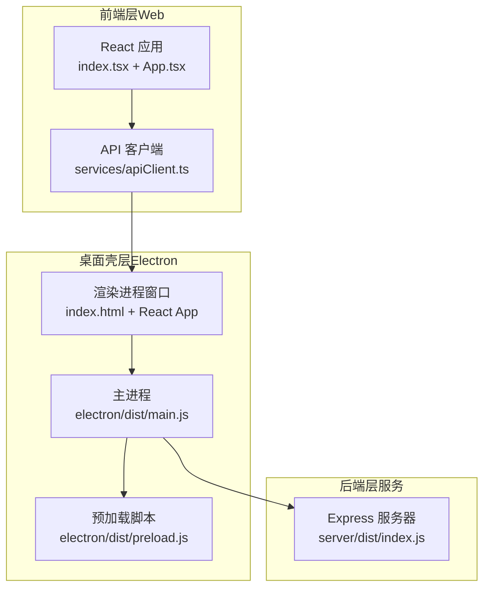
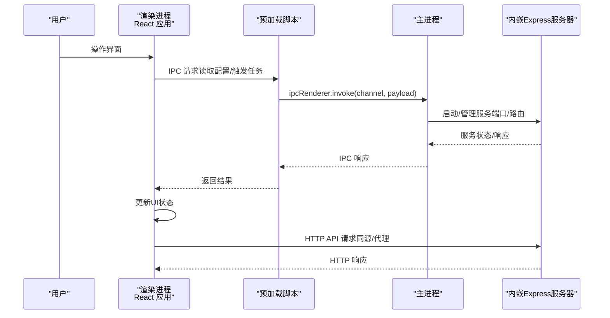
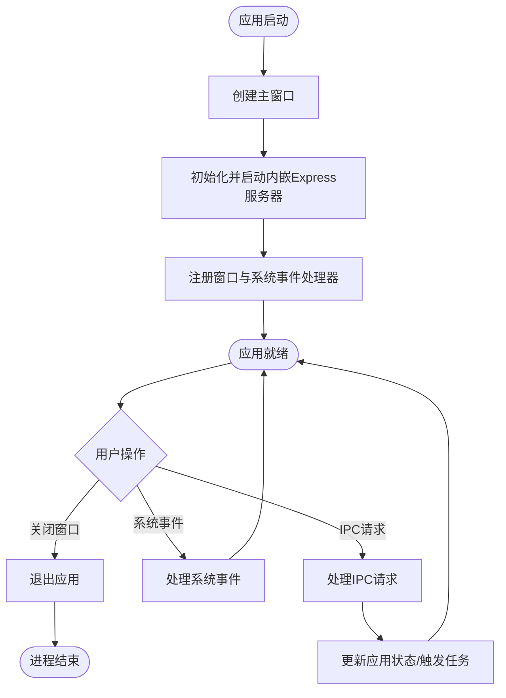
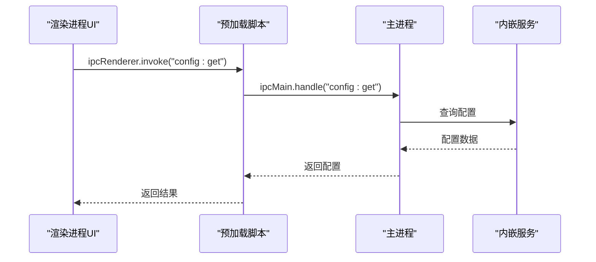
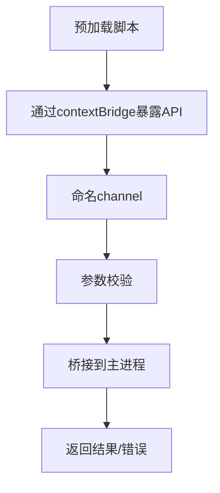
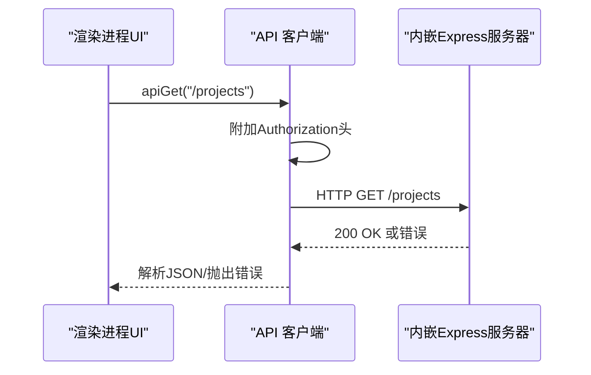
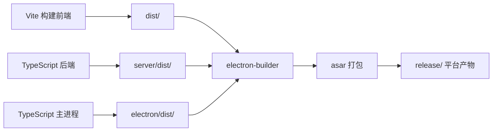

# Electron架构设计

<cite>
**本文引用的文件**
- [package.json](file://package.json)
- [scripts/build-electron.sh](file://scripts/build-electron.sh)
- [electron-builder.yml](file://electron-builder.yml)
- [index.tsx](file://index.tsx)
- [App.tsx](file://App.tsx)
- [services/apiClient.ts](file://services/apiClient.ts)
</cite>

## 目录
1. [简介](#简介)
2. [项目结构](#项目结构)
3. [核心组件](#核心组件)
4. [架构总览](#架构总览)
5. [详细组件分析](#详细组件分析)
6. [依赖关系分析](#依赖关系分析)
7. [性能考虑](#性能考虑)
8. [故障排查指南](#故障排查指南)
9. [结论](#结论)
10. [附录](#附录)

## 简介
本文件面向AI Shotlive桌面版Electron架构设计，聚焦于主进程与渲染进程的职责划分、主进程如何启动内嵌Express服务器、窗口生命周期管理与系统事件处理、渲染进程与主进程之间的通信机制（IPC）、安全上下文隔离策略，以及预加载脚本的安全边界与Node.js API暴露限制。同时提供进程间通信最佳实践、错误处理策略与性能优化建议，帮助开发者在保证安全性的同时实现高效稳定的桌面应用。

## 项目结构
本项目采用“前端React + 后端Express + Electron桌面壳”的三层架构：
- 前端层：基于Vite构建的React应用，负责UI交互与业务逻辑。
- 后端层：基于Express的REST服务，提供API路由、中间件与业务服务。
- 桌面壳层：Electron主进程负责应用生命周期、窗口管理、原生系统集成；渲染进程承载前端界面；预加载脚本提供受控的Node.js能力桥接。

图表来源
- [package.json:1-83](file://package.json#L1-L83)
- [scripts/build-electron.sh:1-97](file://scripts/build-electron.sh#L1-L97)
- [electron-builder.yml:1-85](file://electron-builder.yml#L1-L85)
- [index.tsx:1-76](file://index.tsx#L1-L76)
- [App.tsx:1-380](file://App.tsx#L1-L380)
- [services/apiClient.ts:1-168](file://services/apiClient.ts#L1-L168)

章节来源
- [package.json:1-83](file://package.json#L1-L83)
- [scripts/build-electron.sh:1-97](file://scripts/build-electron.sh#L1-L97)
- [electron-builder.yml:1-85](file://electron-builder.yml#L1-L85)

## 核心组件
- 主进程（Main Process）
  - 职责：创建和管理窗口、处理系统级事件、启动并管理内嵌Express服务器、与原生系统交互（菜单、托盘、对话框等）。
  - 启动方式：通过package.json的main字段指向electron/dist/main.js。
  - 打包策略：electron-builder.yml定义了asar打包、native模块重建与平台目标。

- 预加载脚本（Preload）
  - 职责：在渲染进程沙箱内提供受控的Node.js能力，向渲染进程暴露有限API，确保上下文隔离与安全。
  - 作用：作为主进程与渲染进程之间的桥梁，仅暴露必要的IPC通道与受限能力。

- 渲染进程（Renderer）
  - 职责：承载React应用UI、状态管理、用户交互；通过IPC与主进程通信；通过API客户端访问后端服务。
  - 安全：默认启用上下文隔离，无法直接访问Node.js API，必须通过预加载脚本桥接。

- 内嵌Express服务器
  - 职责：提供REST API、静态资源、文件上传下载、任务调度与数据库访问等服务。
  - 启动方式：主进程启动后，Express在指定端口监听；前端通过同源或代理访问API。

章节来源
- [package.json:6](file://package.json#L6)
- [electron-builder.yml:10-47](file://electron-builder.yml#L10-L47)
- [index.tsx:1-76](file://index.tsx#L1-L76)
- [App.tsx:1-380](file://App.tsx#L1-L380)
- [services/apiClient.ts:56-96](file://services/apiClient.ts#L56-L96)

## 架构总览
下图展示了Electron桌面壳、前端React应用、预加载脚本与内嵌Express服务器之间的交互关系与数据流向。

图表来源
- [package.json:6](file://package.json#L6)
- [electron-builder.yml:10-47](file://electron-builder.yml#L10-L47)
- [index.tsx:1-76](file://index.tsx#L1-L76)
- [App.tsx:1-380](file://App.tsx#L1-L380)
- [services/apiClient.ts:56-96](file://services/apiClient.ts#L56-L96)

## 详细组件分析

### 主进程职责与流程
- 应用生命周期
  - 创建主窗口、配置窗口行为（尺寸、最小化/最大化、关闭行为）、注册系统级快捷键与菜单。
  - 处理窗口事件（关闭、最小化、恢复、焦点变化）与系统事件（退出、锁屏、显示器变化）。
- 内嵌Express服务器
  - 在主进程中初始化并启动Express服务，监听固定端口；提供路由、中间件与业务服务。
  - 通过主进程控制服务器的启停与健康检查，避免渲染进程直接接触底层服务。
- 系统级事件
  - 处理全局热键、菜单命令、原生对话框（文件选择、保存路径）、托盘图标与通知。
- 安全与权限
  - 严格限制渲染进程对Node.js API的访问，所有跨进程操作通过IPC完成；对敏感操作进行权限校验与审计。

图表来源
- [package.json:6](file://package.json#L6)
- [electron-builder.yml:10-47](file://electron-builder.yml#L10-L47)

章节来源
- [package.json:6](file://package.json#L6)
- [electron-builder.yml:10-47](file://electron-builder.yml#L10-L47)

### 渲染进程与IPC通信
- 通信模式
  - 渲染进程通过ipcRenderer发起invoke/call请求，预加载脚本转发至主进程；主进程处理后返回结果。
  - 常见场景：读取系统配置、触发原生对话框、查询/更新应用状态、启动/停止任务。
- 安全上下文隔离
  - 渲染进程默认无法直接访问Node.js API；所有能力通过预加载脚本暴露，确保上下文隔离。
- 最佳实践
  - 使用命名化的channel，统一前缀与错误码；对请求参数进行严格校验；对敏感操作进行二次确认。
  - 将长耗时任务放在主进程或后台线程执行，避免阻塞UI线程。

图表来源
- [index.tsx:1-76](file://index.tsx#L1-L76)
- [App.tsx:1-380](file://App.tsx#L1-L380)

章节来源
- [index.tsx:1-76](file://index.tsx#L1-L76)
- [App.tsx:1-380](file://App.tsx#L1-L380)

### 预加载脚本与安全策略
- 作用
  - 在渲染进程沙箱内注入受控API，允许渲染进程安全地调用主进程提供的功能。
  - 通过contextBridge暴露有限方法，隐藏底层实现细节与敏感接口。
- 安全策略
  - 仅暴露必要方法与常量；对输入参数进行类型与范围校验；对异常进行捕获与上报。
  - 禁止暴露任何可能造成RCE的高危API；对文件系统、子进程、网络等敏感操作进行白名单控制。
- 与Node.js API的关系
  - 渲染进程不直接访问Node.js；所有能力通过预加载脚本桥接；预加载脚本本身也不直接暴露给渲染进程，而是通过Electron的上下文隔离机制受控暴露。

图表来源
- [index.tsx:1-76](file://index.tsx#L1-L76)
- [App.tsx:1-380](file://App.tsx#L1-L380)

章节来源
- [index.tsx:1-76](file://index.tsx#L1-L76)
- [App.tsx:1-380](file://App.tsx#L1-L380)

### 渲染进程与后端服务通信
- API客户端
  - 统一封装HTTP请求，自动附加Authorization头（JWT Token），处理认证过期与错误响应。
  - 提供GET/POST/PUT/PATCH/DELETE等方法，统一错误处理与JSON解析。
- 基础URL与代理
  - 开发环境通过Vite代理转发到后端；生产环境为同源请求，避免CORS问题。
- 错误处理
  - 对401未授权进行拦截，清除本地认证信息并触发登出回调；对其他错误统一抛出可读错误信息。

图表来源
- [services/apiClient.ts:56-96](file://services/apiClient.ts#L56-L96)
- [services/apiClient.ts:101-167](file://services/apiClient.ts#L101-L167)

章节来源
- [services/apiClient.ts:56-96](file://services/apiClient.ts#L56-L96)
- [services/apiClient.ts:101-167](file://services/apiClient.ts#L101-L167)

## 依赖关系分析
- 构建与打包
  - 前端：Vite构建dist目录。
  - 后端：TypeScript编译server/dist目录。
  - 主进程：TypeScript编译electron/dist目录。
  - 打包：electron-builder将dist、server/dist、electron/dist与package.json打包为asar，并根据平台生成安装包。
- 依赖与版本
  - Electron版本与平台目标在electron-builder.yml中定义；asar打包开启，native模块需解包以适配Electron重编译。

图表来源
- [scripts/build-electron.sh:44-57](file://scripts/build-electron.sh#L44-L57)
- [electron-builder.yml:10-47](file://electron-builder.yml#L10-L47)

章节来源
- [scripts/build-electron.sh:44-57](file://scripts/build-electron.sh#L44-L57)
- [electron-builder.yml:10-47](file://electron-builder.yml#L10-L47)

## 性能考虑
- 进程分离的优势
  - 将CPU密集型任务（如视频渲染、AI推理）放在主进程或专用线程中执行，避免阻塞渲染进程UI。
- IPC优化
  - 合理拆分请求，避免频繁小消息；批量处理数据；对高频事件进行节流/去抖。
- 资源管理
  - 及时释放大对象与事件监听器；避免内存泄漏；合理使用缓存与懒加载。
- 打包与加载
  - 启用asar压缩减少体积；按需加载模块；预加载脚本尽量轻量化，避免阻塞首屏渲染。

## 故障排查指南
- 登录态失效
  - 现象：接口返回401，页面提示重新登录。
  - 处理：清理本地认证信息，触发登出回调；检查Token有效期与刷新策略。
- 网络错误过滤
  - 现象：常见网络错误（如AbortError）被忽略上报。
  - 处理：在Sentry初始化中配置忽略规则，避免噪声干扰。
- API请求失败
  - 现象：接口返回非2xx，抛出可读错误。
  - 处理：捕获错误并展示友好提示；记录错误上下文用于定位问题。

章节来源
- [services/apiClient.ts:86-96](file://services/apiClient.ts#L86-L96)
- [index.tsx:47-57](file://index.tsx#L47-L57)

## 结论
AI Shotlive的Electron架构通过清晰的主/渲染进程分工、严格的上下文隔离与受控的IPC桥接，实现了安全与性能的平衡。主进程负责系统集成与服务管理，渲染进程专注UI与交互，预加载脚本提供受控的Node能力，内嵌Express服务器提供稳定的服务层。遵循本文的最佳实践与安全策略，可在保证用户体验的同时提升系统的可靠性与可维护性。

## 附录
- 关键文件清单
  - 主进程入口：electron/dist/main.js（由package.json main字段指定）
  - 预加载脚本：electron/dist/preload.js（由Electron配置注入）
  - 前端入口：index.tsx（React根节点）
  - 应用容器：App.tsx（路由与状态管理）
  - API客户端：services/apiClient.ts（HTTP封装与认证）