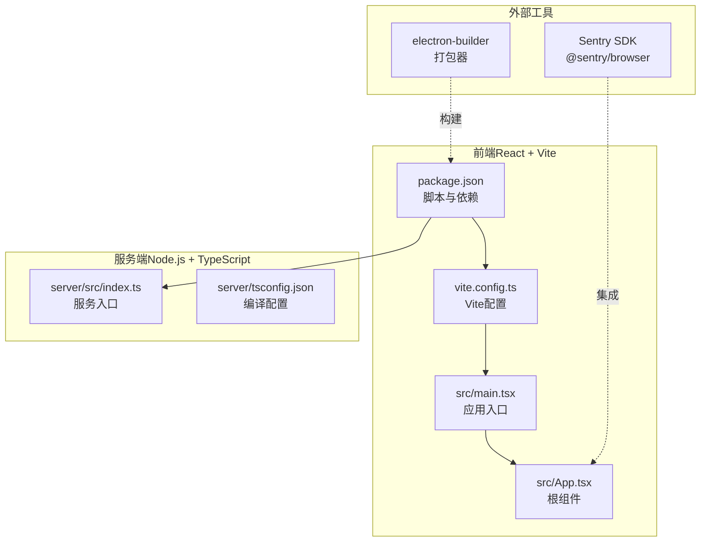
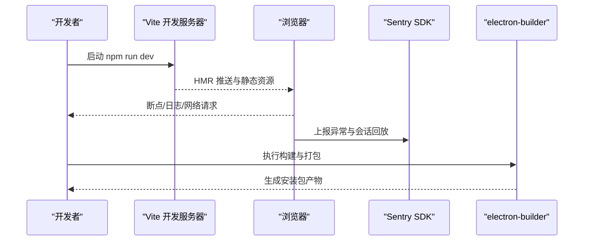
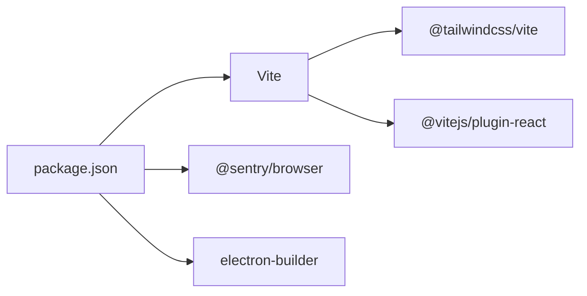

# 开发与调试

<cite>
**本文引用的文件**
- [package.json](file://package.json)
- [vite.config.ts](file://vite.config.ts)
- [src/main.tsx](file://src/main.tsx)
- [src/App.tsx](file://src/App.tsx)
- [src/config.ts](file://src/config.ts)
- [README_EN.md](file://README_EN.md)
- [package-lock.json](file://package-lock.json)
</cite>

## 目录
1. [简介](#简介)
2. [项目结构](#项目结构)
3. [核心组件](#核心组件)
4. [架构总览](#架构总览)
5. [详细组件分析](#详细组件分析)
6. [依赖分析](#依赖分析)
7. [性能考虑](#性能考虑)
8. [故障排查指南](#故障排查指南)
9. [结论](#结论)
10. [附录](#附录)

## 简介
本文件面向AI Shotlive桌面客户端的开发与调试，聚焦以下目标：
- 开发环境搭建与热重载配置
- 主进程与渲染进程的调试技巧、断点设置与日志输出
- Sentry错误监控的配置与使用
- 性能分析工具与内存泄漏检测
- 开发最佳实践、常见问题排查与生产问题诊断

说明：当前仓库前端为React + Vite应用，未包含Electron主进程与预加载脚本源码；因此本文在“主进程/渲染进程调试”部分提供通用实践与定位建议，并结合现有前端工程化配置给出可操作步骤。

## 项目结构
该仓库采用前后端分离的多模块布局：
- 前端（React + Vite）位于根目录，入口为 src/main.tsx，根组件为 src/App.tsx
- 服务端位于 server/ 目录，使用TypeScript编译
- Electron相关文件在 README 中描述了构建流程，但当前工作区未包含实际的 Electron 源码（main.ts、preload.ts）

图表来源
- [src/main.tsx:1-6](file://src/main.tsx#L1-L6)
- [src/App.tsx:1-6](file://src/App.tsx#L1-L6)
- [vite.config.ts:1-13](file://vite.config.ts#L1-L13)
- [package.json:1-26](file://package.json#L1-L26)
- [README_EN.md:261-313](file://README_EN.md#L261-L313)

章节来源
- [src/main.tsx:1-6](file://src/main.tsx#L1-L6)
- [src/App.tsx:1-6](file://src/App.tsx#L1-L6)
- [vite.config.ts:1-13](file://vite.config.ts#L1-L13)
- [package.json:1-26](file://package.json#L1-L26)
- [README_EN.md:261-313](file://README_EN.md#L261-L313)

## 核心组件
- 应用入口与根组件
  - 入口文件负责挂载根组件，根组件提供页面骨架与占位内容
  - 可通过浏览器开发者工具对根组件进行断点与日志调试
- Vite配置
  - 已启用 React 插件与TailwindCSS插件，支持热重载与别名解析
- 包管理与脚本
  - 提供 dev/build/preview 脚本，满足本地开发与预览需求
- Sentry集成
  - 锁文件中包含 @sentry/browser 与相关子包，可用于前端错误监控

章节来源
- [src/main.tsx:1-6](file://src/main.tsx#L1-L6)
- [src/App.tsx:1-6](file://src/App.tsx#L1-L6)
- [vite.config.ts:1-13](file://vite.config.ts#L1-L13)
- [package.json:6-10](file://package.json#L6-L10)
- [package-lock.json:3300-3314](file://package-lock.json#L3300-L3314)

## 架构总览
下图展示从开发到打包的关键路径与工具链关系：

图表来源
- [package.json:6-10](file://package.json#L6-L10)
- [README_EN.md:283-290](file://README_EN.md#L283-L290)
- [package-lock.json:3300-3314](file://package-lock.json#L3300-L3314)

## 详细组件分析

### 开发环境与热重载
- 启动命令
  - 使用 Vite 提供的开发脚本启动本地服务，支持热更新
- Vite配置要点
  - 已启用 React 插件与 TailwindCSS插件
  - 设置了路径别名，便于模块导入
- 浏览器调试
  - 在根组件或任意子组件中设置断点
  - 利用控制台输出日志，观察状态变化与事件流
- 热重载验证
  - 修改源码后，浏览器应自动刷新或局部替换，无需手动重启

章节来源
- [package.json:6-10](file://package.json#L6-L10)
- [vite.config.ts:1-13](file://vite.config.ts#L1-L13)
- [src/main.tsx:1-6](file://src/main.tsx#L1-L6)
- [src/App.tsx:1-6](file://src/App.tsx#L1-L6)

### 主进程与渲染进程调试（通用实践）
- 渲染进程（前端）
  - 在浏览器开发者工具中设置断点、查看网络面板、性能面板
  - 对组件生命周期、事件处理函数、异步数据流进行单步调试
- 主进程（Electron）
  - 当前工作区未包含 Electron 主进程与预加载脚本源码
  - 建议参考 README 中的构建流程，确认主进程入口与打包产物位置
  - 在主进程侧可通过标准输出与日志库输出调试信息
- 预加载脚本（Electron）
  - 若存在预加载脚本，可在其上下文中注入调试接口，向渲染进程暴露受控的调试能力

章节来源
- [README_EN.md:261-313](file://README_EN.md#L261-L313)

### 日志输出与错误上报
- 前端日志
  - 在组件与业务逻辑中使用 console 输出关键信息
  - 结合浏览器控制台的过滤与断点功能定位问题
- Sentry 集成
  - 锁文件显示已安装 @sentry/browser 与相关子包
  - 建议在应用初始化时配置SDK，捕获未处理异常与会话回放
  - 可结合打包器插件进行源码映射与符号上传

章节来源
- [package-lock.json:3300-3314](file://package-lock.json#L3300-L3314)

### 性能分析与内存泄漏检测
- 性能分析
  - 使用浏览器性能面板记录渲染耗时、长任务与重排重绘
  - 关注组件渲染频率与副作用触发次数
- 内存泄漏检测
  - 使用内存快照对比，排查未释放的定时器、事件监听器与闭包引用
  - 对长列表与大对象进行按需清理与弱引用设计

章节来源
- [src/App.tsx:1-6](file://src/App.tsx#L1-L6)

### Sentry 配置与使用（基于现有依赖）
- 安装与依赖
  - 已在锁文件中出现 @sentry/browser 与其相关子包
- 建议步骤
  - 在应用初始化处引入并初始化 Sentry SDK
  - 配置DSN、环境与用户标识等参数
  - 对关键业务埋点与错误上报进行封装
  - 使用打包器插件进行符号上传与源码映射

章节来源
- [package-lock.json:3300-3314](file://package-lock.json#L3300-L3314)

### 开发最佳实践
- 组件拆分与职责单一，便于调试与测试
- 异步逻辑集中管理，统一错误处理与日志输出
- 使用类型约束减少运行期错误
- 严格区分开发/生产环境配置，避免敏感信息泄露

章节来源
- [src/App.tsx:1-6](file://src/App.tsx#L1-L6)

## 依赖分析
- 前端依赖
  - React、React DOM、Lucide React
- 构建与工具
  - Vite、@vitejs/plugin-react、@tailwindcss/vite
- 错误监控
  - @sentry/browser 及相关子包
- 打包与分发
  - electron-builder（用于桌面应用打包）

图表来源
- [package.json:11-24](file://package.json#L11-L24)
- [package-lock.json:3300-3314](file://package-lock.json#L3300-L3314)
- [README_EN.md:283-290](file://README_EN.md#L283-L290)

章节来源
- [package.json:11-24](file://package.json#L11-L24)
- [package-lock.json:3300-3314](file://package-lock.json#L3300-L3314)
- [README_EN.md:283-290](file://README_EN.md#L283-L290)

## 性能考虑
- 减少不必要的重渲染：合理使用 memo、useMemo、useCallback
- 控制副作用：在 useEffect 中正确清理定时器与订阅
- 图片与媒体资源：延迟加载、压缩与尺寸适配
- 网络请求：合并请求、缓存策略与超时控制

章节来源
- [src/App.tsx:1-6](file://src/App.tsx#L1-L6)

## 故障排查指南
- 环境要求与构建命令
  - Node.js 版本要求与平台工具链（macOS/Xcode、Windows/VS Build Tools）
  - 构建与打包命令、产物位置与数据存储路径
- 常见问题定位
  - 端口占用：更换Vite端口或关闭冲突进程
  - 依赖安装失败：使用推荐的安装参数与镜像源
  - Sentry未上报：核对DSN与初始化时机
- 生产问题诊断
  - 收集Sentry事件ID与时间线
  - 截取浏览器控制台日志与网络请求
  - 分析打包产物与符号映射是否完整

章节来源
- [README_EN.md:261-313](file://README_EN.md#L261-L313)

## 结论
本文件基于现有前端工程与依赖，给出了开发与调试的系统性方法。对于Electron主进程与预加载脚本，建议依据README中的构建流程补齐源码并按通用实践进行调试。同时，结合Sentry与浏览器工具链，可有效提升问题定位与修复效率。

## 附录
- 快速检查清单
  - 确认 Node.js 版本满足要求
  - 使用推荐命令安装依赖与启动开发服务器
  - 在浏览器中设置断点与日志，观察渲染与交互
  - 初始化Sentry并验证错误上报
  - 使用性能面板与内存快照进行优化与泄漏排查