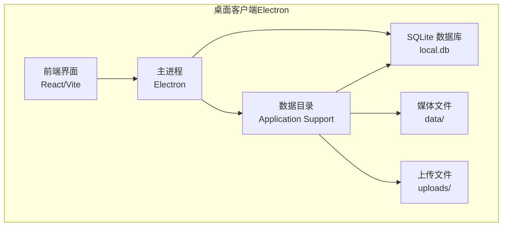
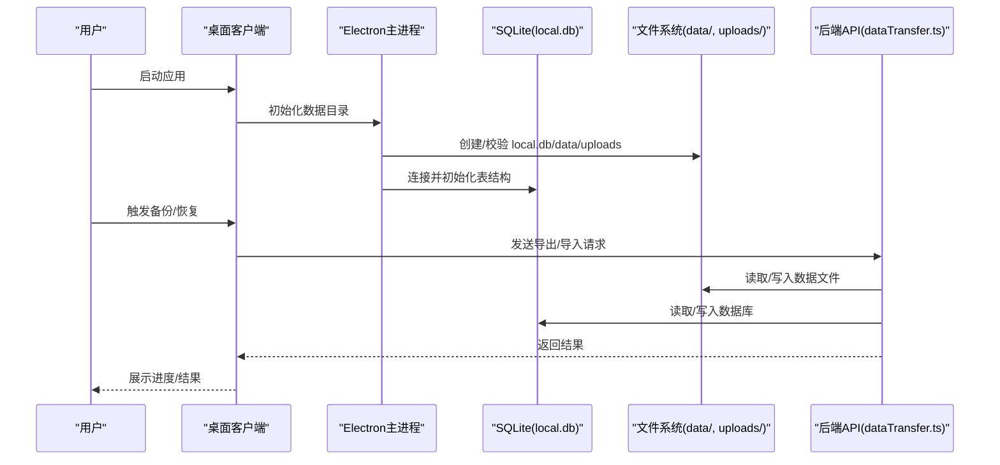
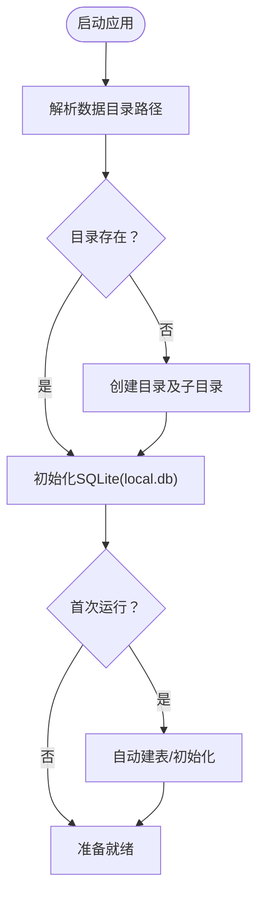
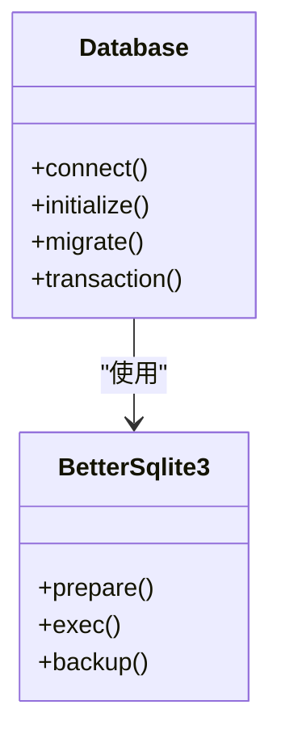
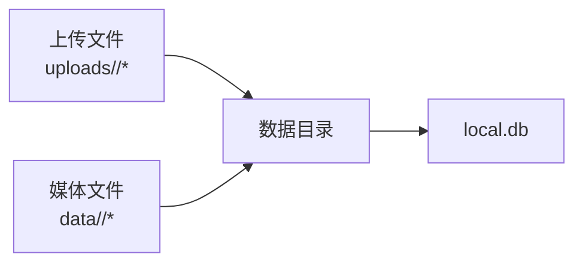
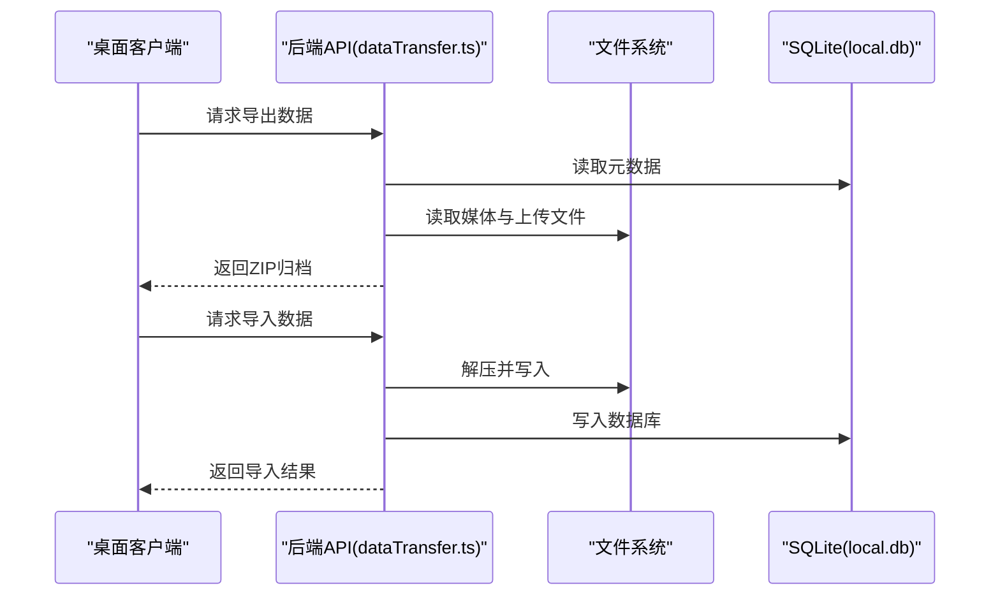
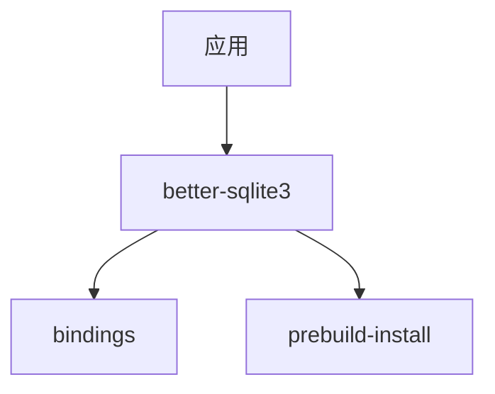

# 本地存储与数据管理

<cite>
**本文引用的文件**
- [README_EN.md](file://README_EN.md)
- [README.md](file://README.md)
- [package.json](file://package.json)
- [package-lock.json](file://package-lock.json)
</cite>

## 目录
1. [简介](#简介)
2. [项目结构](#项目结构)
3. [核心组件](#核心组件)
4. [架构总览](#架构总览)
5. [详细组件分析](#详细组件分析)
6. [依赖分析](#依赖分析)
7. [性能考虑](#性能考虑)
8. [故障排查指南](#故障排查指南)
9. [结论](#结论)
10. [附录](#附录)

## 简介
本文件面向AI Shotlive的本地存储与数据管理，聚焦桌面客户端（Electron）在用户数据隔离、SQLite数据库与上传文件的存储位置、环境变量配置、数据目录初始化、文件权限管理、以及与云端数据的同步策略、备份恢复与迁移方案。同时提供存储空间管理、缓存策略与数据清理的最佳实践建议。

## 项目结构
AI Shotlive采用前端（React/Vite）+ 后端（Express）+ 桌面客户端（Electron）的分层架构。桌面客户端独立运行，内置SQLite数据库，数据与应用分离，存储在用户数据目录中，包含本地数据库、媒体文件与上传文件三类数据。

- 桌面客户端数据目录（按平台）：
  - macOS：`~/Library/Application Support/ai-shotlive-director/`
  - Windows：`%APPDATA%/ai-shotlive-director/`
- 目录内容：
  - `local.db`：SQLite数据库
  - `data/`：媒体文件（按项目隔离）
  - `uploads/`：上传文件（按用户隔离）

**图表来源**
- [README_EN.md: 300-310:300-310](file://README_EN.md#L300-L310)
- [README.md: 285-295:285-295](file://README.md#L285-L295)

**章节来源**
- [README_EN.md: 300-310:300-310](file://README_EN.md#L300-L310)
- [README.md: 285-295:285-295](file://README.md#L285-L295)

## 核心组件
- 数据目录初始化与隔离
  - 桌面客户端在用户数据目录下创建独立数据分区，确保与应用二进制解耦，便于卸载后保留用户数据。
- SQLite数据库（local.db）
  - 使用better-sqlite3作为本地数据库驱动，支持高性能读写与事务处理。
- 媒体文件与上传文件
  - 媒体文件按项目隔离存放于`data/`；上传文件按用户隔离存放于`uploads/`，避免跨用户访问。
- 环境变量与配置覆盖
  - 在数据目录放置`.env`文件以覆盖默认配置（如API Key、JWT密钥等），便于不同部署环境的灵活定制。
- 与云端的同步、备份与迁移
  - 通过后端路由`dataTransfer.ts`进行数据导出/导入（ZIP归档），支持备份恢复与跨设备迁移。

**章节来源**
- [README_EN.md: 300-310:300-310](file://README_EN.md#L300-L310)
- [README_EN.md: 188-200:188-200](file://README_EN.md#L188-L200)
- [README_EN.md: 237-244:237-244](file://README_EN.md#L237-L244)
- [README_EN.md: 361](file://README_EN.md#L361)

## 架构总览
本地存储与数据管理的整体流程如下：
- 启动时确定数据目录路径，若不存在则创建。
- 初始化SQLite数据库（local.db），并在首次启动时自动建表。
- 通过后端路由提供数据导出/导入接口，实现备份与迁移。
- 前端通过API访问后端服务，完成数据同步与状态更新。

**图表来源**
- [README_EN.md: 300-310:300-310](file://README_EN.md#L300-L310)
- [README_EN.md: 361](file://README_EN.md#L361)

## 详细组件分析

### 数据目录与用户隔离
- 目录定位
  - 桌面客户端将数据存储在用户数据目录，与应用二进制分离，避免随应用升级被覆盖。
- 隔离策略
  - 媒体文件按项目隔离（`data/<project-id>/...`），上传文件按用户隔离（`uploads/<user-id>/...`），防止跨用户数据泄露。
- 权限管理
  - 推荐仅授予当前用户读写权限，避免其他用户访问；在Linux/macOS上可通过`chmod/chown`设置；Windows上通过NTFS权限控制。

**图表来源**
- [README_EN.md: 300-310:300-310](file://README_EN.md#L300-L310)

**章节来源**
- [README_EN.md: 300-310:300-310](file://README_EN.md#L300-L310)

### SQLite数据库与better-sqlite3
- 驱动与特性
  - 使用better-sqlite3，具备高性能、原生模块、自动重编译适配Electron版本等特性。
- 存储位置
  - 数据库存放在数据目录根部（`local.db`），与媒体文件、上传文件同级。
- 初始化与迁移
  - 首次启动自动建表；提供迁移脚本（如迁移Base64到文件）以兼容历史数据格式。

**图表来源**
- [README_EN.md: 237-244:237-244](file://README_EN.md#L237-L244)
- [package-lock.json: 5169-5179:5169-5179](file://package-lock.json#L5169-L5179)

**章节来源**
- [README_EN.md: 237-244:237-244](file://README_EN.md#L237-L244)
- [package-lock.json: 5169-5179:5169-5179](file://package-lock.json#L5169-L5179)

### 上传文件与媒体文件管理
- 上传文件（uploads）
  - 按用户隔离，避免跨用户访问；适合临时或私有文件。
- 媒体文件（data）
  - 按项目隔离，便于项目打包、备份与迁移；与SQLite中的元数据关联。
- 清理策略
  - 建议定期清理未引用的媒体文件；对上传文件可按用户策略清理临时文件。

**图表来源**
- [README_EN.md: 300-310:300-310](file://README_EN.md#L300-L310)

**章节来源**
- [README_EN.md: 300-310:300-310](file://README_EN.md#L300-L310)

### 环境变量与配置覆盖
- 配置来源
  - 在数据目录放置`.env`文件，覆盖默认配置（如API Key、JWT密钥、服务器端口等）。
- 生产建议
  - 不要将敏感信息硬编码在源码中；通过`.env`集中管理，并限制文件权限。

**章节来源**
- [README_EN.md: 188-200:188-200](file://README_EN.md#L188-L200)
- [README_EN.md: 311-313:311-313](file://README_EN.md#L311-L313)

### 本地数据与云端数据的同步策略
- 同步范围
  - 通过后端路由`dataTransfer.ts`提供数据导出/导入能力，支持将项目数据、媒体文件与数据库打包为ZIP归档，便于跨设备传输与云端备份。
- 同步流程
  - 导出：后端读取数据库与文件系统，生成ZIP归档。
  - 导入：后端解压并写入对应位置，重建索引与引用关系。
- 冲突处理
  - 建议在导入前进行冲突检测（如项目ID重复），并提供合并/覆盖选项。

**图表来源**
- [README_EN.md: 361](file://README_EN.md#L361)

**章节来源**
- [README_EN.md: 361](file://README_EN.md#L361)

### 备份恢复机制
- 备份
  - 使用导出功能生成完整归档，包含数据库与所有相关文件，便于离线保存与云端归档。
- 恢复
  - 在新环境或新设备上执行导入，自动重建数据库与文件索引。
- 最佳实践
  - 定期执行全量备份；对增量备份可结合版本控制或云存储快照。

**章节来源**
- [README_EN.md: 361](file://README_EN.md#L361)

### 数据迁移方案
- 跨版本迁移
  - 通过导出/导入流程实现版本间迁移；迁移前先备份当前数据。
- 跨平台迁移
  - 将数据目录整体迁移到另一台机器，确保SQLite文件与媒体文件完整性。
- 自动化脚本
  - 可结合CI/CD或脚本自动化执行导出、传输与导入流程。

**章节来源**
- [README_EN.md: 361](file://README_EN.md#L361)

## 依赖分析
- better-sqlite3
  - 作为SQLite驱动，提供高性能与原生模块支持；打包时会根据Electron版本自动重编译。
- 依赖来源
  - 通过package-lock.json可见其版本与依赖链。

**图表来源**
- [package-lock.json: 5169-5179:5169-5179](file://package-lock.json#L5169-L5179)
- [package-lock.json: 5180-5188:5180-5188](file://package-lock.json#L5180-L5188)

**章节来源**
- [package-lock.json: 5169-5179:5169-5179](file://package-lock.json#L5169-L5179)
- [package-lock.json: 5180-5188:5180-5188](file://package-lock.json#L5180-L5188)

## 性能考虑
- 存储性能
  - SQLite适合中小规模数据；当项目数量与文件规模增长时，建议优化索引与查询计划。
- I/O优化
  - 媒体文件按项目隔离，减少目录层级与文件扫描开销；批量操作时使用事务。
- 缓存策略
  - 对频繁访问的元数据与小文件建立内存缓存；对大文件采用流式读取与分块处理。
- 清理策略
  - 定期清理未引用的媒体文件与临时上传文件；对日志与中间产物进行轮转。

## 故障排查指南
- 数据目录不可写
  - 检查用户权限与磁盘配额；必要时调整目录所有权与权限。
- SQLite连接失败
  - 确认local.db文件未被其他进程占用；检查文件完整性与权限。
- 导入失败
  - 检查ZIP归档完整性与解压权限；确认数据库与文件系统写入权限。
- 环境变量未生效
  - 确认`.env`文件位于数据目录根部且格式正确；重启应用使配置生效。

**章节来源**
- [README_EN.md: 300-310:300-310](file://README_EN.md#L300-L310)
- [README_EN.md: 188-200:188-200](file://README_EN.md#L188-L200)

## 结论
AI Shotlive的本地存储体系通过“数据目录隔离 + SQLite数据库 + 文件系统”实现了清晰的用户数据边界与高效的数据管理。配合导出/导入的同步与迁移能力，既满足个人开发者与小型团队的本地使用需求，也为跨设备与云端备份提供了可行方案。建议在生产环境中强化权限控制、定期备份与清理策略，并结合缓存与I/O优化提升整体性能。

## 附录
- 平台数据目录对照
  - macOS：`~/Library/Application Support/ai-shotlive-director/`
  - Windows：`%APPDATA%/ai-shotlive-director/`
- 关键文件与目录
  - `local.db`：SQLite数据库
  - `data/`：媒体文件（按项目隔离）
  - `uploads/`：上传文件（按用户隔离）
- 环境变量
  - 放置于数据目录根部的`.env`文件用于覆盖默认配置（如API Key、JWT密钥、服务器端口等）

**章节来源**
- [README_EN.md: 300-310:300-310](file://README_EN.md#L300-L310)
- [README_EN.md: 188-200:188-200](file://README_EN.md#L188-L200)