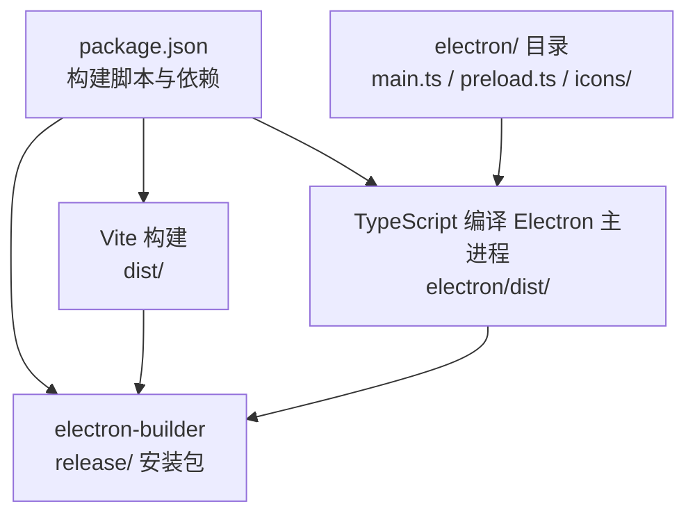
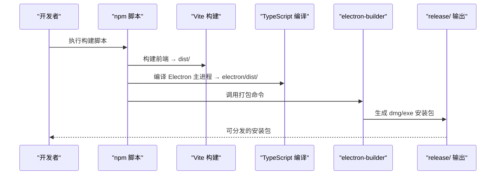
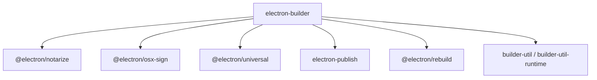

# 构建与打包配置

<cite>
**本文引用的文件**
- [package.json](file://package.json)
- [vite.config.ts](file://vite.config.ts)
- [README.md](file://README.md)
- [README_EN.md](file://README_EN.md)
- [package-lock.json](file://package-lock.json)
</cite>

## 目录
1. [简介](#简介)
2. [项目结构](#项目结构)
3. [核心组件](#核心组件)
4. [架构总览](#架构总览)
5. [详细组件分析](#详细组件分析)
6. [依赖分析](#依赖分析)
7. [性能考虑](#性能考虑)
8. [故障排查指南](#故障排查指南)
9. [结论](#结论)
10. [附录](#附录)

## 简介
本文件聚焦于 AI Shotlive 的构建与打包配置，围绕 electron-builder 的使用、目标平台与签名策略、构建脚本流程、开发与生产的差异、自动化构建管道、跨平台兼容性、应用图标与元数据、安装包分发策略进行系统化说明，并提供优化技巧、调试方法与常见问题解决方案。

## 项目结构
- 本项目采用“前端 + Electron 主进程 + 后端服务”的多模块结构，构建与打包主要涉及：
  - 前端构建：Vite 配置与产物输出至 dist/
  - Electron 主进程：TypeScript 编译至 electron/dist/
  - 安装包打包：electron-builder 统一产出 dmg（macOS）与 exe（Windows）
- 关键目录与文件：
  - electron/：主进程入口、预加载脚本、图标资源
  - scripts/：构建脚本（如 build-electron.sh）
  - electron-builder.yml：electron-builder 配置文件
  - package.json：构建脚本与依赖声明
  - vite.config.ts：前端构建配置

图表来源
- [package.json:1-26](file://package.json#L1-L26)
- [vite.config.ts:1-13](file://vite.config.ts#L1-L13)

章节来源
- [README.md:308-326](file://README.md#L308-L326)
- [README_EN.md:267-290](file://README_EN.md#L267-L290)

## 核心组件
- 构建脚本与命令
  - 通过 package.json 的 scripts 字段定义构建命令，包括前端构建、服务端编译、Electron 主进程编译与打包。
  - README 提供了完整的构建流水线：先构建前端、后端与 Electron 主进程，再由 electron-builder 打包为安装包。
- 前端构建
  - 使用 Vite 进行开发与生产构建，配置了 React 插件与 TailwindCSS 插件，并设置了路径别名。
- Electron 主进程
  - 主进程入口与预加载脚本位于 electron/ 目录，打包前需先编译到 electron/dist/。
- electron-builder 配置
  - 配置文件为 electron-builder.yml，用于定义目标平台、安装包元数据、图标、签名与构建产物输出路径等。

章节来源
- [package.json:6-10](file://package.json#L6-L10)
- [vite.config.ts:5-12](file://vite.config.ts#L5-L12)
- [README.md:242-306](file://README.md#L242-L306)
- [README_EN.md:267-290](file://README_EN.md#L267-L290)

## 架构总览
下图展示了从源码到安装包的完整构建与打包路径，涵盖前端、后端与 Electron 主进程的编译，以及最终的安装包生成。

图表来源
- [README.md:268-275](file://README.md#L268-L275)
- [README_EN.md:283-290](file://README_EN.md#L283-L290)

## 详细组件分析

### electron-builder 配置文件
- 配置文件位置：electron-builder.yml
- 作用：定义安装包元数据、目标平台、图标、签名策略、构建产物输出目录等。
- 常见配置要点（基于仓库文档与依赖推断）：
  - 目标平台与架构：macOS（arm64/x64）与 Windows（x64）
  - 图标与元数据：应用名称、版本、版权、描述、图标路径等
  - 打包产物：dmg（macOS）、exe（Windows）
  - 自动重编译原生模块：better-sqlite3 会在打包时按 Electron 版本重新编译
- 注意事项：
  - 跨平台打包 Windows 安装包需在 Windows 环境下执行（或使用 CI）
  - 应用图标位于 electron/icons/，需生成 .icns/.ico 后方可使用

章节来源
- [README.md:277-284](file://README.md#L277-L284)
- [README.md:300-305](file://README.md#L300-L305)
- [README_EN.md:292-299](file://README_EN.md#L292-L299)

### 构建脚本与工作流程
- 命令与顺序（来自 README）：
  - 构建前端：npm run build:client → 产出 dist/
  - 构建服务端：npm run build:server → 产出 server/dist/
  - 编译 Electron 主进程：npm run build:electron-main → 产出 electron/dist/
  - 打包安装包：npx electron-builder → 产出 release/ 安装包
- 平台特定命令：
  - 一键打包当前平台：npm run build:electron
  - 仅打包 macOS：npm run build:electron:mac
  - 仅打包 Windows：npm run build:electron:win

章节来源
- [README.md:252-266](file://README.md#L252-L266)
- [README_EN.md:267-281](file://README_EN.md#L267-L281)

### 开发环境与生产环境差异
- 开发环境
  - 使用 Vite 的开发服务器进行前端热更新
  - Electron 主进程以开发模式运行，便于调试
- 生产环境
  - 前端构建为静态资源（dist/）
  - Electron 主进程编译为可分发的主进程代码
  - electron-builder 生成安装包，包含应用图标、元数据与签名配置

章节来源
- [README.md:242-246](file://README.md#L242-L246)
- [README_EN.md:261-266](file://README_EN.md#L261-L266)

### 自动化构建管道
- 推荐的 CI 流水线步骤（基于 README 的命令顺序）：
  - 安装依赖
  - 构建前端
  - 构建服务端
  - 编译 Electron 主进程
  - 调用 electron-builder 打包
  - 上传 release/ 产物
- 平台矩阵
  - macOS：arm64 与 x64 产物
  - Windows：x64 产物

章节来源
- [README.md:268-275](file://README.md#L268-L275)
- [README_EN.md:283-290](file://README_EN.md#L283-L290)

### 跨平台兼容性处理
- macOS
  - 支持 Apple Silicon（arm64）与 Intel（x64）
  - 使用 .icns 图标
- Windows
  - 仅 x64
  - 使用 .ico 图标
- 原生模块兼容
  - better-sqlite3 为 C++ 原生模块，electron-builder 会自动按 Electron 版本重新编译

章节来源
- [README.md:279-283](file://README.md#L279-L283)
- [README.md:302-303](file://README.md#L302-L303)
- [README_EN.md:294-298](file://README_EN.md#L294-L298)

### 应用图标与元数据配置
- 图标位置：electron/icons/
- 生成规范：替换 icon.png 后，参考 electron/icons/README.md 生成 .icns/.ico
- 元数据：通过 electron-builder.yml 配置应用名称、版本、版权、描述等

章节来源
- [README.md:304-305](file://README.md#L304-L305)

### 安装包分发策略
- 产物命名与路径
  - macOS：release/AI-ShotLive-{version}-mac-arm64.dmg 或 mac-x64.dmg
  - Windows：release/AI-ShotLive-Setup-{version}-win.exe
- 数据存储位置
  - macOS：~/Library/Application Support/ai-shotlive-director/
  - Windows：%APPDATA%/ai-shotlive-director/
- 用户可通过数据目录下的 .env 覆盖默认配置（如 API Key、JWT 密钥）

章节来源
- [README.md:277-294](file://README.md#L277-L294)
- [README_EN.md:292-313](file://README_EN.md#L292-L313)

## 依赖分析
- electron-builder 依赖
  - electron-builder 与相关子包（如 @electron/notarize、@electron/osx-sign、@electron/universal 等）在 package-lock.json 中有明确声明，表明项目使用 electron-builder 进行跨平台打包。
- 原生模块与重编译
  - better-sqlite3 为 C++ 原生模块，打包时会根据 Electron 版本自动重新编译，确保二进制兼容。

图表来源
- [package-lock.json:4860-4912](file://package-lock.json#L4860-L4912)
- [package-lock.json:6466-6492](file://package-lock.json#L6466-L6492)

章节来源
- [package-lock.json:4860-4912](file://package-lock.json#L4860-L4912)
- [package-lock.json:6466-6492](file://package-lock.json#L6466-L6492)

## 性能考虑
- 构建性能优化建议
  - 使用 Vite 的快速冷启与热更新能力，缩短前端开发迭代周期
  - 在 CI 中缓存 node_modules 与 Electron 缓存，减少重复下载与编译时间
  - 对于大型项目，拆分 Electron 主进程与渲染进程的构建任务，避免串行瓶颈
- 打包体积优化建议
  - 合理配置 electron-builder 的过滤规则，排除不必要的源码与测试文件
  - 使用原生模块的预编译缓存，减少 CI 中的编译开销

## 故障排查指南
- 常见问题与解决思路
  - Windows 安装包无法生成
    - 现象：跨平台打包 Windows 安装包需在 Windows 环境执行
    - 解决：在 Windows 环境或 CI 中执行打包命令
  - better-sqlite3 编译失败
    - 现象：原生模块编译报错
    - 解决：确保安装 Xcode Command Line Tools（macOS）或 Visual Studio Build Tools（Windows），并使用 electron-builder 的自动重编译机制
  - 图标未生效
    - 现象：安装包图标显示异常
    - 解决：在 electron/icons/ 目录下生成 .icns/.ico 后，更新 electron-builder.yml 中的图标路径
  - macOS 安装包被系统拦截
    - 现象：Gatekeeper 拦截未签名的应用
    - 解决：为 macOS 启用签名与公证（notarize），并在 electron-builder.yml 中配置签名参数
- 调试方法
  - 使用 electron-builder 的 verbose 日志输出定位问题
  - 在 CI 中开启详细日志，复现构建失败步骤
  - 分阶段验证：先单独构建前端与 Electron 主进程，确认无误后再执行打包

章节来源
- [README.md:300-305](file://README.md#L300-L305)
- [README_EN.md:261-266](file://README_EN.md#L261-L266)

## 结论
本项目通过 Vite + Electron + electron-builder 的组合，实现了跨平台的桌面应用构建与打包。借助清晰的构建脚本与平台化配置，能够在 macOS 与 Windows 上稳定产出安装包。结合原生模块自动重编译与图标/元数据配置，可进一步提升打包效率与用户体验。建议在 CI 中完善缓存与日志策略，并为 macOS 启用签名与公证，以提升安装包的可信度与可用性。

## 附录
- 相关命令速查
  - 安装依赖：npm install --legacy-peer-deps
  - 构建前端：npm run build:client
  - 构建服务端：npm run build:server
  - 编译 Electron 主进程：npm run build:electron-main
  - 打包当前平台：npm run build:electron
  - 仅打包 macOS：npm run build:electron:mac
  - 仅打包 Windows：npm run build:electron:win
- 产物与路径
  - 前端：dist/
  - Electron 主进程：electron/dist/
  - 安装包：release/

章节来源
- [README.md:252-266](file://README.md#L252-L266)
- [README_EN.md:267-281](file://README_EN.md#L267-L281)