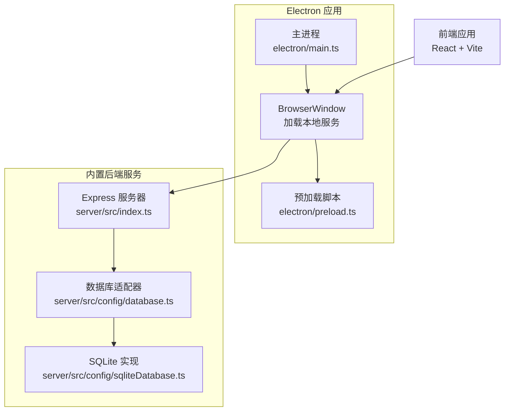
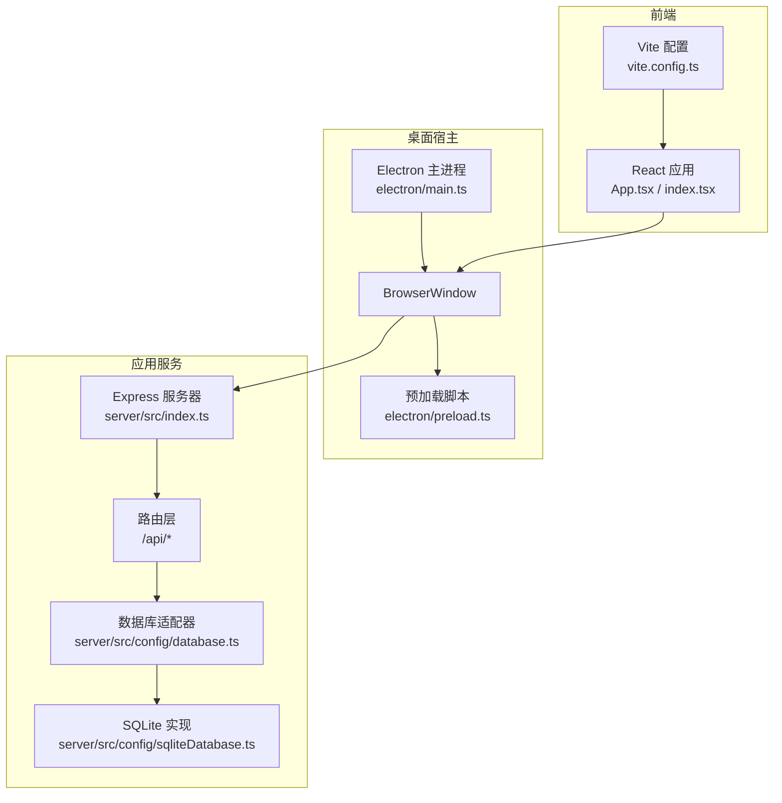
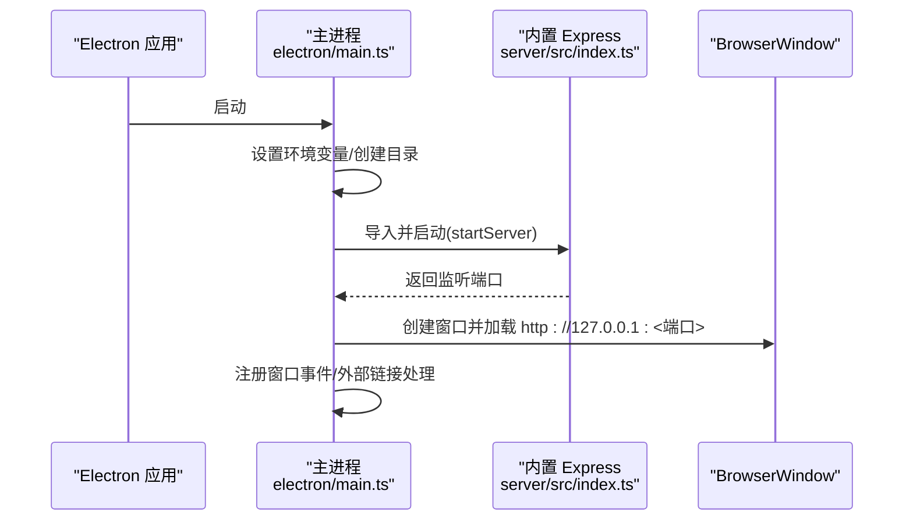
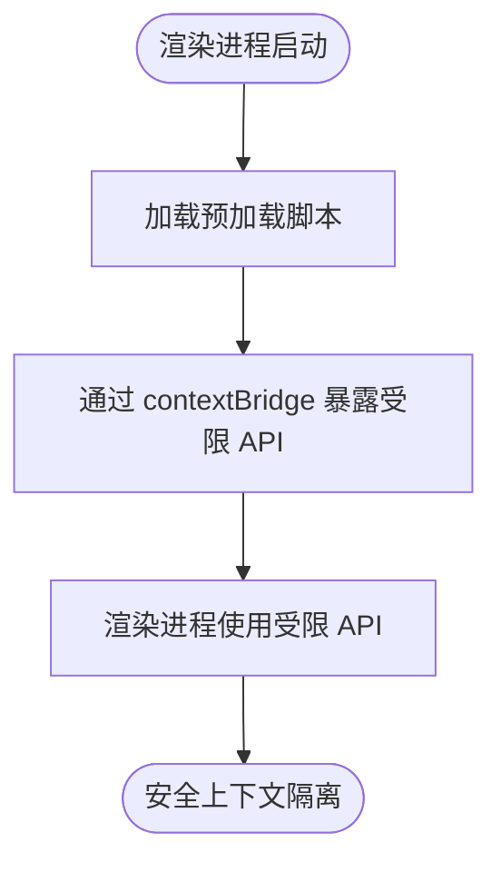
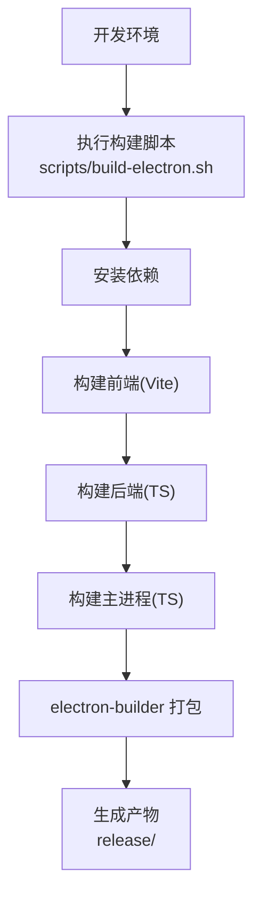
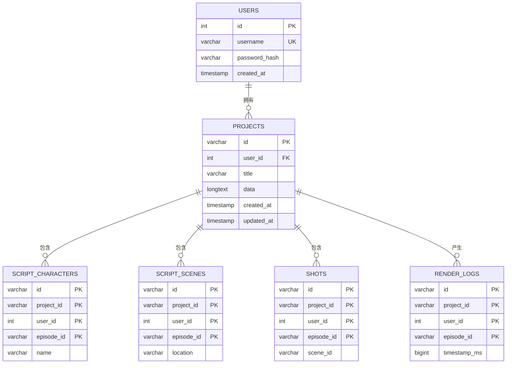
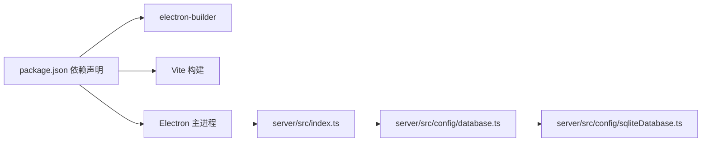

# 桌面客户端

<cite>
**本文引用的文件**
- [package.json](file://package.json)
- [electron/main.ts](file://electron/main.ts)
- [electron/preload.ts](file://electron/preload.ts)
- [electron/tsconfig.json](file://electron/tsconfig.json)
- [electron-builder.yml](file://electron-builder.yml)
- [scripts/build-electron.sh](file://scripts/build-electron.sh)
- [vite.config.ts](file://vite.config.ts)
- [index.tsx](file://index.tsx)
- [App.tsx](file://App.tsx)
- [server/src/index.ts](file://server/src/index.ts)
- [server/src/config/database.ts](file://server/src/config/database.ts)
- [server/src/config/sqliteDatabase.ts](file://server/src/config/sqliteDatabase.ts)
- [tsconfig.json](file://tsconfig.json)
</cite>

## 目录
1. [简介](#简介)
2. [项目结构](#项目结构)
3. [核心组件](#核心组件)
4. [架构总览](#架构总览)
5. [详细组件分析](#详细组件分析)
6. [依赖关系分析](#依赖关系分析)
7. [性能考量](#性能考量)
8. [故障排查指南](#故障排查指南)
9. [结论](#结论)
10. [附录](#附录)

## 简介
本文件面向AI Shotlive桌面客户端的开发者与运维人员，系统性阐述基于Electron的桌面应用架构设计、主进程与渲染进程职责划分、预加载脚本安全策略、打包与跨平台发布配置、本地SQLite数据库集成与用户数据存储策略、配置文件管理、以及常见问题排查与部署注意事项。文档同时提供可视化架构图与流程图，帮助读者快速理解系统工作原理。

## 项目结构
该项目采用“前端React + 后端Express + Electron封装”的混合架构。Electron主进程负责启动内置的Express服务器，并在本地启动BrowserWindow加载前端页面；渲染进程运行React应用并通过API与后端交互；后端根据运行模式选择MySQL或SQLite作为数据存储。

**图表来源**
- [electron/main.ts:1-129](file://electron/main.ts#L1-L129)
- [electron/preload.ts:1-16](file://electron/preload.ts#L1-L16)
- [server/src/index.ts:1-173](file://server/src/index.ts#L1-L173)
- [server/src/config/database.ts:1-712](file://server/src/config/database.ts#L1-L712)
- [server/src/config/sqliteDatabase.ts:1-671](file://server/src/config/sqliteDatabase.ts#L1-L671)

**章节来源**
- [package.json:1-83](file://package.json#L1-L83)
- [electron/main.ts:1-129](file://electron/main.ts#L1-L129)
- [server/src/index.ts:1-173](file://server/src/index.ts#L1-L173)

## 核心组件
- Electron主进程：负责设置环境变量、启动内置Express服务器、创建BrowserWindow、处理窗口生命周期与外部链接打开策略。
- 预加载脚本：通过contextBridge向渲染进程暴露最小化能力（平台信息、是否Electron环境），确保上下文隔离与安全。
- 内置Express服务器：统一提供REST API、静态资源托管、第三方代理、健康检查与任务恢复。
- 数据库适配层：抽象MySQL与SQLite差异，提供统一的连接池与事务接口，支持按需初始化表结构。
- 前端React应用：负责UI交互、状态管理、引导流程、模型配置、项目工作区等。

**章节来源**
- [electron/main.ts:1-129](file://electron/main.ts#L1-L129)
- [electron/preload.ts:1-16](file://electron/preload.ts#L1-L16)
- [server/src/index.ts:1-173](file://server/src/index.ts#L1-L173)
- [server/src/config/database.ts:1-712](file://server/src/config/database.ts#L1-L712)
- [server/src/config/sqliteDatabase.ts:1-671](file://server/src/config/sqliteDatabase.ts#L1-L671)

## 架构总览
下图展示了Electron桌面客户端的端到端架构：主进程启动后端，渲染进程通过本地HTTP访问后端API；数据库层根据运行模式选择MySQL或SQLite；构建与打包通过electron-builder完成跨平台发布。

**图表来源**
- [electron/main.ts:1-129](file://electron/main.ts#L1-L129)
- [electron/preload.ts:1-16](file://electron/preload.ts#L1-L16)
- [server/src/index.ts:1-173](file://server/src/index.ts#L1-L173)
- [server/src/config/database.ts:1-712](file://server/src/config/database.ts#L1-L712)
- [server/src/config/sqliteDatabase.ts:1-671](file://server/src/config/sqliteDatabase.ts#L1-L671)
- [vite.config.ts:1-118](file://vite.config.ts#L1-L118)
- [index.tsx:1-76](file://index.tsx#L1-L76)
- [App.tsx:1-380](file://App.tsx#L1-L380)

## 详细组件分析

### 主进程与窗口管理
- 环境变量设置：主进程在导入后端前设置Electron标志、数据库路径、上传目录、JWT密钥等；支持在用户数据目录下放置.env文件进行覆盖。
- 后端启动：根据打包状态动态定位dist与server目录，调用后端入口启动本地HTTP服务并返回监听端口。
- 窗口创建：设置窗口尺寸、最小宽高、webPreferences启用上下文隔离、禁用Node集成、指定预加载脚本；外部链接在系统浏览器打开，内部链接在应用内加载。
- 生命周期：ready时创建窗口；激活时若无窗口则重建；关闭时释放引用。

**图表来源**
- [electron/main.ts:1-129](file://electron/main.ts#L1-L129)
- [server/src/index.ts:119-164](file://server/src/index.ts#L119-L164)

**章节来源**
- [electron/main.ts:1-129](file://electron/main.ts#L1-L129)

### 预加载脚本与安全策略
- 上下文隔离：通过contextBridge.exposeInMainWorld向渲染进程暴露受控API（平台信息、Electron标识），避免直接访问Node.js全局API。
- 安全边界：预加载脚本不执行业务逻辑，仅桥接必要能力；渲染进程侧通过Sentry初始化与错误处理增强可观测性。

**图表来源**
- [electron/preload.ts:1-16](file://electron/preload.ts#L1-L16)

**章节来源**
- [electron/preload.ts:1-16](file://electron/preload.ts#L1-L16)

### 打包配置与跨平台发布
- 打包工具：electron-builder，配置输出目录、构建资源目录、asar打包策略、native模块重编译与解包规则。
- 平台目标：macOS支持dmg/zip，Windows支持NSIS安装包；配置图标、分类、快捷方式与产物命名。
- 构建脚本：scripts/build-electron.sh负责安装依赖、编译前端/后端/Electron主进程、调用electron-builder并输出产物至release目录。

**图表来源**
- [scripts/build-electron.sh:1-97](file://scripts/build-electron.sh#L1-L97)
- [electron-builder.yml:1-85](file://electron-builder.yml#L1-L85)

**章节来源**
- [electron-builder.yml:1-85](file://electron-builder.yml#L1-L85)
- [scripts/build-electron.sh:1-97](file://scripts/build-electron.sh#L1-L97)

### 数据库集成与用户数据存储
- 运行模式：通过DB_TYPE选择MySQL或SQLite；Electron模式默认SQLite。
- SQLite实现：better-sqlite3包装为异步接口，提供SQL翻译、INFORMATION_SCHEMA模拟、WAL模式、外键开启、超时设置；初始化多张核心表并建立索引。
- 数据隔离：通过在主键中加入episode_id实现“剧本级”数据隔离，支持同一项目内不同剧集的数据独立。
- 上传与数据目录：主进程在用户数据目录下创建data与uploads目录，保证数据与系统其他文件隔离。

**图表来源**
- [server/src/config/sqliteDatabase.ts:280-671](file://server/src/config/sqliteDatabase.ts#L280-L671)

**章节来源**
- [server/src/config/database.ts:1-712](file://server/src/config/database.ts#L1-L712)
- [server/src/config/sqliteDatabase.ts:1-671](file://server/src/config/sqliteDatabase.ts#L1-L671)
- [electron/main.ts:30-50](file://electron/main.ts#L30-L50)

### 配置文件管理与环境变量
- Electron主进程：在用户数据目录下查找.env文件并加载，便于用户覆盖默认配置；同时设置JWT_SECRET、数据库路径、上传目录等。
- 前端构建：Vite通过loadEnv加载环境变量，配置代理与Sentry插件；define注入API_KEY常量。
- 后端启动：Express在非Electron模式下从项目根加载.env；生产环境强制要求配置JWT_SECRET。

**章节来源**
- [electron/main.ts:40-46](file://electron/main.ts#L40-L46)
- [vite.config.ts:7-22](file://vite.config.ts#L7-L22)
- [server/src/index.ts:12-15](file://server/src/index.ts#L12-L15)
- [server/src/index.ts:125-137](file://server/src/index.ts#L125-L137)

### 前端应用与开发体验
- Sentry初始化：在渲染进程侧初始化Sentry，配置DSN、环境、版本、性能采样率与会话回放；提供忽略特定网络错误的过滤器。
- 开发代理：Vite配置对多家第三方AI平台的反向代理，解决CORS限制；同时代理/api到本地后端。
- 应用入口：index.tsx挂载ThemeProvider、AlertProvider、AuthProvider与App；App.tsx负责路由视图、引导流程、模型配置弹窗与移动端提示。

**章节来源**
- [index.tsx:18-57](file://index.tsx#L18-L57)
- [vite.config.ts:23-105](file://vite.config.ts#L23-L105)
- [App.tsx:1-380](file://App.tsx#L1-L380)

## 依赖关系分析
- 构建与打包：package.json声明Electron、electron-builder、Vite等依赖；scripts/build-electron.sh驱动完整构建链路。
- 类型与编译：tsconfig.json与electron/tsconfig.json分别约束前端与主进程编译选项，确保严格类型检查与模块解析。
- 运行时：主进程在用户数据目录下组织SQLite数据库与上传文件，Express提供静态资源与API路由。

**图表来源**
- [package.json:1-83](file://package.json#L1-L83)
- [electron/tsconfig.json:1-20](file://electron/tsconfig.json#L1-L20)
- [tsconfig.json:1-34](file://tsconfig.json#L1-L34)
- [server/src/index.ts:1-173](file://server/src/index.ts#L1-L173)
- [server/src/config/database.ts:1-712](file://server/src/config/database.ts#L1-L712)
- [server/src/config/sqliteDatabase.ts:1-671](file://server/src/config/sqliteDatabase.ts#L1-L671)

**章节来源**
- [package.json:1-83](file://package.json#L1-L83)
- [tsconfig.json:1-34](file://tsconfig.json#L1-L34)
- [electron/tsconfig.json:1-20](file://electron/tsconfig.json#L1-L20)

## 性能考量
- 数据库优化：SQLite启用WAL模式、外键与超时设置；为高频查询建立索引；通过SQL翻译减少MySQL与SQLite差异带来的性能损耗。
- 任务恢复：后端启动时恢复未完成的后台任务，提升稳定性与用户体验。
- 前端代理：Vite代理第三方API，减少CORS影响，提高请求效率。
- Sentry采样：合理设置tracesSampleRate与replays采样率，平衡可观测性与性能开销。

[本节为通用指导，不直接分析具体文件]

## 故障排查指南
- 启动失败：检查主进程是否成功启动内置Express服务；查看端口占用与权限；确认数据库初始化是否完成。
- 数据库异常：确认DB_TYPE与SQLite路径；核对WAL/外键/超时设置；检查INFORMATION_SCHEMA模拟逻辑是否命中。
- 打包失败：确认Node版本与electron-builder参数；检查asar解包规则与native模块重编译；核对图标与平台目标配置。
- 环境变量：生产环境必须配置JWT_SECRET；前端与后端的.env加载路径需正确；Sentry DSN与采样率需有效。
- 移动端访问：App.tsx对移动端有明确提示，建议在PC端使用以获得最佳体验。

**章节来源**
- [server/src/index.ts:119-164](file://server/src/index.ts#L119-L164)
- [server/src/config/sqliteDatabase.ts:105-119](file://server/src/config/sqliteDatabase.ts#L105-L119)
- [electron-builder.yml:40-47](file://electron-builder.yml#L40-L47)
- [server/src/index.ts:125-137](file://server/src/index.ts#L125-L137)
- [App.tsx:279-302](file://App.tsx#L279-L302)

## 结论
本桌面客户端通过Electron将React前端与Express后端整合为单机应用，结合SQLite实现本地化数据持久化与“剧本级”隔离，辅以electron-builder完成跨平台发布。预加载脚本确保上下文隔离与最小权限暴露；Sentry贯穿前后端提升可观测性；Vite代理与任务恢复机制优化开发体验与运行稳定性。遵循本文档的打包、发布与部署建议，可高效交付高质量的桌面客户端。

[本节为总结性内容，不直接分析具体文件]

## 附录
- 开发命令与脚本：参见package.json与scripts/build-electron.sh。
- TypeScript配置：参见tsconfig.json与electron/tsconfig.json。
- 前端代理与Sentry：参见vite.config.ts与index.tsx。

**章节来源**
- [package.json:7-25](file://package.json#L7-L25)
- [scripts/build-electron.sh:1-97](file://scripts/build-electron.sh#L1-L97)
- [tsconfig.json:1-34](file://tsconfig.json#L1-L34)
- [electron/tsconfig.json:1-20](file://electron/tsconfig.json#L1-L20)
- [vite.config.ts:1-118](file://vite.config.ts#L1-L118)
- [index.tsx:18-57](file://index.tsx#L18-L57)