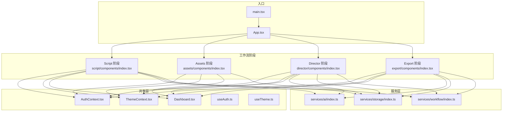
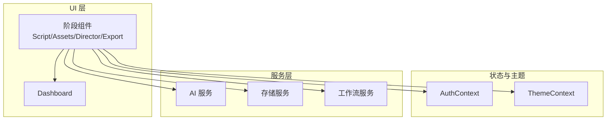
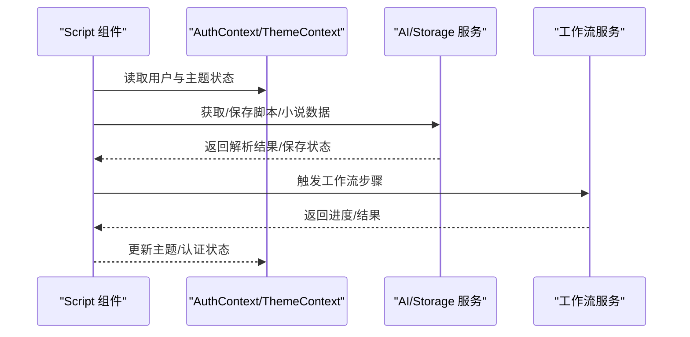
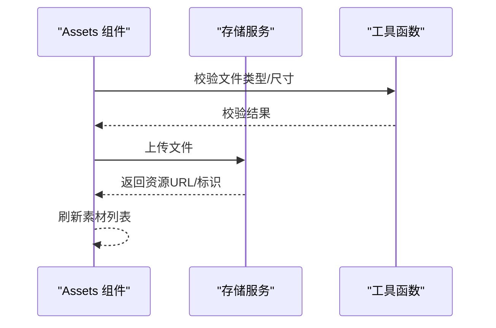
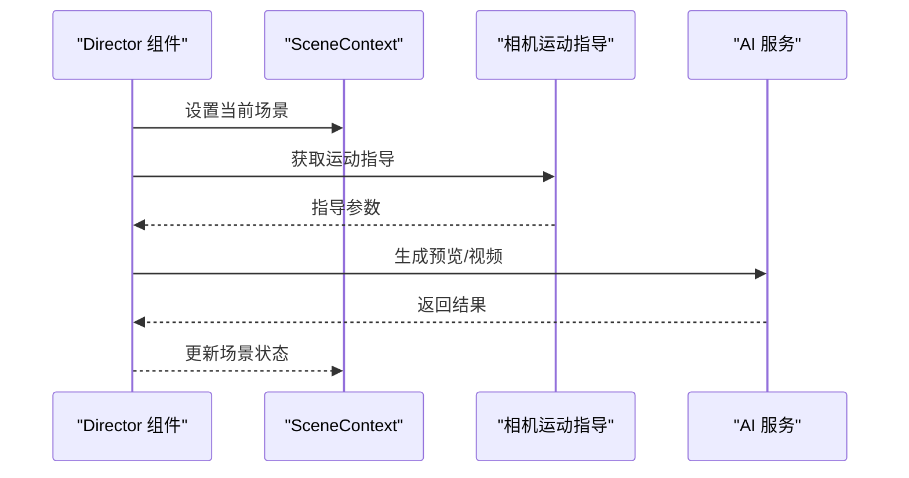
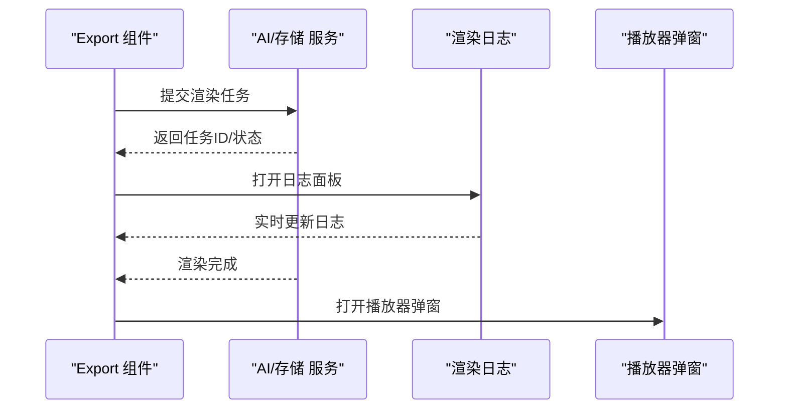
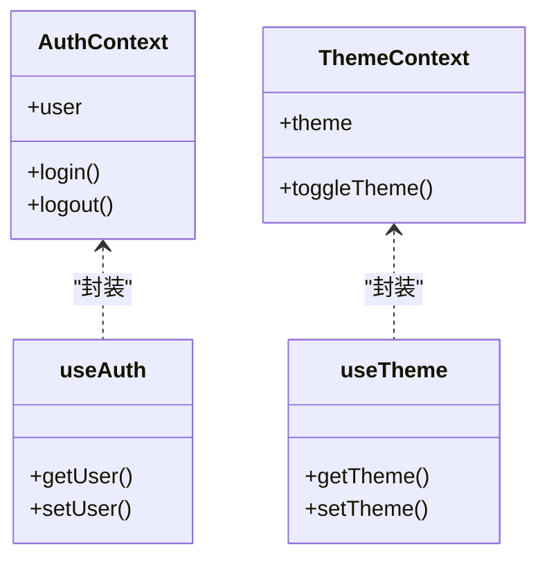
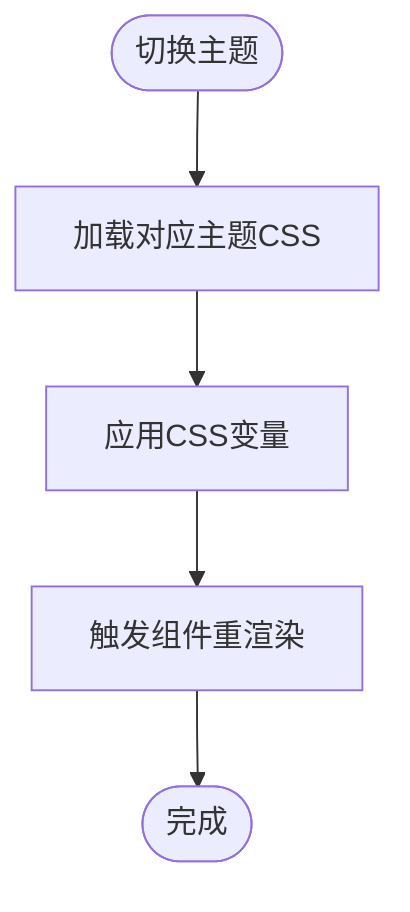
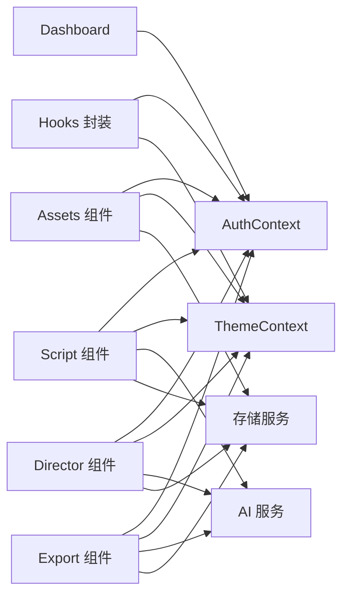

# 前端架构设计

<cite>
**本文档引用的文件**
- [src/App.tsx](file://src/App.tsx)
- [src/main.tsx](file://src/main.tsx)
- [src/phases/script/components/index.tsx](file://src/phases/script/components/index.tsx)
- [src/phases/assets/components/index.tsx](file://src/phases/assets/components/index.tsx)
- [src/phases/director/components/index.tsx](file://src/phases/director/components/index.tsx)
- [src/phases/export/components/index.tsx](file://src/phases/export/components/index.tsx)
- [src/services/ai/index.ts](file://src/services/ai/index.ts)
- [src/services/storage/index.ts](file://src/services/storage/index.ts)
- [src/services/workflow/index.ts](file://src/services/workflow/index.ts)
- [src/shared/contexts/AuthContext.tsx](file://src/shared/contexts/AuthContext.tsx)
- [src/shared/contexts/ThemeContext.tsx](file://src/shared/contexts/ThemeContext.tsx)
- [src/shared/components/Dashboard.tsx](file://src/shared/components/Dashboard.tsx)
- [src/shared/hooks/useAuth.ts](file://src/shared/hooks/useAuth.ts)
- [src/shared/hooks/useTheme.ts](file://src/shared/hooks/useTheme.ts)
- [src/config.ts](file://src/config.ts)
- [src/types.ts](file://src/types.ts)
- [public/styles/theme-dark.css](file://public/styles/theme-dark.css)
- [public/styles/theme-light.css](file://public/styles/theme-light.css)
</cite>

## 目录
1. [简介](#简介)
2. [项目结构](#项目结构)
3. [核心组件](#核心组件)
4. [架构总览](#架构总览)
5. [详细组件分析](#详细组件分析)
6. [依赖关系分析](#依赖关系分析)
7. [性能考虑](#性能考虑)
8. [故障排除指南](#故障排除指南)
9. [结论](#结论)

## 简介
本文件面向AI Shotlive前端架构，聚焦于React应用的组件层次与工作流阶段组件（Script、Assets、Director、Export）的设计模式，系统阐述状态管理与Context上下文体系、路由设计策略、响应式与主题系统、移动端适配方案、组件间通信与事件处理流程，以及性能优化策略。文档同时提供可视化图示与最佳实践建议，帮助开发者快速理解并高效扩展系统。

## 项目结构
项目采用按“功能域+共享层”的分层组织方式：顶层通过入口文件挂载应用；核心业务以“phases”划分四大工作流阶段；共享层提供上下文、Hooks与通用组件；服务层封装AI能力、存储与工作流逻辑；样式通过主题CSS实现明暗切换。

图表来源
- [src/main.tsx:1-6](file://src/main.tsx#L1-L6)
- [src/App.tsx:1-6](file://src/App.tsx#L1-L6)
- [src/phases/script/components/index.tsx](file://src/phases/script/components/index.tsx)
- [src/phases/assets/components/index.tsx](file://src/phases/assets/components/index.tsx)
- [src/phases/director/components/index.tsx](file://src/phases/director/components/index.tsx)
- [src/phases/export/components/index.tsx](file://src/phases/export/components/index.tsx)
- [src/shared/contexts/AuthContext.tsx](file://src/shared/contexts/AuthContext.tsx)
- [src/shared/contexts/ThemeContext.tsx](file://src/shared/contexts/ThemeContext.tsx)
- [src/shared/components/Dashboard.tsx](file://src/shared/components/Dashboard.tsx)
- [src/services/ai/index.ts](file://src/services/ai/index.ts)
- [src/services/storage/index.ts](file://src/services/storage/index.ts)
- [src/services/workflow/index.ts](file://src/services/workflow/index.ts)

章节来源
- [src/main.tsx:1-6](file://src/main.tsx#L1-L6)
- [src/App.tsx:1-6](file://src/App.tsx#L1-L6)

## 核心组件
- 应用入口与挂载：通过入口文件创建根节点并渲染应用组件。
- 工作流阶段组件：Script、Assets、Director、Export四个阶段组件分别负责脚本编辑、素材管理、镜头编排与导出渲染。
- 共享上下文与Hooks：认证上下文与主题上下文贯穿各阶段，提供全局状态与主题切换能力。
- 服务层：AI服务、存储服务与工作流服务为阶段组件提供数据与能力支撑。

章节来源
- [src/main.tsx:1-6](file://src/main.tsx#L1-L6)
- [src/App.tsx:1-6](file://src/App.tsx#L1-L6)
- [src/shared/contexts/AuthContext.tsx](file://src/shared/contexts/AuthContext.tsx)
- [src/shared/contexts/ThemeContext.tsx](file://src/shared/contexts/ThemeContext.tsx)
- [src/shared/hooks/useAuth.ts](file://src/shared/hooks/useAuth.ts)
- [src/shared/hooks/useTheme.ts](file://src/shared/hooks/useTheme.ts)

## 架构总览
系统采用“阶段化工作流 + 共享上下文 + 服务层解耦”的架构。每个阶段组件独立完成特定任务，通过共享上下文与服务层进行协作。UI层面通过主题系统实现明暗主题切换，移动端通过响应式布局适配。

图表来源
- [src/phases/script/components/index.tsx](file://src/phases/script/components/index.tsx)
- [src/phases/assets/components/index.tsx](file://src/phases/assets/components/index.tsx)
- [src/phases/director/components/index.tsx](file://src/phases/director/components/index.tsx)
- [src/phases/export/components/index.tsx](file://src/phases/export/components/index.tsx)
- [src/shared/contexts/AuthContext.tsx](file://src/shared/contexts/AuthContext.tsx)
- [src/shared/contexts/ThemeContext.tsx](file://src/shared/contexts/ThemeContext.tsx)
- [src/services/ai/index.ts](file://src/services/ai/index.ts)
- [src/services/storage/index.ts](file://src/services/storage/index.ts)
- [src/services/workflow/index.ts](file://src/services/workflow/index.ts)

## 详细组件分析

### Script 阶段组件（脚本与场景）
- 职责：负责剧本/小说解析、场景拆解、镜头行编辑、角色配置等。
- 设计模式：组件分层（编辑器、列表、配置面板），通过共享上下文注入认证与主题状态。
- 数据流：从服务层获取脚本/小说内容，经解析后更新本地状态，支持实时编辑与保存。
- 交互：编辑器触发变更，配置面板控制参数，场景列表驱动预览与下一步操作。

图表来源
- [src/phases/script/components/index.tsx](file://src/phases/script/components/index.tsx)
- [src/shared/contexts/AuthContext.tsx](file://src/shared/contexts/AuthContext.tsx)
- [src/shared/contexts/ThemeContext.tsx](file://src/shared/contexts/ThemeContext.tsx)
- [src/services/ai/index.ts](file://src/services/ai/index.ts)
- [src/services/storage/index.ts](file://src/services/storage/index.ts)
- [src/services/workflow/index.ts](file://src/services/workflow/index.ts)

章节来源
- [src/phases/script/components/index.tsx](file://src/phases/script/components/index.tsx)

### Assets 阶段组件（素材与资源）
- 职责：角色、道具、场景素材的上传、预览、选择与管理。
- 设计模式：卡片组件化（角色卡、道具卡、场景卡），模态框用于预览与编辑，工具函数封装上传与校验。
- 数据流：上传触发后调用存储服务，返回资源标识，更新本地素材库并刷新视图。
- 交互：点击上传按钮触发文件选择，预览弹窗展示缩略图，确认后写入素材库。

图表来源
- [src/phases/assets/components/index.tsx](file://src/phases/assets/components/index.tsx)
- [src/services/storage/index.ts](file://src/services/storage/index.ts)

章节来源
- [src/phases/assets/components/index.tsx](file://src/phases/assets/components/index.tsx)

### Director 阶段组件（镜头编排）
- 职责：镜头编辑、关键帧设置、相机运动指导、九宫格预览与视频生成。
- 设计模式：场景上下文管理当前场景状态，编辑器与预览分离，工具函数提供相机运动指导。
- 数据流：编辑器变更触发状态更新，预览组件根据上下文渲染，最终提交到视频生成服务。
- 交互：关键帧编辑器更新时间轴，九宫格预览即时反馈，生成按钮触发渲染流程。

图表来源
- [src/phases/director/components/index.tsx](file://src/phases/director/components/index.tsx)
- [src/shared/contexts/SceneContext.tsx](file://src/shared/contexts/SceneContext.tsx)
- [src/services/ai/index.ts](file://src/services/ai/index.ts)

章节来源
- [src/phases/director/components/index.tsx](file://src/phases/director/components/index.tsx)

### Export 阶段组件（导出与渲染）
- 职责：渲染状态面板、二次选项配置、时间线可视化、渲染日志与播放器弹窗。
- 设计模式：状态面板集中展示进度与结果，二次选项控制渲染参数，可视化组件辅助理解时间线。
- 数据流：根据前序阶段输出生成渲染任务，轮询或回调获取进度，完成后打开播放器弹窗。
- 交互：开始渲染按钮触发任务，日志弹窗显示详细信息，播放器弹窗预览最终视频。

图表来源
- [src/phases/export/components/index.tsx](file://src/phases/export/components/index.tsx)
- [src/services/ai/index.ts](file://src/services/ai/index.ts)
- [src/services/storage/index.ts](file://src/services/storage/index.ts)

章节来源
- [src/phases/export/components/index.tsx](file://src/phases/export/components/index.tsx)

### 状态管理与Context系统
- 认证上下文（AuthContext）：提供用户登录状态、令牌与权限信息，供所有阶段组件访问。
- 主题上下文（ThemeContext）：提供明/暗主题切换与当前主题状态，驱动样式与组件外观。
- Hooks封装：useAuth与useTheme简化上下文读取与更新，降低组件复杂度。

图表来源
- [src/shared/contexts/AuthContext.tsx](file://src/shared/contexts/AuthContext.tsx)
- [src/shared/contexts/ThemeContext.tsx](file://src/shared/contexts/ThemeContext.tsx)
- [src/shared/hooks/useAuth.ts](file://src/shared/hooks/useAuth.ts)
- [src/shared/hooks/useTheme.ts](file://src/shared/hooks/useTheme.ts)

章节来源
- [src/shared/contexts/AuthContext.tsx](file://src/shared/contexts/AuthContext.tsx)
- [src/shared/contexts/ThemeContext.tsx](file://src/shared/contexts/ThemeContext.tsx)
- [src/shared/hooks/useAuth.ts](file://src/shared/hooks/useAuth.ts)
- [src/shared/hooks/useTheme.ts](file://src/shared/hooks/useTheme.ts)

### 路由设计策略
- 单页应用（SPA）：基于前端路由在不同阶段之间切换，保持应用状态与上下文连续性。
- 阶段内导航：每个阶段内部可进一步细分为子视图（如编辑器、列表、配置面板），通过面包屑或侧边栏导航。
- 权限路由：结合认证上下文，在进入阶段前校验用户权限，未授权跳转至登录或提示页面。

章节来源
- [src/shared/contexts/AuthContext.tsx](file://src/shared/contexts/AuthContext.tsx)
- [src/shared/components/Dashboard.tsx](file://src/shared/components/Dashboard.tsx)

### 响应式设计与主题系统
- 响应式布局：使用CSS媒体查询与弹性布局适配桌面与移动设备，确保组件在小屏上可滚动与自适应。
- 主题系统：通过明/暗两套CSS变量主题文件，切换主题时动态加载对应样式表，实现全局外观一致。
- 移动端适配：优先使用相对单位与flex布局，避免固定宽度；针对触摸交互优化按钮尺寸与间距。

图表来源
- [public/styles/theme-dark.css](file://public/styles/theme-dark.css)
- [public/styles/theme-light.css](file://public/styles/theme-light.css)
- [src/shared/contexts/ThemeContext.tsx](file://src/shared/contexts/ThemeContext.tsx)

章节来源
- [public/styles/theme-dark.css](file://public/styles/theme-dark.css)
- [public/styles/theme-light.css](file://public/styles/theme-light.css)
- [src/shared/contexts/ThemeContext.tsx](file://src/shared/contexts/ThemeContext.tsx)

### 组件间通信与事件处理
- 上下文通信：通过AuthContext与ThemeContext在任意层级传递状态，避免多级props传递。
- 事件冒泡与委托：在列表组件中使用事件委托减少监听器数量，提升性能。
- 异步事件：阶段间通过服务层回调或轮询推进，确保UI与后台任务解耦。

章节来源
- [src/shared/contexts/AuthContext.tsx](file://src/shared/contexts/AuthContext.tsx)
- [src/shared/contexts/ThemeContext.tsx](file://src/shared/contexts/ThemeContext.tsx)
- [src/services/workflow/index.ts](file://src/services/workflow/index.ts)

### 性能优化策略
- 懒加载与分割：对大型组件与第三方库进行代码分割，按需加载阶段组件。
- 缓存策略：对AI生成结果与素材资源进行缓存，减少重复请求。
- 虚拟滚动：在长列表场景使用虚拟滚动，仅渲染可视区域元素。
- 事件节流与防抖：对高频输入与窗口resize事件进行节流/防抖，降低重绘频率。
- 图片懒加载与压缩：对预览图片启用懒加载与WebP格式，缩短首屏时间。

章节来源
- [src/services/storage/index.ts](file://src/services/storage/index.ts)
- [src/services/ai/index.ts](file://src/services/ai/index.ts)

## 依赖关系分析
- 组件到上下文：各阶段组件均依赖认证与主题上下文。
- 组件到服务：Script与Director依赖AI与存储服务，Export依赖渲染与存储服务。
- 共享层：Hooks与Dashboard作为跨阶段复用模块，降低重复开发成本。

图表来源
- [src/phases/script/components/index.tsx](file://src/phases/script/components/index.tsx)
- [src/phases/assets/components/index.tsx](file://src/phases/assets/components/index.tsx)
- [src/phases/director/components/index.tsx](file://src/phases/director/components/index.tsx)
- [src/phases/export/components/index.tsx](file://src/phases/export/components/index.tsx)
- [src/shared/contexts/AuthContext.tsx](file://src/shared/contexts/AuthContext.tsx)
- [src/shared/contexts/ThemeContext.tsx](file://src/shared/contexts/ThemeContext.tsx)
- [src/services/ai/index.ts](file://src/services/ai/index.ts)
- [src/services/storage/index.ts](file://src/services/storage/index.ts)

章节来源
- [src/shared/contexts/AuthContext.tsx](file://src/shared/contexts/AuthContext.tsx)
- [src/shared/contexts/ThemeContext.tsx](file://src/shared/contexts/ThemeContext.tsx)
- [src/services/ai/index.ts](file://src/services/ai/index.ts)
- [src/services/storage/index.ts](file://src/services/storage/index.ts)

## 性能考虑
- 模块化与Tree Shaking：确保未使用的代码被移除，减小包体积。
- 并行渲染：利用并发渲染特性，将不依赖的状态更新合并为批处理。
- CDN与静态资源：将公共资源托管至CDN，配合缓存头提升加载速度。
- 错误边界：在关键阶段组件外层包裹错误边界，防止单点异常影响整体。

## 故障排除指南
- 登录状态异常：检查认证上下文初始化与令牌刷新逻辑，确认网络请求拦截器正确注入。
- 主题切换无效：确认主题CSS文件已正确加载且CSS变量覆盖顺序正确。
- 渲染任务无响应：检查工作流服务的任务队列与回调机制，查看日志面板定位问题。
- 素材上传失败：验证存储服务的鉴权与文件大小限制，检查浏览器兼容性与网络状况。

章节来源
- [src/shared/contexts/AuthContext.tsx](file://src/shared/contexts/AuthContext.tsx)
- [src/shared/contexts/ThemeContext.tsx](file://src/shared/contexts/ThemeContext.tsx)
- [src/services/workflow/index.ts](file://src/services/workflow/index.ts)
- [src/services/storage/index.ts](file://src/services/storage/index.ts)

## 结论
AI Shotlive前端以阶段化工作流为核心，通过共享上下文与服务层实现高内聚低耦合。Script、Assets、Director、Export四大阶段组件职责清晰、交互顺畅，配合响应式与主题系统满足多端体验需求。建议在后续迭代中持续完善错误边界、监控埋点与国际化支持，进一步提升稳定性与可维护性。