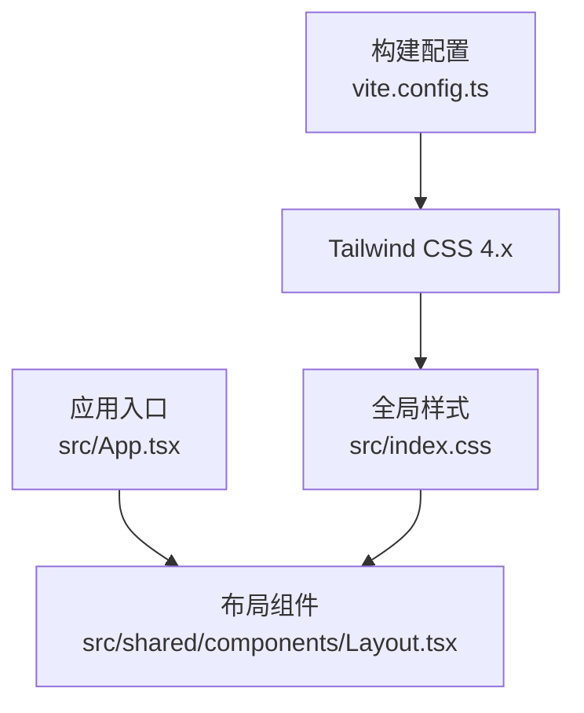
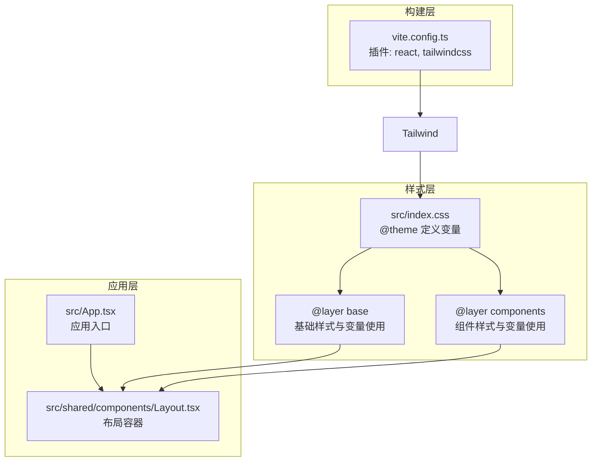
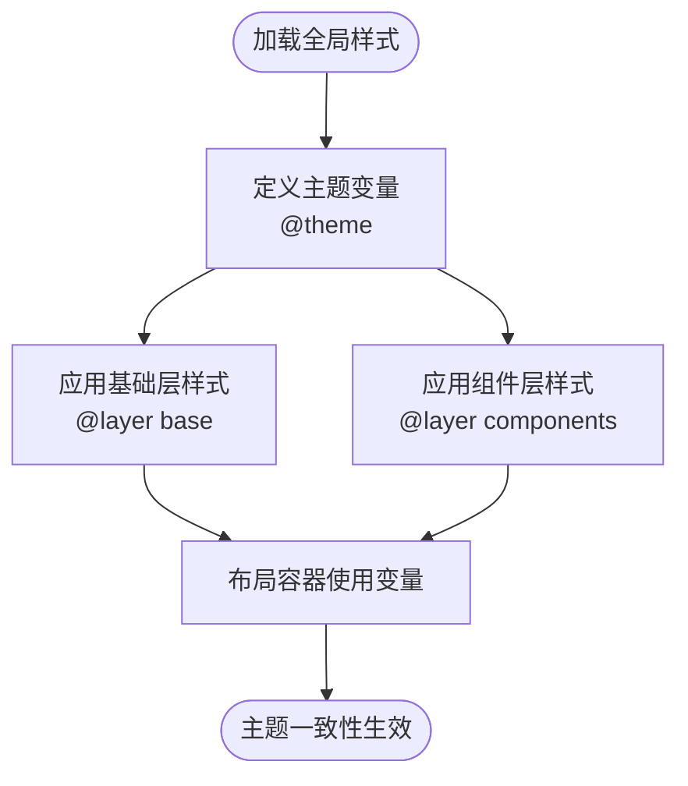
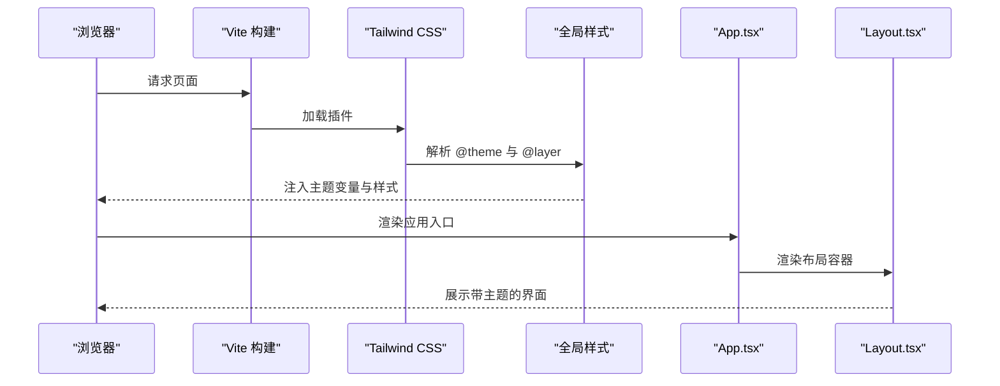
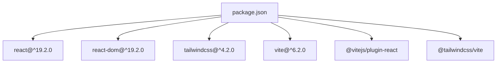

# 响应式设计与主题系统

<cite>
**本文档引用的文件**
- [vite.config.ts](file://vite.config.ts)
- [index.css](file://src/index.css)
- [package.json](file://package.json)
- [App.tsx](file://src/App.tsx)
- [Layout.tsx](file://src/shared/components/Layout.tsx)
</cite>

## 目录
1. [简介](#简介)
2. [项目结构](#项目结构)
3. [核心组件](#核心组件)
4. [架构总览](#架构总览)
5. [详细组件分析](#详细组件分析)
6. [依赖关系分析](#依赖关系分析)
7. [性能考虑](#性能考虑)
8. [故障排除指南](#故障排除指南)
9. [结论](#结论)
10. [附录](#附录)

## 简介
本文件聚焦于 AI Shotlive 的响应式设计与主题系统，围绕以下目标展开：
- 移动端检测机制与断点策略
- 响应式布局与小屏适配
- CSS 变量主题系统（深色/浅色主题切换、命名规范、继承机制）
- Tailwind CSS 定制化配置与组件级样式覆盖
- 主题一致性保障与性能优化
- 主题扩展与自定义主题创建方法
- 主题变量对照表与响应式设计示例

需要特别说明的是：当前仓库中未发现专门的主题上下文文件与独立的主题 CSS 文件；主题系统以 CSS 变量为核心，通过全局样式与组件样式进行统一管理。移动端警告页面与触摸交互优化在现有代码中未找到直接实现，将在“概念性概述”部分给出可落地的实践建议。

## 项目结构
本项目采用 Vite + React + Tailwind CSS 4.x 构建，样式通过 CSS 变量集中管理，布局由组件组合完成。关键结构如下：
- 构建与样式：Vite 插件引入 Tailwind CSS，全局样式在 src/index.css 中定义
- 应用入口：App.tsx 负责根据项目状态选择渲染不同阶段的页面
- 布局容器：Layout.tsx 提供左右分栏布局与背景纹理

**图表来源**
- [vite.config.ts:1-13](file://vite.config.ts#L1-L13)
- [index.css:1-209](file://src/index.css#L1-L209)
- [App.tsx:1-44](file://src/App.tsx#L1-L44)
- [Layout.tsx:1-22](file://src/shared/components/Layout.tsx#L1-L22)

**章节来源**
- [vite.config.ts:1-13](file://vite.config.ts#L1-L13)
- [package.json:1-26](file://package.json#L1-L26)
- [App.tsx:1-44](file://src/App.tsx#L1-L44)
- [Layout.tsx:1-22](file://src/shared/components/Layout.tsx#L1-L22)

## 核心组件
- 全局样式与主题变量：在 src/index.css 中通过 @theme 定义颜色与字体变量，并在 @layer base 与 @layer components 中统一应用
- 布局容器：Layout.tsx 使用 CSS 变量控制文本色与背景纹理，确保主题一致性
- 应用入口：App.tsx 根据项目状态渲染不同阶段内容，配合全局样式实现一致的主题外观

**章节来源**
- [index.css:11-37](file://src/index.css#L11-L37)
- [index.css:39-68](file://src/index.css#L39-L68)
- [index.css:70-209](file://src/index.css#L70-L209)
- [Layout.tsx:9-21](file://src/shared/components/Layout.tsx#L9-L21)
- [App.tsx:15-28](file://src/App.tsx#L15-L28)

## 架构总览
下图展示了主题系统与响应式设计在项目中的整体关系：构建层引入 Tailwind，样式层通过 CSS 变量提供主题能力，应用层通过布局组件承载主题外观。

**图表来源**
- [vite.config.ts:5-6](file://vite.config.ts#L5-L6)
- [index.css:11-37](file://src/index.css#L11-L37)
- [index.css:39-68](file://src/index.css#L39-L68)
- [index.css:70-209](file://src/index.css#L70-L209)
- [App.tsx:30-42](file://src/App.tsx#L30-L42)
- [Layout.tsx:9-21](file://src/shared/components/Layout.tsx#L9-L21)

## 详细组件分析

### 组件一：全局样式与主题变量（src/index.css）
- 设计要点
  - 使用 @theme 定义品牌色彩与字体变量，形成统一的主题语料库
  - 在 @layer base 中设置全局字体、背景、滚动条与焦点样式，确保跨组件一致性
  - 在 @layer components 中定义按钮、卡片、输入框等通用组件样式，均通过 CSS 变量引用主题色
- 关键特性
  - 深色主题基调：以深色为主，搭配暖色强调色，营造暗房氛围
  - 字体体系：显示字体、无衬线字体、等宽字体三套体系，满足不同场景需求
  - 动画与过渡：为按钮与状态指示器提供平滑动画，提升交互体验
- 命名规范
  - 颜色变量：--color-{材质}-{明度}，如 --color-ink-950、--color-paper-50
  - 字体变量：--font-{类别}，如 --font-display、--font-sans、--font-mono
- 主题继承机制
  - 所有组件样式通过 CSS 变量引用，无需修改组件内部即可实现主题切换
  - 布局容器通过内联 style 使用变量，确保子元素继承主题色

**图表来源**
- [index.css:11-37](file://src/index.css#L11-L37)
- [index.css:39-68](file://src/index.css#L39-L68)
- [index.css:70-209](file://src/index.css#L70-L209)
- [Layout.tsx:11-12](file://src/shared/components/Layout.tsx#L11-L12)

**章节来源**
- [index.css:11-37](file://src/index.css#L11-L37)
- [index.css:39-68](file://src/index.css#L39-L68)
- [index.css:70-209](file://src/index.css#L70-L209)
- [Layout.tsx:9-21](file://src/shared/components/Layout.tsx#L9-L21)

### 组件二：应用入口与布局容器（src/App.tsx, src/shared/components/Layout.tsx）
- 设计要点
  - App.tsx 根据项目状态决定渲染分支，确保主题在各阶段保持一致
  - Layout.tsx 作为布局容器，使用 CSS 变量控制文本色与背景纹理，承载全局样式效果
- 响应式策略
  - 通过 Flex 布局与相对定位实现自适应，配合 Tailwind 类名进一步细化断点行为
  - 建议在组件层引入断点类名（如 sm: md: lg:）以实现不同屏幕下的布局调整

**图表来源**
- [vite.config.ts:5-6](file://vite.config.ts#L5-L6)
- [index.css:11-37](file://src/index.css#L11-L37)
- [App.tsx:30-42](file://src/App.tsx#L30-L42)
- [Layout.tsx:9-21](file://src/shared/components/Layout.tsx#L9-L21)

**章节来源**
- [App.tsx:15-28](file://src/App.tsx#L15-L28)
- [Layout.tsx:9-21](file://src/shared/components/Layout.tsx#L9-L21)

### 概念性概述：移动端检测、断点与小屏适配
- 移动端检测机制
  - 建议通过 CSS 媒体查询与 JavaScript 媒体查询结合的方式识别移动设备
  - 在关键组件上使用断点类名（如 sm: md: lg:）实现响应式布局
- 断点设置建议
  - 常用断点：sm: 640px, md: 768px, lg: 1024px, xl: 1280px
  - 针对移动端，优先使用更紧凑的间距与字号，减少横向滚动
- 小屏适配策略
  - 使用 Flex 布局与 Grid 的自动换行能力
  - 对按钮、输入框等交互元素增加触摸目标尺寸，确保可点击性
- 触摸交互优化
  - 为按钮添加合适的 :active 与 :focus-visible 样式
  - 在滚动区域避免使用全局滚动条样式，改用局部滚动容器

[本节为概念性指导，不直接分析具体文件，故无“章节来源”]

### 概念性概述：移动端警告页面
- 设计目标：当用户在过小的屏幕或不支持的设备上访问时，展示简洁的提示页面
- 实现建议：
  - 在应用入口处检测屏幕宽度，若小于阈值则渲染警告页
  - 警告页采用居中布局与大号字体，提供升级到桌面环境的指引
- 注意事项：
  - 警告页样式应独立于主主题，避免与主界面混淆
  - 提供返回按钮或刷新链接，便于用户操作

[本节为概念性指导，不直接分析具体文件，故无“章节来源”]

## 依赖关系分析
- 构建依赖
  - Vite 插件：@vitejs/plugin-react、@tailwindcss/vite
  - 样式依赖：tailwindcss 4.x
- 运行时依赖
  - React 19 与 React DOM
  - 图标库 lucide-react

**图表来源**
- [package.json:11-24](file://package.json#L11-L24)

**章节来源**
- [package.json:1-26](file://package.json#L1-L26)

## 性能考虑
- 样式体积控制
  - 仅在 @theme 与 @layer 中声明必要变量，避免冗余
  - 合理拆分组件样式，减少重复计算
- 构建优化
  - 使用 Tailwind CSS 4.x 的按需处理能力，避免打包无关样式
  - 在生产构建中启用压缩与 Tree Shaking
- 交互性能
  - 动画与过渡尽量使用 transform 与 opacity，避免触发布局抖动
  - 控制动画频率与时长，确保在低端设备上流畅运行

[本节提供一般性指导，不直接分析具体文件，故无“章节来源”]

## 故障排除指南
- 主题变量未生效
  - 检查全局样式是否正确导入与编译
  - 确认组件是否通过 CSS 变量引用而非硬编码颜色
- 样式冲突
  - 使用 Tailwind 的层叠顺序与 !important 谨慎处理
  - 避免在组件内直接覆盖全局样式
- 构建问题
  - 确保 Tailwind 插件已正确安装与配置
  - 检查 Vite 配置中的插件顺序

[本节提供一般性指导，不直接分析具体文件，故无“章节来源”]

## 结论
本项目以 CSS 变量为核心的主题系统具备良好的可维护性与扩展性。通过全局样式与组件样式的协同，实现了跨组件的主题一致性。建议在现有基础上补充：
- 明确的断点与响应式类名规范
- 移动端检测与警告页面
- 主题切换的上下文封装与持久化
- 组件级样式覆盖的最佳实践

[本节为总结性内容，不直接分析具体文件，故无“章节来源”]

## 附录

### 主题变量对照表（基于 src/index.css）
- 颜色变量
  - 深色系：--color-ink-950、--color-ink-900、--color-ink-850、--color-ink-800、--color-ink-700、--color-ink-600、--color-ink-500
  - 浅色系：--color-paper-50、--color-paper-100、--color-paper-200、--color-paper-400、--color-paper-500、--color-paper-600
  - 强调色：--color-amber-leader、--color-amber-glow、--color-amber-deep、--color-crimson-mark、--color-crimson-deep
- 字体变量
  - --font-display、--font-sans、--font-mono

**章节来源**
- [index.css:12-36](file://src/index.css#L12-L36)

### 响应式设计示例（概念性）
- 断点与类名
  - sm: 针对小屏（如 640px）
  - md: 针对中屏（如 768px）
  - lg: 针对大屏（如 1024px）
  - xl: 针对超大屏（如 1280px）
- 示例策略
  - 导航栏在 sm 下折叠为汉堡菜单
  - 主内容区在 md 下变为单列，在 lg 下恢复双栏
  - 表单控件在 sm 下增大触摸目标尺寸

[本节为概念性示例，不直接分析具体文件，故无“章节来源”]