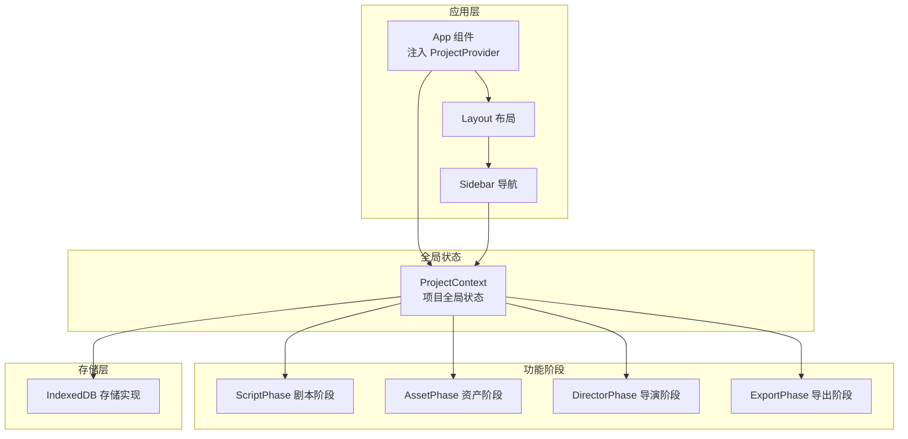
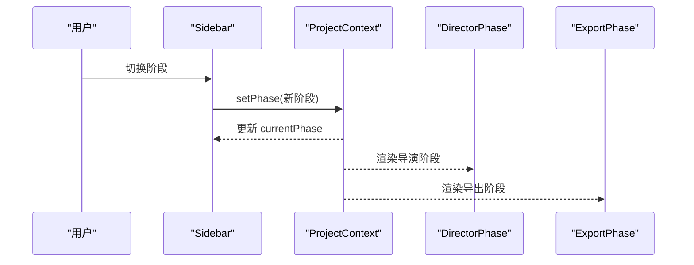
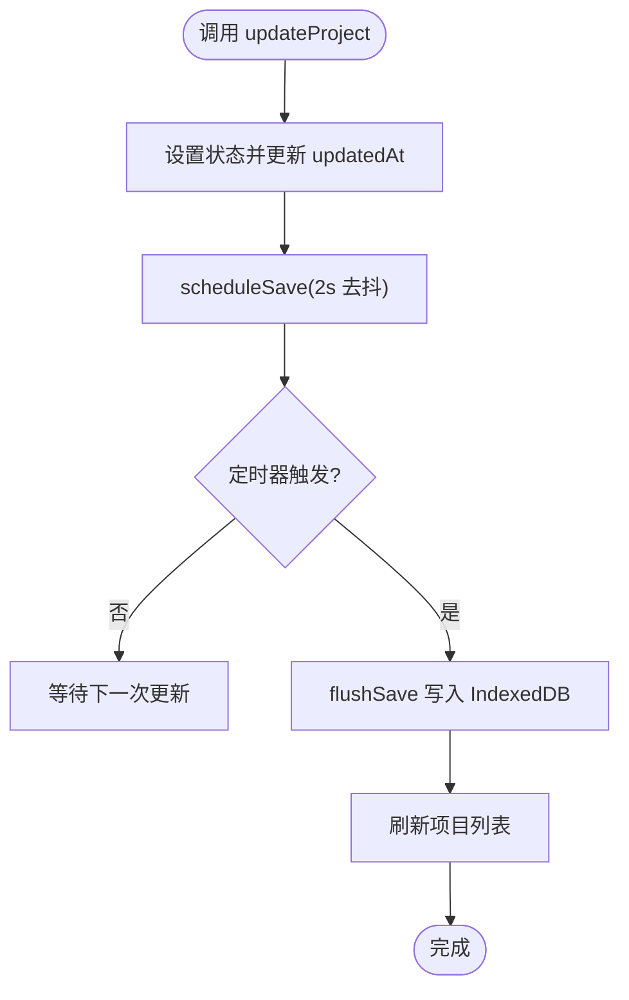
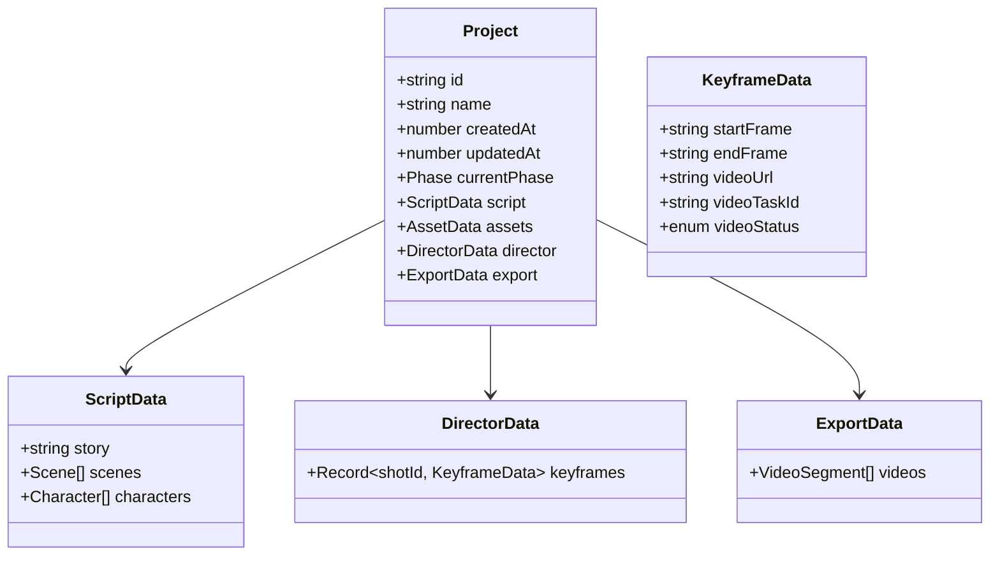
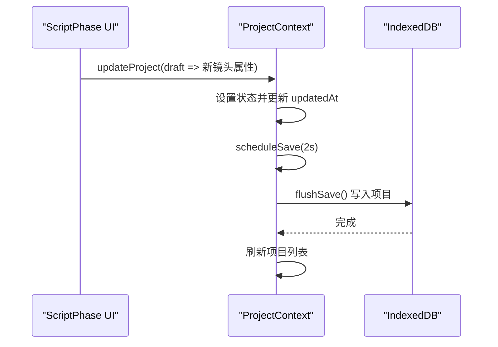
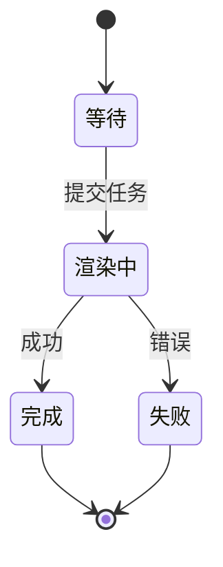
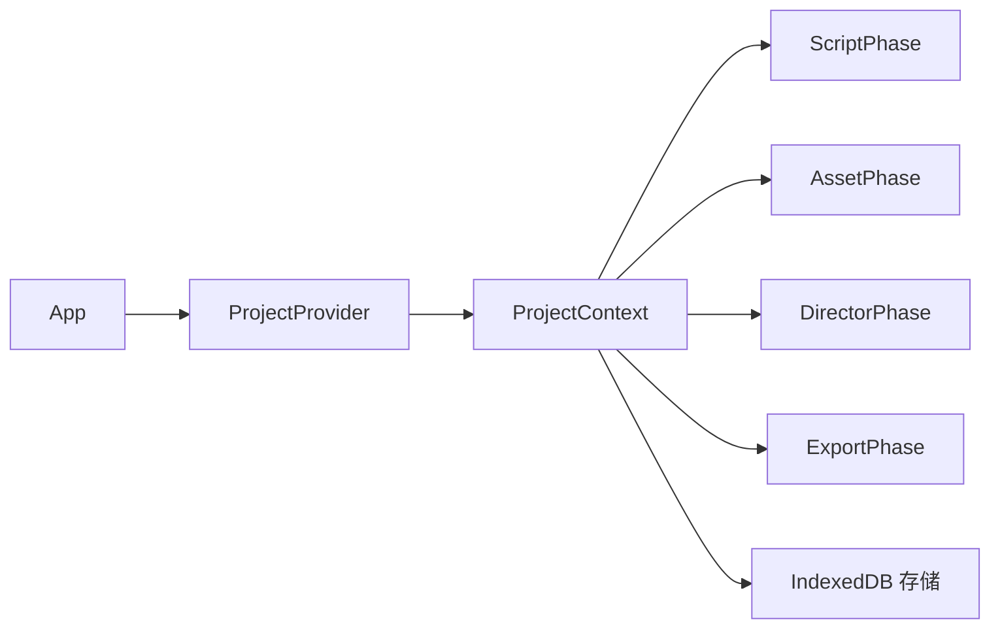

# 状态管理模式

<cite>
**本文引用的文件**
- [ProjectContext.tsx](file://src/shared/contexts/ProjectContext.tsx)
- [App.tsx](file://src/App.tsx)
- [Layout.tsx](file://src/shared/components/Layout.tsx)
- [Sidebar.tsx](file://src/shared/components/Sidebar.tsx)
- [ScriptPhase.tsx](file://src/phases/script/ScriptPhase.tsx)
- [DirectorPhase.tsx](file://src/phases/director/DirectorPhase.tsx)
- [ExportPhase.tsx](file://src/phases/export/ExportPhase.tsx)
- [VideoStatusBadge.tsx](file://src/phases/director/components/VideoStatusBadge.tsx)
- [indexeddb.ts](file://src/services/storage/indexeddb.ts)
- [types.ts](file://src/types.ts)
</cite>

## 目录
1. [简介](#简介)
2. [项目结构](#项目结构)
3. [核心组件](#核心组件)
4. [架构总览](#架构总览)
5. [详细组件分析](#详细组件分析)
6. [依赖关系分析](#依赖关系分析)
7. [性能考量](#性能考量)
8. [故障排查指南](#故障排查指南)
9. [结论](#结论)

## 简介
本文件系统性梳理 AI Shotlive 的状态管理模式，重点覆盖：
- 局部状态与上下文状态的使用边界与最佳实践
- ProjectState 的结构设计、更新机制与持久化策略
- 认证与主题等全局状态的上下文设计模式
- 增量 PATCH 保存、渲染日志与生成任务状态的协调
- 状态同步策略、性能优化技巧与调试方法
- 提供状态流转图与可追溯的代码示例路径

## 项目结构
本项目采用“分层 + 功能域”的组织方式：
- 根组件通过 Provider 包裹，统一注入全局状态上下文
- 每个编辑阶段（剧本、资产、导演、导出）作为独立功能域，消费全局状态并进行局部状态管理
- 存储层基于 IndexedDB 实现，提供项目、资产与配置的持久化能力

图表来源
- [App.tsx:15-28](file://src/App.tsx#L15-L28)
- [ProjectContext.tsx:47-186](file://src/shared/contexts/ProjectContext.tsx#L47-L186)
- [Layout.tsx:9-21](file://src/shared/components/Layout.tsx#L9-L21)
- [Sidebar.tsx:39-47](file://src/shared/components/Sidebar.tsx#L39-L47)
- [indexeddb.ts:23-189](file://src/services/storage/indexeddb.ts#L23-L189)

章节来源
- [App.tsx:15-28](file://src/App.tsx#L15-L28)
- [ProjectContext.tsx:47-186](file://src/shared/contexts/ProjectContext.tsx#L47-L186)
- [Layout.tsx:9-21](file://src/shared/components/Layout.tsx#L9-L21)
- [Sidebar.tsx:39-47](file://src/shared/components/Sidebar.tsx#L39-L47)
- [indexeddb.ts:23-189](file://src/services/storage/indexeddb.ts#L23-L189)

## 核心组件
- ProjectContext：单一可信数据源（Project），配合去抖持久化（2 秒），提供项目生命周期与阶段切换能力
- 类型系统：以 Project 为核心，分阶段拆解数据模型，确保结构与功能对应
- 存储服务：IndexedDB 封装，提供项目、资产、配置三类对象存储

章节来源
- [ProjectContext.tsx:20-37](file://src/shared/contexts/ProjectContext.tsx#L20-L37)
- [types.ts:10-20](file://src/types.ts#L10-L20)
- [indexeddb.ts:103-141](file://src/services/storage/indexeddb.ts#L103-L141)

## 架构总览
全局状态通过 Provider 注入，根组件依据当前阶段选择渲染对应功能域；各阶段内部可使用局部状态管理复杂交互，同时通过全局更新函数进行结构化变更。

图表来源
- [Sidebar.tsx:39-47](file://src/shared/components/Sidebar.tsx#L39-L47)
- [ProjectContext.tsx:163-168](file://src/shared/contexts/ProjectContext.tsx#L163-L168)
- [App.tsx:20-27](file://src/App.tsx#L20-L27)

## 详细组件分析

### ProjectContext：项目全局状态与持久化
- 设计要点
  - 单一可信数据源：Project 对象作为唯一事实来源
  - 去抖保存：2 秒内多次更新合并为一次持久化，降低 I/O 压力
  - 引用保持：通过 ref 保存最新项目快照，保证回调一致性
  - 生命周期：支持创建、加载、删除、关闭项目，并刷新项目列表
- 状态结构
  - 项目元数据：id、name、createdAt、updatedAt、currentPhase
  - 分阶段数据：script、assets、director、export
- 更新机制
  - updateProject 接收“草稿函数”，返回新 Project 并自动更新 updatedAt
  - setPhase 通过 updateProject 原子更新阶段
- 持久化策略
  - IndexedDB 存储，事务封装，写入完成后刷新列表
  - 页面卸载前强制落盘，避免数据丢失

图表来源
- [ProjectContext.tsx:150-161](file://src/shared/contexts/ProjectContext.tsx#L150-L161)
- [ProjectContext.tsx:85-90](file://src/shared/contexts/ProjectContext.tsx#L85-L90)
- [ProjectContext.tsx:71-83](file://src/shared/contexts/ProjectContext.tsx#L71-L83)
- [ProjectContext.tsx:61-64](file://src/shared/contexts/ProjectContext.tsx#L61-L64)

章节来源
- [ProjectContext.tsx:47-186](file://src/shared/contexts/ProjectContext.tsx#L47-L186)
- [indexeddb.ts:103-141](file://src/services/storage/indexeddb.ts#L103-L141)

### 类型系统：Project 与分阶段数据模型
- 结构关系
  - Project 包含 script、assets、director、export 四个阶段数据
  - ScriptData 包含故事、场景与角色列表
  - DirectorData 以 keyframes 映射每个镜头的渲染状态
  - ExportData 保存已生成片段
- 设计原则
  - 结构决定功能：清晰的数据结构支撑各阶段的业务流程
  - 工具函数：createEmptyProject 提供标准化空项目模板

图表来源
- [types.ts:10-20](file://src/types.ts#L10-L20)
- [types.ts:22-27](file://src/types.ts#L22-L27)
- [types.ts:58-69](file://src/types.ts#L58-L69)
- [types.ts:71-80](file://src/types.ts#L71-L80)

章节来源
- [types.ts:6-20](file://src/types.ts#L6-L20)
- [types.ts:83-95](file://src/types.ts#L83-L95)

### 功能阶段：剧本阶段的增量 PATCH 示例
- 场景与镜头的增删改通过 updateProject 的草稿函数实现
- 以不可变更新的方式替换嵌套数组与对象，确保状态一致性
- 典型操作
  - 更新镜头属性：updateShot
  - 删除镜头：deleteShot
  - 更新角色：updateCharacter
  - 删除角色：deleteCharacter

图表来源
- [ScriptPhase.tsx:273-319](file://src/phases/script/ScriptPhase.tsx#L273-L319)
- [ProjectContext.tsx:150-161](file://src/shared/contexts/ProjectContext.tsx#L150-L161)
- [ProjectContext.tsx:71-83](file://src/shared/contexts/ProjectContext.tsx#L71-L83)

章节来源
- [ScriptPhase.tsx:273-319](file://src/phases/script/ScriptPhase.tsx#L273-L319)
- [ProjectContext.tsx:150-161](file://src/shared/contexts/ProjectContext.tsx#L150-L161)

### 导演阶段：渲染任务状态与进度
- 任务状态枚举：pending、processing、completed、failed
- 状态徽标组件：根据状态映射颜色、图标与脉动感
- 批处理进度：在批量渲染时显示总体进度条

图表来源
- [VideoStatusBadge.tsx:11-44](file://src/phases/director/components/VideoStatusBadge.tsx#L11-L44)
- [types.ts:63-69](file://src/types.ts#L63-L69)

章节来源
- [VideoStatusBadge.tsx:11-56](file://src/phases/director/components/VideoStatusBadge.tsx#L11-L56)
- [types.ts:63-69](file://src/types.ts#L63-L69)

### 导出阶段：成片统计与渲染素材关联
- 统计面板：总镜头数、已完成、进行中、总时长
- 渲染素材：从导演阶段的 keyframes 中筛选已生成视频

章节来源
- [ExportPhase.tsx:10-28](file://src/phases/export/ExportPhase.tsx#L10-L28)

### 认证与主题上下文设计（概念性说明）
- 认证上下文（AuthContext）：用于管理用户登录态、令牌与权限，适合在顶层 Provider 中注入，供全局路由守卫与页面组件使用
- 主题上下文（ThemeContext）：用于管理明暗主题、色彩变量与动态样式切换，建议与系统偏好联动并在应用启动时恢复
- 使用建议
  - 将认证与主题状态与 ProjectContext 解耦，分别维护各自的 Provider
  - 在根组件中组合多个 Provider，确保状态隔离与最小重渲染

（本小节为概念性说明，不直接分析具体文件）

## 依赖关系分析
- App 作为根组件，负责注入 ProjectProvider，并根据 currentPhase 渲染对应阶段
- Sidebar 依赖 ProjectContext 获取与切换阶段
- 各阶段组件通过 ProjectContext 的 updateProject 进行结构化更新
- 存储层通过 IndexedDB 实现持久化，事务封装保证一致性

图表来源
- [App.tsx:30-42](file://src/App.tsx#L30-L42)
- [ProjectContext.tsx:47-186](file://src/shared/contexts/ProjectContext.tsx#L47-L186)
- [indexeddb.ts:23-189](file://src/services/storage/indexeddb.ts#L23-L189)

章节来源
- [App.tsx:30-42](file://src/App.tsx#L30-L42)
- [ProjectContext.tsx:47-186](file://src/shared/contexts/ProjectContext.tsx#L47-L186)
- [indexeddb.ts:23-189](file://src/services/storage/indexeddb.ts#L23-L189)

## 性能考量
- 去抖保存：2 秒去抖窗口减少频繁 I/O，适合内容密集型编辑
- 事务写入：IndexedDB 事务封装，写入完成后统一刷新，避免中间态
- 引用保持：通过 ref 保存最新项目快照，避免闭包陷阱导致的异步写入旧数据
- 最小重渲染：草稿函数式更新，避免深层拷贝带来的性能损耗
- 批处理进度：在渲染队列中聚合进度，减少 UI 抖动

章节来源
- [ProjectContext.tsx:45](file://src/shared/contexts/ProjectContext.tsx#L45)
- [ProjectContext.tsx:53-59](file://src/shared/contexts/ProjectContext.tsx#L53-L59)
- [ProjectContext.tsx:71-83](file://src/shared/contexts/ProjectContext.tsx#L71-L83)
- [indexeddb.ts:93-99](file://src/services/storage/indexeddb.ts#L93-L99)

## 故障排查指南
- 保存失败
  - 现象：控制台输出保存失败日志
  - 排查：检查 IndexedDB 权限、数据库版本变更、事务错误
  - 参考路径：[ProjectContext.tsx:78-82](file://src/shared/contexts/ProjectContext.tsx#L78-L82)、[indexeddb.ts:34-42](file://src/services/storage/indexeddb.ts#L34-L42)
- 页面卸载未保存
  - 现象：刷新或关闭页面后数据未持久化
  - 排查：确认 beforeunload 监听是否注册、定时器是否清理
  - 参考路径：[ProjectContext.tsx:92-106](file://src/shared/contexts/ProjectContext.tsx#L92-L106)
- 项目列表为空
  - 现象：项目列表排序异常或为空
  - 排查：确认 listProjects 返回值与排序逻辑
  - 参考路径：[ProjectContext.tsx:61-64](file://src/shared/contexts/ProjectContext.tsx#L61-L64)、[indexeddb.ts:119-133](file://src/services/storage/indexeddb.ts#L119-L133)
- 渲染状态不一致
  - 现象：UI 状态与任务实际状态不符
  - 排查：核对 KeyframeData 的 videoStatus 字段更新路径与组件渲染条件
  - 参考路径：[types.ts:63-69](file://src/types.ts#L63-L69)、[VideoStatusBadge.tsx:52-56](file://src/phases/director/components/VideoStatusBadge.tsx#L52-L56)

章节来源
- [ProjectContext.tsx:78-82](file://src/shared/contexts/ProjectContext.tsx#L78-L82)
- [ProjectContext.tsx:92-106](file://src/shared/contexts/ProjectContext.tsx#L92-L106)
- [ProjectContext.tsx:61-64](file://src/shared/contexts/ProjectContext.tsx#L61-L64)
- [indexeddb.ts:34-42](file://src/services/storage/indexeddb.ts#L34-L42)
- [indexeddb.ts:119-133](file://src/services/storage/indexeddb.ts#L119-L133)
- [types.ts:63-69](file://src/types.ts#L63-L69)
- [VideoStatusBadge.tsx:52-56](file://src/phases/director/components/VideoStatusBadge.tsx#L52-L56)

## 结论
本项目采用“单一可信数据源 + 去抖持久化”的全局状态模式，结合阶段化的功能域组件，实现了高效、可维护的状态管理。通过草稿函数式更新与事务化存储，既保证了状态一致性，也兼顾了性能与用户体验。建议在后续扩展中：
- 将认证与主题状态拆分为独立上下文，保持职责单一
- 在高频更新场景引入更细粒度的局部状态，减少全局重渲染
- 增强状态调试工具链，如时间旅行调试与状态快照对比