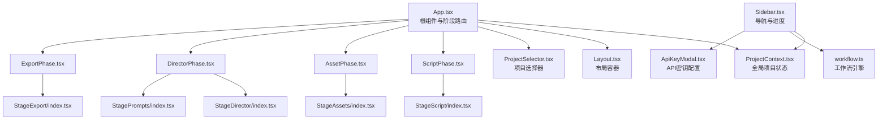
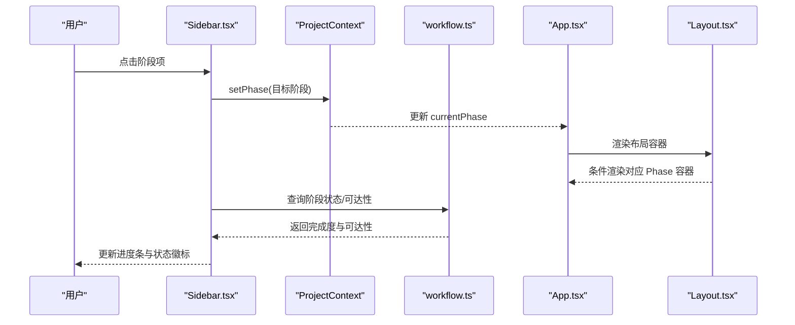
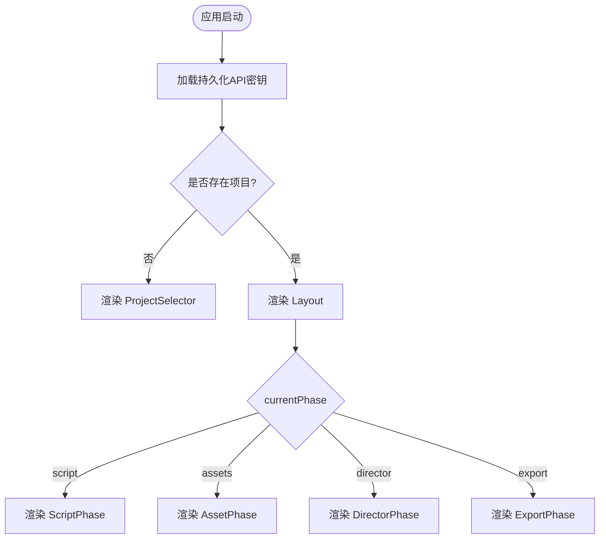
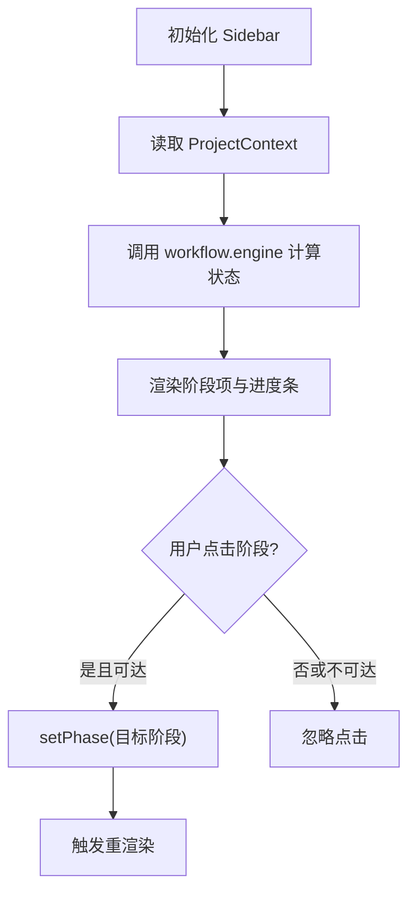
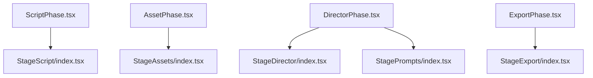
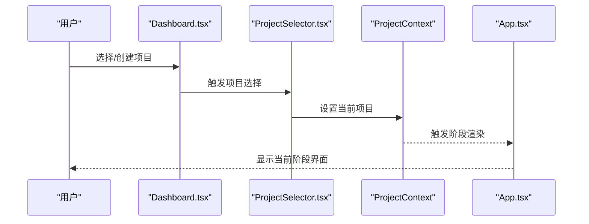
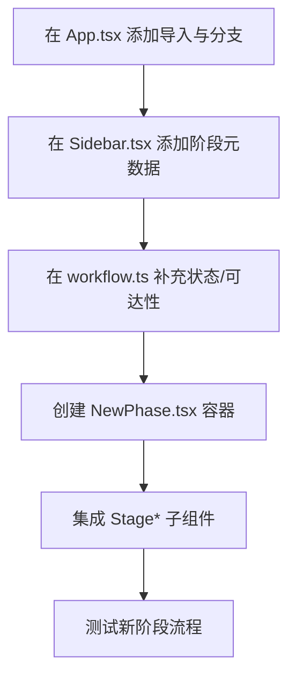
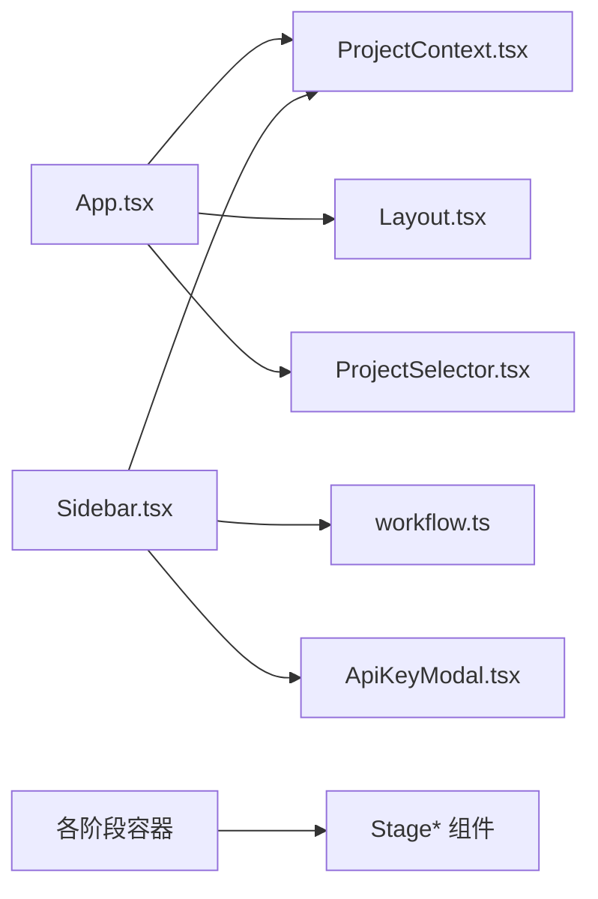

# 组件层次结构

<cite>
**本文引用的文件**
- [App.tsx](file://src/App.tsx)
- [Sidebar.tsx](file://src/shared/components/Sidebar.tsx)
- [ScriptPhase.tsx](file://src/phases/script/ScriptPhase.tsx)
- [AssetPhase.tsx](file://src/phases/assets/AssetPhase.tsx)
- [DirectorPhase.tsx](file://src/phases/director/DirectorPhase.tsx)
- [ExportPhase.tsx](file://src/phases/export/ExportPhase.tsx)
- [ProjectContext.tsx](file://src/shared/contexts/ProjectContext.tsx)
- [workflow.ts](file://src/services/workflow.ts)
- [Layout.tsx](file://src/shared/components/Layout.tsx)
- [ProjectSelector.tsx](file://src/shared/components/ProjectSelector.tsx)
- [ApiKeyModal.tsx](file://src/shared/components/ApiKeyModal.tsx)
- [StageScript/index.tsx](file://components/StageScript/index.tsx)
- [StageAssets/index.tsx](file://components/StageAssets/index.tsx)
- [StageDirector/index.tsx](file://components/StageDirector/index.tsx)
- [StageExport/index.tsx](file://components/StageExport/index.tsx)
- [StagePrompts/index.tsx](file://components/StagePrompts/index.tsx)
- [Dashboard.tsx](file://components/Dashboard.tsx)
</cite>

## 目录
1. [简介](#简介)
2. [项目结构](#项目结构)
3. [核心组件](#核心组件)
4. [架构总览](#架构总览)
5. [详细组件分析](#详细组件分析)
6. [依赖分析](#依赖分析)
7. [性能考虑](#性能考虑)
8. [故障排查指南](#故障排查指南)
9. [结论](#结论)
10. [附录](#附录)

## 简介
本文件聚焦于AI Shotlive的组件层次结构，围绕应用根组件App.tsx展开，系统性解析其控制论式“开放系统”设计：依据项目状态与当前工作流阶段动态选择渲染分支。文档详细说明了工作流阶段组件（ScriptPhase、AssetPhase、DirectorPhase、ExportPhase）与各阶段子组件（如StageScript、StageAssets、StageDirector、StageExport、StagePrompts）的组织方式、父子关系、props传递机制与复用策略；同时阐述Dashboard项目管理功能与Sidebar导航系统的实现原理，覆盖生命周期管理、条件渲染逻辑、移动端适配与响应式设计，并提供可扩展新工作流阶段组件的实践建议。

## 项目结构
项目采用按功能域分层的组织方式：
- 根组件与上下文：App.tsx负责顶层路由与阶段选择，配合ProjectContext提供全局项目状态。
- 阶段容器：ScriptPhase、AssetPhase、DirectorPhase、ExportPhase分别承载对应阶段的UI与业务逻辑。
- 阶段内组件：StageScript、StageAssets、StageDirector、StageExport、StagePrompts等具体功能模块。
- 共享组件与服务：Sidebar、Layout、ProjectSelector、ApiKeyModal、workflow引擎等。
- 类型与配置：类型定义、主题与样式、API密钥加载等。

图表来源
- [App.tsx:15-28](file://src/App.tsx#L15-L28)
- [Sidebar.tsx:39-214](file://src/shared/components/Sidebar.tsx#L39-L214)
- [ScriptPhase.tsx](file://src/phases/script/ScriptPhase.tsx)
- [AssetPhase.tsx](file://src/phases/assets/AssetPhase.tsx)
- [DirectorPhase.tsx](file://src/phases/director/DirectorPhase.tsx)
- [ExportPhase.tsx](file://src/phases/export/ExportPhase.tsx)
- [ProjectContext.tsx](file://src/shared/contexts/ProjectContext.tsx)
- [workflow.ts](file://src/services/workflow.ts)
- [StageScript/index.tsx](file://components/StageScript/index.tsx)
- [StageAssets/index.tsx](file://components/StageAssets/index.tsx)
- [StageDirector/index.tsx](file://components/StageDirector/index.tsx)
- [StageExport/index.tsx](file://components/StageExport/index.tsx)
- [StagePrompts/index.tsx](file://components/StagePrompts/index.tsx)
- [ApiKeyModal.tsx](file://src/shared/components/ApiKeyModal.tsx)

章节来源
- [App.tsx:15-28](file://src/App.tsx#L15-L28)
- [Sidebar.tsx:39-214](file://src/shared/components/Sidebar.tsx#L39-L214)

## 核心组件
- App.tsx：应用根组件，通过ProjectContext读取project与currentPhase，无项目时显示ProjectSelector，否则在Layout内按阶段条件渲染对应Phase容器。
- Sidebar.tsx：左侧导航栏，展示四阶段进度与可达性，支持跳转到可到达的阶段，底部显示保存状态与API配置入口。
- ProjectContext：提供项目状态、当前阶段、项目切换与关闭、保存状态等能力。
- workflow.ts：工作流引擎，用于计算阶段完成度、判断是否可推进到下一阶段。
- 各Phase容器：ScriptPhase、AssetPhase、DirectorPhase、ExportPhase，作为阶段级容器承载该阶段的主界面与交互。
- 阶段内组件：StageScript、StageAssets、StageDirector、StageExport、StagePrompts，负责具体功能实现。

章节来源
- [App.tsx:15-28](file://src/App.tsx#L15-L28)
- [Sidebar.tsx:39-214](file://src/shared/components/Sidebar.tsx#L39-L214)
- [ProjectContext.tsx](file://src/shared/contexts/ProjectContext.tsx)
- [workflow.ts](file://src/services/workflow.ts)

## 架构总览
App.tsx采用“控制论式开放系统”设计：根据项目状态与currentPhase决定渲染分支，形成清晰的阶段化工作流。Sidebar作为导航中枢，结合workflow引擎的状态计算，驱动用户在阶段间流转。各Phase容器进一步封装阶段内的复杂交互，Stage*组件则聚焦具体功能点，形成从根到阶段再到功能模块的层级化结构。

图表来源
- [Sidebar.tsx:39-214](file://src/shared/components/Sidebar.tsx#L39-L214)
- [workflow.ts](file://src/services/workflow.ts)
- [App.tsx:15-28](file://src/App.tsx#L15-L28)
- [Layout.tsx](file://src/shared/components/Layout.tsx)

## 详细组件分析

### App.tsx：根组件与阶段路由
- 设计模式：基于ProjectContext的项目与阶段状态进行条件渲染，形成“阶段即页面”的轻量路由。
- 生命周期：应用启动时一次性尝试从本地存储恢复API密钥。
- 条件渲染：当无项目时显示ProjectSelector；否则在Layout中按currentPhase渲染对应Phase容器。
- 扩展性：新增阶段仅需在App.tsx中添加导入与条件分支，并在Sidebar中补充阶段元数据。

图表来源
- [App.tsx:30-43](file://src/App.tsx#L30-L43)
- [App.tsx:15-28](file://src/App.tsx#L15-L28)

章节来源
- [App.tsx:15-28](file://src/App.tsx#L15-L28)
- [App.tsx:30-43](file://src/App.tsx#L30-L43)

### Sidebar.tsx：导航与进度
- 结构组成：项目头部信息、章节标签、阶段列表、页脚设置与保存状态。
- 进度与可达性：通过workflow.engine.getPhaseStatus与canAdvanceTo计算完成度百分比与可达性，禁用不可达阶段。
- 交互行为：点击可达阶段触发setPhase；底部显示API配置入口与保存状态指示。
- 响应式设计：使用flex布局与CSS变量，适配不同屏幕尺寸；移动端可通过容器宽度与图标尺寸自适应。

图表来源
- [Sidebar.tsx:39-214](file://src/shared/components/Sidebar.tsx#L39-L214)
- [workflow.ts](file://src/services/workflow.ts)

章节来源
- [Sidebar.tsx:39-214](file://src/shared/components/Sidebar.tsx#L39-L214)
- [workflow.ts](file://src/services/workflow.ts)

### 阶段容器与阶段内组件
- ScriptPhase：承载剧本分析相关UI与逻辑，内部包含StageScript等子组件。
- AssetPhase：承载资产生成相关UI与逻辑，内部包含StageAssets等子组件。
- DirectorPhase：承载导演工作台相关UI与逻辑，内部包含StageDirector、StagePrompts等子组件。
- ExportPhase：承载成片导出相关UI与逻辑，内部包含StageExport等子组件。
- 组件复用策略：各阶段容器以组合方式引入Stage*组件，通过props向下传递数据与回调，实现跨阶段共享与解耦。

图表来源
- [ScriptPhase.tsx](file://src/phases/script/ScriptPhase.tsx)
- [AssetPhase.tsx](file://src/phases/assets/AssetPhase.tsx)
- [DirectorPhase.tsx](file://src/phases/director/DirectorPhase.tsx)
- [ExportPhase.tsx](file://src/phases/export/ExportPhase.tsx)
- [StageScript/index.tsx](file://components/StageScript/index.tsx)
- [StageAssets/index.tsx](file://components/StageAssets/index.tsx)
- [StageDirector/index.tsx](file://components/StageDirector/index.tsx)
- [StageExport/index.tsx](file://components/StageExport/index.tsx)
- [StagePrompts/index.tsx](file://components/StagePrompts/index.tsx)

章节来源
- [ScriptPhase.tsx](file://src/phases/script/ScriptPhase.tsx)
- [AssetPhase.tsx](file://src/phases/assets/AssetPhase.tsx)
- [DirectorPhase.tsx](file://src/phases/director/DirectorPhase.tsx)
- [ExportPhase.tsx](file://src/phases/export/ExportPhase.tsx)

### Dashboard组件：项目管理
- 功能定位：作为项目库入口，负责项目列表、创建、打开与删除等操作。
- 与Sidebar的关系：Dashboard通常位于App.tsx之外的独立视图，通过ProjectSelector与ProjectContext协作，最终回到App.tsx的阶段路由。
- 交互流程：用户在Dashboard选择项目后，ProjectContext更新项目状态，App.tsx据此渲染对应阶段容器。

图表来源
- [Dashboard.tsx](file://components/Dashboard.tsx)
- [ProjectSelector.tsx](file://src/shared/components/ProjectSelector.tsx)
- [ProjectContext.tsx](file://src/shared/contexts/ProjectContext.tsx)
- [App.tsx:15-28](file://src/App.tsx#L15-L28)

章节来源
- [Dashboard.tsx](file://components/Dashboard.tsx)
- [ProjectSelector.tsx](file://src/shared/components/ProjectSelector.tsx)
- [ProjectContext.tsx](file://src/shared/contexts/ProjectContext.tsx)
- [App.tsx:15-28](file://src/App.tsx#L15-L28)

### 组件生命周期与条件渲染
- App.tsx：在useEffect中执行一次性的API密钥加载；随后根据ProjectContext状态进行条件渲染。
- Sidebar.tsx：每次渲染时读取ProjectContext与workflow.engine，动态计算阶段状态与可达性。
- 阶段容器：通常在进入阶段时初始化数据与订阅，退出阶段时清理副作用；具体实现由各Phase容器负责。
- 条件渲染：基于currentPhase与项目存在性进行分支渲染，避免不必要的组件挂载。

章节来源
- [App.tsx:30-43](file://src/App.tsx#L30-L43)
- [Sidebar.tsx:39-214](file://src/shared/components/Sidebar.tsx#L39-L214)

### 移动端适配与响应式设计
- Sidebar：使用flex布局与CSS变量，图标与文字大小在小屏下保持可读性；可通过容器宽度与间距调整适配移动端。
- 阶段内组件：遵循通用的响应式布局原则，优先使用相对单位与弹性布局，确保在移动设备上良好显示。
- 交互优化：按钮与图标尺寸在移动端适当放大，保证触控操作体验。

章节来源
- [Sidebar.tsx:49-214](file://src/shared/components/Sidebar.tsx#L49-L214)

### 扩展新的工作流阶段组件
- 步骤一：在App.tsx中添加新阶段的导入与条件渲染分支。
- 步骤二：在Sidebar.tsx中向PHASES数组追加新阶段元数据（id、number、title、subtitle、Icon）。
- 步骤三：在workflow.ts中完善新阶段的状态计算与可达性判断。
- 步骤四：创建新阶段的容器组件（如NewPhase.tsx），并在其中引入Stage*子组件。
- 步骤五：在新阶段容器中实现必要的生命周期管理与数据流对接。

图表来源
- [App.tsx:15-28](file://src/App.tsx#L15-L28)
- [Sidebar.tsx:32-37](file://src/shared/components/Sidebar.tsx#L32-L37)
- [workflow.ts](file://src/services/workflow.ts)
- [ScriptPhase.tsx](file://src/phases/script/ScriptPhase.tsx)

章节来源
- [App.tsx:15-28](file://src/App.tsx#L15-L28)
- [Sidebar.tsx:32-37](file://src/shared/components/Sidebar.tsx#L32-L37)
- [workflow.ts](file://src/services/workflow.ts)

## 依赖分析
- 组件耦合：App.tsx与Sidebar.tsx均依赖ProjectContext；Sidebar还依赖workflow.engine；各阶段容器依赖对应的Stage*组件。
- 外部依赖：Sidebar依赖图标库（lucide-react）、主题变量与loading组件；App.tsx依赖Layout与ProjectSelector。
- 潜在循环依赖：当前结构以App.tsx为中心辐射，未见直接循环依赖；但需注意Sidebar与workflow.engine之间的间接依赖链。

图表来源
- [App.tsx:15-28](file://src/App.tsx#L15-L28)
- [Sidebar.tsx:39-214](file://src/shared/components/Sidebar.tsx#L39-L214)
- [ProjectContext.tsx](file://src/shared/contexts/ProjectContext.tsx)
- [workflow.ts](file://src/services/workflow.ts)
- [ApiKeyModal.tsx](file://src/shared/components/ApiKeyModal.tsx)

章节来源
- [App.tsx:15-28](file://src/App.tsx#L15-L28)
- [Sidebar.tsx:39-214](file://src/shared/components/Sidebar.tsx#L39-L214)

## 性能考虑
- 渲染优化：App.tsx的条件渲染避免了无关阶段的挂载；Sidebar按需计算状态，减少不必要重绘。
- 数据流：通过ProjectContext集中管理状态，降低跨组件通信成本。
- 资源加载：API密钥仅在应用启动时加载一次，避免重复IO开销。
- 建议：对高频状态更新的组件（如进度条）可考虑memo化与节流策略，以提升移动端流畅度。

## 故障排查指南
- 导航不可达：检查workflow.engine的可达性判断逻辑与项目状态一致性。
- 进度不更新：确认getPhaseStatus返回值与Sidebar的渲染逻辑一致。
- 阶段切换无效：验证setPhase是否正确更新ProjectContext，并触发App.tsx的重渲染。
- API配置问题：通过ApiKeyModal进行配置校验，确认hasApiKey状态同步。

章节来源
- [Sidebar.tsx:39-214](file://src/shared/components/Sidebar.tsx#L39-L214)
- [workflow.ts](file://src/services/workflow.ts)
- [ApiKeyModal.tsx](file://src/shared/components/ApiKeyModal.tsx)

## 结论
本项目以App.tsx为核心，构建了清晰的阶段化工作流体系：Sidebar提供导航与进度反馈，ProjectContext统一管理状态，各阶段容器与Stage*组件实现功能解耦与复用。通过标准化的扩展流程，可便捷地新增工作流阶段组件，满足不断演进的创作需求。建议在后续迭代中进一步完善状态持久化、错误边界与性能监控，以提升整体稳定性与用户体验。

## 附录
- 术语说明：阶段（Phase）指工作流中的一个环节，如剧本分析、资产生成、导演工作台、成片导出；阶段容器为承载该阶段UI与逻辑的组件；Stage*组件为阶段内的具体功能模块。
- 最佳实践：保持阶段容器的薄逻辑特性，将业务逻辑下沉至服务层；对频繁更新的状态进行局部优化；在Sidebar中统一处理导航与进度，避免分散逻辑。