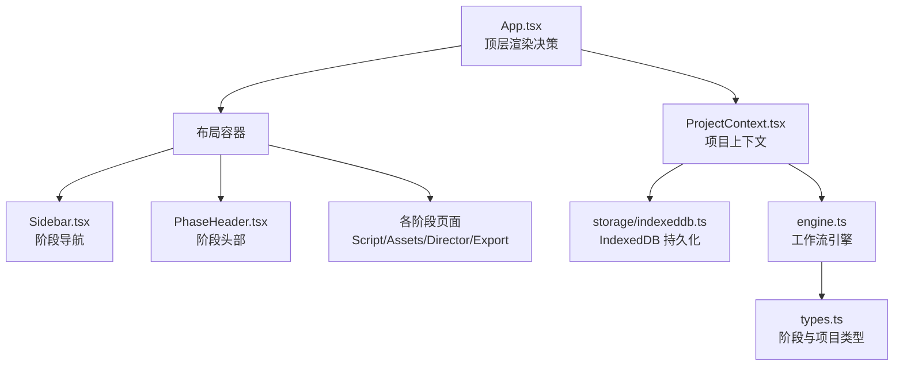
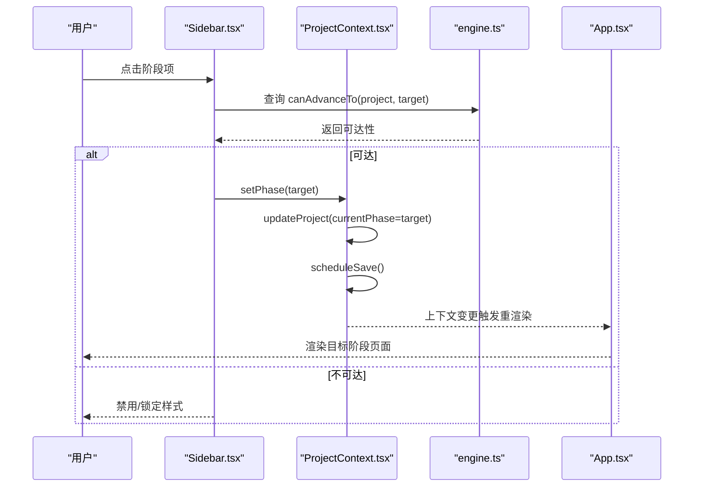
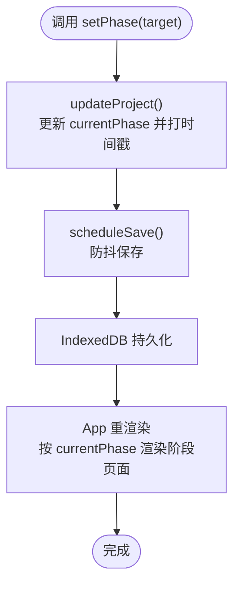
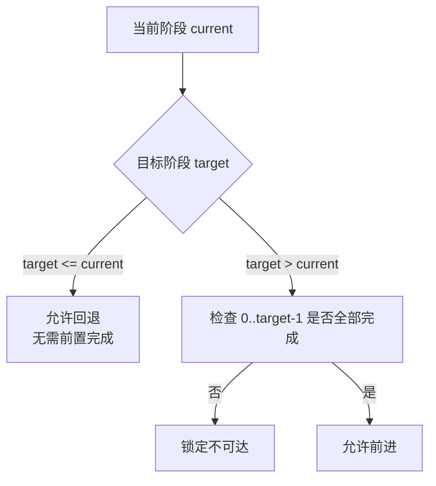
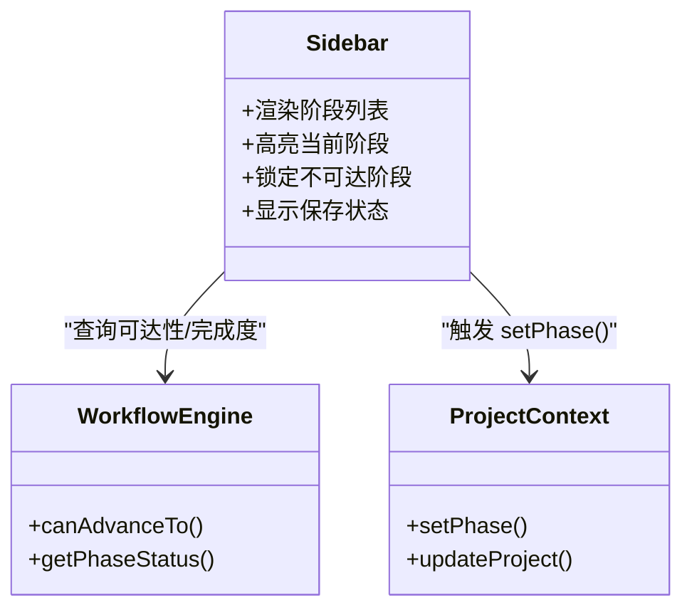
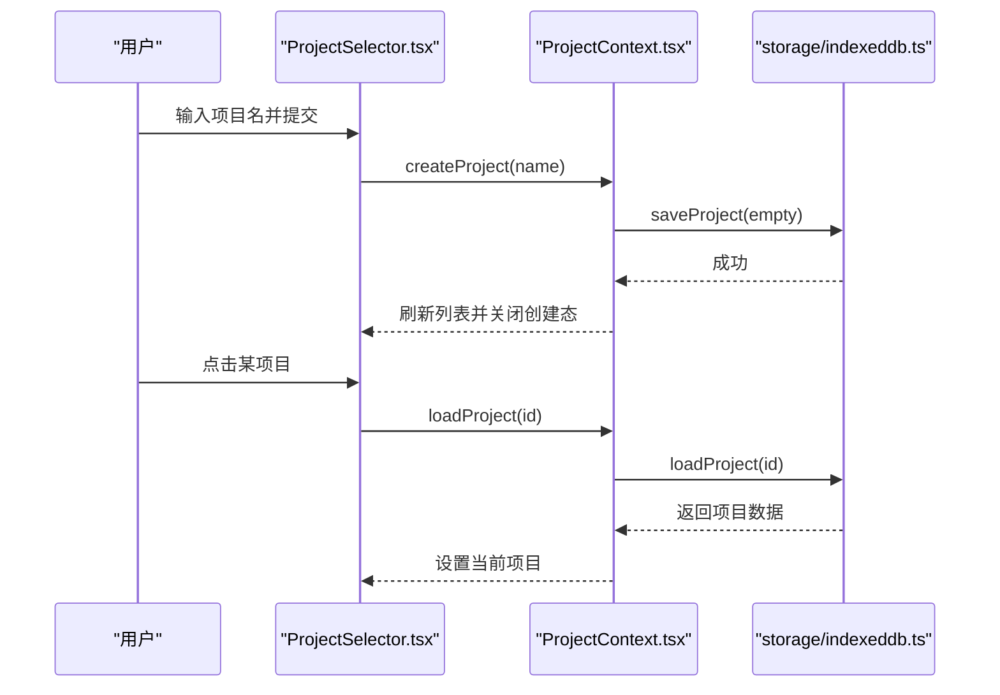
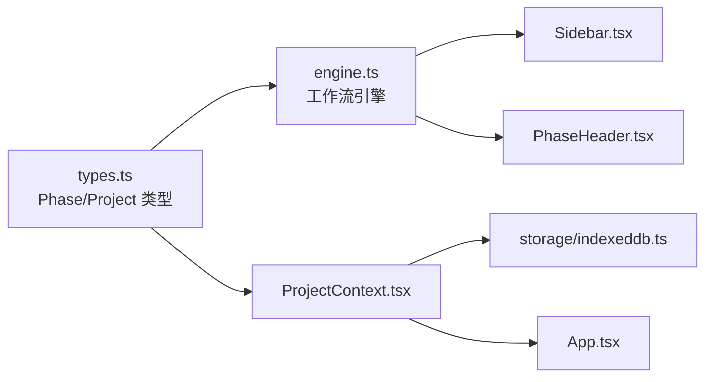

# 路由与导航

<cite>
**本文引用的文件**
- [App.tsx](file://src/App.tsx)
- [Sidebar.tsx](file://src/shared/components/Sidebar.tsx)
- [PhaseHeader.tsx](file://src/shared/components/PhaseHeader.tsx)
- [ProjectContext.tsx](file://src/shared/contexts/ProjectContext.tsx)
- [ProjectSelector.tsx](file://src/shared/components/ProjectSelector.tsx)
- [engine.ts](file://src/services/workflow/engine.ts)
- [types.ts](file://src/services/workflow/types.ts)
- [types.ts](file://src/types.ts)
- [storage/indexeddb.ts](file://src/services/storage/indexeddb.ts)
- [storage/types.ts](file://src/services/storage/types.ts)
</cite>

## 目录
1. [简介](#简介)
2. [项目结构](#项目结构)
3. [核心组件](#核心组件)
4. [架构总览](#架构总览)
5. [详细组件分析](#详细组件分析)
6. [依赖关系分析](#依赖关系分析)
7. [性能考量](#性能考量)
8. [故障排查指南](#故障排查指南)
9. [结论](#结论)
10. [附录](#附录)

## 简介
本文件围绕 AI Shotlive 的“路由与导航”体系展开，重点解释基于工作流阶段的导航设计、setStage（即 setPhase）的实现原理、页面切换逻辑、导航状态管理、Sidebar 导航菜单与高亮机制、移动端适配、Dashboard/项目选择功能、项目加载与数据隔离、生成任务进行中的导航锁定与确认对话框、导航守卫、路由参数传递与历史记录管理等。文档同时提供导航流程图与具体实现路径，帮助开发者快速理解与扩展。

## 项目结构
本项目的导航与路由以“阶段驱动”的方式组织：顶层组件根据当前项目与阶段决定渲染内容；Sidebar 作为导航中枢，结合工作流引擎控制可访问性与高亮；项目上下文负责状态持久化与自动保存；工作流引擎定义阶段推进规则与完成度计算。

图表来源
- [App.tsx:15-28](file://src/App.tsx#L15-L28)
- [ProjectContext.tsx:47-186](file://src/shared/contexts/ProjectContext.tsx#L47-L186)
- [Sidebar.tsx:39-215](file://src/shared/components/Sidebar.tsx#L39-L215)
- [PhaseHeader.tsx:17-106](file://src/shared/components/PhaseHeader.tsx#L17-L106)
- [engine.ts:83-119](file://src/services/workflow/engine.ts#L83-L119)
- [storage/indexeddb.ts:23-189](file://src/services/storage/indexeddb.ts#L23-L189)
- [types.ts:6-21](file://src/types.ts#L6-L21)

章节来源
- [App.tsx:15-28](file://src/App.tsx#L15-L28)
- [ProjectContext.tsx:47-186](file://src/shared/contexts/ProjectContext.tsx#L47-L186)

## 核心组件
- 顶层渲染与阶段分发：顶层组件依据是否存在项目与当前阶段选择渲染对应阶段页面或项目选择器。
- 项目上下文：提供 create/load/delete/close、更新项目、设置阶段、保存调度与加载状态等能力，并通过 IndexedDB 实现自动持久化。
- 工作流引擎：定义阶段顺序、完成度计算、前进/回退可达性判断。
- Sidebar：展示阶段列表、进度条、完成状态、当前阶段高亮与锁定态；点击触发 setPhase。
- PhaseHeader：展示阶段标题、进度百分比、缺失项提示、下一阶段按钮。
- 项目选择器：提供新建项目、加载项目、删除项目、API Key 配置入口与加载状态。

章节来源
- [App.tsx:15-28](file://src/App.tsx#L15-L28)
- [ProjectContext.tsx:150-183](file://src/shared/contexts/ProjectContext.tsx#L150-L183)
- [engine.ts:83-119](file://src/services/workflow/engine.ts#L83-L119)
- [Sidebar.tsx:39-215](file://src/shared/components/Sidebar.tsx#L39-L215)
- [PhaseHeader.tsx:17-106](file://src/shared/components/PhaseHeader.tsx#L17-L106)
- [ProjectSelector.tsx:29-303](file://src/shared/components/ProjectSelector.tsx#L29-L303)

## 架构总览
导航系统遵循“阶段驱动 + 引擎判定 + 上下文持久化”的模式：Sidebar 与 PhaseHeader 通过工作流引擎查询阶段状态与可达性；setPhase 更新项目 currentPhase；ProjectContext 触发自动保存；App 根据 currentPhase 渲染对应阶段页面。

图表来源
- [Sidebar.tsx:83-95](file://src/shared/components/Sidebar.tsx#L83-L95)
- [engine.ts:83-95](file://src/services/workflow/engine.ts#L83-L95)
- [ProjectContext.tsx:163-168](file://src/shared/contexts/ProjectContext.tsx#L163-L168)
- [App.tsx:15-28](file://src/App.tsx#L15-L28)

## 详细组件分析

### setStage（setPhase）实现原理与导航状态管理
- setPhase 通过 ProjectContext.updateProject 将 currentPhase 更新为目标阶段，并打上时间戳，随后触发自动保存调度。
- setPhase 是导航状态管理的核心入口，确保阶段切换与持久化解耦，避免直接操作存储带来的复杂性。
- 顶层 App 根据 currentPhase 分发渲染，形成“阶段即路由”的轻量路由模型。

图表来源
- [ProjectContext.tsx:150-168](file://src/shared/contexts/ProjectContext.tsx#L150-L168)
- [storage/indexeddb.ts:103-109](file://src/services/storage/indexeddb.ts#L103-L109)
- [App.tsx:15-28](file://src/App.tsx#L15-L28)

章节来源
- [ProjectContext.tsx:150-168](file://src/shared/contexts/ProjectContext.tsx#L150-L168)
- [App.tsx:15-28](file://src/App.tsx#L15-L28)

### 页面切换逻辑与导航守卫
- 可达性守卫：Sidebar 与 PhaseHeader 通过 workflowEngine.canAdvanceTo 判断是否允许前进；若前置阶段未完成则禁用/锁定。
- 自由回退：可任意回到之前的阶段，无需前置阶段完成。
- 完成度约束：只有当前阶段完成度达标才允许进入下一阶段；下一阶段按钮在可前进时启用。

图表来源
- [engine.ts:83-95](file://src/services/workflow/engine.ts#L83-L95)

章节来源
- [engine.ts:83-95](file://src/services/workflow/engine.ts#L83-L95)
- [Sidebar.tsx:83-95](file://src/shared/components/Sidebar.tsx#L83-L95)
- [PhaseHeader.tsx:23-25](file://src/shared/components/PhaseHeader.tsx#L23-L25)

### Sidebar 导航菜单与当前阶段高亮
- 列表项：按固定顺序渲染 script/assets/director/export，显示阶段编号、标题、副标题与完成度百分比。
- 高亮机制：当前阶段显示醒目标识（左侧亮色条、标题与图标高亮、进度条高亮渐变）。
- 锁定机制：不可达阶段禁用点击、降低透明度、显示锁图标。
- 保存指示：底部显示保存状态（存档中/已存档），体现实时反馈。

图表来源
- [Sidebar.tsx:39-215](file://src/shared/components/Sidebar.tsx#L39-L215)
- [engine.ts:83-119](file://src/services/workflow/engine.ts#L83-L119)
- [ProjectContext.tsx:163-168](file://src/shared/contexts/ProjectContext.tsx#L163-L168)

章节来源
- [Sidebar.tsx:39-215](file://src/shared/components/Sidebar.tsx#L39-L215)

### 移动端导航适配
- Sidebar 使用相对宽度与弹性布局，配合断点在小屏设备上仍保持可读性与点击区域。
- 阶段标题与进度条采用响应式字号与间距，确保在移动设备上清晰可读。
- 锁定态与高亮态通过颜色与阴影区分，减少对触控精度的依赖。

章节来源
- [Sidebar.tsx:50-51](file://src/shared/components/Sidebar.tsx#L50-L51)
- [Sidebar.tsx:112-121](file://src/shared/components/Sidebar.tsx#L112-L121)
- [Sidebar.tsx:144-158](file://src/shared/components/Sidebar.tsx#L144-L158)

### Dashboard/项目选择功能与数据隔离
- 项目选择器：提供新建项目、加载项目、删除项目、API Key 配置入口；列表按更新时间倒序展示；支持键盘回车快速创建。
- 项目加载状态：isLoading 控制加载中占位与交互禁用；刷新列表后自动更新。
- 数据隔离：每个项目拥有独立的 Project 结构与工作流状态；切换项目即切换上下文，避免跨项目污染。

图表来源
- [ProjectSelector.tsx:43-52](file://src/shared/components/ProjectSelector.tsx#L43-L52)
- [ProjectContext.tsx:108-131](file://src/shared/contexts/ProjectContext.tsx#L108-L131)
- [storage/indexeddb.ts:103-117](file://src/services/storage/indexeddb.ts#L103-L117)

章节来源
- [ProjectSelector.tsx:29-303](file://src/shared/components/ProjectSelector.tsx#L29-L303)
- [ProjectContext.tsx:108-131](file://src/shared/contexts/ProjectContext.tsx#L108-L131)
- [storage/indexeddb.ts:103-117](file://src/services/storage/indexeddb.ts#L103-L117)

### 生成任务进行中的导航锁定与确认对话框
- 导航锁定：当存在进行中的生成任务（如视频生成）时，工作流引擎在“导演工作台”阶段会要求至少一个镜头生成视频，否则下一阶段按钮禁用。这间接形成“任务进行中禁止跳转下一阶段”的导航约束。
- 确认对话框：项目删除处使用浏览器原生 confirm 提示，防止误删；建议在更复杂的场景引入自定义模态框以提升一致性与可访问性。
- 用户体验保护：保存状态与加载状态在 UI 层实时反馈，避免用户在不安全状态下进行危险操作。

章节来源
- [engine.ts:56-72](file://src/services/workflow/engine.ts#L56-L72)
- [ProjectSelector.tsx:257-261](file://src/shared/components/ProjectSelector.tsx#L257-L261)

### 路由参数传递与历史记录管理
- 轻量路由模型：本项目采用“阶段即路由”，通过 currentPhase 决定渲染内容，无需额外的 URL 参数与历史记录管理。
- 历史记录：由于无 URL 变化，历史记录由浏览器默认行为处理；如需深度链接或分享链接，可在后续扩展中引入 URL 同步与回放机制。

章节来源
- [App.tsx:15-28](file://src/App.tsx#L15-L28)

## 依赖关系分析
- Sidebar/PhaseHeader 依赖工作流引擎与项目上下文，用于渲染与交互。
- 项目上下文依赖存储服务实现自动保存与列表刷新。
- 类型系统贯穿工作流引擎与项目模型，确保阶段与数据结构一致。

图表来源
- [types.ts:6-21](file://src/types.ts#L6-L21)
- [engine.ts:83-119](file://src/services/workflow/engine.ts#L83-L119)
- [Sidebar.tsx:39-215](file://src/shared/components/Sidebar.tsx#L39-L215)
- [PhaseHeader.tsx:17-106](file://src/shared/components/PhaseHeader.tsx#L17-L106)
- [ProjectContext.tsx:47-186](file://src/shared/contexts/ProjectContext.tsx#L47-L186)
- [storage/indexeddb.ts:23-189](file://src/services/storage/indexeddb.ts#L23-L189)
- [App.tsx:15-28](file://src/App.tsx#L15-L28)

章节来源
- [types.ts:6-21](file://src/types.ts#L6-L21)
- [engine.ts:83-119](file://src/services/workflow/engine.ts#L83-L119)
- [ProjectContext.tsx:47-186](file://src/shared/contexts/ProjectContext.tsx#L47-L186)

## 性能考量
- 自动保存防抖：2 秒防抖减少频繁写入 IndexedDB 的开销，适合本地优先的离线场景。
- 列表懒加载：项目列表仅返回摘要字段，避免传输大型项目对象。
- 渲染粒度：阶段页面按需渲染，避免全量组件重绘。
- 建议：在任务密集场景可考虑将“进行中任务”状态纳入导航锁定，进一步减少无效请求与渲染。

## 故障排查指南
- API Key 未配置导致无法创建/加载项目：检查项目选择器顶部提示与 API 配置入口，确保密钥可用后再进行项目操作。
- 项目列表为空：确认 IndexedDB 初始化成功，必要时清理缓存后重试。
- 无法前进到下一阶段：查看阶段头部的缺失项提示，补齐前置条件后再尝试。
- 删除项目失败：确认浏览器允许 IndexedDB 访问，检查控制台错误日志。

章节来源
- [ProjectSelector.tsx:115-137](file://src/shared/components/ProjectSelector.tsx#L115-L137)
- [storage/indexeddb.ts:31-78](file://src/services/storage/indexeddb.ts#L31-L78)
- [PhaseHeader.tsx:89-102](file://src/shared/components/PhaseHeader.tsx#L89-L102)

## 结论
本导航体系以“阶段驱动 + 引擎判定 + 上下文持久化”为核心，实现了清晰的阶段推进规则、直观的导航反馈与可靠的本地存储。Sidebar 与 PhaseHeader 提供了良好的用户引导，ProjectContext 保障了状态一致性与可恢复性。未来可在任务进行中导航锁定、URL 同步与历史记录管理等方面进一步增强，以满足更复杂的协作与分享需求。

## 附录
- 关键实现路径
  - setPhase 与自动保存：[ProjectContext.tsx:150-168](file://src/shared/contexts/ProjectContext.tsx#L150-L168)
  - 工作流引擎与阶段推进：[engine.ts:83-119](file://src/services/workflow/engine.ts#L83-L119)
  - 顶层渲染与阶段分发：[App.tsx:15-28](file://src/App.tsx#L15-L28)
  - Sidebar 导航与高亮：[Sidebar.tsx:39-215](file://src/shared/components/Sidebar.tsx#L39-L215)
  - 阶段头部与下一阶段按钮：[PhaseHeader.tsx:17-106](file://src/shared/components/PhaseHeader.tsx#L17-L106)
  - 项目选择器与加载状态：[ProjectSelector.tsx:29-303](file://src/shared/components/ProjectSelector.tsx#L29-L303)
  - 本地存储与持久化：[storage/indexeddb.ts:23-189](file://src/services/storage/indexeddb.ts#L23-L189)
  - 类型定义与阶段枚举：[types.ts:6-21](file://src/types.ts#L6-L21)