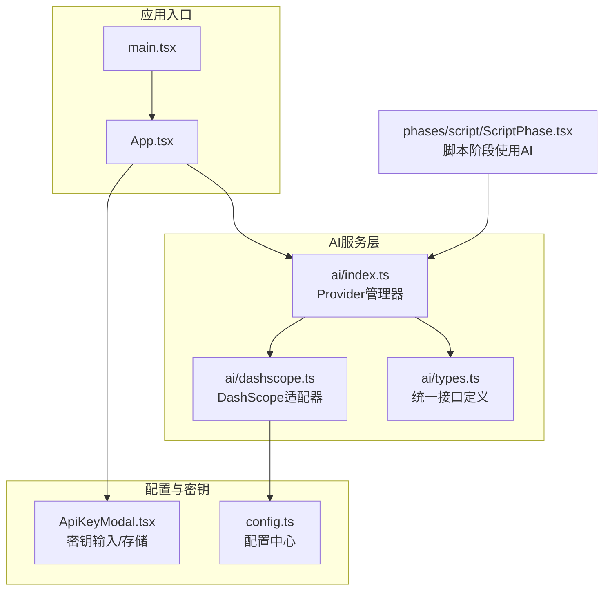
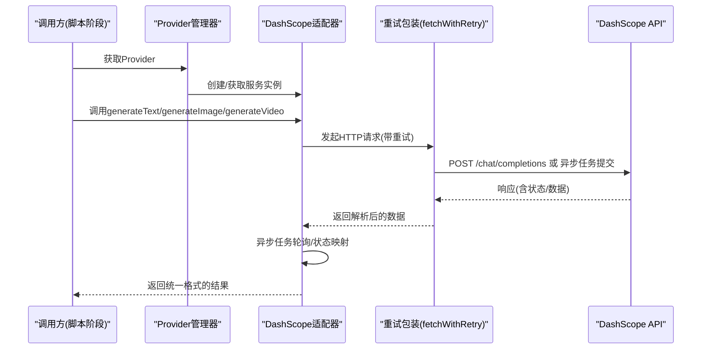
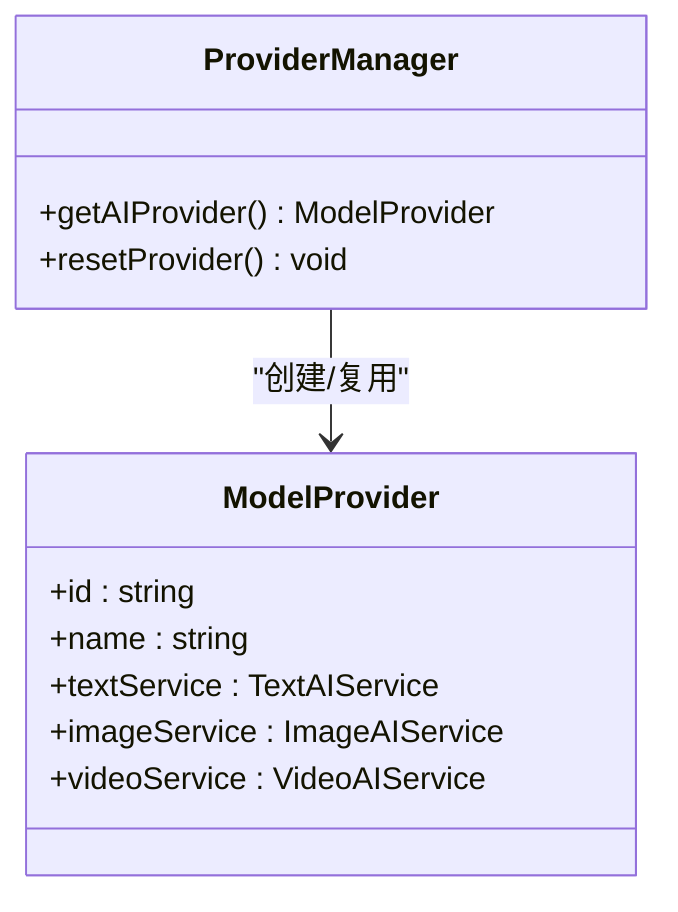
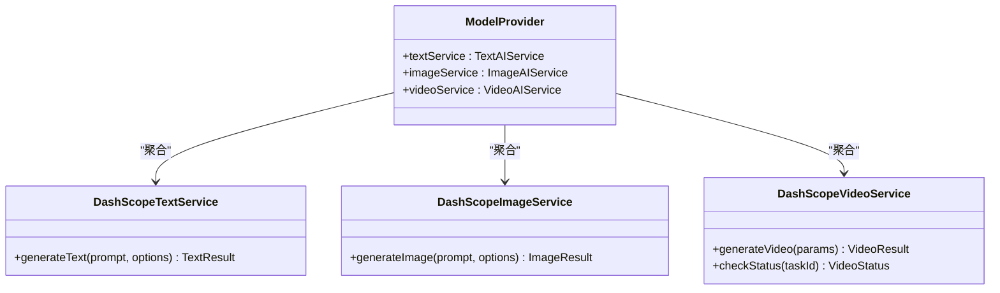
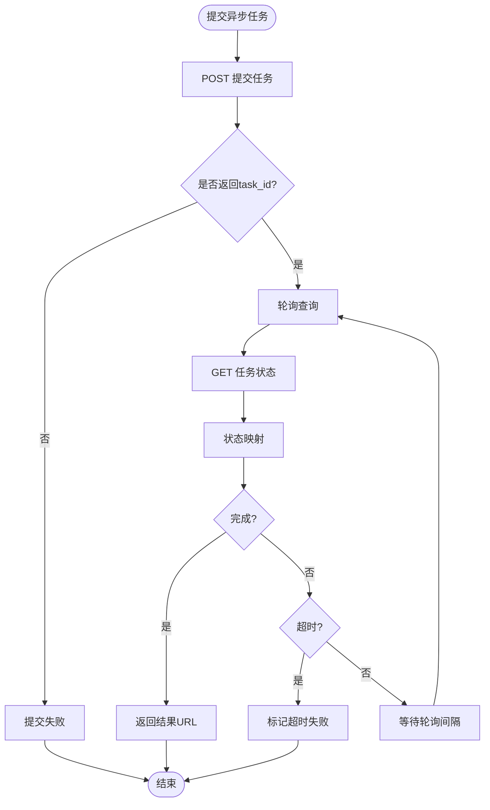
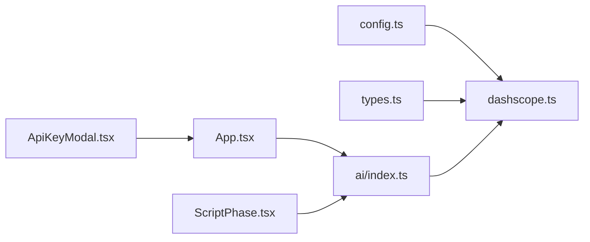

# AI服务路由

<cite>
**本文引用的文件**
- [src/services/ai/index.ts](file://src/services/ai/index.ts)
- [src/services/ai/dashscope.ts](file://src/services/ai/dashscope.ts)
- [src/services/ai/types.ts](file://src/services/ai/types.ts)
- [src/config.ts](file://src/config.ts)
- [src/App.tsx](file://src/App.tsx)
- [src/main.tsx](file://src/main.tsx)
- [src/shared/components/ApiKeyModal.tsx](file://src/shared/components/ApiKeyModal.tsx)
- [src/phases/script/ScriptPhase.tsx](file://src/phases/script/ScriptPhase.tsx)
</cite>

## 目录
1. [简介](#简介)
2. [项目结构](#项目结构)
3. [核心组件](#核心组件)
4. [架构总览](#架构总览)
5. [详细组件分析](#详细组件分析)
6. [依赖关系分析](#依赖关系分析)
7. [性能考量](#性能考量)
8. [故障排查指南](#故障排查指南)
9. [结论](#结论)
10. [附录](#附录)

## 简介
本文件围绕“AI服务路由”主题，系统化梳理前端侧AI服务适配与代理机制，重点覆盖以下方面：
- 统一接口契约与适配器模式：以抽象接口屏蔽多厂商差异，当前实现基于DashScope（阿里云）。
- 请求转发与重试策略：封装fetch并内置指数退避重试、状态码分类处理与超时控制。
- 异步任务与轮询：图像/视频生成采用异步任务+轮询，统一状态映射与结果提取。
- API设计与参数传递：文本、图像、视频三类服务的参数与响应结构清晰分离。
- 错误处理与可观测性：统一错误类型与错误码，便于上层展示与日志追踪。
- 配置驱动与密钥管理：通过配置中心集中管理API Key与模型参数，启动时从存储加载。

## 项目结构
AI服务路由位于前端src/services/ai目录，采用“接口定义 + 适配器实现 + Provider工厂”的分层组织方式，配合全局配置模块与应用入口进行初始化与密钥注入。



**图表来源**
- [src/main.tsx:1-11](file://src/main.tsx#L1-L11)
- [src/App.tsx:1-44](file://src/App.tsx#L1-L44)
- [src/services/ai/index.ts:1-34](file://src/services/ai/index.ts#L1-L34)
- [src/services/ai/dashscope.ts:1-327](file://src/services/ai/dashscope.ts#L1-L327)
- [src/services/ai/types.ts:1-73](file://src/services/ai/types.ts#L1-L73)
- [src/config.ts:1-47](file://src/config.ts#L1-L47)
- [src/shared/components/ApiKeyModal.tsx](file://src/shared/components/ApiKeyModal.tsx)
- [src/phases/script/ScriptPhase.tsx:79-100](file://src/phases/script/ScriptPhase.tsx#L79-L100)

**章节来源**
- [src/main.tsx:1-11](file://src/main.tsx#L1-L11)
- [src/App.tsx:1-44](file://src/App.tsx#L1-L44)
- [src/services/ai/index.ts:1-34](file://src/services/ai/index.ts#L1-L34)
- [src/services/ai/dashscope.ts:1-327](file://src/services/ai/dashscope.ts#L1-L327)
- [src/services/ai/types.ts:1-73](file://src/services/ai/types.ts#L1-L73)
- [src/config.ts:1-47](file://src/config.ts#L1-L47)
- [src/shared/components/ApiKeyModal.tsx](file://src/shared/components/ApiKeyModal.tsx)
- [src/phases/script/ScriptPhase.tsx:79-100](file://src/phases/script/ScriptPhase.tsx#L79-L100)

## 核心组件
- Provider管理器：负责惰性创建与复用ModelProvider实例，当前默认创建DashScope Provider。
- DashScope适配器：实现Text/Image/Video三类服务，封装厂商API调用、异步任务提交与轮询、错误映射。
- 统一接口定义：抽象出TextAIService、ImageAIService、VideoAIService与ModelProvider，确保替换厂商时无需修改上层调用。
- 配置中心：集中管理API Key、基础URL与模型名称，支持运行时更新与持久化读取。

**章节来源**
- [src/services/ai/index.ts:1-34](file://src/services/ai/index.ts#L1-L34)
- [src/services/ai/dashscope.ts:1-327](file://src/services/ai/dashscope.ts#L1-L327)
- [src/services/ai/types.ts:1-73](file://src/services/ai/types.ts#L1-L73)
- [src/config.ts:1-47](file://src/config.ts#L1-L47)

## 架构总览
下图展示了从前端调用到厂商API的完整链路，包括参数构建、请求转发、重试与轮询、状态映射与结果返回。



**图表来源**
- [src/services/ai/index.ts:24-33](file://src/services/ai/index.ts#L24-L33)
- [src/services/ai/dashscope.ts:58-93](file://src/services/ai/dashscope.ts#L58-L93)
- [src/services/ai/dashscope.ts:96-139](file://src/services/ai/dashscope.ts#L96-L139)
- [src/services/ai/dashscope.ts:219-255](file://src/services/ai/dashscope.ts#L219-L255)
- [src/services/ai/dashscope.ts:258-315](file://src/services/ai/dashscope.ts#L258-L315)

## 详细组件分析

### Provider管理器
- 职责：单例化Provider，避免重复创建；提供重置能力以便切换配置或密钥。
- 设计要点：延迟初始化、可扩展为多Provider切换（当前固定DashScope）。



**图表来源**
- [src/services/ai/index.ts:22-33](file://src/services/ai/index.ts#L22-L33)
- [src/services/ai/types.ts:66-72](file://src/services/ai/types.ts#L66-L72)

**章节来源**
- [src/services/ai/index.ts:1-34](file://src/services/ai/index.ts#L1-L34)
- [src/services/ai/types.ts:66-72](file://src/services/ai/types.ts#L66-L72)

### DashScope适配器（文本/图像/视频）
- 文本服务：OpenAI兼容模式，同步返回；支持system提示词、温度、最大token等参数。
- 图像服务：异步任务，提交后轮询直到完成；返回图片URL与修订提示词。
- 视频服务：异步任务，立即返回taskId；调用方可自行轮询checkStatus或等待完成。
- 重试策略：对5xx进行指数退避重试，401/429等明确错误直接抛出带错误码的异常，其他网络错误统一归类。
- 超时与轮询：异步任务最长等待时间、轮询间隔、状态映射（待处理/处理中/已完成/失败）。



**图表来源**
- [src/services/ai/dashscope.ts:96-139](file://src/services/ai/dashscope.ts#L96-L139)
- [src/services/ai/dashscope.ts:219-255](file://src/services/ai/dashscope.ts#L219-L255)
- [src/services/ai/dashscope.ts:258-315](file://src/services/ai/dashscope.ts#L258-L315)
- [src/services/ai/types.ts:18-20](file://src/services/ai/types.ts#L18-L20)
- [src/services/ai/types.ts:36-38](file://src/services/ai/types.ts#L36-L38)
- [src/services/ai/types.ts:60-63](file://src/services/ai/types.ts#L60-L63)

**章节来源**
- [src/services/ai/dashscope.ts:1-327](file://src/services/ai/dashscope.ts#L1-L327)
- [src/services/ai/types.ts:1-73](file://src/services/ai/types.ts#L1-L73)

### 统一接口定义
- 文本：输入prompt与可选参数，输出content与用量信息。
- 图像：输入prompt与尺寸/风格/数量等，输出图片URL与修订提示词。
- 视频：输入prompt与可选图片/时长/宽高比，输出taskId与初始状态；后续checkStatus查询进度/结果。
- Provider：聚合三类服务，作为对外统一入口。

```mermaid
classDiagram
class TextAIService {
+generateText(prompt, options) TextResult
}
class ImageAIService {
+generateImage(prompt, options) ImageResult
}
class VideoAIService {
+generateVideo(params) VideoResult
+checkStatus(taskId) VideoStatus
}
class TextResult {
+content : string
+usage? : { promptTokens, completionTokens }
}
class ImageResult {
+url : string
+revisedPrompt? : string
}
class VideoStatus {
+state : "pending|processing|completed|failed"
+progress? : number
+resultUrl? : string
+error? : string
}
class VideoResult {
+taskId : string
+status : VideoStatus
}
TextAIService <|.. DashScopeTextService
ImageAIService <|.. DashScopeImageService
VideoAIService <|.. DashScopeVideoService
```

**图表来源**
- [src/services/ai/types.ts:6-20](file://src/services/ai/types.ts#L6-L20)
- [src/services/ai/types.ts:23-38](file://src/services/ai/types.ts#L23-L38)
- [src/services/ai/types.ts:41-63](file://src/services/ai/types.ts#L41-L63)

**章节来源**
- [src/services/ai/types.ts:1-73](file://src/services/ai/types.ts#L1-L73)

### 请求转发与重试策略
- fetch包装：对5xx自动重试，指数退避；4xx直接抛出带错误码的异常；网络错误统一归类。
- 认证：从配置中心读取API Key，缺失时抛出认证错误。
- 超时与轮询：异步任务设置最大等待时间与轮询间隔，避免无限等待。

```mermaid
flowchart TD
Start(["开始"]) --> Build["构建请求体/头部"]
Build --> Call["发起请求(fetchWithRetry)"]
Call --> Resp{"响应状态"}
Resp --> |2xx| Done["返回数据"]
Resp --> |401| AuthErr["抛出认证错误"]
Resp --> |429| QuotaErr["抛出配额错误"]
Resp --> |4xx| ClientErr["抛出客户端错误"]
Resp --> |5xx| Retry["指数退避重试"]
Retry --> Call
Resp --> |网络错误| NetErr["抛出网络错误"]
AuthErr --> End(["结束"])
QuotaErr --> End
ClientErr --> End
NetErr --> End
Done --> End
```



**图表来源**
- [src/services/ai/dashscope.ts:58-93](file://src/services/ai/dashscope.ts#L58-L93)
- [src/services/ai/dashscope.ts:39-45](file://src/services/ai/dashscope.ts#L39-L45)

**章节来源**
- [src/services/ai/dashscope.ts:58-93](file://src/services/ai/dashscope.ts#L58-L93)
- [src/services/ai/dashscope.ts:39-45](file://src/services/ai/dashscope.ts#L39-L45)

### 异步任务与轮询流程
- 提交任务：设置异步头并提交，解析返回task_id。
- 查询状态：按task_id轮询，映射状态并处理完成/失败分支。
- 完成条件：返回视频URL或图片URL；失败时携带错误信息。



**图表来源**
- [src/services/ai/dashscope.ts:155-182](file://src/services/ai/dashscope.ts#L155-L182)
- [src/services/ai/dashscope.ts:184-216](file://src/services/ai/dashscope.ts#L184-L216)
- [src/services/ai/dashscope.ts:289-314](file://src/services/ai/dashscope.ts#L289-L314)

**章节来源**
- [src/services/ai/dashscope.ts:155-182](file://src/services/ai/dashscope.ts#L155-L182)
- [src/services/ai/dashscope.ts:184-216](file://src/services/ai/dashscope.ts#L184-L216)
- [src/services/ai/dashscope.ts:289-314](file://src/services/ai/dashscope.ts#L289-L314)

### API设计与参数传递
- 文本：支持systemPrompt、temperature、maxTokens。
- 图像：支持width、height、style、negativePrompt、count。
- 视频：支持prompt、imageUrl、duration、aspectRatio。
- 统一返回：文本返回content与usage；图像返回url与revisedPrompt；视频返回taskId与初始状态，后续checkStatus获取结果。

**章节来源**
- [src/services/ai/types.ts:7-20](file://src/services/ai/types.ts#L7-L20)
- [src/services/ai/types.ts:23-38](file://src/services/ai/types.ts#L23-L38)
- [src/services/ai/types.ts:41-63](file://src/services/ai/types.ts#L41-L63)

### 错误处理与API Key轮询机制
- 错误类型：认证缺失、认证无效、配额超限、服务端错误、网络错误、空响应、任务失败/超时等。
- API Key管理：应用启动时从存储加载密钥，配置中心提供setApiKey与hasApiKey方法；DashScope适配器在每次调用前校验密钥存在性。
- 轮询与超时：异步任务有最大等待时间与轮询间隔，避免长时间占用资源。

**章节来源**
- [src/services/ai/dashscope.ts:47-52](file://src/services/ai/dashscope.ts#L47-L52)
- [src/services/ai/dashscope.ts:39-45](file://src/services/ai/dashscope.ts#L39-L45)
- [src/config.ts:40-46](file://src/config.ts#L40-L46)
- [src/shared/components/ApiKeyModal.tsx](file://src/shared/components/ApiKeyModal.tsx)
- [src/App.tsx:30-36](file://src/App.tsx#L30-L36)

## 依赖关系分析
- Provider管理器依赖适配器工厂与类型定义。
- DashScope适配器依赖配置中心与统一接口定义。
- 应用入口在启动时加载密钥，供Provider与适配器使用。
- 脚本阶段在解析AI返回时可能需要处理JSON提取与错误。



**图表来源**
- [src/config.ts:1-47](file://src/config.ts#L1-L47)
- [src/services/ai/dashscope.ts:1-327](file://src/services/ai/dashscope.ts#L1-L327)
- [src/services/ai/types.ts:1-73](file://src/services/ai/types.ts#L1-L73)
- [src/services/ai/index.ts:1-34](file://src/services/ai/index.ts#L1-L34)
- [src/App.tsx:1-44](file://src/App.tsx#L1-L44)
- [src/shared/components/ApiKeyModal.tsx](file://src/shared/components/ApiKeyModal.tsx)
- [src/phases/script/ScriptPhase.tsx:79-100](file://src/phases/script/ScriptPhase.tsx#L79-L100)

**章节来源**
- [src/config.ts:1-47](file://src/config.ts#L1-L47)
- [src/services/ai/dashscope.ts:1-327](file://src/services/ai/dashscope.ts#L1-L327)
- [src/services/ai/types.ts:1-73](file://src/services/ai/types.ts#L1-L73)
- [src/services/ai/index.ts:1-34](file://src/services/ai/index.ts#L1-L34)
- [src/App.tsx:1-44](file://src/App.tsx#L1-L44)
- [src/shared/components/ApiKeyModal.tsx](file://src/shared/components/ApiKeyModal.tsx)
- [src/phases/script/ScriptPhase.tsx:79-100](file://src/phases/script/ScriptPhase.tsx#L79-L100)

## 性能考量
- 异步任务与轮询：图像/视频采用异步任务，避免阻塞主线程；合理设置轮询间隔与最大等待时间，平衡实时性与资源消耗。
- 重试策略：对5xx进行指数退避，降低对厂商服务的压力峰值；4xx快速失败，减少无效重试。
- 参数裁剪：按需传入参数（如图像的style、count），避免不必要的计算开销。
- 缓存与复用：Provider单例化，避免重复创建服务实例；配置中心集中管理，减少重复读取。

## 故障排查指南
- 认证问题
  - 现象：抛出认证缺失或认证无效错误。
  - 排查：确认密钥是否已设置且有效；检查配置中心的API Key字段。
- 配额/频率限制
  - 现象：抛出配额超限错误。
  - 排查：降低请求频率或提升配额；观察重试间隔是否过短导致触发限流。
- 网络/服务端错误
  - 现象：网络错误或服务端错误。
  - 排查：检查网络连通性与厂商可用性；关注指数退避是否生效。
- 异步任务失败/超时
  - 现象：任务失败或超时。
  - 排查：检查任务ID是否正确；确认轮询间隔与最大等待时间设置；查看返回的错误信息。
- 文本/图像/视频空响应
  - 现象：返回内容为空或未返回URL。
  - 排查：检查输入参数合法性；确认厂商模型可用性与版本。

**章节来源**
- [src/services/ai/dashscope.ts:47-52](file://src/services/ai/dashscope.ts#L47-L52)
- [src/services/ai/dashscope.ts:68-82](file://src/services/ai/dashscope.ts#L68-L82)
- [src/services/ai/dashscope.ts:167-173](file://src/services/ai/dashscope.ts#L167-L173)
- [src/services/ai/dashscope.ts:207-216](file://src/services/ai/dashscope.ts#L207-L216)
- [src/services/ai/dashscope.ts:126-128](file://src/services/ai/dashscope.ts#L126-L128)
- [src/services/ai/dashscope.ts:247-250](file://src/services/ai/dashscope.ts#L247-L250)

## 结论
该AI服务路由通过“统一接口 + 适配器 + Provider工厂”的架构，实现了对DashScope（阿里云）的稳定接入，并为未来多厂商切换预留了清晰的扩展点。异步任务与轮询机制有效解耦了长耗时操作，配合完善的重试与错误处理策略，提升了整体可靠性与用户体验。建议在生产环境中结合监控与日志，持续优化轮询间隔与重试策略，以获得更佳的性能表现。

## 附录
- 多厂商集成示例思路
  - 新增适配器：实现统一接口（TextAIService/ImageAIService/VideoAIService），封装厂商API调用与错误映射。
  - Provider工厂：在Provider管理器中新增工厂方法，返回包含新适配器实例的Provider。
  - 配置与切换：通过配置中心选择不同Provider，或在运行时动态切换。
  - 测试与验证：针对每类服务编写单元测试，覆盖同步/异步、成功/失败、超时等场景。