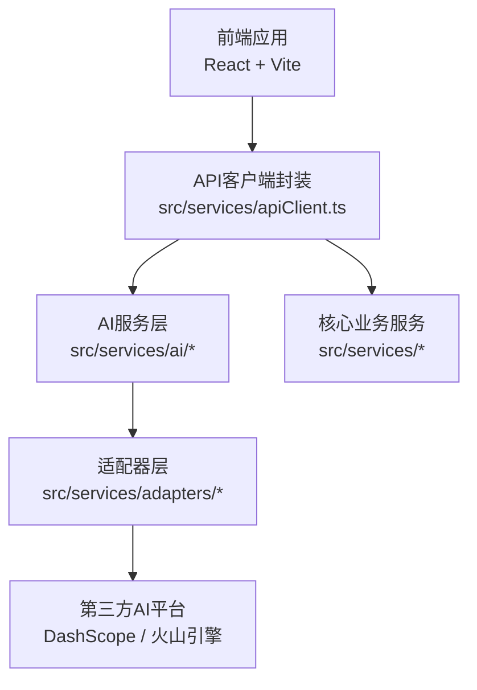
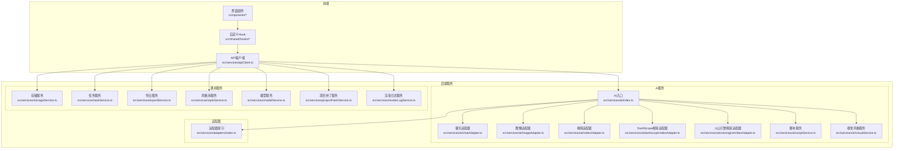
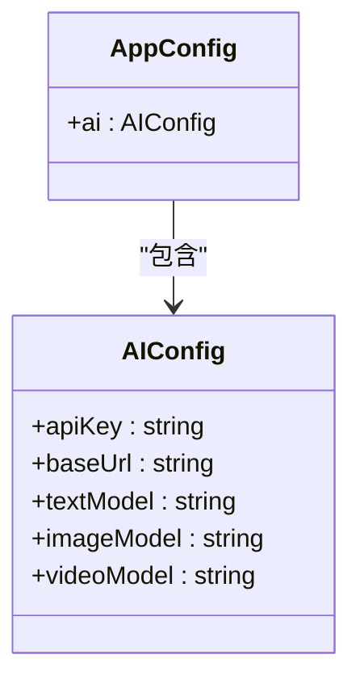
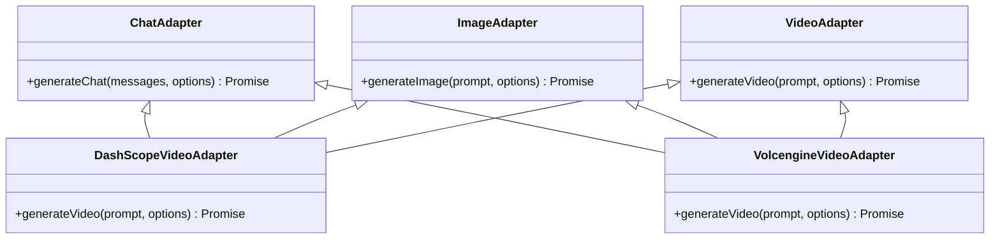
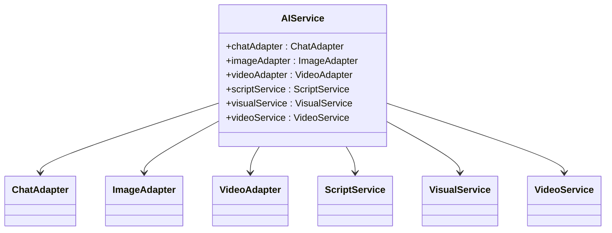
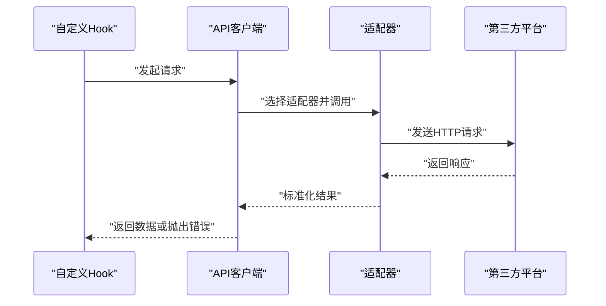
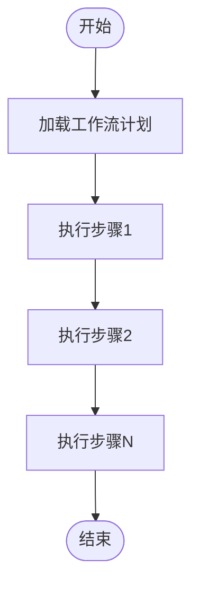
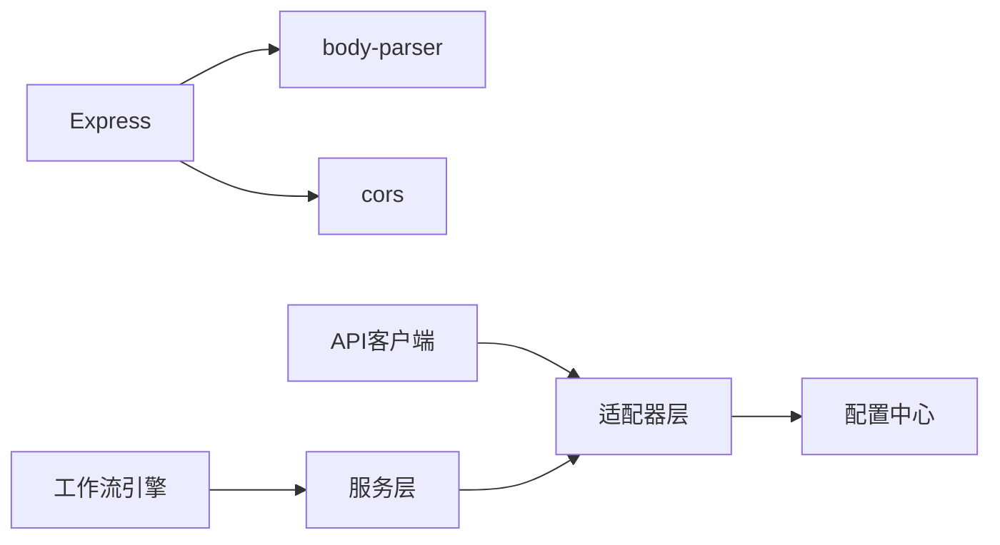

# API路由架构

<cite>
**本文引用的文件**
- [package.json](file://package.json)
- [src/config.ts](file://src/config.ts)
- [src/services/ai/index.ts](file://src/services/ai/index.ts)
- [src/services/ai/apiCore.ts](file://src/services/ai/apiCore.ts)
- [src/services/ai/chatAdapter.ts](file://src/services/ai/chatAdapter.ts)
- [src/services/ai/imageAdapter.ts](file://src/services/ai/imageAdapter.ts)
- [src/services/ai/videoAdapter.ts](file://src/services/ai/videoAdapter.ts)
- [src/services/ai/dashscopeVideoAdapter.ts](file://src/services/ai/dashscopeVideoAdapter.ts)
- [src/services/ai/volcengineVideoAdapter.ts](file://src/services/ai/volcengineVideoAdapter.ts)
- [src/services/ai/novelScriptService.ts](file://src/services/ai/novelScriptService.ts)
- [src/services/ai/scriptService.ts](file://src/services/ai/scriptService.ts)
- [src/services/ai/shotService.ts](file://src/services/ai/shotService.ts)
- [src/services/ai/videoService.ts](file://src/services/ai/videoService.ts)
- [src/services/ai/visualService.ts](file://src/services/ai/visualService.ts)
- [src/services/ai/promptConstants.ts](file://src/services/ai/promptConstants.ts)
- [src/services/aiService.ts](file://src/services/aiService.ts)
- [src/services/apiClient.ts](file://src/services/apiClient.ts)
- [src/services/modelConfigService.ts](file://src/services/modelConfigService.ts)
- [src/services/modelService.ts](file://src/services/modelService.ts)
- [src/services/projectPatchService.ts](file://src/services/projectPatchService.ts)
- [src/services/renderLogService.ts](file://src/services/renderLogService.ts)
- [src/services/storageService.ts](file://src/services/storageService.ts)
- [src/services/taskService.ts](file://src/services/taskService.ts)
- [src/services/assetLibraryService.ts](file://src/services/assetLibraryService.ts)
- [src/services/exportService.ts](file://src/services/exportService.ts)
- [src/services/styleService.ts](file://src/services/styleService.ts)
- [src/services/workflow/engine.ts](file://src/services/workflow/engine.ts)
- [src/services/workflow/index.ts](file://src/services/workflow/index.ts)
- [src/services/workflow/types.ts](file://src/services/workflow/types.ts)
- [src/shared/hooks/useAI.ts](file://src/shared/hooks/useAI.ts)
- [src/shared/hooks/useProject.ts](file://src/shared/hooks/useProject.ts)
- [src/types.ts](file://src/types.ts)
- [src/services/adapters/index.ts](file://src/services/adapters/index.ts)
</cite>

## 目录
1. [简介](#简介)
2. [项目结构](#项目结构)
3. [核心组件](#核心组件)
4. [架构总览](#架构总览)
5. [详细组件分析](#详细组件分析)
6. [依赖关系分析](#依赖关系分析)
7. [性能考虑](#性能考虑)
8. [故障排查指南](#故障排查指南)
9. [结论](#结论)
10. [附录](#附录)

## 简介
本文件面向AI Shotlive项目的API路由架构，聚焦后端服务层与前端调用层的协作方式，系统化阐述RESTful API设计原则、路由组织结构、控制器模式实现、HTTP方法映射、请求参数验证、中间件集成、错误响应格式与API版本管理策略。文档同时提供路由架构图、API设计规范与最佳实践，帮助开发者快速理解并扩展系统。

## 项目结构
AI Shotlive采用前后端分离架构，前端通过React应用与后端服务交互。后端服务以Express框架为基础（从依赖中可见），结合适配器模式对接多家AI厂商（如DashScope、火山引擎等）。路由层位于后端服务目录下，前端通过统一的API客户端封装调用。

**章节来源**
- [package.json:11-24](file://package.json#L11-L24)

## 核心组件
- 配置中心：集中管理AI厂商接入参数（密钥、基础URL、模型名称）。
- 适配器层：对不同AI厂商的接口进行统一封装，屏蔽差异。
- 服务层：按领域拆分（文本、图像、视频、脚本、视觉风格等），每个服务负责特定业务流程。
- API客户端：统一请求构建、认证、重试与错误处理。
- 工作流引擎：编排多步骤任务，协调多个服务协同完成复杂流程。

**章节来源**
- [src/config.ts:6-46](file://src/config.ts#L6-L46)
- [src/services/ai/index.ts](file://src/services/ai/index.ts)
- [src/services/adapters/index.ts](file://src/services/adapters/index.ts)
- [src/services/aiService.ts](file://src/services/aiService.ts)
- [src/services/apiClient.ts](file://src/services/apiClient.ts)
- [src/services/workflow/engine.ts](file://src/services/workflow/engine.ts)

## 架构总览
下图展示从前端到后端服务的整体数据流与职责边界：

**图表来源**
- [src/services/ai/index.ts](file://src/services/ai/index.ts)
- [src/services/ai/chatAdapter.ts](file://src/services/ai/chatAdapter.ts)
- [src/services/ai/imageAdapter.ts](file://src/services/ai/imageAdapter.ts)
- [src/services/ai/videoAdapter.ts](file://src/services/ai/videoAdapter.ts)
- [src/services/ai/dashscopeVideoAdapter.ts](file://src/services/ai/dashscopeVideoAdapter.ts)
- [src/services/ai/volcengineVideoAdapter.ts](file://src/services/ai/volcengineVideoAdapter.ts)
- [src/services/ai/scriptService.ts](file://src/services/ai/scriptService.ts)
- [src/services/ai/visualService.ts](file://src/services/ai/visualService.ts)
- [src/services/adapters/index.ts](file://src/services/adapters/index.ts)
- [src/services/apiClient.ts](file://src/services/apiClient.ts)
- [src/services/storageService.ts](file://src/services/storageService.ts)
- [src/services/taskService.ts](file://src/services/taskService.ts)
- [src/services/exportService.ts](file://src/services/exportService.ts)
- [src/services/styleService.ts](file://src/services/styleService.ts)
- [src/services/modelService.ts](file://src/services/modelService.ts)
- [src/services/projectPatchService.ts](file://src/services/projectPatchService.ts)
- [src/services/renderLogService.ts](file://src/services/renderLogService.ts)

## 详细组件分析

### 配置中心（AppConfig）
- 职责：集中管理AI厂商接入参数，支持运行时更新。
- 关键字段：API密钥、基础URL、文本/图像/视频模型名。
- 设计要点：深拷贝合并，避免全局污染；提供hasApiKey判断。

**图表来源**
- [src/config.ts:6-24](file://src/config.ts#L6-L24)

**章节来源**
- [src/config.ts:26-46](file://src/config.ts#L26-L46)

### 适配器层（Adapters）
- 职责：对不同AI厂商的接口进行统一封装，屏蔽差异。
- 组织：按能力划分（聊天、图像、视频），并进一步细分厂商实现。
- 典型实现：
  - 文本聊天适配器：src/services/ai/chatAdapter.ts
  - 图像生成适配器：src/services/ai/imageAdapter.ts
  - 视频生成适配器：src/services/ai/videoAdapter.ts
  - DashScope视频适配器：src/services/ai/dashscopeVideoAdapter.ts
  - 火山引擎视频适配器：src/services/ai/volcengineVideoAdapter.ts

**图表来源**
- [src/services/ai/chatAdapter.ts](file://src/services/ai/chatAdapter.ts)
- [src/services/ai/imageAdapter.ts](file://src/services/ai/imageAdapter.ts)
- [src/services/ai/videoAdapter.ts](file://src/services/ai/videoAdapter.ts)
- [src/services/ai/dashscopeVideoAdapter.ts](file://src/services/ai/dashscopeVideoAdapter.ts)
- [src/services/ai/volcengineVideoAdapter.ts](file://src/services/ai/volcengineVideoAdapter.ts)

**章节来源**
- [src/services/adapters/index.ts](file://src/services/adapters/index.ts)
- [src/services/ai/chatAdapter.ts](file://src/services/ai/chatAdapter.ts)
- [src/services/ai/imageAdapter.ts](file://src/services/ai/imageAdapter.ts)
- [src/services/ai/videoAdapter.ts](file://src/services/ai/videoAdapter.ts)
- [src/services/ai/dashscopeVideoAdapter.ts](file://src/services/ai/dashscopeVideoAdapter.ts)
- [src/services/ai/volcengineVideoAdapter.ts](file://src/services/ai/volcengineVideoAdapter.ts)

### 服务层（AI Services）
- 文本类：novelScriptService.ts、scriptService.ts、shotService.ts
- 视觉类：visualService.ts
- 视频类：videoService.ts
- 统一入口：ai/index.ts 汇聚各子服务，便于上层调用。

**图表来源**
- [src/services/ai/index.ts](file://src/services/ai/index.ts)
- [src/services/ai/scriptService.ts](file://src/services/ai/scriptService.ts)
- [src/services/ai/visualService.ts](file://src/services/ai/visualService.ts)
- [src/services/ai/videoService.ts](file://src/services/ai/videoService.ts)

**章节来源**
- [src/services/ai/index.ts](file://src/services/ai/index.ts)
- [src/services/ai/scriptService.ts](file://src/services/ai/scriptService.ts)
- [src/services/ai/visualService.ts](file://src/services/ai/visualService.ts)
- [src/services/ai/videoService.ts](file://src/services/ai/videoService.ts)

### API客户端（apiClient.ts）
- 职责：统一构建请求、注入认证信息、处理重试与错误。
- 设计：基于fetch或axios（从依赖可见Express生态），支持拦截器与中间件扩展。

**图表来源**
- [src/shared/hooks/useAI.ts](file://src/shared/hooks/useAI.ts)
- [src/services/apiClient.ts](file://src/services/apiClient.ts)
- [src/services/adapters/index.ts](file://src/services/adapters/index.ts)

**章节来源**
- [src/services/apiClient.ts](file://src/services/apiClient.ts)
- [src/shared/hooks/useAI.ts](file://src/shared/hooks/useAI.ts)

### 工作流引擎（workflow/engine.ts）
- 职责：编排多步骤任务，协调多个服务协同完成复杂流程。
- 类型：workflow/types.ts 定义流程类型与状态。

**图表来源**
- [src/services/workflow/engine.ts](file://src/services/workflow/engine.ts)
- [src/services/workflow/types.ts](file://src/services/workflow/types.ts)

**章节来源**
- [src/services/workflow/engine.ts](file://src/services/workflow/engine.ts)
- [src/services/workflow/types.ts](file://src/services/workflow/types.ts)

## 依赖关系分析
- 外部依赖：Express、body-parser、cors、debug、mime、send、statuses 等。
- 内部耦合：API客户端依赖适配器层；适配器层依赖配置中心；服务层依赖适配器层与配置中心；工作流引擎依赖服务层。

**图表来源**
- [package.json:6031-6829](file://package.json#L6031-L6829)

**章节来源**
- [package.json:6031-6829](file://package.json#L6031-L6829)

## 性能考虑
- 连接复用与超时控制：在适配器层设置合理的连接池与超时阈值，避免阻塞。
- 缓存策略：对静态资源与重复请求结果进行缓存，降低第三方平台调用频率。
- 并发控制：限制并发请求数，防止触发第三方限流。
- 错误重试：指数退避重试，避免雪崩效应。
- 压缩传输：启用gzip/deflate压缩，减少带宽占用。
- CDN加速：静态资源走CDN，提升首屏速度。
- 监控与告警：埋点请求耗时、错误率与第三方平台可用性。

## 故障排查指南
- 认证失败：检查配置中心中的API密钥是否正确设置。
- 请求超时：检查网络连通性与第三方平台限流策略。
- 参数校验失败：核对请求体结构与必填字段，确保与服务层期望一致。
- 适配器未命中：确认适配器索引与厂商实现是否匹配。
- 工作流卡死：查看工作流状态机与中间步骤日志。

**章节来源**
- [src/config.ts:40-46](file://src/config.ts#L40-L46)
- [src/services/apiClient.ts](file://src/services/apiClient.ts)
- [src/services/adapters/index.ts](file://src/services/adapters/index.ts)
- [src/services/workflow/engine.ts](file://src/services/workflow/engine.ts)

## 结论
AI Shotlive的API路由架构以“配置驱动、适配器屏蔽差异、服务分层编排”为核心设计思想，既保证了与多家AI厂商的兼容性，又提升了系统的可维护性与扩展性。通过统一的API客户端与工作流引擎，前端可以以一致的方式调用后端能力，实现复杂的创作流程。

## 附录

### API设计规范
- 路由命名：采用名词复数形式，动词作为HTTP方法，遵循REST语义。
- 请求参数：
  - 必填参数：在接口文档中标注required。
  - 可选参数：提供默认值或明确行为。
  - 参数校验：在服务层进行严格校验，返回明确的错误码与提示。
- 响应格式：
  - 成功：统一返回 { code: 0, message: "success", data: T }
  - 失败：统一返回 { code: number, message: string, data?: any }
- 错误码约定：
  - 400：参数错误
  - 401：未授权
  - 403：权限不足
  - 404：资源不存在
  - 500：服务器内部错误
  - 502/503：上游服务异常
- 版本管理：
  - 路径前缀：/api/v1、/api/v2
  - 查询参数：?version=1
  - 头部：X-API-Version: 1
- 中间件：
  - 认证：鉴权令牌校验
  - 日志：请求/响应日志记录
  - 限流：QPS/并发限制
  - CORS：跨域配置
  - 压缩：Gzip/Deflate
- 最佳实践：
  - 使用幂等操作时采用GET/HEAD/PUT/DELETE
  - 对长耗时任务采用异步队列与轮询查询
  - 对敏感数据进行脱敏与加密
  - 对第三方接口增加熔断与降级策略

### 路由配置示例（概念性）
以下为概念性示例，用于说明路由组织与HTTP方法映射思路（具体实现以实际代码为准）：
- GET /api/v1/models：列出可用模型
- POST /api/v1/models：创建新模型
- GET /api/v1/tasks/{id}：查询任务详情
- PUT /api/v1/tasks/{id}/cancel：取消任务
- POST /api/v1/assets/upload：上传素材
- GET /api/v1/assets/{id}/download：下载素材
- POST /api/v1/scripts/generate：生成脚本
- POST /api/v1/videos/generate：生成视频
- GET /api/v1/styles：获取风格库
- POST /api/v1/styles：新增风格
- GET /api/v1/projects/{id}/patch：获取项目补丁
- POST /api/v1/projects/{id}/patch：应用补丁

### 性能优化建议
- 合理设置超时与重试：避免长时间阻塞请求线程。
- 使用连接池与并发限制：平衡吞吐量与稳定性。
- 开启响应压缩与缓存：减少网络传输与第三方调用次数。
- 异步处理长任务：返回任务ID，前端轮询查询结果。
- 监控与告警：建立完善的指标体系，及时发现瓶颈与异常。