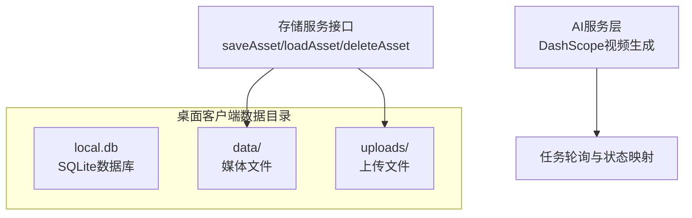
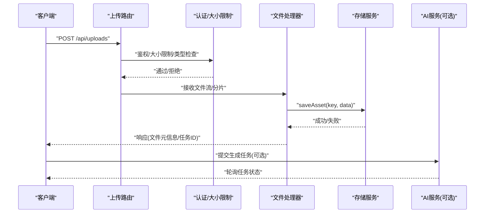
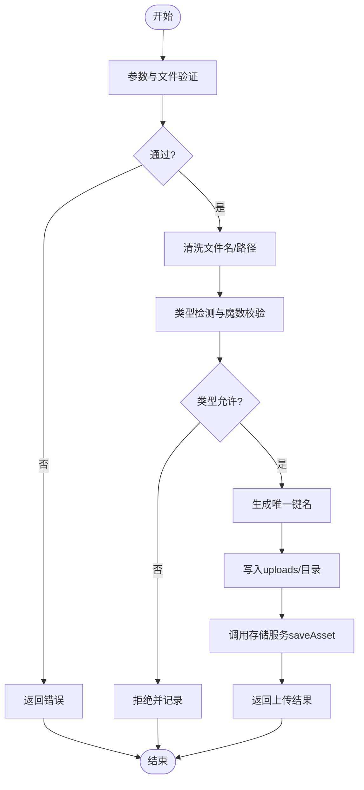
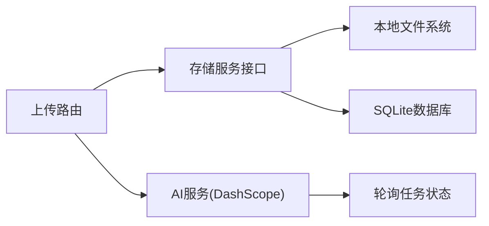

# 上传管理路由

<cite>
**本文档引用的文件**
- [README_EN.md](file://README_EN.md)
- [types.ts](file://src/services/storage/types.ts)
- [dashscope.ts](file://src/services/ai/dashscope.ts)
</cite>

## 目录
1. [简介](#简介)
2. [项目结构](#项目结构)
3. [核心组件](#核心组件)
4. [架构总览](#架构总览)
5. [详细组件分析](#详细组件分析)
6. [依赖关系分析](#依赖关系分析)
7. [性能考虑](#性能考虑)
8. [故障排查指南](#故障排查指南)
9. [结论](#结论)
10. [附录](#附录)

## 简介
本文件面向“AI Shotlive”项目中的上传管理路由，系统性梳理其文件上传的RESTful API设计、文件类型验证、存储策略、单文件上传、批量上传与断点续传的实现机制，并阐述文件安全检查、大小限制与存储路径管理。同时给出上传接口规范、文件处理流程与存储优化策略，提供上传架构图与文件处理最佳实践说明，帮助开发者快速理解并扩展上传能力。

## 项目结构
围绕上传管理的关键位置与职责如下：
- 数据存储位置与目录结构：桌面客户端数据位于独立目录，包含本地数据库与媒体/上传文件目录，便于离线与本地化管理。
- 存储服务接口：统一抽象了项目、资产与配置的存取接口，为上传后的文件持久化提供一致契约。
- AI服务层：以DashScope为例，展示上传后触发的异步任务状态轮询与错误映射，体现上传与后续处理的衔接。

**图表来源**
- [README_EN.md:300-313](file://README_EN.md#L300-L313)
- [types.ts:15-30](file://src/services/storage/types.ts#L15-L30)
- [dashscope.ts:184-216](file://src/services/ai/dashscope.ts#L184-L216)

**章节来源**
- [README_EN.md:300-313](file://README_EN.md#L300-L313)

## 核心组件
- 存储服务接口（StorageService）
  - 提供保存/加载/删除资产的能力，资产以二进制形式存储，键名作为唯一标识。
  - 该接口为上传后的文件落地提供统一入口，确保不同来源的文件能以一致方式写入与读取。
- 上传与文件处理
  - 上传后文件落盘至“uploads/”目录，随后可按需移动到“data/”等目标目录。
  - 文件类型验证与安全检查建议在服务端进行，结合白名单与内容探测。
- 大小限制与并发控制
  - 建议在网关/中间件层设置请求体大小限制与并发连接数限制，避免资源耗尽。
- 断点续传
  - 可基于分片上传与服务端校验和（如SHA-256）实现断点续传，提升大文件传输稳定性。

**章节来源**
- [types.ts:15-30](file://src/services/storage/types.ts#L15-L30)

## 架构总览
上传管理路由的整体架构由“前端上传请求 -> 服务端路由/中间件 -> 文件落地 -> 存储服务 -> 后续处理（可选）”构成。下图展示了从上传到存储的关键交互：

**图表来源**
- [types.ts:22-26](file://src/services/storage/types.ts#L22-L26)
- [dashscope.ts:201-216](file://src/services/ai/dashscope.ts#L201-L216)

## 详细组件分析

### 上传路由与中间件
- 路由设计
  - 使用RESTful风格：POST /api/uploads 表示单文件上传；可扩展为多文件批量上传的子资源或查询参数。
  - 响应格式：返回文件键名、原始名称、大小、类型、上传时间与访问URL（若启用）。
- 中间件职责
  - 认证：确保上传者身份有效。
  - 大小限制：在网关或中间件层限制请求体大小，避免内存压力。
  - 类型验证：白名单过滤允许的MIME类型，必要时进行魔数检测。
  - 并发控制：限制同一IP/用户同时上传的任务数量。

### 文件类型验证与安全检查
- 类型白名单：仅允许图像/视频/音频等业务所需类型，拒绝脚本/可执行文件。
- 内容探测：读取文件头部魔数，与MIME类型比对，防止“文件头伪装”。
- 名称清洗：去除路径分隔符、转义特殊字符，避免目录穿越风险。
- 权限与归属：上传文件默认私有，仅授权用户可访问；生成临时URL时附加签名与时效。

### 存储策略与路径管理
- 目录规划
  - uploads/：临时存放刚上传的文件，便于后续迁移或清理。
  - data/：最终归档的媒体文件，按项目/场景/类型组织子目录。
- 键名设计
  - 建议采用“项目ID/类型/时间戳_随机串.扩展名”的命名策略，兼顾可读性与去重。
- 版本与回滚
  - 对关键文件保留版本号或哈希索引，支持回滚与一致性校验。

### 单文件上传
- 请求体：multipart/form-data，字段名为file。
- 处理流程：接收文件 -> 安全检查 -> 生成键名 -> 写入uploads/ -> 返回元信息。
- 错误处理：类型不符、大小超限、磁盘空间不足等均返回明确错误码与消息。

### 批量上传
- 请求体：多个file字段或数组参数，后端逐个处理。
- 并发策略：限制最大并发数，避免IO瓶颈；对失败项单独记录，整体结果聚合返回。
- 原子性：建议使用事务式落盘或原子替换，确保部分失败不影响整体一致性。

### 断点续传
- 分片策略：固定大小分片（如10-50MB），最后一片可变长。
- 校验与合并：服务端计算每片SHA-256，合并时再次校验总和。
- 续传接口：
  - 获取未完成分片列表：GET /api/uploads/{key}/chunks
  - 上传分片：PUT /api/uploads/{key}/chunks/{index}
  - 完成分片：POST /api/uploads/{key}/complete
- 客户端重试：指数退避，失败自动重试，避免重复写入。

### 上传接口规范
- 地址与方法
  - 单文件上传：POST /api/uploads
  - 批量上传：POST /api/uploads?batch=true
  - 断点续传：PUT /api/uploads/{key}/chunks/{index} + POST /api/uploads/{key}/complete
- 请求头
  - Content-Type：multipart/form-data 或 application/octet-stream（分片）
  - Authorization：Bearer {token}
- 成功响应
  - 200 OK：返回文件键名、大小、类型、访问URL等
- 错误响应
  - 400 Bad Request：参数缺失/类型不支持/大小超限
  - 401 Unauthorized：未认证
  - 403 Forbidden：权限不足
  - 413 Payload Too Large：超过大小限制
  - 500 Internal Server Error：服务器异常

### 文件处理流程

**图表来源**
- [types.ts:22-26](file://src/services/storage/types.ts#L22-L26)

### 存储优化策略
- 压缩与转码：对图像/视频进行无损压缩或转码，降低存储与带宽成本。
- 去重：基于哈希去重，避免重复文件占用空间。
- 归档：长期未访问的文件移至低频存储或冷存储。
- CDN：热点文件通过CDN加速，减少源站压力。

## 依赖关系分析
- 存储服务接口与AI服务的耦合点在于“任务状态轮询”，上传完成后可触发AI生成任务，客户端轮询任务状态并拉取结果。
- 上传路由与存储服务之间通过统一接口解耦，便于替换底层存储实现。

**图表来源**
- [types.ts:15-30](file://src/services/storage/types.ts#L15-L30)
- [dashscope.ts:201-216](file://src/services/ai/dashscope.ts#L201-L216)

**章节来源**
- [types.ts:15-30](file://src/services/storage/types.ts#L15-L30)
- [dashscope.ts:184-216](file://src/services/ai/dashscope.ts#L184-L216)

## 性能考虑
- I/O吞吐：合理设置分片大小与并发度，避免过多小文件导致磁盘寻道开销。
- 内存占用：流式处理文件，避免一次性加载到内存。
- 网络抖动：断点续传与指数退避重试提升可靠性。
- 缓存策略：对常用文件建立缓存，减少重复读取。

## 故障排查指南
- 常见问题
  - 400/413：检查请求体大小限制与文件类型白名单。
  - 401：确认Authorization头是否正确传递。
  - 500：查看服务日志，定位磁盘空间、权限或存储异常。
- 任务轮询
  - 若AI任务长时间pending，检查API Key有效性与配额限制。
  - 超时或失败时根据错误码进行重试或降级处理。

**章节来源**
- [dashscope.ts:58-93](file://src/services/ai/dashscope.ts#L58-L93)
- [dashscope.ts:201-216](file://src/services/ai/dashscope.ts#L201-L216)

## 结论
通过统一的存储服务接口与严谨的中间件校验，AI Shotlive的上传管理路由实现了类型安全、路径可控与可扩展的文件处理能力。结合断点续传与任务轮询机制，可在复杂网络环境下稳定完成大文件上传与后续生成任务。建议在生产环境中进一步完善安全扫描、去重与归档策略，持续优化I/O与网络性能。

## 附录
- 数据存储位置参考：桌面客户端数据目录包含local.db、data/与uploads/，便于本地化部署与备份。
- 存储服务接口定义：提供saveAsset/loadAsset/deleteAsset等方法，统一二进制资产的存取。

**章节来源**
- [README_EN.md:300-313](file://README_EN.md#L300-L313)
- [types.ts:15-30](file://src/services/storage/types.ts#L15-L30)