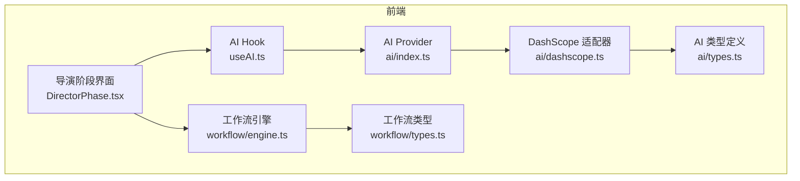
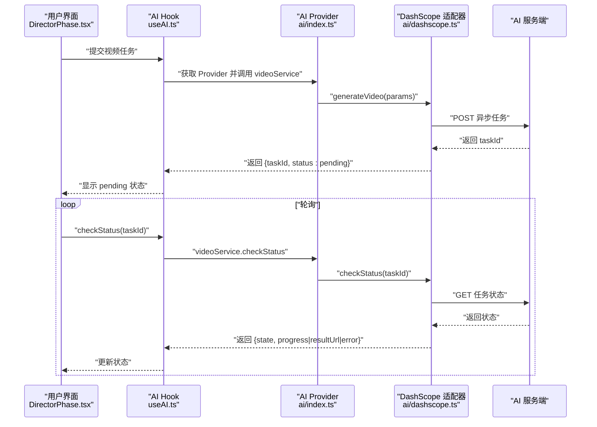
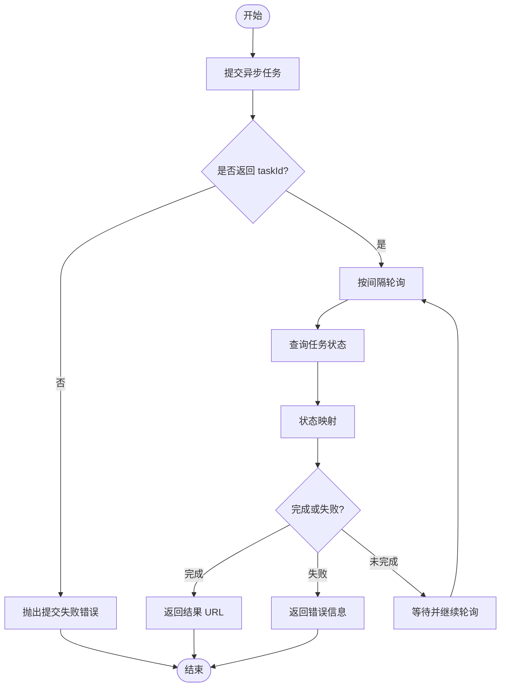
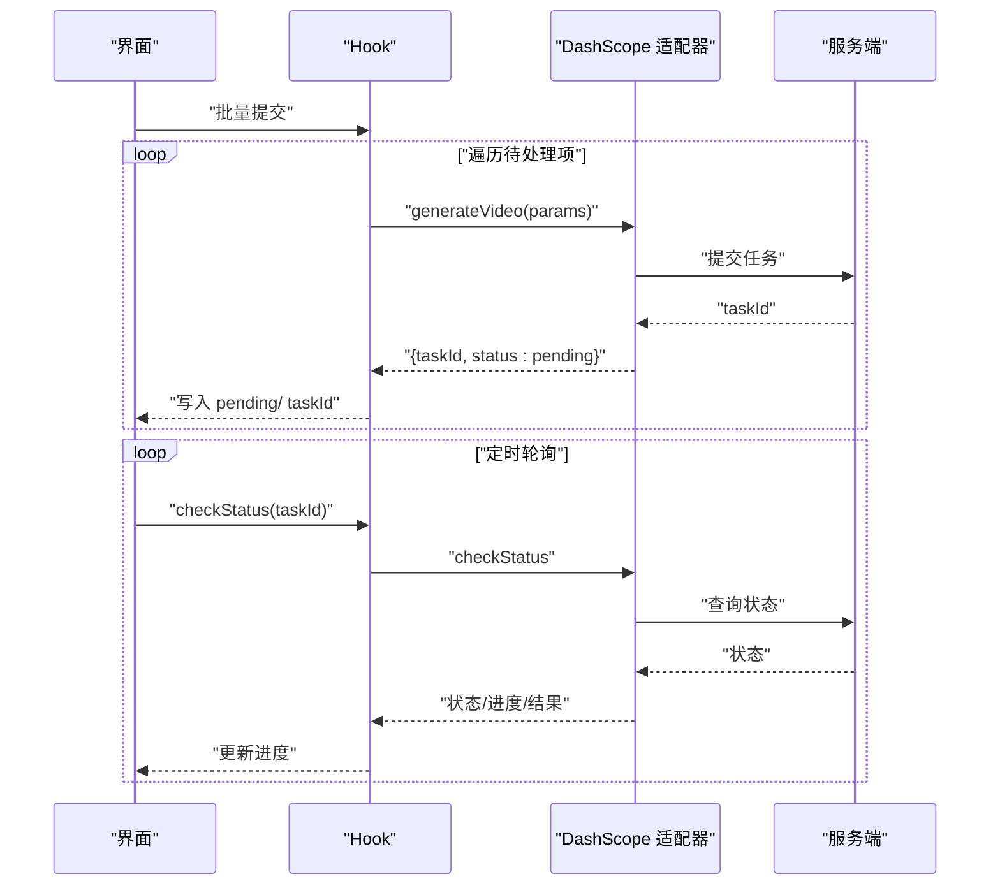
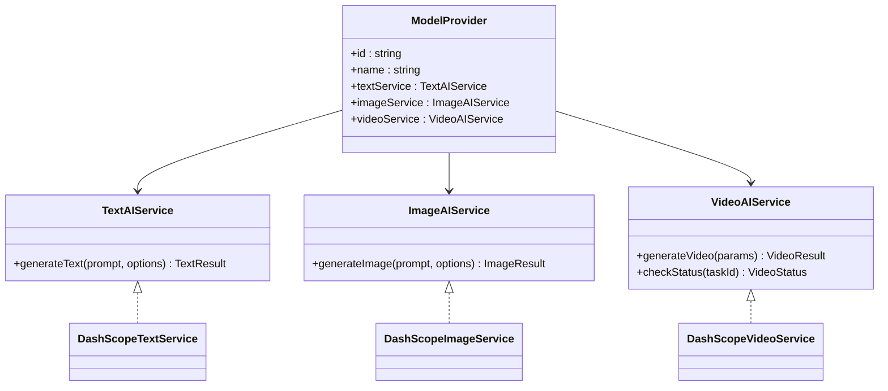
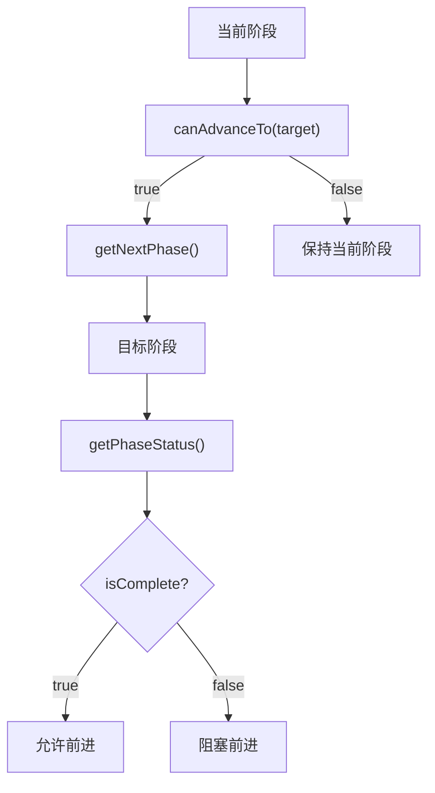
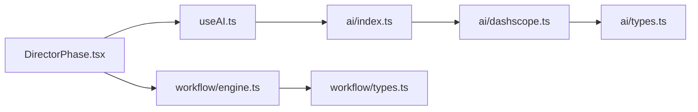
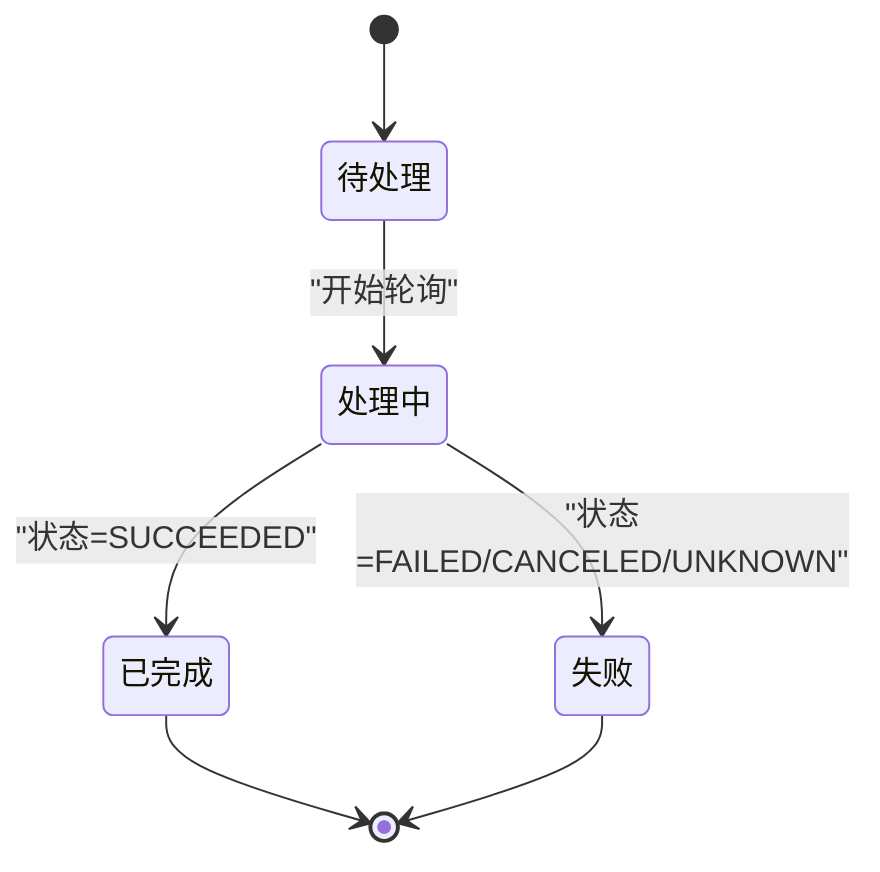

# 任务管理路由

<cite>
**本文引用的文件**
- [dashscope.ts](file://src/services/ai/dashscope.ts)
- [types.ts](file://src/services/ai/types.ts)
- [index.ts](file://src/services/ai/index.ts)
- [useAI.ts](file://src/shared/hooks/useAI.ts)
- [DirectorPhase.tsx](file://src/phases/director/DirectorPhase.tsx)
- [engine.ts](file://src/services/workflow/engine.ts)
- [types.ts](file://src/services/workflow/types.ts)
</cite>

## 目录
1. [简介](#简介)
2. [项目结构](#项目结构)
3. [核心组件](#核心组件)
4. [架构总览](#架构总览)
5. [详细组件分析](#详细组件分析)
6. [依赖关系分析](#依赖关系分析)
7. [性能考量](#性能考量)
8. [故障排查指南](#故障排查指南)
9. [结论](#结论)
10. [附录](#附录)

## 简介
本文件围绕“AI Shotlive”的异步任务管理进行系统化文档化，重点覆盖以下方面：
- 异步任务生命周期：从提交到完成/失败的全流程
- 任务队列与并发控制：批处理、轮询与重试策略
- 任务状态跟踪：状态映射、进度上报与错误处理
- API 设计：任务提交、状态查询、结果获取
- 调度与资源限制：轮询间隔、最大等待时间、重试退避
- 数据模型与状态转换图
- 监控最佳实践与架构图

本项目采用“统一 AI Provider 接口 + DashScope 适配器”的设计，视频与图像生成均以异步任务形式提交，并通过轮询查询状态。

## 项目结构
与任务管理直接相关的前端模块分布如下：
- 服务层（AI Provider 与适配器）：统一接口定义、DashScope 实现、Provider 工厂
- 业务层（页面与 Hook）：导演阶段用于批量提交视频任务并轮询状态
- 工作流层（可选集成）：阶段推进与状态评估，便于将任务完成度纳入整体流程

**图表来源**
- [DirectorPhase.tsx:127-204](file://src/phases/director/DirectorPhase.tsx#L127-L204)
- [useAI.ts:41-96](file://src/shared/hooks/useAI.ts#L41-L96)
- [index.ts:1-34](file://src/services/ai/index.ts#L1-L34)
- [dashscope.ts:1-327](file://src/services/ai/dashscope.ts#L1-L327)
- [types.ts:1-73](file://src/services/ai/types.ts#L1-L73)
- [engine.ts:1-120](file://src/services/workflow/engine.ts#L1-L120)
- [types.ts:1-21](file://src/services/workflow/types.ts#L1-L21)

**章节来源**
- [DirectorPhase.tsx:127-204](file://src/phases/director/DirectorPhase.tsx#L127-L204)
- [useAI.ts:41-96](file://src/shared/hooks/useAI.ts#L41-L96)
- [index.ts:1-34](file://src/services/ai/index.ts#L1-L34)
- [dashscope.ts:1-327](file://src/services/ai/dashscope.ts#L1-L327)
- [types.ts:1-73](file://src/services/ai/types.ts#L1-L73)
- [engine.ts:1-120](file://src/services/workflow/engine.ts#L1-L120)
- [types.ts:1-21](file://src/services/workflow/types.ts#L1-L21)

## 核心组件
- 统一 AI 接口与 Provider
  - 定义文本/图像/视频服务接口与 Provider 结构，便于替换不同厂商
  - DashScope 适配器实现异步任务提交、轮询与状态映射
- 任务生命周期与状态
  - 提交：返回 taskId，立即进入“待处理”状态
  - 轮询：按固定间隔查询任务状态，直到完成或失败
  - 结果：成功返回结果 URL，失败返回错误信息
- 批处理与并发控制
  - 导演阶段支持批量提交与进度条展示
  - 轮询使用定时器，避免阻塞主线程
- 错误与重试
  - 对网络错误与 5xx 进行指数退避重试
  - 4xx 直接抛错，不重试
  - 任务超时与失败有明确错误码

**章节来源**
- [types.ts:40-73](file://src/services/ai/types.ts#L40-L73)
- [dashscope.ts:141-216](file://src/services/ai/dashscope.ts#L141-L216)
- [dashscope.ts:257-315](file://src/services/ai/dashscope.ts#L257-L315)
- [useAI.ts:68-96](file://src/shared/hooks/useAI.ts#L68-L96)
- [DirectorPhase.tsx:127-204](file://src/phases/director/DirectorPhase.tsx#L127-L204)

## 架构总览
下图展示了从前端交互到 AI 服务的异步任务处理路径，包括提交、轮询与状态更新。

**图表来源**
- [DirectorPhase.tsx:127-204](file://src/phases/director/DirectorPhase.tsx#L127-L204)
- [useAI.ts:68-96](file://src/shared/hooks/useAI.ts#L68-L96)
- [index.ts:22-34](file://src/services/ai/index.ts#L22-L34)
- [dashscope.ts:257-315](file://src/services/ai/dashscope.ts#L257-L315)

## 详细组件分析

### 组件一：DashScope 异步任务适配器
- 功能要点
  - 提交异步任务：启用异步头并解析返回的 taskId
  - 查询任务：根据 taskId 获取状态
  - 状态映射：将远端状态映射为统一的本地状态枚举
  - 轮询策略：固定间隔轮询，超时控制与失败处理
  - 重试策略：对网络错误与 5xx 使用指数退避重试，4xx 直接抛错
- 关键常量
  - 轮询间隔、最大等待时间、最大重试次数、重试退避基数
- 错误分类
  - 认证类、配额类、客户端错误、服务端错误、网络错误、任务提交/失败/超时等

**图表来源**
- [dashscope.ts:155-182](file://src/services/ai/dashscope.ts#L155-L182)
- [dashscope.ts:184-216](file://src/services/ai/dashscope.ts#L184-L216)
- [dashscope.ts:257-315](file://src/services/ai/dashscope.ts#L257-L315)

**章节来源**
- [dashscope.ts:26-93](file://src/services/ai/dashscope.ts#L26-L93)
- [dashscope.ts:155-182](file://src/services/ai/dashscope.ts#L155-L182)
- [dashscope.ts:184-216](file://src/services/ai/dashscope.ts#L184-L216)
- [dashscope.ts:257-315](file://src/services/ai/dashscope.ts#L257-L315)

### 组件二：视频任务提交与轮询（导演阶段）
- 批量提交
  - 支持批量生成关键帧视频，逐项提交并记录 taskId
  - 使用乐观更新：先标记为 pending，再写入 taskId 与状态
- 轮询机制
  - 使用定时器定期检查任务状态
  - 使用 ref 保持最新项目与检查函数，避免重复创建定时器
- 错误处理
  - 单项失败不影响其他任务，累积错误信息并在 UI 展示

**图表来源**
- [DirectorPhase.tsx:127-204](file://src/phases/director/DirectorPhase.tsx#L127-L204)
- [DirectorPhase.tsx:191-204](file://src/phases/director/DirectorPhase.tsx#L191-L204)
- [useAI.ts:68-96](file://src/shared/hooks/useAI.ts#L68-L96)
- [dashscope.ts:257-315](file://src/services/ai/dashscope.ts#L257-L315)

**章节来源**
- [DirectorPhase.tsx:127-204](file://src/phases/director/DirectorPhase.tsx#L127-L204)
- [DirectorPhase.tsx:191-204](file://src/phases/director/DirectorPhase.tsx#L191-L204)
- [useAI.ts:68-96](file://src/shared/hooks/useAI.ts#L68-L96)

### 组件三：统一 AI 接口与 Provider
- 接口设计
  - 文本/图像/视频服务接口统一，便于扩展
  - Provider 暴露三种服务能力，支持未来多 Provider 切换
- Provider 管理
  - 懒加载与复用，必要时可重置
- 类型约束
  - 视频状态包含状态枚举、进度、结果 URL、错误信息

**图表来源**
- [types.ts:18-73](file://src/services/ai/types.ts#L18-L73)
- [index.ts:22-34](file://src/services/ai/index.ts#L22-L34)
- [dashscope.ts:96-139](file://src/services/ai/dashscope.ts#L96-L139)
- [dashscope.ts:219-255](file://src/services/ai/dashscope.ts#L219-L255)
- [dashscope.ts:257-315](file://src/services/ai/dashscope.ts#L257-L315)

**章节来源**
- [types.ts:1-73](file://src/services/ai/types.ts#L1-L73)
- [index.ts:1-34](file://src/services/ai/index.ts#L1-L34)
- [dashscope.ts:96-139](file://src/services/ai/dashscope.ts#L96-L139)
- [dashscope.ts:219-255](file://src/services/ai/dashscope.ts#L219-L255)
- [dashscope.ts:257-315](file://src/services/ai/dashscope.ts#L257-L315)

### 组件四：工作流引擎（可选集成）
- 阶段推进规则
  - 前进需前置阶段全部完成，自由回退
- 阶段状态
  - 各阶段完成度、缺失需求列表、百分比
- 与任务管理的关系
  - 可将“存在已完成视频”作为阶段推进的条件之一

**图表来源**
- [engine.ts:83-117](file://src/services/workflow/engine.ts#L83-L117)
- [types.ts:7-18](file://src/services/workflow/types.ts#L7-L18)

**章节来源**
- [engine.ts:1-120](file://src/services/workflow/engine.ts#L1-L120)
- [types.ts:1-21](file://src/services/workflow/types.ts#L1-L21)

## 依赖关系分析
- 组件耦合
  - UI 仅依赖 Hook，Hook 依赖 Provider，Provider 依赖具体适配器
  - 适配器与服务端交互，内部封装重试与轮询
- 外部依赖
  - DashScope API：任务提交、状态查询
  - 浏览器环境：定时器、fetch、本地存储（非任务管理）
- 潜在循环依赖
  - 当前结构为单向依赖，无循环

**图表来源**
- [DirectorPhase.tsx:127-204](file://src/phases/director/DirectorPhase.tsx#L127-L204)
- [useAI.ts:68-96](file://src/shared/hooks/useAI.ts#L68-L96)
- [index.ts:22-34](file://src/services/ai/index.ts#L22-L34)
- [dashscope.ts:257-315](file://src/services/ai/dashscope.ts#L257-L315)
- [types.ts:40-73](file://src/services/ai/types.ts#L40-L73)
- [engine.ts:83-117](file://src/services/workflow/engine.ts#L83-L117)
- [types.ts:13-18](file://src/services/workflow/types.ts#L13-L18)

**章节来源**
- [DirectorPhase.tsx:127-204](file://src/phases/director/DirectorPhase.tsx#L127-L204)
- [useAI.ts:68-96](file://src/shared/hooks/useAI.ts#L68-L96)
- [index.ts:1-34](file://src/services/ai/index.ts#L1-L34)
- [dashscope.ts:1-327](file://src/services/ai/dashscope.ts#L1-L327)
- [types.ts:1-73](file://src/services/ai/types.ts#L1-L73)
- [engine.ts:1-120](file://src/services/workflow/engine.ts#L1-L120)
- [types.ts:1-21](file://src/services/workflow/types.ts#L1-L21)

## 性能考量
- 轮询频率与等待上限
  - 固定轮询间隔与最大等待时间，避免过度请求
- 重试策略
  - 指数退避减少对服务端压力，同时提升成功率
- 批处理优化
  - 批量提交时串行或并行取决于业务需求，建议结合并发限制
- UI 响应性
  - 使用定时器与乐观更新，避免阻塞主线程
- 资源限制
  - 通过最大等待时间与错误码控制资源占用，防止无限轮询

[本节为通用指导，无需列出章节来源]

## 故障排查指南
- 常见错误与定位
  - 未配置 API Key：在 DashScope 适配器中抛出认证错误
  - 请求失败（401/429/4xx）：直接抛错，不重试
  - 服务端错误（5xx）：指数退避重试
  - 任务提交失败：检查返回体是否包含 taskId
  - 任务超时：超过最大等待时间仍未完成
  - 任务完成但无结果 URL：检查返回体结构
- 建议排查步骤
  - 确认 API Key 有效且未过期
  - 查看网络日志与状态码
  - 检查任务 ID 是否正确传递
  - 关注轮询间隔与最大等待时间设置
- 错误码参考
  - AUTH_MISSING/AUTH_INVALID/QUOTA_EXCEEDED/CLIENT_ERROR/SERVER_ERROR/NETWORK_ERROR/TASK_SUBMIT_FAILED/TASK_FAILED/TASK_TIMEOUT

**章节来源**
- [dashscope.ts:39-52](file://src/services/ai/dashscope.ts#L39-L52)
- [dashscope.ts:58-93](file://src/services/ai/dashscope.ts#L58-L93)
- [dashscope.ts:167-173](file://src/services/ai/dashscope.ts#L167-L173)
- [dashscope.ts:201-216](file://src/services/ai/dashscope.ts#L201-L216)
- [dashscope.ts:294-303](file://src/services/ai/dashscope.ts#L294-L303)

## 结论
本任务管理方案以统一接口与适配器为核心，实现了稳定的异步任务提交、轮询与状态映射。通过批处理、定时轮询与指数退避重试，兼顾了用户体验与系统稳定性。配合工作流引擎，可将任务完成度纳入整体流程推进，形成闭环的创作管线。

[本节为总结性内容，无需列出章节来源]

## 附录

### 任务数据模型
- 视频任务结果
  - taskId：任务标识
  - status：包含 state、progress、resultUrl、error
- 视频参数
  - prompt：提示词
  - imageUrl：可选起始帧图
  - duration：可选时长
  - aspectRatio：可选宽高比

**章节来源**
- [types.ts:40-63](file://src/services/ai/types.ts#L40-L63)
- [dashscope.ts:257-287](file://src/services/ai/dashscope.ts#L257-L287)

### 状态转换图

**图表来源**
- [dashscope.ts:184-199](file://src/services/ai/dashscope.ts#L184-L199)

### API 设计要点
- 任务提交
  - 输入：视频参数
  - 输出：{taskId, status: pending}
- 状态查询
  - 输入：taskId
  - 输出：{state, progress|100|undefined, resultUrl|undefined, error|undefined}
- 批量处理
  - UI 层负责组织任务列表与进度条
  - 服务层负责并发与重试策略

**章节来源**
- [useAI.ts:68-96](file://src/shared/hooks/useAI.ts#L68-L96)
- [dashscope.ts:257-315](file://src/services/ai/dashscope.ts#L257-L315)