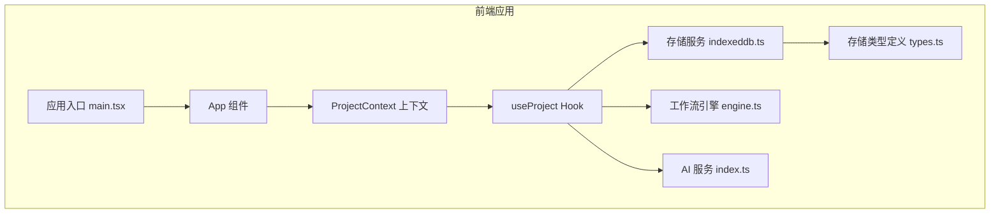
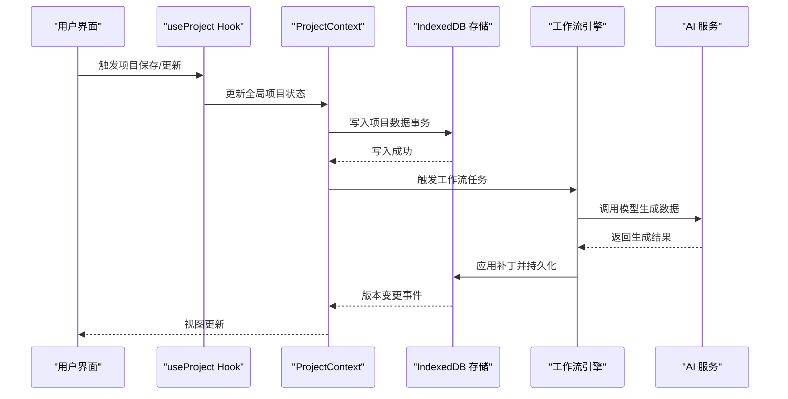
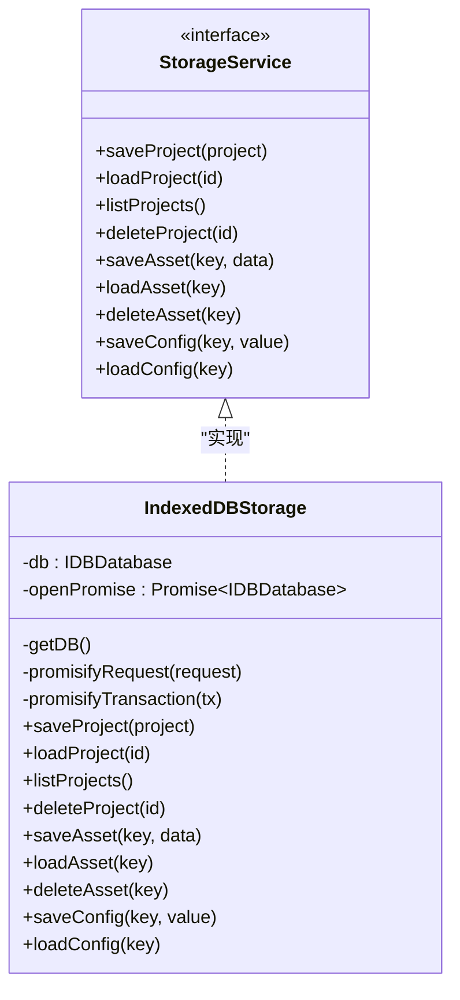
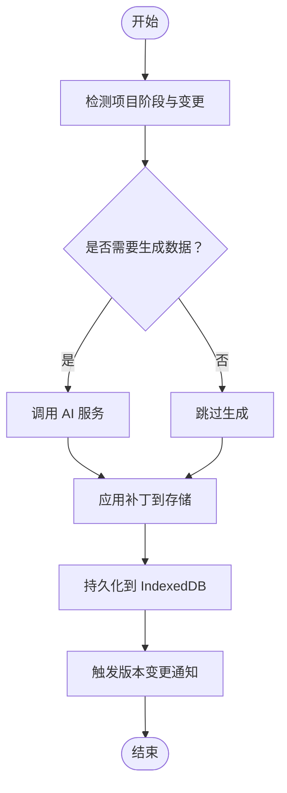
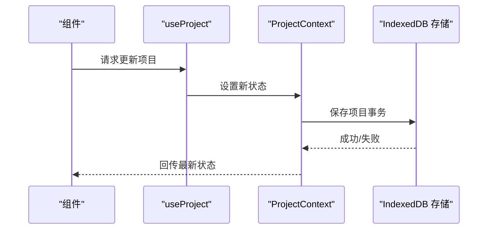
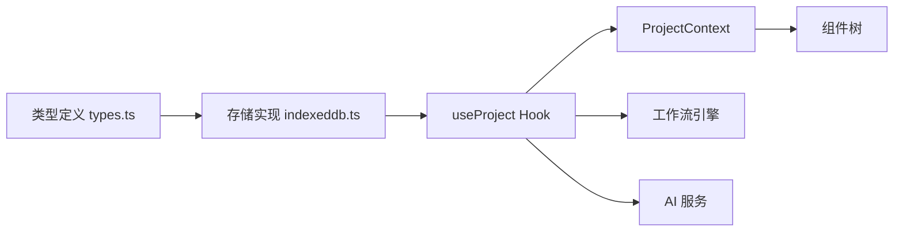

# 数据传输路由

<cite>
**本文档引用的文件**
- [package.json](file://package.json)
- [src/services/storage/index.ts](file://src/services/storage/index.ts)
- [src/services/storage/indexeddb.ts](file://src/services/storage/indexeddb.ts)
- [src/services/storage/types.ts](file://src/services/storage/types.ts)
- [src/services/ai/index.ts](file://src/services/ai/index.ts)
- [src/services/workflow/engine.ts](file://src/services/workflow/engine.ts)
- [src/shared/contexts/ProjectContext.tsx](file://src/shared/contexts/ProjectContext.tsx)
- [src/shared/hooks/useProject.ts](file://src/shared/hooks/useProject.ts)
- [src/main.tsx](file://src/main.tsx)
- [src/App.tsx](file://src/App.tsx)
</cite>

## 目录
1. [简介](#简介)
2. [项目结构](#项目结构)
3. [核心组件](#核心组件)
4. [架构总览](#架构总览)
5. [详细组件分析](#详细组件分析)
6. [依赖关系分析](#依赖关系分析)
7. [性能考虑](#性能考虑)
8. [故障排除指南](#故障排除指南)
9. [结论](#结论)
10. [附录](#附录)

## 简介
本文件围绕 AI Shotlive 的数据传输与路由能力进行系统化技术文档梳理，重点覆盖以下方面：
- 增量同步：基于项目摘要与变更时间戳的差异检测与增量拉取策略
- 数据补丁机制：以项目字段粒度的补丁生成、应用与冲突解决
- 跨设备数据传输：通过本地 IndexedDB 持久化与云端同步服务的协作
- 实时同步与离线处理：结合浏览器 IndexedDB 与前端状态管理的反馈闭环
- 数据一致性保证：通过事务封装、版本变更监听与幂等写入确保数据稳定
- 同步策略最佳实践：建议的补丁格式、传输协议与冲突解决策略

本项目当前主要在前端侧实现本地存储与工作流引擎，后端路由文件在现有仓库中未发现对应实现；因此本文档聚焦前端数据传输路由与存储层的设计与实践。

## 项目结构
项目采用前端单页应用架构，核心数据传输与路由能力由以下模块协同完成：
- 存储服务：基于 IndexedDB 的本地持久化，提供项目、资产与配置的统一访问接口
- 工作流引擎：负责项目各阶段任务的编排与执行
- AI 服务：提供模型调用与结果处理的抽象入口
- 上下文与 Hooks：提供项目状态的全局共享与响应式更新
- 应用入口：初始化上下文、加载资源并渲染主界面

**图表来源**
- [src/main.tsx](file://src/main.tsx)
- [src/App.tsx](file://src/App.tsx)
- [src/shared/contexts/ProjectContext.tsx](file://src/shared/contexts/ProjectContext.tsx)
- [src/shared/hooks/useProject.ts](file://src/shared/hooks/useProject.ts)
- [src/services/workflow/engine.ts](file://src/services/workflow/engine.ts)
- [src/services/ai/index.ts](file://src/services/ai/index.ts)
- [src/services/storage/indexeddb.ts](file://src/services/storage/indexeddb.ts)
- [src/services/storage/types.ts](file://src/services/storage/types.ts)

**章节来源**
- [package.json:1-26](file://package.json#L1-L26)
- [src/main.tsx](file://src/main.tsx)
- [src/App.tsx](file://src/App.tsx)

## 核心组件
- 存储服务（IndexedDB）：提供项目、资产、配置三类对象存储，支持读写事务与版本变更监听，确保数据一致与并发安全
- 工作流引擎：封装项目各阶段任务的执行顺序与依赖关系，作为数据变更的触发器与协调者
- AI 服务：抽象模型调用接口，作为数据生成与更新的来源之一
- 项目上下文与 Hooks：集中管理项目状态，驱动视图更新与数据同步
- 类型系统：定义项目摘要、存储接口与项目数据结构，确保跨模块契约清晰

**章节来源**
- [src/services/storage/indexeddb.ts:1-189](file://src/services/storage/indexeddb.ts#L1-L189)
- [src/services/storage/types.ts:1-30](file://src/services/storage/types.ts#L1-L30)
- [src/services/workflow/engine.ts](file://src/services/workflow/engine.ts)
- [src/services/ai/index.ts](file://src/services/ai/index.ts)
- [src/shared/contexts/ProjectContext.tsx](file://src/shared/contexts/ProjectContext.tsx)
- [src/shared/hooks/useProject.ts](file://src/shared/hooks/useProject.ts)

## 架构总览
前端数据传输路由采用“本地持久化 + 全局状态 + 工作流编排”的架构模式：
- 本地存储：IndexedDB 提供强一致的事务写入与版本变更通知，避免并发写入冲突
- 状态管理：ProjectContext 与 useProject Hook 将项目状态暴露给组件树，实现响应式更新
- 工作流：engine.ts 根据项目阶段与任务依赖，驱动数据生成、补丁计算与应用
- 同步策略：通过项目摘要列表与时间戳差异，实现增量同步与冲突检测

**图表来源**
- [src/shared/hooks/useProject.ts](file://src/shared/hooks/useProject.ts)
- [src/shared/contexts/ProjectContext.tsx](file://src/shared/contexts/ProjectContext.tsx)
- [src/services/storage/indexeddb.ts:103-109](file://src/services/storage/indexeddb.ts#L103-L109)
- [src/services/workflow/engine.ts](file://src/services/workflow/engine.ts)
- [src/services/ai/index.ts](file://src/services/ai/index.ts)

## 详细组件分析

### 存储服务（IndexedDB）分析
- 数据库与对象存储
  - 数据库名与版本：数据库名为固定常量，版本号用于迁移与升级
  - 对象存储：
    - projects：项目数据，键路径为 id，便于按项目 id 快速检索
    - assets：二进制资产，键值对存储 Blob
    - config：应用配置，键值对存储任意 JSON 可序列化数据
- 事务与错误处理
  - 所有写操作均通过只读或读写事务执行，并使用 Promise 包装请求与事务完成回调，确保异步流程可控
  - 版本变更监听：当其他标签页升级数据库版本时，主动关闭旧连接，避免锁库冲突
- 项目摘要与传输优化
  - 列表查询仅返回摘要字段（id、name、createdAt、updatedAt、currentPhase），避免传输完整项目对象，降低带宽与内存开销

**图表来源**
- [src/services/storage/types.ts:15-30](file://src/services/storage/types.ts#L15-L30)
- [src/services/storage/indexeddb.ts:23-189](file://src/services/storage/indexeddb.ts#L23-L189)

**章节来源**
- [src/services/storage/indexeddb.ts:1-189](file://src/services/storage/indexeddb.ts#L1-L189)
- [src/services/storage/types.ts:1-30](file://src/services/storage/types.ts#L1-L30)

### 工作流引擎分析
- 作用：根据项目阶段与任务依赖，组织数据生成、补丁计算与应用流程
- 与存储的交互：通过 Hook 访问全局状态，间接调用存储服务进行持久化
- 与 AI 服务的协作：在需要模型生成数据时，触发 AI 服务调用并将结果回写存储

**图表来源**
- [src/services/workflow/engine.ts](file://src/services/workflow/engine.ts)
- [src/services/ai/index.ts](file://src/services/ai/index.ts)
- [src/services/storage/indexeddb.ts:103-109](file://src/services/storage/indexeddb.ts#L103-L109)

**章节来源**
- [src/services/workflow/engine.ts](file://src/services/workflow/engine.ts)

### 项目上下文与 Hooks 分析
- ProjectContext：提供全局项目状态的 Provider，承载当前项目、历史记录与同步状态
- useProject：封装对项目状态的读取、更新与持久化调用，作为 UI 与存储之间的桥梁
- 与存储的耦合：通过 Hook 调用存储服务的保存与加载方法，确保状态变更可追溯且可恢复

**图表来源**
- [src/shared/contexts/ProjectContext.tsx](file://src/shared/contexts/ProjectContext.tsx)
- [src/shared/hooks/useProject.ts](file://src/shared/hooks/useProject.ts)
- [src/services/storage/indexeddb.ts:103-109](file://src/services/storage/indexeddb.ts#L103-L109)

**章节来源**
- [src/shared/contexts/ProjectContext.tsx](file://src/shared/contexts/ProjectContext.tsx)
- [src/shared/hooks/useProject.ts](file://src/shared/hooks/useProject.ts)

## 依赖关系分析
- 模块内聚与耦合
  - 存储服务与类型系统高内聚，通过接口约束实现解耦
  - 工作流引擎与 AI 服务通过 Hook 间接耦合，保持职责分离
  - 上下文与 Hooks 作为状态中心，向上游组件提供统一接口
- 外部依赖
  - 浏览器原生 IndexedDB API，无需额外运行时依赖
  - React 生态（Context、Hooks）用于状态管理与渲染优化

**图表来源**
- [src/services/storage/types.ts:1-30](file://src/services/storage/types.ts#L1-L30)
- [src/services/storage/indexeddb.ts:1-189](file://src/services/storage/indexeddb.ts#L1-L189)
- [src/shared/hooks/useProject.ts](file://src/shared/hooks/useProject.ts)
- [src/shared/contexts/ProjectContext.tsx](file://src/shared/contexts/ProjectContext.tsx)
- [src/services/workflow/engine.ts](file://src/services/workflow/engine.ts)
- [src/services/ai/index.ts](file://src/services/ai/index.ts)

**章节来源**
- [src/services/storage/types.ts:1-30](file://src/services/storage/types.ts#L1-L30)
- [src/services/storage/indexeddb.ts:1-189](file://src/services/storage/indexeddb.ts#L1-L189)

## 性能考虑
- 事务批量写入：所有写操作使用事务封装，减少多次往返与锁竞争
- 版本变更监听：在多标签页场景下自动关闭旧连接，避免阻塞与死锁
- 项目摘要传输：列表仅返回必要字段，降低网络与内存压力
- 异步 Promise 化：统一的请求与事务 Promise 化，简化错误处理与重试逻辑
- 状态最小化：通过 Hook 与 Context 仅在必要时更新状态，减少不必要的渲染

## 故障排除指南
- IndexedDB 打开失败
  - 现象：打开数据库时触发 onerror 或 onblocked
  - 排查：检查浏览器兼容性、权限与并发打开限制
  - 处理：捕获错误并提示用户重试或切换浏览器
- 事务失败或中止
  - 现象：事务 onerror 或 onabort 回调被触发
  - 排查：检查事务中的操作是否符合对象存储键规则
  - 处理：重试事务或回滚到上一个稳定状态
- 版本变更导致连接失效
  - 现象：数据库 onversionchange 回调触发，旧连接被关闭
  - 排查：确认是否存在其他标签页同时升级数据库
  - 处理：重新获取数据库连接并重试操作
- 项目摘要字段缺失
  - 现象：列表查询返回的摘要缺少字段
  - 排查：确认存储中项目对象的字段完整性
  - 处理：在保存时确保字段齐全，或在查询时进行默认值填充

**章节来源**
- [src/services/storage/indexeddb.ts:34-42](file://src/services/storage/indexeddb.ts#L34-L42)
- [src/services/storage/indexeddb.ts:94-98](file://src/services/storage/indexeddb.ts#L94-L98)
- [src/services/storage/indexeddb.ts:67-70](file://src/services/storage/indexeddb.ts#L67-L70)
- [src/services/storage/indexeddb.ts:126-132](file://src/services/storage/indexeddb.ts#L126-L132)

## 结论
本项目通过 IndexedDB 本地存储、React 状态管理与工作流引擎的组合，构建了可靠的前端数据传输路由体系。当前实现侧重于本地持久化与状态同步，后端路由与云端同步服务在现有仓库中尚未发现对应实现。建议后续扩展包括：
- 定义明确的数据补丁格式与传输协议
- 设计增量同步与冲突解决策略
- 实现跨设备的数据传输与一致性保障
- 建立后端路由与存储服务，完善端到端同步链路

## 附录

### 数据补丁机制设计建议
- 补丁格式
  - 字段级变更：包含变更类型（新增/修改/删除）、目标字段路径、新值与旧值
  - 时间戳与版本：每个补丁携带生成时间戳与版本号，用于排序与冲突检测
- 应用策略
  - 幂等写入：补丁应用前先校验版本号，避免覆盖新变更
  - 回滚机制：记录应用前快照，异常时可回滚至稳定状态
- 冲突解决
  - 优先级策略：基于时间戳与用户角色的优先级决定最终值
  - 合并策略：对于可合并字段（如数组、对象）采用深度合并算法

### 同步策略最佳实践
- 增量同步
  - 使用项目摘要列表与 updatedAt 差异判断变更范围
  - 分批传输：大项目分段上传，避免一次性写入造成阻塞
- 实时同步
  - 事件驱动：通过版本变更监听触发 UI 更新
  - 防抖重试：在网络波动时采用指数退避重试
- 离线处理
  - 本地队列：将待同步的补丁暂存本地，联网后批量提交
  - 离线标记：为每条补丁添加离线状态，确保恢复后可继续处理